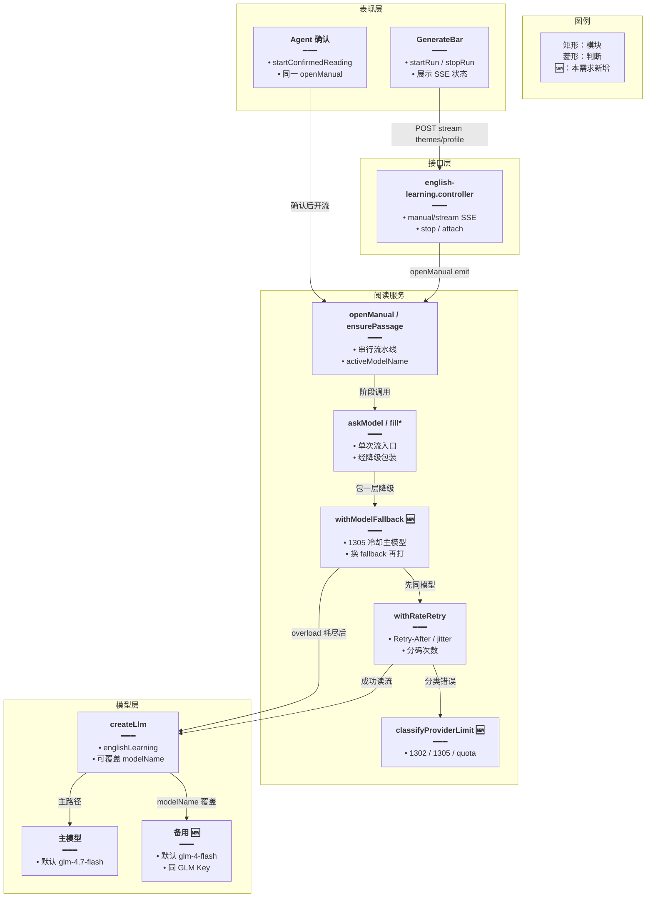
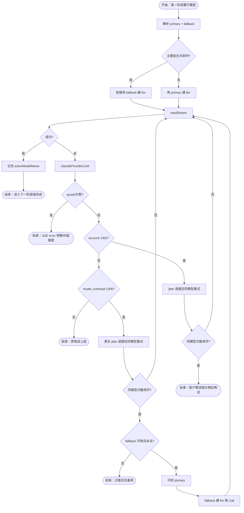
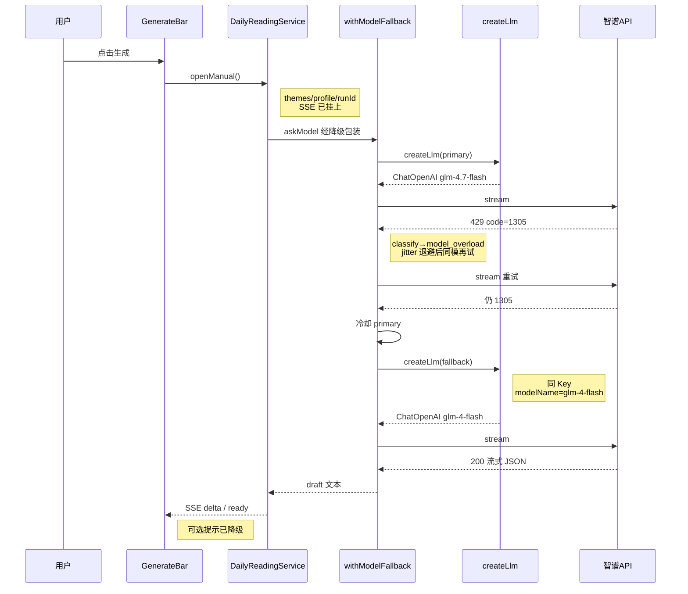
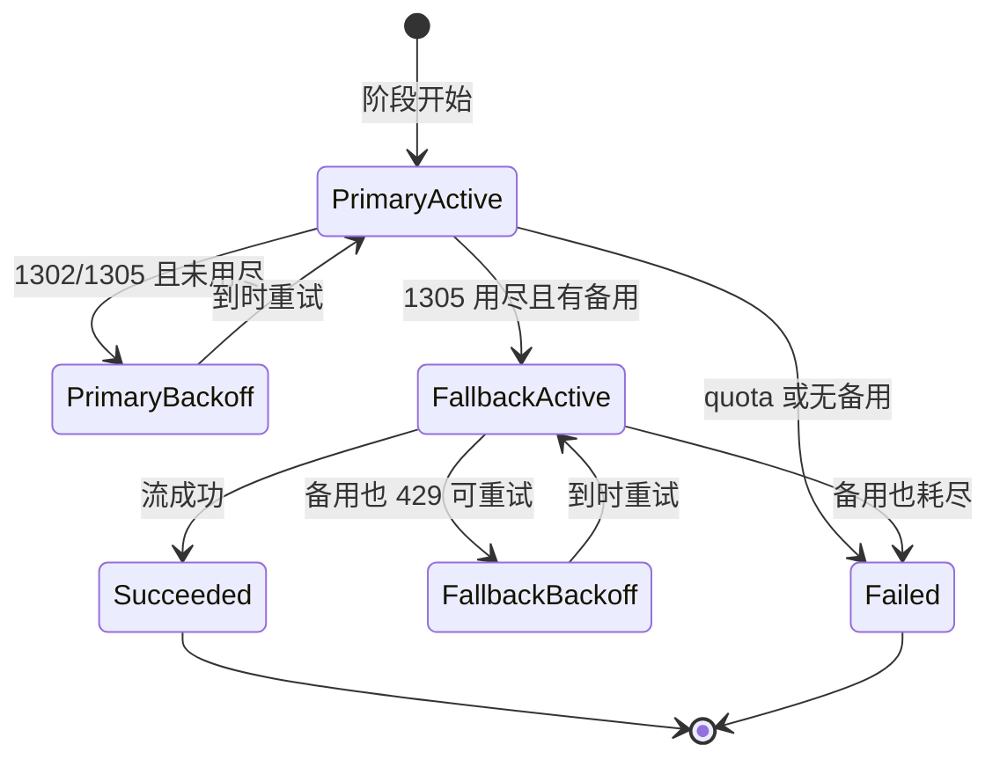

# 阅读模型过载降级 — 实现思路

> **状态**：M1 已落地（分类 + jitter + 同 Key flash 降级）；M2/M3 未做  
> **日期**：2026-11-03  
> **需求摘要**：非会员默认 `glm-4.7-flash` 生成每日阅读时，智谱返回 429「该模型当前访问量过大」（业务码 1305）导致生成失败；在保留现有串行与 `withRateRetry` 的前提下，区分账户限流与模型过载，退避仍失败则切备用模型，让手动/Agent/定时生成能尽量出合格短文。  
> **一句话方案（预告）**：在 `english-daily-reading.service` 把 429 拆成 1302/1305，同模型加 jitter 退避；**1305 耗尽后按模型冷却并降级到同 Key 的 `glm-4-flash`（可选再走硅基）**，不新建全站 LLM 网关。

## 延伸阅读

- [阅读限流重试.md](./阅读限流重试.md)（**已落地**）：同篇串行 + `withRateRetry`（2s/4s×3），主要针对账户级限流与释义批 continue
- [系统日推稳定生成.md](./系统日推稳定生成.md)（规划）：定时篇队列重试与后台补生成；本文只补「单次模型调用遇 1305 怎么活」
- 智谱官方：[速率限制](https://docs.bigmodel.cn/cn/api/rate-limit)、[错误码 1302/1305](https://docs.bigmodel.cn/cn/api/api-code)
- LangChain：[MODEL_RATE_LIMIT](https://docs.langchain.com/oss/javascript/langchain/errors/MODEL_RATE_LIMIT/)
- 业界参考：OpenAI/Vertex 退避与 `Retry-After`；TheRouter 对智谱 **模型级 429** 的「按模型冷却 + 第二条路由」

---

## 0. 读本文你将得到什么

- 要解决：用户看到「生成失败：429 该模型当前访问量过大」——这是智谱 **1305 平台/模型过载**，不是账户并发打满（1302），现有短退避经常仍失败。
- 选定方案：**分类错误码 → 加强退避 → 模型级冷却 → 同厂商 `glm-4-flash` 降级（可选硅基三级）**；落在每日阅读 Service，不另建网关。
- 主要改后端：`english-daily-reading.service.ts`（+ 小工具函数）；前端只改善失败文案/可感知「已切换备用模型」；env 增加可选 fallback 模型名。
- 分阶段：M1 分类+jitter+同 Key flash 降级；M2 SSE 提示与日志；M3 可选硅基三级与调用次数微调。
- 最大风险：降级后正文/释义风格略变；须保证废稿规则与 JSON 契约不变，并避免 nested retry 放大流量。

---

## 1. 需求与边界

### 1.1 用户故事

| 角色 | 场景 | 行为 | 期望结果 |
|------|------|------|----------|
| 非会员读者 | Settings「生成资源」，默认 `glm-4.7-flash` | 点生成，高峰期主模型 1305 | 短退避后自动换备用模型继续；尽量拿到 ready 篇，而不是立刻整单失败 |
| 同一读者 | 释义/附件阶段才 1305 | 正文已合格 | 与现网一致：正文可保留；附件/释义尽力补，不因主模型过载整单作废 |
| Agent 用户 | 确认后 `startConfirmedReading` | 同一 `openManual` | 与手动生成同一套过载策略 |
| 定时日更 | `ensurePassage` 无 userId，走 env `GLM_*` | 工人生成 | 同一套降级；队列层仍可按 [系统日推稳定生成](./系统日推稳定生成.md) 再试 |

### 1.2 范围

| 在范围内 | 不在范围内（非目标） |
|----------|----------------------|
| 每日阅读手动 / Agent / 定时 共用的 `askModel` / `finishReading` 出站调用 | 全站所有 `createLlm` 调用统一网关（聊天、OCR、知识库） |
| 区分 1302 vs 1305，并针对 1305 做模型降级 | 把短文+附件+释义重新合并成一次超大调用 |
| 同 Key 备用模型（默认 `glm-4-flash`）与可选硅基三级 | 购买更高智谱权益等级作为唯一方案 |
| SSE/日志标明「主模型过载已降级」 | 前端自建重试环（避免与后端 nested retry） |
| | 改废稿规则、预览事件名、落库形状 |

### 1.3 约束与依赖

- 须复用：`createLlm(preset: 'englishLearning')`、`LlmConfigService`、`withRateRetry` / `isRateLimit`、`openManual` / `ensurePassage` 流水线。
- 不得破坏：[阅读限流重试](./阅读限流重试.md) 已落地的「同篇串行、释义批 429 continue、停止即中断退避」。
- Ponytail：最短可工作路径；不先上 Redis token bucket / 全站 router。
- 体验底线：用户点击生成后，宁愿多等十几秒降级成功，也不要秒失败只甩 429 原文。

---

## 2. 背景

- **谁、在什么场景、卡在哪**：英语学习每日阅读「生成资源」（含 Agent 确认生成）。后端默认非会员链 `GLM_MODEL_NAME` / `DEFAULT_GLM_MODEL_NAME = glm-4.7-flash`。高峰期智谱返回 HTTP 429，文案「该模型当前访问量过大，请您稍后再试」，经 LangChain 标为 `MODEL_RATE_LIMIT`，前端展示「生成失败：429 …」。
- **现状缺口**：已有同篇串行与 `withRateRetry`（固定 2s→4s，最多 3 次），主要缓解 **账户级** 打满。对 **1305 模型侧公共过载**，短退避往往仍撞墙；**无备用模型、无模型级冷却、不解析业务码、无 jitter**。社区与网关实践均表明：`glm-4.7-flash` 高峰 1305 比例高，且限流是 **按模型**，不是按整账号把所有模型一起封死。
- **不解决会怎样**：非会员高峰生成经常整单失败；定时日更与手动互相抢同一 flash 池时放大；用户误以为「自己点太快」而无效降频。
- **硬约束**：继续走 `openManual` / `finishReading`；会员已走硅基主路径时不要无故切回过载 flash；停止信号在退避与降级间仍生效；不引入新 npm 依赖。

---

## 3. 现状与复用

| 能力 | 仓库中已有 | 本需求中的用法 |
|------|------------|----------------|
| 手动生成入口 | `GenerateBar` → `englishDailyReadingStore.startRun` → `POST .../manual/stream` | 直接复用；不新开 API |
| Agent 确认生成 | `startConfirmedReading` → `openManual` | 直接复用；共享降级逻辑 |
| 定时日更 | Bull `english-daily-reading` + `ensurePassage`（无 userId） | 扩展：同套 `withRateRetry`/降级；队列层另文 |
| 模型解析 | `createLlm` + `LlmConfigService.resolveSiliconFlowCredentials`；`preset: 'englishLearning'` | 扩展：降级时二次 `createLlm` 覆盖 `modelName`，不硬改用户设置页 |
| 默认模型 | `DEFAULT_GLM_MODEL_NAME = 'glm-4.7-flash'`；env `GLM_*` | 主路径不变；新增可选 `GLM_FALLBACK_MODEL_NAME`（默认 `glm-4-flash`） |
| 多阶段串行 | `askModel` → `completeExtras` → `completeWordGloss`；同篇一路在飞 | 直接复用；降级发生在「单次流」层，不改阶段顺序 |
| 429 退避 | `isRateLimit` + `withRateRetry`（2s/4s×3） | **扩展**：分码、jitter、1305 后切模型 |
| Flash 特殊逻辑 | `isFlashGlossModel`（预览拼接） | 直接复用；降级到 `glm-4-flash` 仍属 flash 族 |
| Agent decide「flash」注释 | 实为 `DECIDE_MODEL_NAME` 千问 | 不适用；勿与阅读主模型混谈 |
| 入站 HTTP 限流 | `main.ts` `express-rate-limit` | 不适用（管不到出站智谱） |
| 错误文案 | `agent.service` `formatAgentStreamError`；阅读 SSE `error` 帧 | 扩展阅读侧文案：区分过载/账户限流/已降级 |

**调研结论**：主痛点是 **1305 + 默认 `glm-4.7-flash` 高峰过载**，不是「还不会串行」。候选必须接上现有 `withRateRetry` 与 `createLlm`，而不是另写一条生成管线。账户级 1302 继续吃现有串行+退避；模型级 1305 必须加 **换路**。

### 3.1 市面成熟做法（调研摘要）

| 来源 | 做法 | 对本需求的启示 |
|------|------|----------------|
| 智谱官方 | 1302：降并发/排队；1305：稍后重试、拉长间隔、**业务允许则降级或延迟**；限流按 **模型独立并发** | 必须分码；1305 官方点名「降级」 |
| OpenAI / Vertex | `Retry-After` 优先；指数退避 + jitter；只重试瞬时类错误；封顶次数与总时长 | 加强现有 `withRateRetry`，加 jitter，读 header |
| 生产实践（Joinloop 等） | 客户端限流 → jitter 重试 → 有界队列反压 → fallback；电路断路器用于持续 5xx，**不宜把 429 当断路** | 阅读交互路径：重试+fallback；不要一 429 就熔断整账号 |
| TheRouter（智谱事件） | **模型级 429 只冷却该模型**；账号级才整号停；flash 系列加 **第二条路由** | 冷却作用域 = modelName；第二条路由 ≈ `glm-4-flash` / 硅基 |
| 社区实测 | `glm-4.7-flash` 高峰 1305 比例高；同账号其它模型仍可用；`glm-4-flash` 更稳适合高频 | 默认主模型可保留，但 **必须有同 Key 备用** |

---

## 4. 方案比对与最终方案

### 4.1 候选方案

#### 方案 A：只加强同模型退避（扩展现状）

- **做法**：在 `withRateRetry` 内解析业务码 / `Retry-After`，对 1305 用更长退避（如 2s→4s→8s→16s）+ full jitter，最多 5 次；仍只打 `createLlm` 解析出的主模型。
- **能工作的原因**：官方与 OpenAI 都要求 1305/429 先退避；现有钩子已在 `askModel`/`fillExtras`/`fillWordGloss`。
- **主要代价**：模型持续过载时（社区常见）用户干等更久仍失败；无换路则与官方「降级」建议未对齐。

#### 方案 B：分类退避 + 模型级冷却 + 同 Key flash 降级（可再加硅基）（扩展现状）

- **做法**：
  1. `classifyProviderLimit(err)` → `account`(1302) / `model_overload`(1305) / `quota` / `unknown_429`。
  2. 同模型：`Retry-After` 或指数退避 + jitter；次数与总时长封顶。
  3. **仅 `model_overload`**：主模型写入短冷却（进程内 Map，key=`provider:model`）；同一次逻辑调用改用 fallback 模型名再 `createLlm` 打一路。
  4. Fallback 默认 `glm-4-flash`（同 `GLM_*` Key）；env 可配；若配置了三级硅基且主路径本就是 GLM，可再试一次。
  5. 会员主路径已是硅基时：不强制切回 flash；硅基 429 另按其错误处理（本需求优先覆盖智谱 1305 文案）。
- **能工作的原因**：智谱限流按模型；同账号 `glm-4-flash` 常仍可用；TheRouter 已验证「模型冷却 + 第二路由」；阅读阶段已串行，不会双模型并发互抢。
- **主要代价**：降级后文风/质量略变；需防 nested retry；多一次凭证解析调用。

#### 方案 C：手动生成也进 Bull + 全站出站令牌桶（新增网关向）

- **做法**：手动 SSE 只入队；工人 `concurrency:1` 按 RPM 平滑出站；全站 `englishLearning` 共用 Redis 令牌桶；过载时延迟出队而非降级。
- **能工作的原因**：官方建议队列/并发池；定时篇已有 Bull。
- **主要代价**：手动交互变成「排队等待」，改动面含 store/SSE 语义；解决不了 **平台级 1305**（你再平滑，模型侧仍可拒）；复杂度远高于本痛点。

### 4.2 比对

| 维度 | 方案 A | 方案 B | 方案 C |
|------|--------|--------|--------|
| 正确性（失败路径、边界、数据是否会错） | 1302 更好；1305 持续过载仍整单失败 | 1305 有换路；须保证降级输出仍过 `rejectPassage`/JSON 解析 | 排队正确；1305 仍可能每岗都失败，只是失败更晚 |
| 复用 / 与现状契合 | 只改 `withRateRetry` | 复用串行+`createLlm`+现有退避钩子 | 复用定时 Bull，但手动链路要重塑 |
| 改动面 | `english-daily-reading.service.ts` 局部 | 同上 + 小分类/冷却 helper + 可选 env | Service + Processor + 前端等待态 + 可能 Redis |
| 复杂度 | 低 | 中（冷却 Map + fallback 一次） | 高（网关语义） |
| 体验 | 干等后仍可能失败 | 多数高峰可出篇；略慢、可能提示已降级 | 排队不确定时长；高峰仍可能失败 |
| 风险 | 惊群（无 jitter 时） | 降级质量；误把 1302 当 1305 换模型 | 交互语义变化大；回滚难 |
| 可维护性 | 一处函数 | 阅读域集中；M2 可抽共享 util | 横切全站，以后每次调模型都要懂网关 |

### 4.3 综合考量

本需求权重：**正确性（1305 真能出结果）> 体验 > 改动面/复杂度 > 远期扩展**。痛点文案已锁定为智谱 **1305**，方案 A 在官方与社区证据下对持续过载不够；方案 C 能治 1302 洪峰，却治不好「模型公共资源不够」，还破坏手动 SSE 即时感，Ponytail 不选。方案 B 对齐智谱「降级」与 TheRouter「模型冷却 + 第二路由」，且落在已串行的阅读链上，改动面可控。

**明确放弃**：方案 A「零新概念、只拉长等待」的简单性；方案 C「全站统一出站治理」的长期扩展性——二者都抵不过「高峰仍要出合格短文」这一条。

### 4.4 最终方案

#### 背景

非会员每日阅读默认 `glm-4.7-flash`，一次生成串行多阶段调用。已有 `withRateRetry` 对 429 短退避，但仍把所有 429 一视同仁，且无换模型。用户真实失败文案对应 **1305 模型过载**。硬约束：不破坏串行与停止语义，不新建全站网关，会员硅基主路径不被误降级回过载 flash。

#### 具体思路

1. **模块**：分类/冷却/带降级的重试放在阅读 Service（或同目录小 util）；`createLlm` 增加「显式 modelName 覆盖」调用方式（若已有则复用）。UI 仅消费 SSE 已有 `error`/`status` 类事件，可选加一行「已切换备用模型」。
2. **数据流**：每次 `readStream` 仍经统一入口；主模型失败分类 → 退避 →（仅 overload）冷却主模型 → fallback `createLlm` → 再读流；成功则后续阶段优先沿用本次选定的模型名（避免每阶段再撞冷却中的主模型）。
3. **状态**：进程内 `Map<string, number>` 记 `glm:glm-4.7-flash → cooldownUntil`；不进 DB/Redis（单机后端足够；多实例待确认）。
4. **关键边界**：停止/abort 不进入下一跳；quota/欠费类 429 **禁止**降级与空转重试；释义批 1305 降级失败仍 `continue` 下一批（沿用已落地行为）；短文阶段降级后仍走 `rejectPassage`，不合格可再写一次（计入废稿配额，不无限）。

#### 实现方案

**一句话**：分类 429 → jitter 退避 → 1305 冷却主模型并降级到同 Key `glm-4-flash`（可选硅基三级），挂在现有阅读出站钩子上。

| 步骤 | 谁 | 做什么 | 输入 → 输出 |
|------|----|--------|-------------|
| 1 | `classifyProviderLimit`（新增） | 从 err/cause 取 status、lc 码、智谱 `error.code` | err → `account` / `model_overload` / `quota` / `other` |
| 2 | `withRateRetry`（扩展） | 同模型重试：Prefer `Retry-After`，否则指数+jitter；quota 直接抛 | run + signal → T 或抛 |
| 3 | `withModelFallback`（新增） | 包住步骤 2；`model_overload` 耗尽则冷却主模型并换 fallback 再跑步骤 2 | primaryCreds + fallbackName + runFactory → T |
| 4 | `askModel` / `fillExtras` / `fillWordGloss` | 经步骤 3 取 llm；同一次 `executeManual` 记住 `activeModelName` | 与现网相同 IO |
| 5 | SSE emit（可选） | `status: degraded` 或 delta 旁路提示 | 前端展示「主模型繁忙，已用备用模型」 |
| 6 | env | `GLM_FALLBACK_MODEL_NAME` 默认 `glm-4-flash`；可选 `GLM_FALLBACK_SILICONFLOW=1` | 运维可调 |

#### 选定原因

1. **正确性**：1305 有换路，对齐官方与按模型限流事实。牺牲：同模型「只多等一会」的纯粹性。
2. **复用**：挂在已有串行与 `withRateRetry` 钩子。牺牲：不顺手做全站统一限流。
3. **改动面**：集中阅读 Service。牺牲：Agent 对话其它 429 暂不共享（可 M3 抽 util）。
4. **体验**：高峰可出篇。牺牲：偶发多等一轮 fallback 延迟、文风微变。
5. **风险**：冷却作用域限 model，避免 TheRouter 踩过的「一模型 429 冻整号」。牺牲：多实例冷却不同步（待确认）。
6. **可维护性**：阅读域可读。牺牲：方案 C 那种「一处治理全部出站」的远期整洁。

#### 优势

- 相对方案 A：持续 1305 时仍有机会成功，而不是拉长等待后同样失败。
- 相对方案 C：不改手动 SSE 交互语义，改动面小一个数量级，且真正针对模型过载而非只排队。

#### 怎么实现

1. 新增 `classifyProviderLimit` + 解析嵌套 cause / 智谱 JSON `code`。
2. 扩展 `withRateRetry`：jitter、`Retry-After`、按类调整次数；quota 不重试。
3. 新增 `withModelFallback`：主跑失败且为 `model_overload` → 写冷却 → `createLlm(..., { modelName: fallback })` 再跑。
4. `executeManual` / `ensurePassage` 级缓存 `activeModelName`，后段附件/释义复用，减少再撞主模型。
5. 日志：`primary` / `fallback` / `code` / `attempt`；SSE 可选 degraded。
6. 主要代码见 §9。

### 4.5 其他关键决策

#### 决策 1：Fallback 目标选谁

##### 候选

- **F1：同 Key `glm-4-flash`**：零额外成本；智谱按模型分立并发；社区认为更稳。
- **F2：硅基 `SILICONFLOW_*`（如现会员默认）**：另一供应商，彻底躲开智谱 flash 池；需 Key、可能计费、输出风格差更大。
- **F3：换默认主模型为 `glm-4-flash`，4.7 仅离线批**：从根减少 1305，但放弃 4.7 能力/上下文卖点，影响面大于「失败才降级」。

##### 比对（摘要）

| 维度 | F1 | F2 | F3 |
|------|----|----|-----|
| 正确性 | 高峰常能通 | 通，但契约/风格差需回归 | 主路径更稳，但非过载时也降能力 |
| 复用 | 同 `GLM_*` | 已有硅基解析 | 改默认常量/env |
| 改动面 | 小 | 中（权限/费用） | 小但产品决策大 |
| 体验 | 延迟+微变 | 可能更好也更贵 | 日常能力下降 |
| 风险 | 备用也过载 | 双供应商运维 | 产品预期变化 |

##### 综合与选定

选定 **F1 为主，F2 为可选三级（env 开关）**；**不选 F3 作为本需求主方案**（可另开产品讨论改默认模型）。放弃 F3「永远更稳」的优点，因未证实业务愿意放弃 4.7；放弃 F2 作为唯一二级，因非会员可能无硅基 Key。

##### 最终方案六块（本决策）

- **背景**：二级路由必须换「另一模型配额」，不能换同名。
- **具体思路**：fallback 名来自 env，默认 `glm-4-flash`；若与主模型同名则跳过降级直接失败；硅基三级仅当 `GLM_FALLBACK_SILICONFLOW=1` 且 Key 存在。
- **实现方案**：`resolveReadingModels(primary) → { primary, fallback, tertiary? }`。
- **选定原因**：正确性/成本/复用三维 F1 最优。
- **优势**：相对纯 F2 无强制费用；相对 F3 保留 4.7 主路径质量。
- **怎么实现**：见 §9.2 `resolveReadingModels`。

#### 决策 2：降级逻辑放阅读域还是 `createLlm` 全局

##### 候选

- **P1：仅阅读 Service**（选定 M1）
- **P2：`createLlm` / 共享 wrapper 全 preset 自动降级**

##### 比对要点

P2 改动面与误伤面大（OCR/decide 不该跟阅读同一套 flash 降级）。P1 对准痛点，M3 若 Agent 对话也要再抽 `withModelFallback` util。

**无其他会改变架构、数据流或状态归属的决策**（冷却 Map 为进程内实现细节，不改持久化归属）。

---

## 5. 架构图



**图内方法说明**：

| 方法 / 模块入口 | 功能 |
|-----------------|------|
| `startRun` / `GenerateBar` | 前端开手动 SSE；停止时 `stopRun` |
| `startConfirmedReading` | Agent 确认后进入同一 `openManual` |
| `openManual` / `ensurePassage` | 编排 claim→draft→finishReading；本需求增加记住 `activeModelName` |
| `askModel` / `fillExtras` / `fillWordGloss` | 各阶段单次模型流；改为经 `withModelFallback` |
| `withRateRetry` | 同模型有限次重试；扩展 jitter 与分码 |
| `withModelFallback` | 同模型重试耗尽且为 1305 时冷却并换备用模型再试 |
| `classifyProviderLimit` | 从异常树解析 1302/1305/quota |
| `createLlm` | 按 preset/用户凭证建 `ChatOpenAI`；降级时覆盖 `modelName` |

**读图要点**：UI/API 不改主契约；新增能力集中在阅读出站包装层；备用模型与主模型共享 `createLlm`，靠 modelName 分流以匹配智谱「按模型限流」。

---

## 6. 主流程图



**图内方法说明**：

| 方法 | 功能 |
|------|------|
| `resolveReadingModels` | 从 env/主凭证算出 primary/fallback，同名则视为无备用 |
| `classifyProviderLimit` | 判定 1302/1305/quota/other |
| `withRateRetry` | 同模型退避循环 |
| `withModelFallback` | 在同模型耗尽后触发冷却与换路 |
| `readStream` | 实际流式调用；abort 不重试 |

**读图要点**：入口是「单阶段一次流」不是整篇；1302 不换模型（降频即可）；1305 才换路；quota 立即失败避免空转烧费用。

---

## 7. 核心时序图



**图内方法说明**：

| 方法 | 功能 |
|------|------|
| `openManual()` | 占 ManualRun 并异步 `executeManual` |
| `askModel`（经包装） | 正文 JSON 阶段入口 |
| `withModelFallback` | 主备切换编排 |
| `createLlm` | 按凭证与 modelName 建客户端 |
| `classifyProviderLimit` | 识别 1305 以决定是否换路 |

**读图要点**：Happy path 含一次失败换路；前端仍只认 SSE；备用与主模型共用 Key，换的是模型名。

---

## 8. （可选）状态机



**图内方法说明**：

| 方法 | 功能 |
|------|------|
| `withModelFallback` | 驱动 Primary* ↔ Fallback* 迁移 |
| `isRateLimit` / `classifyProviderLimit` | guard：是否可进入 Backoff / Fallback |

---

## 9. 具体实现（主链路代码）

### 9.1 模块一览

| 模块 | 职责 | 新增/改动 | 预估路径 |
|------|------|-----------|----------|
| 限流分类与退避 | 分码、jitter、Retry-After | 扩展/新增 | `apps/backend/src/services/english-learning/english-daily-reading.service.ts`（或旁路 `reading-llm-limit.ts`） |
| 模型降级 | 冷却 + fallback createLlm | 新增 | 同上 |
| 凭证 | modelName 覆盖 | 扩展 | `apps/backend/src/utils/create-llm.ts`（若尚不支持显式覆盖） |
| 配置 | fallback 模型名 | 扩展 | `apps/backend/src/enum/config.enum.ts` + `.env` |
| 前端文案 | 过载/已降级提示 | 可选扩展 | `apps/frontend/src/i18n/locales/*/englishLearning.ts` + store 消费 |

### 9.2 主链路实现

```typescript
// 对应 §4.4 步骤 1。把所有 429 拆开，避免 1305 还按账户限流只短睡两下
type LimitKind = 'account' | 'model_overload' | 'quota' | 'other';

// 对应 §4.4 步骤 1。从 LangChain / 智谱嵌套 cause 里取出业务码，文案只作辅助
function classifyProviderLimit(err: unknown, depth = 0): LimitKind {
	// 深度封顶防止循环 cause 把栈打爆
	if (!err || typeof err !== 'object' || depth > 4) return 'other';
	const o = err as {
		status?: number;
		lc_error_code?: string;
		code?: string | number;
		error?: { code?: string | number; message?: string };
		message?: string;
		cause?: unknown;
	};
	// 欠费/额度类绝不能降级重试，否则空转烧费用或误导用户
	const code = String(o.code ?? o.error?.code ?? '');
	if (code === '1113' || code === '1308' || code === '1310') return 'quota';
	// 智谱账户并发/频率：只降频，不换模型
	if (code === '1302') return 'account';
	// 智谱模型公共过载：这才是本需求要换路的主因
	if (code === '1305') return 'model_overload';
	// LangChain 统一码时再看文案，区分「访问量过大」与「账户速率」
	if (o.status === 429 || o.lc_error_code === 'MODEL_RATE_LIMIT') {
		const msg = String(o.message ?? o.error?.message ?? '');
		if (/访问量过大|overloaded|capacity/i.test(msg)) return 'model_overload';
		if (/账户.*速率|rate limit|slow_down/i.test(msg)) return 'account';
		// 分不清时按 overload 保守处理：允许后续走 fallback，避免干等
		return 'model_overload';
	}
	return classifyProviderLimit(o.cause, depth + 1);
}

// 对应 §4.4 步骤 6 / 决策 F1。主备同名则视为没有备用，避免无效自调用
function resolveReadingModels(primaryName: string): {
	primary: string;
	fallback: string | null;
} {
	// 运维可改备用名；默认 glm-4-flash 与主模型分属不同并发池
	const fallback =
		(process.env.GLM_FALLBACK_MODEL_NAME || 'glm-4-flash').trim() ||
		'glm-4-flash';
	// 裸名比一下，防止配置成同一个 4.7 还自以为降级了
	const bare = (s: string) => s.split('/').pop() || s;
	if (bare(fallback) === bare(primaryName)) return { primary: primaryName, fallback: null };
	return { primary: primaryName, fallback };
}

// 对应 §4.4 步骤 2。同模型重试：优先 Retry-After，否则指数 + full jitter
async function withRateRetry<T>(
	run: () => Promise<T>,
	opts: { signal?: AbortSignal; kindHint?: LimitKind; maxAttempts?: number },
): Promise<T> {
	// overload 多给两次机会；account 保持短重试，避免占死 SSE
	const max = opts.maxAttempts ?? (opts.kindHint === 'model_overload' ? 4 : 3);
	let lastKind: LimitKind = 'other';
	for (let attempt = 0; attempt < max; attempt += 1) {
		try {
			return await run();
		} catch (err) {
			lastKind = classifyProviderLimit(err);
			// 额度问题与非限流错误立刻抛，不再睡眠
			if (lastKind === 'quota' || lastKind === 'other') throw err;
			if (opts.signal?.aborted || attempt === max - 1) throw err;
			// 若供应商给了 Retry-After，把它当下限，避免自作聪明睡太短
			const retryAfterMs = readRetryAfterMs(err);
			const base = retryAfterMs ?? 2000 * 2 ** attempt;
			// full jitter 打散多用户同时惊群
			const delay = Math.floor(Math.random() * base);
			await wait(Math.max(500, delay), opts.signal);
		}
	}
	throw new Error(`rate limit:${lastKind}`);
}

// 对应 §4.4 步骤 3。只有 model_overload 才换路；account 用尽直接失败
async function withModelFallback<T>(input: {
	primaryModel: string;
	fallbackModel: string | null;
	signal?: AbortSignal;
	coolUntil: Map<string, number>;
	runWithModel: (modelName: string) => Promise<T>;
}): Promise<{ value: T; modelName: string }> {
	const now = Date.now();
	// 主模型冷却未到期则跳过无效撞击，直接走备用
	const cooled = (input.coolUntil.get(input.primaryModel) ?? 0) > now;
	const first = cooled && input.fallbackModel ? input.fallbackModel : input.primaryModel;
	try {
		const value = await withRateRetry(() => input.runWithModel(first), {
			signal: input.signal,
			kindHint: cooled ? 'model_overload' : undefined,
		});
		return { value, modelName: first };
	} catch (err) {
		const kind = classifyProviderLimit(err);
		// 仅过载且尚未用过备用时换路；账户限流换模型帮不上忙
		if (
			kind !== 'model_overload' ||
			!input.fallbackModel ||
			first === input.fallbackModel
		) {
			throw err;
		}
		// 15s 冷却主模型，与 TheRouter 量级接近；有 Retry-After 时可再拉长
		input.coolUntil.set(input.primaryModel, now + 15_000);
		const value = await withRateRetry(
			() => input.runWithModel(input.fallbackModel!),
			{ signal: input.signal, kindHint: 'model_overload' },
		);
		return { value, modelName: input.fallbackModel };
	}
}
```

```typescript
// 对应 §4.4 步骤 4。askModel 经降级包装；同一次 run 把 activeModelName 传给后段
private async askModel(/* 现有参数 */): Promise</* 现有返回 */> {
	// 先按用户/会员规则解析出主模型名，再算备用，避免会员被拽回过载 flash
	const creds = await this.llmConfigService.resolveSiliconFlowCredentials(
		/* userId / englishLearning 现有参数 */,
	);
	const models = resolveReadingModels(creds.modelName);
	const { value: text, modelName } = await withModelFallback({
		primaryModel: models.primary,
		fallbackModel: models.fallback,
		signal,
		coolUntil: this.modelCoolUntil,
		runWithModel: async (modelName) => {
			// 显式覆盖 modelName，其它凭证不变，保证仍是同一账户下的另一模型池
			const llm = await createLlm(/* preset englishLearning */, {
				modelName,
				/* 其余与现网 askModel 相同 */,
			});
			return this.readStream(llm, messages, signal, onDelta, onUsage);
		},
	});
	// 供 finishReading 复用，减少后段再撞冷却中的 4.7
	opts?.onModel?.(modelName);
	// 后续 parsePassageJson / rejectPassage 与现网一致
	return parseAsToday(text, modelName);
}
```

### 9.3 数据模型

| 字段/实体 | 来源 | 存储 | 说明 |
|-----------|------|------|------|
| `modelCoolUntil` | 本进程 | 内存 `Map` | key=`modelName`，value=冷却到期 ms |
| `activeModelName` | 本次 run | ManualRun / 局部变量 | 后段附件释义优先 |
| `GLM_FALLBACK_MODEL_NAME` | env | 配置 | 默认 `glm-4-flash` |
| SSE `degraded`（可选） | 服务端 emit | 瞬时 | 前端提示用，不落库 |

---

## 10. 分阶段实现步骤

| 阶段 | 目标 | 交付物 | 依赖 |
|------|------|--------|------|
| M1 | 1305 可降级出短文 | 分类 + jitter + `withModelFallback` + askModel 接通 | 无 |
| M2 | 可观测与后段复用 | `activeModelName` 贯穿 finishReading；日志/SSE degraded；i18n | M1 |
| M3 | 可选三级与收敛 | env 硅基三级；抽 `reading-llm-limit.ts`；评估是否降低默认主模型 | M2 |

### M1

- [x] 实现 `classifyProviderLimit`（含 cause 与 1302/1305/quota）→ `reading-llm-limit.ts`
- [x] 扩展 `withRateRetry`：jitter、`Retry-After`、分码次数
- [x] 实现 `withModelFallback` + 进程内冷却 Map
- [x] `askModel` / `fillExtras` / `fillWordGloss` 经 `callReadingStream` 接通；`maxRetries: 0`
- [x] 停止信号在退避中仍中断（沿用 `wait` + AbortSignal）

### M2

- [ ] `fillExtras` / `fillWordGloss` 复用 `activeModelName`
- [ ] SSE 或日志暴露 `degraded`；前端文案区分账户限流 vs 模型过载
- [ ] 定时 `ensurePassage` 走同一包装（无 userId 仍用 GLM 链）

### M3

- [ ] 可选 `GLM_FALLBACK_SILICONFLOW`
- [ ] 将 helper 抽到独立文件供其它英语生成复用（仅在有第二痛点时）
- [ ] 产品评估是否改默认主模型（另决策，默认不做）

---

## 11. 风险、边界与待确认

| 项 | 等级 | 说明 | 缓解 |
|----|------|------|------|
| 备用模型也 1305 | 中 | 双 flash 同时过载 | 有界失败 + 清晰文案；可选硅基三级 |
| 降级文风/废稿率 | 中 | flash 质量差触发 rewrite | 保持现有 `rejectPassage` 一次重写配额 |
| nested retry | 中 | LangChain SDK 自带重试 × 业务重试 | 查 ChatOpenAI 重试配置，业务侧封顶总次数 |
| 多实例冷却不同步 | 低 | 每进程各自冷却 | 单机可接受；要跨实例再上 Redis（待确认） |
| 误伤会员硅基主路径 | 中 | 错误地把 SF 用户降回 GLM flash | `resolveReadingModels` 仅当 primary 属智谱 flash 族才启用 GLM fallback |
| 前端重复重试 | 低 | 用户连点 | 现有同用户 ManualRun 占位已挡 |

**待确认**：

- [ ] 生产 `.env` 是否已设 `GLM_MODEL_NAME` 非默认（验证：读部署配置）
- [ ] `createLlm` 是否已支持显式 `modelName` 覆盖而不改用户设置页快照（验证：读 `create-llm.ts` 调用签名并写一单测/自检）
- [ ] 智谱 429 响应是否稳定带回 `error.code` 与 `Retry-After`（验证：打一次过载日志打印 headers/body）
- [ ] 多后端实例是否要用 Redis 共享冷却（验证：看部署拓扑；单实例则 YAGNI）

---

## 12. 验收清单

| # | 用例 | 步骤 | 期望 |
|---|------|------|------|
| AC1 | 主模型 1305 后降级成功 | 模拟 primary 两次 1305，fallback 200 | 短文 ready；日志含 fallback 模型名 |
| AC2 | 账户 1302 不换模型 | 模拟 1302 | 仅同模型退避；不调用 fallback |
| AC3 | quota 不重试 | 模拟 1113/1308 | 立即 SSE error，无睡眠无降级 |
| AC4 | 停止中断退避 | 进入退避后点停止 | 不发起下一跳请求；状态 stopped |
| AC5 | 释义批过载 | 正文成功，释义 1305 | 尝试降级；仍失败则 continue 下一批，正文保留 |
| AC6 | 冷却跳过主模型 | 主模型冷却未到期开启新阶段 | 直接 fallback，不再撞 primary |
| AC7 | Agent/定时同策略 | Agent 确认生成与 `ensurePassage` 各跑一次过载模拟 | 与手动同一套分类/降级 |

---

## 13. 预估改动面（实现阶段参考）

| 类型 | 路径（预估） |
|------|--------------|
| 后端 | `apps/backend/src/services/english-learning/english-daily-reading.service.ts`；可选 `reading-llm-limit.ts`；`create-llm.ts` / `config.enum.ts` |
| 前端 | `englishDailyReading` store 状态文案；`i18n/.../englishLearning.ts`（可选） |
| 文档（实现后） | `remote-docs/wiki/english/` 正式专题；本文保持规划或改状态为已落地 |

---

（本文档为规划态实现思路；落地后以源码与 remote-docs wiki 专题为准）
