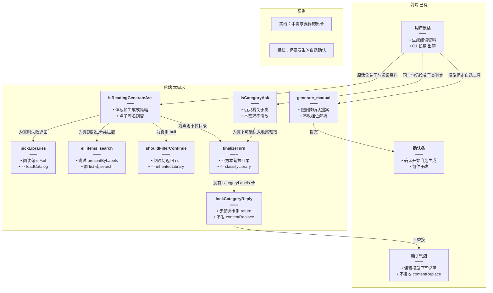
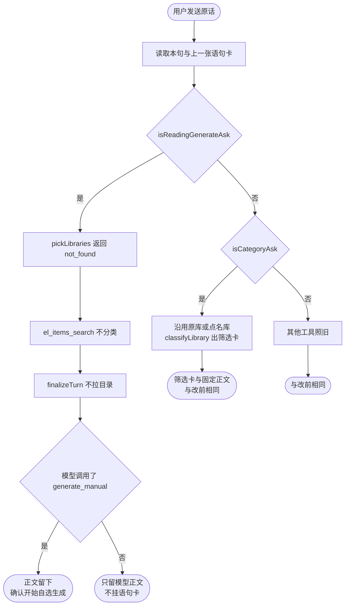
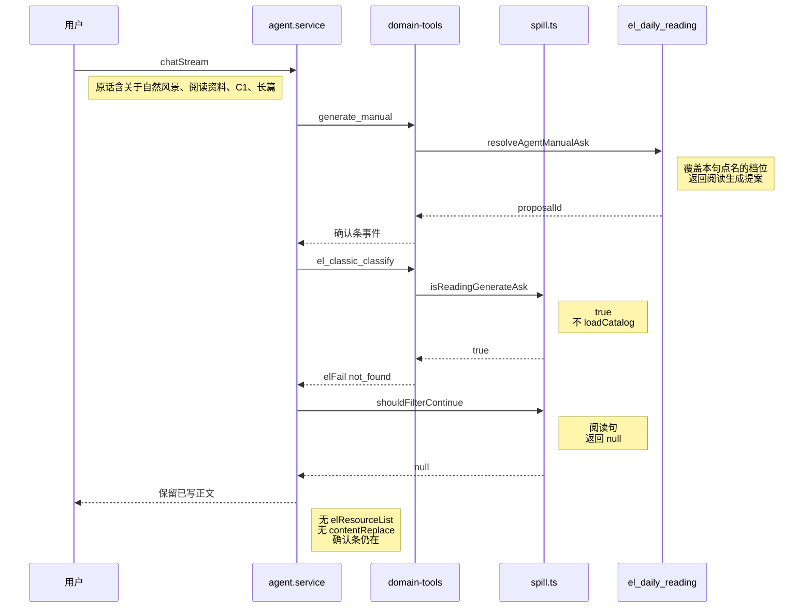
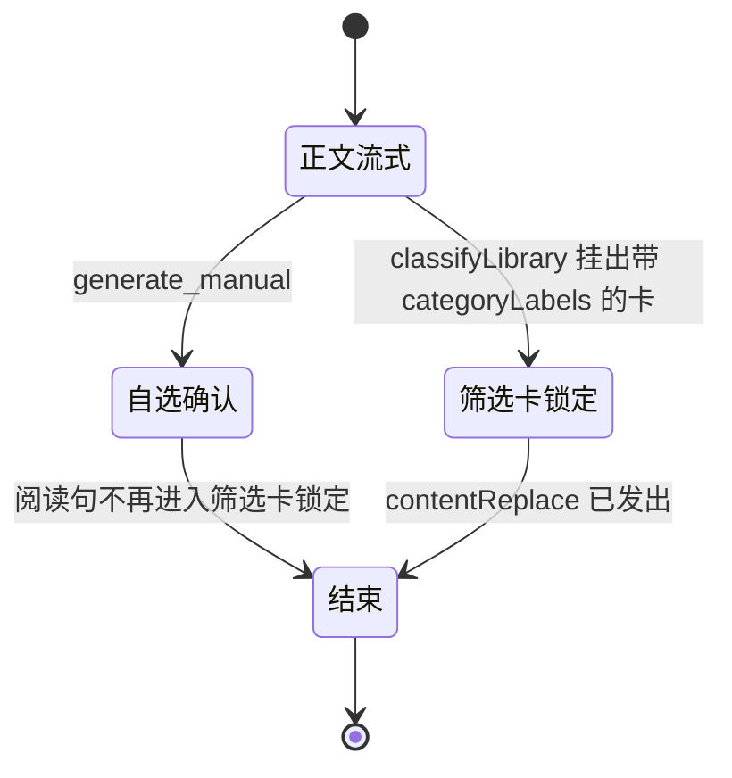

# 阅读生成不误分类 — 实现思路

> **状态**：规划（工作区已按本文落地）  
> **日期**：2026-10-29  
> **需求摘要**：用户要生成一篇自选阅读时，不挂上一本语句库的空筛选卡，也不把已经写好的生成说明换成「没有可展示的行。」  
> **一句话方案（预告）**：用同步短语认出阅读生成句，只在继承语句库和挂筛选卡的入口返回，自选确认条与真正的关于类分类保持原样。

## 延伸阅读

- [语句分类稳定出卡](./语句分类稳定出卡.md)：筛选卡的 `filtered`、固定正文「库名：共 n 条。」、空结果也锁正文
- [续问沿用原库](./续问沿用原库.md)：短续问沿用上一本库；本篇只把阅读生成句排除出这条继承
- [Agent自选认配置](./Agent自选认配置.md)：`generate_manual` 挂「确认开始自选生成」，档位解析不在本篇改动范围

---

## 0. 读本文你将得到什么

- 主题里的「关于」会把自选阅读误判成语句库分类，并沿用会话里上一张语句卡的库
- 选定方案：同步短语 `isReadingGenerateAsk`，只挡继承和出卡，不改 `isCategoryAsk`
- 改动在后端 `spill.ts`、`domain-tools.ts`、`agent.service.ts`；前端确认条和卡片组件不动
- 一个阶段即可落地：四个入口同一句判定
- 最大风险是短语漏判或误伤「生成语句库里关于…的句子」；后者用库名词汇排除

---

## 1. 需求与边界

### 1.1 用户故事

| 角色 | 场景 | 行为 | 期望结果 |
|------|------|------|----------|
| 英语学习用户 | 本会话刚看过「小学三年级上册」语句卡 | 说「帮我生成一份关于自然风景的阅读资料，C1，长篇，带单词与语法，要出题」 | 只保留自选生成说明和「确认开始自选生成」；不出现三年级空卡 |
| 同一用户 | 点名语句库或接着问「我还需要关于家庭的」 | 分类 | 仍沿用原库，出筛选卡，正文仍是「库名：共 n 条。」 |
| 同一用户 | 连续几张分类卡后说「讲这些进行收藏」 | 收藏 | 仍合并连续分类卡，阅读生成句不改变这条规则 |

### 1.2 范围

| 在范围内 | 不在范围内（非目标） |
|----------|----------------------|
| 认出阅读生成句，并挡住沿用库、挂空筛选卡、`contentReplace` 盖掉正文 | 改自选档位解析、`generate_manual` 确认文案、日推生成 |
| 四个会继承或出卡的入口使用同一判定 | 改 `isCategoryAsk` 的「关于 / 有关」口径 |
| 句中点了语句库或词汇库时仍走分类 | 为「自然风景」或某个年级写死词表；改分类模型提示词 |
| | 前端 `ResourceListBlock`、确认条组件 |

### 1.3 约束与依赖

- 复用已有 `generate_manual`、`categoryReply`、`inheritedLibrary`、`classifyLibrary`。阅读生成不新增表、不新增确认条类型。
- 判定必须同步完成，不能为了认阅读再调一次 `decide()`。
- 真正的关于类（含「我还需要关于家庭的」）的继承、空结果锁定正文、收藏「这些」往回走，行为保持不变。
- 收藏往回走看的是 `isCategoryAsk`，所以本判定不能折进 `isCategoryAsk`。

---

## 2. 背景

- **谁、在什么场景、卡在哪**：用户在已经出过「小学三年级上册」语句卡的会话里，要求生成 C1 长篇阅读。气泡先写出生成要求，随后被换成「小学三年级上册：没有可展示的行。」，下面挂一张 0 条的筛选卡。确认条「确认开始自选生成」本身是对的。
- **现状缺口**：`categoryLabels` 会从「关于自然风景的…」抽出「自然风景」。`isCategoryAsk` 见到「关于」即为真。当前句没有库名时，`inheritedLibrary` 用上一张语句卡的标题对上三年级上册。`classifyLibrary` 对这本库筛「自然风景」得到确认空结果。带 `categoryLabels` 的空筛选卡触发 `lockCategoryReply`，`contentReplace` 盖掉模型已经写好的说明。
- **不解决会怎样**：同一会话里，任何「关于某主题」的阅读生成都会套上最近一本语句库或词汇库；主题在那本库里没有命中时，用户看到空卡，已写的档位说明丢失。
- **硬约束**：不能把短续问「我还需要关于家庭的」挡掉；不能关掉筛选卡的固定正文；不能改自选确认条；不能按「家庭 / 风景」维护词表。

---

## 3. 现状与复用

| 能力 | 仓库中已有 | 本需求中的用法 |
|------|------------|----------------|
| 关于类判定 | `apps/backend/src/services/agent/tools/english/spill.ts` `isCategoryAsk` | 保持原样。阅读句仍然含「关于」，收藏回扫继续认它 |
| 类别名 | 同文件 `categoryLabels` | 不改。阅读句仍能抽出「自然风景」，但出卡入口不再使用它 |
| 沿用上一本库 | 同文件 `inheritedLibrary`、`shouldFilterContinue`、`inheritedKind` | 扩展 `shouldFilterContinue`：阅读生成直接返回 null |
| 分类工具选库 | `domain-tools.ts` `pickLibraries`（`el_classic_classify` / `el_vocab_classify`） | 阅读生成在 `loadCatalog` 之前 `elFail` |
| 带库 id 的取词 | 同文件 `el_items_search` 在 `list`/`search` 且 `isCategoryAsk` 时调用 `presentByLabels` | 加上阅读生成排除 |
| 流结束后兜底出卡 | `agent.service.ts` `finalizeTurn`：未出卡且关于类时拉目录，再 `shouldFilterContinue` + `classifyLibrary` | 拉目录前排除阅读生成；`shouldFilterContinue` 再挡一层 |
| 固定正文 | `domain-tools.ts` `categoryReply`；`agent.service.ts` `lockCategoryReply` 发 `contentReplace` | 直接复用。没有带 `categoryLabels` 的筛选卡时，它返回 null，正文不被替换 |
| 自选生成确认 | `domain-tools.ts` `el_daily_reading` 的 `generate_manual`；`resolveAgentManualAsk` | 直接复用。本需求不解析 C1 / 长篇 / 出题 |
| 前端空卡 | `ResourceListBlock.tsx`：`filtered` 且 `items` 为空时显示「没有匹配的条目」 | 不适用。服务端不再挂这张卡 |

**调研结论**：误卡不是前端画错，也不是自选确认条认错。三个服务端入口都能在「关于」成立且当前句没有库名时继承上一张卡：工具 `pickLibraries`、工具 `el_items_search`、`finalizeTurn`。空卡一旦带上 `categoryLabels`，现有 `categoryReply` 就会替换正文。阅读侧没有现成的同步「这是生成阅读」函数；`parseReadingOverride` 负责档位，不负责拦住分类。

---

## 4. 方案比对与最终方案

### 4.1 候选方案

#### 方案 A：收窄 `isCategoryAsk`（扩展现有判定）

- **做法**：`isCategoryAsk` 改为必须同时出现「语句库 / 语料库 / 找出 / 列出」之一，「关于」单独不够。短续问「我还需要关于家庭的」在 `shouldFilterContinue` 里另加白名单：上一句或上一张卡已经定了库，且本句没有阅读资料、长篇、生成。
- **能工作的原因**：用户原话不再进入 `pickLibraries`、`el_items_search` 拦截和 `finalizeTurn`。空卡不会挂，`categoryReply` 没有输入，正文留下。短续问靠白名单仍能 `inheritedLibrary`。
- **主要代价**：`isCategoryAsk` 的所有调用方一起变口径。`quoteThreadAssistantIndexes` 用它决定收藏「这些」能不能继续往前并卡；白名单要和阅读短语各写一套，两处规则容易漂移。

#### 方案 B：同步短语只挡继承和出卡（新增判定，扩展四个入口）

- **做法**：在 `spill.ts` 新增 `isReadingGenerateAsk`。命中且句中没有语句库、语料库、词汇库、单词库、词库时：`shouldFilterContinue` 返回 null；`pickLibraries` 在拉目录前返回 `elFail('not_found')`；`el_items_search` 的分类拦截跳过；`finalizeTurn` 不为本句拉目录。`isCategoryAsk`、`categoryReply`、`generate_manual` 不改。
- **能工作的原因**：三个会挂筛选卡的入口都先看到这句是阅读生成。没有带 `categoryLabels` 的卡，`lockCategoryReply` 自然不发 `contentReplace`。`generate_manual` 仍挂「确认开始自选生成」。
- **主要代价**：判定是短语，不是模型。没写出「阅读资料 / 短文 / 文章 / 长文 / 长篇」的生成句不会被挡住。四个入口都要调用，漏一处仍会出卡。

#### 方案 C：确认条出现后只停正文替换（扩展 `lockCategoryReply`）

- **做法**：`generate_manual` 成功后在 `elSurface` 记 `readingProposal: true`。`lockCategoryReply` 看到这个标记就 return，不发 `contentReplace`。分类工具和 `finalizeTurn` 仍按现在的继承去 `classifyLibrary`。
- **能工作的原因**：模型已经写的档位说明不会被「没有可展示的行。」盖掉。确认条逻辑不用改。
- **主要代价**：空筛选卡仍会通过 `elResourceList` 推到前端。用户圈出的「小学三年级上册 0 条」还在。若模型先调了分类工具、还没调 `generate_manual`，标记来不及，正文仍会被替换。

### 4.2 比对

| 维度 | 方案 A | 方案 B | 方案 C |
|------|--------|--------|--------|
| 正确性（失败路径、边界、数据是否会错） | 阅读句不出卡。短续问依赖另一套白名单，漏写就会不出家庭卡 | 四个入口都不继承、不出卡。句中点了库名仍分类。短语外的生成句仍可能出卡 | 正文多半能留下。空卡仍出。分类工具若早于确认条，正文仍被替换 |
| 复用 / 与现状契合 | 复用 `inheritedLibrary`，但改写 `isCategoryAsk` 这个共用谓词 | 复用 `categoryReply`、`generate_manual`、`inheritedLibrary`；只在出卡前加判断 | 复用出卡全流程，只改锁正文 |
| 改动面（要动哪些路径） | `isCategoryAsk` 及其收藏回扫、全库分类快路径、三个出卡入口的续问白名单 | `spill.ts` 一个函数，加上 `shouldFilterContinue`、`pickLibraries`、`el_items_search`、`finalizeTurn` 各一行条件 | `el_daily_reading` 写标记，`lockCategoryReply` 读标记 |
| 复杂度（新概念、新状态、新依赖） | 无新状态。两套「算不算关于类」 | 无新状态、无新请求。一个同步函数 | `elSurface` 增加本轮标记 |
| 体验（延迟、步骤数、失败时用户看到什么） | 无额外模型延迟。续问白名单写错时，家庭续问不出卡 | 无额外延迟。命中时只剩自选说明和确认条 | 无额外延迟。用户仍看到 0 条语句卡 |
| 风险（迁移、互斥、并发、回滚） | 收藏「这些」的回扫边界跟着变 | 短语过宽会放过本应分类的句子；过窄会放过漏写体裁的生成句。库名词排除挡住「生成语句库里关于家庭的句子」 | 与 [语句分类稳定出卡](./语句分类稳定出卡.md) 的锁正文互斥：有确认条时筛选卡不再锁，若误挂卡，正文和卡片会不一致 |
| 可维护性（以后改一处还是改多处） | 口径在 `isCategoryAsk` 一处，续问例外在另一处 | 短语在一处，调用点四处，漏调用会复发 | 标记和锁各一处，出卡路径不用改，但空卡问题还在 |

### 4.3 综合考量

正确性和「不碰分类 / 收藏 / 确认条」权重大。用户同时指出空卡和被换掉的正文，只留确认条。方案 C 改动最少，正文替换能停，但空卡还在，且分类工具若先执行，标记还没写上，替换仍会发生。这项「少改一个入口」抵不过卡片仍错。方案 A 把共用的 `isCategoryAsk` 收窄，阅读句确实进不了出卡；它少维护一个新函数，但收藏回扫和「我还需要关于家庭的」都绑在这个谓词上，白名单会和阅读短语分家。方案 B 把新函数限制在会继承库或会挂卡的入口，`isCategoryAsk` 仍表示句中有「关于 / 有关」。四处调用是明确代价：主路径只有这四个入口，漏掉 `finalizeTurn` 时工具失败仍会在收尾出卡，所以收尾必须一起挡。

### 4.4 最终方案

#### 背景

「关于自然风景的阅读资料」同时满足关于类和自选生成。关于类在当前句没有库名时会 `inheritedLibrary`，会话里唯一的「小学三年级上册」卡片被当成目标库。`classifyLibrary` 确认没有命中后仍挂 `filtered: true`、`categoryLabels: ['自然风景']`、`items: []`。`categoryReply` 对这种卡返回「小学三年级上册：没有可展示的行。」，`lockCategoryReply` 用 `contentReplace` 覆盖已生成的说明。`generate_manual` 的确认条与这条路径无关，应保留。短续问和收藏回扫仍依赖现在的 `isCategoryAsk`。

#### 具体思路

1. 判定放在 `spill.ts`，与 `isCategoryAsk` 并列，不放进分类模型，也不放进 `parseReadingOverride`。
2. 数据仍是用户原话字符串。命中后不产生新的资源卡，不写缓存。未命中时四个入口的后续调用与现在相同。
3. 不新增 MobX 或 `elSurface` 字段。阅读生成不占用 `presented`；自选确认仍只存在提案存储里。
4. 句中出现语句库、语料库、词汇库、单词库、词库时判定为假，分类入口照旧。空串为假。确认空的筛选卡逻辑不改，只是阅读句到不了那里。

#### 实现方案

**一句话**：用同步短语认出阅读生成句，只在继承语句库和挂筛选卡的入口返回，自选确认条与真正的关于类分类保持原样。

| 步骤 | 谁 | 做什么 | 输入 → 输出 |
|------|----|--------|-------------|
| 1 | `spill.ts` `isReadingGenerateAsk` | 看体裁、生成动词、篇幅；句中有库名则否 | 用户原话 → `boolean` |
| 2 | `shouldFilterContinue` | 阅读生成为真时返回 null，不再 `inheritedLibrary` | 原话、目录、是否已出卡 → `null` |
| 3 | `pickLibraries` | 为真时不 `loadCatalog`，返回 `elFail('not_found')` | 原话 → 失败信封 |
| 4 | `el_items_search` | 分类拦截增加「不是阅读生成」 | 原话、`libraryId` → 继续原来的 list/search |
| 5 | `finalizeTurn` | 拉目录前为真则跳过；步骤 2 再保证 `lib` 为空 | 原话 → 不调用 `classifyLibrary`，不 `contentReplace` |

#### 选定原因

1. **正确性**：四个入口都停，空卡和正文替换一起消失。牺牲：没写体裁词的生成句仍会走旧继承。
2. **复用**：`categoryReply` 与 `generate_manual` 一行不改。牺牲：不能靠改锁正文这一处解决。
3. **改动面**：只加条件和一个函数。牺牲：比方案 C 多三处调用。
4. **复杂度**：无新状态、无第二次模型调用。牺牲：短语要随说法补词，不能覆盖一切换说法。
5. **体验**：用户只看到自选说明和确认条，没有 0 条语句卡，也没有多一次等待。牺牲：模型若仍去调分类工具，会收到「这句不是语句分类」，需要它改口；确认条不依赖这次工具成功。
6. **风险**：库名词排除保住「生成语句库里关于家庭的句子」。牺牲：方案 A 那种「所有关于类调用方同时变」的一致性不要了。
7. **可维护性**：短语集中在一个函数。牺牲：新增出卡入口时必须记得调用，否则会复发。

#### 优势

- 相对方案 A：收藏「这些」仍用原来的 `isCategoryAsk` 回扫；「我还需要关于家庭的」不用第二套白名单。
- 相对方案 C：`elResourceList` 不会带上三年级空卡；分类工具早于 `generate_manual` 时也不会先锁正文。

#### 怎么实现

1. `isReadingGenerateAsk`：去掉空白后，库名正则命中则 false。体裁正则与（生成动词或篇幅）同时命中则 true。篇幅、生成动词、以及句中有「阅读」三者同时命中也 true。
2. `shouldFilterContinue` 在 `presented` 之后、`isCategoryAsk` 之前返回 null。
3. `pickLibraries` 在 `loadCatalog` 之前失败返回，避免阅读句扫全库。
4. `el_items_search` 现有 `isCategoryAsk && !presented && (list|search)` 加上 `!isReadingGenerateAsk`。
5. `finalizeTurn` 拉经典库或词汇库目录的条件加上 `!isReadingGenerateAsk`。步骤 2 保证即使目录里已有数据，`lib` 仍是 null，后面的 `classifyLibrary` 与全文字面兜底都不会跑。

### 4.5 其他关键决策

#### 决策：判定是否折进 `isCategoryAsk`

##### 4.5.1 候选

**折进 `isCategoryAsk`（扩展共用谓词）**

- **做法**：`isCategoryAsk` 开头若 `isReadingGenerateAsk` 则 return false。三个出卡入口不用再写条件。
- **能工作的原因**：凡是先问 `isCategoryAsk` 的路径都会停。
- **主要代价**：`quoteThreadAssistantIndexes` 在收藏时用 `isCategoryAsk` 决定是否继续往前合并助手卡。阅读句变成「不是分类」后，夹在两轮分类中间的生成句会把更早的分类卡截断。

**只在出卡入口判断（选定）**

- **做法**：`isCategoryAsk` 仍只看「关于 / 有关 / 属于」且排除整库问法。阅读短语只出现在 §4.4 的四个入口。
- **能工作的原因**：会挂卡的路径停了；收藏回扫仍把含「关于」的阅读句当成可穿过的用户句，连续分类卡的合并与现在一致。
- **主要代价**：新的出卡入口若只调用 `isCategoryAsk`，会漏掉这道闸。

##### 4.5.2 比对

| 维度 | 折进 `isCategoryAsk` | 只在出卡入口判断 |
|------|----------------------|------------------|
| 正确性 | 出卡正确。收藏回扫会在阅读句处截断，更早的分类卡进不了「这些」 | 出卡正确。收藏回扫与现在相同 |
| 复用 / 与现状契合 | 少写三处 if，改了共用谓词的含义 | 共用谓词含义不变 |
| 改动面 | 一个函数内部 | 四个调用点 |
| 复杂度 | 此项相同，都是同步布尔 | 此项相同 |
| 体验 | 收藏条数可能变少 | 收藏条数不变；阅读轮只少空卡 |
| 风险 | 全库分类快路径 `isAllClassicCategory` 也会把阅读句判否；句中有库名时 `isReadingGenerateAsk` 已为假，这条风险被库名排除盖住 | 漏调用才会再出空卡 |
| 可维护性 | 以后看 `isCategoryAsk` 不能再把它理解成「句中有关于」 | 短语的调用清单要在本文保持 |

##### 4.5.3 综合考量

收藏合并已经按「连续的关于类用户句」回扫，权重大于少写三行 if。折进谓词能少几个调用点，但这会改变「讲这些进行收藏」在阅读句两侧的并卡结果。出卡入口目前就是 `pickLibraries`、`el_items_search`、`shouldFilterContinue` 和它前面的目录预取，清单短，漏调用可以在验收里用同一句原话覆盖。

##### 4.5.4 最终方案

**背景**：`isCategoryAsk` 被出卡和收藏回扫共用。阅读句含「关于」，若谓词变假，收藏会把这句当成边界。

**具体思路**：谓词继续表示「像分类问法」。阅读生成是出卡策略，不是分类定义。状态仍不新增。

**实现方案**：不在 `isCategoryAsk` 内调用 `isReadingGenerateAsk`。四个出卡入口各自调用。

**选定原因**：

1. **正确性**：收藏回扫不变。牺牲：调用点多于一处。
2. **复用**：`quoteThreadAssistantIndexes` 不改。牺牲：不能自动覆盖未来只写了 `isCategoryAsk` 的新入口。
3. **体验**：阅读轮不改变已有确认条的条数规则。牺牲：无。
4. **风险**：库名句两个函数都为「仍是分类」。牺牲：无新状态可以在日志里直接看到「本轮是阅读」。
5. **可维护性 / 改动面 / 复杂度**：与上表相同，不另引入标记。牺牲：方案「折进谓词」少改调用点的优点。

**优势**：相对「折进 `isCategoryAsk`」，「讲这些进行收藏」在阅读句前后的并卡范围与改前一致。

**怎么实现**：`isCategoryAsk` 保持只调用 `listIntent` 与关于类正则。代码见 §9.2，其中没有把阅读判断写进 `isCategoryAsk`。

---

## 5. 架构图



**图内方法说明**：

| 方法 / 模块入口 | 功能 |
|-----------------|------|
| `isReadingGenerateAsk` | 同步判断原话是不是在要一篇阅读。真：后续四个出卡入口停。假：那些入口与现在相同。输入是用户原话，无副作用 |
| `isCategoryAsk` | 整库问法返回假，否则看「关于 / 相关 / 有关 / 属于」。阅读生成不改变它的返回值 |
| `pickLibraries` | `el_classic_classify` 与 `el_vocab_classify` 选库。阅读句在拉目录前返回 `not_found`，避免继承上一本 |
| `el_items_search` | 带 `libraryId` 的 list/search。阅读句不进入 `presentByLabels`，不挂空筛选卡 |
| `shouldFilterContinue` | 模型停手后决定是否还要服务端筛一库。阅读句返回 null，不调用 `inheritedLibrary` |
| `finalizeTurn` | 流结束收尾。阅读句不预取目录、不 `classifyLibrary`、不推 `elResourceList` |
| `lockCategoryReply` | 已有带 `categoryLabels` 的筛选卡时，把正文换成 `categoryReply` 的固定句并 `contentReplace`。没有这种卡则什么都不发 |
| `generate_manual` | 解析本句点名的档位，写入阅读生成提案，前端挂「确认开始自选生成」 |
| `loadCatalog` | 按语句或词汇拉取用户的库目录。阅读句在 `pickLibraries` 里不会调用它 |
| `presentByLabels` | 按类别名筛指定库并挂卡。`el_items_search` 在阅读句上不进入这里 |
| `inheritedLibrary` | 用上一句或上一张卡的库名选定一本库。`shouldFilterContinue` 对阅读句不调用它 |
| `classifyLibrary` | 对一本库的一个类别做语义筛选并可能写出空卡。`finalizeTurn` 对阅读句不调用它 |
| `categoryReply` | 把带类别的筛选卡收成「库名：共 n 条。」或「没有可展示的行。」。没有这种卡时返回 null |
| `contentReplace` | SSE 事件，用固定句覆盖已流式写出的正文。本路径不发送 |

**读图要点**：

- 判定在后端，前端只消费「没有新的筛选卡」和「仍有确认提案」。
- `isCategoryAsk` 与 `isReadingGenerateAsk` 并列，收藏回扫不读后者。
- 自选确认与筛选卡是两条出口；本需求只掐掉筛选卡那条。

---

## 6. 主流程图



**图内方法说明**：

| 方法 | 功能 |
|------|------|
| `isReadingGenerateAsk` | 流程图的第一处分叉。句中有库名时函数本身返回假，所以「是」分支已经不含点名库的句子 |
| `isCategoryAsk` | 「否」之后再分：仍是关于类则走原来的筛选出卡，否则其他工具照旧 |
| `pickLibraries` | 停出卡分支的第一处。返回失败信封，工具图不再选到三年级库 |
| `el_items_search` | 停出卡分支的第二处。不调用 `presentByLabels`，因此不会挂 0 条卡 |
| `finalizeTurn` | 停出卡分支的收尾。不预取目录，也不再按继承库分类 |
| `generate_manual` | 与停出卡并行，由模型是否调用决定。调用了就挂确认条 |
| `classifyLibrary` | 只出现在「不是阅读生成」或「点了库名」的分支，按类别筛那一本库并出卡 |

**读图要点**：

- 入口只有用户这一句，不看模型后来写的主题词。
- 「句中有库名」回到原分类，避免生成语句库内容时被误伤。
- 没有 `generate_manual` 时也不挂空卡；确认条不是本闸门负责补上的。

---

## 7. 核心时序图



**图内方法说明**：

| 方法 | 功能 |
|------|------|
| `chatStream` | 本轮 SSE 入口。原话放进 `elSurface.userText`，上一张语句卡在 `priorLibraryCards` |
| `generate_manual` | 自选生成工具。先挂确认提案，用户点确认后才真正生成。本需求不改它的内部档位 |
| `resolveAgentManualAsk` | 从原话读出 C1、长篇等覆盖项，没点到的字段用已保存配置。返回值只进提案 |
| `el_classic_classify` | 模型可能同时拿这句去分类。入口转到 `pickLibraries` |
| `isReadingGenerateAsk` | 给分类工具和收尾共用。本句为 true |
| `shouldFilterContinue` | 收尾时决定要不要继承三年级库。返回 null 后 `classifyLibrary` 不会被调用 |
| `elFail` | `pickLibraries` 的失败信封，`code` 为 `not_found`。不推资源卡 |

**读图要点**：

- 确认条在分类工具之前或之后都可以；闸门不依赖确认条已经写上。
- `shouldFilterContinue` 返回 null 后，服务端不会再扫三年级库，也不会为「自然风景」写分类缓存。
- 推给用户的是原正文加确认条，没有筛选卡事件。

---

## 8. 状态机

一轮里和本需求有关的只有「有没有锁正文」。阅读生成不到达锁定态。



**图内方法说明**：

| 方法 | 功能 |
|------|------|
| `generate_manual` | 进入自选确认。不修改 `categoryReplyLocked` |
| `classifyLibrary` | 只在非阅读句挂卡。挂出后 `lockCategoryReply` 把状态推进到筛选卡锁定 |
| `contentReplace` | 锁定态发出的 SSE。阅读句因为没有筛选卡，不会发 |

**读图要点**：

- 自选确认与筛选卡锁定本轮互斥是本需求的结果，代码上靠「先不出卡」，不靠互相取消。
- 已锁定的上一轮消息不回放、不改写。

---

## 9. 具体实现（主链路代码）

### 9.1 模块一览

| 模块 | 职责 | 新增/改动 | 预估路径 |
|------|------|-----------|----------|
| 阅读生成判定 | 同步短语 | 新增 | `apps/backend/src/services/agent/tools/english/spill.ts` |
| 收尾继承 | 阅读句不沿用库 | 扩展 | 同文件 `shouldFilterContinue` |
| 分类选库与取词 | 阅读句不出卡 | 扩展 | `apps/backend/src/services/agent/tools/english/domain-tools.ts` |
| 流收尾 | 阅读句不预取目录 | 扩展 | `apps/backend/src/services/agent/agent.service.ts` |
| 固定正文、自选确认、前端卡 | 无行为变化 | 不改 | `categoryReply`、`generate_manual`、`ResourceListBlock.tsx` |

### 9.2 主链路实现

```typescript
// 对应 §4.4 步骤 1。与 isCategoryAsk 并列，避免收藏回扫把阅读句当成边界
export function isReadingGenerateAsk(userText: string): boolean {
	// 去掉首尾空白，空串不是生成请求，后面的正则不用跑
	const text = userText.trim();
	// 没有字面内容，调用方按普通句子处理
	if (!text) return false;
	// 点名了库就仍是分类，例如「生成语句库里关于家庭的句子」
	if (/语句库|语料库|词汇库|单词库|词库/.test(text)) return false;
	// 体裁词覆盖阅读资料和短文、文章、长文，用户这句靠「阅读资料」命中
	const passage = /阅读资料|阅读材料|自选阅读|每日阅读|英语阅读|短文|文章|长文/;
	// 生成动词，避免「找出长篇」这种列举被当成要写一篇
	const make = /生成|写一|来一|做一/;
	// 篇幅词。长篇单独出现还不够，必须再配体裁或生成动词
	const sized = /长篇|短篇|中篇|长文|短文/;
	// 有体裁，并且在要生成或已经点了篇幅，就是阅读生成
	if (passage.test(text) && (make.test(text) || sized.test(text))) return true;
	// 没写「阅读资料」但写了「生成一篇长篇阅读」时仍挡住继承
	return sized.test(text) && make.test(text) && /阅读/.test(text);
}
```

```typescript
// 对应 §4.4 步骤 2。放在继承之前，三年级卡的标题不会被拿来当本句的库
export function shouldFilterContinue(
	// 本轮用户原话，判定和库名匹配都只用它
	userText: string,
	// 已经在内存里的库目录；阅读句不会用它来继承
	catalog: { id: string; title: string }[],
	// 本轮是否已经挂过资源卡，挂过就不再兜底
	presented: boolean,
	// 上一轮用户句和卡片，只给短续问继承用
	prior?: {
		// 更早的用户原话，从近到远找库名
		userTexts: string[];
		// 更早挂出的库卡标题
		cards: { title: string }[];
		// 语句库或词汇库的点名标记，没有则只做整段库名包含
		mark?: RegExp;
	},
	// 唯一库；阅读句和未命中都是 null
): { id: string; title: string } | null {
	// 本轮已经挂过卡就不再兜底，避免同一句两张卡
	if (presented) return null;
	// 阅读生成不继承上一本，后面的匹配与继承不跑
	if (isReadingGenerateAsk(userText)) return null;
	// 不是关于类的句子本来就不筛库
	if (!isCategoryAsk(userText)) return null;
	// 当前句库名命中列表，续问逻辑与改前相同
	const hits = matchLibraries(userText, catalog);
	// 恰好一本就用它，不再看上一张卡
	if (hits.length === 1) return hits[0];
	// 多本或没有上一轮材料时不猜
	if (hits.length > 1 || !prior) return null;
	// 短续问仍沿用上一本
	return inheritedLibrary(prior.userTexts, prior.cards, catalog, prior.mark);
}
```

```typescript
// 对应 §4.4 步骤 3。失败返回发生在 loadCatalog 之前，阅读句不扫全库
const pickLibraries = async (
	// classic 读语句库，vocab 读词汇库；阅读句在用到这个区分之前就返回
	kind: 'vocab' | 'classic',
	// 失败信封或唯一库列表，调用方据此决定是否出卡
): Promise<ElEnvelope | { id: string; title: string }[]> => {
	// 本轮原话，分类工具不看模型改写后的主题
	const text = deps.surface.userText;
	// 失败文案按语句或词汇区分，调用方是哪一个工具就说哪一种
	const noun = kind === 'classic' ? '语句' : '词汇';
	// 不是关于类，或是阅读生成，都不选库，因此也不会继承上一张卡
	if (!isCategoryAsk(text) || isReadingGenerateAsk(text)) {
		// not_found 让工具停止，不推资源卡
		return elFail('not_found', `这句不是${noun}分类`);
	}
	// 未命中阅读生成时才读目录
	const libs = await loadCatalog(kind);
	// 当前句恰好一本库时直接用它；否则再点名、抽槽、继承，这些与改前相同
	const exact = matchLibraries(text, libs);
	// 唯一库名命中就返回，阅读句到不了这一行
	if (exact.length === 1) return exact;
};
```

```typescript
// 对应 §4.4 步骤 4。阅读句即使带了模型填的 libraryId，也不进入整库分类
if (
	// 没有库 id 时本来就不是在筛某一本
	libraryId &&
	// 仍要是关于类，避免普通检索被拉去分类
	isCategoryAsk(deps.surface.userText) &&
	// 阅读生成留在原来的 list 或 search，不挂筛选卡
	!isReadingGenerateAsk(deps.surface.userText) &&
	// 本轮已经出过卡就不再挂第二张
	!deps.surface.presented &&
	// 只有 list 和 search 会整库分类，sample 保持原样
	(op === 'list' || op === 'search')
) {
	// 条件成立才抽类别名并交给 presentByLabels；阅读句走不到这里
	const labels = categoryLabels(deps.surface.userText);
}
```

```typescript
// 对应 §4.4 步骤 5。目录预取只为收尾继承服务，阅读句不需要这次查询
if (
	// 已经出过卡就不用再为兜底准备目录
	!elSurface.presented &&
	// 不是关于类时没有继承可做
	isCategoryAsk(elSurface.userText) &&
	// 阅读生成不预取，语句库表不会为这句被翻页
	!isReadingGenerateAsk(elSurface.userText) &&
	// 工具阶段已经填过目录时不再查第二次
	!elSurface.catalog.length
) {
	// 只有条件成立才看上一句是语句还是词汇
	const kind = inheritedKind(
		// 更早的用户原话，用来判断沿用哪一种库
		elSurface.priorUserTexts,
		// 更早的库卡，原话没写种类时用卡片种类
		elSurface.priorLibraryCards,
	);
}
```

### 9.3 数据模型

| 字段/实体 | 来源 | 存储 | 说明 |
|-----------|------|------|------|
| `userText` | 本轮用户消息 | 请求内存 `elSurface` | 判定的唯一输入 |
| `priorLibraryCards` | 本会话已落库的语句卡或词汇卡 | 收尾时从历史读入内存 | 阅读句不再读取它来选库 |
| `filtered` + `categoryLabels` | `classifyLibrary` 出卡 | 资源卡 payload | 阅读句不产生 |
| 阅读生成提案 | `generate_manual` | 现有提案存储 | 形状不改 |
| 分类缓存 `el_cat:` | `classifyLibrary` | `CACHE_MANAGER` | 阅读句不读不写 |

---

## 10. 分阶段实现步骤

| 阶段 | 目标 | 交付物 | 依赖 |
|------|------|--------|------|
| M1 | 阅读生成不再出语句筛选卡，正文不被替换 | `isReadingGenerateAsk` 与四个入口 | 现有分类与自选确认 |

- [x] `spill.ts` 增加 `isReadingGenerateAsk`，库名句返回 false
- [x] `shouldFilterContinue` 在继承前返回 null
- [x] `pickLibraries` 在 `loadCatalog` 前 `elFail`
- [x] `el_items_search` 分类拦截排除阅读句
- [x] `finalizeTurn` 目录预取排除阅读句
- [ ] 用 §12 的原话在已有三年级卡的会话里看一轮 SSE：无 `elResourceList` 筛选卡，无 `contentReplace`，仍有确认条

---

## 11. 风险、边界与待确认

| 项 | 等级 | 说明 | 缓解 |
|----|------|------|------|
| 短语漏判 | 中 | 「帮我写一篇关于湖的东西」没有体裁词，仍会继承上一本库 | 验收只承诺带阅读资料、短文、文章、长文或「生成 + 篇幅 + 阅读」的句子；新说法再补同一函数 |
| 短语过宽 | 低 | 「生成一份长篇阅读」会被当成阅读生成 | 句中有库名时函数直接 false；没有库名的长篇阅读本来就不是在筛库 |
| 新出卡入口漏调用 | 中 | 只写了 `isCategoryAsk` 的新路径会再次继承 | 出卡前固定调用 `isReadingGenerateAsk`；本篇四个入口已接上 |
| 模型仍调用分类工具 | 低 | 工具回 `not_found`，模型可能再解释一句 | 确认条不依赖这次调用；失败信封不挂卡 |
| 收藏回扫 | 低 | 若有人以后把判定折进 `isCategoryAsk`，并卡范围会变 | §4.5 明确不折进 |

**待确认**（若有）：

- [ ] 登录后的真实会话里，上一张卡是「小学三年级上册」时，§12 AC1 的原话是否同时没有空卡、没有正文替换、仍有确认条（验证方式：看该轮 SSE 的 `elResourceList`、`contentReplace`、提案事件）

---

## 12. 验收清单

| # | 用例 | 步骤 | 期望 |
|---|------|------|------|
| AC1 | 截图中的原话 | 会话里已有小学三年级上册语句卡；发送「帮我生成一份关于自然风景的阅读资料，C1，长篇，带单词与语法，要出题」 | 无「没有可展示的行」；无 0 条筛选卡；模型写出的档位说明仍在；确认条为「确认开始自选生成」 |
| AC2 | 短续问仍分类 | 先点名小学三年级语句库问家庭，再发「我还需要关于家庭的」 | 仍沿用该库并出筛选卡；正文为「库名：共 n 条。」或「没有可展示的行。」 |
| AC3 | 点名库的生成不误伤 | 发送「生成语句库里关于家庭的句子」 | `isReadingGenerateAsk` 为 false，仍走分类 |
| AC4 | 收藏条数 | 连续两张分类卡后说「讲这些进行收藏」 | 并卡范围与改前相同，不因本判定少卡 |
| AC5 | 收尾兜底 | 模型只写了正文并调用 `generate_manual`，没有成功的分类工具 | `finalizeTurn` 不推筛选卡，不发 `contentReplace` |

---

## 13. 预估改动面（实现阶段参考）

| 类型 | 路径（预估） |
|------|--------------|
| 前端 | 无 |
| 后端 | `apps/backend/src/services/agent/tools/english/spill.ts` |
| 后端 | `apps/backend/src/services/agent/tools/english/domain-tools.ts` |
| 后端 | `apps/backend/src/services/agent/agent.service.ts` |
| 文档（实现后） | 落地归档若需要，再写 remote-docs wiki 专题；本篇保持在 `wiki/ideas/english/` |

---

（本文档为规划态实现思路；落地后以源码与 remote-docs wiki 专题为准）
