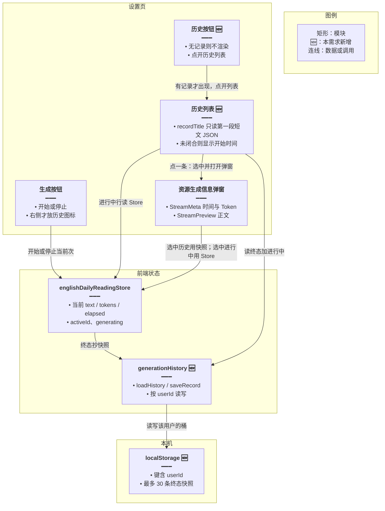
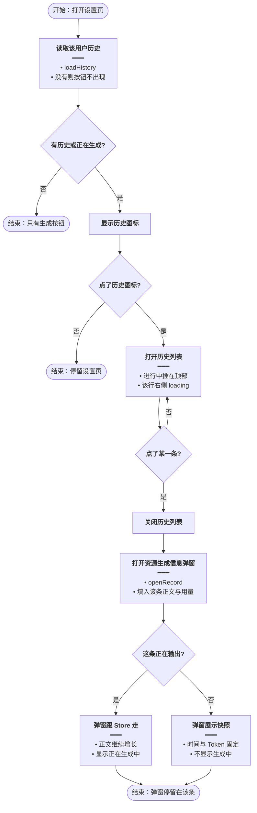
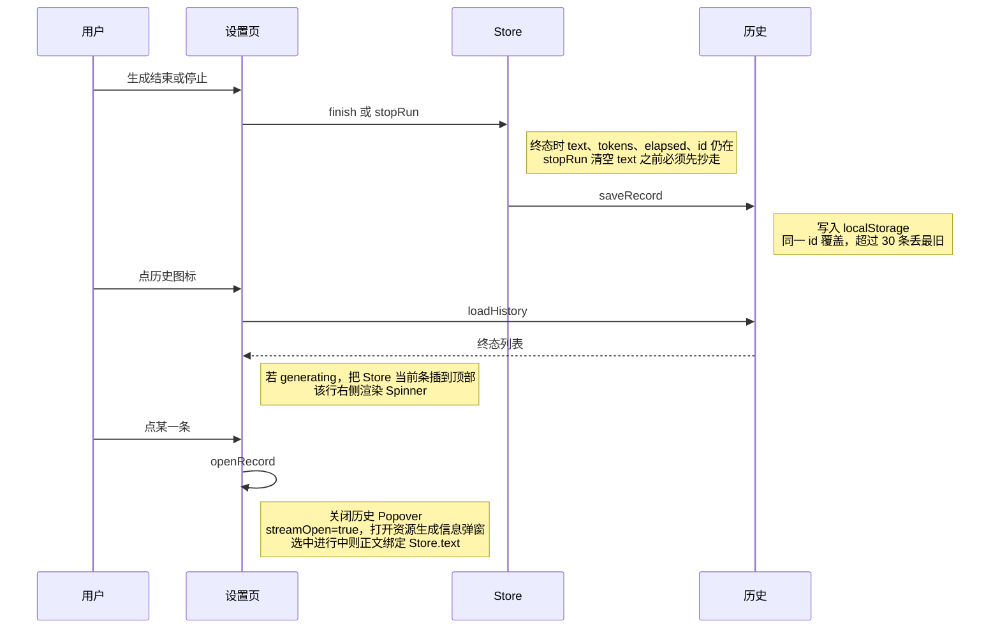
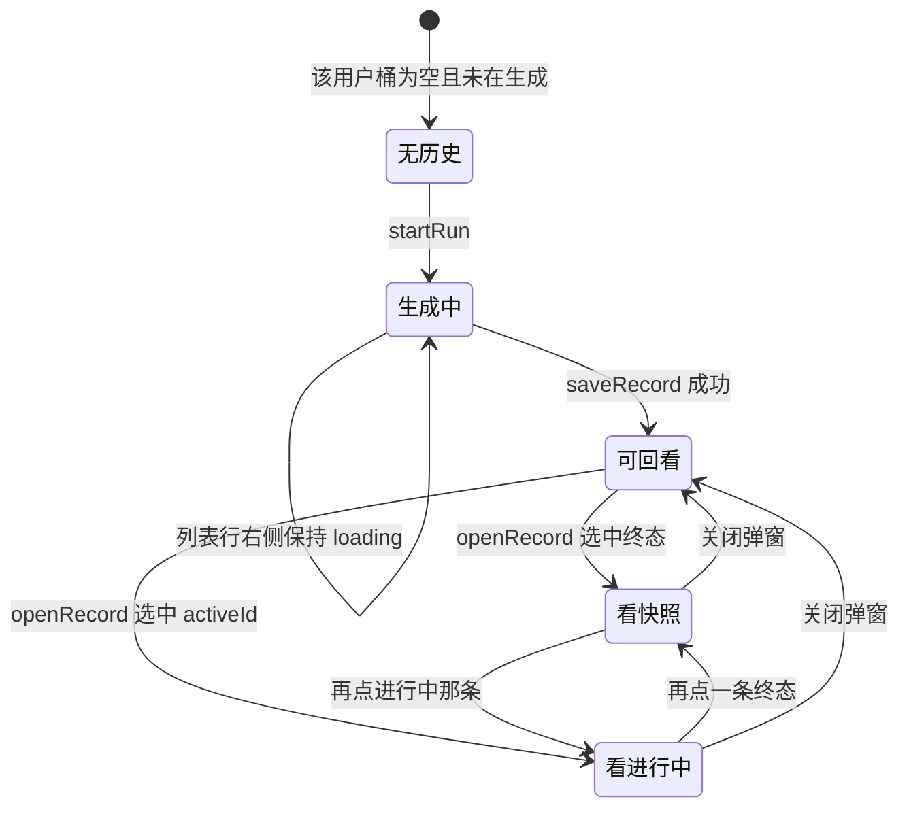

# 阅读生成历史 — 实现思路

> **状态**：规划（未实现）  
> **日期**：2026-10-18  
> **需求摘要**：设置页手动生成结束后，把弹窗里的正文、耗时和 Token 记到本机历史；生成按钮右侧在有记录时出现历史图标，点开列表，再点某一条就打开「资源生成信息」弹窗回看；正在输出的那一条在列表右侧显示 loading。

## 延伸阅读

- [每日阅读流式生成.md](./每日阅读流式生成.md)：当前弹窗、SSE、模块级 Store
- [刷新续接生成流.md](./刷新续接生成流.md)：刷新不恢复生成中 UI，后端继续跑
- [弱模型补单词释义.md](./弱模型补单词释义.md)：flash 第二次只补释义，不把已展示正文清掉

---

## 0. 读本文你将得到什么

- 要留的是弹窗里那次生成信息，不是今日阅读文章列表。
- 本机按用户分桶保存，不新建表、不改 SSE。
- 历史按钮在生成按钮右侧，没有记录就不出现。
- 点一条记录会关掉历史列表，并打开已有的「资源生成信息」弹窗。
- 最大风险是刷新发生在生成中途：这一条还没落盘，刷新后列表里没有它。

---

## 1. 需求与边界

### 1.1 用户故事

| 角色 | 场景 | 行为 | 期望结果 |
|------|------|------|----------|
| 已登录用户 | 设置页点过「生成阅读资源」 | 生成结束、停止、失败或中断 | 这条的正文、耗时、Token 进入历史 |
| 已登录用户 | 已有历史或当前正在生成 | 看生成按钮右侧 | 出现历史图标；一条都没有时不出现 |
| 已登录用户 | 点历史图标 | 打开历史列表 | 看到全部记录，新的在上 |
| 已登录用户 | 点列表中某一条 | 回看 | 「资源生成信息」弹窗打开，展示该条正文、时间和 Token |
| 已登录用户 | 列表里有正在输出的一条 | 看该行右侧 | 有 loading，不挡整行点击 |

### 1.2 范围

| 在范围内 | 不在范围内（非目标） |
|----------|----------------------|
| 设置页底栏历史图标、历史列表、回看弹窗 | 今日阅读列表页、详情页改版 |
| 手动生成的正文快照、耗时、Token、结束状态 | 定时日推的生成记录 |
| 进行中的那一条用内存态插在列表顶部并带 loading | 刷新后恢复「正在生成」按钮或自动重连 UI |
| 按当前用户隔离 | 跨设备同步、新数据库表、删除/重命名 |

### 1.3 约束与依赖

- 必须已登录。历史键带用户 id，换号不看到上一号的记录。
- 复用现有 `Popover`、`StreamPreview`、`StreamMeta`、`englishDailyReadingStore`。查看当前输出的卷轴按钮保持原样。
- 刷新不恢复生成中界面这条产品约束不变。历史只在一次生成走到结束、停止、失败或中断时写入。
- 单条正文是模型原文，可能有几万字。本机最多留 30 条，超出丢最旧的。

---

## 2. 方案总览（一句话 + 要点）

**一句话方案**：生成走到终态时，把 Store 里当时的正文、耗时和 Token 写入当前用户的 localStorage；历史图标打开列表，点一条就选中它并打开已有的资源生成信息弹窗，进行中的那条不落盘、只在列表里挂 loading。

| # | 设计要点 | 理由 |
|---|----------|------|
| 1 | 历史是弹窗快照，不是 `english_daily_readings` 行 | 弹窗展示的是模型原文加耗时、Token；文章表没有这两项，停止时正文还会被清掉 |
| 2 | 只在终态写一次 | 每个字都写 localStorage 会卡；生成中的内容用 Store 现读 |
| 3 | 回看不改 Store 的 `text` | 生成还在跑时，SSE 继续写入 Store；历史正文只放页面上的选中项 |
| 4 | 点记录先关历史列表，再开信息弹窗 | 两个浮层叠在同一锚点上会抢焦点；信息弹窗就是截图里的「资源生成信息」 |
| 5 | 进行中行用 `id === activeId && generating` 画 loading | 不另存一份「生成中」状态，避免刷新后出现永远转圈的假记录 |

---

## 3. 现状与复用

| 能力 | 仓库中已有 | 本需求中的用法 |
|------|------------|----------------|
| 资源生成信息弹窗 | `apps/frontend/src/views/englishLearning/dailyReading/Settings.tsx` 的 `StreamMeta` + `StreamPreview` | 回看同一弹窗；历史态关掉「正在生成中」和贴底跟随 |
| 生成按钮右侧卷轴图标 | 同文件，`showStream` 时渲染 `ScrollText` | 保留，只看当前这次输出 |
| 当前次状态 | `apps/frontend/src/store/englishDailyReading.ts` | 终态时从这里抄快照；进行中列表行读这里 |
| 停止会清空正文 | `stopRun()` 把 `text` 置空 | 必须先 `saveRecord`，再清空 |
| 完成会离开设置页 | `reading.complete` → `finish()` → `ready()` 跳列表 | 跳转前写入历史 |
| 换号重置 | `resetOnUserSwitch()` | 只停当前次，不删其他用户已存的桶 |
| 文章表 | `english_daily_readings` | 不扩展。没有耗时和 Token，也不是弹窗原文 |

**调研结论**：弹窗、Store、SSE 都已能展示「这一次」。缺的是终态落盘、历史列表，以及「选中某条再打开同一个弹窗」。不要把文章列表当成生成历史。

---

## 4. 架构图



**图内方法说明**：

| 方法 / 模块入口 | 功能 |
|-----------------|------|
| `startRun()` / `stopRun()` | 生成按钮进入或停掉当前次；停止前要先把快照交给 `saveRecord` |
| `loadHistory()` | 按当前用户读出已结束的记录，供按钮是否显示和列表使用 |
| `saveRecord()` | 把一次终态的正文、耗时、Token、状态写入该用户的桶，并丢掉超出 30 条的最旧记录 |
| `StreamMeta` | 弹窗标题「资源生成信息」，右侧展示这一条的生成时间和消耗 Token |
| `StreamPreview` | 用现有流式 Markdown 渲染正文；只有正在输出的那条才转圈并贴底 |
| `recordTitle(text, startedAt)` | 历史行标题。从正文里取出 `titleZh`，没有中文标题再用 `titleEn`；都没有则用开始时间 |
| `firstJsonObject(text)` | 只切出第一段花括号已配平的 JSON。释义接在短文后面之后，整段 `JSON.parse` 会失败，标题就会退回成时间 |

**读图要点**：

- 历史模块只碰本机，不进后端文章表。
- 弹窗不保存第二份正文；进行中仍以 Store 为准，避免和 SSE 各写一份。
- 历史按钮和原来的卷轴按钮是两个入口：一个看列表，一个看当前输出。

---

## 5. 主流程图



**图内方法说明**：

| 方法 | 功能 |
|------|------|
| `loadHistory()` | 设置页打开时读本机桶；空数组就不渲染历史按钮 |
| `openRecord(id)` | 记下选中 id，关掉历史列表，把资源生成信息弹窗设为打开 |

**读图要点**：

- 按钮出现的条件是「桶里有终态」或「当前正在生成」，不是只看文章列表。
- 点记录的成功路径一定经过「关列表、开信息弹窗」，不能只在列表里高亮。
- 是否跟流，只看这条是不是当前 `activeId` 且 `generating`。

---

## 6. 核心时序图



**图内方法说明**：

| 方法 | 功能 |
|------|------|
| `finish()` | 生成完成、失败或中断时停表；调用方在跳转或清状态前用它的终值写历史 |
| `stopRun()` | 用户停止。先 `saveRecord`，再把正文和计时清掉，避免历史里是空正文 |
| `saveRecord()` | 把这一条终态写入当前用户的桶 |
| `loadHistory()` | 打开列表时读桶；不包含尚未结束的那次 |
| `openRecord(id)` | 选中记录并打开资源生成信息弹窗 |

**读图要点**：

- 写入发生在终态，不发生在每个 SSE 增量上。
- 列表的进行中行不来自 localStorage，来自打开列表这一刻的 Store。
- 打开弹窗是页面状态 `streamOpen`，和原来点卷轴按钮是同一个弹窗。

---

## 7. 状态机



**图内方法说明**：

| 方法 | 功能 |
|------|------|
| `startRun()` | 进入生成中。此时还没有终态记录，但历史按钮要出现，列表里能看到这一条 |
| `saveRecord()` | 离开生成中、进入可回看的唯一写入点 |
| `openRecord(id)` | 在看快照和看进行中之间切换，并保证信息弹窗是打开的 |

---

## 8. 模块职责与接口草图

### 8.1 模块一览

| 模块 | 职责 | 新增/改动 | 预估路径 |
|------|------|-----------|----------|
| 历史读写 | 按用户存终态快照，上限 30 | 新增 | `apps/frontend/src/utils/dailyReadingHistory.ts` |
| Store 钩子 | 终态前调用保存；停止先保存再清空 | 扩展 | `apps/frontend/src/store/englishDailyReading.ts` |
| 设置页 | 历史按钮、列表、选中后打开原弹窗 | 扩展 | `apps/frontend/src/views/englishLearning/dailyReading/Settings.tsx` |
| 文案 | 历史按钮、空状态不需要（无记录不展示按钮） | 扩展 | `apps/frontend/src/i18n/locales/zh-CN/englishLearning.ts`、`en-US/englishLearning.ts` |

### 8.2 关键接口（伪代码或 TypeScript 草图）

```typescript
// 一条已结束的生成。进行中不写进这个类型，避免刷新后假 loading
type GenRecord = {
	// 与本次 runId 相同，再次结束时覆盖，不产生两条
	id: string;
	// 弹窗里的模型原文；停止前抄走，因为 stopRun 会把 Store 正文清掉
	text: string;
	// 终态 Token，回看时用快照，不读 Store
	tokens: number;
	// 终态耗时毫秒，回看时时钟停住
	elapsed: number;
	// 列表排序用，新的在上
	startedAt: number;
	// 列表可不展示，留着区分停止和完成
	status: 'done' | 'stopped' | 'error' | 'paused';
};

// 终态写入。正文和 Token 都空则不记，避免停在发出请求前的空条
function saveRecord(userId: number, record: GenRecord): void;

// 只读当前用户的桶。设置页用长度决定历史按钮是否渲染
function loadHistory(userId: number): GenRecord[];
```

```typescript
// 点列表一行。先关历史浮层，再打开资源生成信息弹窗
function openRecord(id: string): void {
	// 选中 id 决定弹窗数据来自快照还是 Store
	setSelectedId(id);
	// 与卷轴按钮共用 streamOpen，保证弹窗一定打开
	setStreamOpen(true);
	// 关掉历史 Popover，避免两个浮层叠在底栏上
	setHistoryOpen(false);
}
```

### 8.3 数据模型

| 字段/实体 | 来源 | 存储 | 说明 |
|-----------|------|------|------|
| `GenRecord` | Store 终态 | `localStorage` 键 `el-daily-gen-history:<userId>` | 仅终态；上限 30 |
| 进行中一条 | `generating`、`activeId`、`text`、`tokens`、`startedAt` | 内存 | 列表顶部临时行，右侧 loading |
| 选中 id | 页面 `useState` | 内存 | 不写入 Store，避免 SSE 被历史正文覆盖 |
| 文章行 | 已有发布结果 | MySQL | 本需求不读、不写 |

列表一行展示标题，右侧只有进行中才放 `Spinner`。

标题不解析整段正文。手动生成的原文是「短文 JSON + 空行 + 释义 JSON」。从第一个 `{` 一直解析到文末会失败，行标题就变成开始时间。`firstJsonObject` 只取第一段已经闭合的对象，再读 `titleZh`，没有则读 `titleEn`。第一段还没闭合（短文仍在输出）时，继续显示开始时间。已经存下的记录不用重写，打开列表时现算。

```typescript
// 历史行标题。整段解析会把后面的释义 JSON 算进去，所以先切第一段
function recordTitle(text: string, startedAt: number): string {
	// 只取第一段已闭合的短文，后面的释义不参与解析
	const slice = firstJsonObject(text);
	// 第一段未闭合或还没有 { 时，列表用开始时间
	if (!slice) return new Date(startedAt).toLocaleString();
	// 只解析短文对象，避免把释义对象当成标题来源
	const data = JSON.parse(slice) as { titleZh?: unknown; titleEn?: unknown };
	// 中文标题优先；没有中文时用英文标题
	const title = typeof data.titleZh === 'string' ? data.titleZh : data.titleEn;
	// 空字符串不当标题，避免这一行是空白
	if (typeof title === 'string' && title.trim()) return title.trim();
	// 对象里没有可用标题时，仍用开始时间
	return new Date(startedAt).toLocaleString();
}
```

`firstJsonObject` 从第一个 `{` 起按花括号配平，字符串里的括号和转义引号不计入深度。配平失败或没有 `{` 时返回 `null`。

弹窗数据：

| 选中 | 正文 | 时间 | Token | 正在生成中 |
|------|------|------|--------|------------|
| 无选中，卷轴按钮打开 | Store.text | Store 时钟 | Store.tokens | 仅 generating |
| 选中进行中 | Store.text | Store 时钟 | Store.tokens | 是 |
| 选中终态 | 快照 text | 快照 elapsed，时钟停住 | 快照 tokens | 否 |

---

## 9. 分阶段实现步骤

| 阶段 | 目标 | 交付物 | 依赖 |
|------|------|--------|------|
| M1 | 终态能留下，刷新还在 | `saveRecord` / `loadHistory`，接上完成、停止、失败、中断 | 无 |
| M2 | 看得到、点得开 | 历史按钮、列表、点记录打开信息弹窗 | M1 |
| M3 | 进行中标识 | 列表顶部活记录 + 行右侧 loading；弹窗跟流 | M2 |

M1

- [ ] 新增历史工具，键带 userId，最多 30 条，同 id 覆盖
- [ ] `reading.complete`、`reading.error`、`reading.paused` 在 `finish` 清状态前写入
- [ ] `stopRun` 先写入再清空 `text`
- [ ] 正文与 Token 都为空时不写

M2

- [ ] 生成按钮右侧增加历史图标；桶为空且未在生成时不渲染
- [ ] 点击图标用 Popover 列出记录，新的在上
- [ ] 点击一行调用 `openRecord`：关闭列表并打开资源生成信息弹窗
- [ ] 终态回看不显示「正在生成中」，时间不继续跳
- [ ] 中英文文案

M3

- [ ] 生成中把 Store 当前条插到列表顶部
- [ ] 仅该行右侧显示 loading
- [ ] 点这条时弹窗绑定 Store，正文继续增长
- [ ] 点卷轴按钮时清除选中，弹窗回到当前次

---

## 10. 关键决策与备选方案

| 决策 | 选用 | 备选 | 为何不选备选 |
|------|------|------|--------------|
| 存哪里 | 本机 localStorage，按用户分桶 | 写入 `english_daily_readings` 或新表 | 文章行没有耗时和 Token；停止会清正文；新表超过这次只是回看弹窗的需求 |
| 何时写 | 终态写一次 | 每个 SSE 增量都写 | 增量写会频繁卡主线程，刷新中途本来就不恢复界面 |
| 回看存在哪 | 页面选中 id | 写回 Store.text | 写回 Store 会和正在跑的 SSE 互相覆盖 |
| 点记录后的浮层 | 关历史列表，开信息弹窗 | 两个浮层同时开着 | 同一底栏上两个 Popover 抢锚点和焦点；需求是「展示在流式弹窗里」并打开信息弹窗 |
| 进行中如何标识 | 行右侧 Spinner | 整行骨架或按钮上的点 | 需求写明 loading 在列表 item 右侧 |
| 行标题从哪段 JSON 取 | 只解析第一段已闭合对象 | 从第一个 `{` 解析到文末 | 释义接在短文后面后，文末多一段 JSON，整段解析失败，标题变成开始时间 |

---

## 11. 风险、边界与待确认

| 项 | 等级 | 说明 | 缓解 |
|----|------|------|------|
| 生成中刷新 | 中 | 这一条尚未 `saveRecord`，刷新后历史里没有；后端仍会把文章写进列表 | 与现有「刷新不恢复生成 UI」一致，不在本期补记 |
| 配额 | 低 | 30 条原文可能到数 MB | 超出丢最旧；写失败时忽略，不影响生成 |
| 换号 | 低 | 键含 userId | 换号后读新桶；不主动删旧桶 |
| 停止时序 | 中 | 先清空 `text` 再保存会得到空历史 | M1 明确规定先保存 |

**待确认**（若有）：

- [ ] 历史是否要跨设备。验证方式：若要，再单开一篇服务端方案，本期不做。
- [ ] 点记录时历史列表是否必须保持打开。验证方式：本期默认关闭；若试用觉得要对照列表，再改成列表不关。

---

## 12. 验收清单

| # | 用例 | 步骤 | 期望 |
|---|------|------|------|
| AC1 | 无历史不显示按钮 | 清空该用户的桶后打开设置页，且没有正在生成 | 生成按钮右侧没有历史图标 |
| AC2 | 完成后可回看 | 生成成功一次后回到设置页，点历史，点该条 | 资源生成信息弹窗打开，正文、时间、Token 与结束时一致，没有「正在生成中」 |
| AC3 | 停止也留下 | 生成过程中点停止 | 历史里有这条；正文不是空的（除非停止前确实没有输出且 Token 为 0） |
| AC4 | 进行中 loading | 生成过程中打开历史列表 | 顶部一条的右侧有 loading；点它后弹窗继续跟着输出 |
| AC5 | 换条不串流 | 生成中先点一条旧记录，再点卷轴按钮 | 旧记录是静止快照；卷轴按钮回到当前正在输出的正文 |
| AC6 | 换号隔离 | 用另一个账号打开设置页 | 看不到上一账号的历史 |
| AC7 | 释义接在后面仍有标题 | 打开一条已经写完短文、并且后面还有 `wordGloss` 的历史 | 行上是 `titleZh`（没有则 `titleEn`），不是开始时间 |
| AC8 | 短文未闭合 | 生成还停在第一段 JSON 中间时打开历史 | 这一行仍是开始时间；短文对象闭合后变成标题 |

---

## 13. 预估改动面（实现阶段参考）

| 类型 | 路径（预估） |
|------|--------------|
| 前端 | `apps/frontend/src/utils/dailyReadingHistory.ts`、`apps/frontend/src/store/englishDailyReading.ts`、`apps/frontend/src/views/englishLearning/dailyReading/Settings.tsx`、中英文 `englishLearning.ts` |
| 后端 | 无 |
| 文档（实现后） | 落地后再按 diff 归档，不在本规划里改业务源码 |

（本文档为规划态实现思路；落地后以源码为准）
