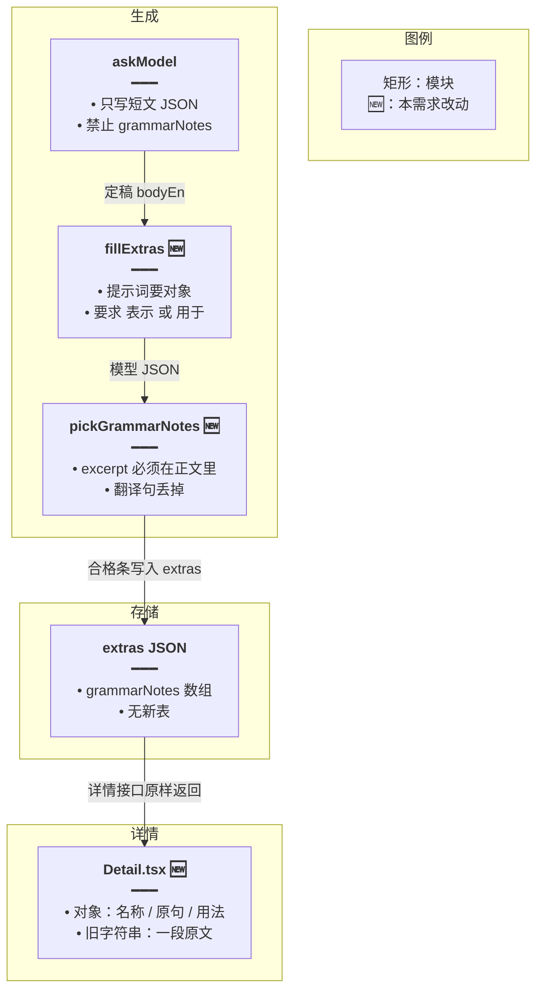
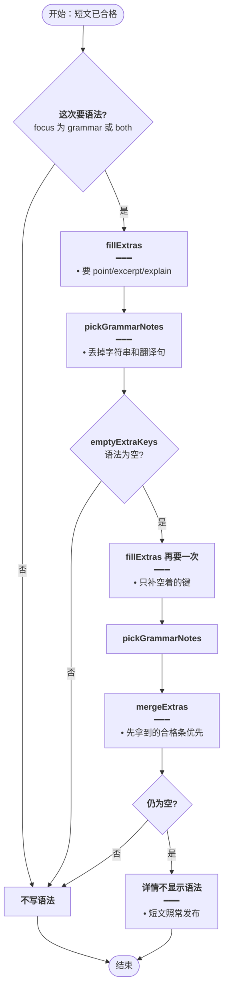
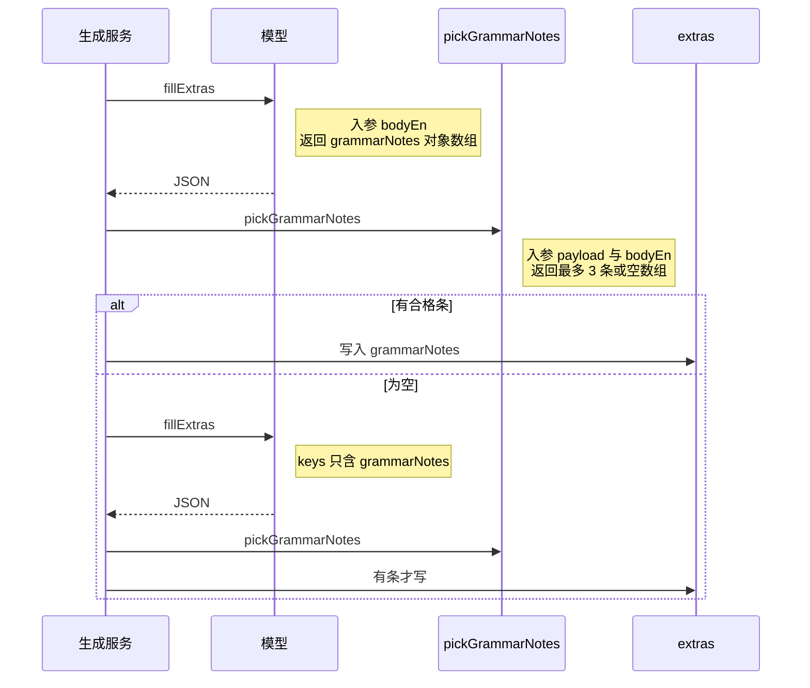

# 每日阅读语法说明 — 实现思路

> **状态**：规划  
> **日期**：2026-10-21  
> **需求摘要**：侧重语法时，详情里的语法要讲这篇短文里的真实语法点，不能再交三句中文翻译。

## 延伸阅读

- [阅读附件分请求.md](./阅读附件分请求.md)：语法已经从短文 JSON 拆到附件请求
- [阅读分路并行.md](./阅读分路并行.md)：附件与释义分路，语法仍走附件这一路

---

## 0. 读本文你将得到什么

- 现在的「语法」是中文句子，因为提示词要的是 Chinese sentences，验收只看有没有汉字。
- 改成每条 `{ point, excerpt, explain }`：语法点名称、文中英文片段、用「表示 / 用于」写出的用法。
- 只改附件提示词、`pickExtras` 验收和详情展示。短文生成、题目、词汇不动。
- 一次落地：不合格就当这一类为空，沿用现成的补请求再要一次。
- 最大风险是弱模型两次都交不出合格条，详情就不显示语法，而不是再显示错句。

---

## 1. 需求与边界

### 1.1 用户故事

| 角色 | 场景 | 行为 | 期望结果 |
|------|------|------|----------|
| 学习者 | 打开一篇侧重语法的每日阅读 | 看「语法」区块 | 每条有语法点名称、文中英文原句片段、这条结构在句中怎么用 |
| 学习者 | 打开旧文章 | 看已保存的字符串语法 | 旧的三句中文仍原样显示，不回写 |

### 1.2 范围

| 在范围内 | 不在范围内 |
|----------|------------|
| 附件请求里 `grammarNotes` 的提示词 | 重写短文 `bodyEn` / `bodyZh` |
| `pickExtras` 丢掉翻译句和摘不到原文的条 | 给旧文章重新生成语法 |
| 整类为空时再要一次（已有 `emptyExtraKeys`） | 语法大全、对话里的语法意图 |
| 详情按新结构展示，并兼容旧字符串 | 数据库迁移 |

### 1.3 约束与依赖

- 语法存在 `english_daily_readings.extras` 的 JSON 里，没有单独的列。
- 附件失败或仍为空时，短文照常发布。这是 [阅读附件分请求.md](./阅读附件分请求.md) 的既有约定。
- 所有模型走同一条附件提示，不单独给 flash 加第三次。

---

## 2. 方案总览（一句话 + 要点）

**一句话方案**：语法条改成「名称 + 必须出现在正文里的英文片段 + 含表示/用于的中文用法」，翻译句验收不过就当没生成，再要一次。

| # | 设计要点 | 理由 |
|---|----------|------|
| 1 | 字段固定为 `point` / `excerpt` / `explain` | 纯字符串无法区分「讲解」和「翻译」 |
| 2 | `excerpt` 规范化空白后必须是 `bodyEn` 的子串 | 语法必须锚在这篇阅读上 |
| 3 | `explain` 必须含「表示」或「用于」 | 挡住「这不仅仅是为了生存」这种整句中文 |
| 4 | 字符串条目直接丢弃 | 模型若仍按旧格式交句子，不入库 |
| 5 | 一条都没有则走已有的第二次 `fillExtras` | 不新开循环 |
| 6 | 详情兼容 `string` 与对象 | 已发布文章不用迁移 |

---

## 3. 现状与复用

| 能力 | 仓库中已有 | 本需求中的用法 |
|------|------------|----------------|
| 短文与附件拆开 | `english-daily-reading.service.ts` 的 `askModel` 禁止带 `grammarNotes`；`fillExtras` 另一次要附件 | 只改 `fillExtras` 里语法那一行提示 |
| 附件验收 | `daily-reading.rules.ts` 的 `pickExtras` | 语法分支改为对象验收 |
| 整类为空再要一次 | `emptyExtraKeys` + `completeExtras` 第二次 `fillExtras` | 翻译句被丢掉后长度为 0，自动再要 |
| 截断抢救 | `salvageExtras` / `closedArrayItems` | 已能解析数组里的对象，不改解析 |
| 详情展示 | `dailyReading/Detail.tsx` 把 `grammarNotes` 渲染成段落 | 对象分三行；字符串保持一段 |
| 前端类型 | `service/index.ts` 的 `EnglishDailyReadingExtras` | `grammarNotes` 扩成字符串或对象 |

**调研结论**：页面没有把译文填进语法区。图中的三句是模型按「Chinese sentences」交出来的，`pickExtras` 只要求含汉字且不超过 120 字，所以被当成合格。补请求只在数组为空时触发，所以错句一旦留下就不会再要。

---

## 4. 架构图



**图内方法说明**：

| 方法 | 功能 |
|------|------|
| `askModel` | 只生成标题和正文。明确不要 `grammarNotes`，避免短文和语法挤在同一次输出里 |
| `fillExtras` | 短文定稿后单独要词汇、语法、题目。本需求改语法提示，要求交对象而不是中文句子 |
| `pickGrammarNotes` | 从附件 JSON 里留下最多 3 条合格语法。摘录对不上正文或用法不像讲解的丢掉 |
| `Detail.tsx` | 按条目形状展示。新对象分三行，旧文章的字符串仍是一段 |

**读图要点**：

- 语法不进短文请求，仍挂在附件这一路上。
- 🆕 只改提示词、验收和详情，不增加服务或表。
- 详情读的是已经验收过的 `extras`，不再自行判断对错。

---

## 5. 主流程图



**图内方法说明**：

| 方法 | 功能 |
|------|------|
| `fillExtras` | 向模型要附件 JSON。第二次调用只带仍然为空的键，语法仍用同一套对象提示 |
| `pickGrammarNotes` | 验收单次返回。字符串、摘录不在正文、用法里没有「表示 / 用于」的都不留下 |
| `emptyExtraKeys` | 某一类一个都没有才算空。已有合格条就不再补 |
| `mergeExtras` | 两次都有语法时留下先拿到的，避免第二次覆盖已经合格的条 |

**读图要点**：

- 入口是短文已经合格，不因为语法不合格废掉正文。
- 关键分支是验收后数组是否为空。空才再要一次，有合格条就停。
- 两次都不合格就结束为「不展示」，不再打第三次。

---

## 6. 核心时序图



**图内方法说明**：

| 方法 | 功能 |
|------|------|
| `fillExtras` | 发起附件模型请求。用户消息是定稿英文，系统提示规定语法对象的三个字段 |
| `pickGrammarNotes` | 在写入 extras 之前过滤。不合格的调用返回空数组，由外层决定要不要再请求 |

**读图要点**：

- 生成服务发起，模型只产 JSON，验收在写库之前。
- 第二次请求是同一条链路的分支，不是新的接口。
- 详情不在这条时序里。它只读已经落库的 extras。

---

## 7. 状态机

本需求没有播放或编辑模式。一条语法只有「合格留下 / 不合格丢弃」两种结果，见 §5，不单列状态图。

---

## 8. 模块职责与接口草图

### 8.1 模块一览

| 模块 | 职责 | 新增/改动 | 预估路径 |
|------|------|-----------|----------|
| 语法提示 | 要求对象和「表示 / 用于」 | 改动 | `apps/backend/src/services/english-learning/english-daily-reading.service.ts` |
| 验收 | 摘录锚正文，丢掉翻译句 | 改动 | `apps/backend/src/services/english-learning/daily-reading.rules.ts` |
| 详情 | 三行展示，兼容旧字符串 | 改动 | `apps/frontend/src/views/englishLearning/dailyReading/Detail.tsx` |
| 类型 | 前端 extras 类型 | 改动 | `apps/frontend/src/service/index.ts` |

### 8.2 关键接口（伪代码）

```typescript
// 一条语法的存储形状；字符串无法区分讲解和翻译
type GrammarNote = {
	// 中文语法点名，限制长度以免模型把整句塞进标题
	point: string;
	// 从这篇 bodyEn 抄出的英文片段，用来证明讲的是本文
	excerpt: string;
	// 用法说明，必须含「表示」或「用于」，挡住纯译文
	explain: string;
};

// 从附件 JSON 留下合格语法；字符串条目当不合格，好触发再要一次
function pickGrammarNotes(raw: unknown, bodyEn: string): GrammarNote[] {
	// 实现阶段写过滤；这里只定输入是模型原文、输出是最多 3 条
	return [];
}
```

### 8.3 数据模型

| 字段 | 来源 | 存储 | 说明 |
|------|------|------|------|
| `grammarNotes[].point` | 模型 | extras JSON | 中文语法点名，最长 20 字 |
| `grammarNotes[].excerpt` | 模型，验收对照 `bodyEn` | extras JSON | 8～80 字，空白折叠后必须出现在正文 |
| `grammarNotes[].explain` | 模型 | extras JSON | 最长 120 字，含汉字，且含「表示」或「用于」 |
| 旧 `grammarNotes: string[]` | 已发布文章 | 原样 | 只读展示，不再按新规则重滤 |

---

## 9. 分阶段实现步骤

| 阶段 | 目标 | 交付物 | 依赖 |
|------|------|--------|------|
| M1 | 新生成的语法不再收下翻译句 | 提示词 + `pickGrammarNotes` + 一条验收测试 | 无 |
| M2 | 详情能看懂新结构，旧文不破 | `Detail.tsx` 与前端类型 | M1 |

- [ ] M1 改 `fillExtras` 的语法提示为对象，并写明摘录必须来自原文、用法必须含「表示」或「用于」
- [ ] M1 `pickExtras` 只收通过摘录和用法检查的对象，字符串丢弃
- [ ] M1 用一篇假正文断言：纯中文句子被丢、摘录不在正文被丢、合格对象留下
- [ ] M2 详情对对象显示名称、原句、用法；字符串仍是一段
- [ ] M2 不迁移旧数据

---

## 10. 关键决策与备选方案

| 决策 | 选用 | 备选 | 为何不选备选 |
|------|------|------|--------------|
| 条目形状 | 三个字段的对象 | 继续用一段中文，靠提示词写得更严 | 上次就是一段中文，弱模型会交译文，验收分不开 |
| 用法检查 | 必须含「表示」或「用于」 | 用一大串语法术语词表 | 词表漏掉合法讲法，也会放过「更是一种交流」这种句子；两个字提示词和验收一致 |
| 不合格 | 丢掉并最多再要一次，仍空则不展示 | 把翻译句留下 | 留下就是现在的错 |
| 旧文 | 兼容字符串展示 | 批量重生成 | 超出这次范围，也会改已发布正文旁的附件 |

---

## 11. 风险、边界与待确认

| 项 | 等级 | 说明 | 缓解 |
|----|------|------|------|
| 两次都不合格 | 中 | 弱模型可能仍交句子，语法区空白 | 提示词与验收用同一句话；空白好过错句 |
| 「表示 / 用于」过窄 | 低 | 合格讲解若没用这两个词会被丢掉 | 提示词强制使用这两个词 |
| 摘录改写了一个词 | 低 | 对不上正文会被丢 | 提示词要求逐字抄录 |
| 旧字符串仍不像语法 | 低 | 已发布文章不变 | 只影响新生成；旧文保持原样以免详情空白 |

**待确认**（若有）：

- [ ] 无。旧文是否重跑由产品另定，本方案不包含。

---

## 12. 验收清单

| # | 用例 | 步骤 | 期望 |
|---|------|------|------|
| AC1 | 翻译句 | 附件返回三句纯中文 | `pickGrammarNotes` 结果为空，并触发第二次附件请求 |
| AC2 | 摘录不在正文 | `excerpt` 是另一篇文章的句子，`explain` 含「表示」 | 该条丢弃 |
| AC3 | 合格条 | `excerpt` 是正文子串，`explain` 含「用于」 | 留下，详情显示名称、原句、用法 |
| AC4 | 旧文章 | extras 里仍是字符串数组 | 详情仍按一段文字显示 |
| AC5 | 两次都失败 | 第二次仍不合格 | 短文发布，语法区不出现 |

---

## 13. 预估改动面（实现阶段参考）

| 类型 | 路径 |
|------|------|
| 后端 | `apps/backend/src/services/english-learning/english-daily-reading.service.ts` |
| 后端 | `apps/backend/src/services/english-learning/daily-reading.rules.ts` |
| 后端测试 | `apps/backend/src/services/english-learning/daily-reading.grammar.spec.ts` |
| 前端 | `apps/frontend/src/views/englishLearning/dailyReading/Detail.tsx` |
| 前端 | `apps/frontend/src/service/index.ts` |

（本文档为规划态实现思路；落地后以源码为准）
