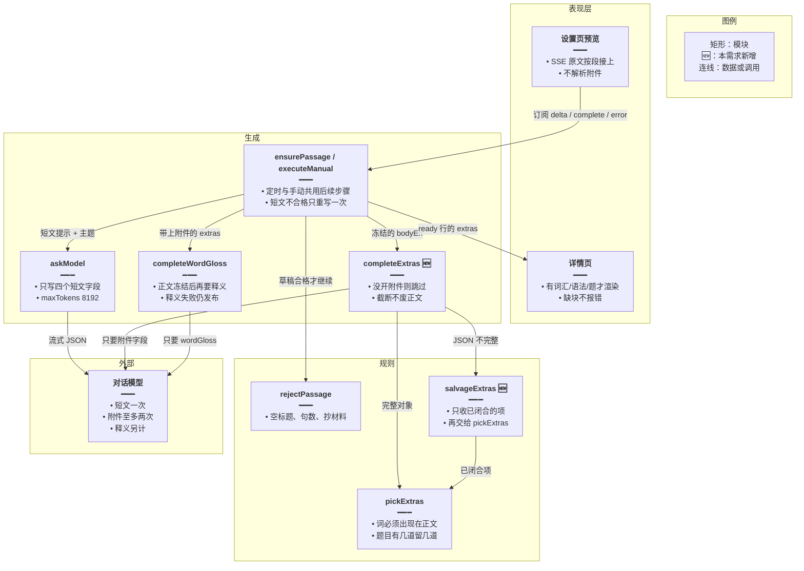
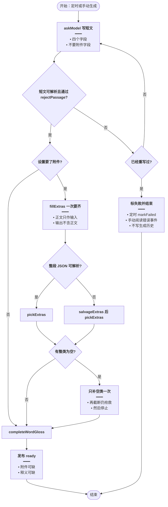
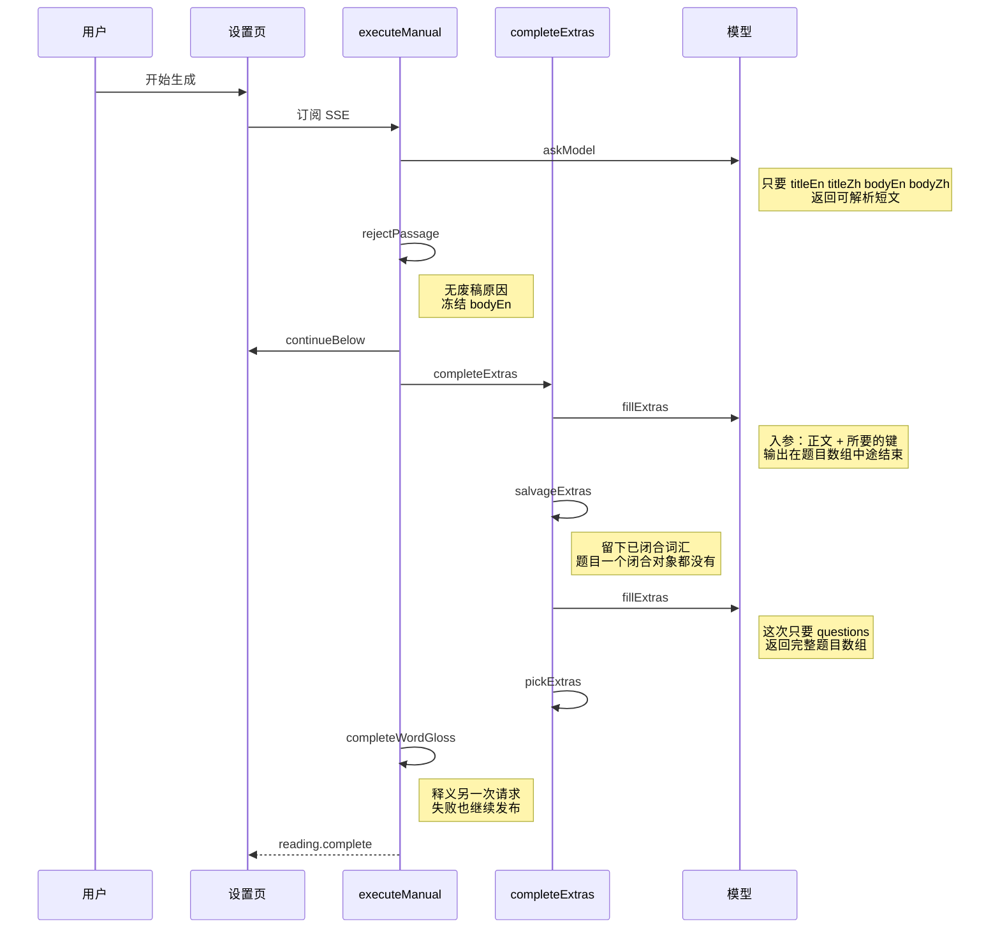

# 阅读附件分请求 — 实现思路

> **状态**：已落地  
> **日期**：2026-10-19  
> **需求摘要**：用户打开词汇、语法或理解题时，这些附件在短文合格之后另一次请求；附件被输出上限截断也不废正文，小模型同样如此。

## 延伸阅读

- [阅读截断补释义](./阅读截断补释义.md)（`wordGloss` 已从短文 JSON 拆出。本文接着拆 `glossary` / `grammarNotes` / `questions`）
- [弱模型补单词释义](./弱模型补单词释义.md)（flash 漏词补释义。附件拆分对所有模型生效，不另做模型名单）
- [每日阅读](./每日阅读.md)、[每日阅读流式生成](./每日阅读流式生成.md)（详情缺哪块就不画哪块；SSE 协议不变）
- [阅读生成历史](./阅读生成历史.md)（历史标题已只读第一段短文 JSON。附件 JSON 接在后面，不必再改标题规则）
- [阅读分路并行](./阅读分路并行.md)（在本文的附件请求之上，与逐词释义并行，并用句子序号缩短释义输出）

---

## 0. 读本文你将得到什么

- 要解决的问题：词汇、语法、理解题仍写在短文同一个 JSON 里。输出被 8192 或厂商更低的上限截断时，整段无法 `JSON.parse`，已经写完的正文也被丢掉，页面显示「模型没有返回可解析的短文」。
- 一句话方案：第一次只写标题和正文；合格后另要附件；附件截断就留下已闭合的条目，某一类完全没有时只补那一类一次，补不上也发布短文。
- 只改后端两条生成路径（定时 `ensurePassage`、手动 `executeManual`）。设置页、详情页、SSE 事件、历史表都不改。
- 分三阶段：M1 短文提示去掉附件字段；M2 附件请求、抢救、缺类补一次；M3 接到逐词释义之前。
- 最大风险：模型不听提示，仍把附件写进第一次，短文再次被截断。提示只允许四个短文字段；短文解析失败仍只重写一次。

---

## 1. 需求与边界

### 1.1 用户故事

| 角色 | 场景 | 行为 | 期望结果 |
|------|------|------|----------|
| 已登录用户 | 设置里打开词汇、语法或理解题，用输出上限偏低的模型生成 | 等生成结束 | 短文发布成功。附件写全就展示；写到一半被截断，已闭合的条目仍展示 |
| 已登录用户 | 焦点是「只阅读」且理解题数为 0 | 生成 | 不发附件那一次请求，直接进入逐词释义 |
| 读者 | 定时任务同样打开了附件 | 打开当天详情 | 篇目是 `ready`。缺词汇、缺语法或缺题目时，详情里对应区块不出现 |
| 已登录用户 | 短文 JSON 本身不完整 | 生成结束 | 仍只重写一次短文。第二次还不行，才显示「模型没有返回可解析的短文」。不因附件失败走这条 |
| 已登录用户 | 生成过程中点停止 | 停在附件请求中途 | 与现在一样中止，不把半成品标成 `ready` |

### 1.2 范围

| 在范围内 | 不在范围内（非目标） |
|----------|----------------------|
| `askModel` 只要求 `titleEn`、`titleZh`、`bodyEn`、`bodyZh` | 把 `maxTokens` 从 8192 调高 |
| 短文合格后，所有模型另要本次设置里打开的附件 | 按模型名单只对 flash 拆开 |
| 附件 JSON 不完整时，抽出已闭合的词汇项、语法句、题目 | 从截断的短文 JSON 里硬抠标题和正文 |
| 某一类附件一个都没有时，只补这一类一次 | 词汇按条、题目按道无限重试 |
| 附件全失败时短文仍发布，并继续逐词释义 | 详情页为缺附件单独加错误提示 |
| 题目不足设定道数时，留下已合格的几道 | 为了凑满道数再整篇重写短文 |
| 定时篇与手动篇走同一套 | 改 SSE 事件名、改 `extras` 存库结构、改前端 Store |

### 1.3 约束与依赖

- 手动生成要登录。定时篇不带 `userId`，继续用环境变量默认模型。
- 输出上限保持 8192。界面「消耗 Token 数」是各次调用的输入加输出累计，不是单次输出上限。
- 逐词释义继续走已有的 `completeWordGloss`，排在附件之后。释义截断不废正文，这条不变。
- 词汇仍受 `glossaryLimit` 约束：短 10、中 15、长 20。语法最多 3 条、每条 120 字。题目 2 或 3 道、每道 3 个选项。这些上限留在提示和 `pickExtras` 里，用来拦住模型写超，而不是靠它们保证一定放得进 8192。
- 焦点为词汇或「词汇+语法」时，短文提示仍要求正文使用值得查的词。只是不在同一次输出里要 `glossary` 字段。
- 手动预览沿用 `continueBelow`：附件输出接在短文下面。定时篇没有预览。
- 停止信号只在手动路径存在。附件请求之前要看 `shouldStop`。
- 生成失败不写入历史（`rememberGen` 遇到 `error` 直接返回）。本方案不改这条。

---

## 2. 方案总览（一句话 + 要点）

**一句话方案**：短文 JSON 只含标题和正文；校验通过后用另一次请求写词汇、语法、理解题，截断则抢救已闭合条目，缺的整类只补一次，然后照旧补逐词释义并发布。

| # | 设计要点 | 理由 |
|---|----------|------|
| 1 | 第一次只写四个短文字段 | 长篇大约 220 个英文词加中文译文，输出通常一两千 token，低于 8192，也低于不少小模型的实际上限。附件不再挤在这段 JSON 的后半 |
| 2 | 没打开任何附件就不发第二次 | 默认「只阅读、不出题」与现在的短文成本相同，只是提示里不再出现附件字段 |
| 3 | 打开的附件放在同一次 `fillExtras` | 词汇、语法、题目加在一起仍远小于正文加逐词释义。拆成三次会把正文重复送进上下文 |
| 4 | 解析失败用 `salvageExtras` 留下已闭合项，再经 `pickExtras` 过滤 | 与逐词释义的抢救同一做法。词不在正文里、语法超长、选项不是 3 个的条目丢掉 |
| 5 | 某一类完全为空才补一次，且只补空的那几类 | 词汇「最多 N 条」、语法「最多 3 条」本来就允许少。题目已有合格的几道就留下，不为凑满再打 |
| 6 | 附件失败只打日志，短文继续进 `completeWordGloss` 然后发布 | 红字「模型没有返回可解析的短文」只留给短文 JSON 或 `rejectPassage` |

---

## 3. 现状与复用

| 能力 | 仓库中已有 | 本需求中的用法 |
|------|------------|----------------|
| 短文一次生成并解析 | `apps/backend/src/services/english-learning/english-daily-reading.service.ts` 的 `askModel` | 扩展：系统提示去掉 `glossary`、`grammarNotes`、`questions` |
| 短文不合格只重写一次 | 同文件 `ensurePassage`、`executeManual` | 直接复用。仅当 `parsePassageJson` 为空或 `rejectPassage` 有原因时重写 |
| 废稿文案 | `apps/backend/src/services/english-learning/daily-reading.rules.ts` 的 `rejectReasonText` | 直接复用。只在短文阶段使用 |
| 附件过滤 | 同文件 `pickExtras` | 扩展：题目改为有几道合格留几道，上限仍是 `profile.questions`。词条、语法的校验不变 |
| 逐词释义另请求、截断抢救、缺句每批 4 句 | 同 service 的 `completeWordGloss`、`fillWordGloss`；`salvageWordGloss` | 直接复用，调用点移到附件完成之后 |
| 预览接在下面 | `continueBelow`；flash 重试短文时 `isFlashGlossModel` 决定接上还是清空 | 直接复用。附件开始前调用 `continueBelow`。不新增模型名单 |
| 详情按有无渲染 | `apps/frontend/src/views/englishLearning/dailyReading/Detail.tsx` | 直接复用。空数组不画词汇、语法、题目 |
| 历史标题 | `apps/frontend/src/views/englishLearning/dailyReading/Settings.tsx` 的 `firstJsonObject` | 直接复用。第一段仍是短文 JSON |
| 失败不进历史 | `rememberGen` 对 `error` 直接返回；`listGens` 排除 `error` | 直接复用 |

**调研结论**：附件已经「不合格就省略该键，不让附件废掉整篇」（`pickExtras` 注释）。缺的是它们仍和正文写在同一个 JSON 里，截断发生在解析之前，过滤函数拿不到对象。逐词释义已经按「另请求 + 抢救 + 有限补全」落地，附件沿用同一形状，不新造表，不改前端。

---

## 4. 架构图



**图内方法说明**：

| 方法 | 功能 |
|------|------|
| `askModel` | 写短文。系统提示只要求四个字段，避免附件占输出。返回解析后的草稿；解析失败则草稿为空，由调用方重写一次 |
| `rejectPassage` | 检查标题、正文长度、句数、是否抄检索材料。有原因则重写一次短文，不进入附件 |
| `completeExtras` | 短文合格后编排附件：不需要则跳过；需要则请求一次，截断就抢救，整类为空再补一次 |
| `salvageExtras` | 在截断文本里按括号深度取出已闭合的词汇对象、语法字符串、题目对象，交给 `pickExtras` 过滤 |
| `pickExtras` | 丢掉不在正文中的词、超长语法、选项不合法的题。题目不再要求道数刚好等于设置 |
| `completeWordGloss` | 附件步骤结束后按现有规则补逐词释义。释义失败不回滚短文 |

**读图要点**：

- 表现层只订阅读流和渲染已发布的 `extras`，不参加「附件是否齐」的判断。
- 新增逻辑集中在 `completeExtras` 与 `salvageExtras`。短文重试、释义补全、详情显隐都用现成函数。
- 模型被调用的顺序是短文、附件、释义。附件和释义的失败都不回到短文重试。

---

## 5. 主流程图



**图内方法说明**：

| 方法 | 功能 |
|------|------|
| `askModel` | 生成短文草稿。失败分支最多再进入一次，第二次仍失败则整次生成失败 |
| `rejectPassage` | 给出短文废稿原因。附件阶段不再调用它 |
| `fillExtras` | 向模型要本次设置打开的附件字段。补空类时只把空的键写进提示 |
| `pickExtras` | 过滤模型给出的附件。完整 JSON 和抢救结果都走这里 |
| `salvageExtras` | 整段解析失败时抽出已闭合条目，避免半截题目把已写完的词汇一起丢掉 |
| `completeWordGloss` | 发布前补逐词释义。与附件是否齐全无关 |
| `markFailed` | 定时短文两次都不合格时清空该日 pending，避免占住当天名额 |

**读图要点**：

- 唯一会整次失败的分支是短文两次都不合格。附件和释义都汇合到发布。
- 「整类为空」才补。词汇已有若干条、题目已有一道，都算这一类成功。
- 停止发生在任一次模型调用之前时，沿用现有中止，不进入发布。图中省略这条，避免和短文失败混在一起。

---

## 6. 核心时序图

手动生成、设置打开了词汇和题目、第一次附件 JSON 在题目处被截断时的主路径：



**图内方法说明**：

| 方法 | 功能 |
|------|------|
| `askModel` | 第一次模型调用只写短文。设置页预览看到的是这段 JSON |
| `rejectPassage` | 短文合格后才允许进入附件。不合格则走流程图里的重写，本图不展开 |
| `continueBelow` | 手动预览在短文和附件之间空一行，避免两段 JSON 粘成一段。定时篇不调用 |
| `completeExtras` | 编排附件的第一次请求、抢救和至多一次补空类 |
| `fillExtras` | 真正发附件的模型请求。两次调用同一函数，第二次的键列表更短 |
| `salvageExtras` | 第一次附件输出不完整时抽出已闭合项。本例留下词汇、题目为空 |
| `pickExtras` | 合并补全结果后做词条与题目校验，得到写入 `extras` 的对象 |
| `completeWordGloss` | 附件结束之后的释义请求，沿用现有批次规则 |

**读图要点**：

- 用户只发起一次生成。短文、附件、补空类、释义是同一次任务里的多次模型调用。
- 第一次 `fillExtras` 的半截题目不会让 `executeManual` 抛「没有可解析的短文」。
- `reading.complete` 仍在全部步骤之后发一次。中途不增加新的 SSE 事件。

---

## 8. 模块职责与接口草图

### 8.1 模块一览

| 模块 | 职责 | 新增/改动 | 预估路径 |
|------|------|-----------|----------|
| `askModel` | 短文提示只留四个字段；词汇焦点仍要求正文用值得查的词 | 扩展 | `apps/backend/src/services/english-learning/english-daily-reading.service.ts` |
| `completeExtras` / `fillExtras` | 附件请求与缺类补一次 | 新增 | 同上 |
| `salvageExtras` | 截断文本里的已闭合附件 | 新增 | `apps/backend/src/services/english-learning/daily-reading.rules.ts` |
| `pickExtras` | 题目改为「有几道留几道」 | 扩展 | 同上 |
| `ensurePassage` / `executeManual` | 短文合格后先附件、再释义 | 扩展 | service 文件 |
| 详情 / 设置 / SSE | 缺附件不展示；历史标题已按第一段 JSON | 不改 | `Detail.tsx`、`Settings.tsx` |

### 8.2 关键接口（伪代码）

```typescript
// 只阅读且不出题时不要附件请求，避免每次生成多打一轮模型
function extrasRequested(profile: ReadingProfile): boolean {
	// 焦点不是 reading 表示要了词汇或语法；questions 大于 0 表示要了题
	return profile.focus !== 'reading' || profile.questions > 0;
}

// 短文已合格。附件失败只少几块，不把正文退回重写
function completeExtras(bodyEn: string, profile: ReadingProfile): ReadingExtras {
	// 档位始终写入 extras，详情和列表不依赖附件是否存在
	const base = { level: profile.level, length: profile.length, focus: profile.focus };
	// 没要附件就到此为止，后面的释义仍会执行
	if (!extrasRequested(profile)) return base;
	// 第一次把本次打开的键一起要；正文放在用户消息里，提示禁止再输出正文
	const first = fillExtras(bodyEn, profile);
	// 能解析走过滤；不能解析只收已闭合项，避免半截 JSON 把已写完的词汇丢掉
	const extras = first.ok ? pickExtras(first.payload, bodyEn, profile) : salvageExtras(first.raw, bodyEn, profile);
	// 只列出完全没有的类。已有若干词汇或若干题就不再要
	const missing = emptyKeys(extras, profile);
	// 没有缺口就发布这些附件
	if (!missing.length) return extras;
	// 第二次只补缺口，再失败也把两次里能用的合并后返回
	const second = fillExtras(bodyEn, profile, missing);
	const more = second.ok ? pickExtras(second.payload, bodyEn, profile) : salvageExtras(second.raw, bodyEn, profile);
	// 两次里同一类都有内容时保留先拿到的，避免补请求覆盖已经合格的词汇
	return mergeExtras(extras, more);
}
```

`fillExtras` 的系统提示只列出这次要的键。用户消息是冻结的 `bodyEn`。`maxTokens` 仍为 8192。`salvageExtras` 复用逐词释义里按括号深度切已闭合对象的办法：先找 `"glossary"`、`"grammarNotes"`、`"questions"` 各自的 `[`，闭合一个收一个，遇到未闭合就停。收完再调用 `pickExtras`。

### 8.3 数据模型

| 字段/实体 | 来源 | 存储 | 说明 |
|-----------|------|------|------|
| `ReadingExtras.glossary` | 附件请求 | 短文行 `extras` JSON | 结构不变。可缺 |
| `grammarNotes` | 附件请求 | 同上 | 最多 3 条。可缺 |
| `questions` | 附件请求 | 同上 | 0 到 `profile.questions` 道。可缺 |
| `wordGloss` | 释义请求 | 同上 | 本方案不改其形状 |
| 生成历史 `text` | 预览拼接 | `english_daily_reading_gens` | 短文 JSON、空行、附件 JSON、释义 JSON。失败行仍不写 |

---

## 9. 分阶段实现步骤

| 阶段 | 目标 | 交付物 | 依赖 |
|------|------|--------|------|
| M1 | 短文输出不再含附件字段 | `askModel` 提示 | 无 |
| M2 | 附件能单独要到，截断可抢救 | `completeExtras`、`salvageExtras`、`pickExtras` | M1 |
| M3 | 两条生成路径在释义之前接上 | `ensurePassage`、`executeManual` | M2 |

### M1

- [ ] 从 `askModel` 的 `extraKeys` 去掉词汇、语法、题目。
- [ ] 系统提示写明只要四个短文字段，不要 `glossary`、`grammarNotes`、`questions`、`wordGloss`。
- [ ] 焦点为词汇或「词汇+语法」时，保留「正文使用值得查的词」这一句，不要求在同一次输出里交词汇表。

### M2

- [ ] 新增 `extrasRequested`、`fillExtras`、`completeExtras`、`salvageExtras`。
- [ ] `pickExtras` 在题目道数不足时保留已合格的题，截断到 `profile.questions`。
- [ ] 某一类一个都没有时只再请求一次，键列表仅为这些空类。
- [ ] `salvageExtras` 留一处最小断言：半截题目数组里，已闭合的词汇对象能留下，未闭合的题目被丢掉。不新建大 spec 文件。

### M3

- [ ] `ensurePassage` 与 `executeManual` 在短文合格后调用 `completeExtras`，把它的返回值交给 `completeWordGloss`。
- [ ] 手动路径在附件请求前调用 `continueBelow`，并检查 `shouldStop`。
- [ ] 附件抛错且不是停止时只记日志，用已有附件或空附件继续释义和发布。

---

## 10. 关键决策与备选方案

| 决策 | 选用 | 备选 | 为何不选备选 |
|------|------|------|--------------|
| 附件何时写 | 短文合格后另一次 | 仍跟短文同一个 JSON，截断时从短文里抠正文 | 截断若发生在 `bodyEn` 字符串内部，抠正文会得到半句。小模型也常不按字段顺序写 |
| 附件几次请求 | 所选项一次要齐，整类为空再补一次 | 词汇、语法、题目固定三次 | 三次都会重送正文。这三类合在一起的输出远小于逐词释义 |
| 题目道数 | 有几道合格留几道 | 必须等于设置道数，否则整组丢掉 | 现在的相等判断会在最后一道被截断时把前面几道一起丢掉 |
| 输出上限 | 保持 8192 | 把 `maxTokens` 调到 32768 | 小模型的实际上限往往更低，调高请求值填不满。也会把截断从「附件」再次推回「超长正文」 |
| 模型范围 | 所有模型 | 只拆 flash | 付费模型同样可能在长篇加三项附件时顶满；厂商上限低于 8192 的模型更明显 |

---

## 11. 风险、边界与待确认

| 项 | 等级 | 说明 | 缓解 |
|----|------|------|------|
| 模型仍把附件写进短文 | 中 | 第一次输出再次被截断，短文重试一次后仍可能失败 | 提示只允许四个字段。不从半截短文里抠正文 |
| 附件补全仍被截断 | 低 | 第二次只要空类，输出更短；仍可能不守「最多几条」 | 再抢救一次后停止，短文照常发布 |
| 多一次模型调用 | 低 | 打开附件时多一轮延迟和 Token | 只阅读且不出题时不发这轮。Token 显示继续累加 |
| 预览里出现两段 JSON | 低 | 用户在设置页看到短文 JSON 下面还有附件 JSON | 与释义接在下面的现有预览相同。发布结果仍是解析后的字段 |
| 停止落在附件请求中 | 低 | 已合格的短文还在内存里，行仍是 pending | 与释义中途停止相同：不标 `ready` |

**待确认**（若有）：

- [ ] 无。题目「有几道留几道」以本文为准，实现时改 `pickExtras` 的道数判断即可验证。

---

## 12. 验收清单

| # | 用例 | 步骤 | 期望 |
|---|------|------|------|
| AC1 | 只阅读、不出题 | 手动生成一篇中篇 | 短文之后直接是逐词释义，没有附件请求。篇目发布 |
| AC2 | 长篇 + 词汇 + 语法 + 3 题 | 用输出上限偏低的模型生成，附件在题目中途被截断 | 短文为 `ready`。已闭合的词汇仍在。页面不是「模型没有返回可解析的短文」 |
| AC3 | 某一类一个都没有 | 第一次附件 JSON 里没有 `questions` | 只再要一次题目。要到几道展示几道；仍没有则详情不画题，短文仍发布 |
| AC4 | 短文本身不可解析 | 第一次和重写的短文都不是完整 JSON | 显示「模型没有返回可解析的短文」。不进入附件。不写生成历史 |
| AC5 | 附件请求报错 | 短文已合格，附件这次调用抛非停止错误 | 日志有记录。释义照旧进行，短文发布 |
| AC6 | 生成中停止 | 停在附件请求之前或之中 | 行不是 `ready`。不把这次记成生成成功 |

---

## 13. 预估改动面（实现阶段参考）

| 类型 | 路径（预估） |
|------|--------------|
| 前端 | 无 |
| 后端 | `apps/backend/src/services/english-learning/english-daily-reading.service.ts`、`apps/backend/src/services/english-learning/daily-reading.rules.ts` |
| 文档（实现后） | 本文状态改为已落地，并在 [阅读截断补释义](./阅读截断补释义.md) 保持互链 |

---

（本文档为规划态实现思路；落地后以源码为准）
