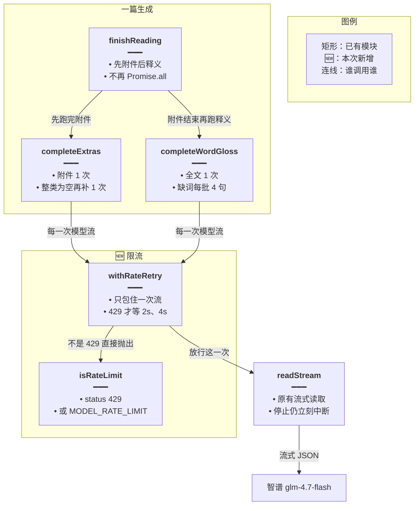
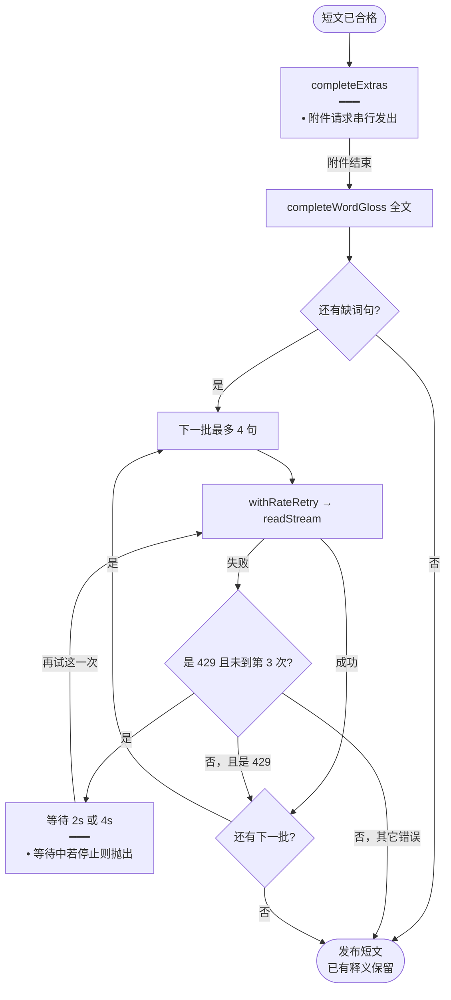
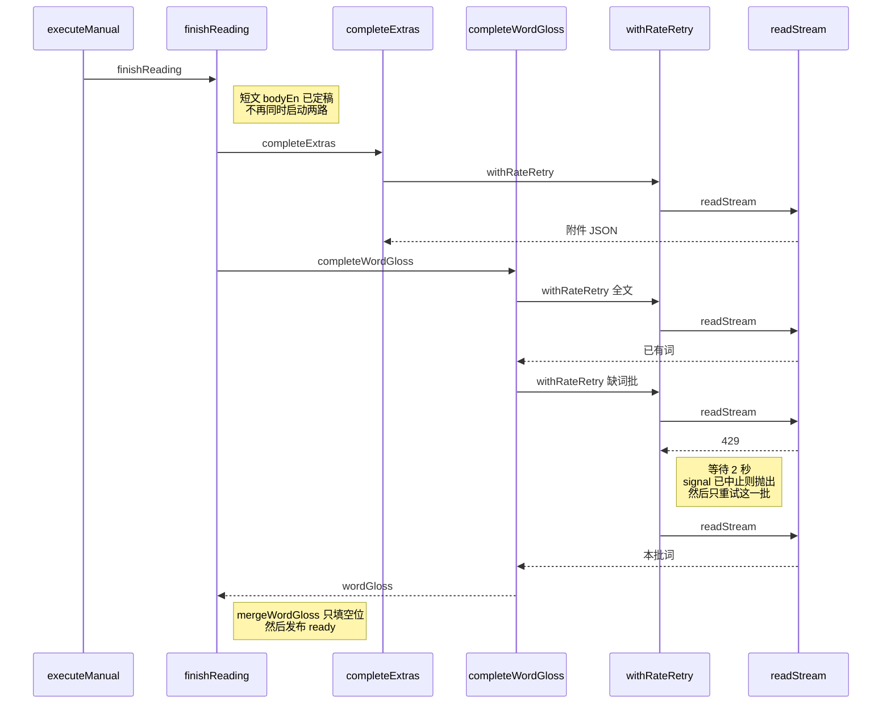
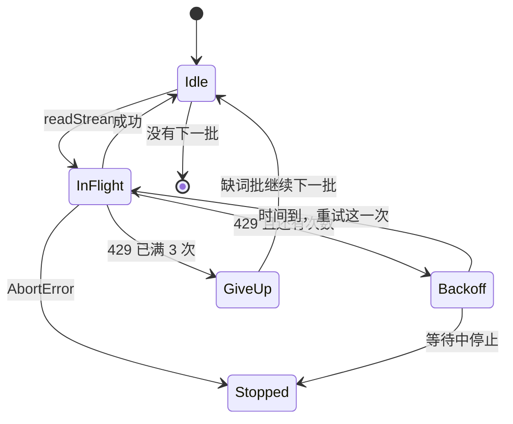

# 阅读限流重试 — 实现思路

> **状态**：已落地  
> **日期**：2026-10-20  
> **需求摘要**：每日阅读一次生成里的多次模型调用不再打满账户速率；遇到 429 只等这一次并重试，后面的缺词批继续发，短文照常发布。

## 延伸阅读

- [阅读分路并行](./阅读分路并行.md)（附件与释义目前 `Promise.all` 同时发出。本文取消这两路的同时请求，调用内容和落库形状不改）
- [阅读附件分请求](./阅读附件分请求.md)、[阅读截断补释义](./阅读截断补释义.md)（拆开请求是为了躲开 8192 截断。本文不把它们并回一次调用）

---

## 0. 读本文你将得到什么

- 要解决的问题：一篇阅读会连着打短文、附件、全文释义、缺词批。智谱返回 `429`「账户已达到速率限制」后，`completeWordGloss` 整段退出，后面的句子不再补中文。
- 一句话方案：同一篇里的模型请求改成一次只飞一路；只有 429 才等待并重试这一次，重试仍失败就放过这一批、继续下一批。
- 只改后端 `english-daily-reading.service.ts`。预览顺序、落库 `{en, words}`、8192、短文失败规则都不改。
- 分两段：M1 串行附件和释义；M2 429 退避，并且缺词批不再因为这一次失败而停掉后续批。
- 最大风险：串行后等待变长。换来的是后半段不再被 429 直接丢掉。

---

## 1. 需求与边界

### 1.1 用户故事

| 角色 | 场景 | 行为 | 期望结果 |
|------|------|------|----------|
| 读者 | 用 `glm-4.7-flash` 生成一篇阅读 | 短文合格后还要附件和逐词释义 | 账户限流时稍后重试，后半段仍能补上中文 |
| 同一读者 | 全文释义写不完，还要按每批 4 句补缺词 | 中间一批返回 429 | 这一批重试；重试尽了也继续后面的批 |
| 定时任务 | 与手动生成走同一个 `finishReading` | 不另开对话 | 限流规则两边相同 |

### 1.2 范围

| 在范围内 | 不在范围内 |
|----------|------------|
| 同一篇阅读内部的模型请求频率 | 把短文、附件、释义并回一次调用 |
| 429 / `MODEL_RATE_LIMIT` 的有限次退避 | 提高 `maxTokens`，或改用对话 agent |
| 缺词批在 429 之后继续 | 全站所有大模型调用共用一把锁 |
| 停止按钮仍立刻中断，不进入退避 | 成功的调用之间插入固定间隔 |
| | 改预览事件名、详情对照、历史记录 |

### 1.3 约束与依赖

- 复用现有 `readStream`、`completeExtras`、`completeWordGloss`、`placeGapGloss`、`mergeWordGloss`。不新增依赖。
- `apps/backend/src/main.ts` 的 `express-rate-limit` 限制的是打进本服务的 HTTP，管不到打出去的智谱请求，不能拿来用。
- `formatAgentStreamError` 只把 429 收成给聊天看的文案，没有重试。阅读这里只借用它的判断方式（`status === 429` 或 `lc_error_code === 'MODEL_RATE_LIMIT'`），不引用对话模块。
- 2026-10-19 23:08 那次：全文释义后日志 `释义缺词 sentences=13`，接着 3 次缺词请求，23:11 第 3 次 429，日志 `释义补全失败`。外层 `catch` 直接 `return`，第 4 批没有发出。

---

## 2. 方案总览

**一句话方案**：同一篇生成里模型请求串行；429 只重试当前这一次（2 秒、4 秒），两次仍失败则跳过这一批并继续后面的批。

| # | 设计要点 | 理由 |
|---|----------|------|
| 1 | `finishReading` 先 `await` 附件，再跑释义 | 现在两路同时在飞，账户按并发和频率一起计。预览本来就是先附件后释义，串行与预览顺序一致 |
| 2 | 退避只包住单次 `readStream` | 短文不合格的重写、附件补空、缺词分批都还在。限流重试不代替内容重试 |
| 3 | 成功调用之间不等待 | 间隔只在 429 之后出现，平常生成不被拖慢 |
| 4 | 缺词循环里捕获耗尽的 429，`continue` 下一批 | 今天一次 429 会退出整个 `completeWordGloss`，尾巴整段留空 |
| 5 | 最多 3 次尝试（含首次） | 账户持续限流时不能一直占着这条 SSE |

---

## 3. 现状与复用

| 能力 | 仓库中已有 | 本需求中的用法 |
|------|------------|----------------|
| 短文合格后两路同时要 | `finishReading` 里 `Promise.all` | 改为先后 `await`。预览缓冲可以去掉，附件的 `onDelta` 结束再写释义 |
| 流式读取 | `readStream` | 外面包一层退避。停止信号在等待期间也要生效 |
| 缺词分批 | `completeWordGloss`，`GLOSS_BATCH = 4` | 批大小和「只补缺词」不变。429 耗尽后继续下一批，其它错误仍沿用现在的整段返回 |
| 限流错误形态 | `agent.service.ts` 的 `formatAgentStreamError` | 只复用判断条件，不把聊天文案拿进阅读 |
| 入站限流 | `main.ts` 的 `express-rate-limit` | 不适用 |

**调研结论**：429 出在缺词批，不是短文 JSON 解析失败。已合并进 `gloss` 的句子会留下，没发到的批直接消失。并行本身少不了几次 HTTP，真正把频率打满的是「附件和释义重叠」加上「一批失败就放弃后续」。

---

## 4. 架构图



**图内方法说明**：

| 方法 | 功能 |
|------|------|
| `finishReading` | 短文合格后的编排。改为串行调用附件和释义，保证同一篇同时只有一路打到模型 |
| `completeExtras` | 要词汇、语法、题目。次数规则不变，每次请求经过退避 |
| `completeWordGloss` | 全文释义后再按缺词分批。某一批 429 重试尽了仍进入下一批 |
| `withRateRetry` | 新增。执行一次 `readStream`；仅 429 等待后重试，最多共 3 次 |
| `isRateLimit` | 新增。认出 LangChain 的 429 / `MODEL_RATE_LIMIT`，避免把废稿当限流 |
| `readStream` | 已有。真正向模型发流。停止信号中止时不重试 |

**读图要点**：

- 限流层夹在业务编排和 `readStream` 之间，不改提示词，也不改落库。
- 附件和释义不再同时进入 `withRateRetry`，峰值并发从 2 降到 1。
- 入站 `express-rate-limit` 不在这条链上。

---

## 5. 主流程图



**图内方法说明**：

| 方法 | 功能 |
|------|------|
| `completeExtras` | 附件全部结束才开始释义，避免两路重叠触发账户频率 |
| `completeWordGloss` | 先全文释义，再按 `missingWordSlots` 分批 |
| `withRateRetry` | 把单次流式请求包进最多 3 次尝试 |
| `readStream` | 发出这一次 HTTP 流。成功则把本批交 `mergeWordGloss` |
| `isRateLimit` | 流程图里「是 429」的判断。停止造成的 `AbortError` 不算 429 |

**读图要点**：

- 429 的回路只回到当前这一批，不会把已成功的批再打一遍。
- 429 用尽后走「还有下一批」，尾巴仍有机会。其它错误维持现在的行为：留下已有释义并发布。
- 用户停止在等待或读流中都会跳出，不发布半成品为成功路径里的重试。

---

## 6. 核心时序图



**图内方法说明**：

| 方法 | 功能 |
|------|------|
| `executeManual` | 手动生成入口。定时篇的 `ensurePassage` 同样调用 `finishReading`，不另写一套 |
| `finishReading` | 串行等待附件返回值，再等待释义返回值，合并后交给发布 |
| `completeExtras` | 一次附件请求。整类为空的补请求也各自包一层退避 |
| `completeWordGloss` | 全文一次，缺词按批。某批最终仍 429 时跳到下一批 |
| `withRateRetry` | 看到 429 才等待。成功则立刻把文本交回调用方 |
| `readStream` | 向智谱发这一次流。429 从这里抛出，由 `withRateRetry` 接住 |

**读图要点**：

- 时间上附件的 HTTP 完全结束后，释义的第一次才发出。
- 429 不回到短文重写，也不回到全文释义，只重发当前缺词批。
- 发布仍在两路都有结果之后。短文不合格的那条路不经过这张图。

---

## 7. 状态机



**图内方法说明**：

| 方法 | 功能 |
|------|------|
| `readStream` | `Idle → InFlight` 的动作。每次只代表一条 HTTP |
| `isRateLimit` | 决定进入 `Backoff` 还是把错误抛出。非 429 不进这张图的等待态 |
| `withRateRetry` | 持有尝试次数。第 3 次仍 429 进入 `GiveUp` |

**读图要点**：

- `GiveUp` 只结束这一批。缺词循环回到 `Idle` 再发下一批，而不是结束整次释义。
- `Stopped` 不再进入 `InFlight`。

---

## 8. 模块职责与接口草图

### 8.1 模块一览

| 模块 | 职责 | 新增/改动 | 预估路径 |
|------|------|-----------|----------|
| `finishReading` | 附件、释义改为先后执行 | 改 | `apps/backend/src/services/english-learning/english-daily-reading.service.ts` |
| `withRateRetry` / `isRateLimit` | 单次流的 429 退避 | 新增，同文件私有函数 | 同上 |
| `completeWordGloss` | 一批 429 耗尽后继续 | 改循环 | 同上 |
| 提示词、`placeGapGloss`、详情 | 不改 | — | — |

### 8.2 关键接口

```typescript
// 认出账户限流；内容废稿和停止不能走进退避
function isRateLimit(err: unknown): boolean {
	// LangChain 把 HTTP 429 收成 status 或这个错误码
	const o = err as { status?: number; lc_error_code?: string };
	// 两个条件命中才重试，避免按文案误判
	return o?.status === 429 || o?.lc_error_code === 'MODEL_RATE_LIMIT';
}

// 包住一次 readStream。成功路径不睡觉，429 才等
async function withRateRetry<T>(run: () => Promise<T>, signal?: AbortSignal): Promise<T> {
	// 含首次最多 3 次，避免账户一直限流时占住 SSE
	for (let attempt = 0; attempt < 3; attempt += 1) {
		try {
			// 真正发流仍是原来的 readStream
			return await run();
		} catch (err) {
			// 停止，或已是最后一次，或不是 429：把错误交回调用方
			if (signal?.aborted || attempt === 2 || !isRateLimit(err)) throw err;
			// 2 秒然后 4 秒。只出现在失败之后
			await wait(2000 * 2 ** attempt, signal);
		}
	}
	// 循环里已经 return 或 throw。这里只满足类型
	throw new Error('rate limit');
}
```

缺词循环只多一个分支：`withRateRetry` 最终仍抛出 429 时 `continue`，不 `return`。停止造成的错误继续向上抛。

### 8.3 数据模型

| 字段/实体 | 来源 | 存储 | 说明 |
|-----------|------|------|------|
| 尝试次数 | 内存 | 不落库 | 每次 `withRateRetry` 自己从 0 数到 2 |
| `wordGloss` | 已成功的批 | `english_daily_readings.extras` | 形状仍是 `{en, words}`。429 跳过的句保持没有中文 |
| 预览文本 | SSE | 不改事件名 | 串行后先看到附件 JSON，再看到释义 JSON |

---

## 9. 分阶段实现步骤

| 阶段 | 目标 | 交付物 | 依赖 |
|------|------|--------|------|
| M1 | 同一篇同时只有一路模型请求 | `finishReading` 先后 await；预览缓冲删掉后顺序仍是附件然后释义 | 无 |
| M2 | 429 不吃掉后续缺词批 | `withRateRetry` + 循环 `continue` | M1 |

- [ ] M1：`Promise.all` 改成先附件、后释义。定时与手动都走这一处
- [ ] M1：释义 `onDelta` 直接写预览，确认不会再和附件 JSON 交错
- [ ] M2：`isRateLimit` 只认 status 与 `MODEL_RATE_LIMIT`
- [ ] M2：等待可被 `AbortSignal` 打断
- [ ] M2：缺词批 429 耗尽后继续下一批；非 429 仍留下已有释义并发布

---

## 10. 关键决策与备选方案

| 决策 | 选用 | 备选 | 为何不选备选 |
|------|------|------|--------------|
| 如何少撞限流 | 串行 + 429 才等待 | 把附件和释义并回短文那一次 | 并回去会再次顶满 8192，后半段更容易没有中文 |
| 等待加在哪 | 只加在失败的那一次 | 每次调用固定睡几秒 | 固定间隔拖慢没有限流的生成 |
| 重试用尽之后 | 跳过这一批，继续下一批 | 结束整个释义 | 现在就是结束整个释义，所以尾巴全空 |
| 锁的范围 | 这一篇内部串行 | 进程里所有阅读请求共用一把锁 | 不同用户、不同 Key 不该互相堵住。若定时篇和手动篇共用同一把 Key 仍 429，再收成一把锁 |
| 依赖 | 服务里一个私有函数 | `p-queue` 一类库 | 只有「一次一流、失败再等」，标准 `setTimeout` 够用 |

---

## 11. 风险、边界与待确认

| 项 | 等级 | 说明 | 缓解 |
|----|------|------|------|
| 生成变慢 | 中 | 附件和释义不再重叠，墙钟变成相加 | 只去掉重叠，不在成功调用之间加间隔 |
| 账户持续 429 | 中 | 每批最多 3 次后仍可能没词 | 跳过该批继续后面的；短文照发 |
| 等待期间停止 | 低 | 定时器没接上 signal 会多等几秒 | `wait` 在 abort 时立刻 reject |
| 误判限流 | 低 | 把废稿重试会多打请求 | 只认 status 和 `MODEL_RATE_LIMIT` |

**待确认**：

- [ ] 定时篇与手动篇若共用同一 `GLM_API_KEY` 且同时跑，一篇内部串行仍可能两篇并发。验证方式：同时触发两边，看是否仍 429。仍 429 再加阅读服务级的一把锁，不提前做。

---

## 12. 验收清单

| # | 用例 | 步骤 | 期望 |
|---|------|------|------|
| AC1 | 平常生成 | 短文合格，模型不返回 429 | 请求顺序是短文，然后附件，然后释义。预览先附件 JSON 后释义 JSON。成功调用之间没有人为等待 |
| AC2 | 缺词批 429 一次 | 第 2 批第一次 429，第二次成功 | 只重发第 2 批。第 3 批照常发。日志不再是一次 429 就 `释义补全失败` 后结束 |
| AC3 | 429 连续 3 次 | 某一批三次都 429 | 这一批没有新词。下一批仍发出。已写上的中文还在，短文发布 |
| AC4 | 停止 | 退避等待中点停止 | 不再发下一次 HTTP，生成记为停止 |
| AC5 | 调用次数 | 没有 429 的一篇 | 与现在相同：短文 1～2、附件 0～2、释义 1 加缺词批。重试次数不计入这个下限 |

---

## 13. 预估改动面

| 类型 | 路径 |
|------|------|
| 后端 | `apps/backend/src/services/english-learning/english-daily-reading.service.ts` |
| 前端 | 无 |
| 规则与提示词 | 无 |

---

（本文档为规划态实现思路；落地后以源码为准）
