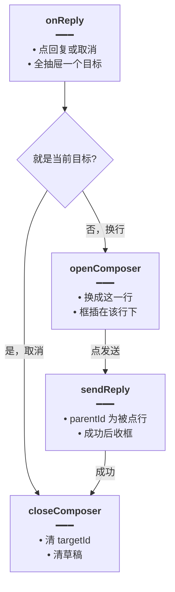
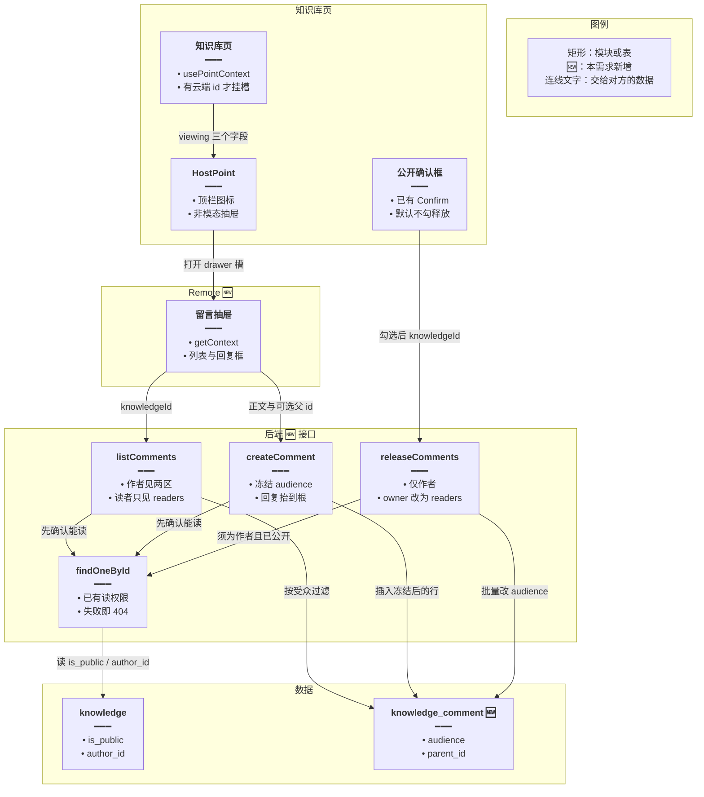
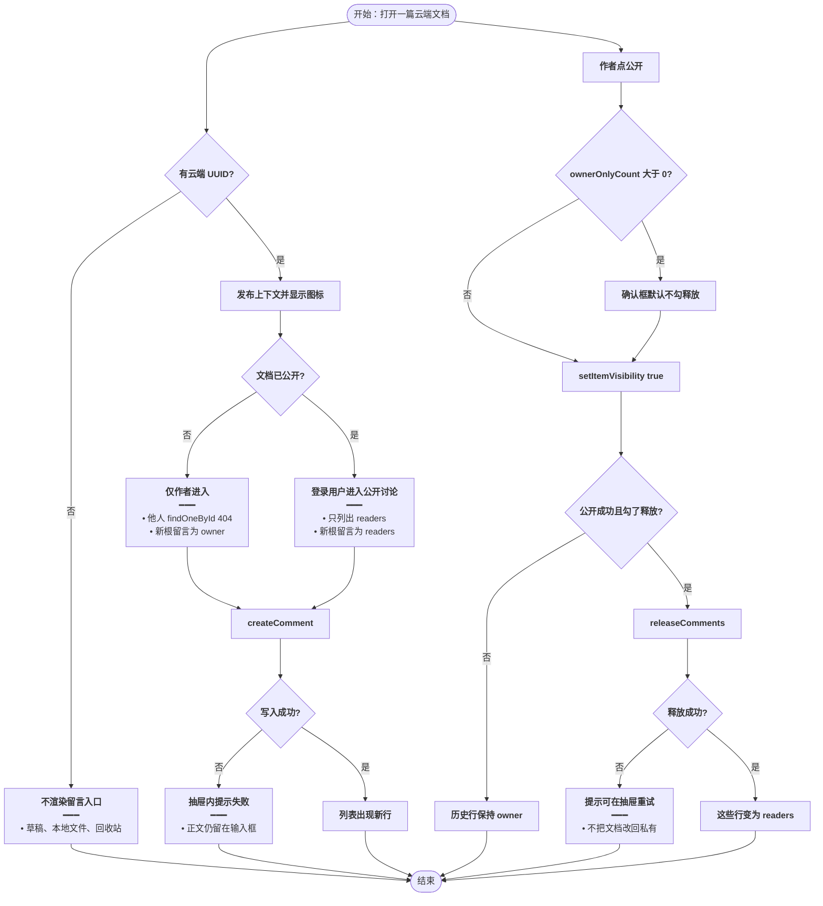
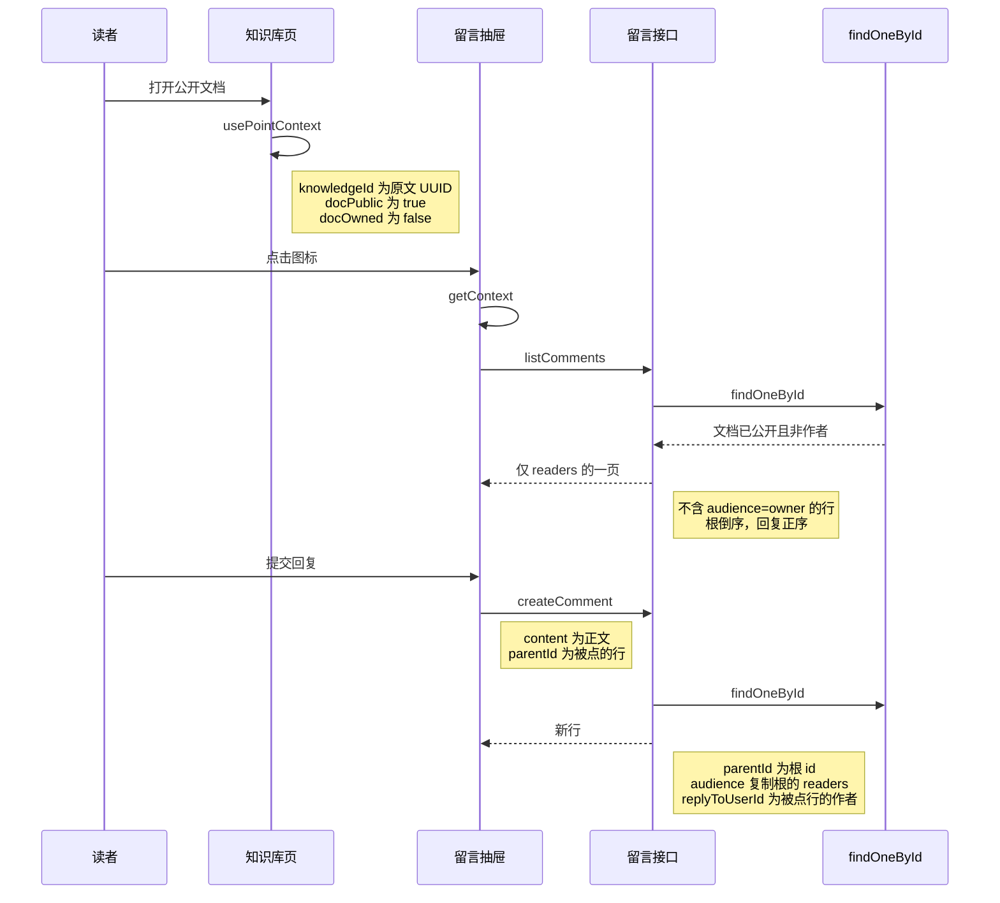
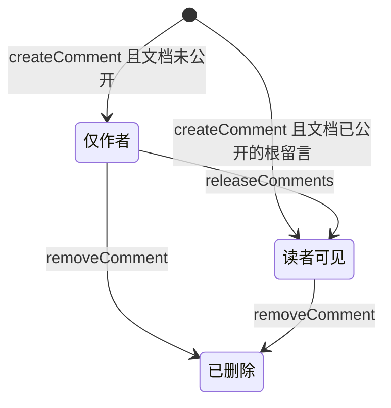

# 知识库文档留言插件 — 实现思路

> **状态**：主体已落地。实现细节以 [文档留言](../../knowledge/文档留言.md) 为准；上文比对仍是选定方案，和代码不一致时该归档优先于 [§14](#14-落地补充原方案未写现已实现)。  
> **日期**：2026-11-18  
> **需求摘要**：登录用户在知识库云端文档上留言并回复；插件是否可见跟文档读权限走；文档从仅自己可见改为公开时，私有期留言默认不进入公开讨论，作者可显式释放。列表排法对齐 [掘金评论区](https://juejin.cn/post/7691154454523576354)。  
> **一句话方案（预告）**：在知识库页新增扩展点抽屉；留言读权限复用「作者或已公开」；每条留言创建时冻结受众，公开确认默认不释放历史留言。抽屉里根留言按时间倒序，回复按时间正序且默认只露最早两条，回复框贴在被点的那一行下面。

## 延伸阅读

- [文档留言](../../knowledge/文档留言.md)（已落地归档：分页、条数、错误条、顶栏文案）
- [插件接入点统一](../plugins/插件接入点统一.md)（扩展点只有四种角色，本需求走 `page` 抽屉）
- [知识库助手接入 Agent](../../知识库助手接入Agent.md)（同一页的助手面板，留言抽屉不接管它）

---

## 0. 读本文你将得到什么

- 留言插件怎么挂到当前打开的云端文档上，以及为什么不能只做独立插件页。
- 比对后的选定方案：创建时冻结受众；公开文档时默认不放出私有期留言，确认框可勾选一并释放。
- 主项目改扩展点目录、知识库页和可见性确认；后端新增留言表与接口；界面在新的 Remote 插件里。
- 分四段落地：先能看能回，再接公开释放，再补编辑删除和点赞，最后收边界。评论排列的调整在这套权限之上，批准后再改插件，不改表。
- 抽屉排法对齐掘金：根倒序、回复正序、默认两条、回复框贴行、`...` 里才放改和删。表情和图片仍然不做。
- 最大风险是作者在仅自己可见时写下的内容，在文档公开后被别的登录用户看见。
- 落地后补上的、原文没写或写反的行为：顶栏文案「留言」、抽屉标题「共 N 条 / 已加载 N 条」、根列表滚动加载、回复按钮「还有 N 条回复」、单条公开与取消公开。见 §14。

---

## 1. 需求与边界

### 1.1 用户故事

| 角色 | 场景 | 行为 | 期望结果 |
|------|------|------|----------|
| 文档作者 | 文档仅自己可见 | 打开留言并写下一条 | 只有自己能看见；读者即使猜到文档 id 也读不到 |
| 文档作者 | 准备把文档公开 | 在现有「确定公开」确认里看到未释放条数 | 默认不勾选；不勾则历史留言仍只有自己能看见 |
| 文档作者 | 已经公开，当时没释放 | 在留言抽屉里再次释放 | 这些历史留言进入公开讨论，不必把文档改回私有再公开 |
| 其他登录用户 | 文档已公开 | 打开同一篇并回复一条公开留言 | 回复出现在该条下面，并标明回复谁 |
| 其他登录用户 | 文档仅作者可见，或已改回私有 | 打开留言接口 | 与文章详情一样得到「不存在」，列表里不出现这篇 |
| 留言作者 | 自己的一条留言 | 修改正文或删除 | 只能改自己的正文；文档作者可以删掉别人的留言 |
| 任意登录用户 | 未保存草稿、本地 Markdown、回收站预览 | 看编辑器顶栏 | 没有留言入口 |

### 1.2 范围

| 在范围内 | 不在范围内（非目标） |
|----------|----------------------|
| 文档级留言：列表、发表、一层回复、编辑自己的、删除、作者标记、时间、空态 | 划线、选区锚点、正文旁批注 |
| 点赞（第二阶段，单独一张赞表）；相对时间；根上的回复计数 | @、站内通知、表情选择器、图片、审核队列、置顶、匿名、按热度排序 |
| 可见性跟知识库文章读权限；私有改公开时的释放策略 | 分享链接页（快照，不挂插件）、会员才能留言 |
| 云端已保存文档（UUID） | 本地 `__local_md__:` 文件、未保存草稿、回收站预览 |
| 软删除；删文档时同一事务删掉留言 | 从回收站把留言恢复回原文档（回收站不还原原行） |

主流留言里和本仓库约束对齐后留下的是：身份、时间、回复、改删、作者可治理、计数、点赞。通知和富文本要另做一套，本文不带上。

### 1.3 约束与依赖

- 全站知识库接口都有 `JwtGuard`。未登录进不了 `/knowledge`，留言同样要求登录。没有「互联网匿名可见」。
- 文章可见性只有 `knowledge.isPublic`。`false`：仅 `authorId` 可读。`true`：任意登录用户可读。读不到统一 `NotFoundException`（「知识库条目不存在」），避免用 403 告诉别人这篇存在。
- 插件必须走现有扩展点：`points/catalog.ts` 登记，页面放 `HostPoint`，Remote 只用 `api.modules.point`，HTTP 走已有的 `http:plugin-api`。不为留言新造 `modules/knowledgeComments`。
- 他人的公开文档今天会按新草稿打开（`editingKnowledgeId = null`），保存仍是新建。留言不能借这个空 id，也不能把保存出的新文档当成原讨论。
- 公开确认已在 `KnowledgeList` 的 `Confirm` 里。释放选择放在同一次确认，不另做一套公开流程。
- 助手面板继续用现在的开关。留言抽屉 `modal: false`，不遮死编辑器，也不关闭助手。

---

## 2. 背景

- **谁、在什么场景、卡在哪**：作者想在一篇知识文档下跟其他登录用户讨论。文档有两种读者范围——仅自己、以及所有登录用户。留言若比文档更宽，私有笔记会漏出去；若比文档更窄，公开文会变成只有作者能讨论。
- **现状缺口**：知识库没有留言表，也没有 `knowledge.*` 扩展点。可见性切换只改 `isPublic`，确认文案只说明「登录用户可以查看该文档」，没有留言的去向。打开别人的公开文档时，页面丢掉原文 id，插件即使挂上也不知道讨论该挂哪一篇。
- **不解决会怎样**：要么插件在私有文档上对作者没用，要么作者把私有期随手写的句子在点公开时整包交给所有登录用户。改回私有后如果删数据，再次公开时讨论接不回来。
- **硬约束**：读权限必须跟 `findOneById` 同一条规则，由服务端每次重判，不能信插件上下文里的布尔值。本地文件和未保存草稿不能写出留言行。分享快照不因本文变成可留言页面。

---

## 3. 现状与复用

| 能力 | 仓库中已有 | 本需求中的用法 |
|------|------------|----------------|
| 文章读权限：作者或 `isPublic` | `apps/backend/src/services/knowledge/knowledge.service.ts` `findOneById` | 直接复用。留言每个写读接口先走它，读不到就 404 |
| 仅作者改可见性 | 同文件 `setVisibility`；`PUT /knowledge/visibility/:id` | 直接复用。不在这里改留言行 |
| 公开确认框 | `apps/frontend/src/views/knowledge/KnowledgeList.tsx` `onConfirmVisibility` | 扩展。改为公开且存在未释放留言时多一个默认不勾的选项 |
| 列表项上的 `isPublic` / `isOwned` | `KnowledgeRecord`；`knowledgeStore.setItemVisibility` | 扩展。打开文档时写入「正在看的文档」，供扩展点上下文使用 |
| 他人公开文档按新草稿打开 | `apps/frontend/src/views/knowledge/index.tsx` `handlePickRecord` | 扩展。原文 id 改记到 viewing，`editingKnowledgeId` 仍只在本人文档上有值 |
| 本地文件 id | `apps/frontend/src/views/knowledge/utils.ts` `isKnowledgeLocalMarkdownId` | 直接复用。带 `__local_md__:` 前缀不挂入口 |
| 扩展点抽屉 | `apps/frontend/src/federation/points/catalog.ts`；`HostPoint`；`ebook.read` 的 `page` + `icons` | 扩展。新增点 `knowledge.article`，角色照阅读页抽屉，但 `modal: false`、由知识库页自己挂 |
| 页面上下文 | `usePointContext` / `publishPointContext` | 直接复用。只发布目录里声明的键；布尔 `false` 不会被空字符串过滤丢掉 |
| 插件 HTTP | `apps/frontend/src/federation/runtime/index.ts` 的 `http`，权限 `http:plugin-api` | 直接复用。Remote 不自己存 token |
| 用户展示名和头像 | `user.username`、`profile.avatar` | 直接复用。列表只带用户名和头像，不带邮箱 |
| 想法实体上的 `isPublic` | `apps/backend/src/services/ebook/ebook-thought.entity.ts` | 不适用。那是想法自己的公开开关，不是文档权限，也不含回复 |
| 分享知识文章 | `apps/backend/src/services/share/share.service.ts` 快照 / 实时正文 | 不适用。分享页不挂这个扩展点 |
| 回收站 | `knowledge.service.ts` `remove` 写快照后物理删除 | 扩展。同一事务删除该文档留言。回收站没有还原原行，留言不进快照 |
| 插件启用开关 | 插件中心 + `isPluginEnabled` | 直接复用。未启用则 `HostPoint` 不画出图标 |

**调研结论**：文章权限和扩展点抽屉都不用重写。缺的是留言数据、一个知识库扩展点，以及「当前正在看哪篇云端文档」——今天这个 id 在看别人的公开文档时被清掉。电子书想法不能当留言表来改。候选方案都接在 `findOneById`、`HostPoint` 和 `KnowledgeList` 的确认框上。

---

## 4. 方案比对与最终方案

### 4.1 候选方案

#### 方案 A：知识库页扩展点抽屉（扩展现有插件模型）

- **做法**：在 `catalog.ts` 增加点 `knowledge.article`，角色为 `page` 抽屉，触发器 `icons`，`owner: 'page'`，`modal: false`。`apps/frontend/src/views/knowledge/index.tsx` 在当前有云端文档 id 时渲染 `HostPoint`（触发器 + 抽屉），并用 `usePointContext` 发布 `knowledgeId`、`docPublic`、`docOwned`。Remote 只读 `api.modules.point.getContext()`，通过 `http` 调留言接口。注册表 `host.surface = knowledge.article`，`host.slot = drawer`，`injectRoute: false`，权限含 `modules:point` 与 `http:plugin-api`。
- **能工作的原因**：阅读页已经用同一套角色把插件放进当前书。知识库路由不在英语学习布局下，所以抽屉由本页自己挂，这是接入指南里的形态 B。
- **主要代价**：要改目录类型里的 `ContextKey`，并在知识库页留下当前文档 id。插件工程是新的 Remote，不在本仓。

#### 方案 B：插件中心独立页（复用整页挂载）

- **做法**：注册表 `injectRoute: false`，像学习笔记那样用 `PluginHostPage` 做静态路由，例如 `/plugins/knowledge-comments`。用户从插件中心进入，插件自己拉「我能读的文档」再选一篇。留言接口与方案 A 相同。
- **能工作的原因**：主项目不必新增 `HostPoint`。文档 id 由插件里的选择器提供，不依赖编辑器当前篇。
- **主要代价**：留言离开正在读的文档。用户要先离开编辑器再找一篇，回复时看不到正文。和「挂在这篇文章上」的用法相反。

#### 方案 C：写进知识库页面，不做插件（复用现状页面）

- **做法**：在 `knowledge/index.tsx` 右侧加一块留言栏，组件放在 `apps/frontend/src/views/knowledge/`。数据接口与方案 A 相同，不改 `catalog.ts`，不建 Remote。
- **能工作的原因**：少一次注册表和一次联邦加载，权限规则可以一模一样。
- **主要代价**：以后下线或替换留言必须发主项目。用户点名的是插件，插件中心的启用开关也用不上。

### 4.2 比对

| 维度 | 方案 A 扩展点抽屉 | 方案 B 独立页 | 方案 C 写进知识库页 |
|------|-------------------|---------------|---------------------|
| 正确性 | 上下文只作界面提示；每次请求仍走 `findOneById`。换篇时 `knowledgeId` 变化，插件重拉 | 不依赖编辑器状态，选错文档的可能在选择器上。权限同样走服务端 | 与 A 相同，少一层「上下文和请求不一致」 |
| 复用 / 与现状契合 | 复用 `HostPoint`、`usePointContext`、`http:plugin-api`。阅读页已有 `page` + `icons` | 复用 `PluginHostPage`。知识库页零改动，但接不上「当前这篇」 | 复用知识库页布局。不复用插件启用和扩展点 |
| 改动面 | `catalog.ts`、知识库页、`KnowledgeList` 确认框、新后端模块、新 Remote、注册表 JSON | 新路由、新 Remote、新后端。知识库页可以不动 | 知识库页 + 新后端。无 Remote、无目录 |
| 复杂度 | 多一个扩展点和三个上下文字段。抽屉开关沿用槽会话，不进页面 state | 插件内要做文档选择和权限展示，等于另一套知识库列表 | 少一个运行时。主项目多一块业务 UI |
| 体验 | 顶栏图标打开抽屉，正文还在。`modal: false` 时还能滚动编辑器 | 离开当前文档再讨论，来回至少多一步 | 和正文同一页，步骤最少 |
| 风险 | 未启用插件时没有图标，作者可能以为功能不存在。抽屉和助手同页，需避免互斥 | 公开文档的读者不知道要去插件中心才能留言 | 不能按插件下线。和「插件」这个交付物不符 |
| 可维护性 | 留言 UI 在 Remote，权限在后端一处。主项目只负责「这是哪篇、公开与否」 | 权限在后端，但文档选择会和知识库列表各写一遍 | 权限和 UI 都在主项目，改留言就要发主应用 |

### 4.3 综合考量

权重先放在「讨论必须挂在当前这篇」和「必须是可启用的插件」上。这两条来自需求本身，也来自现有扩展点：业务页不自己造抽屉开关。方案 A 在这两条上都成立。方案 C 少一个 Remote，步骤更短，但做完就不是插件，插件中心无法关闭它，这项优点舍弃。方案 B 主项目改动更小，也不必处理编辑器里的文档 id，但读者要离开正文才能回复，舍弃「少改知识库页」这一项。权限谁说了算不由插件形态决定，三种做法都把判定放在 `findOneById` 之后，所以正确性不构成选 B 或 C 的理由。

### 4.4 最终方案

#### 背景

知识库文章只有作者可读、或任意登录用户可读。插件体系要求新能力挂到已登记的槽上，由 `HostPoint` 画图标和抽屉。当前页没有「正在看的云端文档 id」：自己的文档记在 `knowledgeEditingKnowledgeId`，别人的公开文档会把这个字段清空，本地文件则使用 `__local_md__:` 前缀。留言若只看编辑 id，公开文档的读者无法回复；若插件另开一页，讨论和正文分开。

#### 具体思路

1. 主项目只增加扩展点和「当前云端文档」上下文。留言列表、输入框、回复缩进放在新 Remote。后端单独模块，不把留言列塞进文章详情。
2. 数据从打开的列表项进入 store 的 viewing 字段，经 `usePointContext` 到插件；插件再请求留言接口。接口内部重新 `findOneById`，不采用上下文里的 `docPublic` 做放行。
3. viewing 放在 `knowledgeStore`，和 `knowledgeEditingKnowledgeId` 并列。`setItemVisibility` 已在 store 里改列表，同一处顺手改当前篇的 `docPublic`，不依赖该行是否还留在当前分类列表里。页面 `useState` 接不到这次更新。
4. 没有云端 UUID（草稿、本地文件、回收站预览）不渲染 `HostPoint`。接口失败显示抽屉内错误，不把编辑器正文清掉。重复提交用按钮上的进行中状态挡住。

#### 实现方案

**一句话**：在知识库页新增扩展点抽屉；留言读权限复用「作者或已公开」；每条留言创建时冻结受众，公开确认默认不释放历史留言。

| 步骤 | 谁 | 做什么 | 输入 → 输出 |
|------|----|--------|-------------|
| 1 | `points/catalog.ts` | 登记 `knowledge.article`，上下文键 `knowledgeId`、`docPublic`、`docOwned` | 点定义 → `HostPoint` 能画图标和抽屉 |
| 2 | `knowledge/index.tsx` | 有云端 viewing id 才挂触发器和抽屉；`usePointContext` 发布这三个键；离开页面 `closePoint` | viewing → 插件 `getContext()` |
| 3 | `knowledgeStore` + `handlePickRecord` | 云端文档写入 viewing；仅本人可编辑时才写 `editingKnowledgeId` | 列表项 → `{ id, isPublic, isOwned }` |
| 4 | Remote 抽屉 | 订阅上下文，拉列表、发表、回复 | `knowledgeId` → 留言树 |
| 5 | `KnowledgeList` 确认框 | 改为公开且 `ownerOnlyCount > 0` 时显示默认不勾的「一并公开已有留言」 | 勾选与否 → `setVisibility` 之后可选 `release` |

#### 选定原因

1. **复用**：方案 A 沿用阅读页同一类 `page` 抽屉和 `http:plugin-api`。牺牲：多一个 Remote 和注册表项。
2. **体验**：图标在当前文档顶栏，正文不必离开。牺牲：知识库页要挂两个 `HostPoint`，比方案 B 多改一处页面。
3. **可维护性**：停用插件只关注册表启用位，主项目槽可以留着。牺牲：比方案 C 多一次联邦加载。
4. **风险**：抽屉不接管助手，`modal: false` 避免挡住编辑。牺牲：要约定离开 `/knowledge` 时 `closePoint`，否则槽会话会留在内存里。

#### 优势

- 相对方案 B：回复发生在正在看的那一篇上，文档 id 由页面给出，插件不必再做一套文档选择器。
- 相对方案 C：留言界面随插件启用位出现或消失，不必为下线留言再改知识库页面结构。

#### 怎么实现

1. `ContextKey` 增加 `knowledgeId`、`docPublic`、`docOwned`。`pointDefs` 增加 `knowledge.article`：`page` 槽名 `drawer`，`payload: 'none'`，`trigger: 'icons'`，`drawer: { owner: 'page', modal: false, persist: false }`。`signals` 和 `commands` 留空。点赞数放在插件自己的标题上，不占用只给词库顶栏用的 `stats`。
2. 知识库顶栏在 `viewing.id` 为云端 UUID 时渲染 `<HostPoint pointId="knowledge.article" slot="drawer" part="trigger" />`，同页再渲染抽屉槽。`usePointContext('knowledge.article', viewing)`。卸载时 `closePoint('knowledge.article', 'drawer')`。
3. `handlePickRecord`：本地 id 清空 viewing；云端 id 写入 viewing。`isOwned === false` 时 `editingKnowledgeId` 仍为 `null`，保存继续走新建，新文档不复制留言。
4. 插件 `subscribe` 后若 `knowledgeId` 变化或 `docPublic` 变化，重新请求列表。发表、回复走第 9 节的创建函数。
5. 公开确认先要摘要；用户确认公开成功后，仅当勾选了释放才调用释放接口。释放失败不把 `isPublic` 改回去。

受众冻结、一层回复、viewing 与 editing 分离的取舍在 §4.5。

### 4.5 其他关键决策

#### 4.5.1 私有期留言在文档公开后的去向

##### 候选方案

###### 方案 A：留言实时跟随文档 `isPublic`（复用读权限，不另存受众）

- **做法**：表里不存受众。`list` / `create` 只调用 `findOneById`。能读文档就能看见该文档全部未删除留言。`setVisibility` 不碰留言。改回私有后他人再次 404，行还在，再次公开又全部出现。
- **能工作的原因**：和 `findOneById` 同一条规则，没有第二套权限。GitHub 仓库公开/私有也是讨论跟仓库走。
- **主要代价**：仅自己可见时写下的句子，在点公开的瞬间对所有登录用户可见。现有确认文案没有这句话。

###### 方案 B：创建时写入 `audience`，只在插件里稍后释放

- **做法**：列 `audience` 取 `owner` 或 `readers`，创建时写死，之后不跟 `isPublic` 自动改。读者的列表加 `audience = readers`。作者能看见两区。抽屉里一条「公开这 N 条」调用 `release`，把该文档未删除的 `owner` 行改成 `readers`。`setVisibility` 保持现状。
- **能工作的原因**：默认不会漏。作者打开抽屉才能释放，不释放则公开文档的讨论区是空的，新留言才进入 `readers`。
- **主要代价**：决定发生在打开抽屉之后。作者可能以为点公开已经把旧留言交出去了，读者却看到空列表。

###### 方案 C：创建时写入 `audience`，公开确认默认不释放，抽屉可补释放

- **做法**：数据与方案 B 相同。`GET /knowledge/:id/comments/summary` 返回 `ownerOnlyCount`。`KnowledgeList` 在「改为公开」且计数大于 0 时，确认框增加复选框，默认不勾。确认后先 `setItemVisibility(id, true)`，勾了再 `release`。没勾则之后仍可在抽屉里调用同一个 `release`。改回私有不更新 `audience`。
- **能工作的原因**：决定落在作者已经在看的那次确认上，默认值偏安全。补释放避免他们必须把文档改回私有再公开一次。
- **主要代价**：确认框多一次摘要请求；公开成功但释放失败时要单独提示，不能假装两步是一个事务。

##### 比对

| 维度 | 方案 A 实时跟随 | 方案 B 只在抽屉释放 | 方案 C 确认框默认不释放 |
|------|-----------------|---------------------|-------------------------|
| 正确性 | 私有期全文会进入公开列表。改回私有不删数据，这点正确 | 不勾就没有入口可勾，默认不漏。读者回复不到 `owner` 行 | 与 B 相同，并且在公开那一次把选择摆出来。释放失败时文档已公开、旧留言仍锁着 |
| 复用 | 只复用 `findOneById`，确认框文案都不用改 | 复用 `setVisibility` 原样。摘要和释放是新接口 | 复用现有 `Confirm` 和 `setItemVisibility`。摘要、释放为新接口 |
| 改动面 | 留言 CRUD。`KnowledgeList` 可不改 | 留言表、列表过滤、抽屉横幅 | 在 B 的基础上改 `onVisibilityClick` / `onConfirmVisibility` 和两套文案 |
| 复杂度 | 无 `audience` 列 | 多一列和一次批量更新 | 与 B 相同，再加确认框的本地勾选状态 |
| 体验 | 公开后讨论立刻在。作者无法留下「这几条不要给人看」 | 公开后讨论是空的，直到作者记得打开插件 | 公开当时就能选。忘记选时抽屉里还能补，空讨论是作者明确留下的 |
| 风险 | 误点公开即泄露。无法只撤回其中几条，除非删除 | 作者误以为已经公开了历史留言 | 两步非同一事务：公开成功、释放失败。用错误提示和抽屉重试接住 |
| 可维护性 | 权限只有文档一行，以后加「链接可见」时留言会跟着变宽 | 受众和文档可见性是两套字段，读的人要知道先看文档再看行 | 与 B 相同。释放只有一个写入口，确认框和抽屉都调它 |

##### 综合考量

这里权重最高的是不要在作者点公开时把私有期文字交出去。需求把这件事单独点出，现有确认文案也只承诺「可以查看该文档」。方案 A 实现最短，没有 `audience` 列，这项优点舍弃，因为它盖不住误公开。方案 B 同样安全，而且知识库列表完全不用改；舍弃的是「少改 `KnowledgeList`」——作者做决定的地方就是这个确认框，把选择留到以后打开抽屉，空列表会被理解成故障。方案 C 用同一个 `release` 接住「当时没勾」的情况，所以 B 的补救路径还在。

##### 最终方案

###### 背景

`setVisibility` 只改 `knowledge.is_public`。私有期间能打开文档的只有作者，此期间产生的留言若在公开时自动出现，就超出确认文案的承诺。公开之后新写的留言又应该让能读文档的人看见，否则公开文档没有讨论。

###### 具体思路

1. 留言行自带 `audience`，取值为 `owner` 或 `readers`。客户端不能传这个字段。
2. 根留言：文档当时 `isPublic` 为真则 `readers`，否则 `owner`。回复继承父留言的 `audience`，这样对一条仅作者可见的留言的回复不会先出现在公开区。
3. 判定顺序固定：先 `findOneById`（读不到即 404），作者列出两种受众，其他登录用户只列 `readers`。文档再改回私有时不改行，他人被挡在 `findOneById`。
4. `release` 仅作者、且文档已经公开时，把该文档未删除的 `owner` 行改成 `readers`。这是单向的。想收回某条，用删除，不做「取消释放」。
5. 摘要失败时仍弹出原来的公开确认，不显示复选框，等于无法在这一步释放（失败即保持锁住）。

###### 实现方案

**一句话**：留言在创建时冻结受众；公开确认默认不释放；作者可在确认框或抽屉调用同一次释放。

| 步骤 | 谁 | 做什么 | 输入 → 输出 |
|------|----|--------|-------------|
| 1 | 留言表 | 保存 `audience`，创建后只允许 `release` 把 `owner` 改成 `readers` | 插入行 |
| 2 | `listComments` | 先读文档，非作者加受众条件 | 文档 + 调用者 → 可见根留言 |
| 3 | `createComment` | 根留言看文档是否公开；回复复制父行受众 | 正文、可选父 id → 新行 |
| 4 | `releaseComments` | 作者且文档已公开时批量改受众 | `knowledgeId` → 更新条数 |
| 5 | `KnowledgeList` | 摘要计数大于 0 才出现复选框，默认 false | 勾选 → 步骤 4 或跳过 |

###### 选定原因

1. **正确性**：默认不把 `owner` 行交给读者。牺牲：公开后的讨论区可能是空的，直到有新留言或作者释放。
2. **体验**：选择出现在已有的公开确认上。牺牲：比方案 A 多一个复选框和一次摘要请求。
3. **风险**：释放失败不回滚公开。牺牲：作者可能看到「文档已公开，历史留言未能公开」，需要再点一次抽屉。
4. **可维护性**：受众只有一个写入口 `releaseComments`。牺牲：比方案 A 多一列，读代码时要同时看文档和行。

###### 优势

- 相对方案 A：作者在仅自己可见时写的内容不会因为点了公开就进入公开列表。
- 相对方案 B：作者不必等到打开插件才发现历史留言还锁着；当时没选，抽屉里仍是同一个接口。

###### 怎么实现

1. 实体字段见 §9.3。不提供按条释放，避免确认框和抽屉各做一套选择。
2. 列表查询见 §9.2 第二段。
3. 创建见 §9.2 第一段。父行若是回复，先抬到根留言，再继承根的 `audience`。
4. 释放见 §9.2 第三段。文档未公开时返回 400，避免出现「文档还是私有，但行已经是 readers」。
5. 确认流程见 §9.2 第四段。`setItemVisibility` 成功后若当前 viewing 就是这篇，把 store 里的 `docPublic` 改成新值，抽屉订阅到上下文变化后重拉。

#### 4.5.2 读者打开公开文档时讨论挂在哪一篇

##### 候选方案

###### 方案 A：store 增加 viewing，与编辑 id 分开

- **做法**：`knowledgeStore` 增加 `knowledgeViewing: { id, isPublic, isOwned } | null`。`handlePickRecord` 对云端文档始终写入 `id = record.id`。仅当 `isOwned !== false` 且不是本地 id 时，才把 `knowledgeEditingKnowledgeId` 设为该 id。`setItemVisibility` 若改的是当前 viewing，同步 `isPublic`。扩展点上下文读 viewing，不读 editing id。
- **能工作的原因**：读者看到的正文就是这篇公开文档，留言的 `knowledgeId` 与之一致。作者保存仍走更新；读者保存仍走新建，新 id 没有旧留言。
- **主要代价**：多一组 store 字段。所有「清空编辑器」的路径（新建草稿、删当前篇、回收站预览）都要把 viewing 一并清空。

###### 方案 B：不增加 id，只有作者自己的文档能留言

- **做法**：上下文只用现成的 `knowledgeEditingKnowledgeId`。他人公开文档这个字段是 `null`，不渲染 `HostPoint`。作者本人的私有或公开文档可以留言。公开后其他登录用户只能看正文，不能打开留言。
- **能工作的原因**：不用改打开文档的赋值，也不会把留言写到错误 id 上。
- **主要代价**：公开文档没有读者回复。这和不做「别人能回复」是同一件事。

###### 方案 C：viewing 只用页面 `useState`

- **做法**：id 和两个布尔值放在 `index.tsx` 的 state，不进 store。列表里点公开时，页面 `useEffect`  watching `knowledgeStore.list`，找到同一 id 再改本地布尔。
- **能工作的原因**：扩展点在这个页面上，state 够用来 `usePointContext`。
- **主要代价**：`setItemVisibility` 在当前分类筛掉该行时，effect 看不到新的 `isPublic`，抽屉会停在旧布尔，直到重新点开文档。服务端仍正确，但横幅会错。

##### 比对

| 维度 | 方案 A store viewing | 方案 B 只挂作者文档 | 方案 C 页面 state |
|------|----------------------|---------------------|-------------------|
| 正确性 | 读者回复写在原文 id。新建保存不会带走留言 | 不会写错 id，但读者路径不存在 | 请求仍带页面上的 id，权限仍在服务端。界面布尔可能过期 |
| 复用 | 复用 `handlePickRecord` 的「他人则 editing 为空」 | 完全复用现有 editing id | 复用打开逻辑，但和 `setItemVisibility` 的更新点断开 |
| 改动面 | store、打开文档、清空草稿、删除当前篇 | 只在渲染 `HostPoint` 时判断 editing id | `index.tsx` 一套 state，外加监听列表 |
| 复杂度 | 两个 id，职责不同：一个给保存，一个给讨论 | 无新字段 | 无新 store 字段，多一个 effect |
| 体验 | 读者在公开文档上直接回复 | 读者看不到留言入口 | 与 A 相同，直到列表刷新把该行拿掉后横幅可能仍写「未公开」 |
| 风险 | 漏清 viewing 时，新建草稿顶栏还会挂着上一篇的留言 | 不能满足公开文档上的回复 | 分类筛选导致上下文过期，作者以为释放条件不对 |
| 可维护性 | 可见性变更在 `setItemVisibility` 一处修补 viewing | 以后要支持读者时还得补 A | 布尔的真源分成 store 列表和页面 state 两处 |

##### 综合考量

公开文档若不允许读者回复，留言就只剩作者备忘，和「用户能够回复」不符。方案 B 完全不用新字段，这项优点舍弃。方案 C 也不改 store，但 `setItemVisibility` 已经是可见性的写入口，布尔真源放在它碰得到的 store 里，页面 effect 会在「该行不在当前列表」时漏更新。因此 viewing 跟 editing id 一起放在 `knowledgeStore`。

##### 最终方案

###### 背景

`handlePickRecord` 对 `isOwned === false` 把 `knowledgeEditingKnowledgeId` 设为 `null`，避免把别人的文档用更新接口写坏。保存、分享、助手会话都依赖「空则新建」。讨论需要的是原文 id，两件事不能共用一个字段。

###### 具体思路

1. viewing 只表示「这页正文来自哪篇云端文档」。editing id 只表示「保存时更新哪一篇」。
2. 本地前缀、草稿、回收站预览：viewing 为 `null`。
3. `setItemVisibility` 成功后，若 `updated.id` 等于 viewing.id，写入新的 `isPublic`。插件上下文因此变化并重拉，不靠列表里还有没有这一行。
4. 读者在原文上留言；若他们把正文另存，新文档的 id 不同，留言列表为空。不提供「复制留言到新文档」。

###### 实现方案

**一句话**：云端原文 id 记在 `knowledgeViewing`，保存仍只认 `knowledgeEditingKnowledgeId`。

| 步骤 | 谁 | 做什么 | 输入 → 输出 |
|------|----|--------|-------------|
| 1 | `knowledgeStore` | 保存 viewing；提供清空和「可见性变更时对齐」 | 列表项或 null |
| 2 | `handlePickRecord` | 云端则 set viewing；非作者不 set editing id | `KnowledgeRecord` |
| 3 | 新建草稿 / 回收站 / 删除当前篇 | 调用清空 | viewing 变为 null，图标消失 |
| 4 | `usePointContext` | 有 id 才发布；无 id 发布 `null` | 插件读到 null 时不请求 |

###### 选定原因

1. **正确性**：读者的回复落在所读文档上，保存路径保持「非作者即新建」。牺牲：多一组需要同步清空的状态。
2. **体验**：公开文档的其他登录用户能在当前页回复。牺牲：作者要理解另存不会带走讨论（界面不额外做向导，空列表即结果）。
3. **风险**：可见性布尔和 `setItemVisibility` 同一次写入。牺牲：比方案 C 多三个 store 字段。

###### 优势

- 相对方案 B：其他登录用户可以回复已公开文档，而不是只能看正文。
- 相对方案 C：当前分类列表不再包含该行时，抽屉上的公开状态仍会随 `setItemVisibility` 更新。

###### 怎么实现

1. 字段与赋值见 §9.2 第五段。
2. `handlePickRecord` 在现有 `editable` 判断之后调用 `setKnowledgeViewing`。本地 id 走清空。
3. `resetEditorToNewDraft`、`handlePickTrashRecord`、当前篇被删除时调用 `clearKnowledgeViewing`。
4. 页面 effect 依赖 `viewing` 的序列化结果，这是 `usePointContext` 已有的写法，不必再订阅插件。

#### 4.5.3 回复是一层还是无限嵌套

##### 候选方案

###### 方案 A：只挂在根留言下

- **做法**：`parentId` 为空表示根。回复根，或回复某一条回复时，新行的 `parentId` 都写根 id。另存 `replyToUserId`。直接回根时界面不写「回复某人」；回的是另一条回复时才写。列表按根 `createdAt` 倒序分页。回复按 `createdAt` 正序，首屏只带最早 2 条，展开规则见 §4.5.4。
- **能工作的原因**：微信、语雀文档评论都是这一层。一次分页不用递归。
- **主要代价**：不能表达「回复的回复」再套一层缩进。深度对话靠「回复 某用户」这句话。

###### 方案 B：`parentId` 无限嵌套

- **做法**：新行的 `parentId` 就是被点的那一条，可以是回复。列表先取根，再按层组装树。删除一条时只软删该行，子树保留并显示「已删除」占位，否则更深的回复会断开。
- **能工作的原因**：讨论可以分叉，不丢失「这句话是在回哪一句」。
- **主要代价**：分页、未读和删除都要定义树的边界。第一版没有通知，深树的收益很小。

##### 比对

| 维度 | 方案 A 一层 | 方案 B 无限嵌套 |
|------|-------------|-----------------|
| 正确性 | 回复始终能找到根。继承受众时只看根，不会出现子回复比父更公开 | 深节点的受众必须定义成跟随根还是跟随直接父。跟错就会漏出 |
| 复用 | 无现成评论树可复用。查询是「根一页 + 这些根的子行」 | 同样无现成树。要写组装和占位 |
| 改动面 | 一列 `parent_id`、一列 `reply_to_user_id` | 同样两列，外加树组装和删除占位 |
| 复杂度 | 两段查询 | 递归或多次按层查询，加上删除占位规则 |
| 体验 | 时间正序读完一条底下的回复。不能折叠第三层 | 长讨论能分叉。手机宽度的抽屉里深缩进难读 |
| 风险 | 把「回复一条回复」抬到根上，若忘了写 `replyToUserId`，读者不知道在回谁 | 删除中间节点容易把后辈留在公开列表里却没有父文 |
| 可维护性 | 受众只在根上判定一次，子行复制根的值 | 每加一层都要再核对受众和删除 |

##### 综合考量

回复要能用，但不做论坛。权重在分页和受众好不好算。方案 A 把「回哪个人」收成一个用户 id，树永远两层。方案 B 更能保留谈话结构，这项优点舍弃：抽屉宽度不够，而且没有通知把人带回深层节点。受众规则也可以因此写成「子行复制根」，少一条漏公开的路径。

##### 最终方案

###### 背景

用户要求能回复留言。文档抽屉不是论坛版面。父行若是仅作者可见，它下面的回复也必须仅作者可见，不能因为文档已经公开就单独露出一句回复。

###### 具体思路

1. 存储仍是邻接表，但写入时把父行抬到根，保证 `parentId` 要么空、要么指向根。
2. `replyToUserId` 指向用户实际点的那一条的作者。点的就是根时，这个字段为空，界面不写「回复某人」。
3. 删除根时，同一事务把未删除的子行一并软删，避免留下没有根的公开回复。
4. 首屏每个根只带最早 2 条回复，并给出总条数。展开后按每页 50 条续取，规则见 §4.5.4。

###### 实现方案

**一句话**：任何回复都挂在根留言下，用 `replyToUserId` 表示在回谁。

| 步骤 | 谁 | 做什么 | 输入 → 输出 |
|------|----|--------|-------------|
| 1 | `createComment` | 找到被点的行；若它有 `parentId`，改挂其根 | `parentId` → 根 id + 被回复用户 |
| 2 | 同一函数 | `audience` 复制根的值 | 根行 → 新行受众 |
| 3 | `listComments` | 先分页根，再按根 id 取回复 | 游标 → 根及回复 |
| 4 | `removeComment` | 删根则连子行软删 | 评论 id |

###### 选定原因

1. **正确性**：子回复不会比根更公开。牺牲：不能按第三层缩进还原谈话树。
2. **复杂度**：列表是固定两段查询。牺牲：舍弃方案 B 的分叉结构。
3. **体验**：抽屉里只有一层缩进。牺牲：长链回复都堆在同一条根下面。

###### 优势

- 相对方案 B：删除和受众都只处理根和它的直接子行，不会出现父行已删、更深层回复仍公开的空洞。

###### 怎么实现

1. 创建函数在 §9.2 第一段里完成抬根和复制受众。
2. 列表在查出根之后，`WHERE parent_id IN (:roots) AND deleted_at IS NULL`，按 `created_at ASC`。首屏附带条数见 §4.5.4，不把整楼放进第一页响应。
3. 软删使用 `deleted_at`。已软删的父 id 不能再被回复，创建时查不到即 404。

#### 4.5.4 评论怎么排、回复框放哪

对照 [掘金这篇文章的评论区](https://juejin.cn/post/7691154454523576354)。只对齐楼层排列和回复操作，不把表情、图片、热度排序带进来。受众、抬根、释放规则仍是 §4.4 和 §4.5.1～§4.5.3。

##### 从截图读到的规则

| 位置 | 掘金上的样子 | 本文采用 |
|------|----------------|----------|
| 根留言 | 头像、用户名、正文各占一行；下面是相对时间、赞数、回复数、`...` | 同样四段。根按 `createdAt` 倒序，新的在上 |
| 回复 | 缩进一层。直接回根写成「用户名：正文」；回另一条回复写成「用户名 回复 对方：正文」。文档作者名后带「作者」 | 同样。`replyToUserId` 为空就不写「回复某人」。对方也是文档作者时，名字后同样带「作者」 |
| 回复顺序 | 先写的在上。楼内先露开头两条，其余收进「查看全部 N 条回复」 | 回复按 `createdAt` 正序。默认 2 条。N 用该根的回复总数 |
| 回复框 | 点某行的「回复」后，框出现在该行正下方；这一行的按钮变成「取消回复」。占位是「回复某用户...」，右下角「回复」，旁边是 `0/1000` | 全抽屉同时只有一个框，贴在被点行下面。再点同一行或点「取消回复」就收起。发送仍把 `parentId` 设成被点行，服务端抬到根 |
| 根上的回复入口 | 根的元信息是气泡加数字，没有单独的「回复」二字 | 点这个数字，把回复框插到该根正文和第一条回复之间，占位「回复该根的用户名...」 |
| 改和删 | 收在行尾 `...` 里，不铺在每行下面 | `mine` 才有编辑，`canDelete` 才有删除。两项都没有则不画 `...` |
| 时间 | 「27天前」「1月前」 | 相对时间。编辑过的行在时间后加「已编辑」 |

截图里还有表情和插图按钮。本文范围仍排除它们：正文继续是最长 1000 字的纯文本，框里只留字数和发送。

##### 候选方案

###### 方案 A：首屏两条，回复框贴行

- **做法**：列表响应里每个根带 `replyCount` 和最早 2 条 `replies`。`replyCount > 2` 时带 `repliesNextCursor`（第 2 条的游标）。插件点「查看全部 N 条回复」后，用已有的回复分页接口按正序续上，每页 50 条。续完后若还有游标，按钮改成「查看更多回复」。回复框的开关只存在插件状态里，不新增接口。
- **能工作的原因**：存储和抬根不用改。掘金楼层要的「先看开头、再展开」正好是少返回几条，不是另一种树。
- **主要代价**：首屏响应多一个计数字段。超过 50 条的楼不能一次展开完，和掘金「查看全部」的一次铺开不完全一样。

###### 方案 B：维持首屏最多 50 条，输入框固定在抽屉顶部

- **做法**：每个根第一次就带最多 50 条回复。发表和回复共用抽屉顶部那一个输入框，用一行小字说明正在回复谁。
- **能工作的原因**：查询更少一次「展开」。实现已经按这个条数写过一版。
- **主要代价**：一条热门根会把后面的根推到抽屉外面。回复时视线要离开被点的那一行，和截图不一致。

##### 比对

| 维度 | 方案 A 两条 + 贴行 | 方案 B 五十条 + 顶栏输入 |
|------|--------------------|--------------------------|
| 正确性 | 此项相同。分页和受众仍由服务端决定，框放哪不影响谁能看见 | 此项相同 |
| 复用 | 复用现有列表和回复游标，只把首屏条数从 50 改成 2，并补 `replyCount` | 复用程度更高，连条数都不用改 |
| 改动面 | 列表组装和插件渲染。不改表，不改创建接口 | 几乎不改 |
| 复杂度 | 多一个「已展开」的本地状态，和一个游标续取 | 更少状态 |
| 体验 | 和掘金一样：先读开头两条，回复框就在那一行下面 | 长楼占满抽屉；回复时要回到顶部 |
| 风险 | 展开后若游标对不齐，会漏掉第 3 条或重复第 2 条 | 首屏 payload 偏大 |
| 可维护性 | 预览条数是一个常量。树的层数不变 | 此项相同 |

##### 综合考量

用户点名的是排列和回复操作，不是再做一套评论模型。权重在「打开抽屉时先看到各条根，以及回复时不用离开那一行」。方案 B 改动更小，这项优点舍弃：50 条预览会把根列表挤没，顶栏输入也对不上截图里「取消回复」出现在被点行上的位置。超过 50 条仍分页，是有意不一次拉完整楼。

##### 最终方案

###### 背景

一层回复已经定了，但首屏把最多 50 条都带出来，改删按钮也直接铺在每一行上。掘金的楼是先露开头，回复框跟着被点的行走。

###### 具体思路

1. 根的顺序不变，仍是新的在上。回复仍是旧的在上，这样默认两条就是这段对话的开头，而不是最新的两句。
2. 服务端对这一页的每个根统计未删除回复数，响应里只放前 2 条，并在有剩余时给出续取游标。
3. 插件用本地 `expanded` 记住哪些根已经点过展开。换文档时清空。
4. 回复目标用一个 `targetId`。点同一行、点「取消回复」、或发送成功，都把它清掉。换行时框移到新行下面，草稿清空，避免把给 A 写的字发给 B。
5. 直接回根不显示「回复某人」。回回复时，名字后面的「作者」徽章看 `byDocAuthor`；被回复的人是否文档作者，看服务端随行返回的 `replyToByDocAuthor`（`replyToUserId === 文档 authorId`）。

###### 实现方案

**一句话**：首屏每个根 2 条回复，回复框贴在被点行下面，改删进 `...`。

| 步骤 | 谁 | 做什么 | 输入 → 输出 |
|------|----|--------|-------------|
| 1 | `listComments` | 回复正序截到 2 条，并数总数 | 根 id → `replies`、`replyCount`、可选游标 |
| 2 | 插件 | 未展开时只渲染这 2 条；`replyCount > 2` 显示「查看全部 N 条回复」 | 根 → 楼层 |
| 3 | `onReply` | 设置或取消 `targetId`，框渲染在该行下方 | 行 id → 一个输入框 |
| 4 | `sendReply` | `parentId` 用被点行，成功后清掉框并重拉列表 | 正文 → 新回复出现在该根下 |

相对时间按分钟、小时、天、月、年折算，不到 1 分钟写「刚刚」。不引入日期库。

###### 选定原因

1. **体验**：打开抽屉先看到更多条根，回复操作留在被点的那一行。牺牲：长楼要再点一次才看全。
2. **改动面**：不改表、不改受众。牺牲：放弃方案 B「少一次展开请求」。
3. **风险**：展开沿用已有的正序游标。牺牲：超过 50 条不能像掘金那样一次铺开，按钮改成「查看更多回复」。

###### 优势

- 相对方案 B：一条根下有 8 条回复时，抽屉里仍先是两条加一行「查看全部 8 条回复」，后面的根不会被挤出第一屏。
- 相对把表情和图片也做上：字数和纯文本规则保持 1000 字，不新增上传。

###### 怎么实现

1. 列表在按根分组、正序排好之后截取。续取接口从第 2 条之后接着给，不把已显示的两条再发一遍。
2. 插件按下图决定框的开关。发送函数仍调用现有 `POST /knowledge/:id/comments`。



**图内方法说明**

| 方法 | 做什么 | 输入 / 输出 |
|------|--------|-------------|
| `onReply` | 处理这一行的回复或取消。保证不会同时开两个框 | 行 id → 更新 `targetId` |
| `closeComposer` | 收起框并丢掉未发送草稿 | 无 → `targetId` 为空 |
| `openComposer` | 把框移到新行下面。占位符用该行用户名 | 行 → 该行下方的输入框 |
| `sendReply` | 把正文交给创建接口。父 id 用被点行，服务端再抬到根 | 正文 → 新回复；失败则框和草稿留着 |

读图要点：开关只在插件里。发送成功才收框，失败时用户不用重写。取消和发送成功走同一个收起。

```typescript
// 对应 §4.5.4 步骤 2。2 与掘金首屏条数一致，集中成常量，避免渲染和按钮文案各写一个魔法数
const PREVIEW = 2;

// 未展开时只给这段楼的开头；展开后用已经续取到的回复，顺序保持服务端的正序
function visibleReplies(root: {
	// 该根是否已经点过「查看全部」，只活在插件里，不回写服务端
	expanded: boolean;
	// 当前已经拿到的回复，未展开时也至少有开头两条
	replies: { id: string }[];
	// 返回值与入参是同一条回复序列，展开与否只决定截不截
}): { id: string }[] {
	// 点过「查看全部」就不再截断，否则用户会看见按钮消失但楼还是两条
	if (root.expanded) return root.replies;
	// 没展开时固定开头两条，后面的条数只出现在「查看全部 N 条」里
	return root.replies.slice(0, PREVIEW);
}

// 对应 §4.5.4 步骤 3。全抽屉一个目标，框跟着被点的行走
function onReply(current: string | null, rowId: string): string | null {
	// 再点同一行等于取消，按钮从「取消回复」回到「回复」
	if (current === rowId) return null;
	// 换行时只保留新目标；调用方同时清草稿，避免把给上一行写的字发出去
	return rowId;
}
```

---

## 5. 架构图



**图内方法说明**：

| 方法 | 功能 |
|------|------|
| `usePointContext` | 知识库页把当前 viewing 交给 `knowledge.article`。无云端 id 时传入 `null`，插件读到空上下文 |
| `HostPoint` | 按目录画出图标，并在槽打开时挂载 Remote。本点 `modal: false`，不挡住正文 |
| `getContext` | 插件读取 `knowledgeId`、`docPublic`、`docOwned`。这三个值只决定横幅和要不要发请求，不作为权限 |
| `findOneById` | 已有方法。作者可读任意自己的文档，其他人只能读 `isPublic` 的文档，否则抛出不存在 |
| `listComments` | 在能读文档的前提下返回一页根留言。作者包含 `owner` 与 `readers`，其他人只有 `readers` |
| `createComment` | 校验正文后写入一行。根留言的受众由当时文档是否公开决定，回复复制根留言的受众 |
| `releaseComments` | 文档作者在文档已公开时，把该文档未删除的 `owner` 行改成 `readers` |

**读图要点**：

- 主项目只负责「现在看的是哪篇、图标和确认框」；留言界面在 Remote，行数据在新表。
- 三条写读路径都先进入已有的 `findOneById`，再碰留言表。上下文箭头不到数据库。
- 公开确认框与抽屉共用 `releaseComments`，避免两套更新。

---

## 6. 主流程图



**图内方法说明**：

| 方法 | 功能 |
|------|------|
| `createComment` | 写入一条留言或回复，并按 §4.5.1 冻结受众。失败时不关闭抽屉 |
| `setItemVisibility` | 已有方法。只把该文档 `isPublic` 设为 true，不修改留言行 |
| `releaseComments` | 把该文档未删除的 `owner` 留言改成 `readers`。仅在公开已经成功并且用户勾选时调用 |
| `findOneById` | 文档仍为私有时，非作者的列表和创建都会在这里停止 |

**读图要点**：

- 上半段是打开文档后的留言；下半段是同一次「改为公开」，两条路径最后都结束，公开不会自动调用创建。
- 没有云端 id 的文档在第一个判断就结束，不发摘要请求。
- 释放失败停在「可重试」，文档保持公开，受众保持 `owner`。

---

## 7. 核心时序图

读者在一篇已经公开、且目标留言已是 `readers` 的文档上回复。



**图内方法说明**：

| 方法 | 功能 |
|------|------|
| `usePointContext` | 打开列表项后把 viewing 发布给扩展点。读者这条路径里 `docOwned` 为 false，编辑 id 仍为空 |
| `getContext` | 抽屉用 `knowledgeId` 发起列表请求，并用 `docOwned` 决定要不要显示「仅自己可见」横幅 |
| `listComments` | 返回读者能看见的根和回复。`owner` 行不在这页里，所以读者无法回复它们 |
| `findOneById` | 确认这篇仍是公开文档。若作者刚好改回私有，这里失败，后面的插入不执行 |
| `createComment` | 把回复挂到根上并复制根的受众。本路径根已是 `readers`，新回复也是 `readers` |

**读图要点**：

- 读者不经过公开确认框。释放发生在作者那一侧，完成之后读者的 `listComments` 才能看见那些行。
- `findOneById` 出现两次，列表和创建各判一次，避免列表打开后文档被改成私有仍能写入。
- 页面不把 `docPublic` 传给接口。接口只认库里的 `is_public`。

---

## 8. 状态机

单条留言的受众。文档改公开或改私有都不画成迁移，因为行本身不变。



**图内方法说明**：

| 方法 | 功能 |
|------|------|
| `createComment` | 新建根留言时进入「仅作者」或「读者可见」。回复不单独起状态，复制根当前所处的那一态 |
| `releaseComments` | 作者在文档已公开时，把「仅作者」改为「读者可见」。没有反向迁移 |
| `removeComment` | 写入 `deleted_at`。根被删时其子行一起进入已删除，列表不再返回 |

**读图要点**：

- 文档从公开改回私有时，停留在「读者可见」的行不会退回「仅作者」；他人只是暂时读不到文档。
- 再次公开且不再次释放时，这些「读者可见」行会重新出现，未释放的仍留在「仅作者」。

---

## 9. 具体实现（主链路代码）

### 9.1 模块一览

| 模块 | 职责 | 新增/改动 | 预估路径 |
|------|------|-----------|----------|
| 扩展点目录 | 登记 `knowledge.article` 与三个上下文键 | 扩展 | `apps/frontend/src/federation/points/catalog.ts` |
| 知识库页 | 挂 `HostPoint`，发布上下文，离开时关槽 | 扩展 | `apps/frontend/src/views/knowledge/index.tsx` |
| 知识库 store | viewing 与可见性对齐 | 扩展 | `apps/frontend/src/store/knowledge.ts` |
| 公开确认 | 摘要与可选释放 | 扩展 | `apps/frontend/src/views/knowledge/KnowledgeList.tsx` |
| 文案 | 复选框与失败提示 | 扩展 | `apps/frontend/src/i18n/locales/zh-CN/knowledge.ts` 与 `en-US` |
| 留言服务 | 列表、创建、释放、软删 | 新增 | `apps/backend/src/services/knowledge-comment/` |
| 删文档 | 同一事务删留言 | 扩展 | `apps/backend/src/services/knowledge/knowledge.service.ts` `remove` |
| Remote | 抽屉 UI | 新增 | 独立插件工程，不在本仓。注册表 `apps/backend/uploads/remotes/plugins-registry.json` |
| 前端请求 | 摘要与释放，供确认框使用 | 新增 | `apps/frontend/src/service/index.ts` |

确认框在主项目里，所以摘要和释放要有主项目的 `service` 函数。插件用同一条 HTTP，不从主项目 import 这些函数。

### 9.2 主链路实现

```typescript
// 对应 §4.5.1 步骤 3，同时完成 §4.5.3 的抬根。受众由服务端决定，避免客户端把私有行标成读者可见
async function createComment(
	// 当前登录用户，写入 user_id，不能用客户端传来的作者
	userId: number,
	// 路径上的文档 id，先交给 findOneById，避免插件上下文伪造权限
	knowledgeId: string,
	// 只收正文和被点的行；不收 audience，防止私有行被标成读者可见
	dto: { content: string; parentId?: string },
	// 返回刚写入的行，抽屉不必再查一次才能插进列表
): Promise<KnowledgeComment> {
	// 读不到文档就 404，私有文档的非作者到此为止
	const doc = await this.knowledgeService.findOneById(userId, knowledgeId);
	// 去掉空白后再计长度，避免只发空格占一条
	const content = dto.content.trim();
	// 空串和超长都拒绝，抽屉把原文留在输入框里
	if (content.length < 1 || content.length > 1000) {
		// 400 让插件区分校验失败和文档不存在
		throw new BadRequestException('留言须为 1～1000 字');
	}
	// 没有父 id 就是根留言，受众只看文档此刻是否公开
	let audience: 'owner' | 'readers' = doc.isPublic ? 'readers' : 'owner';
	// 根留言不写「回复某人」
	let parentId: string | null = null;
	// 回复时才填被点那条的作者
	let replyToUserId: number | null = null;
	// 有父 id 才抬根；没有则保持上面的根留言默认值
	if (dto.parentId) {
		// 只回复本篇且未软删的行，跨文档的 parentId 当不存在
		const hit = await this.comments.findOne({
			// 三个条件绑在一起，少一个就会回复到别的文档或已删行
			where: { id: dto.parentId, knowledgeId, deletedAt: IsNull() },
		});
		// 查不到就 404，不把「父 id 写错」说成 400 以免被用来探测
		if (!hit) throw new NotFoundException('要回复的留言不存在');
		// 非作者不能借 parentId 探测仅作者可见的行，同样 404
		if (hit.audience === 'owner' && !doc.isOwned) {
			// 和查不到用同一句，避免读者区分「没有这条」和「这条锁着」
			throw new NotFoundException('要回复的留言不存在');
		}
		// 默认被点的就是根；它若已是回复，下面再换成它的根
		let root = hit;
		// 抬到根，保证表里只有两层
		if (hit.parentId) {
			// 根必须仍在本篇且未删除，否则这句回复没有可挂的父文
			root = await this.comments.findOne({
				// 用被点行记下的 parentId，不让客户端再传一个根 id
				where: { id: hit.parentId, knowledgeId, deletedAt: IsNull() },
			});
		}
		// 根已被删时不再挂回复，避免留下没有父文的行
		if (!root) throw new NotFoundException('要回复的留言不存在');
		// 子行复制根的受众，避免文档已公开时单独露出一句回复
		audience = root.audience;
		// 新行的父永远是根，而不是用户实际点中的那条回复
		parentId = root.id;
		// 点在根上不显示「回复某人」；点在回复上才记下那条的作者
		replyToUserId = hit.parentId ? hit.userId : null;
	}
	// 一次插入冻结后的行，创建后再改受众只走 release
	const row = this.comments.create({
		// 外键用路径上的文档，不从正文里解析
		knowledgeId,
		// 作者只用登录态，避免冒充别人留言
		userId,
		// 根为 null；回复则是抬过之后的根 id
		parentId,
		// 仅「回复一条回复」时有值，界面用来写回复谁
		replyToUserId,
		// 已经 trim 过的正文
		content,
		// 根看文档是否公开，回复则是根的受众
		audience,
	});
	// 返回保存后的行（含 id 和时间），插件直接插进当前列表
	return this.comments.save(row);
}
```

```typescript
// 对应 §4.5.1 步骤 2。先过文档权限，再按调用者是不是作者决定看不看 owner 行
async function listComments(
	// 当前登录用户，交给 findOneById 判断是作者还是其他读者
	userId: number,
	// 只列这一篇的根，避免一页混进别的文档
	knowledgeId: string,
	// 上一页最后一条的「时间|id」；第一页不传
	cursor?: string,
	// 根的一页和下一页游标；回复由调用方按这些根 id 再取
): Promise<{ roots: KnowledgeComment[]; nextCursor: string | null }> {
	// 私有文档的非作者在这里 404，不会落到下面的查询
	const doc = await this.knowledgeService.findOneById(userId, knowledgeId);
	// 从留言表起查，后面的条件都落在别名 c 上
	const qb = this.comments.createQueryBuilder('c');
	// 只查当前文档，避免游标串到别的文章
	qb.where('c.knowledge_id = :knowledgeId', { knowledgeId });
	// 软删行不回到列表，删除不必物理清空才能从界面消失
	qb.andWhere('c.deleted_at IS NULL');
	// 这一页只取根，回复在查出根之后按 parent_id 另取
	qb.andWhere('c.parent_id IS NULL');
	// 作者要看到自己的私有期留言；其他人只看已释放或公开期写下的根
	if (!doc.isOwned) qb.andWhere("c.audience = 'readers'");
	// 游标用「创建时间|id」，倒序翻页时不会因同一毫秒漏行或重行
	if (cursor) {
		// 拆成时间和 id，同一毫秒的两行靠 id 决出先后
		const [time, id] = cursor.split('|');
		// 倒序翻页用小于号，等于游标的那一行留在上一页
		qb.andWhere('(c.created_at, c.id) < (:time, :id)', { time, id });
	}
	// 新根在上面，和主流留言列表一致
	qb.orderBy('c.created_at', 'DESC');
	// 同一毫秒再按 id 倒序，和游标比较用的次序相同
	qb.addOrderBy('c.id', 'DESC');
	// 多取一行判断有没有下一页，返回时丢掉这行
	qb.take(21);
	// 执行查询；回复不在这次结果里
	const roots = await qb.getMany();
	// 多取的那一行不返回，只用来决定 nextCursor
	const page = roots.slice(0, 20);
	// 最后一条根的时间和 id 组成下一页游标；空页时是 undefined
	const last = page[page.length - 1];
	// 把这一页和下一页游标一起交回，插件不用再为「有没有下一页」发第二次计数
	return {
		// 这一页的根，插件再按这些 id 取最多 50 条回复
		roots: page,
		// 没有第 21 行就不再请求
		nextCursor:
			// 同时要求 page 里真有最后一条，避免空页拼出 undefined
			roots.length > 20 && last
				// 时间和 id 用同一分隔符，下一页按这个小于号继续
				? `${last.createdAt.toISOString()}|${last.id}`
				// 没有更多根
				: null,
	};
}
```

```typescript
// 对应 §4.5.1 步骤 4。确认框和抽屉都调这一处，避免两套更新条件
async function releaseComments(
	// 必须是文档作者；其他登录用户即使能读这篇也不能释放
	userId: number,
	// 只释放这一篇，避免一次公开把别的文档的私有留言带走
	knowledgeId: string,
	// 返回实际改掉的行数，确认框可以告诉作者公开了几条
): Promise<{ released: number }> {
	// 读不到文档仍是 404，和详情同一条规则
	const doc = await this.knowledgeService.findOneById(userId, knowledgeId);
	// 能读但不是作者：文档已公开，用 403，不再伪装成不存在
	if (!doc.isOwned) throw new ForbiddenException('只有作者可以公开历史留言');
	// 文档仍私有时禁止写成 readers，否则行会先于文档暴露
	if (!doc.isPublic) throw new BadRequestException('文档尚未公开');
	// 只改本篇未删除的 owner 行；已是 readers 的不动
	const res = await this.comments.update(
		// 条件里带 deletedAt 为空，软删行不会被重新公开
		{ knowledgeId, audience: 'owner', deletedAt: IsNull() },
		// 单向改成 readers，没有反向更新
		{ audience: 'readers' },
	);
	// affected 为空时当 0，调用方不必再判空
	return { released: res.affected ?? 0 };
}
```

```typescript
// 对应 §4.4 步骤 5。公开与释放分成两次请求，释放失败不撤销已经公开的文档
async function onConfirmVisibility(): Promise<void> {
	// 确认框已关掉或还没选中文档时不再打接口
	if (!pendingVisibility) return;
	// 先只改文档 isPublic，这一步不碰留言行
	const ok = await knowledgeStore.setItemVisibility(
		// 作者在列表里点的那一篇
		pendingVisibility.id,
		// true 为改为公开，false 为改回仅自己可见
		pendingVisibility.isPublic,
	);
	// 公开本身失败时不要继续释放，否则行会在文档仍私有时变成 readers
	if (!ok) return;
	// 只有「改为公开」且用户勾了，才动留言行
	if (pendingVisibility.isPublic && releaseHistory) {
		// 释放单独包一层，失败时不要把已经成功的公开一起丢掉
		try {
			// 和抽屉里的按钮是同一个接口
			await releaseKnowledgeComments(pendingVisibility.id);
		// 网络或 400 都进这里，文档保持刚刚写成的公开状态
		} catch (e) {
			// 文档已经公开，提示作者到抽屉重试，避免再点一次公开
			Toast({
				// 失败用 error，和「已公开」的成功提示分开
				type: 'error',
				// 文案说明文档已公开、历史留言还没放出去
				title: t('knowledge.list.releaseFailed'),
				// 把接口原因放进副文，方便区分网络和 400
				message: getRequestErrorMessage(e),
			});
		}
	}
	// 无论释放是否成功都关掉确认框，文档状态已经落定
	setVisibilityConfirmOpen(false);
	// 清掉待确认的文档，避免下次打开沿用旧 id
	setPendingVisibility(null);
	// 复选框回到默认不勾，下一篇不会继承这次的选择
	setReleaseHistory(false);
}
```

```typescript
// 对应 §4.5.2 步骤 1 与步骤 2。讨论 id 与保存 id 分开，读者留言不会落到尚未创建的新草稿上
function openKnowledgeRecord(
	// 列表点开的那一行，含 id、isPublic、isOwned
	record: KnowledgeRecord,
	// 无返回值，结果写进 store，页面再用 usePointContext 发布
): void {
	// 本地 Markdown 没有云端行，不能作为留言的外键
	const local = isKnowledgeLocalMarkdownId(record.id);
	// 本地文件不挂留言；编辑 id 仍用带前缀的本地 id，保存走磁盘
	if (local) {
		// 清掉上一篇云端文档，避免顶栏还挂着它的留言图标
		knowledgeStore.clearKnowledgeViewing();
		// 本地 id 只给保存和再次打开文件用
		knowledgeStore.setKnowledgeEditingKnowledgeId(record.id);
		// 本地分支到此结束，不再写入云端 viewing
		return;
	}
	// 原文 id 始终留下，供扩展点上下文使用
	knowledgeStore.setKnowledgeViewing({
		// 云端 UUID，插件请求留言时放进路径
		id: record.id,
		// 缺省当未公开，避免列表漏字段时把私有文档画成公开
		isPublic: record.isPublic === true,
		// 缺省当作者，和 handlePickRecord 里 isOwned !== false 的可编辑判断一致
		isOwned: record.isOwned !== false,
	});
	// 非作者保持 editing 为空，保存继续走新建接口
	knowledgeStore.setKnowledgeEditingKnowledgeId(
		// 作者写入原文 id；读者写 null，另存会得到新文档
		record.isOwned !== false ? record.id : null,
	);
}
```

### 9.3 数据模型

| 字段/实体 | 来源 | 存储 | 说明 |
|-----------|------|------|------|
| `knowledge_comment.id` | 服务端 UUID | MySQL | 主键 |
| `knowledge_id` | 路径参数，须为云端文档 | MySQL，索引 `(knowledge_id, created_at)` | 外键逻辑指向 `knowledge.id`。删文档时同事务删除，不靠数据库级联以免和回收站事务缠在一起 |
| `user_id` | JWT | MySQL | 留言作者。展示时查 `username` 与 `profile.avatar` |
| `parent_id` | 服务端抬根后写入 | MySQL，可空 | 空为根；非空必须是同文档的根 |
| `reply_to_user_id` | 被点行的 `user_id` | MySQL，可空 | 仅当用户点的是一条回复 |
| `content` | 客户端正文 trim 后 | varchar(1000) | 纯文本 |
| `audience` | 服务端 | `owner` / `readers` | 创建后只有 `release` 能从 `owner` 改为 `readers` |
| `edited_at` | 作者修改正文时 | timestamp，可空 | 列表显示「已编辑」 |
| `deleted_at` | 软删 | timestamp，可空 | 列表条件 `IS NULL` |
| `knowledge_comment_like` | 第二阶段 | `(comment_id, user_id)` 唯一 | 第一阶段不建表。点赞不改变 `audience` |
| 上下文 `docPublic` / `docOwned` | 打开文档时的列表项，公开成功后由 store 更新 | 内存 | 不落库。插件用来切换横幅 |

摘要接口返回 `{ readerCount, ownerOnlyCount }`。`ownerOnlyCount` 只给作者；非作者调用时该字段为 0，且仍须先通过 `findOneById`。

---

## 10. 分阶段实现步骤

| 阶段 | 目标 | 交付物 | 依赖 |
|------|------|--------|------|
| M1 | 当前云端文档能看能发能回 | 表、列表、创建、扩展点、抽屉空态 | 无 |
| M2 | 公开时不漏出私有期留言 | 摘要、确认框、`release`、作者横幅 | M1 |
| M3 | 改删与点赞 | 编辑、软删、赞表 | M1 |
| M4 | 删文档与改回私有的回归 | 同事务删除、再次公开后的列表 | M2 |

### M1

- [ ] `catalog.ts` 增加 `knowledge.article` 与三个上下文键
- [ ] `knowledgeStore.knowledgeViewing`，`handlePickRecord` 按 §9.2 写入；草稿、本地、回收站清空
- [ ] 知识库页挂触发器与抽屉，离开路由时 `closePoint`
- [ ] `POST/GET /knowledge/:id/comments`，创建逻辑按 §9.2 第一段
- [ ] Remote 画出列表和输入框；未启用插件时顶栏无图标

### M2

- [ ] `GET .../summary` 与 `POST .../release`
- [ ] 公开确认在 `ownerOnlyCount > 0` 时显示默认不勾的复选框
- [ ] 释放失败的文案，以及抽屉内同一释放按钮
- [ ] 作者在私有文档看到「这些留言不会随公开自动出现」

### M3

- [ ] 作者改自己的正文并写 `edited_at`；不能改 `audience`
- [ ] 本人可删自己的；文档作者可删任意。删根时软删子行
- [ ] 赞表与取消赞。不能赞自己读不到的 `owner` 行

### M4

- [ ] `knowledge.remove` 的事务里删除该 `knowledge_id` 的留言与赞
- [ ] 改回私有不更新 `audience`；非作者列表 404；再次公开后 `readers` 行重新可见
- [ ] 另存别人的公开文档得到新 id，新文档留言为空

### 排列补充（§4.5.4，同意后再改）

不改表，不改受众。只改列表首屏条数和插件渲染。

- [ ] `listComments` 每个根只带最早 2 条回复，并返回 `replyCount`；有剩余时游标从第 2 条之后算
- [ ] 回复行：回根不写「回复某人」；回回复写「回复 对方」；文档作者带「作者」徽章（被回复人用 `replyToByDocAuthor`）
- [ ] 相对时间；赞是图标加数字；根上的回复数可点开回复框
- [ ] 回复框贴在被点行下，同一抽屉只有一个；「取消回复」收起并清草稿
- [ ] 编辑和删除收进 `...`，没有可用项就不渲染

---

## 11. 风险、边界与待确认

| 项 | 等级 | 说明 | 缓解 |
|----|------|------|------|
| 私有期文字被公开 | 高 | 作者误以为点公开只公开正文 | 默认不勾；确认文案写明条数；不勾则行保持 `owner` |
| 公开成功、释放失败 | 中 | 两次请求，中间可能断网 | 不回滚 `isPublic`；Toast 说明到抽屉重试 |
| viewing 漏清 | 中 | 新建草稿仍带着上一篇的图标 | 清空编辑器的每条路径都调用 `clearKnowledgeViewing` |
| 上下文被当成权限 | 中 | 插件可伪造 `docPublic` | 服务端忽略该字段，只认 `findOneById` |
| 回复抬根后看不出在回谁 | 低 | 一层结构的代价 | 展示 `replyToUserId` 的用户名 |
| 热文档回复很多 | 低 | 第一页过大 | 首屏每根 2 条；展开后每页 50 条 |
| 插件未启用 | 低 | 作者找不到入口 | 与其他插件一致，由插件中心说明；不在未启用时把 UI 写进主项目 |

**待确认**（若有）：

- [ ] 注册表开发文件是否仍为 `apps/backend/uploads/remotes/plugins-registry.json`（验证方式：按 `apps/frontend/src/federation/guide.md` 第 4 节在本机打开该文件；仓库内未检索到已提交副本）
- [ ] 头像是否每条留言都查 `profile`（验证方式：看用户详情接口是否已有批量按 userId 取头像；没有则 M1 只显示 `username`，头像放到 M3）

---

## 12. 验收清单

| # | 用例 | 步骤 | 期望 |
|---|------|------|------|
| AC1 | 读者回复公开留言 | 作者公开文档并写下一条；另一账号打开该文档，回复这条 | 回复挂在该条下；`parentId` 为根；双方刷新都能看见 |
| AC2 | 私有文档他人不可见 | 作者在未公开文档写留言；另一账号请求该文档留言列表 | 404，与文章详情一致；数据库行仍在 |
| AC3 | 公开默认不释放 | 私有期已有留言；点公开，不勾选，确认 | 文档 `isPublic` 为真；另一账号列表为空；作者仍能在「仅自己可见」里看到原文 |
| AC4 | 勾选释放 | 同上但勾选 | 另一账号能看到这些历史留言，受众为 `readers` |
| AC5 | 释放失败不回滚 | 公开请求成功后让释放请求失败 | 文档保持公开；Toast 提示可在抽屉重试；行仍为 `owner` |
| AC6 | 改回私有再公开 | 已释放的文档改回私有，再公开且不勾选 | 他人在私有期间 404；再次公开后先前已释放的行重新出现，未释放的不出现 |
| AC7 | 非作者打开不写坏原文 | 读者打开他人公开文档后点保存 | 产生新文档；原文档留言仍在原 id 上；新文档没有那些留言 |
| AC8 | 无云端 id | 新建草稿、打开本地 Markdown | 顶栏没有留言图标，且没有留言请求 |
| AC9 | 回复仅作者可见的行 | 文档已公开，作者对一条未释放留言点回复 | 新回复的受众仍是 `owner`；读者列表里根和这条回复都不出现 |
| AC10 | 删除根 | 作者删除一条带回复的根 | 根和回复都不再出现在任何列表 |
| AC11 | 首屏楼层 | 一条根下有 8 条回复，打开抽屉 | 只看到最早 2 条，以及「查看全部 8 条回复」；点开后按时间正序看到后续回复 |
| AC12 | 回复框贴行 | 点某一条回复的「回复」，再点一次 | 输入框出现在该行下方，按钮变为「取消回复」；再点后框消失。占位符是「回复该用户名...」 |
| AC13 | 回根与回回复的文案 | 分别回复一条根、一条回复 | 回根不出现「回复某人」；回回复出现「回复 对方用户名」。文档作者名后有「作者」 |
| AC14 | 改删入口 | 看自己的行、别人的行、以及自己作为文档作者看别人的行 | 改和删都在 `...` 里；不能改也不能删的行没有 `...` |

---

## 13. 预估改动面（实现阶段参考）

| 类型 | 路径（预估） |
|------|----------------|
| 前端 | `apps/frontend/src/federation/points/catalog.ts`、`apps/frontend/src/views/knowledge/index.tsx`、`apps/frontend/src/views/knowledge/KnowledgeList.tsx`、`apps/frontend/src/store/knowledge.ts`、`apps/frontend/src/service/index.ts`、`apps/frontend/src/i18n/locales/zh-CN/knowledge.ts`、`apps/frontend/src/i18n/locales/en-US/knowledge.ts` |
| 后端 | `apps/backend/src/services/knowledge-comment/`（新）、`apps/backend/src/services/knowledge/knowledge.service.ts` 的 `remove`、一条 migration |
| 插件 | 新 Remote；`plugins-registry.json` 增加 `knowledgeComments`，`host.surface` 为 `knowledge.article`，`host.slot` 为 `drawer` |
| 文档（实现后） | 缺口补在本文 §14，不另开专题 |

---

## 14. 落地补充（原方案未写、现已实现）

§4 到 §13 保留选定方案和当时的比对。下面只记已经写进代码、但原文没有或和原文不一致的行为。

### 14.1 顶栏是「留言」，不是一枚图标

原文写顶栏只放 `HostPoint` 的图标触发器，点赞数放到插件标题上。

落地后，入口放进编辑器顶栏那一排，和「回收站」同一个 flex、同一套 link 按钮：16px 图标槽、图标后跟文字、悬停只把字和图标改成强调色，没有底色。文案是主项目的 `knowledge.toolbar.comments`，中文为「留言」，不用插件注册名「文档留言」。抽屉标题仍用注册名「文档留言」。未保存草稿、本地 Markdown、回收站预览仍然不挂这个入口。阅读页上其他插件的图标触发器没有改成带文字。

### 14.2 抽屉标题后的条数用 `stats`

原文写 `signals` 留空，不占用词库顶栏的 `stats`。

落地后 `knowledge.article` 的 `signals` 含 `stats`。插件在摘要就绪后发布 `{ total, loaded }`，离开时发布 `null`。

| 字段 | 怎么算 | 不拿来算的 |
|------|--------|------------|
| `total` | 摘要里的 `readerCount + ownerOnlyCount`，根和回复都算 | 不用当前列表长度冒充总数 |
| `loaded` | 当前内存里的根条数，加上每条根已经挂上的 `replies.length` | 不用 `replyCount`。预览最多 2 条算已加载；还没请求的回复不算 |

宿主只在 `pointId === 'knowledge.article'` 时把这段接到抽屉标题后面，文案是「共 {total} 条 / 已加载 {loaded} 条」。词库抽屉也用 `stats` 这个形状，不能给每个抽屉都拼这段。条数不放进抽屉里的提示栏。

### 14.3 根留言滚动加载

原文没有写根列表怎么翻页。回复仍是点击加载，这一点没改。

根每页 50 条，与回复续页相同。列表距底部不超过 72px 时用游标拉下一页；第一页不满视口就继续拉，直到铺满或没有下一页。翻页进行中不重复请求。某一页失败只 toast，列表留着，并记住这个失败游标；先滚回上方再滚到底才会重试。首屏失败仍换成整页错误。已有根时再加载，底部一行「加载更多…」，没有单独的加载更多按钮。还没有根时，Loading 占满提示栏和底部输入框之间的高度，在这块区域里垂直居中。

### 14.4 回复展开不叫「查看全部」

原文写未展开时显示「查看全部 N 条回复」，N 是该根回复总数。一次点击只拉下一页（最多 50 条），这个文案会让人以为 58 条会一次回来。

落地后未展开的按钮是「还有 {n} 条回复」。`n` 是回复总数减去已经在屏上的预览条数（预览按最多 2 条计）。点一次只拉下一页，并把这栋楼标成已展开。还有游标时按钮改成「查看更多回复」，仍然一页一次。例外：这栋楼已经展开过，根列表又整页重载时，会把剩余回复页拉完，避免展开状态和屏上的楼对不上。

行内打开回复框的文案是「回复」，框开着时变成「取消回复」。原文里根上用气泡加数字当回复入口，落地没有做成那样。

### 14.5 单条公开、取消公开，以及提示文案

原文只有整篇 `release`：文档已公开时，作者把这篇下面全部 `owner` 行改成 `readers`。

落地另有两个只改被点那一行的接口，不改它的回复，也不改文档的 `isPublic`：

| 菜单 | 条件 | 结果 |
|------|------|------|
| 公开留言 | 文档已公开，操作者是作者本人，这一行是 `owner` | 这一行改为 `readers` |
| 取消公开 | 操作者是作者本人，这一行是 `readers` | 这一行改回 `owner` |

文档作者才能看到这两项，而且只能改自己写的那一行。整篇「公开这些留言」还在：文档已公开、仍有仅自己可见的条数时，横幅是「还有 {count} 条仅自己可见」，旁边是 link 形式的「公开这些留言」，这一栏的高度与没有按钮的提示一致。

文档未公开且当前用户是作者时，提示是「文档未公开时，留言仅自己可见；公开文档需同意后才公开」。原文 M2 里的「这些留言不会随公开自动出现」没有采用。

`...` 里的文案是四个字：编辑留言、删除留言、公开留言。与「公开留言」配对的收回是「取消公开」。编辑用和回复同一个输入框：字数、右侧按钮、Enter 保存。取消编辑可以点取消、按 Esc，或在编辑中再点菜单，此时菜单项是「取消」。点赞、回复和更多这三项悬停时变为强调色；更多没有底色。

### 14.6 原文已经覆盖、这里不改口的部分

创建时冻结 `audience`、回复抬到根并继承根的受众、公开文档默认不释放历史留言、根按时间倒序、回复按时间正序且首屏 2 条、回复框贴在被点行下面、改和删在 `...` 里、正文最长 1000 字且为纯文本、软删、删除文档时同一事务删除留言。这些仍以 §4.5 和 §9 为准。

---

（§4 至 §13 是选定方案。与源码不一致时，以 §14 和源码为准。）
