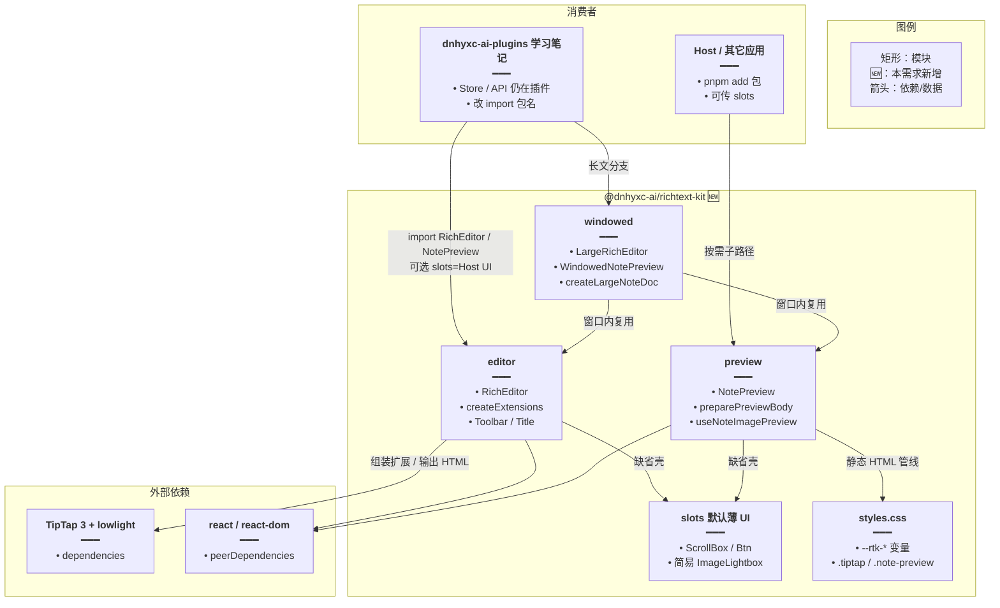
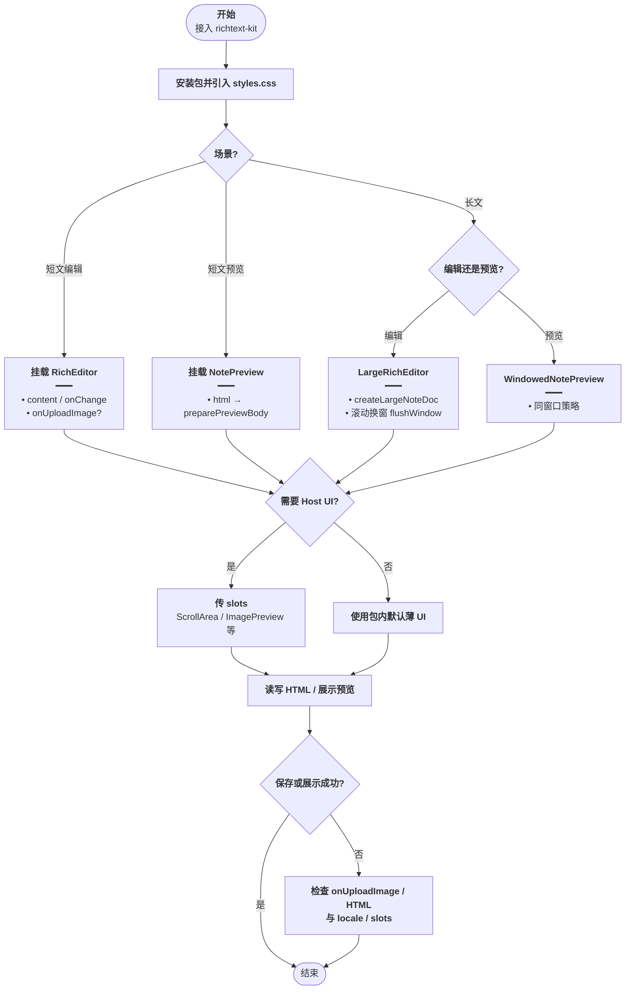
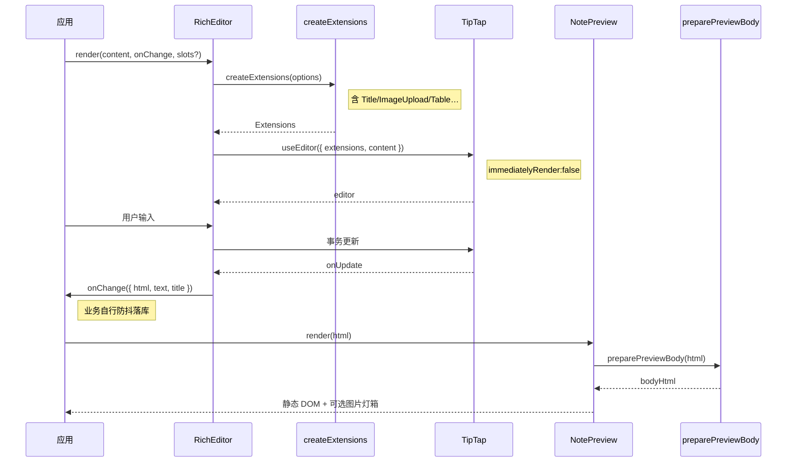
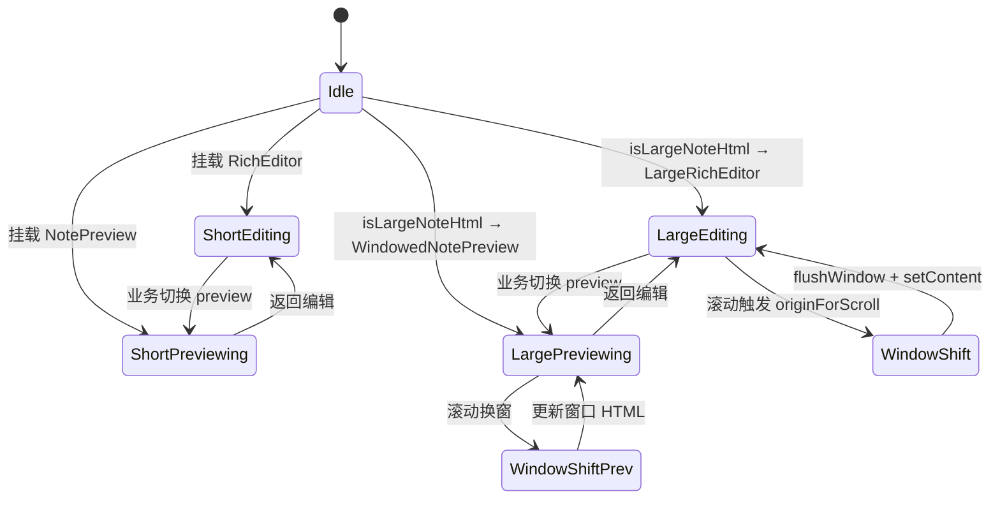

# 富文本编辑与预览 Kit 抽包 — 实现思路

> **状态**：规划（未实现 / 插件侧能力已可复用）  
> **日期**：2026-11-05  
> **需求摘要**：把 `dnhyxc-ai-plugins` 里已打磨的 TipTap 富文本编辑 + 静态预览（含长文窗口化）抽成可发布 npm 包，落在 `dnhyxc-ai/packages`，供 Host / 插件 / 外部项目通用复用。  
> **一句话方案（预告）**：在 `packages/` 新增单包 `@dnhyxc-ai/richtext-kit`（对齐 `markdown-kit` 的子路径 + Changesets 发布），内核迁入编辑/预览/长文窗口；宿主 UI（ScrollArea / Button / ImagePreview）用「默认薄实现 + slots 覆盖」解耦；学习笔记业务层只改 import。

## 延伸阅读

- [学习笔记富文本编辑.md](./学习笔记富文本编辑.md)（插件内首次封装 RichEditor）
- [学习笔记全面实现.md](./学习笔记全面实现.md)（编辑/预览/长文窗口与业务接线）
- [学习笔记编辑器预览卡顿.md](./学习笔记编辑器预览卡顿.md)（窗口化与性能约束）
- 正式专题：`../english/富文本编辑器性能调优.md`、`../english/学习笔记图片内联样式.md`
- 包范式参考：`packages/markdown-kit`（`@dnhyxc-ai/markdown-kit`）、`packages/PUBLISH.md`

---

## 0. 读本文你将得到什么

- 要把插件内 ~4.5k 行的 RichEditor / NotePreview / 长文窗口抽成 **可发布、可扩展** 的 npm 包。
- **选定方案**：单包 `@dnhyxc-ai/richtext-kit` + 子路径导出 + 默认 UI 薄实现与 slots 覆盖 + 长文窗口进可选子路径。
- 主要改动层：新建 `dnhyxc-ai/packages/richtext-kit`；`dnhyxc-ai-plugins` 学习笔记改为依赖该包；业务 API/Store **不进包**。
- 分阶段：M1 包骨架与短文编辑 → M2 预览与图片槽 → M3 长文窗口 → M4 插件迁入与发布。
- 最大风险：对插件内 shadcn / `useI18n` / `ImagePreview` / Tailwind 主题 token 的硬耦合若解耦不彻底，包无法在 Host 或其它仓独立使用。

---

## 1. 需求与边界

### 1.1 用户故事

| 角色 | 场景 | 行为 | 期望结果 |
|------|------|------|----------|
| 插件维护者 | 学习笔记编辑/预览 | `pnpm add @dnhyxc-ai/richtext-kit` 后替换本地 `@design/RichEditor` | API 语义与现网一致，性能不回退 |
| Host / 前端应用 | 任意页面需要富文本 | 引入包 + CSS，挂 `RichEditor` / `NotePreview` | 无需复制 TipTap 扩展与预览 HTML 管线 |
| 包消费者 | 自有设计系统 | 传入 `slots` / `locale` / `onUploadImage` | 工具栏、滚动区、图片灯箱可换成自家组件 |
| 包作者 | monorepo 发布 | Changesets 发 `@dnhyxc-ai` scope | 与 `markdown-kit` 同流程 |

### 1.2 范围

| 在范围内 | 不在范围内（非目标） |
|----------|----------------------|
| TipTap 二次封装 `RichEditor`（扩展、工具栏、气泡、标题节点、locale） | 学习笔记 CRUD / Store / COS 上传业务 |
| 静态 `NotePreview` + `preparePreviewBody` 等 HTML 管线 | DOCX 导出、列表面板、MF 远程加载 |
| 长文窗口化编辑/预览（`LargeRichEditor` / `WindowedPreview`）可选子路径 | 协作 OT/CRDT、Markdown 双向源码模式 |
| 包级 CSS（变量主题）+ README / 类型导出 / 最小自检 | 重写 TipTap；与 `markdown-kit`（MD→HTML）合并为一包 |
| peer：`react` / `react-dom`；TipTap 等进 dependencies（对齐 markdown-kit 易装） | 强制消费者安装整套 shadcn / radix |

### 1.3 约束与依赖

- **落盘位置**：`/Users/dnhyxc/Documents/code/dnhyxc-ai/packages/richtext-kit`（pnpm workspace 已含 `packages/**`）。
- **发布**：沿用 Changesets（见 `packages/PUBLISH.md`），包名 `@dnhyxc-ai/richtext-kit`。
- **范式**：对齐 `@dnhyxc-ai/markdown-kit` 的 `exports` 子路径、`tsup`、`peer react`、README 条件导出表。
- **源码真相**：`micro-apps/dnhyxc-ai-plugins/src/components/design/{RichEditor,NotePreview}` + `views/learning-notes/{utils/doc.ts,components/Editor.tsx,PreviewBody.tsx}`。
- **硬约束**：抽包后短文编辑/预览与长文窗口行为与现网一致；不把 `LearningNotesStore` / `api.ts` 打进包；主题色用 CSS 变量，避免绑死插件 Tailwind 类名语义。
- **性能底线**：长文仍走块窗口（`WINDOW_SIZE` / hysteresis）；预览大 base64 图继续正则去 title，禁止默认 `DOMParser` 整树。

---

## 2. 背景

- **谁、场景、卡在哪**：学习笔记的富文本编辑与只读预览已在插件仓打磨成熟（含长文窗口、图片预览、内联图样式），但能力锁在 `dnhyxc-ai-plugins` 设计系统路径下；Host、其它 remote、甚至 `dnhyxc-ai/apps` 无法以 npm 依赖方式复用，只能复制或 MF 间接加载。
- **现状缺口**：`RichEditor` / `NotePreview` 直接依赖 `@/components/ui/*`、`@/lib/utils`、`useI18n`、`ImagePreview`；长文窗口逻辑散在 `views/learning-notes`，未与组件同层成「库 API」。`dnhyxc-ai/packages` 已有 `markdown-kit`（Markdown 渲染），**没有** TipTap HTML 编辑+预览对偶包。
- **不解决会怎样**：各仓继续复制 TipTap 配置与预览 HTML 管线，性能补丁（字数按需、窗口化、图内联 style）无法单点升级；语义上「编辑」与「预览」也缺少稳定的公开契约。
- **硬约束**：必须复用现有 TipTap 扩展与 `previewHtml` 算法；不能破坏学习笔记现网路径；包对外 API 要语义清晰（编辑 / 预览 / 长文 / 样式分入口），符合成熟 npm 习惯。

---

## 3. 现状与复用

| 能力 | 仓库中已有 | 本需求中的用法 |
|------|------------|----------------|
| TipTap 封装 `RichEditor` | `micro-apps/dnhyxc-ai-plugins/src/components/design/RichEditor/`（`index.tsx` / `extensions` / `toolbar` / `title` / `locale` / `types`） | **扩展**：迁入包；去掉对插件 UI 的硬依赖 |
| 扩展组装 `createExtensions` | 同上 `extensions/index.ts` | **直接复用** 迁入；保留 `extensions` / `extraExtensions` / `onUploadImage` |
| 静态预览 `NotePreview` | `.../NotePreview/index.tsx` | **扩展**：迁入；文案与滚动/灯箱可注入 |
| 预览 HTML 管线 | `.../NotePreview/previewHtml.ts`（`stripNoteTitleHtml` / `preparePreviewBody` / `splitPreviewBlocks` …） | **直接复用** 迁入纯函数层 |
| 预览点图 | `.../NotePreview/useNoteImagePreview.tsx` + `ImagePreview` | **扩展**：Hook 进包；灯箱用 `slots.renderImagePreview` 或内置最小灯箱 |
| 长文文档模型 | `.../learning-notes/utils/doc.ts` | **直接复用** 迁入 `windowed/`；业务判定可仍留插件薄封装 |
| 长文编辑 UI | `.../learning-notes/components/Editor.tsx` → `LargeNoteEditor` | **扩展**：改名导出为包内 `LargeRichEditor` |
| 长文预览 UI | `.../learning-notes/components/PreviewBody.tsx` → `WindowedPreviewBody` | **扩展**：导出为 `WindowedNotePreview` |
| 学习笔记页面接线 | `.../learning-notes/index.tsx` | **扩展**：改 import；Store/API **不适用**进包 |
| npm 包范式 | `dnhyxc-ai/packages/markdown-kit`（exports / tsup / peer react / Changesets） | **直接复用** 脚手架与发布流程 |
| 滚动条 UI | 插件 `components/ui/scroll-area` | **新建** 包内默认 overflow 容器；slots 可换 Host ScrollArea |
| 工具栏控件 | 插件 `Button` / `Input` / `DropdownMenu` | **新建** 包内 CSS 按钮/菜单薄实现，或 slots |
| 文案 | `RichEditor/locale.ts`（已有 zh/en）；`NotePreview` 仍 `useI18n` | **扩展**：预览也走 `locale` props，去掉 Hook 硬依赖 |

**调研结论**：编辑/预览/长文算法均可迁；真正阻塞「通用 npm」的是 **UI 与 i18n 硬耦合**，不是 TipTap 本身。候选方案必须回答：UI 如何默认可用、又如何被宿主替换；长文窗口是否进包。`markdown-kit` 证明同仓「单包 + 子路径 + peer react」可发布。

---

## 4. 方案比对与最终方案

### 4.1 候选方案

#### 方案 A：单包 `@dnhyxc-ai/richtext-kit` + 子路径（复用 markdown-kit 范式）

- **做法**：在 `packages/richtext-kit` 新建包。`exports`：
  - `.` → `RichEditor`、`createExtensions`、locale、title utils
  - `./preview` → `NotePreview`、`preparePreviewBody`、`useNoteImagePreview`
  - `./windowed` → `LargeRichEditor`、`WindowedNotePreview`、`createLargeNoteDoc`…
  - `./styles.css` → 编辑+预览共用样式（CSS 变量）
  - 可选 `./react` 若需再拆 Hook（默认可并入上列）
  TipTap 相关放 **dependencies**；`react`/`react-dom` 为 **peer**。学习笔记改为 `from '@dnhyxc-ai/richtext-kit'`。
- **能工作的原因**：与现有 `markdown-kit` 安装/发布习惯一致；编辑与预览共享 `styles` 与 title/HTML 约定，单仓单版本。
- **主要代价**：首包体积与依赖面偏大；需认真做 subpath，避免预览场景误打入整套 Toolbar。

#### 方案 B：双包 `@dnhyxc-ai/richtext-editor` + `@dnhyxc-ai/richtext-preview`

- **做法**：编辑与预览分两个 npm 包；共享类型/HTML 工具再抽第三个 `@dnhyxc-ai/richtext-shared`，或 preview 依赖 editor 的 types-only 导出。
- **能工作的原因**：纯预览消费者可不装 TipTap 运行时，tree-shake / 安装面更干净。
- **主要代价**：三包版本对齐、Changesets 联动、样式重复或交叉依赖；与当前「一套 TipTap HTML 约定」强绑定，拆包收益有限、维护成本高。

#### 方案 C：不新建包，仅在插件仓整理 export + MF 暴露

- **做法**：继续放在 `dnhyxc-ai-plugins` 的 `@design/*`，通过 Module Federation 把 `RichEditor`/`NotePreview` expose 给 Host。
- **能工作的原因**：现网已是 MF 插件；Host 已能加载远程。
- **主要代价**：不是独立 npm；版本随远程部署，外部仓 / 非 MF 场景无法 `pnpm add`；与用户「写入 `dnhyxc-ai/packages`」目标不符。

### 4.2 比对

| 维度 | 方案 A 单包 richtext-kit | 方案 B 双/三包 | 方案 C 仅 MF |
|------|--------------------------|----------------|--------------|
| 正确性（失败路径、边界、数据是否会错） | 编辑/预览/长文同一版本，HTML 约定不易漂移 | 多包版本不一致时 title 节点 / previewHtml 易错位 | 行为与现网一致，但无独立 semver 契约 |
| 复用 / 与现状契合 | 对齐 markdown-kit；源码几乎原迁 | 需额外拆共享层，现状无双包先例 | 最贴插件现状，但不进 packages |
| 改动面 | 新包 + 插件改 import + workspace/changeset | 2～3 新包 + 双倍脚手架 + 插件双依赖 | 仅插件 expose，**不满足落 packages** |
| 复杂度 | 中：子路径 + slots | 高：包图与发布矩阵 | 低，但产品形态不对 |
| 体验（安装与使用） | 一次安装；按子路径 import | 预览可更瘦，但文档与安装步骤翻倍 | Host 以外用不了 |
| 风险 | 首包依赖面；subpath 配置失误 | 版本漂移、重复发版 | 无法 npm 复用 |
| 可维护性 | 一处改 TipTap/预览管线 | 改动常跨包 | 能力继续锁死插件仓 |

### 4.3 综合考量

本需求权重最高的是：**落在 `dnhyxc-ai/packages`、可 npm 安装、语义清晰、与 markdown-kit 同级可维护**；其次是 **不破坏学习笔记正确性与长文性能**。方案 A 在复用、改动面、可维护性上同时满足；方案 B 的「预览不带 TipTap」优点真实，但本仓库预览依赖与编辑同一套 HTML/CSS/title 约定，拆包节省的安装面抵不过版本对齐成本。方案 C 改动最小，但明确放弃「packages + npm」目标。因此选定 A，**放弃** B 的预览零 TipTap 安装面，以及 C 的零搬家成本。

### 4.4 最终方案

#### 背景

插件内已有完整 TipTap 编辑、静态预览、长文窗口；缺口是无法作为 `@dnhyxc-ai/*` 包被其它应用依赖。硬约束：进 `packages/`、Changesets 可发、去掉 shadcn/i18n 硬耦合、长文性能策略一并带走。

#### 具体思路

1. **模块切分**：`core`（extensions / title / image upload / locale 类型）→ `editor`（RichEditor + toolbar）→ `preview`（NotePreview + previewHtml + image hook）→ `windowed`（doc 模型 + Large/Windowed UI）→ `styles`（CSS 变量）。业务 Store/API 留在插件。
2. **数据流**：外部仍以 **HTML 字符串**（可选 JSONContent）进出；`onChange` 继续给 `{ html, text, title }`；预览只吃 HTML，经 `preparePreviewBody` 再挂载。
3. **状态归属**：编辑器状态在 TipTap；长文窗口 origin 在 `LargeRichEditor` / `WindowedNotePreview` 内部 ref；包 **不** 引入 MobX。
4. **边界**：无 `onUploadImage` → data URL；无 slots → 包内默认滚动/按钮/简易灯箱；locale 缺省 zhCN；长文判定阈值 `isLargeNoteHtml` 导出，业务可覆盖阈值。

#### 实现方案

**一句话**：新建单包 `@dnhyxc-ai/richtext-kit`，子路径导出编辑/预览/长文/样式；默认薄 UI + slots；插件学习笔记改依赖该包。

| 步骤 | 谁 | 做什么 | 输入 → 输出 |
|------|----|--------|-------------|
| 1 | `packages/richtext-kit` | 建包：package.json exports、tsup、peer、README | 空目录 → 可 build 的包骨架 |
| 2 | `src/editor/*` | 迁入 RichEditor 内核；用 `cn` 本地实现；ScrollArea→默认 div + slots | 插件源码 → 无 `@/` 依赖的编辑入口 |
| 3 | `src/preview/*` | 迁入 NotePreview / previewHtml / useNoteImagePreview；locale 化文案；灯箱 slot | HTML → 只读预览 |
| 4 | `src/windowed/*` | 迁入 doc.ts + Large/Windowed 组件 | 长 HTML → 窗口化编辑/预览 |
| 5 | `src/styles/*` | 合并 RichEditor/NotePreview CSS，token 改为 `--rtk-*` / 兼容旧变量 | 主题可覆盖 |
| 6 | 插件 learning-notes | 改 import；可选 `slots={{ ScrollArea: HostScrollArea }}` | 现网行为保持 |
| 7 | Changesets | `pnpm changeset` 发布 | npm `@dnhyxc-ai/richtext-kit` |

#### 选定原因

1. **复用 / 与现状契合**：直接迁现有模块并对齐 markdown-kit。牺牲：首版要把 UI 解耦做完，不能「原文件搬进包仍 import `@/`」。
2. **可维护性**：单版本保证编辑/预览 HTML 约定一致。牺牲：放弃 B 的预览零 TipTap 安装面。
3. **改动面**：只增一包 + 插件改 import。牺牲：放弃 C 的零搬家。
4. **体验**：一次 `pnpm add`，子路径按需。牺牲：纯预览场景仍可能解析到 TipTap peer/deps（可用 subpath + 文档说明减轻）。
5. **正确性**：长文窗口与 previewHtml 同包同版本。牺牲：包体积大于「只拷预览函数」。

#### 优势

- 相对方案 B：不必维护双包 semver；title 节点与 `stripNoteTitleHtml` 不会跨包漂移。
- 相对方案 C：任意非 MF 项目可安装；有稳定导出与 changelog。

#### 怎么实现

1. 按 markdown-kit 抄齐 `package.json` / `tsup` / `exports`。
2. 迁 editor，引入 `RichTextKitSlots`（ScrollArea、Button、Input、Dropdown、ImagePreview）。
3. 迁 preview + 纯函数；`NotePreview` 用 `locale` 替代 `useI18n`。
4. 迁 windowed；从学习笔记页改为包导出。
5. CSS 变量化；README 写三分钟示例（编辑 / 预览 / 长文）。
6. 插件改依赖；跑短文保存与长文滚动验收；changeset 发布。

### 4.5 其他关键决策

#### 决策 1：宿主 UI 解耦方式

##### 候选

- **D1-A 默认薄实现 + slots 覆盖（选定）**：包内提供无 radix 的滚动容器、按钮、简单菜单、简易图片灯箱；`slots` / `components` props 可换成 Host 的 ScrollArea / shadcn / ImagePreview。
- **D1-B 全部强制注入**：无默认 UI，创建时必须传齐 slots。
- **D1-C 打包一份完整 radix/shadcn**：零配置即与插件像素级一致。

##### 比对（摘要）

| 维度 | D1-A | D1-B | D1-C |
|------|------|------|------|
| 正确性 | 默认可用；Host 可对齐现网 | 漏传 slots 则无法渲染 | 易与 Host 双份 radix |
| 复用 | 插件传现有 UI 即可像素对齐 | 每个消费者都要接线 | 拷贝成本高 |
| 改动面 | 包内写薄 UI + slots 类型 | 插件/Host 必改 | 包依赖膨胀 |
| 复杂度 | 中 | 低实现、高接入 | 高依赖 |
| 体验 | 开箱能用，可渐进美化 | 开箱不能用 | 开箱像插件，但主题难剥离 |
| 风险 | 默认 UI 与现网视觉差 | 接入摩擦大 | peer 冲突、包体积 |
| 可维护性 | 核心逻辑与 UI 壳分离 | 壳全在外 | 设计系统升级拖包 |

##### 综合考量

「使用方便」要求开箱可跑；「扩展性强」要求 Host 可换皮。D1-A 同时满足。放弃 D1-B 的强制显式（接入重）、D1-C 的像素级零配置（依赖与主题绑架）。

##### 最终方案六块

- **背景**：现实现直接 import 插件 shadcn 与 ImagePreview，npm 消费者没有这些路径。
- **具体思路**：逻辑（TipTap、previewHtml、窗口）与壳（滚动、按钮、灯箱）分离；默认壳保证 demo；slots 保证接入现网。
- **实现方案**：`RichTextKitProvider` 或顶层 props `slots?: Partial<RichTextKitSlots>`；缺省用内部组件。
- **选定原因**：体验与扩展两维都要；牺牲默认视觉与插件 100% 一致。
- **优势**：相对 B 开箱可用；相对 C 不绑 radix。
- **怎么实现**：见 §9.2 步骤 2 的 `RichTextKitSlots` 类型与 Provider。

#### 决策 2：长文窗口是否进包

##### 候选

- **D2-A 进包 `./windowed`（选定）**：`createLargeNoteDoc`、`LargeRichEditor`、`WindowedNotePreview` 一并导出。
- **D2-B 仅导出纯函数，UI 留插件**：包只出 `doc.ts` 算法。
- **D2-C 不进包**：长文继续私有在 learning-notes。

##### 比对（摘要）

| 维度 | D2-A | D2-B | D2-C |
|------|------|------|------|
| 正确性 | 编辑/预览窗口策略成对 | UI 复制易漂移 | 包外易分叉 |
| 复用 | Host 长文开箱 | 算法可复用、UI 仍复制 | 其它仓要重写窗口 |
| 改动面 | 多迁 2 组件 + doc | 中 | 最小 |
| 复杂度 | 包 API 多一块 | 中 | 低 |
| 体验 | 短文/长文同一文档 | 消费者自拼 UI | 包能力不完整 |
| 风险 | 窗口参数成公开 API | 双份 UI | 「通用包」名不副实 |
| 可维护性 | 性能补丁一处改 | 两处 | 差 |

##### 综合考量

用户要的「渲染和预览」在现网已包含长文路径；性能补丁历史也集中在窗口化。D2-A 权重最高。放弃 D2-B/C 的「包更瘦」。

##### 最终方案六块

- **背景**：>80 块或大 HTML 必须窗口化，否则列表滚动被拖垮（已有专题）。
- **具体思路**：窗口算法与 UI 同包可选子路径；短文消费者不 import `./windowed`。
- **实现方案**：`exports["./windowed"]`；主入口可不 re-export 重组件（或 document 建议按需）。
- **选定原因**：正确性与复用；牺牲包面更大。
- **优势**：相对 B/C，Host 不必再抄 `Editor.tsx`/`PreviewBody.tsx`。
- **怎么实现**：迁 `doc.ts` + 两组件，改名导出；插件 `isLargeNoteHtml` 仍可包一层业务。

---

## 5. 架构图



**图内方法说明**：

| 方法 / 模块入口 | 功能 |
|-----------------|------|
| `RichEditor(props)` | TipTap 二次封装：工具栏/气泡/标题/字数；`onChange` 抛出 html/text/title |
| `createExtensions(options)` | 组装默认扩展；支持整表替换或 `extraExtensions` 追加 |
| `NotePreview(props)` | 只读预览壳：顶栏 + 静态 HTML 或 children；不挂 TipTap |
| `preparePreviewBody(html)` | 去 title、补空段、图懒加载与内联 margin |
| `useNoteImagePreview(options)` | 在预览根上委托点击 img，打开灯箱；`downloadBlob` 可接 Host |
| `LargeRichEditor(props)` | 长文编辑：块窗口 + 外置 `NoteTitleField` + `renderBody` |
| `WindowedNotePreview(props)` | 长文只读：同源窗口滚动，避免全文 DOM |
| `createLargeNoteDoc(html)` | 切块并初始化 `LargeNoteDoc` origin/count |

**读图要点**：

- 业务（Store/API）留在插件；包只含编辑/预览/窗口与薄 UI。
- `windowed` 依赖 editor/preview，但经子路径按需加载。
- slots 是宿主换皮边界；TipTap 为 dependencies，React 为 peer。

---

## 6. 主流程图



**图内方法说明**：

| 方法 | 功能 |
|------|------|
| `RichEditor` | 短文编辑入口 |
| `NotePreview` | 短文（或 children 自定义）预览入口 |
| `preparePreviewBody` | 预览前规范化 HTML |
| `LargeRichEditor` | 长文编辑入口 |
| `WindowedNotePreview` | 长文预览入口 |
| `createLargeNoteDoc` | 长文启动时切块 |

**读图要点**：

- 入口按场景选子路径，避免短文误用窗口。
- slots 是可选增强，不是必经失败点。
- 失败侧重点在上传钩子与 HTML 约定，而非 TipTap 安装本身。

---

## 7. 核心时序图



**图内方法说明**：

| 方法 | 功能 |
|------|------|
| `createExtensions(options)` | 按选项组装 TipTap 扩展列表 |
| `useEditor(...)` | TipTap React 创建编辑器实例（包内调用） |
| `onChange(payload)` | 向应用抛出 html/text/title（热路径不强制 json） |
| `preparePreviewBody(html)` | 预览 HTML 规范化 |
| `NotePreview` | 挂载静态 HTML 并可选绑定点图 |

**读图要点**：

- 应用只面对 HTML 契约；落库时机由业务决定。
- 预览不复用 TipTap 实例，避免只读场景挂编辑器开销。
- slots 在 render 时注入，不参与 TipTap 事务。

---

## 8. 状态机（编辑 / 预览 / 长文窗口）



**图内方法说明**：

| 方法 | 功能 |
|------|------|
| `isLargeNoteHtml(content)` | 按块数/体积判断是否走长文路径 |
| `originForScroll(...)` | 由 scrollTop 计算窗口 origin |
| `flushWindow(doc, html)` | 把当前窗写回 blocks，拒绝异常空覆盖 |
| `windowBodyHtml(doc, origin)` | 取出窗口 HTML 切片 |

---

## 9. 具体实现（主链路代码）

### 9.1 模块一览

| 模块 | 职责 | 新增/改动 | 预估路径 |
|------|------|-----------|----------|
| 包骨架 | exports / tsup / peer | 新增 | `packages/richtext-kit/package.json` |
| editor | RichEditor 与扩展 | 新增（迁） | `packages/richtext-kit/src/editor/` |
| preview | NotePreview 与 HTML 管线 | 新增（迁） | `packages/richtext-kit/src/preview/` |
| windowed | 长文编辑/预览 | 新增（迁） | `packages/richtext-kit/src/windowed/` |
| slots | 默认 UI + 类型 | 新增 | `packages/richtext-kit/src/slots/` |
| styles | CSS 变量主题 | 新增（迁） | `packages/richtext-kit/src/styles/` |
| 插件学习笔记 | 改依赖 | 改动 | `micro-apps/dnhyxc-ai-plugins/src/views/learning-notes/**` |
| 本地桥接（可选） | 插件暂用 workspace / file: | 改动 | 插件 `package.json` |

### 9.2 主链路实现

```typescript
// 对应 §4.4 步骤 1。包名与 markdown-kit 对齐，便于 Changesets 同 scope 发布
// packages/richtext-kit/package.json（关键字段示意）
export const packageJsonSketch = {
	// 对外包名：编辑+预览对偶于 markdown-kit 的「MD 渲染」
	name: '@dnhyxc-ai/richtext-kit',
	type: 'module',
	peerDependencies: {
		// 宿主已有 React，避免打进两份
		react: '>=18.0.0',
		'react-dom': '>=18.0.0',
	},
	exports: {
		// 短文编辑主入口
		'.': {
			types: './dist/index.d.ts',
			import: './dist/index.js',
		},
		// 只读预览与 HTML 管线，文档引导按需引用
		'./preview': {
			types: './dist/preview/index.d.ts',
			import: './dist/preview/index.js',
		},
		// 长文窗口，避免短文消费者误打入
		'./windowed': {
			types: './dist/windowed/index.d.ts',
			import: './dist/windowed/index.js',
		},
		// 样式单独入口，sideEffects 友好
		'./styles.css': './dist/styles/richtext-kit.css',
	},
};
```

```typescript
// 对应 §4.4 步骤 2 / §4.5 D1。槽位让 Host 换皮，缺省保证开箱可跑
import type { ComponentType, ReactNode, RefObject, UIEventHandler } from 'react';

// 灯箱入参与现网 SelectedImage 对齐，避免插件改协议
export type RichTextImagePreviewProps = {
	// 当前图与图库列表，支持左右翻
	images: { url: string }[];
	index: number;
	onClose: () => void;
	onDownload?: (url: string) => void;
};

export type RichTextKitSlots = {
	// 正文滚动：插件可注入 Radix ScrollArea；默认用 overflow auto 的 div
	ScrollArea: ComponentType<{
		className?: string;
		onScroll?: UIEventHandler<HTMLDivElement>;
		children?: ReactNode;
	}>;
	// 工具栏按钮壳，避免绑死 shadcn Button
	Button: ComponentType<
		React.ButtonHTMLAttributes<HTMLButtonElement> & { active?: boolean }
	>;
	// 链接表单等输入
	Input: ComponentType<React.InputHTMLAttributes<HTMLInputElement>>;
	// 点图预览；不传则用包内简易 lightbox
	ImagePreview?: ComponentType<RichTextImagePreviewProps>;
};

// 运行时缺省，保证无 Provider 也能渲染
export const defaultRichTextKitSlots: RichTextKitSlots = {
	ScrollArea: ({ className, onScroll, children }) => (
		<div className={className} onScroll={onScroll} style={{ overflow: 'auto' }}>
			{children}
		</div>
	),
	Button: (props) => <button type="button" {...props} />,
	Input: (props) => <input {...props} />,
};
```

```typescript
// 对应 §4.4 步骤 3。预览入口去 useI18n，文案进 locale，才能进 npm
export type NotePreviewLocale = {
	// 空正文提示
	emptyContent: string;
	// 无标题时顶栏占位
	untitledNote: string;
};

export type NotePreviewProps = {
	title: string;
	html?: string;
	meta?: ReactNode;
	headerExtra?: ReactNode;
	children?: ReactNode;
	footer?: ReactNode;
	className?: string;
	bodyClassName?: string;
	locale?: Partial<NotePreviewLocale>;
	// 与现网一致：嵌入 Host 下载
	downloadBlob?: (options: {
		fileName: string;
		data: ArrayBuffer | Uint8Array;
		mimeType?: string;
	}) => Promise<{ ok: boolean; hostToasted: boolean; message?: string }>;
	slots?: Partial<RichTextKitSlots>;
};

// 合并默认中文，避免预览再依赖插件 hooks
export function resolveNotePreviewLocale(
	partial?: Partial<NotePreviewLocale>,
): NotePreviewLocale {
	return {
		emptyContent: '暂无内容',
		untitledNote: '无标题笔记',
		...partial,
	};
}
```

```typescript
// 对应 §4.4 步骤 4 / §4.5 D2。长文从业务页下沉为包 API
import type { LargeNoteDoc } from './types';

// 超过该块数启用窗口（与现网 LARGE_MIN_BLOCKS 对齐，可 options 覆盖）
export const LARGE_MIN_BLOCKS = 80;

export function createLargeNoteDoc(html: string): {
	doc: LargeNoteDoc;
	title: string;
	editorHtml: string;
} {
	// 去 title 再切块，保证编辑窗不含 title 节点 DOM
	const title = extractTitleText(html);
	const body = stripNoteTitleHtml(html);
	const parts = splitPreviewBlocks(body);
	const blocks = parts.length ? parts : ['<p></p>'];
	const count = Math.min(WINDOW_SIZE, blocks.length);
	return {
		doc: { blocks, origin: 0, count },
		title,
		editorHtml: blocks.slice(0, count).join('') || '<p></p>',
	};
}

// 插件侧短接示例：长文走包，短文走 RichEditor
export function pickNoteEditorMode(html: string): 'short' | 'large' {
	return isLargeNoteHtml(html) ? 'large' : 'short';
}
```

```tsx
// 对应 §4.4 步骤 6。学习笔记页只改依赖与可选 slots，不改 Store
import { RichEditor } from '@dnhyxc-ai/richtext-kit';
import { NotePreview } from '@dnhyxc-ai/richtext-kit/preview';
import {
	LargeRichEditor,
	WindowedNotePreview,
	isLargeNoteHtml,
} from '@dnhyxc-ai/richtext-kit/windowed';
import '@dnhyxc-ai/richtext-kit/styles.css';
import { ScrollArea } from '@/components/ui/scroll-area';
import ImagePreview from '@/components/design/ImagePreview';

// 插件注入现网 UI，视觉与抽包前一致
const slots = { ScrollArea, ImagePreview };

function NotePane({ html, preview }: { html: string; preview: boolean }) {
	// 长文判定仍用包导出，阈值与窗口实现同版本
	const large = isLargeNoteHtml(html);
	if (preview) {
		return large ? (
			<NotePreview title="…" slots={slots}>
				<WindowedNotePreview html={html} slots={slots} />
			</NotePreview>
		) : (
			<NotePreview title="…" html={html} slots={slots} />
		);
	}
	return large ? (
		<LargeRichEditor defaultContent={html} slots={slots} onReady={() => {}} />
	) : (
		<RichEditor defaultContent={html} slots={slots} onChange={() => {}} />
	);
}
```

### 9.3 数据模型

| 字段/实体 | 来源 | 存储 | 说明 |
|-----------|------|------|------|
| 笔记 HTML | TipTap `getHTML()` | 业务 DB（插件） | 含可选 `data-type="note-title"` 节点 |
| `RichEditorChangePayload` | onChange | 内存 | `{ html, text, title, json? }` |
| `LargeNoteDoc` | createLargeNoteDoc | 组件内 ref | `{ blocks, origin, count }` |
| locale | props | 内存 | 编辑/预览文案，默认 zhCN |
| slots | props / Provider | 内存 | 宿主 UI 覆盖 |

---

## 10. 分阶段实现步骤

| 阶段 | 目标 | 交付物 | 依赖 |
|------|------|--------|------|
| M1 | 包骨架 + 短文编辑可 build | `packages/richtext-kit`、RichEditor 无 `@/` | — |
| M2 | 预览与 slots | `./preview`、locale 化 NotePreview、默认灯箱 | M1 |
| M3 | 长文窗口子路径 | `./windowed` + 文档示例 | M2 |
| M4 | 插件迁入 + 发布 | learning-notes 改依赖、changeset 发版 | M3 |

### M1

- [ ] 创建 `packages/richtext-kit`（package.json / tsup / tsconfig / README 骨架）
- [ ] 迁入 `RichEditor` 核心与 `createExtensions`，本地 `cn`，默认 `ScrollBox`
- [ ] `pnpm --filter @dnhyxc-ai/richtext-kit build` 通过
- [ ] 最小自检：挂载后 `onChange` 能拿到 html/title

### M2

- [ ] 迁入 `previewHtml` + `NotePreview` + `useNoteImagePreview`
- [ ] 去掉 `useI18n`；补 `NotePreviewLocale`
- [ ] `RichTextKitSlots` 类型 + 默认实现；ImagePreview 可注入
- [ ] 导出 `./preview` 与 `./styles.css`

### M3

- [ ] 迁入 `doc.ts`、`LargeRichEditor`、`WindowedNotePreview`
- [ ] 导出 `./windowed`；README 写长短文分支示例
- [ ] 自检：块数 > `LARGE_MIN_BLOCKS` 时仅挂载窗口 DOM

### M4

- [ ] 插件 `package.json` 依赖 workspace / file: 包
- [ ] learning-notes 替换 `@design/RichEditor` / NotePreview / 本地 Editor·PreviewBody
- [ ] 回归短文保存、长文滚动、点图下载
- [ ] `pnpm changeset` 发布说明与版本

---

## 11. 风险、边界与待确认

| 项 | 等级 | 说明 | 缓解 |
|----|------|------|------|
| UI 解耦不彻底 | 高 | 残留 `@/components/ui` 则包无法独立用 | M1 门禁：禁止包内 `@/`、插件相对路径 |
| TipTap 多包版本 | 中 | 与 Host 其它 TipTap 并存时重复 | 文档建议 resolutions；deps 锁同主版本 |
| CSS 主题 token | 中 | 插件靠 `text-textcolor` 等 Tailwind | 改为 `--rtk-*`，插件映射变量 |
| 长文公开 API | 中 | `WINDOW_SIZE` 等成契约后难改 | 导出常量 + `options` 覆盖；changelog 标明 |
| MF 样式隔离 | 中 | 远程插件曾依赖 @scope | 保持图内联 style + 包 CSS 明确 import |
| 双包诱惑 | 低 | 日后想拆 preview | 先 subpath；真有安装痛再拆，避免过早 |

**待确认**：

- [ ] 包名最终用 `@dnhyxc-ai/richtext-kit` 还是 `@dnhyxc-ai/note-editor`？（验证：与作者确认；本文按 richtext-kit 对齐 markdown-kit）
- [ ] TipTap 放 dependencies 还是 peer？（验证：试装到干净 Vite 应用；本文默认 dependencies 更易用）
- [ ] 插件迁入过渡期：workspace 协议 vs 先发 npm 再升版本？（验证：看 monorepo 是否已能 file: 链到 `../../dnhyxc-ai/packages`）

---

## 12. 验收清单

| # | 用例 | 步骤 | 期望 |
|---|------|------|------|
| AC1 | 短文编辑 | 干净应用只装包 + styles，挂 `RichEditor`，输入标题与正文 | `onChange` 含正确 title/html；无控制台缺模块 |
| AC2 | 短文预览 | 将上一步 html 交给 `NotePreview` | 无 title 节点重复；空段高度与编辑态一致；图有懒加载 |
| AC3 | Host slots | 插件传入 ScrollArea + ImagePreview | 滚动条与点图体验与抽包前一致 |
| AC4 | 长文窗口 | 打开 >80 块笔记编辑并快速滚动 | 仅窗口 DOM；保存 `stitchFullHtml` 不丢块 |
| AC5 | 无 slots 开箱 | 不传 slots 使用默认 UI | 仍可编辑/预览/点图（简易灯箱） |
| AC6 | 业务隔离 | 检查包 dist | 无 `learningNotes` Store/api 符号 |

---

## 13. 预估改动面（实现阶段参考）

| 类型 | 路径（预估） |
|------|--------------|
| 新包 | `dnhyxc-ai/packages/richtext-kit/**` |
| 插件依赖 | `micro-apps/dnhyxc-ai-plugins/package.json` |
| 插件业务 | `micro-apps/dnhyxc-ai-plugins/src/views/learning-notes/**`（改 import；可删本地 Editor/PreviewBody 或变薄 re-export） |
| 插件设计系统 | 原 `components/design/RichEditor` / `NotePreview` → 删除或 re-export 包（过渡期） |
| 发布 | `dnhyxc-ai/.changeset/*`、`packages/richtext-kit/CHANGELOG.md` |
| 文档（实现后） | `remote-docs/wiki/notes/` 或 `tools/` 正式专题；本文保持规划态 |

---

（本文档为规划态实现思路；落地后以 `packages/richtext-kit` 源码与 remote-docs wiki 专题为准）
