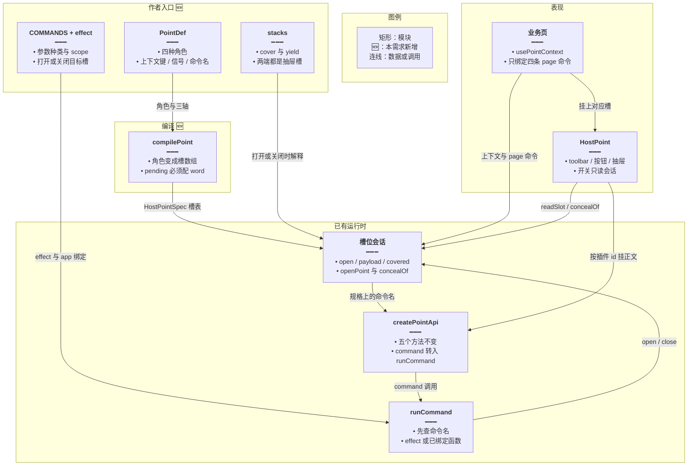
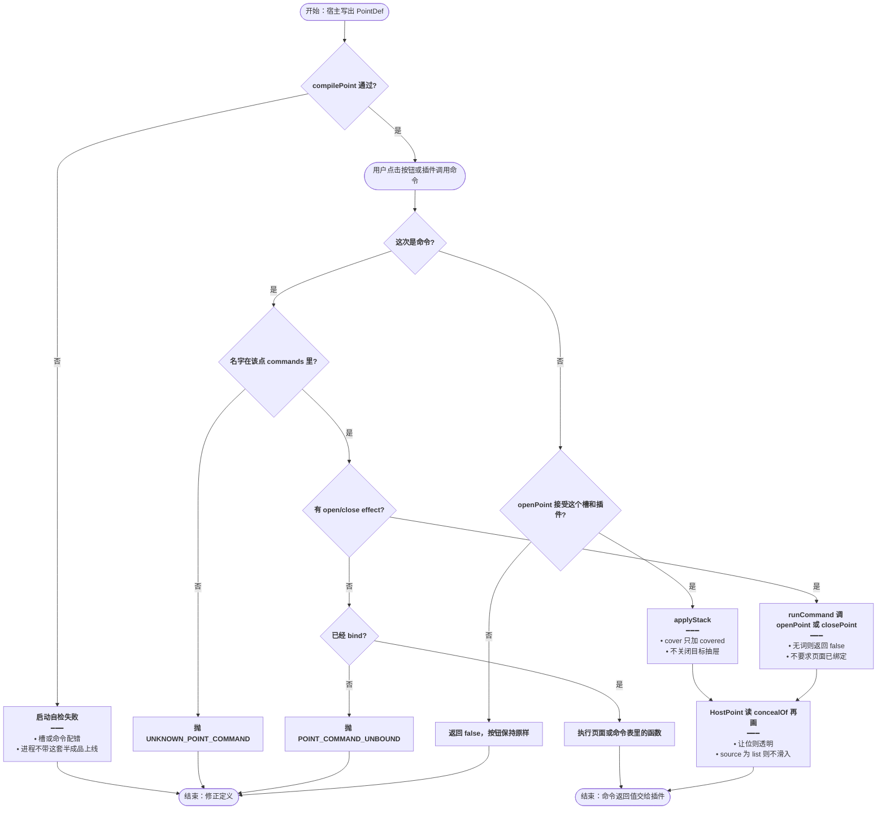
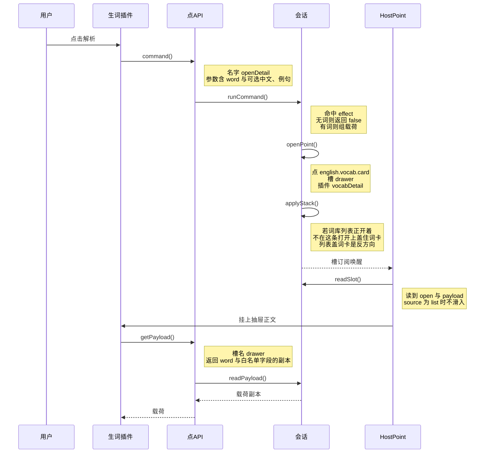
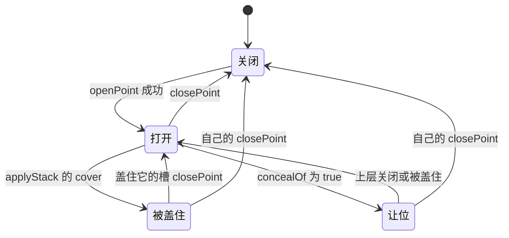

# 插件接入点统一 — 实现思路

> **状态**：已落地。目录按四种角色编译，叠放在 `stacks`，不依赖页面闭包的命令在 `commandTable.ts`。抽屉开关只在槽位会话。下文是当时的方案比对，和源码不一致时以 `apps/frontend/src/federation/points/` 与 `guide.md`、`access.md` 为准。  
> **日期**：2026-11-16  
> **需求摘要**：宿主开发给新页面挂插件、插件开发往已有页面加能力时，都按同一张可勾选清单落地；目录里不再为每个点手写一套对不上的槽位、信号和命令。  
> **一句话方案（预告）**：扩展点只由 toolbar、toggle、page、command 四种角色、一份叠放表和一份命令闭集组成，编译成现有槽位会话；抽屉开关只留在会话里，插件填同一张清单。

## 延伸阅读

- 现有扩展点是怎么登记进主项目的：[插件预留扩展点.md](./插件预留扩展点.md)
- 接入步骤与「按现象抄一段目录」：`apps/frontend/src/federation/guide.md`、`apps/frontend/src/federation/access.md`
- 每日阅读生词把文章点当成纯命令点：`apps/frontend/src/federation/process.md`

---

## 0. 读本文你将得到什么

- 要解决的问题：`hostPoints` 里每个点的槽位、布局、信号、命令、叠放和开关各写各的，新插件无法按同一套参数落地。
- 比对后的方案：四种角色加一份叠放表、一份命令闭集；编译成今天的槽位会话，`api.modules.point` 仍是那五个方法。
- 主要改哪些层：前端扩展点目录、槽位会话、命令注册；阅读页和词库列表的抽屉开关改读会话。后端不改，`federation-kit` 的插件描述类型不改。
- 分三期：M1 用角色表编译出与今天相同的行为并加上启动检查；M2 叠放和开关收进会话；M3 无页面状态的命令离开页面文件，页面抽屉并进 `HostPoint`。
- 最大风险：词库列表、生词页和阅读页的抽屉开关、让位和退场动画现在各写一份，收口时容易把「藏起来」做成「关掉」。

---

## 1. 需求与边界

### 1.1 用户故事

| 角色 | 场景 | 行为 | 期望结果 |
|------|------|------|----------|
| 宿主开发 | 新页面要能挂插件 | 从四种角色里选，并声明上下文键、信号和命令名 | 目录能编译；启动检查不通过则不能把半套参数带上线 |
| 插件开发 | 往已有点加一个插件 | 注册表写已有的点 id 和该角色的公开槽名，权限带 `modules:point` | 不改主项目页面，不新造槽名、信号名或命令名 |
| 使用插件的人 | 词卡、词库、生词、阅读页 | 点按钮打开抽屉，或点命令跳转、朗读、导出 | 叠放、退场、冷启动载荷与现在一致 |
| 宿主开发 | 插件要一个目录里没有的能力 | 先在闭集里加一种命令或确认必须新信号 | 不能在某一个点上私自写一个别人无法复用的字段 |

### 1.2 范围

| 在范围内 | 不在范围内（非目标） |
|----------|----------------------|
| 把现有 10 个扩展点收成同一套角色、叠放和命令 | 重写模块联邦加载、样式隔离、插件中心开关 |
| 抽屉开关只留槽位会话；页面不再自管一份 `openPluginId` | 改 `api.modules.point` 的五个方法名或语义 |
| 命令分成「启动时注册」和「页面持有状态时注册」 | 把学习笔记 `modules:learningNotes`、聊天 `openThread` 并进扩展点 |
| 启动时检查角色、槽名、命令和叠放端点对得上 | 引入 Zod、JSON Schema 或新的 npm 依赖 |
| 已发布的 `host.slot` 字符串保持不变 | 后端表、会员、新的 i18n 文案体系 |
| 词库列表盖住词卡、导入抽屉让位、`source: 'list'` 不滑入 | 允许插件在注册表里自己发明第五种角色或新槽位 |

### 1.3 约束与依赖

- 必须复用已落地的槽位会话：`apps/frontend/src/federation/points/session.ts` 的 `openPoint`、`closePoint`、`coverPoint`、`publishPointContext`、`publishSignal`、`bindPointCommand`。冷启动时插件可能还没下载，载荷仍写在会话里。
- 必须复用 `createPointApi`（`points/api.ts`）和 `buildModules` 里 `modules:point` 的装配（`federation/runtime/index.ts`）。插件侧继续 `getContext`、`getPayload`、`subscribe`、`publishSignal`、`command`。
- `packages/federation-kit` 的 `PluginDescriptor.host.slot` 已是开放字符串（`'drawer' | 'toolbar' | (string & {})`）。本需求不改这个类型，也不改 `listHostSurfacePlugins`。
- 已发布槽名保持：`toolbar`、`card-action`、`item-action`、`library-card-action`、`drawer`、`item-drawer`、`import-drawer`、`command`。`command` 今天只出现在每日阅读生词的注册表里，目录槽位是空的。
- 叠放视觉不能换：被盖住的抽屉保持 `open`，只加 `covered`；让位是同一帧把面板透明度设为 0 并关掉滑入；从列表点开详解时不从右侧滑入。这些逻辑今天在 `HostPoint.tsx` 的 `parked`、`fromList`、`conceal`。
- Web 与 Tauri 共用这一份内存会话，不写入 localStorage。
- 遵守 Ponytail：不为一类插件加 schema 库；参数收紧靠一份编译函数和一份 `tsx` 自检。

---

## 2. 背景

- **谁、在什么场景、卡在哪**：宿主开发要在新页面预留插件位，插件开发要挂到单词卡、词库、语句库、错题、复习、收藏、每日阅读、阅读页或生词命令上。入口都是 `apps/frontend/src/federation/points/catalog.ts` 的 `hostPoints`。`listPoint` 只覆盖「顶栏 + 行按钮 + 一个抽屉」；单词卡、单词库、语句库、文章点、阅读页各自手写，字段对不上。
- **现状缺口**：同一份 `HostPointSpec` 上，槽位名自由、`layout` 五个可选字段可有可无、`covers` 只有单词库有、`yieldTo` 只写在导入抽屉上、信号只有 `pending | stats` 但处理写死在 `publishSignal`、命令是未标注参数的字符串，绑定散落在 `points/commands.ts`、`englishLearning/Layout.tsx` 和 `ebook/read.tsx`。抽屉有的走 `HostPoint`，有的走 `PluginHostSurface` 加页面自己的 `openPluginId`。文章点没有槽，注册表却要填一个目录里不存在的 `command`。
- **不解决会怎样**：下一个插件继续「按现象抄一段目录」（`access.md` §2.1 已经这么写）。抄完仍要在页面里补按钮、补开关、补命令闭包。清单无法勾选，行为差异留在页面里，目录看起来像配置，实际每加一个点就加一截专用逻辑。
- **硬约束**：挂载位置仍由主项目事先划定，插件不能在注册表里新造槽。已发布插件的 `host.slot` 和 `getPayload` 槽名不能改。五个点 API 方法不能改。叠放和退场的可见结果不能变。

---

## 3. 现状与复用

十个点今天的参数如下。事实来自 `catalog.ts`、`session.ts`、`commands.ts`、`Layout.tsx`、`HostPoint.tsx`、`PluginHostSurface.tsx`、词库页、生词页和 `ebook/read.tsx`。

| 点 id | 槽位怎么写 | 上下文 | 信号 | 命令写在哪 | 叠放 | 谁画抽屉 | 开关放哪 |
|------|------------|--------|------|------------|------|----------|----------|
| `english.vocab.card` | `card-action` 打开 `drawer`；`persist`、`order: 1` | 无 | `pending` | `play` / `stop` 在 `commands.ts` | 被词库列表盖住 | 布局 `HostPoint` | 会话 |
| `english.vocab.library` | 顶栏、`item-action`→`item-drawer`、`drawer`（`page: true`）、`library-card-action`→`import-drawer`（`persist`、`modal: false`、`order: 0`、`yieldTo` 词卡） | `libraryId` | `stats` | `pickJsonFile` / `openCard` 在 `commands.ts` | `covers` 词卡 `drawer` | 布局抽屉 + 页面 `PluginHostSurface` | 会话，另外页面还有 `openPluginId` |
| `english.classic.card` | `card-action` 打开 `drawer`，无 `layout` | 无 | 无 | 无 | 无 | 布局 `HostPoint` | 会话 |
| `english.classic.library` | 展开 `listPoint` 后再整段替换 `slots`；多一个没有按钮打开的 `drawer` | `libraryId` | 无 | 无 | 无 | 布局 `HostPoint` | 会话 |
| `english.mistakes` / `review` / `favorites` | `listPoint`：顶栏、`item-action` 打开 `drawer` | `kind` | 无 | 无 | 无 | 布局 `HostPoint` | 会话 |
| `english.dailyReading` | 同上 | `origin` | 无 | 无 | 无 | 布局 `HostPoint` | 会话 |
| `english.dailyReading.article` | `slots: []` | 无 | 无 | 八个命令全绑在 `Layout.tsx` | 无 | 不画 | 无；命令去 `openPoint` 别人的槽 |
| `ebook.read` | `toolbar` + `drawer`（`page: true`） | `bookId`、`bookTitle` | 无 | 三个命令绑在 `read.tsx` | 无 | `PluginHostSurface` | 只有 `hostDrawerPluginId`，不进会话 |

| 能力 | 仓库中已有 | 本需求中的用法 |
|------|------------|----------------|
| 扩展点目录与 `listPoint` | `apps/frontend/src/federation/points/catalog.ts` | 扩展。`listPoint` 改为由角色编译，不再当唯一模板 |
| 槽位会话、上下文、信号、命令表 | `apps/frontend/src/federation/points/session.ts` | 扩展。`openPoint` / `closePoint` 改读叠放表；`covers` 与 `yieldTo` 从这里退出 |
| 插件看到的五个方法 | `apps/frontend/src/federation/points/api.ts` 的 `createPointApi` | 直接复用。命令名检查仍走目录里的 `commands` |
| 按权限把点 API 交给插件 | `apps/frontend/src/federation/runtime/index.ts` 的 `buildModules` | 直接复用。`host.surface` 对上目录才挂 `modules.point` |
| 布局扫描抽屉 | `catalog.ts` 的 `layoutDrawerSlots`；`views/englishLearning/Layout.tsx` 挂 `HostPoint` | 直接复用。`owner: 'page'` 编译成今天的 `layout.page`，布局继续跳过 |
| 按钮、顶栏、布局抽屉 | `apps/frontend/src/federation/host/HostPoint.tsx` | 扩展。让位改问叠放表；M3 才画 page 角色的图标按钮和抽屉正文 |
| 页面自管的抽屉外壳 | `apps/frontend/src/federation/host/PluginHostSurface.tsx` | M2 改为读会话。M3 调用方迁走后删除 |
| 不依赖页面状态的命令 | `apps/frontend/src/federation/points/commands.ts` | 扩展。并入命令表，按「点 + 命令名」注册 |
| 文章点命令与离开英语学习时关抽屉 | `apps/frontend/src/views/englishLearning/Layout.tsx` | 扩展。只留下仍要页面闭包的命令 |
| 阅读页上下文、命令和抽屉开关 | `apps/frontend/src/views/ebook/read.tsx` | 扩展。开关改 `openPoint` / `closePoint`；`navigateToCfi`、`openThought` 仍在这一页绑定 |
| 词库列表抽屉的本地开关 | `views/englishLearning/library/vocabulary/index.tsx`、`dailyReading/Words.tsx` | 扩展。删掉 `openPluginId`，样式改由会话的 `covered` 推导 |
| 按表面列出已上架插件 | `packages/federation-kit` 的 `listHostSurfacePlugins` | 直接复用。槽名仍由插件注册表声明，宿主只校验它落在已编译槽上 |
| 页面发布上下文 | `points/usePointContext.ts` | 直接复用 |
| 前端测试框架 | `apps/frontend/package.json` 有 `tsx` 脚本，没有 vitest | 新建一份 `tsx` 自检。不引入测试框架 |

**调研结论**：运行时已经是「一份目录 + 一份会话 + 五个方法」。缺的是目录的写法。`listPoint` 证明列表页可以共用模板，但单词库的四件互斥抽屉、阅读页的自管开关、文章点的纯命令，都绕开了这个模板，并在页面里复制开关和动画。候选方案必须接在 `catalog.ts`、`session.ts`、`HostPoint.tsx` 上，不能另起一套插件运行时。语句库那个没有按钮打开的 `drawer`，仓库里没有 `openPoint(POINT.classicLibrary, …, 'drawer')` 的调用，是残留槽，不是第五种交互。

---

## 4. 方案比对与最终方案

### 4.1 候选方案

#### 方案 A：预设收口（复用现有目录，把抄录写成四个预设）

- **做法**：保留 `HostPointSpec` 的字段。用四个函数代替手写对象：`listPreset`（今天的 `listPoint`）、`cardPreset`（单词卡 / 语句卡）、`libraryPreset`（单词库那六槽加 `covers` / `yieldTo`）、`commandPreset`（空槽加命令名）。阅读页继续手写 `page: true`。`PluginHostSurface` 和页面里的 `openPluginId` 不动。命令仍是字符串，绑定仍留在 `commands.ts`、`Layout.tsx`、`read.tsx`。启动时检查：`opens` 指向的槽存在、`signals` 只有 `pending | stats`、`covers` 的目标点存在。
- **能工作的原因**：`access.md` §2.1 已经按现象分段。把段落收成函数后，新的列表页不会再抄错槽名。会话、`HostPoint`、五个点 API 方法都不用改，行为与今天一致。
- **主要代价**：预设内部仍是四套不同参数。单词库和阅读页的开关继续在页面里。文章点的八个命令继续写在 `Layout.tsx`。第五种交互出现时还是新增一个预设，清单回答不了「这个插件属于哪一轴」。

#### 方案 B：角色闭集（四种角色 + 叠放表 + 命令闭集）

- **做法**：作者不再写 `HostPointSlot`。一个点是 `roles`、`contextKeys`、`signals`、`commands`。角色只有四种：`toolbar`（顶栏内联）、`toggle`（按钮槽打开另一个抽屉槽）、`page`（抽屉槽由页面或图标按钮打开，布局不自动挂）、`command`（不画槽，注册表槽名固定 `command`）。叠放从角色上拿掉，改成一份 `stacks`：`cover`（打开甲时把乙标成被盖住）和 `yield`（乙可见时甲只隐藏）。命令名来自闭集，每条标明参数种类和 `app` / `page`。`compilePoint` 把角色编译成今天的 `HostPointSpec`，`session` 和 `createPointApi` 继续读编译结果。M2 起 `openPoint` 只解释 `stacks`，页面抽屉的开关只写会话。无页面状态的命令和「打开另一个点的抽屉」放进 `points/commandTable.ts`。
- **能工作的原因**：今天的差异都能落到这四类上。列表页是 toolbar + 一个 toggle。单词卡是一个 payload 为 `word` 的 toggle。单词库是 toolbar + 两个 toggle + 一个 `trigger: 'custom'` 的 page，再加两条 stack。阅读页是 toolbar + 一个 `trigger: 'icons'` 的 page。文章点是单个 command 角色。公开槽名原样留在角色上，已发布插件不用改 `host.slot`。五个点 API 方法不改。
- **主要代价**：M2 要改阅读页、词库列表和生词页的开关来源。M3 前 `PluginHostSurface` 还在，只是不再自己记开关。语句库那个没人打开的 `drawer` 要在自检里标成残留，不能当成新角色。

#### 方案 C：注册表自带槽位（插件声明要挂什么，宿主不预写槽）

- **做法**：`hostPoints` 只保留点 id 和上下文键。插件注册表的 `host` 增加角色、抽屉外观和要调用的命令。`layoutDrawerSlots` 改为扫描已启用插件，动态挂 `HostPoint`。叠放规则写在插件注册表里。页面仍 `usePointContext`，但不再事先知道有哪些槽。
- **能工作的原因**：注册表在插件下载前就有，冷启动载荷仍可先写入会话。新槽位可以随插件发布，不必等主项目发版。`listHostSurfacePlugins` 已经按 `host.surface` 过滤，动态挂载接得上。
- **主要代价**：两个插件可以给同一个点声明互相矛盾的 `cover`。没有插件启用时，页面不知道要留哪些按钮位（今天是「没有插件就不占位」，但槽的种类是页面事先定的）。这和已经落地的约束相反：挂载位置必须由主项目划定，否则插件能在任意已登记页面插入抽屉。`openPoint` 今天还会核对「这个插件的 `host.slot` 是不是该槽或打开该槽的按钮」，槽若由插件自己造，这道核对就失去事先约定的槽表。

### 4.2 比对

| 维度 | 方案 A 预设收口 | 方案 B 角色闭集 | 方案 C 注册表自带槽位 |
|------|-----------------|-----------------|------------------------|
| 正确性（失败路径、边界、数据是否会错） | `opens` 和 `covers` 目标能查到。开关仍有两份：词库列表既 `openPoint` 又 `setOpenPluginId`，生词页用 effect 把会话同步回本地 state，阅读页只写本地 state。`closeIdeasList` 只清本地 state，会话里没有这个抽屉 | 槽名、命令名、pending 与 word 的搭配、叠放两端都在编译和自检里失败。开关只写会话后，关抽屉、让位、被盖住用同一份 `SlotSession`。已发布插件多传的命令参数仍按今天忽略，不新增运行时拒绝 | 插件未启用时槽表为空，页面按钮位会闪。两条 `cover` 冲突时后加载的插件盖住先加载的，没有单一事实来源。冷启动载荷可以做，但叠放目标可能指向还没注册的插件槽 |
| 复用 / 与现状契合 | 全复用 `session`、`HostPoint`、`PluginHostSurface`、现有绑定位置。`listPoint` 改名即可 | 复用会话和五个点 API。`HostPoint` 的退场、`parked`、`fromList` 留用。公开槽名不变。M2 才让 `PluginHostSurface` 改读 `readSlot` | 复用 `listHostSurfacePlugins` 和 `PluginHostPage`。目录、`openPoint` 的槽表核对、布局扫描都要改成跟插件走，和 `guide.md`「先登记再允许插件」相反 |
| 改动面（要动哪些路径） | 主要是 `catalog.ts` 和一份自检。页面、阅读页、`Layout.tsx` 不动 | M1：`catalog.ts`、自检。M2：`session.ts`、`HostPoint.tsx`、词库页、生词页、`read.tsx`。M3：`commands.ts` 并入命令表，`Layout.tsx` 删掉已变成 effect 的绑定，`PluginHostSurface` 无调用后删除 | `catalog.ts`、`session.ts`、`Layout.tsx`、所有放了 `HostPoint` 的页面、注册表 JSON、插件指南。已发布插件要补角色字段 |
| 复杂度（新概念、新状态、新依赖） | 四个预设函数，无新状态，无新依赖 | 四种角色、一张叠放表、一张命令闭集。无新依赖。会话状态字段仍是 `open` / `payload` / `covered` | 槽的事实来源从目录挪到多份注册表。要加冲突合并。无新依赖，但概念比角色表多一层「插件运行时改宿主结构」 |
| 体验（延迟、步骤数、失败时用户看到什么） | 与今天相同。配错预设时要等页面手测才发现抽屉打不开 | 用户路径不变。配错在启动自检失败，而不是点下去才发现空抽屉。叠放仍是同一帧隐藏，不增加往返 | 插件清单晚到时，顶栏按钮会晚一拍出现。冲突的叠放会把不该关的抽屉关掉，用户看到详解消失 |
| 风险（迁移、互斥、并发、回滚） | 最低。回滚就是不用预设函数。行为风险几乎没有，也因此统一不了开关 | 风险在 M2 的动画：`listStill`、`tucked`、`fromList` 必须仍从 `covered` 和 `source: 'list'` 推导。M1 编译结果与今天一致，可单独回滚。已发布槽名不动 | 已发布插件不改注册表就丢槽。回滚要同时回注册表和宿主。与「主项目事先划定位置」冲突，不能靠开关藏起来 |
| 可维护性（以后改一处还是改多处） | 列表页改一处预设。单词库、阅读页、文章命令仍是多处：目录一段、页面一段、绑定一段 | 新插件只改注册表。新页面只加一份 `PointDef`。新的叠放加一条 `stacks`。新的无状态打开动作加一条 effect。第五种交互才改 `compilePoint` 一处 | 每个插件一份结构。改叠放要查所有注册了该点的插件。主项目发版不再是槽位的唯一入口 |

### 4.3 综合考量

这份需求的权重依次是：以后加插件能不能按同一张清单落地、现有叠放和冷启动会不会错、改动能不能分步且复用已有会话。三件事都指向「参数先变成闭集，运行时仍解释同一份会话」。

方案 B 在清单和分步上同时成立：M1 只换作者入口，编译结果对着今天的 `HostPointSpec`，行为不变；M2 再动开关和叠放。方案 A 的改动面更小，M1 就能停，但停下来之后单词库、阅读页、文章点仍是三套参数，正是现在「没法统一落地」的原因。方案 C 少一次宿主发版就能加槽，这一点 B 和 A 都做不到；放弃它，是因为槽位事先划定、以及 `openPoint` 用槽表核对插件，已经是这个仓库的安全边界。插件仍不能在未登记的页面插入按钮。

选定方案 B。放弃 A 的「页面文件零改动」。放弃 C 的「插件单独发布就能新造槽」。

### 4.4 最终方案

#### 背景

`hostPoints` 的类型只有一套，写出来的十个点不是一套。列表页靠 `listPoint`，单词库在槽上堆 `page`、`persist`、`modal`、`order`、`yieldTo` 再加顶层 `covers`，阅读页用 `PluginHostSurface` 自己记开关，文章点用空槽加八个命令。插件作者无法从目录算出「按钮槽、载荷槽、命令参数、开关归谁」。硬约束是：会话和五个点 API 方法留着，已发布槽名留着，叠放的可见结果留着，插件不能自己造槽。

#### 具体思路

1. 模块切分。作者入口放在 `catalog.ts` 的 `PointDef`。`compilePoint` 是纯函数，输出仍是 `HostPointSpec`。叠放表 `stacks` 与角色并列，不写进某一个抽屉的 `layout`。命令闭集和 effect 放在 `points/commandTable.ts`。`session.ts` 继续当唯一内存状态。`HostPoint` 继续画 `owner: 'layout'` 的抽屉；`owner: 'page'` 在 M2 仍由页面挂外壳，但开关改读会话。不新增 Store，不把扩展点状态放进 URL 或服务端：抽屉是这一次打开的内存载荷，刷新页面本来就会丢掉。
2. 数据从哪来到哪去。插件注册表只提供 `host.surface` 和 `host.slot`。宿主用编译后的槽表核对。点击或命令调用 `openPoint`，载荷写入 `点id:槽名`。上下文仍由页面 `usePointContext` 发布，只保留 `contextKeys` 里的键。信号仍是 `publishSignal` 的两支：`pending` 的值是 `{ pluginId, key, on }`，`stats` 的值是 `{ total, loaded }` 或 `null`。
3. 状态放哪。开关、载荷、`covered` 只放 `session.ts` 的 `SlotSession`。页面可以留视觉用的 ref（今天 `HostPoint` 的 `parked`），不能再留一份「开没开」的 `useState`。命令实现：不读某一页 React 状态的，模块加载时 `bindPointCommand`；要读阅读器或路由闭包的，仍由那一页在 effect 里绑定，离开时解绑。
4. 边界。未登记的点、槽、命令维持今天的失败：`openPoint` 返回 `false`，命令抛 `UNKNOWN_POINT_COMMAND` 或 `POINT_COMMAND_UNBOUND`。`pending` 配在没有 `payload: 'word'` 的点上，编译直接失败。叠放的目标槽不存在，自检失败。command 角色编译出零个可渲染槽，注册表槽名必须是 `command`，`HostPoint` 不画它。语句库残留的无按钮 `drawer` 暂且编译成 `page` + `trigger: 'custom'` + `owner: 'layout'`，自检把它标成「仓库内没有 openPoint 调用」，确认注册表没有插件挂这个槽之后再删，不为此增加第五种角色。

#### 实现方案

**一句话**：扩展点只由 toolbar、toggle、page、command 四种角色、一份叠放表和一份命令闭集组成，编译成现有槽位会话；抽屉开关只留在会话里，插件填同一张清单。

四种角色的固定含义：

| 角色 | 画什么 | 公开槽名 | 载荷 | 谁打开 |
|------|--------|----------|------|--------|
| `toolbar` | 顶栏内联插件正文 | 固定 `toolbar` | 无 | 不涉及开关 |
| `toggle` | 一枚按钮 + 另一个抽屉 | 按钮槽由定义写出，例如 `card-action`；抽屉槽写在 `opens` | `word`、`english` 或 `record` | `HostPoint` 点击时 `openPoint` 到 `opens` |
| `page` | 一个抽屉 | 插件的 `host.slot` 就是这个抽屉槽 | `none` 或 `record` | `trigger: 'icons'` 由宿主画图标按钮；`trigger: 'custom'` 由页面画按钮，按钮里必须调用 `openPoint` |
| `command` | 不画 | 注册表固定写 `command` | 无 | 只通过 `command()` |

抽屉外观收成必填的 `DrawerChrome`，缺省由编译器填上，作者不再省略出两套含义：`owner` 默认 `layout`，`persist` 默认 false，`modal` 默认 true，`order` 默认 2（与今天 `layoutDrawerSlots` 的 `?? 2` 一致）。`owner: 'page'` 编译成 `layout.page: true`。

插件作者清单（只改注册表和远程组件，主项目不改）：

| # | 只能选 | 不允许 |
|---|--------|--------|
| 1 | 已有点 id 作为 `host.surface` | 新造点 id |
| 2 | 该点某个角色的公开槽名作为 `host.slot` | 新造槽名；command 角色只能写 `command` |
| 3 | `permissions` 含 `modules:point` | 为读页面数据再加 `modules:<插件id>` |
| 4 | `getPayload` 读 toggle 的 `opens`，或 page 的抽屉槽 | 读按钮槽名 |
| 5 | `command` 的名字属于该点 `commands` | 调用别的点的命令；第二个参数仍必须传，没有参数时传 `undefined` |
| 6 | `publishSignal` 只用该点声明的 `pending` 或 `stats`，值形状用上面两种 | 自造信号名 |

宿主作者清单（新页面要预留插件位时才改主项目）：

| # | 只能选 | 配套动作 |
|---|--------|----------|
| 1 | 一到多个上述角色 | 同一点可以有多个 toggle，用不同槽名区分，例如行抽屉和导入抽屉 |
| 2 | 上下文键：`libraryId`、`kind`、`origin`、`bookId`、`bookTitle` | 页面 `usePointContext` 发布这些键；空串仍变成 `null` |
| 3 | 信号：空、`pending`、`stats` | `pending` 只能和 `payload: 'word'` 的 toggle 一起出现 |
| 4 | 命令名来自 `COMMANDS` 闭集 | `scope: 'page'` 且没有 effect 的，由持有状态的页面绑定；其余进命令表 |
| 5 | 叠放只加在 `stacks` | 一条 `cover` 或一条 `yield`，两端都必须是编译后存在的抽屉槽 |

现有点如何落入角色（公开槽名保持今天的字符串）：

| 点 | 角色 | 叠放 / 命令 |
|----|------|-------------|
| 单词卡 | toggle：`card-action` → `drawer`，载荷 `word`，`persist: true`，`order: 1` | 信号 `pending`。命令 `play`、`stop`，`scope: 'app'` |
| 单词库 | toolbar；toggle：`item-action` → `item-drawer`，载荷 `record`；page：槽 `drawer`，`trigger: 'custom'`，`owner: 'page'`；toggle：`library-card-action` → `import-drawer`，`persist: true`，`modal: false`，`order: 0` | 上下文 `libraryId`。信号 `stats`。`cover`：打开词库 `drawer` 时盖住词卡 `drawer`。`yield`：词卡 `drawer` 开着且未被盖住时，导入抽屉只隐藏。命令 `pickJsonFile`、`openCard` |
| 语句卡 | toggle：`card-action` → `drawer`，载荷 `english`，外观全默认 | 无信号、无命令 |
| 语句库 | 与单词库相同的四个角色，但抽屉外观全是默认，且没有 stats / 命令 / 叠放。残留的无按钮 `drawer` 按上面的临时 page 编译 | 上下文 `libraryId`。自检标残留 |
| 错题、复习、收藏 | toolbar + toggle：`item-action` → `drawer`，载荷 `record` | 上下文 `kind` |
| 每日阅读列表 | 同上 | 上下文 `origin` |
| 文章点 | 只有 command | 命令见 §4.5.2 的落点。注册表 `host.slot` 继续写 `command` |
| 阅读页 | toolbar + page：槽 `drawer`，`trigger: 'icons'`，`owner: 'page'`，载荷 `none` | 上下文 `bookId`、`bookTitle`。命令 `navigateToCfi`、`openThought` 留在阅读页；`closeIdeasList` 是关掉该抽屉的 effect |

| 步骤 | 谁 | 做什么 | 输入 → 输出 |
|------|----|--------|-------------|
| 1 | `compilePoint` | 角色变成 `HostPointSpec`；非法组合抛错 | `PointDef` → 槽数组、上下文键、信号、命令名 |
| 2 | `openPoint` / `concealOf` | 打开或关闭时按 `stacks` 盖住或揭开；外壳问要不要隐藏 | 点 id + 槽名 → 更新后的 `SlotSession`，以及是否 conceal |
| 3 | `runCommand` | 名字不在该点命令里就拒绝；有 effect 就打开或关闭目标槽；否则调用已绑定的函数 | 点 id + 命令名 + 参数 → 打开结果、绑定函数的返回值，或抛错 |
| 4 | 页面 | 发布上下文，渲染 `HostPoint`，只绑定「page 且无 effect」的命令；page 角色的自定义按钮调用 `openPoint` | 页面状态 → 会话里的上下文和槽 |

#### 选定原因

1. **可维护性**：新插件填 §4.4 的六行清单，新页面填角色表。牺牲：第五种交互（例如插件直接往卡片里画自己的按钮、而不是宿主代画）要改 `compilePoint`，不能在某个点上临时加字段。
2. **正确性**：叠放和开关收进同一份 `SlotSession`，词库列表、生词页、阅读页不再各记一份开。牺牲：M2 必须改这三处的接线，不能只改目录。
3. **复用**：编译结果仍是 `HostPointSpec`，`createPointApi`、`buildModules`、`layoutDrawerSlots` 的调用方式不变。牺牲：M1 结束时作者入口是新的，运行时路径还是旧的，要等到 M2 才删掉 `covers` 和 `yieldTo`。
4. **风险**：M1 的编译输出对着今天的槽和命令，可用自检对比。已发布槽名不改。牺牲：语句库残留槽要多留一阵，不能在 M1 直接删，否则已挂到 `english.classic.library` / `drawer` 的插件会失去槽。
5. **改动面**：分三期，M1 不碰阅读页。牺牲：放弃方案 A 那种页面文件零改动；M2、M3 仍要动 `read.tsx` 和词库页。
6. **复杂度**：闭集是 TypeScript 联合类型加一张表，不引入 schema 库。牺牲：命令参数在运行时仍宽松，已发布插件多传字段不会被新错误码拒绝，收紧只发生在作者写错定义时的自检。
7. **体验**：用户点击次数和抽屉动画的判定条件不变（`covered`、`source === 'list'`）。牺牲：不做方案 C 那种「插件先到、按钮后出现」的动态槽，未启用插件继续不占位，但槽的种类必须随主项目发布。

#### 优势

- 相对方案 A：单词库的列表抽屉、导入让位、文章点的跨点打开、阅读页的图标抽屉，用的是同一组角色字段和同一份 `stacks`，不再各抄一段 `layout`。加一条叠放改 `stacks` 一处，不用在 `session.ts` 认 `covers`、又在 `HostPoint` 认 `yieldTo`。
- 相对方案 C：没有插件启用时，页面仍知道该渲染哪些 `HostPoint`，只是匹配到的插件数为 0 时不占位。`openPoint` 仍用宿主槽表核对插件，两个插件不能各自声明一条互相覆盖的 `cover`。

#### 怎么实现

1. 在 `catalog.ts` 用 `PointDef` 写出十个点，`compilePoint` 生成现在的 `hostPoints`。M1 的编译器把 `stacks` 仍写成今天的 `covers` 和 `layout.yieldTo`，让 `session.ts` 和 `HostPoint.tsx` 行为不变。自检对比编译结果与「打开词卡、打开导入、盖住、让位」这几项是否还在。
2. M2 删掉规格上的 `covers` 和 `yieldTo`。`openPoint` 打开后、`closePoint` 关闭后调用 `applyStack`。`HostPoint` 和仍暂时存在的 `PluginHostSurface` 用 `concealOf` 决定透明和 `visibility`，不再各自读 `yieldTo` 或 `detailOpen`。
3. `createPointApi` 的 `command` 改为调用 `runCommand`。effect 表负责 `openCard`、`openDetail`、`openDetailList`、`openDetailImport`、`closeIdeasList`。其余按 §4.5.2 绑定。
4. 页面按 §4.5.1 去掉 `openPluginId`。自定义按钮只调用 `openPoint`。阅读页继续绑定 `navigateToCfi` 和 `openThought`。

主链路代码在 §9。开关归谁、命令函数写在哪个文件，分别在 §4.5.1 和 §4.5.2 定死，下面两节的结论已经写进上表，不另起一套角色。

### 4.5 其他关键决策

#### 4.5.1 抽屉开关放在哪

##### 候选

**方案 A：page 角色继续用页面里的 `useState`**

- **做法**：`ebook/read.tsx` 保留 `hostDrawerPluginId`。词库页和 `Words.tsx` 保留 `openPluginId`，需要和别的插件协作时再 `openPoint`，并用 effect 把 `readSlot` 同步回 state。`PluginHostSurface` 继续吃 `openPluginId`。
- **能工作的原因**：阅读页今天就是这样，抽屉不进会话也能开关。词库列表已经用 effect 做过双向同步，生词页也有一份。
- **主要代价**：同一抽屉两份开关。`closeIdeasList`、布局卸载时的 `closePoint`、页面按钮各写一处。同步 effect 晚一帧时，遮罩和面板会不一致。

**方案 B：开关只写 `SlotSession`**

- **做法**：图标按钮和自定义按钮都调用 `openPoint` / `closePoint`。`PluginHostSurface` 在 M2 改为 `useSyncExternalStore(readSlot)`，删掉 `openPluginId` 参数。阅读页的 `closeIdeasList` 改为 effect：`closePoint(POINT.ebookRead, 'drawer')`。词库页、生词页删除本地开关，透明度仍根据 `readSlot(词卡 drawer)` 的 `open && !covered` 计算。`parked` 这类「曾经藏过，收回来不要再滑入」留在画抽屉的组件里，不放进会话。
- **能工作的原因**：单词卡、导入抽屉、行抽屉已经是这个模型。`openPoint` 在插件还没下载时也能记下 `pluginId` 和载荷。布局离开英语学习时已经按 `layoutDrawerSlots` 统一 `closePoint`。
- **主要代价**：`read.tsx`、词库页、`Words.tsx`、`PluginHostSurface` 的参数要改。视觉状态如果误放进会话，会被别的订阅者读走，所以必须限定只有布尔开关进会话。

##### 比对

| 维度 | 方案 A 页面 useState | 方案 B 只写会话 |
|------|----------------------|-----------------|
| 正确性 | 阅读页关闭命令碰不到会话；词库同步差一帧时列表和详解的遮罩不一致 | 关闭、覆盖、离开布局走同一函数。失败仍是 `openPoint` 返回 false |
| 复用 | 复用现成的 `useState` 和 `PluginHostSurface` 参数 | 复用已有 `SlotSession`、`subscribeSlot`、布局卸载时的 `closePoint` |
| 改动面 | 目录和会话可以不动 | `read.tsx`、两个英语页面、`PluginHostSurface` |
| 复杂度 | 无新结构，但每个 page 抽屉多一个 state 和一个同步 effect | 无新字段。`SlotSession` 已有 `open` / `pluginId` / `payload` / `covered` |
| 体验 | 与今天相同，包括那一帧不同步 | 开关和遮罩同一次 `emitSlot`。不增加网络往返 |
| 风险 | 低。也把双份状态留到下一期 | 动画回归：必须继续用 `source === 'list'` 和 `covered` 关掉滑入。回滚时恢复 `openPluginId` 参数 |
| 可维护性 | 每加一个 page 抽屉就加一份 state | 新的 page 抽屉只多一次 `openPoint` 和一处 `HostPoint` |

##### 综合考量

权重在正确性和可维护性：用户要的是插件不要再自带一套开关逻辑。方案 A 改动少，双份状态却还在，词库页已经为此写了同步 effect。放弃 A 的「阅读页少改一个 state」。选定方案 B。视觉 ref 不进会话，避免把动画中间态做成全局状态。

##### 背景

单词卡抽屉的开关在会话里。阅读页抽屉的开关在 `hostDrawerPluginId`。词库列表两边都有，`Words.tsx` 再用 effect 从会话抄回本地。三套写法让「关掉抽屉」没有一个函数可以收口。

##### 具体思路

1. 开关的事实来源只留 `session.ts`。页面和 `HostPoint` 都订阅槽。
2. `pluginId`、`payload`、`covered` 跟着同一次 `slots.set` 写入，这样冷启动和叠放不用第二份 state。
3. `listStill`、`parked` 仍是画板组件的 ref：它们描述「这一帧不要播动画」，别的模块不该读。
4. `openPoint` 返回 false（插件未启用或槽不对）时按钮不改本地 state，因为本地 state 已经不存在；按钮保持原样。

##### 实现方案

**一句话**：page 角色和 toggle 角色的开关都只写 `SlotSession`，页面删除 `openPluginId`。

| 步骤 | 谁 | 做什么 | 输入 → 输出 |
|------|----|--------|-------------|
| 1 | 图标按钮或自定义按钮 | 调用 `openPoint` 或 `closePoint` | 插件 id、槽、载荷 → 会话 |
| 2 | `PluginHostSurface` 或之后的 `HostPoint` | `readSlot` 决定 `Drawer` 的 `open` | 槽会话 → 开或关 |
| 3 | 同一组件 | 用 `concealOf` 和载荷里的 `source` 算透明和是否滑入 | 会话 → CSS |

##### 选定原因

1. **正确性**：关闭命令、布局卸载、按钮再次点击改的是同一份 `open`。牺牲：阅读页要改关闭路径。
2. **可维护性**：新的 page 抽屉不再复制 `useState` 加同步 effect。牺牲：M2 的 diff 比只改目录大。
3. **复用**：不新增状态结构。牺牲：放弃继续使用 `PluginHostSurface` 现成的 `openPluginId` 参数。
4. **体验**：`emitSlot` 之后外壳和叠放同时更新。牺牲：无。
5. **风险**：动画条件改读会话字段，和今天 `HostPoint` 已有条件相同。牺牲：要眼看词库列表、生词页、阅读页各开一次。
6. **改动面**：三个页面加一个外壳。牺牲：放弃方案 A 的零页面改动。
7. **复杂度**：无新概念。牺牲：无。

##### 优势

- 相对方案 A：`closeIdeasList`、离开英语学习、词库按钮关闭，都走 `closePoint`，不会出现会话已关、本地 state 仍开着的抽屉。生词页可以删掉把 `readSlot` 同步进 `useState` 的 effect。

##### 怎么实现

1. `PluginHostSurface` 增加从 `surface + slot` 读会话的路径，`open` 取 `session.open && plugin`。M2 的阅读页、词库页、生词页不再传入 `openPluginId`。
2. 阅读页图标按钮的点击改为 `openPoint(POINT.ebookRead, pluginId, 'drawer', {})`，再点同一插件则 `closePoint`。
3. 词库「单词解析」按钮和生词页只调 `openPoint` / `closePoint`。透明度用 `concealOf(POINT.vocabLibrary, 'drawer')` 的结果，或直接看词卡槽 `open && !covered`。
4. M3 这三个调用点改挂 `HostPoint` 的 trigger / body 后，删除 `PluginHostSurface`。

#### 4.5.2 命令实现写在哪个文件

##### 候选

**方案 A：绑定位置保持现状**

- **做法**：角色表只限制命令名必须来自闭集。`play`、`stop`、`pickJsonFile`、`openCard` 仍在 `commands.ts`。文章点八个命令仍在 `Layout.tsx` 的 effect 里。阅读页三个命令仍在 `read.tsx`。
- **能工作的原因**：闭包已经抓着 `navigate`、`t`、阅读器滚动和 `openHostThought`。挪走要先找替代的依赖。名字收成联合类型之后，写错命令名会在编译期失败。
- **主要代价**：清单的第 4 行仍要写「去某个页面文件里找这个函数」。文章点打开词卡、打开列表、打开导入，和词库的 `openCard` 是四段重复的 `wordOf` + `openPoint`。

**方案 B：无页面状态的命令和打开效果进命令表，其余留在页面**

- **做法**：`COMMANDS` 标明每条命令的参数种类和 `scope`。另外一张 effect 表，键是 `点id:命令名`，值是 `open` 或 `close`。`runCommand` 先查 effect，命中就 `openPoint` / `closePoint`，不再要求页面绑定。没有 effect 且 `scope: 'app'` 的，在 `commandTable.ts` 加载时绑定，内容就是今天 `commands.ts` 里的朗读、停止、选 JSON、以及文章点的 `detailEntries`、文章点自己的 `play` / `stop`（缓存目录不同，按点各绑一次）。`scope: 'page'` 且没有 effect 的只留三处：`openReading`（要用这一页的 `navigate`）、`exportWords`（要用这一页的 `t`）、阅读页的 `navigateToCfi` 和 `openThought`（要用阅读器实例）。
- **能工作的原因**：`openPoint` 不需要 React 闭包。`isPluginEnabled`、`playPreferred`、`stopAllPlayback`、`pickEnglishLearningJsonFile` 今天就已经在模块顶层调用。阅读器和导出文案确有页面依赖，留在页面不会破坏闭集。
- **主要代价**：`Layout.tsx` 要删掉六段绑定，改动集中在一个 effect 里，回归时要逐条点生词上的解析、列表、导入、朗读。`exportWords` 和 `openReading` 仍留在布局里，命令表不是唯一文件。

##### 比对

| 维度 | 方案 A 绑定位置不动 | 方案 B 命令表 + 页面只留有状态的 |
|------|---------------------|----------------------------------|
| 正确性 | 行为与今天相同。四段 `openPoint` 以后仍可能抄错插件 id | effect 的目标点、槽、插件 id 写在一处。缺绑定的页面命令仍抛 `POINT_COMMAND_UNBOUND` |
| 复用 | 复用现有三个文件里的函数 | 复用 `openPoint`、`bindPointCommand`、`commands.ts` 里的 `wordOf` 和朗读。`commands.ts` 的内容搬进命令表 |
| 改动面 | 只加类型 | `api.ts` 的 `command`、`commands.ts`、`Layout.tsx`、`read.tsx` 的 `closeIdeasList` |
| 复杂度 | 无新表 | 一张闭集、一张 effect。无新依赖 |
| 体验 | 相同 | 相同。打开失败仍返回 false，不增加请求 |
| 风险 | 低 | 生词的 `openDetail` 多传的 `translationZh`、`example`、`source` 必须出现在 effect 的字段白名单里，否则详解抽屉少字段 |
| 可维护性 | 命令名统一了，函数仍散落 | 跨点打开只改 effect 表。真正依赖页面的命令一眼能数出来，目前就是四条 |

##### 综合考量

权重在可维护性：用户要量化的是「插件能调什么、实现写在哪」。方案 A 只统一了名字，文章点的打开逻辑仍是布局里的专用代码。方案 B 把「打开某个已登记槽」从页面逻辑里删掉，留下的页面命令都是离开该页就没有意义的闭包。放弃 A 的「绑定文件零移动」。不把 `openReading` 和 `exportWords` 硬搬进模块顶层，因为那要再接一套全局 `navigate` 和 `t`，多一个间接层，这一期不值得。

选定方案 B。

##### 背景

命令名今天是 `readonly string[]`。`play` 在单词卡和文章点各有一份实现，缓存目录不同。`openCard`、`openDetail`、`openDetailList`、`openDetailImport` 都是 `openPoint` 加一个写死的插件 id。阅读页的跳转和打开想法必须抓着当前书的 rendition。这些差异没有写在目录里，所以每个插件看起来都有自己的命令协议。

##### 具体思路

1. 命令的名字、参数种类、scope 放在闭集，点的 `commands` 只能引用闭集里的名字。
2. 「打开或关闭一个槽」不需要页面，放 effect 表，由 `runCommand` 执行。
3. 朗读、停读、选文件、查询插件是否启用，放 `commandTable.ts`，按点绑定，允许同名命令在不同点上用不同缓存目录。
4. 依赖路由闭包、文案函数或阅读器实例的，留在那个组件的 effect 里，卸载时解绑。运行时不因为参数多一个字段就抛新错误，避免已发布插件被拒绝；字段白名单只用于 effect 组载荷。

##### 实现方案

**一句话**：跨点打开和关闭进 effect 表，无页面状态的函数进 `commandTable.ts`，只有 `openReading`、`exportWords`、`navigateToCfi`、`openThought` 留在页面。

| 命令 | 点 | 参数 | 落点 |
|------|----|------|------|
| `play` | 单词卡 | `text`（字符串或 `{ word }`） | 命令表，缓存目录用单词详解 |
| `stop` | 单词卡 | `none` | 命令表 |
| `pickJsonFile` | 单词库 | `none` | 命令表 |
| `openCard` | 单词库 | `word` | effect：打开 `vocabDetail` 的词卡 `drawer`，载荷 `{ word, source: 'list' }` |
| `openReading` | 文章点 | `text` | 布局 effect，内部 `navigate` |
| `play` / `stop` | 文章点 | `text` / `none` | 命令表，缓存目录 `daily_reading_words` |
| `detailEntries` | 文章点 | `none` | 命令表，返回三个插件是否启用 |
| `openDetail` | 文章点 | `word` | effect：打开词卡 `drawer`，白名单字段 `translationZh`、`example`、`source` |
| `openDetailList` | 文章点 | `none` | effect：打开 `vocabDetailList` 的词库 `drawer`，载荷 `{ scope: 'dailyReading' }` |
| `openDetailImport` | 文章点 | `none` | effect：打开 `vocabDetailImport` 的 `import-drawer`，载荷同上 |
| `exportWords` | 文章点 | `record` | 布局 effect，内部用 `t` 提示失败 |
| `navigateToCfi` / `openThought` | 阅读页 | `text` / `record` | 阅读页 effect |
| `closeIdeasList` | 阅读页 | `none` | effect：`closePoint(ebook.read, drawer)` |

| 步骤 | 谁 | 做什么 | 输入 → 输出 |
|------|----|--------|-------------|
| 1 | `runCommand` | 拒绝未声明的名字 | 名字 → 抛 `UNKNOWN_POINT_COMMAND` 或继续 |
| 2 | `runCommand` | 命中 effect 就打开或关闭 | effect + 参数 → `openPoint` 的 boolean，或 `close` 的 true |
| 3 | `getPointCommand` | 未命中 effect 时找绑定 | 没有绑定 → 抛 `POINT_COMMAND_UNBOUND` |

##### 选定原因

1. **可维护性**：跨点打开只存在 effect 表。牺牲：`commandTable.ts` 变成朗读和 effect 的共同入口，文件比现在的 `commands.ts` 长。
2. **正确性**：四段手写 `openPoint` 收成表，插件 id 不会在布局里再抄错一处。牺牲：白名单漏字段时，详解少拿到中文或例句，要靠自检锁住 `openDetail` 的字段列表。
3. **复用**：仍用 `bindPointCommand` 和 `openPoint`。牺牲：无。
4. **改动面**：`Layout.tsx` 的 effect 从八个绑定变成两个。牺牲：要回归生词上的每一条命令。
5. **复杂度**：两张常量，无新依赖。牺牲：放弃把剩余四条页面命令也抽象成全局导航服务。
6. **风险**：参数运行时保持宽松。牺牲：插件传错类型时仍是今天的「当成空词返回 false 或已完成的 Promise」，自检不会在线上拦截。
7. **体验**：调用次数不变。牺牲：无。

##### 优势

- 相对方案 A：单词库 `openCard` 和文章点 `openDetail` 不再各写一遍 `wordOf` 与插件 id。新增一种「从别的页面打开词卡」只加一行 effect，不用在新页面的 effect 里再绑一次。

##### 怎么实现

1. 把 `commands.ts` 的四个 `bindPointCommand` 移到 `commandTable.ts`，并加上文章点的 `play`、`stop`、`detailEntries`。
2. 按上表写下 effect。`runCommand` 在 `createPointApi` 里替换现在的内联检查。
3. `Layout.tsx` 只保留 `openReading` 和 `exportWords` 的绑定与卸载。
4. `read.tsx` 删除 `closeIdeasList` 的 `setHostDrawerPluginId`，这一条改走 effect。`navigateToCfi` 和 `openThought` 的绑定留在原 effect。

---

## 5. 架构图

图画的是 §4.4 选定方案在 M2 之后的结构：角色编译进现有会话，开关只在会话，命令经 `runCommand`。M3 才把 page 外壳并进 `HostPoint`，图里的外壳按最终绘制者写成 `HostPoint`。



**图内方法说明**：

| 方法 | 功能 |
|------|------|
| `compilePoint(def)` | 把一个点的角色编译成 `HostPointSpec`。toolbar、toggle、page 变成槽；command 不产生可渲染槽。`pending` 若没有载荷为 `word` 的 toggle，直接抛错 |
| `openPoint(pointId, pluginId, slot, payload)` | 核对槽和已启用插件后写下 `SlotSession`。插件尚未下载也可以写。随后按 `stacks` 盖住目标抽屉 |
| `concealOf(pointId, slot)` | 自己已被 `cover`，或某条 `yield` 的上层抽屉正开着且没被盖住时，返回 true。外壳用它把面板设为透明，不把 `open` 改成 false |
| `runCommand(pointId, name, arg)` | 命令名不在该点里则抛 `UNKNOWN_POINT_COMMAND`。命中 effect 就打开或关闭目标槽。否则调用 `bindPointCommand` 留下的函数，没有绑定就抛 `POINT_COMMAND_UNBOUND` |
| `createPointApi(spec)` | 按目录冻住插件能看到的五个方法。`command` 转给 `runCommand`，其余仍读会话里的上下文、载荷和信号 |
| `usePointContext(pointId, data)` | 页面把当前上下文交给这个点，离开时写成 null。键仍只保留目录声明过的那些 |
| `bindPointCommand(pointId, name, fn)` | 登记一条没有 effect 的命令实现。页面命令在卸载时用返回的函数解绑，避免离开阅读页后仍滚到旧位置 |
| `HostPoint` | 按编译后的槽画顶栏、按钮或抽屉。按钮点击和抽屉开关都读写会话，不另存一份是否打开 |

**读图要点**：

- 新增的只有作者入口和编译。会话、点 API、`HostPoint` 仍是原来的三层，插件不直接写会话。
- 叠放表和命令表不挂在某一个角色上，所以单词库的「盖住词卡」不会再写成导入抽屉的私有字段。
- 业务页只发布上下文、挂槽、绑定那四条确有页面状态的命令。图标按钮的开关不再由页面 state 绕过会话。

---

## 6. 主流程图



**图内方法说明**：

| 方法 | 功能 |
|------|------|
| `compilePoint(def)` | 启动时把角色变成槽表。配错就停在自检，不会等到用户点击才发现没有这个槽 |
| `runCommand(pointId, name, arg)` | 插件调用 `command` 的唯一入口。先对名字，再决定走 effect 还是已绑定函数 |
| `openPoint(...)` | 按钮或 effect 打开抽屉。槽不存在、插件未启用、或插件的 `host.slot` 对不上时返回 false |
| `closePoint(pointId, slot)` | 关掉一个槽。若这个槽盖着别的抽屉，只揭开，不把被盖的那层一起关掉 |
| `applyStack(pointId, slot, opened)` | 打开时执行以该槽为起点的 `cover`；关闭时揭开同一条规则的目标。不读取页面 state |
| `concealOf(pointId, slot)` | 告诉外壳这一帧要不要隐藏。隐藏期间 `open` 仍为 true，所以不会播退场 |
| `bindPointCommand(...)` | 给没有 effect 的命令挂上函数。流程图里「已经 bind」看的就是这张表 |

**读图要点**：

- 入口分两条：人点按钮进 `openPoint`，插件调命令先进名字检查。两条最后都回到同一份槽位会话。
- 失败分三档：定义错误在启动时暴露，槽或插件不对返回 false，命令名或绑定问题抛今天已有的两个错误。
- `cover` 不会把目标抽屉关掉，所以词库列表关上之后详解还在。这条是叠放表的语义，不是某一个页面的分支。

---

## 7. 核心时序图

Happy path：生词页要打开单词详解。这条路径同时经过 effect、会话和叠放，是角色模型要收口的那条跨点调用。



**图内方法说明**：

| 方法 | 功能 |
|------|------|
| `command(name, arg)` | 插件侧唯一的命令入口，第二个参数必传。点 API 把它交给 `runCommand`，插件不知道实现在布局里还是在 effect 表里 |
| `runCommand(pointId, name, arg)` | 确认文章点声明了 `openDetail`，按 effect 组载荷并 `openPoint`。不再依赖 `Layout.tsx` 里的闭包 |
| `openPoint(pointId, pluginId, slot, payload)` | 把详解插件和这个词写进词卡抽屉槽。插件即使还在下载，载荷也已经在会话里 |
| `applyStack(pointId, slot, opened)` | 查看有没有以「词卡 drawer 被打开」为条件的 cover。现有规则是词库列表打开时才盖词卡，所以这条打开不会把列表关掉 |
| `readSlot(pointId, slot)` | `HostPoint` 订阅到变化后读会话，决定抽屉是否挂载、是否透明 |
| `getPayload(slot)` | 插件读取本次打开的载荷。必须读 `drawer`，读按钮槽会得到 null |
| `readPayload(pointId, slot)` | 从会话取出载荷并浅拷贝，插件改返回值不会写回会话 |

**读图要点**：

- 用户点的是生词插件，打开的抽屉属于单词卡这个点。跨点关系写在 effect 里，生词页组件不调用 `openPoint`。
- 外壳只跟会话订阅走。生词页不再把「详解开了」抄进自己的 `useState`。
- 载荷在 `openPoint` 时已经落下，随后插件才 `getPayload`。这和今天冷启动的顺序一致。

---

## 8. 状态机

一个抽屉槽的开关。`让位` 不是会话里的新枚举：`open` 仍为 true，`concealOf` 这一帧返回 true。图里把它画出来，是为了和「被盖住」区分——两者都不播退场，触发条件不同。



**图内方法说明**：

| 方法 | 功能 |
|------|------|
| `openPoint(...)` | 从关闭进入打开，并写入插件 id 和载荷。返回 false 时留在关闭 |
| `closePoint(pointId, slot)` | 进入关闭，清掉载荷和 covered。若本槽是某条 cover 的起点，同时把目标从被盖住拉回打开，且不关目标 |
| `applyStack(...)` | cover 规则把目标从打开送入被盖住。只改 `covered`，所以目标抽屉组件可以留着，避免退场动画 |
| `concealOf(...)` | yield 规则成立时，本槽从打开进入让位。上层不再可见时回到打开。让位期间本槽自己的 `open` 仍是 true |

**读图要点**：

- 「被盖住」由别的槽打开引起，「让位」由上层槽正可见引起。单词库列表用前者，导入抽屉用后者，所以它们是两条 stack，不是一个抽屉上的两个布尔。
- 关闭自己不会误关被盖住的那一层。这是词库列表关掉后详解还在的原因。
- 让位不进入关闭，导入抽屉在详解关掉后仍停在原处，对应已有的「收起导入不卸载」行为。

---

## 9. 具体实现（主链路代码）

### 9.1 模块一览

| 模块 | 职责 | 新增/改动 | 预估路径 |
|------|------|-----------|----------|
| 角色定义与编译 | 十个点的唯一作者入口 | 扩展 | `apps/frontend/src/federation/points/catalog.ts` |
| 叠放 | 打开和关闭时盖住或揭开 | 扩展 | `apps/frontend/src/federation/points/session.ts` |
| 命令闭集与 effect | 无页面状态的命令、跨点打开 | 新增，并入现有 `commands.ts` | `apps/frontend/src/federation/points/commandTable.ts` |
| 点 API | `command` 改走 `runCommand` | 扩展 | `apps/frontend/src/federation/points/api.ts` |
| 外壳 | 让位改问 `concealOf`；M3 画 page 的图标与正文 | 扩展 | `apps/frontend/src/federation/host/HostPoint.tsx` |
| 页面抽屉外壳 | M2 改读会话；M3 删除 | 扩展后删除 | `apps/frontend/src/federation/host/PluginHostSurface.tsx` |
| 自检 | 角色、残留槽、effect 字段 | 新增 | `apps/frontend/src/federation/points/catalog.smoke.ts` |
| 英语学习布局 | 只留 `openReading`、`exportWords` | 扩展 | `apps/frontend/src/views/englishLearning/Layout.tsx` |
| 阅读页 / 词库 / 生词 | 删除本地开关 | 扩展 | `views/ebook/read.tsx`、`library/vocabulary/index.tsx`、`dailyReading/Words.tsx` |

### 9.2 主链路实现

下面是 M2 之后的主链路。M1 的编译器还会临时把 `stacks` 写回今天的 `covers` 和 `yieldTo`，只为让旧外壳行为不变，那段兼容不在代码里展开。

```typescript
// 对应 §4.4 步骤 1。命令名闭集，点的 commands 只能引用这些字符串
type CommandName =
	// 朗读。单词卡和文章点同名，绑定键必须带点 id
	| 'play'
	// 停止当前朗读
	| 'stop'
	// 词库导入借主站选 JSON
	| 'pickJsonFile'
	// 词库列表打开词卡，实现是 effect
	| 'openCard'
	// 按篇目 id 进入阅读页，留在布局里因为要 navigate
	| 'openReading'
	// 告诉生词页三个入口的插件是否启用
	| 'detailEntries'
	// 生词打开词卡，实现是 effect
	| 'openDetail'
	// 打开每日阅读范围的解析列表
	| 'openDetailList'
	// 打开每日阅读范围的导入抽屉
	| 'openDetailImport'
	// 导出当前生词，留在布局里因为要 t
	| 'exportWords'
	// 阅读页滚到 CFI，必须抓着当前 rendition
	| 'navigateToCfi'
	// 阅读页打开一条想法
	| 'openThought'
	// 关掉阅读页抽屉，实现是 close effect
	| 'closeIdeasList';

// 对应 §4.4 步骤 1。抽屉外观收成必填结构，编译前用缺省补全，作者不能再靠省略制造第二种含义
type DrawerChrome = {
	// layout 是否代挂。page 留给阅读页和词库列表自己放外壳
	owner: 'layout' | 'page';
	// 关掉后组件仍留着，HostPoint 才能播退场
	persist: boolean;
	// false 时不锁焦点，导入抽屉上面才能再叠词卡详解
	modal: boolean;
	// 小的先挂在下面，与今天 layoutDrawerSlots 的排序一致
	order: number;
};

// 对应 §4.4 步骤 1。只有这四种。第五种交互要改编译器，不能在某个点上加可选字段
type Role =
	// 顶栏内联。槽名固定 toolbar，没有开关
	| { kind: 'toolbar' }
	// 按钮打开另一个抽屉
	| {
			// 按钮打开另一个抽屉。单词卡、行按钮、导入按钮都是这一种
			kind: 'toggle';
			// 已发布插件的 host.slot。单词卡仍是 card-action
			slot: string;
			// 载荷写入的抽屉。插件 getPayload 读这个名字
			opens: string;
			// word 才允许 pending；english 只参与再点一次关闭
			payload: 'word' | 'english' | 'record';
			// 缺省由 chromeOf 补齐，作者只写和缺省不同的项
			drawer?: Partial<DrawerChrome>;
	  }
	// 抽屉槽自己就是插件槽
	| {
			// 阅读页图标和词库列表文字按钮都落在这里
			kind: 'page';
			// 插件 host.slot 直接写这个抽屉槽
			slot: string;
			// none 只切换插件；record 用来带 scope
			payload: 'none' | 'record';
			// icons 由宿主画图标；custom 由页面画按钮，按钮里必须 openPoint
			trigger: 'icons' | 'custom';
			// 缺省由 chromeOf 补齐。阅读页要写 owner page
			drawer?: Partial<DrawerChrome>;
	  }
	// 不画槽。注册表槽名固定 command，文章点用这一种
	| { kind: 'command' };

// 对应 §4.4 步骤 1。上下文键做成联合类型，拼写错误在编译期就过不了
type ContextKey = 'libraryId' | 'kind' | 'origin' | 'bookId' | 'bookTitle';

// 对应 §4.4 步骤 1。一个点是角色加三轴，不再手写彼此对不上的 slots 和 layout
type PointDef = {
	// 同时是注册表 host.surface。写错则 buildModules 不会挂上 modules.point
	id: string;
	// 可以多个 toggle，用槽名区分行抽屉和导入抽屉
	roles: readonly Role[];
	// 页面 usePointContext 只能发布这些键
	contextKeys: readonly ContextKey[];
	// 只有这两支。值形状仍由 publishSignal 解释
	signals: readonly ('pending' | 'stats')[];
	// 只做启用。实现在命令表或页面绑定里
	commands: readonly CommandName[];
};

// 对应 §4.4 步骤 1。缺省外观只写这一处，避免有的抽屉写 order、有的靠 ?? 2
const DEFAULT_CHROME: DrawerChrome = {
	// 没写 owner 的抽屉由英语学习布局挂上
	owner: 'layout',
	// 缺省关掉就卸载。单词卡和导入要退场时再显式写 true
	persist: false,
	// 缺省锁焦点。导入要叠详解时再写 false
	modal: true,
	// 与 layoutDrawerSlots 今天的缺省排序相同
	order: 2,
};

// 对应 §4.4 步骤 1。作者只写差异项，其余用缺省，避免再出现「不写 layout 就是另一种抽屉」
function chromeOf(partial?: Partial<DrawerChrome>): DrawerChrome {
	// 后写的字段覆盖缺省。未传的 owner、persist、modal、order 保持 DEFAULT_CHROME
	return { ...DEFAULT_CHROME, ...partial };
}

// 对应 §4.4 步骤 1。M1 仍输出 layout 字段，现有 HostPoint 不用改判断
function compilePoint(def: PointDef): HostPointSpec {
	// 按角色顺序生成槽。toggle 先按钮后抽屉，HostPoint 仍用 opens 找抽屉
	const slots: HostPointSlot[] = [];
	// command 不推进 slots，文章点不会长出空抽屉
	for (const role of def.roles) {
		// 顶栏槽名固定，注册表和页面都写 toolbar
		if (role.kind === 'toolbar') {
			// 没有 opens。顶栏插件直接铺正文
			slots.push({ name: 'toolbar', kind: 'toolbar' });
			// 一个点可以同时有顶栏和按钮，继续看下一个角色
			continue;
		}
		// 纯命令角色没有可渲染槽。公开槽名 command 由自检另核
		if (role.kind === 'command') continue;
		// 先补齐外观，后面按钮抽屉和 page 抽屉共用这一份
		const chrome = chromeOf(role.drawer);
		// 按钮和抽屉分成两个槽，载荷在抽屉上
		if (role.kind === 'toggle') {
			// 插件 host.slot 写按钮槽。点击后打开 opens
			slots.push({ name: role.slot, kind: 'action', opens: role.opens });
			// 布局只挂 kind 为 drawer 的槽。page 为 true 时布局扫描会跳过
			slots.push({
				// 与 opens 同名，getPayload 才读得到这次点击的词
				name: role.opens,
				// drawer 才会进 layoutDrawerSlots
				kind: 'drawer',
				// 外观从角色编译而来，HostPoint 继续读这些字段
				layout: {
					// owner page 编译成今天的 layout.page，阅读页和词库列表不由布局代挂
					page: chrome.owner === 'page',
					// 原样带上，HostPoint 用它决定关抽屉后组件还留不留
					persist: chrome.persist,
					// false 时 HostPoint 不锁焦点
					modal: chrome.modal,
					// 原样带上，布局按这个数排序
					order: chrome.order,
				},
			});
			// page 分支不能再处理这个角色
			continue;
		}
		// page 角色没有单独按钮槽。图标按钮和正文都认这一个抽屉槽
		slots.push({
			// 阅读页和词库列表今天都叫 drawer，已发布插件不用改
			name: role.slot,
			// 与 toggle 的抽屉相同，布局才能扫到 owner 为 layout 的那些
			kind: 'drawer',
			// 外观同样来自 chromeOf，不另写一套缺省
			layout: {
				// 阅读页和词库列表的 owner 是 page，布局不代挂
				page: chrome.owner === 'page',
				// 阅读页缺省不保留退场
				persist: chrome.persist,
				// 阅读页缺省锁焦点
				modal: chrome.modal,
				// 与其它抽屉同一套排序
				order: chrome.order,
			},
		});
	}
	// pending 靠载荷里的 word 找到那一枚按钮。没有 word toggle 则转圈没有目标
	const wordToggle = def.roles.some(
		// 只认 toggle。page 抽屉不画那枚带 word 的小按钮
		(role) => role.kind === 'toggle' && role.payload === 'word',
	);
	// 启动即失败，不把半套参数放进 hostPoints
	if (def.signals.includes('pending') && !wordToggle) {
		// 带上点 id，自检输出能直接对到写错的那个点
		throw new Error(`PENDING_WITHOUT_WORD:${def.id}`);
	}
	// 交给现有 hostPoints。session 和 createPointApi 仍读这份规格
	return {
		// 点 id 原样留下，注册表 host.surface 继续对这个字符串
		id: def.id,
		// 编译后的槽。session.openPoint 仍用它核对槽名
		slots,
		// 上下文键原样留下，publishPointContext 继续按它裁剪
		contextKeys: def.contextKeys,
		// 信号名原样留下，publishSignal 继续只认 pending 和 stats
		signals: def.signals,
		// 命令名原样留下，runCommand 用它拒绝未启用的名字
		commands: def.commands,
	};
}
```

```typescript
// 对应 §4.4 步骤 2。叠放不再放在某个点的 covers 或某个槽的 yieldTo 上
type StackRule =
	// 打开甲时把乙标成被盖住
	| {
			// 打开起点时把目标标成被盖住，不改变目标的 open
			op: 'cover';
			// 谁被打开时触发。词库列表抽屉用这一端
			whenOpen: { point: string; slot: string };
			// 被盖住的抽屉。词卡详解用这一端
			target: { point: string; slot: string };
	  }
	// 上层可见时自己只隐藏
	| {
			// 不进入关闭，所以导入列表不会卸载
			op: 'yield';
			// 谁可见时触发。词卡详解开着且没被盖住
			whileVisible: { point: string; slot: string };
			// 要隐藏的抽屉。导入抽屉用这一端
			self: { point: string; slot: string };
	  };

// 对应 §4.4 步骤 2。现有两条叠放。新的一层关系加在这里，不改 session 的分支
const stacks: readonly StackRule[] = [
	// 词库列表打开时盖住词卡详解
	{
		// 列表打开时详解让路，关掉列表后详解还在
		op: 'cover',
		// 起点是词库那个由页面打开的列表抽屉
		whenOpen: { point: 'english.vocab.library', slot: 'drawer' },
		// 目标是词卡详解，只加 covered
		target: { point: 'english.vocab.card', slot: 'drawer' },
	},
	// 词卡详解可见时，导入抽屉只隐藏
	{
		// 详解可见时导入只透明，不卸载
		op: 'yield',
		// 上层是词卡抽屉，且没有被列表盖住
		whileVisible: { point: 'english.vocab.card', slot: 'drawer' },
		// 要让位的是导入抽屉
		self: { point: 'english.vocab.library', slot: 'import-drawer' },
	},
	// 现有叠放到此为止。新的一层关系追加在这条之前
];

// 对应 §4.4 步骤 2。打开或关闭之后调用。关闭时只揭开，不把目标关掉
function applyStack(pointId: string, slot: string, opened: boolean): void {
	// 规则很少，线性扫描即可。多到需要索引时再按起点建 Map
	for (const rule of stacks) {
		// yield 由外壳每帧询问，不在打开时改对方的 open
		if (rule.op !== 'cover') continue;
		// 只有起点匹配的规则生效，避免导入抽屉打开时误盖词卡
		if (rule.whenOpen.point !== pointId || rule.whenOpen.slot !== slot) continue;
		// 打开列表则盖住详解
		if (opened) coverPoint(rule.target.point, rule.target.slot);
		// 关掉列表则揭开。详解自己的载荷还在，所以不调用 closePoint
		else uncoverPoint(rule.target.point, rule.target.slot);
	}
}

// 对应 §4.4 步骤 2。HostPoint 用返回值决定透明。true 时不播退场，因为 open 没变
function concealOf(pointId: string, slot: string): boolean {
	// 被 cover 的抽屉这一帧不可见
	if (readSlot(pointId, slot).covered) return true;
	// yield 不写进会话，每次绘制时现算，上层一关就回来
	for (const rule of stacks) {
		// cover 已经在上面用 covered 表达，这里只看让位
		if (rule.op !== 'yield') continue;
		// 规则不是针对这个槽就跳过
		if (rule.self.point !== pointId || rule.self.slot !== slot) continue;
		// 读上层的实时会话，不用页面传下来的 detailOpen
		const upper = readSlot(rule.whileVisible.point, rule.whileVisible.slot);
		// 上层自己被盖住时，导入抽屉应该回来
		if (upper.open && !upper.covered) return true;
	}
	// 没有 cover 也没有成立的 yield，外壳正常显示
	return false;
}
```

```typescript
// 对应 §4.4 步骤 3。打开另一个已登记槽，不需要页面闭包
type OpenEffect = {
	// 与 close 分开，runCommand 按这个字段分支
	op: 'open';
	// 目标点。生词打开的是词卡，不是文章点自己
	point: string;
	// 目标抽屉槽。插件随后 getPayload 读的就是它
	slot: string;
	// 写死的插件 id。未启用时 openPoint 返回 false
	pluginId: string;
	// word 从参数取词；fixed 用表里的常量载荷
	payload: 'word' | 'fixed';
	// 列表和导入不从插件参数里取词
	fixed?: Record<string, unknown>;
	// word 载荷上允许抄走的额外字段，其余丢掉
	fields?: readonly string[];
};

// 对应 §4.4 步骤 3。键带点 id，单词卡的 play 不会走到文章点的 effect
const effects: Record<string, OpenEffect | { op: 'close'; point: string; slot: string }> = {
	// 生词打开词卡。source 留在白名单里，列表点开时详解不滑入
	'english.dailyReading.article:openDetail': {
		// 打开而不是关闭。无词时 runCommand 返回 false
		op: 'open',
		// 详解属于词卡点，不属于文章点
		point: 'english.vocab.card',
		// 与单词卡 toggle 的 opens 相同，插件 getPayload('drawer')
		slot: 'drawer',
		// 未启用时 openPoint 返回 false，生词插件照旧提示
		pluginId: 'vocabDetail',
		// 从参数取词，而不是用固定载荷
		payload: 'word',
		// 与今天 Layout 传给 openPoint 的字段相同
		fields: ['translationZh', 'example', 'source'],
	},
};

// 对应 §4.4 步骤 3。从字符串或 { word } 里取词，与今天 commands.ts 的规则相同
function wordOf(arg: unknown): string {
	// 纯字符串去掉首尾空白。空白在调用方当成没有词
	if (typeof arg === 'string') return arg.trim();
	// 对象形态只认 word，和词卡载荷用的是同一个键
	if (arg && typeof arg === 'object' && 'word' in arg) {
		// 先取出再判断类型，避免把数字送进抽屉
		const word = (arg as { word?: unknown }).word;
		// 非字符串当成没有词，不把 [object Object] 写进载荷
		return typeof word === 'string' ? word.trim() : '';
	}
	// 缺参或没有 word 字段
	return '';
}

// 对应 §4.4 步骤 3。插件 command() 的唯一实现。名字检查留在这里
function runCommand(pointId: string, name: string, arg: unknown): unknown {
	// 未登记的点没有命令表
	const spec = getHostPoint(pointId);
	// 目录没启用的名字不往下找
	if (!spec?.commands.includes(name)) throw new Error('UNKNOWN_POINT_COMMAND');
	// 键和绑定相同，都是点 id 加命令名
	const effect = effects[`${pointId}:${name}`];
	// 关闭类不需要页面 state。阅读页关掉想法列表走这里
	if (effect?.op === 'close') {
		// 只关目标槽。盖住关系由 closePoint 里的 applyStack 揭开
		closePoint(effect.point, effect.slot);
		// 插件把 true 当成已经关掉
		return true;
	}
	// 打开类把跨点 openPoint 收成数据。无词时返回 false
	if (effect?.op === 'open') {
		// 列表和导入的载荷是常量，不从这次参数里取词
		if (effect.payload === 'fixed') {
			// fixed 缺省时用空对象，openPoint 仍要求一份载荷
			return openPoint(effect.point, effect.pluginId, effect.slot, effect.fixed ?? {});
		}
		// 与 openCard 相同：没有词就不开空详解
		const word = wordOf(arg);
		// false 表示没打开。插件未启用时 openPoint 也会返回 false
		if (!word) return false;
		// 词是详解的主键，额外字段在下面按白名单抄
		const payload: Record<string, unknown> = { word };
		// 只抄白名单。source 为 list 时详解不滑入
		if (arg && typeof arg === 'object' && effect.fields) {
			// 收成索引，下面按字段名取字符串
			const row = arg as Record<string, unknown>;
			// 白名单很短，多出来的字段不进抽屉
			for (const key of effect.fields) {
				// 非字符串丢掉，避免把对象塞进详解载荷
				if (typeof row[key] === 'string') payload[key] = row[key];
			}
		}
		// 返回值就是这次抽屉有没有打开
		return openPoint(effect.point, effect.pluginId, effect.slot, payload);
	}
	// 没有 effect 的命令仍走绑定表：朗读、导出、滚到 CFI
	const fn = getPointCommand(pointId, name);
	// 名字合法但页面已卸载，或 app 命令漏注册
	if (!fn) throw new Error('POINT_COMMAND_UNBOUND');
	// 参数原样交给实现，返回值原样交回插件
	return fn(arg);
}
```

```typescript
// 对应 §4.5.1。阅读页图标按钮不再写 hostDrawerPluginId，开关只进会话
function onEbookPluginClick(pluginId: string): void {
	// 阅读页 page 角色的公开槽名，与注册表 host.slot 相同
	const slot = 'drawer';
	// 读会话而不是 React state，再点一次才能对上当前打开的插件
	const current = readSlot(POINT.ebookRead, slot);
	// 再点同一枚图标是关闭。换成另一个插件则走下面的 openPoint
	if (current.open && current.pluginId === pluginId) {
		// 关闭后 applyStack 若有 cover 会揭开，阅读页这条目前没有 cover
		closePoint(POINT.ebookRead, slot);
		// 已经关掉，不再打开
		return;
	}
	// 载荷为空对象：书名在上下文里，抽屉不带行数据
	openPoint(POINT.ebookRead, pluginId, slot, {});
}
```

### 9.3 数据模型

| 字段/实体 | 来源 | 存储 | 说明 |
|-----------|------|------|------|
| `PointDef` | 宿主作者 | 源码常量 | 不进注册表，不进数据库 |
| 编译后的槽 | `compilePoint` | 内存中的 `hostPoints` | `layout.page` 只在 M1 作为兼容输出；M2 起外壳改问角色，但槽名不变 |
| `StackRule` | 宿主作者 | 源码常量 `stacks` | 不放在插件注册表，避免两个插件各写一条 cover |
| `SlotSession` | `openPoint` | `session.ts` 的 Map | 字段仍是 `pluginId`、`open`、`payload`、`covered` |
| effect | 宿主作者 | `commandTable.ts` | 键 `点id:命令名` |
| 插件 `host.slot` | 插件注册表 | 现有插件 JSON | 字符串保持今天的值，含文章点的 `command` |
| 上下文 | 业务页 | 会话 Map | 只留闭集里的键 |
| `pending` / `stats` | 插件 `publishSignal` | 会话里已有的两张表 | 值形状不改 |

自检 `catalog.smoke.ts` 用 `node:assert` 做这些事，并用 `tsx` 跑：每个点能编译；每个 toggle 的 `opens` 指向同点的抽屉槽；`pending` 点至少有一个 word toggle；effect 的目标槽存在；`openDetail` 的字段白名单含 `translationZh`、`example`、`source`；语句库残留 `drawer` 被标出且数量为 1。不引入测试框架。

---

## 10. 分阶段实现步骤

| 阶段 | 目标 | 交付物 | 依赖 |
|------|------|--------|------|
| M1 | 作者入口换成角色，运行时行为与今天一致 | `PointDef`、`compilePoint`、自检；`covers` / `yieldTo` 仍由编译器写出 | 无 |
| M2 | 叠放和开关只走会话 | `applyStack`、`concealOf`；三个页面删掉 `openPluginId` | M1 |
| M3 | 命令落点收口，外壳只留 `HostPoint` | `commandTable.ts`、`runCommand`；无调用后删除 `PluginHostSurface` | M2 |

### M1

- [ ] 用 §4.4 的对照表把十个点写成 `PointDef`，`hostPoints` 改为编译结果。
- [ ] 编译器在 M1 继续输出单词库的 `covers` 和导入抽屉的 `yieldTo`，使 `session.ts`、`HostPoint.tsx` 不用改。
- [ ] `listPoint` 改为「toolbar + 一个 record toggle」的薄封装，语句库不再展开后又整段替换 `slots`。
- [ ] 加上 `catalog.smoke.ts`，并在本地用 `tsx` 跑通。
- [ ] 对照 `access.md` 的槽名表，确认编译后的公开槽名没有变化。

### M2

- [ ] `openPoint` / `closePoint` 改为调用 `applyStack`，删除对 `spec.covers` 的读取。
- [ ] `HostPoint` 的让位改为 `concealOf`，删除对 `layout.yieldTo` 的读取。
- [ ] `PluginHostSurface` 改为订阅 `readSlot`，阅读页、词库页、生词页删除 `openPluginId`。
- [ ] 词库列表打开时详解只隐藏不关闭；关掉列表后详解回到原处；从列表点开详解时不滑入。
- [ ] 导入抽屉在详解开着时隐藏，详解关掉后导入仍在，且不锁住详解的焦点。

### M3

- [ ] 按 §4.5.2 的表把 effect 和 app 绑定放进 `commandTable.ts`，`createPointApi` 改调 `runCommand`。
- [ ] `Layout.tsx` 只绑定 `openReading` 和 `exportWords`。
- [ ] 阅读页 `closeIdeasList` 改为 effect，不再 `setHostDrawerPluginId`。
- [ ] page 角色的图标按钮和抽屉正文改由 `HostPoint` 绘制，调用方迁完后删除 `PluginHostSurface`。
- [ ] 确认注册表没有插件把 `host.slot` 设成语句库那个残留 `drawer` 之后，从 `PointDef` 删掉它并再跑自检。

---

## 11. 风险、边界与待确认

| 项 | 等级 | 说明 | 缓解 |
|----|------|------|------|
| 让位被做成关闭 | 高 | `concealOf` 若顺手 `closePoint`，导入列表会卸载，详解关掉后列表从第一页重拉 | 状态机规定让位期间 `open` 仍为 true；M2 用生词导入和词库导入各回归一次 |
| 盖住触发退场 | 高 | 只加 CSS `invisible` 时，单词卡层还会再画一帧。今天靠同一帧 `opacity: 0` 和 `visibility: hidden` | `concealOf` 为 true 时沿用 `HostPoint` 已有的 `sheetStyle`，不新写一套动画 |
| 双份开关拆不干净 | 中 | 词库页若删了 state 仍把 `PluginHostSurface` 的 `onOpenPluginIdChange` 留着，会再写出一份 | M2 的验收要求这三个页面源码里不再出现 `openPluginId` |
| effect 丢掉额外字段 | 中 | `openDetail` 若没把 `source` 放进白名单，从列表点开详解会再次滑入 | 自检锁住这三个字段名 |
| 残留槽被插件占用 | 中 | 语句库那个没人打开的 `drawer` 若已有注册表插件，删掉会让该插件失去槽 | M3 先查注册表再删；M1 只警告 |
| 同名命令串点 | 低 | 单词卡和文章点都有 `play` | effect 和绑定的键都带点 id |
| 运行时不拒多余参数 | 低 | 插件传数字给 `play` 时仍走今天的空词分支 | 写在选定原因里，不另加错误码 |

**待确认**：

- [ ] 语句库 `english.classic.library` 的 `drawer` 在已发布注册表里没有插件使用（验证：查 `plugins-registry.json` 里 `surface` 为该点且 `slot` 为 `drawer` 的项；源码侧已确认没有 `openPoint` 打开它）。
- [ ] 文章点插件的 `host.slot` 在已发布注册表里仍是 `command`（验证：`process.md` 的示例是 `command`；上线前再对一遍生产注册表）。若已改成别的字符串，command 角色的公开槽名跟注册表走，不改插件。

---

## 12. 验收清单

| # | 用例 | 步骤 | 期望 |
|---|------|------|------|
| AC1 | 列表页插件仍只改注册表 | 错题集已有 `item-action` 上再启用一个插件 | 行上多一枚按钮，点击打开同一个 `drawer`，主项目页面无改动 |
| AC2 | 词库叠放 | 打开单词详解，再打开词库列表，然后关闭列表 | 详解在列表打开时不可见且不播退场；列表关闭后详解仍在，词还在 |
| AC3 | 导入让位 | 打开导入，再从导入里打开详解，然后关闭详解 | 导入在详解可见时隐藏且不卸载；详解关闭后导入仍停在原来的位置 |
| AC4 | 文章点打开详解 | 在生词插件里对一个词执行打开详解，插件未启用时再试一次 | 启用时词卡抽屉出现且带上词；未启用时命令返回 false，不出现空抽屉 |
| AC5 | 阅读页开关只在会话 | 打开阅读页抽屉插件，触发 `closeIdeasList`，再离开该 EPUB | 抽屉关闭；页面源码不再用 `hostDrawerPluginId` 记录开关；PDF 或离开页面时上下文变为 null |
| AC6 | 配错的点上不了线 | 给一个没有 word toggle 的点加上 `pending`，运行自检 | 自检抛 `PENDING_WITHOUT_WORD`，该点不会以半套参数进入 `hostPoints` |
| AC7 | 纯命令点不画抽屉 | 启用每日阅读生词插件 | 不出现文章点自己的抽屉；`host.slot` 为 `command` 时 `modules.point` 仍可用 |
| AC8 | 未知命令 | 插件调用该点没有的命令名 | 抛 `UNKNOWN_POINT_COMMAND`；名字合法但页面已离开时抛 `POINT_COMMAND_UNBOUND` |

---

## 13. 预估改动面（实现阶段参考）

| 类型 | 路径（预估） |
|------|--------------|
| 前端 | `apps/frontend/src/federation/points/catalog.ts` |
| 前端 | `apps/frontend/src/federation/points/catalog.smoke.ts` |
| 前端 | `apps/frontend/src/federation/points/session.ts` |
| 前端 | `apps/frontend/src/federation/points/commandTable.ts`（并入现有 `commands.ts`） |
| 前端 | `apps/frontend/src/federation/points/api.ts` |
| 前端 | `apps/frontend/src/federation/host/HostPoint.tsx` |
| 前端 | `apps/frontend/src/federation/host/PluginHostSurface.tsx`（M3 删除） |
| 前端 | `apps/frontend/src/views/englishLearning/Layout.tsx` |
| 前端 | `apps/frontend/src/views/englishLearning/library/vocabulary/index.tsx` |
| 前端 | `apps/frontend/src/views/englishLearning/dailyReading/Words.tsx` |
| 前端 | `apps/frontend/src/views/ebook/read.tsx` |
| 文档（实现后） | 更新 `apps/frontend/src/federation/guide.md` 与 `access.md` 的「按现象抄一段」，改为角色清单 |
| 文档（实现后） | `remote-docs/wiki/` 下的插件专题，按落地 diff 另写，不把本规划文改成实现归档 |

后端无改动。`packages/federation-kit` 无改动。

---

（本文档为规划态实现思路；落地后以源码与 remote-docs wiki 专题为准）
