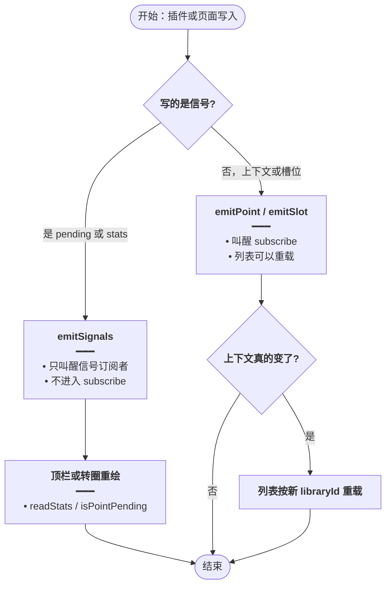
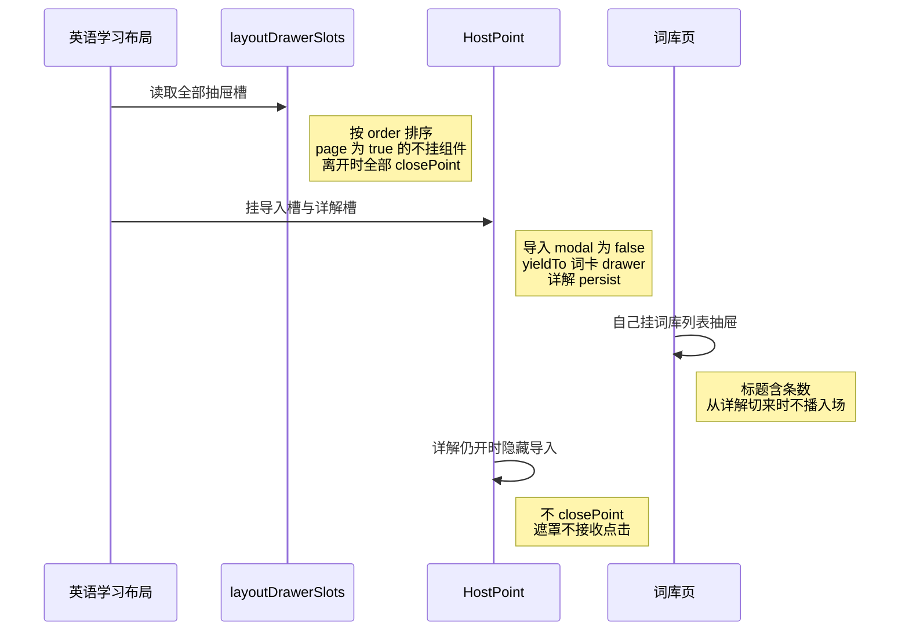
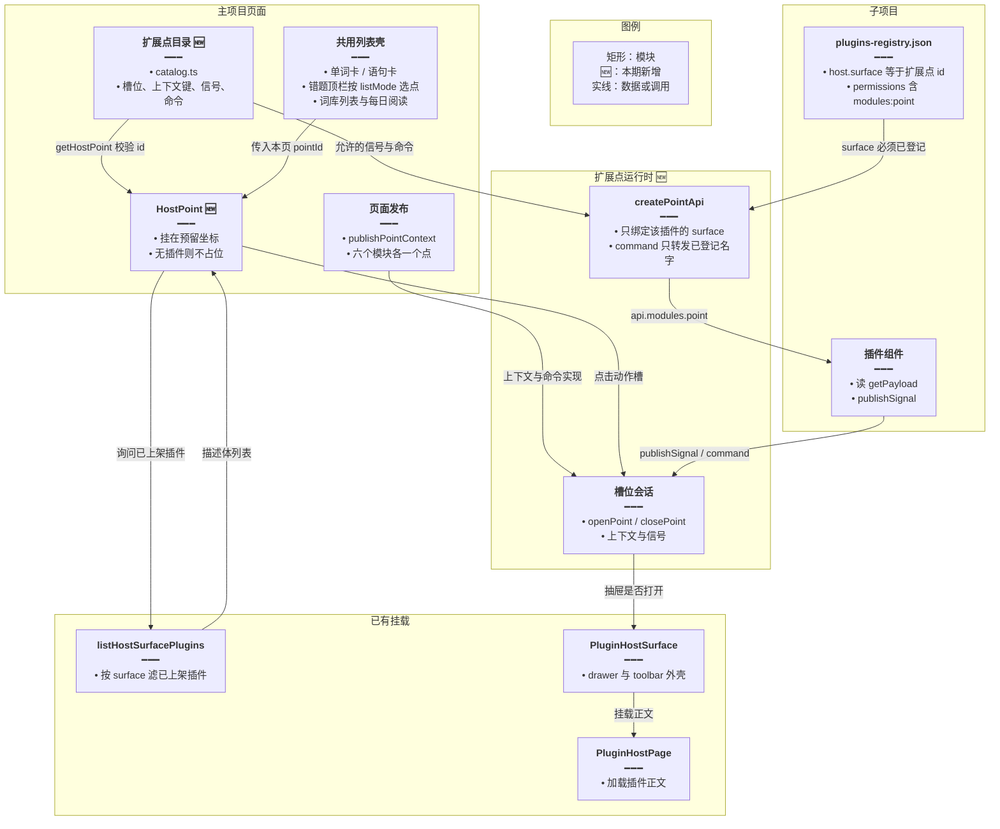
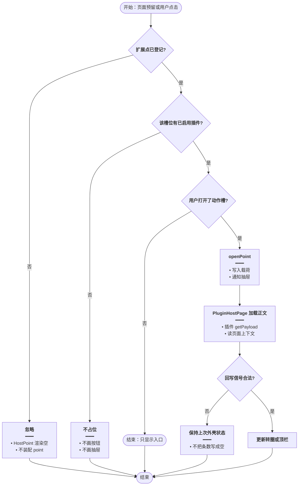
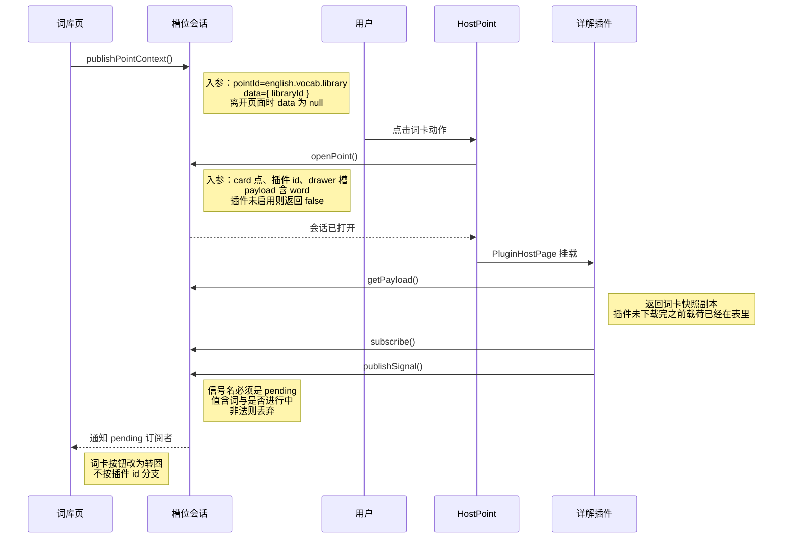
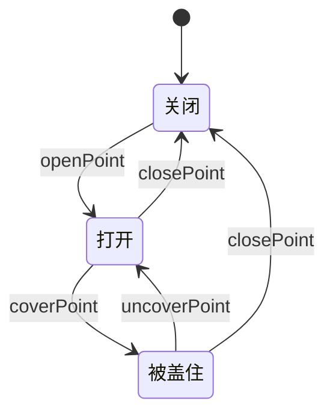

# 插件预留扩展点 — 实现思路

> **状态**：主体已落地，并已收成四种角色和 `stacks`。下文若仍写手写 `hostPoints`、`covers` 或 `yieldTo`，以 [插件接入点统一.md](./插件接入点统一.md) 和 `points/catalog.ts` 为准。  
> **日期**：2026-11-13；§4.6 补充于 2026-11-14  
> **需求摘要**：单词库、语句库、错题集、今日复习、我的收藏、每日阅读以后都要能加插件。这些位置现在就留下扩展点；之后往其中一处加插件只改注册表和子项目。  
> **一句话方案（预告）**：主项目用同一套列表槽位模板，事先给上述模块各登记一个扩展点，并挂到共用的卡片和顶栏上；插件只贡献已登记的点，运行时仍是一条槽位会话和 `api.modules.point`。布局抽屉的差别写在槽位的 `layout` 上，信号回写不叫醒槽位订阅。

## 延伸阅读

- 目录参数收成同一套角色：[插件接入点统一.md](./插件接入点统一.md)
- 单词详解为何把会话写进主项目：[../english/单词详解插件.md](../english/单词详解插件.md)
- 导入抽屉与词库卡片动作：[../english/手动导入单词详解.md](../english/手动导入单词详解.md)
- 解析列表写回顶栏条数：[../english/详解词列表.md](../english/详解词列表.md)
- 现有表面槽只覆盖抽屉和顶栏：`packages/federation-kit/docs/plugin-guide/表面槽位接入.md`

---

## 0. 读本文你将得到什么

- 要解决的问题：单词库上每加一个插件就要改主项目；语句库、错题集、今日复习、我的收藏、每日阅读如果照抄，会再长出六套会话。
- 比对后的方案：运行时仍是一份扩展点目录加一条槽位会话。每个模块一个点，槽位用同一套列表模板，挂在已经共用的单词卡、语句卡和列表顶栏上。
- 主要改动层：前端扩展点目录、通用槽位会话、`buildModules` 的 `api.modules.point`，以及上述共用壳多一个 `pointId`。后端不改。
- 分三期的原计划：M1 挂上空扩展点，M2 迁单词详解和导入并暂时留旧包装，M3 再删包装。M2 的旧包装已按 §4.6.1 提前删掉。
- 落地后补充（§4.6，原文没有）：三个单词插件已改用 `modules.point`，不再留旧模块名；信号和槽位分成两条通知；布局抽屉用槽位上的 `layout` 标识，不再各写一个抽屉组件。

---

## 1. 需求与边界

### 1.1 用户故事

| 角色 | 场景 | 行为 | 期望结果 |
|------|------|------|----------|
| 主项目开发 | 单词库、语句库、错题集、今日复习、我的收藏、每日阅读以后可能加插件 | 按列表模板各登记一个扩展点，挂到共用卡片和顶栏，并发布该页上下文 | 当时没有插件也不占位；错题集上的插件不会出现在今日复习 |
| 插件开发 | 给上述任一模块加一个插件 | 注册表写 `host.surface` = 该模块扩展点 id、`host.slot` = 模板里已有的槽位，并声明 `modules:point` | 不改主项目业务页和 `buildModules` |
| 使用插件的人 | 词卡、词库列表、以后同类位置 | 点已启用插件的图标或打开抽屉 | 冷启动时插件尚未下载，打开载荷仍在；外壳上的转圈和条数与插件回写一致 |
| 主项目开发 | 插件想要目录里没有的字段、槽位或信号 | 先改扩展点目录并在页面发布新数据 | 未登记的表面、槽位、信号被忽略，不会钻进页面内部 |

### 1.2 范围

| 在范围内 | 不在范围内（非目标） |
|----------|----------------------|
| 扩展点目录、通用槽位会话、封闭信号、页面命令、`api.modules.point` | 让插件运行时注册任意宿主函数，或按插件 id 动态 import 主项目内部模块 |
| 事先登记单词库、语句库、错题集、今日复习、我的收藏、每日阅读，并挂到共用壳上 | 为这六个模块各写一份会话文件或各发明一套槽位名 |
| 单词卡详解、词库解析列表、词库导入改接到单词库这个点，作为第一次有业务的证明 | 本期就为语句库、错题集等做出具体插件；也本期搬完阅读页 `setEbookHostHandlers` 和学习笔记跨窗同步 |
| 新页面「先登记、再允许插件」的落地顺序 | 后端表、会员、i18n 新文案体系、新 npm 依赖 |
| 未知表面 / 未启用插件 / 坏信号的失败路径 | 不可信 iframe 另开一套扩展点；iframe 继续走现有 `iframeRpcHandlers` |

### 1.3 约束与依赖

- 复用 `listHostSurfacePlugins`、`useHostSurfacePlugins`、`PluginHostPage`、`PluginHostSurface` 的抽屉和顶栏呈现，以及现有 `permissions` 裁剪、`hostApiRange`、样式隔离。
- 插件与主项目分开发布。M2 不能要求子项目同一天改完 `api.modules.vocabDetail`。
- 点词发生在插件下载之前。打开载荷必须留在主项目内存里，不能等插件挂载后再由插件自己记住。
- 遵守 Ponytail：不为一类插件引入 schema 库；上下文的业务字段由插件自行收窄，主项目只校验扩展点 id、槽位和信号名是否已登记。
- Web 与 Tauri 共用同一套内存会话，不把扩展点状态写入 localStorage。

---

## 2. 背景

- **谁、在什么场景、卡在哪**：插件作者要在主项目的某一处（词卡尾部、词库顶栏、词库卡片）挂能力。展示型抽屉和顶栏已经能只改注册表，但词卡详解和导入还要主项目配合改会话、改桥、改业务页。
- **现状缺口**：`PluginHostSurface` 只认识 `toolbar` / `drawer` 两种呈现，而且没有「页面事先声明这里将来可以挂插件」的目录。单词相关状态散落在 `vocabDetail/session.ts` 和 `vocabDetailImport/session.ts`，`buildModules` 按插件权限各写一枝。页面还直接 import 这些函数。
- **不解决会怎样**：下一个要读页面数据、或要回写外壳的插件，会再复制一份会话文件和一截 `buildModules`。语句库、错题集、今日复习、我的收藏、每日阅读如果各抄一份，主项目会被六个模块的插件绑住。
- **硬约束**：挂载位置必须由主项目事先划定，否则插件就能在任意页面插入按钮。权限仍要挡住未声明的模块。阅读页已经在用的 `ebook.read` 表面不能被这期改坏。打开抽屉时插件可能尚未加载，载荷不能只放在插件内部。

---

## 3. 现状与复用

| 能力 | 仓库中已有 | 本需求中的用法 |
|------|------------|----------------|
| 按表面列出已上架插件 | `packages/federation-kit/src/enabled/hostSurface.ts` 的 `listHostSurfacePlugins`；React 侧 `useHostSurfacePlugins` | 直接复用。扩展点 id 继续当作 `host.surface` |
| 抽屉 / 顶栏外壳 | `apps/frontend/src/federation/host/PluginHostSurface.tsx` | 直接复用。扩展点的 `drawer` 和 `toolbar` 仍交给它画 |
| 插件正文加载与隔离 | `apps/frontend/src/federation/host/PluginHostPage.tsx` | 直接复用。扩展点不另写加载器 |
| 按权限装配模块 | `apps/frontend/src/federation/runtime/index.ts` 的 `buildModules` | 扩展。单词两枝收成 `modules:point`；阅读和笔记两枝这期保留 |
| 词卡打开载荷、生成中、列表条数、当前词库 | `apps/frontend/src/federation/modules/vocabDetail/session.ts` | 扩展后替换。M2 起这些函数改为转调通用会话，M3 删除 |
| 导入抽屉的词库目标 | `apps/frontend/src/federation/modules/vocabDetailImport/session.ts` | 扩展后替换。与详解会话合并进按「扩展点 + 槽位」索引的一张表 |
| 词卡按钮 | `apps/frontend/src/views/englishLearning/components/vocab/PluginActions.tsx` | 扩展。改为调用 `openPoint`，不再 import 详解会话 |
| 详解抽屉 | `apps/frontend/src/views/englishLearning/components/vocab/DetailDrawer.tsx` | 扩展。改为读通用槽位会话；叠放规则改由扩展点的 `covers` 表达 |
| 词库页发布当前库、顶栏读条数 | `apps/frontend/src/views/englishLearning/library/vocabulary/index.tsx` | 扩展。改为 `publishPointContext` 和订阅 `stats` |
| 词库卡片上的导入按钮 | `apps/frontend/src/views/englishLearning/library/components/LibraryListPanel.tsx` | 扩展。去掉写死的 `plugin.id === 'vocabDetailImport'` |
| 阅读页把书 id 交给插件 | `apps/frontend/src/views/ebook/read.tsx` 的 `setEbookHostHandlers`；`apps/frontend/src/federation/modules/ebook/hostApi.ts` | 不适用本期迁移。它已经是「页面发布、插件只读」，M3 再决定是否收成扩展点命令 |
| 笔记跨窗通道 | `apps/frontend/src/federation/modules/learningNotes/hostApi.ts` | 不适用。通道不是页面槽位 |
| 描述体里的表面和槽位 | `packages/federation-kit/src/types/index.ts` 的 `PluginDescriptor.host` | 直接复用。`slot` 已是开放字符串，目录负责限制某一扩展点允许哪些槽位 |
| 单词卡被多页复用 | `apps/frontend/src/views/englishLearning/components/vocab/Card.tsx`。词库、收藏、错题、今日复习、单词包都渲染它 | 扩展。卡片上的页面插件槽接收 `pointId`，不再只写死 `english.vocab.card` |
| 语句卡被多页复用 | `apps/frontend/src/views/englishLearning/components/classic/Card.tsx`。语句库、收藏、错题、今日复习使用 | 扩展。同样接收 `pointId`，挂 `english.classic.library` 或所在页的点 |
| 错题与今日复习共用列表面板 | `mistakes/vocabulary/VocabularyMistakesPanel.tsx` 的 `listMode`；`review/index.tsx` 传入 `listMode="review"`。顶栏是 `MistakesPanelFooter.tsx` | 扩展。面板按 `listMode` 把 `english.mistakes` 或 `english.review` 传给顶栏和卡片 |
| 收藏页 | `apps/frontend/src/views/englishLearning/favorites/index.tsx` 及 `favorites/vocabulary` | 扩展。发布 `english.favorites`，上下文带 `kind` |
| 语句库列表 | `library/components/LibraryListPanel.tsx` 的 `kind`；语句库走 classic | 扩展。`kind === 'classic'` 时发布 `english.classic.library`，槽位模板与单词库相同 |
| 每日阅读列表 | `apps/frontend/src/views/englishLearning/dailyReading/List.tsx` | 扩展。顶栏和篇目行挂 `english.dailyReading`。详情页和测验本期不另开点 |
| 插件侧对 `api.modules.vocabDetail` 的调用 | 本仓检索不到子项目源码（注册表指向仓外远程包） | 待确认具体仓库。M2 用同名包装保住旧方法，验证方式见 §11 |

**业界对照**（候选方案必须落在这些已落地的机制上，而不是另起一个微前端运行时）：

| 来源 | 宿主事先留下什么 | 插件做什么 | 和本仓的差距 |
|------|------------------|------------|----------------|
| Eclipse 扩展点、IntelliJ extension point | 宿主声明扩展点 id 和契约（接口或 bean）。扩展点先于任何扩展存在 | 在 manifest 里按该 id 贡献实现或数据 | 本仓没有「点」的目录，只有插件注册表 |
| VS Code contribution points | 宿主拥有闭集位置（如 `editor/title`、`explorer`）。`package.json` 的 `contributes` 只能填这些位置；`onCommand` / `onView` 懒激活 | 声明贡献；被点到才激活 | `PluginHostSurface` 接近 views，但词卡动作、回写转圈、页面上下文没有对应的贡献点。懒加载已有：`ensurePlugin` 在进入时才拉取 |
| Shopify checkout UI targets | 平台公布有限 target（如 `purchase.checkout.block.render`）。每个 target 的 API 固定；配置文件写 `target` + `module` | 只能注入已公布的 target；商家再决定放哪 | 本仓 `host.surface` 是自由字符串，页面没有一份「已公布 target」可对照 |
| WordPress `do_action` / `apply_filters` | 核心在固定时刻调用钩子并传入参数。任何代码都能新造钩子名 | `add_action(名字)` 挂回调 | 太开放。本仓插件有信任等级和权限，不能让未登记的字符串变成页面接口 |

**调研结论**：展示型的同一表面加插件，已经不用改主项目。缺口集中在「页面数据交给插件」和「插件回写外壳」，以及主项目没有一份先于插件的扩展点目录。单词卡、语句卡、错题顶栏已经被词库、收藏、错题、今日复习共用；今日复习页面直接渲染错题面板并传入 `listMode="review"`。扩展点应挂在这些壳上，而不是每个页面再写一套按钮。阅读页的 `setEbookHostHandlers` 证明「页面发布、插件只读」能工作。下面的候选都接在 `listHostSurfacePlugins` 和 `buildModules` 上，不更换联邦运行时。

---

## 4. 方案比对与最终方案

### 4.1 候选方案

#### 方案 A：继续按插件复制会话（复用现状）

- **做法**：新插件仍建 `apps/frontend/src/federation/modules/<id>/session.ts`，在 `runtime/index.ts` 的 `buildModules` 增加 `modules:<id>` 分支，业务页 import 打开、关闭和回写函数。抽屉和顶栏继续用 `PluginHostSurface`。需要「预留」时，照 `vocabDetail/session.ts` 先写一个空会话，等插件来了再填方法。
- **能工作的原因**：词卡详解和导入今天就是这样跑通的。冷启动载荷放在主项目内存，`getSnapshot` 在插件挂载后读走。权限裁剪已经在 `buildModules` 里。
- **主要代价**：每加一个会读写页面的插件，主项目至少改会话、桥和业务页三处。预留出来的空会话仍然是插件专属文件，下一个插件用不上。

#### 方案 B：页面到处调用开放钩子（WordPress 模型）

- **做法**：页面在按钮和数据变化处调用通用的 `emitHook(name, payload)` / `applyHook(name, data)`。插件用现有 `api.event.on(name)` 订阅。不建目录。新位置只要页面多写一行 `emitHook`，插件约定同一个字符串即可挂上。回写也是任意事件名，业务页自己决定听哪些名字。
- **能工作的原因**：`HostBridgeProps.api.event` 已经有 `on` / `off` / `emit`。打开载荷可以顺手放进一个 `Map<hookName, payload>`。同一字符串上多个插件按注册顺序执行，排序可用现有 `host.order`。
- **主要代价**：钩子名没有权限边界，写错字符串不会在加载期被拒绝。外壳要显示转圈时，业务页必须知道插件会 emit 哪个名字，预留阶段还是要把名字写进页面。插件也能监听别的页面发出的钩子。

#### 方案 C：宿主扩展点目录（Eclipse 扩展点 + VS Code 贡献点 + Shopify target）

- **做法**：新增 `apps/frontend/src/federation/points/catalog.ts`。一个扩展点先于插件存在，写明 id、允许的槽位、页面上下文有哪些键、插件可以回写的信号闭集、页面提供的命令名，以及可选的 `covers`（哪个槽位盖住另一个扩展点）。页面在真正的位置渲染 `HostPoint`，并用 `publishPointContext` 交出当前数据。插件注册表的 `host.surface` 必须等于某个已登记 id，`host.slot` 必须落在该点的槽位里，权限只申报一个 `modules:point`。`buildModules` 按该插件自己的 `host.surface` 绑定只读得到这一处的 `api.modules.point`。打开载荷、开关和信号进一张按「扩展点 id + 槽位」索引的内存表。
- **能工作的原因**：列表过滤复用 `listHostSurfacePlugins(pointId)`。抽屉和顶栏复用 `PluginHostSurface`。冷启动载荷仍在主项目，和方案 A 一样，只是不再按插件 id 分文件。未登记的表面在 `getHostPoint` 得到空，宿主不渲染、不装配 API。这和 Shopify「未知 target 不注入」、VS Code「不能贡献一个不存在的菜单位置」相同。
- **主要代价**：新的挂载位置要先改目录并在页面挂上 `HostPoint`，不能像 WordPress 那样临时造一个字符串。第一次要把词卡和词库两处从专用会话迁过来。

### 4.2 比对

| 维度 | 方案 A 按插件复制会话 | 方案 B 开放钩子 | 方案 C 扩展点目录 |
|------|----------------------|-----------------|-------------------|
| 正确性（失败路径、边界、数据是否会错） | 未启用插件时今天的 `openVocabDetailWord` 会返回 false。坏的条数会被丢掉。每个新会话都要自己再写一遍这些判断，漏了就会把空 id 交给插件 | 钩子名拼错时静默无插件，页面和无插件的表现一样，难以区分「没人接」和「名字写错」。任意插件能听到任意钩子 | 未登记的 id、槽位、信号在一处拒绝。插件只能拿到自己 `host.surface` 对应的那一个点。坏信号沿用现在「留下上次有效条数」的规则 |
| 复用 / 与现状契合 | 全是现有文件，零新概念 | 复用 `api.event`，但页面上的词卡按钮、顶栏条数、叠放抽屉都还要各写监听，和现在的专用订阅是同一形状 | 复用表面列表、`PluginHostPage`、`PluginHostSurface`、权限装配。阅读页「页面发布实现、桥上只读」的形状保留，只是把单词两处收成同一套 |
| 改动面（要动哪些路径） | 每插件：新 session、`buildModules` 一枝、业务页 import。预留阶段就要先落插件名 | 每个预留位置一行 `emitHook`，再加页面侧对回写事件名的订阅。现有两个 session 仍要删或改成钩子，否则两套并存 | M1 新增 `federation/points/` 和 `HostPoint`。M2 改词卡、详解抽屉、词库页、导入抽屉、布局清理和 `buildModules` 的单词两枝。阅读和笔记不动 |
| 复杂度（新概念、新状态、新依赖） | 概念为零，文件数随插件涨 | 概念少（一个字符串总线），状态仍散在各页面订了哪些事件 | 新增扩展点、槽位会话、信号闭集三个概念。无新依赖。状态只有一张内存表 |
| 体验（延迟、步骤数、失败时用户看到什么） | 与现在相同：未启用时由调用方提示；抽屉冷启动有载荷 | 与 A 相同，但插件未接上时页面没有统一的「这处没有启用插件」判断，按钮可能留下空回调 | 与 A 相同。扩展点尚无插件时按钮和抽屉都不渲染，不占位 |
| 风险（迁移、互斥、并发、回滚） | 无迁移。继续复制不会破坏阅读页 | 钩子串台会让导入插件读到词卡载荷。回滚只是删页面上的 emit，但没有清单可对 | 子项目仍调用旧模块名。用一层同名包装转调新表，可单独回滚包装。`covers` 写错会让详解抽屉退场动画回来，这是现有 `markVocabDetailReplacedByList` 已经在防的问题 |
| 可维护性（以后改一处还是改多处） | 第 N 个插件改 N 套文件。预留的空会话不能给下一个插件用 | 新位置要改页面（加钩子）且插件和页面私下约定字符串，约定不在一处可查 | 已登记的点加插件只改注册表和子项目。新位置改目录一条加页面挂载一次。回写信号和命令名在目录里能一次看全 |

### 4.3 综合考量

权重放在可维护性和正确性上。需求是「以后这一处要接插件时，现在就把接口留下」，并且留下的接口要能给后来的多个插件用。方案 A 能留下一份会话，但那份会话写死了插件名和字段，后来的插件仍然要再开一份，预留没有共享价值。方案 B 留下钩子的成本最低，也少一次「目录评审」，但本仓插件已经按 `permissions` 和 `trust` 裁剪能力，开放字符串会把这道裁剪绕开，页面外壳也仍然要认识每个回写名字，预留并不完整。

选定方案 C。它在可维护性上赢在：扩展点先于插件存在，同一点上的下一个插件不再改主项目。它在正确性上赢在：冷启动载荷仍留在宿主（这点与 A 相同，B 若把载荷只放在插件里就会丢），同时未知表面和越权读取在目录这一处被拒绝。

明确放弃的优点：放弃方案 A「不加新文件就能再复制一份会话」的低起步成本；放弃方案 B「页面临时加一个字符串就有钩子、不必先改目录」的灵活性。这两项抵不过第 N 个插件仍然改主项目，以及钩子串台。

### 4.4 最终方案

#### 背景

`PluginHostSurface` 已经让同一表面的抽屉和顶栏只改注册表。词卡详解、解析列表和导入还要主项目保存「当前词 / 当前库 / 开没开 / 生成中 / 条数」，并在 `buildModules` 里按插件各挂一块 API。这些状态不能挪进子项目：用户点击时远程包可能还没下载，转圈和顶栏数字画在主项目上。阅读页用 `setEbookHostHandlers` 证明「页面发布、插件只读」可行，但没有收成一份先于插件的目录。权限和 `hostApiRange` 必须继续有效。这期不搬阅读和笔记，也不引入新的校验库。

#### 具体思路

1. **模块**：新增 `federation/points/`（目录、槽位会话、命令绑定、`HostPoint`）。`PluginHostSurface` 和 `PluginHostPage` 原样复用。`buildModules` 里单词两枝改为装配 `modules.point`，阅读和笔记分支留着。
2. **数据从哪来、到哪去**：页面把当前库 id 等稳定数据经 `publishPointContext` 写入该扩展点的上下文。用户点击动作槽时，`openPoint` 把这一下的载荷（词卡快照或导入目标）写入「扩展点 + 槽位」会话。插件挂载后从 `api.modules.point` 读上下文和载荷。插件要改外壳时调用 `publishSignal`，只接受目录里写明的信号名；页面订阅该信号更新转圈或条数。跨点动作（导入列表点词打开详解）做成源扩展点上的命令，命令实现里调用目标点的 `openPoint`，插件不 import 会话文件。
3. **状态放哪**：全部放在主项目内存的一张表里，按 `pointId + slot` 索引，用 `Set<() => void>` 通知 React。不放 MobX，因为现有两个会话已经是模块级变量加订阅，业务页用 `useSyncExternalStore` 就能接。不放插件内部，因为冷启动时插件还不存在。不放 localStorage，因为这是当前页的瞬时 UI，刷新应回到关闭。
4. **边界**：扩展点 id 不在目录中，`getHostPoint` 返回空，`HostPoint` 渲染 `null`，`buildModules` 不挂 `point`。槽位不在该点的允许列表里，列表过滤掉，不出现按钮。插件未启用时 `openPoint` 返回 `false`，调用方沿用今天的提示责任。信号缺字段或不是有限数字时不写入，顶栏保留上次有效值。离开页面时 `publishPointContext(..., null)`，插件读到空上下文后自己显示空态。`covers` 置位时，被盖住的抽屉跳过退场，对应今天的 `replacedByList`。

#### 实现方案

**一句话**：主项目用同一套列表槽位模板，事先给单词库、语句库、错题集、今日复习、我的收藏、每日阅读各登记一个扩展点，并挂到共用的卡片和顶栏上；插件只贡献已登记的点，运行时仍是一条槽位会话和 `api.modules.point`。

| 步骤 | 谁 | 做什么 | 输入 → 输出 |
|------|----|--------|-------------|
| 1 | `federation/points/catalog.ts` | 用列表模板登记单词库、语句库、错题集、今日复习、我的收藏、每日阅读，并保留词卡点和语句卡点 | 静态说明 → `getHostPoint(id)` 命中或空 |
| 2 | `federation/points/session.ts` | 保存上下文、槽位会话和信号；提供打开、关闭、盖住、订阅 | `openPoint` / `publishPointContext` / `publishSignal` → 内存表变更并通知 |
| 3 | 共用壳 + `HostPoint` | 单词卡、语句卡、错题顶栏、词库列表、每日阅读列表按本页 `pointId` 挂槽并发布上下文 | 页面数据、点击载荷 → 步骤 2 的表 |
| 4 | `runtime/index.ts` 的 `buildModules` | 权限含 `modules:point` 且 `host.surface` 已登记时，挂只属于这一处的 `api.modules.point` | 插件描述 + 权限集 → `getContext` / `getPayload` / `subscribe` / `publishSignal` / `command` |
| 5 | 子项目 | 读上下文和载荷，回写已允许的信号，需要时调命令 | `api.modules.point` → 界面；旧的 `vocabDetail` 方法在 M2 仍可用，内部转调步骤 2 |

#### 选定原因

1. **可维护性**：已登记的点再加插件只改注册表和子项目。牺牲方案 B 那种不改目录就能新造钩子的速度，换一份能检索的契约。
2. **正确性**：未知 id、越权读取、坏信号在目录和会话各有一处拒绝；冷启动载荷留在宿主。牺牲方案 B「少一次目录检查」的路径，避免钩子串台。
3. **复用**：表面过滤、抽屉外壳、权限装配都不换。牺牲方案 A「完全不新增目录文件」的做法，避免第 N 份 `session.ts`。
4. **风险**：M2 用同名包装保住旧模块，子项目可以后迁。牺牲「一次删干净」的短 diff，避免主项目和远程包必须同时发布。
5. **体验**：没有插件的扩展点不占位，未启用时 `openPoint` 返回 false，和现在词卡行为一致。牺牲开放钩子里「页面先渲染按钮、插件随后接上」的弹性，避免空按钮。
6. **复杂度**：三个新概念集中在 `federation/points/`，无新依赖。牺牲方案 A 表面上更少的名词，换文件数不再随插件增长。
7. **改动面**：阅读页和笔记这期不迁。牺牲「所有 `buildModules` 分支一次收完」的整齐，换可回滚的第一刀。

#### 优势

- 相对方案 A：第二个挂在 `english.vocab.card` 上的插件不用再写 `session.ts`，也不用再在 `buildModules` 加一枝；预留是目录里的一条，不是一份插件专属空文件。
- 相对方案 B：插件拿不到别的扩展点的上下文；外壳只订阅目录里写明的 `pending` 和 `stats`，不会因为字符串约定不一致而转圈不亮或条数不更新。

#### 怎么实现

1. 在目录用同一套列表槽位（`toolbar`、`item-action`、`drawer`）登记六个页面点：`english.vocab.library`、`english.classic.library`、`english.mistakes`、`english.review`、`english.favorites`、`english.dailyReading`。单词库在此之外保留已经在用的 `library-card-action`、`import-drawer`、`stats` 和 `covers`。语句库保留同样的库卡片槽和导入抽屉，命令先留空。`english.vocab.card` 继续表示「这个词」的动作，挂在共用单词卡上，不代表某一个列表页。`english.classic.card` 以同样方式挂在共用语句卡上，信号和命令先为空。其它页面点的 `signals` 和 `commands` 也先为空数组，等外壳真要画某种状态或代办某个动作时再加名字。
2. 会话表按 `pointId + slot` 存 `{ pluginId, open, payload, covered }`。上下文和信号按 `pointId` 另存。`publishSignal` 发现信号名不在该点的闭集里，或 `stats` 的数字不是有限非负值时直接返回，不通知。
3. 共用壳接收 `pointId`，不在每个业务页再写一套按钮。单词卡始终挂 `english.vocab.card`，另外挂页面传入的 `pointId` 的 `item-action`。语句卡同样挂 `english.classic.card` 和页面点。`VocabularyMistakesPanel` 按 `listMode` 把 `english.review` 或 `english.mistakes` 传给顶栏和卡片，语句错题面板同样处理。收藏页传入 `english.favorites` 并发布 `kind`。词库列表按 `kind` 发布 `english.vocab.library` 或 `english.classic.library`。每日阅读列表挂 `english.dailyReading`。词库页在 `libraryId` 变化时 `publishPointContext`，离开时传 `null`。顶栏只订阅该点目录里有的信号。详解抽屉订阅词卡 `drawer` 会话；`covered === true` 时不播退场。
4. `buildModules` 看到 `modules:point` 时，只用这份描述体上的 `host.surface` 去 `getHostPoint`。命中才挂 `api.modules.point`。`command` 只转发目录里有、且页面已经绑定实现的名字；`play` 仍调用现有 `playPreferred`，缓存目录仍是 `TTS_CACHE_FOLDER.vocabDetail`。`openCard` 的实现调用词卡点的 `openPoint`。
5. M2 把 `getSnapshot`、`subscribeVocabDetail`、`setVocabDetailPending`、`getListLibrary`、`setVocabDetailListStats`、导入会话的 `getTarget` 和 `subscribeVocabImport` 改成转调步骤 2，旧权限分支暂时留下。子项目迁到 `api.modules.point` 后，M3 删除包装和旧分支，再视情况提升 `VITE_HOST_API_VERSION`。

主要实现代码见 §9。

### 4.5 其他关键决策

下面四处都会改变状态放在哪、或数据从哪流到哪，需要单独定。

#### 4.5.1 扩展点契约放在中央目录，还是只放在页面 JSX 里

##### 候选

**目录集中（选定）**：`catalog.ts` 是唯一契约。页面上的 `HostPoint` 若写出目录里没有的 id，开发时打一次警告并渲染空。插件表面对不上目录则不装配。

**只放 JSX**：页面写 `<HostPoint id="english.vocab.card" slots={[...]} />`，不另建目录。契约以页面源码为准，插件注册表去对这个字符串。

##### 比对

| 维度 | 中央目录 | 只放 JSX |
|------|----------|----------|
| 正确性 | 插件加载时就能拒绝未知 id，不依赖那一页是否已经挂上组件 | 页面还没挂上时，插件无法知道自己被拒绝的原因；两个页面写出不同槽位列表会分叉 |
| 复用 | 词卡动作和布局层抽屉读同一条说明 | 每个挂载点各写一遍槽位和信号，和今天各写一份 session 类似 |
| 改动面 | 多一个 `catalog.ts` | 少一个文件，但每个预留位置的 props 更长 |
| 复杂度 | 多一个静态表 | 概念更少 |
| 体验 | 此项相同。有没有按钮取决于页面是否挂了 `HostPoint` 且注册表有插件 | 此项相同 |
| 风险 | 目录和页面忘记同步时，开发警告能看见 | 忘记挂载时没有任何清单可对，预留不可检索 |
| 可维护性 | 一处能列出「主项目已经答应插件的接口」 | 要全仓搜 `HostPoint` 才知道预留了什么 |

##### 综合考量

「提前预留」要求接口在插件出现之前就能被找到。只放 JSX 少一个文件，但预留散落在页面里，和现在的专用 import 一样不好盘点。选定中央目录。放弃「少一个文件」。

##### 最终方案六块

- **背景**：预留若只存在于某个按钮的 JSX，后来的人不知道主项目已经答应交出哪些字段。
- **具体思路**：目录定义允许的槽位、上下文键、信号和命令名。页面只负责把组件放到坐标上，并提供上下文和命令实现。两边用同一个 id 对齐。
- **实现方案**：`getHostPoint` 是插件装配和 `HostPoint` 渲染的共同入口。目录没有的 id 一律空。
- **选定原因**：可维护性上能一次看全预留；正确性上插件不依赖某页是否已打开。牺牲一个额外文件。
- **优势**：相对「只放 JSX」，词卡按钮和布局层抽屉不会各写一套允许槽位。
- **怎么实现**：见 §9.2 的目录片段。页面挂载见 §9.2 步骤 3。

#### 4.5.2 打开载荷放在宿主槽位会话，还是等插件挂载后放在插件里

##### 候选

**宿主会话（选定）**：`openPoint` 同步把载荷写入内存表。插件稍后 `getPayload`。这是今天 `getSnapshot` 的通用版。

**插件自持**：按钮只 `emit` 一个事件。插件若尚未 `activate`，事件丢掉，或由插件在激活时再向页面要一次。

##### 比对

| 维度 | 宿主槽位会话 | 插件自持 |
|------|----------------|----------|
| 正确性 | 点击时插件未下载，载荷仍在；再点同一词可以按宿主里的当前载荷做开关 | 第一次点击若早于 `activate`，详解打开但词是空的。要补救就得在宿主再存一份，结果回到前一列 |
| 复用 | 与现有 `vocabDetail/session.ts` 的内存订阅同形 | 现有快照读法用不上 |
| 改动面 | 一张表替换两个 session 文件 | 看起来主项目更瘦，实际上按钮仍要处理「插件还没来」 |
| 复杂度 | 一张 `Map` | 还要加激活队列，复杂度更高 |
| 体验 | 打开即可看到该词，不必等二次点击 | 首次可能空白或要点两次 |
| 风险 | 离开页面必须清会话，否则下一页读到旧词。在页面清理函数里 `closePoint` | 丢事件更难查 |
| 可维护性 | 所有槽位同一张表 | 每个插件自己排队，规则不统一 |

##### 综合考量

冷启动是硬约束，不是体验偏好。插件自持省不下宿主状态，因为补救队列仍然要放在宿主。选定宿主会话。放弃「主项目完全不记业务载荷」这个做不到的目标。

##### 最终方案六块

- **背景**：`openVocabDetail` 今天就在插件挂载前写入 `session.card`。
- **具体思路**：键从「某个插件的模块全局变量」改成 `pointId + slot`。载荷保持普通对象，主项目不解析词义字段。
- **实现方案**：`openPoint` 写入并 `emit`；`createPointApi().getPayload` 返回副本。
- **选定原因**：正确性上覆盖未下载插件；体验上一次点击就有词。牺牲「状态全部进子项目」。
- **优势**：相对插件自持，不会出现抽屉已开但词为空。
- **怎么实现**：见 §9.2 步骤 2。

#### 4.5.3 回写用扩展点上的信号闭集，还是沿用 `api.event` 的任意事件名

##### 候选

**信号闭集（选定）**：目录写 `signals: ['pending']` 或 `['stats']`。插件 `publishSignal`。页面按扩展点订阅，不按插件 id 订阅。

**任意事件名**：插件 `api.event.emit('vocab-detail:pending', ...)`，页面事先约定并监听。

##### 比对

| 维度 | 信号闭集 | 任意事件名 |
|------|----------|------------|
| 正确性 | 未声明的名字被丢弃，顶栏不会被陌生事件写成 0 | 名字不一致时转圈不亮，且别的插件可以 emit 同名事件 |
| 复用 | 订阅形态与现在的 `subscribeVocabDetailPending` 相同，只是键变成扩展点 | 复用 `api.event`，页面仍要知道每个插件的事件名 |
| 改动面 | 目录加一个信号名才允许新的外壳回写 | 不加目录，但每个外壳各写监听 |
| 复杂度 | 信号只有 `pending` 和 `stats` 两种已有形状 | 事件名空间开放，更难枚举 |
| 体验 | 此项相同。用户看到的仍是卡片转圈和顶栏「共 n 条 / 已加载 m 条」 | 此项相同 |
| 风险 | 新外壳状态必须改目录，不能插件单方面加 | 串台风险高 |
| 可维护性 | 外壳绑定在扩展点上，同一点的下一个插件自动点亮同一转圈 | 每个插件一套事件名，预留时页面就要把名字写死 |

##### 综合考量

回写的消费者是主项目外壳，不是插件自己。外壳能预留的只有它已经打算画的那几种状态。选定闭集。放弃任意事件名「插件不用改目录就能推一种新状态」的能力；那种新状态本来就要改页面 UI，改目录并没有多一次发布。

##### 最终方案六块

- **背景**：生成中和条数今天由专用 setter 写回，页面再订阅。
- **具体思路**：setter 收成 `publishSignal`。合法性和「坏数字不覆盖上次」放在这一处，避免每个插件再写一遍。
- **实现方案**：`pending` 的值是 `{ pluginId, key, on }`，按钮只亮自己那一枚；`stats` 的值是 `{ total, loaded }`。其它名字忽略。
- **选定原因**：正确性上防止串台和把顶栏写成 NaN。牺牲开放事件的灵活。
- **优势**：相对任意事件名，第二个词卡插件不用和页面再约定一个新事件名。
- **怎么实现**：`publishSignal` 见 §9.2 步骤 2。页面订阅见步骤 3 的说明，不另贴一套监听样板。

#### 4.5.4 迁移期保留旧模块名，还是一次切到 `api.modules.point`

##### 候选

**同名包装（选定）**：M2 的 `modules.vocabDetail` 和 `modules.vocabDetailImport` 方法还在，函数体改为读写槽位会话。子项目无感。M3 确认仓外远程包已改用 `api.modules.point` 后再删包装，并提高 Host API 版本。

**一次切断**：M2 删除旧分支。远程包在同一版本窗口改调用，否则详解面板拿不到快照。

##### 比对

| 维度 | 同名包装 | 一次切断 |
|------|----------|----------|
| 正确性 | 旧调用和新调用读同一张表，不会出现两份「当前词」 | 未升级的远程包打开空抽屉 |
| 复用 | 旧函数名留在原文件，变成几行转调 | 删得更干净 |
| 改动面 | 主项目多留一个版本的包装 | 主项目 diff 更短，远程包必须同步 |
| 复杂度 | 包装期有两个入口 | 只有一个入口 |
| 体验 | 用户无感知 | 版本错开时详解空白 |
| 风险 | 包装忘记转调某一方法会让旧插件缺字段。验收要覆盖旧入口 | 发布顺序耦合。本仓搜不到远程包源码，不适合假设能同一天改 |
| 可维护性 | M3 有明确删除条件 | 没有过渡期，但失败时要整包回滚 |

##### 综合考量

远程包不在本仓，发布不能绑在一起。选定包装一个版本。放弃「M2 的 diff 里就删掉两个 session 文件」这一项更短的改动。

> **后记（2026-11-14）**：单词解析、解析列表和导入的源码可以同一轮改完，本地清单也改成 `modules:point`。同名包装没有留下。已发布、仍调用旧方法名的远程包要等重新发布后才能打开。阅读、笔记、打开会话这三枝不动。详见 §4.6.1。

##### 最终方案六块

- **背景**：`buildModules` 今天把 `getSnapshot` 等直接交给声明了 `modules:vocabDetail` 的插件。
- **具体思路**：表只有一张。旧方法是读这张表的另一扇门。新门是 `api.modules.point`。
- **实现方案**：M2 不提升 `VITE_HOST_API_VERSION`。M3 删除旧门后再提版本，让 `hostApiRange` 继续表达契约变化。
- **选定原因**：风险上允许主项目先发。牺牲一份更短的删除 diff。
- **优势**：相对一次切断，未改的详解插件仍能打开当前词。
- **怎么实现**：旧 `getSnapshot` 改为 `return getPayload('english.vocab.card', 'drawer')` 这一类转调。新 API 的形状见 §9.2 步骤 4。

#### 4.5.5 六个列表模块各登记一个点，还是合成一个英语学习大点

##### 候选

**每模块一个点，槽位用同一模板（选定）**：`english.mistakes`、`english.review`、`english.favorites`、`english.vocab.library`、`english.classic.library`、`english.dailyReading` 各一条目录。槽位都是 `toolbar`、`item-action`、`drawer`。单词库和语句库再带上已经在用的库卡片槽。共用的单词卡、语句卡、错题顶栏接收页面传来的 `pointId`。今日复习继续渲染错题面板，只是 `listMode="review"` 时传入 `english.review`。

**一个大点 `english.learning`**：所有列表页发布 `context.module`。插件自己判断要不要在这一页工作。顶栏把这个点上的全部插件都画出来。

**等某个模块真有插件再登记**：运行时照旧，但语句库、错题集、今日复习、收藏、每日阅读现在不挂 `HostPoint`。第一插件到来时再改那个页面。

##### 比对

| 维度 | 每模块一个点 | 一个大点 | 等有插件再登记 |
|------|----------------|----------|----------------|
| 正确性 | 错题集插件的 `host.surface` 对不上今日复习，按钮不会出现。上下文也不会串到另一页 | 插件漏判断 `module` 时，错题插件出现在复习和收藏上 | 第一插件落地前没有挂载点。到时仍要改页面，和现在加单词插件一样 |
| 复用 | 挂在已有的 `Card`、`classic/Card`、`MistakesPanelFooter`、`LibraryListPanel`、每日阅读列表。今日复习不用新面板 | 也挂这些壳，但每个插件都要再写一层模块过滤 | 壳上没有预留，第一个插件要改对应页面 |
| 改动面 | M1 改这些共用壳，让它们接收 `pointId` 并发布上下文。六个目录条目是数据 | 壳的改动相近，目录只有一条 | 现在改动最小，以后每个模块的第一个插件都要改主项目 |
| 复杂度 | 多六条目录，槽位形状只有一套 | 目录更短，过滤规则散落在每个插件里 | 概念最少，直到第一次复制会话 |
| 体验 | 没有插件的顶栏和卡片不占位。用户在错题集只看到错题集插件 | 每个列表顶栏都会出现所有列表插件，再由插件把自己藏起来，容易闪一下 | 此项相同，直到接入时才看得到入口 |
| 风险 | 单词卡如果只改成页面点，现有详解会从收藏和错题上消失。所以词卡点 `english.vocab.card` 仍挂在单词卡内部，页面点是额外的一排 | 上下文键变多后，旧插件读到别的模块的 `libraryId` | 预留名不副实。六个模块的第一个插件仍要发主项目 |
| 可维护性 | 加插件只改注册表。新的外壳状态才改目录里的 `signals` | 每加一个插件都要约定 `module` 字符串，约定不在目录里 | 和方案 A（按插件复制会话）在这些模块上会再演一遍 |

##### 综合考量

这次要留的是六个模块，不是再留一个单词按钮。一个大点省下的目录行数，换不回「插件漏过滤就串页」。等有插件再登记，则语句库和错题集的第一个插件仍然要改主项目，需求没有被满足。选定每模块一个点，槽位共用一套模板，挂在已经共用的壳上。放弃「目录只有一条」和「现在一行代码都不动这些页面」。

##### 最终方案六块

- **背景**：单词卡被词库、收藏、错题、今日复习、单词包共用。语句卡同样被多页共用。今日复习页面直接渲染错题面板并传 `listMode="review"`。每日阅读列表是单独一页。这些壳上现在除了单词卡里的详解按钮，没有页面级预留。
- **具体思路**：实体动作和页面动作分开。`english.vocab.card` / `english.classic.card` 跟着卡片走，表示「这个词 / 这句」。页面点跟着 `pointId` 走，表示「这一页」。错题和复习共用面板，靠 `listMode` 选择点 id，不靠插件自己判断。
- **实现方案**：`listPoint(id, contextKeys)` 生成 `toolbar`、`item-action`、`drawer`。错题、复习、收藏的上下文键是 `kind`（`vocab` 或 `classic`）。两个库的上下文键是 `libraryId`，并另有库卡片槽。每日阅读的上下文键是 `origin`。信号和命令先为空，单词库和词卡保持现有的 `stats`、`pending`、`play`、`openCard`。
- **选定原因**：正确性上插件不会串页。可维护性上六个模块的后续插件只改注册表。牺牲一条目录就能装下所有列表的短表，也牺牲「这些页面现在完全不改」。
- **优势**：相对一个大点，错题集插件不会出现在今日复习。相对等有插件再登记，语句库和每日阅读现在已经有挂载坐标，第一个插件不用再改壳。
- **怎么实现**：目录条目见 §9.2。`VocabularyMistakesPanel` 在 `listMode === 'review'` 时把 `english.review` 传给 `MistakesPanelFooter` 和 `Card`，否则传 `english.mistakes`。语句错题面板同样处理。收藏页和两个库页面、每日阅读列表各传自己的 id，并在进入时 `publishPointContext`，离开时传 `null`。

### 4.6 落地后补充

下面四条是写完 §4 之后才定下来的。它们改了通知走哪条、抽屉由谁画、旧模块门还留不留。

#### 4.6.1 三个单词插件现在就改用 `modules.point`

##### 候选

**同名包装再留一个版本（§4.5.4 的原文）**：`modules.vocabDetail` 和 `modules.vocabDetailImport` 继续挂上，函数体转调槽位会话。子项目可以后改。

**现在切断**：解析插件、解析列表、导入插件改为 `getContext` / `getPayload(slot)` / `subscribe` / `publishSignal` / `command`。主项目删掉这两枝 `buildModules`。本地 `plugins-registry.json` 的权限改成 `modules:point`。不提升 `VITE_HOST_API_VERSION`。

##### 比对

| 维度 | 同名包装 | 现在切断 |
|------|----------|----------|
| 正确性 | 旧包和新包读同一张表 | 未重新发布的旧包拿不到 `point`，详解和导入打不开 |
| 复用 | 旧方法名还在 | 三个插件和主项目只剩 `api.modules.point` 这一扇门 |
| 改动面 | 主项目多留转调 | 主项目删两枝；仓外插件源码和本地清单同一轮改 |
| 复杂度 | 两套入口 | 一套入口。`getPayload` 只收槽位名，点 id 在装配时已经绑死 |
| 体验 | 已发布的包不受影响 | 还在跑旧包的环境要重新构建插件并重新拉取清单 |
| 风险 | 包装漏转一个方法，旧插件缺字段 | 已上传的远程包在重新发布前不可用。权限名变了，但 Host API 版本号没变，`hostApiRange` 看不出这次断裂 |
| 可维护性 | M3 还要再删一次 | 以后加单词类插件不再出现第三套方法名 |

##### 综合考量

原文假设子项目不能同一天改。落地时解析、列表、导入的源码就在手边，本地清单也由主项目这份仓库提供。继续留包装，会让「新插件走 point、旧插件走专属模块」再多维持一轮。选定现在切断。放弃「已发布的旧包不用重新发」；那部分用重新构建和重新拉清单补上，而不是再留一扇门。阅读页、笔记、打开会话仍走各自的 `modules:*`，它们要的不是当前槽位上的载荷。

##### 最终方案六块

- **背景**：三个插件原先共用或分用 `modules:vocabDetail` 与 `modules:vocabDetailImport`。列表和词卡不在同一个 `host.surface` 上，却挤在同一个模块名里。
- **具体思路**：`buildModules` 只按该插件自己的 `host.surface` 挂 `api.modules.point`。词卡插件读 `drawer` 载荷，调 `play` / `stop`，回写 `pending`。列表插件读 `getContext().libraryId`，回写 `stats`，用 `openCard` 打开详解。导入插件读 `import-drawer`，用 `pickJsonFile` 和 `openCard`。
- **实现方案**：主项目不再注册这两个旧权限。插件侧预览用同一份 `previewPoint`。`command` 必须带第二个参数，没有参数时传 `undefined`。
- **选定原因**：可维护性上只留一扇门。正确性上词卡和列表自动拿到不同的点，不会再共用一个模块对象。牺牲未重新发布的旧包。
- **优势**：相对同名包装，下一个挂在已有槽位上的插件不用再对一下自己该调哪个旧名字。
- **怎么实现**：权限含 `modules:point` 且 `getHostPoint(plugin.host.surface)` 命中时，`modules.point = createPointApi(spec)`。未登记的表面不挂这个字段。

#### 4.6.2 信号回写不叫醒槽位订阅

##### 候选

**一种订阅听全部变化**：`subscribe` 在上下文、槽位、信号任一变化时都调用。列表插件用这一个订阅刷新。

**信号单独一条**：`subscribe` 只在上下文变化，或这个点上任意槽开关时调用。`publishSignal` 只叫醒 `subscribeSignals`。顶栏条数和词卡转圈走这一条。

##### 比对

| 维度 | 一种订阅听全部 | 信号单独一条 |
|------|----------------|--------------|
| 正确性 | 列表插件在 `subscribe` 里重拉列表。它自己 `publishSignal('stats')` 会再次进入这个回调，列表被清掉，严重时形成递归 | 回写条数不会重进列表的 `subscribe`。槽位开关和换库仍然会 |
| 复用 | 少一个订阅函数 | 外壳本来就只关心 `pending` 和 `stats`，和槽位开关不是同一件事 |
| 改动面 | 插件里要自己躲开「这次是 stats」 | 会话里 `emitSignals` 不再遍历点的订阅者 |
| 复杂度 | 表面上更少概念 | 多一条信号订阅。`readStats` 每次返回新对象，不能直接交给 `useSyncExternalStore` |
| 体验 | 打开列表后条数一写，列表闪回空 | 条数更新只重绘顶栏 |
| 风险 | 以后凡是在 `subscribe` 里写信号的插件都会中招 | 若有人把转圈误订在 `subscribe` 上，按钮不会转。转圈必须走信号订阅 |
| 可维护性 | 每个插件自己过滤信号 | 规则在会话里只写一次 |

##### 综合考量

列表插件必须订阅上下文和抽屉开关，同时又要回写条数。把信号并进同一次订阅，正确性过不了。选定信号单独通知。放弃「插件只订一个函数就能看到全部变化」；外壳要转圈或要条数时，改订 `subscribeSignals`。

##### 最终方案六块

- **背景**：解析列表用 `subscribe` 发现 `libraryId` 变了就重载。加载过程中它调用 `publishSignal('stats')`。
- **具体思路**：槽位和上下文走 `emitSlot` / `emitPoint`。信号只增加 `signalRev` 并通知信号订阅者。
- **实现方案**：插件的 `subscribe` 绑定 `subscribePoint`。词库标题用 `subscribeSignals` 后再 `readStats`。`HostPoint` 的转圈用 `readSignalRev` 作为快照，避免 `readStats` 每次新对象造成反复渲染。
- **选定原因**：正确性上切断回写引起的重载。牺牲单一订阅的简单。
- **优势**：相对一种订阅听全部，列表不会在写出条数的同时把自己清空。
- **怎么实现**：`emitSignals` 只遍历信号订阅者。点的订阅者仍由槽位开关和上下文变化叫醒。



**图内方法说明**：

| 方法 | 功能 |
|------|------|
| `emitSignals()` | 信号代数加一，只通知 `subscribeSignals`。不调用这个点的 `subscribe` |
| `emitPoint(pointId)` / `emitSlot(pointId, slot)` | 上下文或槽位变了。`subscribe` 会进来，插件可以重读 `getContext` 或 `getPayload` |
| `readStats(pointId)` | 读这个点上一次有效的 `{ total, loaded }`。非法数字不会覆盖它 |
| `isPointPending(pointId, pluginId, word)` | 词卡按钮问自己这一个词是否还在转。别的插件的进行中不算 |

**读图要点**：

- 信号和槽位是两条通知。列表的重载只挂在第二条上。
- 插件在 `subscribe` 里回写 `stats` 不会再把自己叫起来。
- 顶栏要看到条数，必须订信号，不能靠 `subscribe`。

#### 4.6.3 布局抽屉用槽位上的 `layout`，不再各写组件

##### 候选

**继续各写抽屉**：详解、导入各留一个组件。离开英语学习时单独 `closePoint` 词卡抽屉、词库列表抽屉和导入抽屉，其余抽屉再循环一张手写表。

**槽位上的 `layout`**：目录里每个 `kind: 'drawer'` 的槽可以带 `page`、`persist`、`modal`、`yieldTo`、`order`。布局按这张表挂 `HostPoint`，离开时关掉表里的每一个抽屉槽，包括页面自己画的那一个。

##### 比对

| 维度 | 各写抽屉 | 槽位上的 layout |
|------|----------|-----------------|
| 正确性 | 叠放规则散落在两个组件和布局的三行 `closePoint` 里，漏关一个槽就会带到下一页 | 关抽屉的名单就是目录里的抽屉槽。漏写 `page` 会和页面上的抽屉各画一份 |
| 复用 | 详解和导入几乎是 `HostPoint` 再抄一遍 | 退场、非模态、给上层让路都由 `HostPoint` 读同一份字段 |
| 改动面 | 新的特殊抽屉再加一个组件，再加一行 `closePoint` | 新抽屉先在目录加槽。特殊行为是字段，不是新文件 |
| 复杂度 | 组件数随特殊抽屉涨 | 五个可选字段。词库列表抽屉仍由页面画，因为标题里有条数，打开时还要跳过入场 |
| 体验 | 详解关掉有退场；被列表盖住时不退场。导入在详解下面只隐藏 | 同样的体验写在 `persist` 和 `yieldTo` 上。普通抽屉关掉时直接卸掉，没有退场 |
| 风险 | 手写关闭名单和挂载名单会分开漏 | `order` 写反时，导入会盖住详解。`yieldTo` 指错槽时，详解开着仍会把导入关掉 |
| 可维护性 | 布局文件要认识每一个插件抽屉的名字 | 布局只遍历 `layoutDrawerSlots`。谁由页面画、谁先挂，都在槽位上 |

##### 综合考量

两个专用抽屉和三行 `closePoint` 是同一份名单拆成了两处。词库列表抽屉不能收进布局：它的标题要显示已加载条数，从详解切过来时还不能再从右侧滑入。其余抽屉可以。选定 `layout` 字段。放弃「每个特殊抽屉一个组件、读起来像业务页」；换来关闭和挂载用同一张表。

##### 最终方案六块

- **背景**：详解要在被词库列表盖住时保持挂载并且不播退场；自己关掉时要播退场。导入是非模态的，详解还开着时只隐藏、不 `closePoint`。词库列表抽屉由词库页画。
- **具体思路**：`persist` 表示一直挂着，关闭时把 `open` 交给抽屉做退场；又被盖住又已关闭时不挂，避免退场把上面一层挤开。`modal: false` 时自己锁滚动，并改用自绘遮罩。`yieldTo` 指向的槽开着且没被盖住时，本抽屉不可见，也不响应关闭。`order` 小的先挂，后挂的盖在上面。`page: true` 的槽不由布局挂，离开时仍然关闭。
- **实现方案**：导入槽 `order: 0`、`modal: false`、`persist`，`yieldTo` 指向词卡 `drawer`。详解槽 `order: 1`、`persist`。词库列表槽 `page: true`。其它抽屉不写 `layout`，顺序视作 2。`HostPoint` 读这些字段。`vocabDetail/session.ts` 和 `vocabDetailImport/session.ts` 删除；页面要开关和条数时直接用 `readSlot`、`closePoint`、`readStats`、`usePointContext`。
- **选定原因**：可维护性上布局不再手写抽屉名单。正确性上离开英语学习会关掉目录里的每一个抽屉槽。牺牲词库列表那种「标题里带数字」的抽屉自动收口，那种仍标 `page`。
- **优势**：相对各写组件，再加一个只是普通抽屉的槽，不用改 `Layout.tsx`。
- **怎么实现**：`layoutDrawerSlots` 收集全部抽屉槽并按 `order` 排序。布局跳过 `page`，其余渲染 `HostPoint`。卸载时对整张表 `closePoint`。

字段含义：

```ts
// 写在抽屉槽上。布局只读这些字段，不再为详解和导入各写一个组件
layout?: {
	// 页面自己画这个抽屉。布局不挂 HostPoint，离开英语学习时仍要关掉
	page?: boolean;
	// 一直挂着，关掉时保留退场。被盖住且已经关闭时不挂，避免退场挤开上面一层
	persist?: boolean;
	// false 时不锁焦点，方便详解叠在导入上面；同时改用自绘遮罩
	modal?: boolean;
	// 目标槽开着且没被盖住时，本抽屉只隐藏，不调用 closePoint
	yieldTo?: { point: string; slot: string };
	// 小的先挂。导入是 0，详解是 1，没写的视作 2，所以详解盖在导入上面
	order?: number;
};
```



**图内方法说明**：

| 方法 | 功能 |
|------|------|
| `layoutDrawerSlots` | 从目录收集每个 `kind === 'drawer'` 的槽，按 `layout.order` 排序。没有 `order` 的排在专属抽屉后面 |
| `HostPoint` | 按槽位的 `layout` 画抽屉。`persist` 控制退场，`yieldTo` 控制只隐藏，`modal: false` 控制不锁焦点 |
| `closePoint(pointId, slot)` | 离开英语学习时对表里每一个抽屉槽调用，包括 `page: true` 的词库列表抽屉 |

**读图要点**：

- 挂载和关闭用同一张表。页面自己画的抽屉用 `page` 标出来，避免画两份。
- 导入先挂、详解后挂，详解盖在上面。详解还开着时导入不关闭。
- 词库列表抽屉留在词库页，因为它的标题和入场动画不是通用抽屉能表达的。

#### 4.6.4 行上的动作另开 `item-drawer`

##### 候选

**行动作打开这个点的 `drawer`**：列表模板只有一个抽屉槽。点一行上的插件，就占用页面列表插件用的那个抽屉。

**行动作打开 `item-drawer`**：`item-action` 的 `opens` 指向另一个抽屉槽。页面级列表插件仍用 `drawer`。库卡片上的导入仍打开 `import-drawer`。

##### 比对

| 维度 | 打开同一个 drawer | 另开 item-drawer |
|------|-------------------|------------------|
| 正确性 | 点一行会把已经打开的解析列表换掉，或和它抢同一个槽 | 行上的插件和解析列表各开各的抽屉 |
| 复用 | 槽位更少，目录更短 | 仍是同一个 `HostPoint`，只是槽位名不同 |
| 改动面 | 模板少一个槽 | 列表模板多一个抽屉槽。单词库、语句库同样多一个 |
| 复杂度 | 低 | 多一个槽位名 |
| 体验 | 打开行插件时列表抽屉被换掉 | 列表抽屉可以还开着 |
| 风险 | 和现有解析列表冲突 | 插件若把 `host.slot` 写成 `drawer`，仍会占用列表那个槽。注册表要写对 |
| 可维护性 | 以后每个「不要动列表抽屉」的动作都要再加例外 | 行动作和页面抽屉在目录里就已经分开 |

##### 综合考量

解析列表已经占用单词库的 `drawer`。行上的动作若再打开它，就会把列表换成别的插件。选定单独的 `item-drawer`。放弃「列表模板只有三个槽位名」的短目录。库卡片导入继续用 `import-drawer`，不并进行抽屉。

##### 最终方案六块

- **背景**：单词库的 `drawer` 是解析列表。卡片行上以后还会有别的动作。
- **具体思路**：动作槽用 `opens` 声明自己打开哪一个抽屉。行动作打开 `item-drawer`，库卡片动作打开 `import-drawer`，页面列表插件自己打开 `drawer`。
- **实现方案**：`listPoint` 的槽位是 `toolbar`、`item-action`（打开 `item-drawer`）、`item-drawer`、`drawer`。单词库和语句库在此之外保留库卡片槽和导入抽屉。
- **选定原因**：正确性上互不覆盖。牺牲少一个槽位名。
- **优势**：相对共用 `drawer`，点行上的插件不会把解析列表换掉。
- **怎么实现**：`HostPoint` 在动作槽上读取 `opens`，`openPoint` 写到那个抽屉槽。插件注册表的 `host.slot` 仍写动作槽的名字，不写抽屉槽的名字。

---

## 5. 架构图



**图内方法说明**：

| 方法 | 功能 |
|------|------|
| `getHostPoint(id)` | 从目录取出扩展点说明。id 未登记时返回空，调用方不渲染、不装配 |
| `publishPointContext(pointId, data)` | 页面把当前上下文写入该扩展点。传入 `null` 表示离开页面，插件随后读到空 |
| `openPoint(pointId, pluginId, slot, payload)` | 用户点击动作槽时写入槽位会话。插件未启用或槽位不在目录里则返回 `false` |
| `createPointApi(spec)` | 为这一份插件描述体生成 `api.modules.point`。只暴露该扩展点的读、订阅、回写和命令 |
| `listHostSurfacePlugins(surface)` | 读注册表缓存，返回该 surface 上已上架插件。扩展点 id 直接当作 surface |
| `PluginHostSurface` | 已有组件。扩展点的抽屉和顶栏槽位把开关状态交给它，避免再写一套 Drawer |
| `PluginHostPage` | 已有组件。按插件 id 加载远程正文并套上隔离 |

**读图要点**：

- 目录是契约，页面是坐标和数据源，会话是唯一状态。插件看不到目录之外的点。
- 六个列表模块共用一套槽位，但 id 分开。错题面板按 `listMode` 在 `english.mistakes` 和 `english.review` 之间选点，今日复习不另写面板。
- 新增部分集中在 `federation/points/`。加载、隔离、抽屉外壳仍走现有组件。
- 注册表继续描述「哪个包挂到哪个已存在的点」，不能创造新的点。词卡点跟着单词卡走，页面点跟着 `pointId` 走，两者可以同时出现在一张卡上。

---

## 6. 主流程图



**图内方法说明**：

| 方法 | 功能 |
|------|------|
| `getHostPoint(id)` | 判断预留是否有效。无效则整条链路停止，避免未知表面进入会话表 |
| `listHostSurfacePlugins(pointId)` | 判断这个槽位当前有没有已启用插件。没有则入口不渲染 |
| `openPoint(...)` | 把这次点击的载荷写入对应槽位，并让抽屉订阅者打开 |
| `getPayload(pointId, slot)` | 插件正文首次渲染时读取宿主已保存的载荷，补上冷启动那一次点击 |
| `publishSignal(name, value)` | 插件回写外壳。名字不在闭集或数字非法时返回，不覆盖顶栏或转圈 |

**读图要点**：

- 入口有两条：页面开发时的预留（无插件也要能走完「不占位」），以及用户点击已启用插件。
- 失败分三岔：点未登记、点上没插件、信号非法。前两岔用户看不到坏按钮，第三岔保留上次有效条数。
- 成功终止在外壳状态更新。插件自己的网络请求不在这张图里，仍留在子项目。

---

## 7. 核心时序图



**图内方法说明**：

| 方法 | 功能 |
|------|------|
| `publishPointContext(pointId, data)` | 词库页把当前库 id 交给库扩展点。列表插件用它拉这一库的词 |
| `openPoint(pointId, pluginId, slot, payload)` | 词卡点击写入详解抽屉要打开的词。返回 `false` 时按钮侧提示插件未启用 |
| `getPayload(pointId, slot)` | 详解插件对齐宿主已经打开的词。返回副本，插件改返回值不会写回会话 |
| `subscribe(listener)` | 插件或页面在会话、上下文、信号变化时重绘。返回的函数在卸载时退订 |
| `publishSignal(name, value)` | 详解插件把「这个词还在生成」写回。词卡按钮的转圈只认 `pending` |
| `PluginHostPage` | 会话变为打开后按插件 id 加载远程组件，并把桥接后的 `api` 传进去 |

**读图要点**：

- 页面发布上下文可以早于任何点击。点击才写入载荷。两份数据用途不同，不混在一个对象里。
- 插件是最后一个参与者：它读取的是已经写好的会话，而不是自己接收这次点击事件。
- 回写绕回页面外壳，不经过插件注册表。

---

## 8. 状态机

一个槽位会话的开关。`covered` 是打开态上的标记，不是第三套业务数据。



**图内方法说明**：

| 方法 | 功能 |
|------|------|
| `openPoint(...)` | 从关闭进入打开，并写入这次载荷。同一插件同一词再点由调用方决定是关闭还是保持，规则留在动作槽里，不进状态机 |
| `closePoint(pointId, slot)` | 用户关上抽屉或离开页面。清掉该槽位的插件 id 和载荷，并取消被盖住标记 |
| `coverPoint(targetPoint, targetSlot)` | 目录写了 `covers` 的槽位打开时调用。被盖住的抽屉不再播退场，避免两层滑动叠在一起 |
| `uncoverPoint(targetPoint, targetSlot)` | 盖住它的那个槽位关闭时调用。详解若仍打开，恢复为普通打开态 |

**读图要点**：

- 被盖住仍然算打开：列表盖上详解时，详解插件不必卸载，只是抽屉不播退出动画。这和今天 `markVocabDetailReplacedByList` 的目的相同，触发条件改由目录声明。
- 关闭可以从打开或被盖住直接进入，避免列表和详解一起关时标记漏清。

---

## 9. 具体实现（主链路代码）

### 9.1 模块一览

| 模块 | 职责 | 新增/改动 | 预估路径 |
|------|------|-----------|----------|
| 扩展点目录 | 预留契约 | 新增 | `apps/frontend/src/federation/points/catalog.ts` |
| 槽位会话 | 上下文、载荷、信号 | 新增 | `apps/frontend/src/federation/points/session.ts` |
| 点 API | 按一个扩展点生成桥模块 | 新增 | `apps/frontend/src/federation/points/api.ts` |
| 命令绑定 | `play`、`pickJsonFile`、`openCard` 的宿主实现 | 新增 | `apps/frontend/src/federation/points/commands.ts` |
| `HostPoint` | 预留位置的按钮或外壳 | 新增 | `apps/frontend/src/federation/host/HostPoint.tsx` |
| 桥装配 | `modules:point`；旧单词模块转调 | 扩展 | `apps/frontend/src/federation/runtime/index.ts` |
| 词卡 / 词库 / 导入 / 布局 | 改为发布和 `openPoint` | 扩展 | `apps/frontend/src/views/englishLearning/` 下现有调用点，见 §13 |
| 旧会话 | M2 转调，M3 删除 | 扩展后删除 | `apps/frontend/src/federation/modules/vocabDetail/session.ts`、`vocabDetailImport/session.ts` |

### 9.2 主链路实现

```typescript
// 对应 §4.4 步骤 1。目录先于任何插件存在，页面和注册表都只能引用这里的 id
export type HostPointSpec = {
	// 与注册表 host.surface 相同。自由字符串无法被插件私自增加，因为装配前要过 getHostPoint
	id: string;
	// 该处允许出现的槽位。动作槽用 opens 指明点击后打开哪一个抽屉槽
	slots: readonly { name: string; kind: 'action' | 'drawer' | 'toolbar'; opens?: string }[];
	// 页面稳定上下文的键。插件只能指望这些键，主项目不在运行时解析词义
	contextKeys: readonly string[];
	// 插件可以回写的外壳信号。闭集外的名字在 publishSignal 里丢掉
	signals: readonly ('pending' | 'stats')[];
	// 页面愿意代为执行的命令名。command() 找不到绑定就抛给插件自己提示
	commands: readonly string[];
	// 本点某个槽位打开时，盖住另一个点的槽位，用来替代详解专用的 replacedByList
	covers?: { slot: string; targetPoint: string; targetSlot: string };
};

// 对应 §4.4 步骤 1。单词两处作为第一批预留；阅读页不在这张表里，避免这期改 ebook.read
export const hostPoints: Record<string, HostPointSpec> = {
	// 词卡尾部图标。点击打开的抽屉和详解正文共用 drawer 槽的载荷
	'english.vocab.card': {
		// 与今天 useHostSurfacePlugins('english.vocab.card') 的表面一致，注册表不用改名
		id: 'english.vocab.card',
		// 按钮槽名沿用现有 card-action，opens 指向真正装插件正文的抽屉槽
		slots: [
			// 注册表 host.slot 写 card-action 的插件画成图标，点击后打开 drawer
			{ name: 'card-action', kind: 'action', opens: 'drawer' },
			// 详解正文所在的抽屉。载荷写在这个槽，而不是写在按钮槽上
			{ name: 'drawer', kind: 'drawer' },
		],
		// 词本身在点击载荷里，不在页面级上下文里
		contextKeys: [],
		// 卡片转圈只认这一个信号
		signals: ['pending'],
		// 朗读仍由主项目代调，缓存目录留在命令实现里
		commands: ['play', 'stop'],
	},
	// 词库页：列表抽屉、卡片上的导入动作，以及当前库 id
	'english.vocab.library': {
		// 与词库页 useHostSurfacePlugins('english.vocab.library') 相同，已有插件不用改表面
		id: 'english.vocab.library',
		// 列表抽屉、条目抽屉和导入抽屉分键存储，可以同时开着
		slots: [
			// 以后的顶栏插件。现在没有插件时 HostPoint 不占位
			{ name: 'toolbar', kind: 'toolbar' },
			// 词条上的页面级动作。打开 item-drawer，避免盖掉已经占用 drawer 的解析列表
			{ name: 'item-action', kind: 'action', opens: 'item-drawer' },
			// 词条动作的正文抽屉，与解析列表不是同一个槽
			{ name: 'item-drawer', kind: 'drawer' },
			// 解析列表抽屉。它打开时按 covers 盖住词卡详解
			{ name: 'drawer', kind: 'drawer' },
			// 词库卡片上的导入图标，槽名与 LibraryListPanel 现在过滤的一致
			{ name: 'library-card-action', kind: 'action', opens: 'import-drawer' },
			// 导入正文。载荷是库 id 和标题，与列表用的页面上下文分开
			{ name: 'import-drawer', kind: 'drawer' },
		],
		// 列表插件只需要库 id，标题由导入载荷另外携带
		contextKeys: ['libraryId'],
		// 顶栏「共 n 条 / 已加载 m 条」
		signals: ['stats'],
		// 选 JSON 和「点已导入词打开详解」都是主项目代办的命令
		commands: ['pickJsonFile', 'openCard'],
		// 列表抽屉盖住词卡详解，避免两层退场叠在一起
		covers: {
			// 只有列表这个槽打开才去盖详解，导入抽屉不盖
			slot: 'drawer',
			// 被盖住的是词卡扩展点，不是本点的另一个槽
			targetPoint: 'english.vocab.card',
			// 只跳过详解抽屉的退场，词卡按钮本身保持原样
			targetSlot: 'drawer',
		},
	},
	// 语句卡片。和单词卡一样跟着卡片走，语句库、收藏、错题、复习都能看到这个点上的插件
	'english.classic.card': {
		// 语句卡今天还没有插件表面，id 按单词卡的命名方式预留
		id: 'english.classic.card',
		slots: [
			// 语句尾部图标。点击后打开本卡的抽屉
			{ name: 'card-action', kind: 'action', opens: 'drawer' },
			// 语句插件正文。载荷是英文原句和译文
			{ name: 'drawer', kind: 'drawer' },
		],
		// 句子在点击载荷里，不放进页面上下文
		contextKeys: [],
		// 语句卡外壳还没有转圈或条数，先不开放信号
		signals: [],
		// 还没有需要主项目代办的命令。朗读仍走卡片自己的播放按钮
		commands: [],
	},
};

// 列表页共用槽位。六个模块只改 id 和上下文键，避免各写一套按钮名字
function listPoint(
	// 注册表 host.surface。错题集和今日复习必须是两个 id，插件才不会串页
	id: string,
	// 这个页面愿意交给插件的稳定字段
	contextKeys: readonly string[],
): HostPointSpec {
	// 三个槽覆盖顶栏、条目动作和抽屉。没有插件时三个位置都不占位
	return {
		// 与注册表 surface 相同
		id,
		slots: [
			// 列表顶栏。错题集和今日复习把这个槽放进 MistakesPanelFooter
			{ name: 'toolbar', kind: 'toolbar' },
			// 条目上的图标。点击后打开下面的 drawer，载荷是这一行
			{ name: 'item-action', kind: 'action', opens: 'drawer' },
			// 抽屉正文。和顶栏插件可以不是同一个包
			{ name: 'drawer', kind: 'drawer' },
		],
		// 调用方传入的键。多余字段由 publishPointContext 丢掉
		contextKeys,
		// 这些页的外壳还没有插件回写。以后要顶栏数字时再加 stats
		signals: [],
		// 这些页还没有代办命令。需要时再加名字并在页面绑定
		commands: [],
	};
}

// 把列表模板写进目录。单词库条目在上面已经手写，因为它还有导入槽和 covers
Object.assign(hostPoints, {
	// 语句库。槽位与单词库对齐，这样以后的导入类插件不用为语句库新造槽位名
	'english.classic.library': {
		// 先拿列表模板的 id 和 libraryId，再用下面的槽位盖住模板槽，补上导入
		...listPoint('english.classic.library', ['libraryId']),
		slots: [
			// 顶栏，与其它列表页同一名字
			{ name: 'toolbar', kind: 'toolbar' },
			// 语句条目上的页面动作。打开 item-drawer，把 drawer 留给整库列表插件
			{ name: 'item-action', kind: 'action', opens: 'item-drawer' },
			// 单条语句的插件正文
			{ name: 'item-drawer', kind: 'drawer' },
			// 整库列表抽屉，与单词库的解析列表同一槽名
			{ name: 'drawer', kind: 'drawer' },
			// 与单词库卡片上的导入按钮同一槽名，LibraryListPanel 按 kind 选择点 id
			{ name: 'library-card-action', kind: 'action', opens: 'import-drawer' },
			// 导入正文。现在没有语句导入插件，槽先留着
			{ name: 'import-drawer', kind: 'drawer' },
		],
	},
	// 错题集。单词和语句用上下文 kind 区分，不拆成两个点
	'english.mistakes': listPoint('english.mistakes', ['kind']),
	// 今日复习。面板与错题集相同，listMode 为 review 时传这个 id
	'english.review': listPoint('english.review', ['kind']),
	// 我的收藏。同样用 kind 区分单词和语句
	'english.favorites': listPoint('english.favorites', ['kind']),
	// 每日阅读列表。上下文是来源筛选，不是词库 id
	'english.dailyReading': listPoint('english.dailyReading', ['origin']),
});

// 装配和渲染共用这一次查找。未登记返回空，调用方不得创建会话
export function getHostPoint(id: string): HostPointSpec | null {
	// 未登记返回空。调用方据此不渲染、不装配，避免插件私自造一个表面
	return hostPoints[id] ?? null;
}
```

```typescript
// 对应 §4.4 步骤 2。一张表替换 vocabDetail 与 vocabDetailImport 两份模块状态
type SlotSession = {
	// 打开这个槽位的插件。关闭后清空，避免下一页还指向已下架插件
	pluginId: string | null;
	// 抽屉或动作是否处于打开。被盖住时仍为 true
	open: boolean;
	// 这一次点击带来的载荷。页面级上下文不放这里
	payload: Record<string, unknown> | null;
	// 为 true 时抽屉跳过退场动画
	covered: boolean;
};

// 键是 pointId + slot。同一扩展点的列表抽屉和导入抽屉可以同时开着
const slots = new Map<string, SlotSession>();
// 订阅按同一把键分开，列表刷新不会惊动词卡按钮
const listeners = new Map<string, Set<() => void>>();

// 通知当前键的监听器。拷贝一份再调，避免退订时改到正在遍历的 Set
function emit(key: string): void {
	// 拷贝后再调用，监听器里退订不会漏掉尚未通知的其它监听
	for (const listener of [...(listeners.get(key) ?? [])]) listener();
}

// 对应 §4.4 步骤 2。点击动作槽时调用。未启用或槽位不合法返回 false，由按钮侧提示
export function openPoint(
	// 目录 id，同时是注册表的 host.surface
	pointId: string,
	// 这次要打开的插件。未上架不能写进会话，否则关不掉的抽屉会指向空插件
	pluginId: string,
	// 载荷写入的槽。按钮传入它 opens 的抽屉槽，而不是按钮槽自己
	slot: string,
	// 这一次点击的业务字段。原样保存，主项目不解释词义
	payload: Record<string, unknown>,
): boolean {
	// 目录没有这个点或这个槽，就不能写入，否则插件能打开未预留的位置
	const spec = getHostPoint(pointId);
	// 槽位必须是目录里的名字。动作槽名字和抽屉槽名字都算已预留
	if (!spec || !spec.slots.some((item) => item.name === slot)) return false;
	// 注册表里的插件常挂在按钮槽上，而载荷写在该按钮 opens 的抽屉槽上
	const opener = spec.slots.find((item) => item.opens === slot)?.name;
	// 复用现有上架过滤。插件 id 和槽位必须同时对上，避免别的插件的点击打开这个会话
	const enabled = listHostSurfacePlugins(pointId).some(
		// 逐个已上架插件看 id 和槽位，两个都要对上
		(plugin) =>
			// 必须是这次点击的插件，不能让别的插件的点击写入这个会话
			plugin.id === pluginId &&
			// 槽位是载荷所在的抽屉，或是目录里打开这个抽屉的按钮
			(plugin.host?.slot === slot || plugin.host?.slot === opener),
	);
	// 未启用时让按钮侧提示，不把空插件写进抽屉
	if (!enabled) return false;
	// 列表抽屉和导入抽屉分键存储，互不覆盖
	const key = `${pointId}:${slot}`;
	// 拷贝载荷。调用方之后改自己的对象，不会改到已经打开的抽屉
	slots.set(key, {
		// 记下是谁打开的，关闭和转圈都按这个插件 id 过滤
		pluginId,
		// 进入打开态。被盖住时保持 true，只是不播退场
		open: true,
		// 浅拷贝。嵌套字段仍共享，单词快照只有一层字符串，够用
		payload: { ...payload },
		// 新打开的槽先不被盖住。covers 在下一行另标目标槽
		covered: false,
	});
	// 通知这个槽的订阅者，抽屉从关闭进入打开
	emit(key);
	// 若目录声明该槽盖住别人，顺手标记目标槽，目标抽屉订阅者会跳过退场
	if (spec.covers?.slot === slot) {
		// 标记目标抽屉为被盖住。目标点的订阅者据此跳过退场动画
		coverPoint(spec.covers.targetPoint, spec.covers.targetSlot);
	}
	// 返回 true 表示会话已经写上，按钮不必再提示「未启用」
	return true;
}

// 信号按「扩展点 + 信号名」存放。同一个点若以后同时有转圈和条数，也不会互相覆盖
const signals = new Map<string, unknown>();

// 写入一份信号并只通知外壳订阅者。槽位会话的监听器不在这把键上
function writeSignal(
	// 信号属于哪个扩展点。和槽位会话用同一套 id
	pointId: string,
	// pending 或 stats。拼进键里，两种信号不会互相盖掉
	name: string,
	// 已经校验过的值。这里不再解释字段
	value: unknown,
): void {
	// 按点加信号名存储。外壳读取时用同一把键
	signals.set(`${pointId}:${name}`, value);
	// 只叫醒订阅了信号的外壳，不把条数变化广播给抽屉开关
	emit(`${pointId}:signal`);
}

// 插件回写外壳。信号不在闭集、或 stats 不是有限非负整数时保持原值
export function publishSignal(
	// 只允许改这一处扩展点的外壳，插件不能把信号写到别的点
	pointId: string,
	// 目录 signals 闭集里的名字。其它名字直接丢掉
	name: string,
	// pending 为 { pluginId, key, on }；stats 为 { total, loaded }
	value: unknown,
): void {
	// 点未登记，或这个名字不在该点的闭集里，外壳保持原样
	const spec = getHostPoint(pointId);
	// 收窄只为索引闭集。真正的字段检查在下面的 stats 与 pending 分支
	if (!spec || !spec.signals.includes(name as 'pending' | 'stats')) return;
	// 条数非法时不覆盖上次有效值，避免顶栏闪成 0
	if (name === 'stats') {
		// 缺字段时 Number 得到 NaN，下一行会退回
		const row = value as { total?: unknown; loaded?: unknown } | null;
		// 总数先转数字，和已加载条数一起校验
		const total = Number(row?.total);
		// 已加载条数同样先转数字，缺一不可
		const loaded = Number(row?.loaded);
		// 任一不是有限数就保留上次统计
		if (!Number.isFinite(total) || !Number.isFinite(loaded)) return;
		// 非负整数写回。小数向下取整，和现在的 setVocabDetailListStats 一致
		writeSignal(pointId, name, {
			// 非负整数。小数向下取整，和现在的 setVocabDetailListStats 一致
			total: Math.max(0, Math.floor(total)),
			// 已加载条数同样取非负整数，不能大于总数的约束留给插件自己保证
			loaded: Math.max(0, Math.floor(loaded)),
		});
		return;
	}
	// pending 必须带插件 id 和词，否则两枚词卡按钮会一起转
	const pending = value as { pluginId?: unknown; key?: unknown; on?: unknown };
	// 缺插件 id 或缺词时不写入，按钮保持上一次的转圈状态
	if (typeof pending.pluginId !== 'string' || typeof pending.key !== 'string') return;
	// on 只接受布尔。插件传别的类型视为非法，不点亮转圈
	if (typeof pending.on !== 'boolean') return;
	// 校验通过后再写。按钮按 pluginId 和 key 决定自己转不转
	writeSignal(pointId, name, {
		// 带上插件 id，词卡上每一枚按钮只订阅自己的转圈
		pluginId: pending.pluginId,
		// 词面。按钮用它判断是不是当前这张卡
		key: pending.key,
		// true 显示转圈，false 清掉这个词的进行中状态
		on: pending.on,
	});
}
```

```typescript
// 对应 §4.4 步骤 4。一个插件只拿到它自己 surface 上的那一个点，不能用这个对象去读别的点
export function createPointApi(spec: HostPointSpec) {
	// 冻结后插件不能改方法表，也不能把别的点的函数挂进来
	return Object.freeze({
		// 页面级上下文的副本。尚未发布或已离开页面时为 null
		getContext: () => readContext(spec.id),
		// 指定槽位的点击载荷。详解读 drawer，导入读 import-drawer
		getPayload: (slot: string) => readPayload(spec.id, slot),
		// 上下文、该点任意槽位或信号变化时回调。卸载时用返回函数退订
		subscribe: (listener: () => void) => subscribePoint(spec.id, listener),
		// 只接受目录里的信号名。非法值由 publishSignal 吞掉
		publishSignal: (name: string, value: unknown) => publishSignal(spec.id, name, value),
		// 命令名必须在目录里，且页面已经 bindPointCommand。否则抛错，插件自己决定提示
		command: (name: string, arg: unknown) => {
			// 目录没写的命令直接拒绝，插件不能借这个口调用页面上的其它函数
			if (!spec.commands.includes(name)) throw new Error('UNKNOWN_POINT_COMMAND');
			// 页面卸载后绑定会清掉。此时抛错，由插件决定要不要提示，而不是静默成功
			const fn = getPointCommand(spec.id, name);
			// 绑定尚未挂上时与未登记命令区分开，便于插件显示「页面还没准备好」
			if (!fn) throw new Error('POINT_COMMAND_UNBOUND');
			// 把插件传来的参数交给页面实现。play 的文本、openCard 的词都走这里
			return fn(arg);
		},
	});
}
```

```tsx
// 对应 §4.4 步骤 3。词库页只发布它本来就有的 libraryId，不认识具体插件
useEffect(() => {
	// 空白 id 当成没有库，避免列表插件用空串请求
	publishPointContext(
		'english.vocab.library',
		// 没有库 id 时写 null，列表插件据此显示空态而不是请求空串
		libraryId ? { libraryId } : null,
	);
	// 离开词库页时清掉，防止下一页还读到上一本库
	return () => publishPointContext('english.vocab.library', null);
	// 只跟库 id 走。库标题变化不需要让列表插件整表重拉
}, [libraryId]);
```

M2 的旧入口保持签名，函数体改为转调，例如 `getSnapshot` 返回 `readPayload('english.vocab.card', 'drawer')`。`buildModules` 在保留旧分支的同时，对声明了 `modules:point` 且 `getHostPoint(descriptor.host.surface)` 命中的插件挂上 `createPointApi` 的结果。命令实现放在 `commands.ts`：`play` 调用现有 `playPreferred`，`pickJsonFile` 调用现有 `pickEnglishLearningJsonFile`，`openCard` 调用 `openPoint('english.vocab.card', 'vocabDetail', 'drawer', { word })`。最后这个命令仍要确认详解插件已启用，未启用时返回 `false`，与今天的 `openVocabDetailWord` 一致。

### 9.3 数据模型

| 字段/实体 | 来源 | 存储 | 说明 |
|-----------|------|------|------|
| `HostPointSpec` | 主项目开发预留时手写 | 源码常量表 | 不进注册表，避免插件改清单就能放大自己的权限 |
| 槽位会话 | `openPoint` | 内存 `Map` | 键 `pointId:slot`。刷新页面即丢失 |
| 页面上下文 | `publishPointContext` | 内存，按 pointId | 只保留目录 `contextKeys` 里有的键，多余键丢掉 |
| 信号 | `publishSignal` | 内存，按 pointId | `pending` 为 `{ pluginId, key, on }`；`stats` 为 `{ total, loaded }` |
| 命令实现 | 页面或 `commands.ts` 在挂载时绑定 | 内存，随页面卸载清除 | 未绑定时 `command` 抛 `POINT_COMMAND_UNBOUND` |
| 注册表 `host` | 插件作者 | 现有 `plugins-registry.json` | `surface` 必须等于目录 id；`slot` 必须是该点槽位名或动作槽名 |

---

## 10. 分阶段实现步骤

| 阶段 | 目标 | 交付物 | 依赖 |
|------|------|--------|------|
| M1 | 六个列表模块的空扩展点挂到共用壳上；无插件时不占位；试验插件只改注册表就能出现在指定模块 | `points/`、`HostPoint`、`modules:point` | 无 |
| M2 | 词卡详解、解析列表、导入改走同一张表；旧 API 仍可用 | 业务页改调用；旧 session 变为转调 | M1 |
| M3 | 去掉旧门，并把「新页面先登记」写成接入约定 | 删除两个 session 目录中的单词实现；按需提升 Host API 版本 | 仓外远程包已改读 `api.modules.point` |

### M1

- [ ] 按 §9.2 登记 `english.vocab.card`、`english.classic.card`，以及单词库、语句库、错题集、今日复习、我的收藏、每日阅读
- [ ] 实现 `openPoint`、`publishPointContext`、`publishSignal`、`coverPoint`，以及按键订阅
- [ ] `HostPoint` 对 `action` 画图标按钮，对 `toolbar` 内联渲染，对 `drawer` 复用现有抽屉外壳
- [ ] 单词卡、语句卡接收可选的 `pagePointId`；错题面板按 `listMode` 传入 `english.mistakes` 或 `english.review`；收藏、两个库、每日阅读列表发布自己的上下文
- [ ] `buildModules` 增加 `modules:point`，未知 surface 不挂模块
- [ ] 试验插件分别把 `host.surface` 写成 `english.mistakes` 和 `english.review`：只出现在对应页；两个库和每日阅读在没有插件时顶栏不增高

### M2

- [ ] 词卡 `PluginActions`、详解 `DetailDrawer`、词库页、`LibraryListPanel`、`ImportDrawer`、英语学习 `Layout` 改为步骤 3 的调用
- [ ] `play` / `stop` / `pickJsonFile` / `openCard` 接到 `commands.ts`，行为与现在的朗读、选 JSON、点词打开详解一致
- [ ] 旧 `vocabDetail` 与 `vocabDetailImport` 方法改为转调同一张表，`hostApi` 版本不升
- [ ] 列表抽屉打开时词卡抽屉不再播退场；关掉列表后若详解仍开着，标记被清掉

### M3

- [ ] 确认仓外详解和导入插件已改用 `api.modules.point` 后，删除旧分支和转调
- [ ] 提升 `VITE_HOST_API_VERSION`，注册表里旧 `hostApiRange` 按现有校验失败，迫使插件声明新范围
- [ ] 在 `apps/frontend/src/federation/modules/README.md` 的新增插件清单中写明：已有扩展点只改注册表；新位置必须先加目录和 `HostPoint`
- [ ] 阅读页和学习笔记不在本阶段强制迁移。若要迁，另开一篇，把 `setEbookHostHandlers` 收成 `ebook.read` 的命令表

---

## 11. 风险、边界与待确认

| 项 | 等级 | 说明 | 缓解 |
|----|------|------|------|
| 远程包仍调用旧模块 | 高 | 本仓没有详解插件源码，一次切断会打开空面板 | M2 保留转调；M3 前对照远程包 |
| `covers` 与现有叠放不一致 | 中 | 列表顶替详解时若仍播退场，Loading 会偏右 | M2 用现有词库页路径对照；状态机允许从被盖住直接关闭 |
| 动作槽名字和注册表不一致 | 中 | 目录按本仓按钮过滤写成 `card-action`。若线上注册表用了别的槽位名，按钮对不上 | 落地时对照 `plugins-registry.json` 里该插件的 `host.slot`，目录与之一致 |
| 同一点多个插件共用一个 `pending` | 中 | 两个词卡插件会点亮同一枚转圈 | M1 的信号值带 `pluginId`。按钮只显示自己那枚的 `pending`。文档若只写一个全局布尔会串 |
| 上下文多余字段 | 低 | 页面随手塞进未声明的键 | `publishPointContext` 按 `contextKeys` 拷贝，其余丢掉 |
| iframe 插件 | 低 | 不可信插件走 RPC，没有同一套 `api.modules` | 本期不接。以后要接时，RPC 处理器转调同一张会话表 |

**待确认**：

- [ ] 详解与导入插件的仓库路径，以及它们是否已在生产注册表使用 `modules:vocabDetail`（验证方式：打开当前 `plugins-registry.json`，看这两个 id 的 `permissions` 和 `host.slot` 原值，再在远程包搜 `getSnapshot` / `getTarget`）
- [ ] `pending` 是否需要按插件 id 分开。若生产上一个表面只会启用一个词卡插件，可以维持一个集合；若允许多个同时启用，信号值必须带 `pluginId`（验证方式：看注册表里 `english.vocab.card` 且 `slot` 为动作槽的条目个数）

---

## 12. 验收清单

| # | 用例 | 步骤 | 期望 |
|---|------|------|------|
| AC1 | 预留但没有插件 | 目录登记一个新 id，页面挂上 `HostPoint`，注册表不填插件 | 该位置不占位、不报错 |
| AC2 | 已有点加插件 | 只改注册表：`surface` 为已登记 id，`slot` 为允许槽位，权限含 `modules:point` | 不改 `buildModules` 和业务页，按钮或抽屉出现 |
| AC3 | 冷启动打开详解 | 启用词卡插件后点词，在远程包返回前观察会话 | 抽屉打开且载荷里已有该词；插件挂载后 `getPayload` 读到同一词 |
| AC4 | 未登记表面 | 注册表写一个目录里没有的 `host.surface` | 页面不出现该插件，桥上没有 `api.modules.point` |
| AC5 | 非法条数 | 插件 `publishSignal('stats', { total: 'x' })` | 顶栏保持上次有效数字 |
| AC6 | 列表盖住详解 | 详解开着时打开解析列表 | 详解抽屉不播退场；关掉列表后详解若仍开着可以正常关闭 |
| AC7 | 旧模块名 | 插件再调 `getSnapshot` 或导入 `getTarget` | 主项目不再提供这两个模块。三个单词插件只走 `api.modules.point` |
| AC8 | 离开页面 | 从词库页、错题集或每日阅读路由离开 | 该点上下文变为 `null`，目录里的每个抽屉槽都被 `closePoint` 清掉 |
| AC9 | 模块隔离 | 注册表只把试验插件挂到 `english.mistakes` 的 `toolbar` | 错题集顶栏出现，今日复习、收藏、词库、每日阅读不出现 |
| AC10 | 词卡点仍跨页 | 词卡详解仍登记在 `english.vocab.card` | 词库、收藏、错题、今日复习里的单词卡都能打开详解；语句卡不出现这个按钮 |
| AC11 | 回写条数 | 解析列表在 `subscribe` 里调用 `publishSignal('stats')` | 列表不因此重载。顶栏条数更新 |
| AC12 | 详解叠在导入上 | 导入开着时再打开详解 | 导入不关闭、不可点；关掉详解后导入还在 |
| AC13 | 行上的动作 | 单词库解析列表开着时点一行上的插件 | 打开的是 `item-drawer`，解析列表那个 `drawer` 不被换掉 |

---

## 13. 预估改动面（实现阶段参考）

| 类型 | 路径（预估） |
|------|--------------|
| 前端新增 | `apps/frontend/src/federation/points/catalog.ts`、`session.ts`、`api.ts`、`commands.ts`；`apps/frontend/src/federation/host/HostPoint.tsx` |
| 前端扩展 | `apps/frontend/src/federation/runtime/index.ts`；`apps/frontend/src/federation/index.ts`；单词卡 `components/vocab/Card.tsx`；语句卡 `components/classic/Card.tsx`；`MistakesPanelFooter.tsx`；`mistakes/vocabulary/VocabularyMistakesPanel.tsx`；`mistakes/classic/ClassicQuoteMistakesPanel.tsx`；`favorites/`；`library/vocabulary/index.tsx`；`library/classic/index.tsx`；`library/components/LibraryListPanel.tsx`；`dailyReading/List.tsx`；`views/englishLearning/Layout.tsx` |
| 已删除 | `apps/frontend/src/federation/modules/vocabDetail/`、`vocabDetailImport/`；`components/vocab/DetailDrawer.tsx`、`ImportDrawer.tsx`、`PluginActions.tsx`。不再留同名包装 |
| 前端文档 | `apps/frontend/src/federation/modules/README.md` 的新增插件清单 |
| 后端 | 无 |
| 子项目 | 仓外详解、解析列表、导入改为 `api.modules.point`。本地清单权限改为 `modules:point`。已发布的旧包需重新发布 |
| 文档（实现后） | 后补决定写在本篇 §4.6。实现归档仍可另写 `micro-apps/remote-docs/wiki/plugins/` |

---

（§4 是当初的规划。§4.6 是落地时补上的决定；两者冲突时以 §4.6 为准。）
