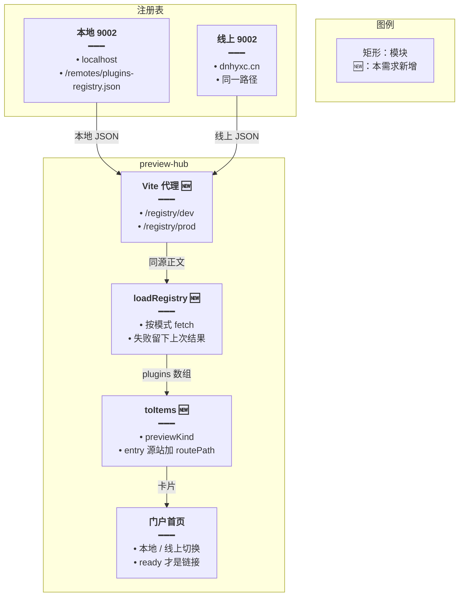
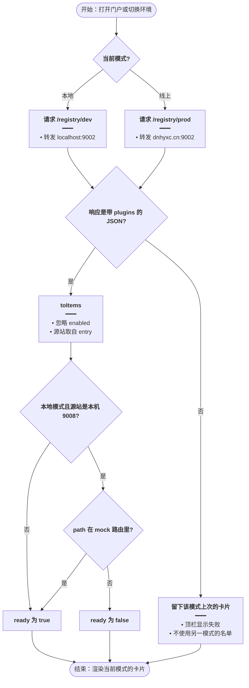
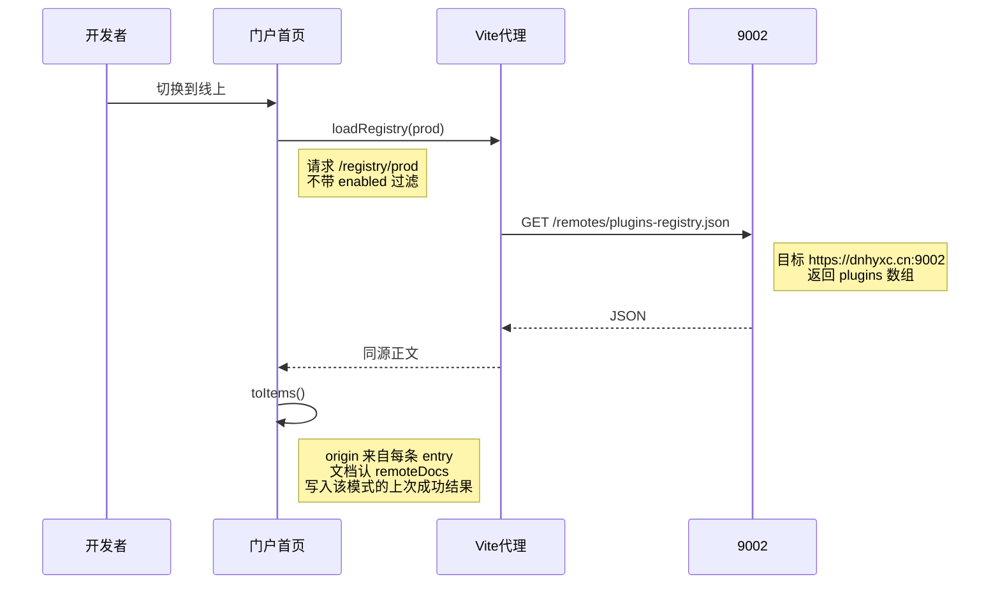

# 预览目录自动收集 — 实现思路

> **状态**：规划（未实现。门户与手写清单已落地；名单改为按环境请求宿主注册表）
> **日期**：2026-11-27
> **需求摘要**：预览门户按本地或线上，请求对应的 `plugins-registry.json`，把其中全部插件和子应用变成卡片，不必再改 `catalog.ts`。
> **一句话方案（预告）**：本地请求 `http://localhost:9002/remotes/plugins-registry.json`，线上请求 `https://dnhyxc.cn:9002/remotes/plugins-registry.json`。分组先按宿主 `catalogKind`，文档认 `remoteName === remoteDocs`。每张卡打开该条 `entry` 的源站加 `routePath`。不看 `enabled`。

## 延伸阅读

- 已落地的门户：[预览统一入口.md](./预览统一入口.md)
- 宿主如何选注册表地址：`dnhyxc-ai/apps/frontend/src/federation/registry/index.ts` 的 `registryUrl`（`VITE_DEV_PLUGIN_REGISTRY_URL` / `VITE_PROD_PLUGIN_REGISTRY_URL`，否则走 `/remotes/plugins-registry.json`）
- 宿主分组：`dnhyxc-ai/apps/frontend/src/views/plugins/index.tsx` 的 `catalogKind`
- 线上注册表现状：[plugins-registry.json](https://dnhyxc.cn:9002/remotes/plugins-registry.json)
- 描述符字段：`dnhyxc-ai/packages/federation-kit/src/types/index.ts` 的 `PluginDescriptor`

---

## 0. 读本文你将得到什么

- 要解决的问题：本地注册表和线上注册表不是同一份，端口也不一样。门户若写死一份名单或只读本机文件，线上条目会对错开发服。
- 比对后的方案：门户按「本地 / 线上」请求上面两个固定地址。开发模式默认本地，生产构建默认线上，顶栏可以切换。
- 主要改哪些层：`preview-hub` 的请求、Vite 代理、分组和卡片。不改宿主的 `fetchPluginRegistry`。
- 分三期：M1 两个地址都能拉出清单；M2 顶栏切换并记住；M3 校验与 9008 本地路径可点性。
- 最大风险：从 `8999` 直接请求 `9002` 会被浏览器跨源拦住。必须由门户自己的开发服代理这两条 URL。

---

## 1. 需求与边界

### 1.1 用户故事

| 角色 | 场景 | 行为 | 期望结果 |
| --- | --- | --- | --- |
| 开发者 | 本机预览 | 打开 8999，环境为本地 | 请求 `http://localhost:9002/remotes/plugins-registry.json`，卡片的源站是该 JSON 里的 `entry` |
| 开发者 | 看线上已发布的插件和子应用 | 顶栏切到线上，或打开生产构建 | 请求 `https://dnhyxc.cn:9002/remotes/plugins-registry.json`，卡片打开 `dnhyxc.cn` 上各条目的源站 |
| 开发者 | 某条 `enabled` 为 false | 任一环境 | 卡片仍在。预览不看上架开关 |
| 开发者 | 当前环境的 9002 没开或请求失败 | 看门户 | 保留该环境上次成功的清单，顶栏标明失败。不把另一个环境的名单混进来 |

### 1.2 范围

| 在范围内 | 不在范围内（非目标） |
| --- | --- |
| 两个固定注册表 URL，按环境二选一 | 读磁盘上的 `uploads/remotes/plugins-registry.json` 当作唯一来源 |
| 分组与宿主 `catalogKind` 一致；`remoteDocs` 进「文档」 | 用端口 `9013` 认文档。线上 `9013` 是 React 多路由实验室，文档在 `9017` |
| 预览打开该条 `entry` 的源站加 `routePath` | 把线上 `entry` 改写成 `127.0.0.1`，或把本地 `entry` 改写成 `dnhyxc.cn` |
| `enabled: false` 也展示 | 复制宿主的 localStorage 上架缓存 |
| 8999 通过同源代理拉取，避开跨源 | 改宿主站点本身的注册表 URL |

### 1.3 约束与依赖

- 本地地址：`http://localhost:9002/remotes/plugins-registry.json`。
- 线上地址：`https://dnhyxc.cn:9002/remotes/plugins-registry.json`。
- 宿主 `registryUrl()` 允许用 `VITE_DEV_PLUGIN_REGISTRY_URL` / `VITE_PROD_PLUGIN_REGISTRY_URL` 覆盖，缺省再走当前站点的 `/remotes/plugins-registry.json`。门户不读这两条宿主环境变量，避免和宿主的代理路径缠在一起。两个 URL 写死在门户里。
- 线上 JSON 与本机落盘不是同一套端口。例如线上 Vue 样式实验室是 `dnhyxc.cn:9010`，文档是 `dnhyxc.cn:9017`，未信任实验室是 `dnhyxc.cn:9015`。分组不能写死本机端口。
- 线上有两条文档的 `entry` 仍是 `http://127.0.0.1:9017/mf-manifest.json`（用户服务政策、用户服务协议）。门户照 `entry` 打开，不擅自改成 `dnhyxc.cn`。
- 预览不 `loadRemote`、不登录。在线探测仍是 `fetch(origin + '/', { mode: 'no-cors' })`。本地失败提示「未启动」；线上失败提示「线上未响应」，不提示去某个目录执行 `pnpm dev`。
- Ponytail：不引入 `@dnhyxc-ai/federation-kit`。

---

## 2. 背景

- **谁、在什么场景、卡在哪**：同一份产品名单在本机 9002 和线上 9002 各有一份。本机 `entry` 指向 `127.0.0.1` 的开发端口，线上 `entry` 指向 `dnhyxc.cn` 的发布端口，两边端口号也不对齐。
- **现状缺口**：门户手写一份只含本机端口的 `catalog.ts`。宿主插件中心会按环境拉 `/remotes/plugins-registry.json`，门户没有这条区分。
- **不解决会怎样**：看线上目录时仍打开本机 9008、9013。本机文档端口和线上文档端口对不上，卡片进错服务。
- **硬约束**：门户跑在 `127.0.0.1:8999`，页面直接请求 `localhost:9002` 或 `dnhyxc.cn:9002` 是跨源。`routePath` 仍是宿主路径，预览要开在该条 `entry` 的源站上，而不是开在 9002 上。`enabled` 不参与过滤。

---

## 3. 现状与复用

| 能力 | 仓库中已有 | 本需求中的用法 |
| --- | --- | --- |
| 本地注册表 URL | 宿主开发站点 `http://localhost:9002` 上的 `/remotes/plugins-registry.json` | 直接复用：本地模式请求这个地址 |
| 线上注册表 URL | [https://dnhyxc.cn:9002/remotes/plugins-registry.json](https://dnhyxc.cn:9002/remotes/plugins-registry.json) | 直接复用：线上模式请求这个地址 |
| 宿主选地址 | `registryUrl()`：生产读 `VITE_PROD_PLUGIN_REGISTRY_URL`，开发读 `VITE_DEV_PLUGIN_REGISTRY_URL`，否则 `resolveUploadedFileUrl('/remotes/...')` | 扩展：只借用「开发 / 生产两套地址」这件事。门户写死上述两个 URL，不调用 `registryUrl` |
| 宿主分组 | `catalogKind`：有 `host` 或 `injectRoute === false` 为插件，否则为应用 | 直接复用这句。应用里 `remoteName === 'remoteDocs'` 或 `id` 以 `remoteDocs` 开头的改为文档 |
| 中文标题 | `title.zh-CN`，宿主用 `pickPluginLocaleText` | 扩展：门户固定先中文，再英文，再 `id` |
| 手写清单 | `preview-hub/src/catalog.ts` | 扩展：`hrefOf`、`devHint` 保留。数组改为请求结果，不再手写 |
| 在线探测 | `preview-hub/src/views/home/index.tsx` | 直接复用。文案按源站是不是本机分开 |
| 本机插件 mock 路由 | `dnhyxc-ai-plugins/src/router/routes.tsx` | 扩展：只在本地模式、且源站是 `127.0.0.1:9008` 或 `localhost:9008` 时，决定这张卡能不能点 |

**调研结论**：两个 URL 已经是宿主在用的注册表位置，线上正文里的端口和本机开发端口不是同一张表。门户要请求当前环境的那一份，并用每条 `entry` 自己的源站。不能再读一份本机磁盘文件充当线上名单，也不能用 `9013` 识别文档。

线上与本机已经对不上的例子（以 2026-11-25 的线上 JSON 为准，实现时以当次响应为准）：

| id | 线上 `entry` 源站 | 本机开发服常见端口 | 说明 |
| --- | --- | --- | --- |
| `remoteDocsUpdateInfo` 等 | `dnhyxc.cn:9017` | `127.0.0.1:9013` | 文档不能按 9013 识别。线上 9013 是 `remoteReactShadcn` |
| `ElementDemo` | `dnhyxc.cn:9012` | `127.0.0.1:9001` | 打开哪一个完全看当前 JSON 的 `entry` |
| `remoteDemo` | `dnhyxc.cn:9007` | 本机落盘那份里可能没有这条 | 哪份 JSON 有，哪份模式就有卡 |
| `remoteDocsServicePolicy`、`remoteDocsUserAgreement` | 线上 JSON 里仍是 `http://127.0.0.1:9017` | 同左 | 不改写 `entry` |

本机插件仓 path 与注册表仍可能不一致：`ebookIdeas` 的注册表是 `/ebook/plugins/ebook-ideas`，mock 是 `ideas-list`；`ebookTestBookInfo` 的注册表是 `/ebook/plugins/test-book-info`，mock 是 `toolbar-test`；`knowledgeComments` 没有 mock。这只影响本地 9008 的可点性。

---

## 4. 方案比对与最终方案

### 4.1 候选方案

#### 方案 A：继续手改 `catalog.ts`（复用现状）

- **做法**：维持 `preview-hub/src/catalog.ts` 里的本机 origin 和 path。
- **能工作的原因**：今天本机卡片就是这样打开的。
- **主要代价**：没有线上名单。本机注册表一变，门户不会变。

#### 方案 B：只读本机磁盘文件

- **做法**：Vite 启动时 `readFileSync` `dnhyxc-ai/apps/backend/uploads/remotes/plugins-registry.json`，生成 `catalog.gen.ts`。
- **能工作的原因**：后端没启动也能得到本机那一份。字段和宿主落盘一致。
- **主要代价**：线上 `https://dnhyxc.cn:9002/remotes/plugins-registry.json` 根本不会被读到。本机文件和线上 JSON 的端口不同，用这份文件去预览线上一定进错服务。

#### 方案 C：页面直接请求两个绝对 URL

- **做法**：本地模式 `fetch('http://localhost:9002/remotes/plugins-registry.json')`，线上模式 `fetch('https://dnhyxc.cn:9002/remotes/plugins-registry.json')`。解析 `plugins[]` 后画卡。
- **能工作的原因**：地址和用户指定的两个入口一致，名单随响应当时的内容变化。
- **主要代价**：8999 与 9002 不同源。浏览器会因 CORS 失败，除非 9002 对 8999 放行。线上站点今天是给宿主自己用的，不能假设它会为门户加 CORS。

#### 方案 D：门户开发服代理这两个 URL，页面只请求同源路径

- **做法**：`vite.config.ts` 增加两条代理。浏览器请求 `/registry/dev` 时，开发服去取 `http://localhost:9002/remotes/plugins-registry.json`。请求 `/registry/prod` 时，去取 `https://dnhyxc.cn:9002/remotes/plugins-registry.json`。页面按模式选其中一条。默认：`import.meta.env.PROD` 用线上，否则用本地。顶栏可切换，选择记在 `sessionStorage`。分组用 `previewKind`。链接用 `new URL(entry).origin + routePath`。不看 `enabled`。请求失败时保留该模式上次成功的数组，并在顶栏显示失败。
- **能工作的原因**：页面只和 8999 说话，没有跨源。两个地址的正文仍是宿主那两份注册表。切换环境即换名单和源站。
- **主要代价**：生产构建若不用 Vite 开发服，代理不在了。生产构建改为在构建机上请求线上 URL，把结果写进包内；运行时切换本地仍要求有人把本地 9002 代理出来。本门户主要是 `pnpm dev`，代理覆盖日常用法。构建产物只保证线上地址。

### 4.2 比对

| 维度 | 方案 A 手改清单 | 方案 B 读磁盘 | 方案 C 页面直连 | 方案 D 开发服代理 |
| --- | --- | --- | --- | --- |
| 正确性 | 只有手写的本机项。线上端口错 | 只有本机落盘。线上名单缺失，端口仍是本机的 | 两份 JSON 都能拿到，但跨源时浏览器直接失败，名单为空 | 两份 JSON 都能拿到。失败时留着该模式上次的成功结果，不串到另一模式 |
| 复用 | 复用现有数组 | 复用落盘文件，不复用线上 URL | 复用两个 URL | 复用两个 URL，以及宿主「按环境分地址」的做法 |
| 改动面 | 以后继续改 `catalog.ts` | 门户加读文件 | 门户加 fetch | 门户加代理、fetch、顶栏切换 |
| 复杂度 | 无 | 一次读文件 | 一次 fetch，外加 CORS | 两条代理加一次 fetch |
| 体验 | 看不到线上 | 后端没开也能看本机，但没有线上 | 未配置 CORS 时两套都是空的 | `pnpm dev` 下切换本地/线上即可。9002 没开时顶栏报错并留下上次清单 |
| 风险 | 低，分叉继续 | 中。把本机文件误当成线上 | 高。被 CORS 挡住 | 中。生产构建没有开发服代理，不能在静态包里再切回本地 9002 |
| 可维护性 | 两套名单 | 线上一变，门户不知道 | URL 只有两处，但依赖 9002 的响应头 | URL 只有代理目标这两处。页面不写死端口表 |

### 4.3 综合考量

权重是：本地和线上必须各请求用户指定的那个 URL；页面跑在 8999 上不能被 CORS 挡住；名单以当次 JSON 为准，不能用本机端口表去解释线上 `entry`。

方案 D 满足这三项。方案 B 的好处是后端没启动仍能读到本机文件，这份好处放弃：用户要求的来源是两个 HTTP 地址，磁盘文件不是线上那一份。失败时保留上次成功结果，用来减轻 9002 短暂不可用，而不是退回读磁盘。方案 C 的好处是少写代理，放弃：8999 直连 9002 在浏览器里不可靠。方案 A 没有环境区分，放弃。

### 4.4 最终方案

#### 背景

本地注册表在 `localhost:9002`，线上注册表在 `dnhyxc.cn:9002`，路径都是 `/remotes/plugins-registry.json`。两边的 `entry` 端口不同。门户若只读本机文件，线上预览会打开错误的开发服。页面若直接请求这两个绝对地址，从 8999 发出会跨源失败。

#### 具体思路

1. **模块**：`preview-hub/vite.config.ts` 写两条代理。`src/registry.ts` 负责选 URL 路径、拉取、映射卡片。首页增加本地 / 线上切换。`catalog.ts` 的手写数组删除，`hrefOf` 保留。
2. **数据从哪来**：当前模式对应的那一次 HTTP 正文。不读磁盘，不读宿主 localStorage。
3. **状态放哪**：当前模式放 `sessionStorage` 键 `preview-hub.registry`，值 `dev` 或 `prod`。没有记录时，生产构建用 `prod`，否则用 `dev`。卡片数组是该模式的请求结果，放组件状态。每个模式各自记一份上次成功的数组，请求失败时只回退自己的那份。
4. **边界**：JSON 没有 `plugins` 数组视为失败。缺 `id`、`entry` 或 `routePath` 的行跳过。`enabled` 忽略。本地且源站是 9008 时，path 不在 `routes.tsx` 字面量里则 `ready: false`。线上模式不做这道本地文件检查，卡片可点，打不开由对方站点自己表现。

#### 实现方案

**一句话**：本地请求 `http://localhost:9002/remotes/plugins-registry.json`，线上请求 `https://dnhyxc.cn:9002/remotes/plugins-registry.json`；页面经门户代理访问，分组按宿主规则并把 `remoteDocs` 标成文档，链接用 `entry` 源站加 `routePath`。

| 步骤 | 谁 | 做什么 | 输入 → 输出 |
| --- | --- | --- | --- |
| 1 | `registryUrl(mode)` | 选出同源代理路径 | `dev` 或 `prod` → `/registry/dev` 或 `/registry/prod` |
| 2 | Vite 代理 | 转发到两个真实地址 | 代理路径 → 注册表 JSON 正文 |
| 3 | `loadRegistry` | `fetch` 并 `JSON.parse` | 正文 → `plugins[]`，失败则抛错 |
| 4 | `toItems` | 映射标题、源站、path、kind、ready | 一行描述符 → `CatalogItem` |
| 5 | 首页 | 切换模式时重新请求；失败则留下该模式上次的卡片 | 模式 → 卡片 |

代理目标：

| 模式 | 浏览器请求 | 代理转发 |
| --- | --- | --- |
| 本地 | `/registry/dev` | `http://localhost:9002/remotes/plugins-registry.json` |
| 线上 | `/registry/prod` | `https://dnhyxc.cn:9002/remotes/plugins-registry.json` |

#### 选定原因

1. **正确性**：名单等于当前环境那份 JSON，源站等于该条 `entry`。牺牲：生产构建里不能再切到本机 9002，因为没有开发服代理。
2. **复用**：地址就是宿主已经在提供的两个注册表。分组条件与 `catalogKind` 相同。牺牲：不调用 `registryUrl()`，避免把宿主的环境变量和上传 URL 解析带进门户。
3. **改动面**：代理、一次 fetch、顶栏两个状态。牺牲：比读磁盘多一个网络失败分支。
4. **体验**：顶栏能在两套名单之间切换。牺牲：本地 9002 没开时，第一次没有「上次成功」可显示，顶栏只有错误。
5. **风险**：跨源不发生在浏览器。牺牲：线上两条仍指向 `127.0.0.1` 的 `entry` 会原样打开本机，这是注册表内容，不在门户修正。
6. **可维护性**：换端口只改 JSON，不改门户表。牺牲：文档识别改看 `remoteDocs`，不再看端口；端口表从此不能当成分组依据。

#### 优势

- 相对方案 A：本地和线上都会跟着注册表变，不再手抄。
- 相对方案 B：线上模式拿到的是 `dnhyxc.cn:9002` 的响应，不会把本机端口当成线上端口。
- 相对方案 C：浏览器只请求 8999 的 `/registry/*`，不依赖 9002 对 8999 返回 CORS 头。

#### 怎么实现

1. 代理按上表配置。`rewrite` 把 `/registry/dev` 和 `/registry/prod` 都指到 `/remotes/plugins-registry.json`。
2. `registryUrl('dev')` 返回 `/registry/dev`，`registryUrl('prod')` 返回 `/registry/prod`。
3. `previewKind`：有 `host` 或 `injectRoute === false` → `plugin`；否则若 `remoteName === 'remoteDocs'` 或 `id` 以 `remoteDocs` 开头 → `docs`；否则 → `lab`。
4. `origin = new URL(entry).origin`，`path = routePath`（补上前导 `/`）。标题取 `zh-CN`，否则 `en-US`，否则 `id`。
5. 仅当模式是 `dev` 且源站主机是 `localhost` 或 `127.0.0.1`、端口是 `9008` 时，对照 `routes.tsx` 的 path 字面量。没有则 `ready: false`。其他情况 `ready: true`。
6. 首页用 `ready` 决定是链接还是说明。探测失败时，源站是本机则用目录名提示 `pnpm dev`；源站是 `dnhyxc.cn` 则只提示线上未响应。
7. M1 仍把本机 mock 的 `ideas-list`、`toolbar-test` 改成注册表上的 `ebook-ideas`、`test-book-info`，这样本地 9008 的这两张卡可点。不为文档留言造 mock。

代码在 §9。

### 4.5 其他关键决策

#### 决策一：文档分组看端口还是看 remoteDocs

##### 候选

**识别方案 1：源站端口 `9013` 算文档。** 这和今天本机 `remote-docs` 的开发端口一致。能工作的只是本机这份旧名单。

**识别方案 2：`remoteName === 'remoteDocs'`，或 `id` 以 `remoteDocs` 开头。** 线上文档的 `remoteName` 是 `remoteDocs`，端口是 `9017`。线上 `9013` 是 `remoteReactShadcn`。

##### 比对

| 维度 | 识别方案 1 端口 9013 | 识别方案 2 remoteDocs |
| --- | --- | --- |
| 正确性 | 线上会把 React 多路由实验室放进文档，真正的文档进实验室 | 两套 JSON 里文档条目都进文档分组 |
| 复用 | 不复用注册表里的 `remoteName` | 复用 `remoteName` 和 id 前缀 |
| 改动面 | 此项相同，都是一句判断 | 此项相同 |
| 复杂度 | 此项相同 | 此项相同 |
| 体验 | 线上筛选「文档」是错的一组 | 本地和线上的文档筛选都是更新信息等页 |
| 风险 | 线上端口再变一次就又错 | `remoteName` 若漏填，仍可借 id 前缀 |
| 可维护性 | 端口表会继续分叉 | 不依赖端口 |

##### 综合考量

线上 JSON 已经证明 9013 不是文档。识别必须跟条目身份走。放弃「和本机 vite 端口一致、少看一个字段」的优点。

##### 最终方案

**背景**：文档在本机是 9013，在线上是 9017。端口不能当种类。

**具体思路**：先做宿主的插件/应用判断，再只在应用分支里认 `remoteDocs`。

**实现方案**：见 §9.2 的 `previewKind`。

**选定原因**：正确性上两套环境的文档筛选一致。牺牲：有人把文档注册成别的 `remoteName` 且 id 也不带 `remoteDocs` 时，它会进实验室。

**优势**：相对看端口，线上的 React 实验室不会出现在文档分组。

**怎么实现**：`previewKind` 的第二分支。

#### 决策二：本地 9008 打不开的 path 怎么办

##### 候选

**可点性方案 1：一律可点。** 实现短。`knowledgeComments` 和两条尚未对齐的 mock 会打开「页面不存在」。

**可点性方案 2：只在本地模式、且源站是本机 9008 时，对照 `routes.tsx`。** 没有该 path 则不可点。线上模式不读本机路由文件。

##### 比对

| 维度 | 可点性方案 1 一律可点 | 可点性方案 2 只拦本机 9008 |
| --- | --- | --- |
| 正确性 | 本地会打开 404 页 | 本地没有 mock 的不可点。线上不因本机文件被误伤 |
| 复用 | 不用 `routes.tsx` | 复用现有 path 字面量做闸门 |
| 改动面 | 更小 | 多读一个本地文件 |
| 复杂度 | 低 | 一个正则集合 |
| 体验 | 点了才发现页面不存在 | 文档留言直接标明没有预览路由 |
| 风险 | 低 | 线上 9008 的 path 若和生产路由不一致，门户不会提前拦住 |
| 可维护性 | 此项相同 | 闸门只存在于本地模式 |

##### 综合考量

本地 mock 和注册表的差是已知的，拦点击能避免假链接。线上没有这份 `routes.tsx` 可对，不把本机文件套到 `dnhyxc.cn` 上。放弃「所有环境同一套可点规则」的优点。

##### 最终方案

**背景**：文档留言没有 mock。全书想法和书信息测试的 mock path 与注册表不同。这些都是本机 9008 的事。

**具体思路**：`ready` 默认 true。只有本地模式的本机 9008 才查 path 集合。

**实现方案**：两条不一致的 mock 在 M1 改名，使它们变为可点。文档留言保持不可点，不新建页面。

**选定原因**：体验上本地不会把不存在的路由画成链接。牺牲：线上点到不存在的 path 时，仍然是对方页面上的 404。

**优势**：相对一律可点，本地的文档留言不会进「页面不存在」。

**怎么实现**：见 §9.3。

---

## 5. 架构图



**图内方法说明**：

| 方法 | 功能 |
| --- | --- |
| `registryUrl(mode)` | 按 `dev` 或 `prod` 返回 `/registry/dev` 或 `/registry/prod`。页面只请求这个同源路径 |
| `loadRegistry(mode)` | 拉取并解析当前模式的注册表。没有 `plugins` 数组则抛错，调用方保留该模式上次的卡片 |
| `previewKind(row)` | 先按宿主规则分插件和应用；应用中 `remoteDocs` 返回 `docs`，其余应用返回 `lab` |
| `toItems(plugins, mode)` | 把每行收成卡片：标题、源站、path、kind、ready。忽略 `enabled` |
| `hrefOf(item)` | 已有。把 origin 和 path 拼成新标签地址 |

**读图要点**：

- 两个 9002 是数据来源。8999 不直接跨源请求它们。
- 切换模式会换一整份 `plugins`，不会把两边的条目拼在一起。
- 卡片打开的是 `entry` 的源站，不是 9002。

---

## 6. 主流程图



**图内方法说明**：

| 方法 | 功能 |
| --- | --- |
| `loadRegistry(mode)` | 请求当前模式的代理路径并解析 JSON。失败或没有 `plugins` 时抛错 |
| `toItems(plugins, mode)` | 映射卡片。本地 9008 才根据 mock 路由设置 `ready` |
| `previewKind(row)` | 决定卡片落在插件、文档还是实验室 |

**读图要点**：

- 模式是互斥的。失败不会改用另一个 URL 的结果。
- `enabled` 不在分支里。
- 线上卡片不会因为本机 `routes.tsx` 少一条就变成不可点。

---

## 7. 核心时序图



**图内方法说明**：

| 方法 | 功能 |
| --- | --- |
| `loadRegistry(prod)` | 首页切换到线上后拉取线上注册表。本地模式则把 `prod` 换成 `dev`，代理目标换成 localhost |
| `toItems()` | 把本次 `plugins` 收成卡片并记住。下次这个模式请求失败时用这份，不用另一模式的 |

**读图要点**：

- 开发者切的是环境，不是某一张卡。
- 代理对浏览器隐藏了 9002 的源。
- 卡片上的链接仍指向各条 `entry` 的源站，例如线上的 `dnhyxc.cn:9008` 或 `dnhyxc.cn:9017`。

---

## 9. 具体实现（主链路代码）

### 9.1 模块一览

| 模块 | 职责 | 新增/改动 | 预估路径 |
| --- | --- | --- | --- |
| 代理 | 把两个注册表 URL 变成同源路径 | 新增 | `preview-hub/vite.config.ts` |
| `registryUrl` / `loadRegistry` / `toItems` | 选模式、拉取、映射 | 新增 | `preview-hub/src/registry.ts` |
| 首页 | 本地 / 线上切换，失败保留上次结果 | 改动 | `preview-hub/src/views/home/index.tsx` |
| `hrefOf` | 拼接源站和 path | 保留 | `preview-hub/src/catalog.ts` |
| 两条本机 mock path | 与注册表对齐，使本地 9008 可点 | 改动 | `dnhyxc-ai-plugins/src/router/routes.tsx` 与首页 `to` |

### 9.2 主链路实现

```typescript
// 对应 §4.4 步骤 1。页面只看见同源路径，真实的 9002 地址留在代理里
function registryUrl(mode: 'dev' | 'prod'): string {
	// 本地模式走 localhost:9002 那一份
	if (mode === 'dev') return '/registry/dev';
	// 线上模式走 dnhyxc.cn:9002 那一份
	return '/registry/prod';
}

// 对应 §4.4 步骤 3。与宿主 catalogKind 相同的那一句写在前面，文档不看端口
function previewKind(row: {
	// 有槽位就是内嵌插件
	host?: unknown;
	// false 表示不占宿主顶层路由
	injectRoute?: boolean;
	// 线上文档的 remoteName 是 remoteDocs，端口却不是本机的 9013
	remoteName?: string;
	// remoteName 漏填时，现有文档 id 都以 remoteDocs 开头
	id: string;
}): 'plugin' | 'docs' | 'lab' {
	// 与宿主 catalogKind 一致
	if (row.host || row.injectRoute === false) return 'plugin';
	// 不用端口。线上 9013 是 React 实验室，文档在 9017
	if (row.remoteName === 'remoteDocs' || row.id.startsWith('remoteDocs')) return 'docs';
	// 其余注入路由的子应用
	return 'lab';
}
```

```typescript
// 对应 §4.4 步骤 3–4。mode 只影响本机 9008 的 ready，不改写 entry
function toItems(
	plugins: RegistryRow[],
	mode: 'dev' | 'prod',
	mockPathSet: Set<string>,
): CatalogItem[] {
	// 保持注册表顺序
	const items: CatalogItem[] = [];
	// 一行一张卡。enabled 不看，关掉上架的条目也要出现
	for (const row of plugins) {
		// 没有这三项就无法做成一张可打开的卡
		if (!row.id || !row.entry || !row.routePath) continue;
		// manifest 不是页面。源站才是要打开的服务，线上就是 dnhyxc.cn 的端口
		const origin = new URL(row.entry).origin;
		// hrefOf 只拼一次斜杠
		const path = row.routePath.startsWith('/') ? row.routePath : `/${row.routePath}`;
		// 只有本地模式才用本机 routes.tsx。线上 JSON 不跟这份文件核对
		const checkLocalPlugin = mode === 'dev' && /^(localhost|127\.0\.0\.1):9008$/.test(new URL(row.entry).host);
		// 本机 9008 没有这条 path 时不可点。其他情况照注册表打开
		const ready = !checkLocalPlugin || mockPathSet.has(path.replace(/^\//, ''));
		// 字段一次写齐，页面不再回查注册表
		items.push({
			// 与注册表 id 相同，切换环境时同一插件仍是同一个 key
			id: row.id,
			// 插件、文档或实验室
			kind: previewKind(row),
			// 门户固定中文优先，缺中文再用英文，避免空白
			title: row.title?.['zh-CN'] || row.title?.['en-US'] || row.id,
			// 探测和打开都用这个源站。不把 dnhyxc.cn 改成 127.0.0.1
			origin,
			// 注册表里的宿主路径，开在源站上
			path,
			// 首页据此决定画不画链接
			ready,
		});
	}
	// 跳过的坏行不在结果里。enabled 没有参与
	return items;
}
```

### 9.3 数据模型

```typescript
// 对应 §4.5 可点性方案。只在本地模式调用，线上不读这个文件
function mockPaths(routesText: string): Set<string> {
	// 预览路由是 path: '...' 字面量。动态路径匹配不到，该卡在本地 9008 上不可点
	const found = routesText.matchAll(/path:\s+'([^']+)'/g);
	// 与去掉前导斜杠后的 routePath 比较
	const paths = new Set<string>();
	// 每处 path 字面量收进集合，供本地 9008 判断可点
	for (const hit of found) {
		// 分组 1 是引号里的 path
		paths.add(hit[1].replace(/^\//, ''));
	}
	// 调用方只用它做 has，不关心顺序
	return paths;
}
```

| 字段 | 来源 | 存储 | 说明 |
| --- | --- | --- | --- |
| 模式 | 生产构建默认 `prod`，否则 `dev`；顶栏可改 | `sessionStorage` | 两个模式的上次成功结果分开存，只放内存 |
| `plugins` | 当前模式的注册表响应 | 请求结果 | 不合并两个环境 |
| `origin` / `path` | `entry` 与 `routePath` | 卡片 | 不改写主机名 |
| `kind` | `previewKind` | 卡片 | 文档认 `remoteDocs` |
| `ready` | 仅本地本机 9008 | 卡片 | 线上恒为 true |
| `enabled` | JSON 里有 | 不使用 | 预览不过滤 |

---

## 10. 分阶段实现步骤

| 阶段 | 目标 | 交付物 | 依赖 |
| --- | --- | --- | --- |
| M1 | 默认本地能拉出名单，生产构建默认线上 | 代理、`loadRegistry`、`toItems`、首页改读请求结果 | 本地 9002 可访问 |
| M2 | 顶栏切换两个环境 | 切换控件、分模式的失败保留 | M1 |
| M3 | 本地 9008 不可点的规则和校验 | `mockPaths`、两条 mock 改名、`check` | M1 |

### M1

- [ ] 代理 `/registry/dev` → `http://localhost:9002/remotes/plugins-registry.json`，`/registry/prod` → `https://dnhyxc.cn:9002/remotes/plugins-registry.json`。
- [ ] 实现 `registryUrl`、`loadRegistry`、`previewKind`、`toItems`。删除手写 `CATALOG`。
- [ ] `pnpm dev` 打开 8999，卡片源站来自本地 JSON 的 `entry`。`enabled: false` 的条目仍在。
- [ ] 文档卡的 kind 是 `docs`，且不是靠端口 9013 判断的。

### M2

- [ ] 顶栏「本地 / 线上」。切换后重新请求，名单整份替换。
- [ ] 选择写入 `sessionStorage`。请求失败时只恢复当前模式上次成功的数组，顶栏显示失败原因。
- [ ] 切到线上后，更新信息的链接主机是该条 `entry` 的主机（当前线上为 `dnhyxc.cn:9017`），而不是本机 9013。

### M3

- [ ] 本地模式对照 `routes.tsx`。文档留言 `ready === false`。
- [ ] 把 `ideas-list` 改为 `ebook-ideas`，`toolbar-test` 改为 `test-book-info`。不为文档留言新建页面。
- [ ] `pnpm check:registry` 用一份夹具 JSON 断言：`remoteDocsUpdateInfo` 为文档，`remoteReactShadcn` 即使端口是 9013 也不是文档，`enabled: false` 仍输出。

---

## 11. 风险、边界与待确认

| 项 | 等级 | 说明 | 缓解 |
| --- | --- | --- | --- |
| 生产构建没有 Vite 代理 | 中 | 静态页无法再代请求 localhost:9002 | 构建只打进线上地址。本地 / 线上切换以 `pnpm dev` 为准 |
| 线上个别 `entry` 仍是 127.0.0.1 | 中 | 用户服务政策和用户服务协议在线上 JSON 里就是本机 9017 | 不改写 `entry`。要修就改注册表 |
| 实验室独立站没有 `routePath` 这条路由 | 中 | 本机 `remote-vue` 的路由表只有 `/`，注册表可能是 `/element-demo` | 打开的是当前 JSON 的 path。打不开时改该仓路由或改注册表，门户不把应用改回 `/` |
| 本地 9002 未启动 | 中 | 第一次没有上次成功结果 | 顶栏报错。不改读磁盘文件 |
| 线上 9008 的 path 与线上实际页面不一致 | 低 | 门户不读线上仓库的路由文件 | 线上卡保持可点 |

**待确认**：

- [ ] 本地 9002 的注册表是否已经和线上一样包含 `remoteDemo`。验证方式：分别打开两个 URL，比 `plugins[].id`。门户哪边有就显示哪边，不在代码里补条目。

---

## 12. 验收清单

| # | 用例 | 步骤 | 期望 |
| --- | --- | --- | --- |
| AC1 | 本地地址 | 默认打开 8999，看网络请求 | 请求的是 `/registry/dev`，代理目标为 `http://localhost:9002/remotes/plugins-registry.json` |
| AC2 | 线上地址 | 顶栏切到线上 | 请求 `/registry/prod`，代理目标为 `https://dnhyxc.cn:9002/remotes/plugins-registry.json` |
| AC3 | 名单随响应 | 对比两个 JSON 的 id | 卡片 id 与当前响应的 `plugins` 一致，两边不合并 |
| AC4 | 源站不改写 | 线上模式点「更新信息」 | 打开该条 `entry` 的源站加 `/update-info`。当前线上是 `https://dnhyxc.cn:9017/update-info` |
| AC5 | 文档不看 9013 | 线上 JSON 里 `remoteReactShadcn` 的端口是 9013 | 它在实验室，不在文档。`remoteDocsUpdateInfo` 在文档 |
| AC6 | 不上架过滤 | 任一条 `enabled: false` | 该环境的卡片仍在 |
| AC7 | 请求失败 | 关掉本地 9002 再刷新本地模式 | 若此前成功过，卡片仍是上次的本地名单，顶栏有失败说明；不会改显示线上名单 |
| AC8 | 本机 9008 不可点 | 本地模式看文档留言 | 卡片在，不是链接 |

---

## 13. 预估改动面（实现阶段参考）

| 类型 | 路径（预估） |
| --- | --- |
| 门户 | `preview-hub/vite.config.ts`、`preview-hub/src/registry.ts`、`preview-hub/src/views/home/index.tsx`、`preview-hub/src/catalog.ts`、`preview-hub/README.md` |
| 本机 mock 对齐 | `dnhyxc-ai-plugins/src/router/routes.tsx`、`dnhyxc-ai-plugins/src/views/home/index.tsx` |
| 不改 | 宿主 `registryUrl`、线上与本地注册表的内容、各 Remote 的 expose |

---

（本文档为规划态实现思路；落地后以源码与 remote-docs wiki 专题为准）
