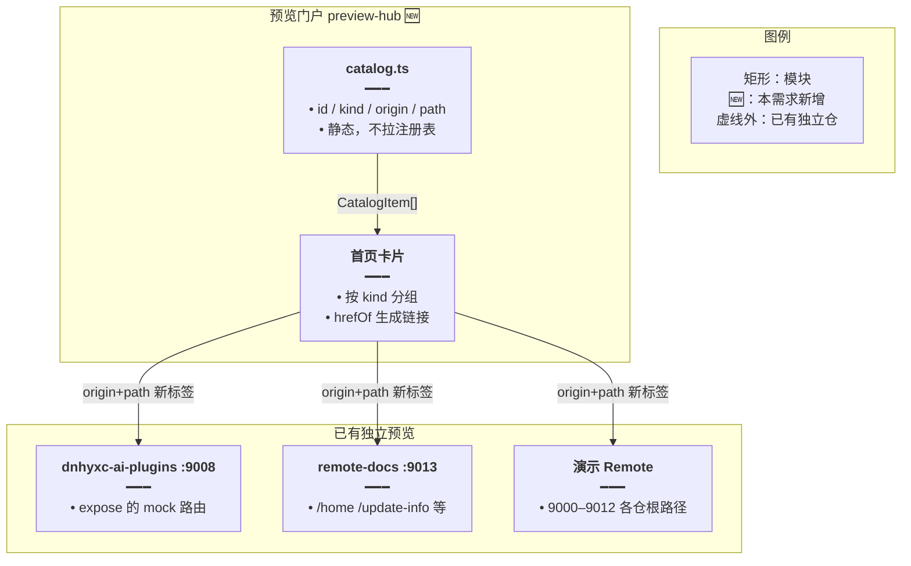
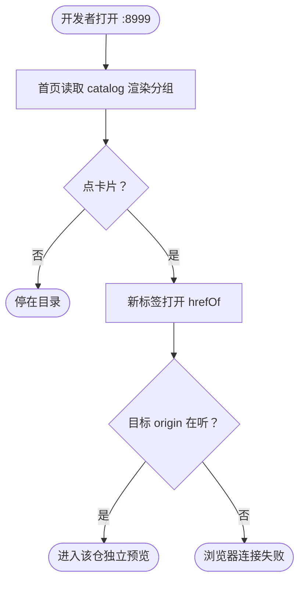
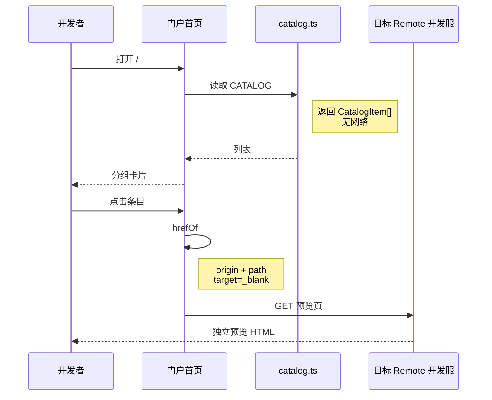
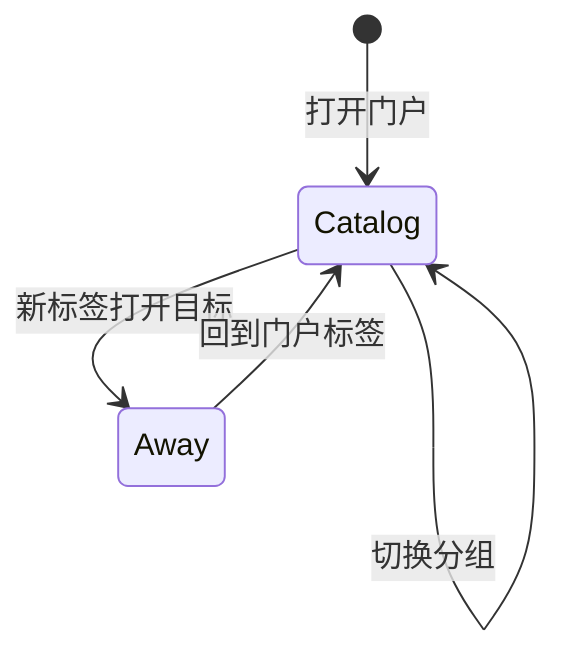

# 预览统一入口 — 实现思路

> **状态**：M1–M3 已落地（`preview-hub`，端口 8999）。下文比对仍是当时的方案。
> **日期**：2026-11-26
> **需求摘要**：开发者在 micro-apps 里要一张目录看齐全部子应用和插件仓预览页，点卡片打开对应独立预览，不必记端口、也不必进主站插件中心。
> **一句话方案（预告）**：在 micro-apps 新增独立 Vite 项目作预览门户，用一份静态清单把各仓 origin + path 收成卡片；进入走浏览器跳转，不 loadRemote、不改宿主 `/plugins`。

## 延伸阅读

- 插件仓独立预览首页：`dnhyxc-ai-plugins/src/views/home/index.tsx`
- 文档仓独立站：`remote-docs/src/App.tsx`（`/home`、`/update-info` 等）
- 主站产品目录（本需求不改）：[项目指南.md](../../项目指南.md) §17、[插件中心卡片重构.md](../../plugins/插件中心卡片重构.md)
- 联邦加载契约：[模块联邦实现指南.md](../../plugins/模块联邦实现指南.md)

---

## 0. 读本文你将得到什么

- 要解决的问题：micro-apps 里多个独立 Vite 工程各开一个端口，插件仓首页只列本仓 expose，演示 Remote 和文档仓没有总目录。
- 比对后的方案：新增 `preview-hub` 预览门户，清单驱动卡片，点进去打开各仓已有独立预览地址。
- 主要改哪些层：新建前端仓（目录页 + 清单）；不改宿主、不改后端、不改各 Remote 的 MF expose。
- 分三期：M1 门户 + 清单 + 跳转；M2 探测端口是否在听；M3 新仓 checklist。
- 最大风险：目标仓没启动时卡片仍可点，落到打不开的页；清单漏改会再次分叉。

---

## 1. 需求与边界

原始说法是「在 micro-apps 中增加一个独立的项目，统一整合这些子项目和插件，给出一个统一的入口，方便项目预览」。收成下面三条。

1. **入口是预览门户，不是产品插件中心。** 用户从 `http://127.0.0.1:8999/` 看目录。主站侧栏「插件中心」继续管上架与 Host 加载，本需求不碰。
2. **整合是链接聚合，不是打成一个包。** 子应用仍是各自的 Vite Remote；插件仍是 `dnhyxc-ai-plugins` 的 expose。门户只保存「去哪预览」。
3. **进入必须落到该仓已有独立预览。** 插件走 9008 上的 mock 路由；文档走 9013；演示包走各自根路径。禁止在门户里再 loadRemote 一遍业务树。

### 1.1 用户故事

| 角色 | 场景 | 行为 | 期望结果 |
| --- | --- | --- | --- |
| 开发者 | 要看文档留言、学习笔记、视频播放器 | 打开预览门户，点卡片 | 浏览器进入 9008 上对应 mock 页 |
| 开发者 | 要看项目指南 / 更新信息 | 点「文档」分组卡片 | 进入 9013 已有独立站路径 |
| 开发者 | 要看 Vue / untrusted 演示 | 点「实验室」分组卡片 | 进入 9001 / 9012 等已有预览 |
| 开发者 | 加了新 expose 或新 Remote | 清单加一行 | 门户出现卡片；漏改则对照表能看出来 |

### 1.2 范围

| 在范围内 | 不在范围内（非目标） |
| --- | --- |
| micro-apps 新建独立 Vite 预览门户 | 把各仓打进同一个构建 |
| 一份清单覆盖插件仓 expose、文档仓页面、演示 Remote | 改宿主 `/plugins`、注册表、账号上架偏好 |
| 卡片跳到已有独立预览 origin + path | 为表面插件再造一套无 mock 的假 Host 页 |
| 开发机本机预览 | 生产部署门户、登录、会员 |
| 目标未启动时的提示（M2） | 门户进程里代启所有 Remote（可后期脚本，不进 M1） |

### 1.3 约束与依赖

- 工作区没有根 `pnpm-workspace.yaml`：各仓是并列工程，门户不能靠 workspace filter 自动发现包。
- 必须复用各仓现有 `vite` 端口与独立预览路由，不改 MF `exposes`。
- 插件仓首页 `views/home/index.tsx` 仍服务 9008 本仓预览；门户不替换它，只链过去。
- Ponytail：不加新 npm 依赖（门户用现有 React + Vite + Tailwind 模板从邻近仓拷最小集）；不加 HostBridge。

---

## 2. 背景

- **谁、在什么场景、卡在哪**：开发者在 micro-apps 同时维护产品插件仓、文档仓和若干演示 Remote。今天要预览只能记住端口，或先开 9008 再只看到本仓卡片。
- **现状缺口**：`dnhyxc-ai-plugins` 首页手写 `pages[]`，只覆盖本仓 expose。`remote-docs` 独立站有自己的 `/home`。`remote-react` 等演示包互不相链。宿主 `/plugins` 在仓外主站，管的是上架，不是本机预览。
- **不解决会怎样**：每加一个模块要改插件仓 home、自己记端口、文档仓再抄一份入口。预览路径口口相传。
- **硬约束**：不能把 React / Vue / untrusted iframe 拼进同一应用树。不能让预览门户变成第二个产品插件中心（无登录偏好）。不能改已发布 expose 与 `host.surface`。

---

## 3. 现状与复用

| 能力 | 仓库中已有 | 本需求中的用法 |
| --- | --- | --- |
| 插件仓独立预览首页 | `dnhyxc-ai-plugins/src/views/home/index.tsx` 手写 `pages[]` | 门户链到 9008 各 path；本仓首页可继续自用 |
| 插件仓预览路由 | `dnhyxc-ai-plugins/src/router/routes.tsx` | 直接复用 path |
| 文档仓独立站 | `remote-docs/src/App.tsx` `DOC_PATHS`、`/home` | 门户链到 9013 对应 path |
| 演示 Remote 开发服 | `remote-react` 9000、`remote-vue` 9001、`remote-demo` 9007、`remote-vue-shadcn` 9009、`remote-react-shadcn` 9010、`remote-route-only` 9011、`remote-untrusted` 9012 | 门户链到各 origin `/` |
| 插件仓开发服 | `dnhyxc-ai-plugins/vite.config.ts` 端口 **9008** | 插件类卡片的 origin |
| 文档仓开发服 | `remote-docs/vite.config.ts` 端口 **9013** | 文档类卡片的 origin |
| 主站插件中心 | 仓外宿主 `/plugins` + 注册表 | **不适用**（产品上架，不是预览） |
| 工作区根包管理 | 无根 workspace | 门户用静态清单，不扫磁盘包 |

**调研结论**：各仓已经能独立预览，缺的是一张跨仓目录。插件仓首页不能当总门户（只含本仓、且带 mock Host）。宿主插件中心不在本工作区、也不服务「没登录的本机预览」。候选必须接上现有 origin 与 path，而不是再造加载器。

---

## 4. 方案比对与最终方案

### 4.1 候选方案

#### 方案 A：扩展插件仓 9008 首页（复用现状）

- **做法**：继续用 `dnhyxc-ai-plugins/src/views/home/index.tsx`。`pages[]` 增加外链字段，指向 9013 与各演示 origin。开发者仍先 `pnpm dev` 插件仓。
- **能工作的原因**：首页卡片网格已在；补 `href` 即可 `window.location` 或 `<a>`。
- **主要代价**：总入口绑在插件仓进程上；没开 9008 就看不到文档和实验室。产品插件预览和演示包混在同一顶栏。

#### 方案 B：micro-apps 新建独立预览门户（新增）

- **做法**：新增并列仓 `preview-hub`（端口 **8999**）。`catalog.ts` 列出全部条目的 `kind` / `origin` / `path`。首页按分组渲染卡片，点击 `<a href={origin+path}>` 打开目标独立预览。
- **能工作的原因**：各目标本就可以独立访问；门户无 MF、无登录。
- **主要代价**：多一个 Vite 工程；清单与各仓路由仍可能漏同步。

#### 方案 C：改宿主 `/plugins` 当统一入口

- **做法**：仓外主站插件中心加 `openPath` 与实验室 Tab，登录后看全部模块。
- **能工作的原因**：产品目录和上架已存在。
- **主要代价**：不在 micro-apps；预览要起整套宿主；表面插件进入的是业务页不是 mock；开发者只想看 Remote 时过重。

### 4.2 比对

| 维度 | 方案 A | 方案 B | 方案 C |
| --- | --- | --- | --- |
| 正确性（失败路径、边界、数据是否会错） | 外链正确即可；9008 挂了则整张目录不可达 | 门户挂了不影响各仓；目标未启动则该卡片打不开 | 上架状态会挡住「只想预览」；mock 与真 Host 易混 |
| 复用 / 与现状契合 | 复用插件仓 home 与 i18n | 复用各仓已有预览 URL；UI 从邻近仓拷最小壳 | 复用宿主卡片/偏好，但需求场景是本机预览 |
| 改动面 | 只改 `home/index.tsx`（及 layout） | 新仓：`package.json`、Vite、首页、`catalog.ts` | 宿主类型、插件页、注册表、i18n |
| 复杂度 | 低：外链字段 | 中：新工程，无新依赖 | 高：分类、权限、openPath |
| 体验 | 必须先起插件仓才能看总目录 | 只起门户也能看目录；点卡片再依赖目标仓 | 必须登录主站 |
| 风险 | 插件仓发布物夹带实验室入口文案 | 清单漏改；端口冲突 | 实验 Remote 漏进生产账号 |
| 可维护性 | 插件仓 home 继续膨胀 | 跨仓只改门户一份清单 | 预览与产品目录缠在一起 |

### 4.3 综合考量

本需求权重最高的是 **体验**（本机预览一张入口）和 **与 micro-apps 现状契合**（独立项目、不碰宿主）。方案 A 少一个仓，但把总目录绑死在 9008，文档和演示在插件仓没开时不可见，和「统一整合这些子项目」不一致。方案 C 的上架与 Host 加载是优点，但场景是产品用户，不是开发预览，且代码不在本工作区。选定 **方案 B**，放弃 A 的「零新仓」和 C 的「复用插件中心」。

### 4.4 最终方案

#### 背景

开发者要在 micro-apps 一张页上到达全部独立预览。现有 9008 首页只覆盖插件仓 expose；9013 与 9000～9012 各过各的。宿主插件中心不在本仓，也不该承担 mock 预览。硬约束是不合并构建、不 loadRemote。

#### 具体思路

1. 模块切分：新增 `preview-hub` 只含目录 UI 与 `catalog.ts`。各 Remote 的页面、mock Host、MF 入口全部复用，门户不引用它们的源码。
2. 数据：静态清单。每条有 `id`、`kind`（plugin / docs / lab）、`title`、`origin`、`path`。不拉注册表、不读偏好。
3. 状态：无登录态。Tab 或分组用页面 `useState` 或纯分组渲染。探测在线（M2）用 `fetch(origin)` 结果放组件 state。
4. 边界：目标未启动时 M1 仍跳转（浏览器显示失败）；M2 卡片标记离线且禁用链接。清单缺条目则门户没有卡片，用 checklist 防漏。

#### 实现方案

**一句话**：在 micro-apps 新增独立 Vite 项目作预览门户，用一份静态清单把各仓 origin + path 收成卡片；进入走浏览器跳转，不 loadRemote、不改宿主 `/plugins`。

| 步骤 | 谁 | 做什么 | 输入 → 输出 |
| --- | --- | --- | --- |
| 1 | `preview-hub/src/catalog.ts` | 声明全部预览条目 | 手工列表 → `CatalogItem[]` |
| 2 | `hrefOf` | 拼绝对预览 URL | item → `http://127.0.0.1:port/path` |
| 3 | `preview-hub` 首页 | 按 `kind` 分组渲染卡片 | 清单 → 可点击卡片 |
| 4 | 浏览器 | 打开目标独立预览 | href → 9008/9013/演示 origin 已有页 |

#### 选定原因

1. **体验**：只起门户就能看见全表。牺牲：多维持一个 Vite 工程。
2. **与现状契合**：入口落在 micro-apps，不依赖仓外宿主。牺牲：不能复用插件中心开关。
3. **正确性**：门户不加载业务模块，不会把 mock 和真 Host 搅在一起。牺牲：目标仓必须自己 `pnpm dev`。
4. **改动面**：各业务仓零改动即可 M1。牺牲：清单与路由可能漏同步。
5. **复杂度**：无 MF、无鉴权。牺牲：没有「一键拉起全部 Remote」。
6. **风险**：实验室只出现在本机门户，不进生产插件中心。牺牲：生产没有这张预览目录（符合非目标）。
7. **可维护性**：跨仓入口只改 `catalog.ts`。牺牲：插件仓 home 仍可能自留一份本仓列表（允许，职责不同）。

#### 优势

- 相对方案 A：没开 9008 也能打开总目录；文档和实验室不挤进插件仓顶栏。
- 相对方案 C：纯本机、免登录；Vue / untrusted 用各自 origin，不必进 React 宿主树。

#### 怎么实现

1. 新建 `preview-hub`，Vite + React，端口 8999，无 federation 插件。
2. 写入 `catalog.ts`（插件仓各 expose path、文档仓 `DOC_PATHS`、演示包 origin）。
3. 首页 `map` 清单为卡片，`<a href={hrefOf(item)}>`。
4. README 写清：先起目标仓，再点卡片；新模块改清单。

### 4.5 其他关键决策：打开方式

#### 4.5.1 候选

- **方案 D：当前页或新标签跳转到目标 origin**（`<a target="_blank">` 或同页 `href`）。
- **方案 E：门户内 iframe 嵌目标 origin**。

#### 4.5.2 比对

| 维度 | 方案 D | 方案 E |
| --- | --- | --- |
| 正确性 | 与独立打开该仓一致 | 若目标禁 iframe 则空白；主题/路由在框内难共享 |
| 复用 | 直接用已有独立站 | 要处理 X-Frame、postMessage |
| 改动面 | 锚点即可 | 布局壳 + 沙箱属性 |
| 复杂度 | 低 | 中 |
| 体验 | 多一个标签，工具栏完整 | 目录不丢，但演示页像被裁切 |
| 风险 | 低 | 点击与快捷键落在错误窗口 |
| 可维护性 | 此项相同 | iframe 兼容清单要按仓维护 |

#### 4.5.3 综合考量

预览要「和单独打开这个 Remote 一样」。iframe 省回目录的步骤，但 untrusted / 部分仓可能不允许被嵌。选定 **D**，放弃 E 的「不离开门户」。

#### 4.5.4 最终方案（打开方式）

- **背景**：目标是跨 origin 的完整 Vite 应用。
- **具体思路**：卡片就是链接；默认新标签，避免门户被目标路由替换后找不到目录。
- **实现方案**：`hrefOf` + `<a target="_blank" rel="noreferrer">`。
- **选定原因**：正确性与复杂度。牺牲：多标签。
- **优势**：相对 E，不碰 iframe 策略。
- **怎么实现**：见 §9 `hrefOf` 与卡片锚点。

---

## 5. 架构图



**图内方法说明**：

| 方法 | 功能 |
| --- | --- |
| `hrefOf(item)` | 把清单里的 origin 与 path 拼成可点击的绝对 URL；供首页锚点使用 |

**读图要点**：

- 门户只持有清单和链接，不进入 Module Federation。
- 业务 UI 仍在各自仓的开发服上。
- 新增节点只有 `preview-hub`；虚线外仓零改即可点通。

---

## 6. 主流程图



**图内方法说明**：

| 方法 | 功能 |
| --- | --- |
| `hrefOf(item)` | 点击时用已算好的绝对 URL 打开目标预览；不在门户内渲染业务组件 |

**读图要点**：

- 入口永远是门户首页，不经过主站登录。
- 失败发生在浏览器连目标端口，M1 不做探测；M2 可把「否」提前到点击前。
- 成功页就是该仓自己的预览壳，不是门户的子路由。

---

## 7. 核心时序图



**图内方法说明**：

| 方法 | 功能 |
| --- | --- |
| `hrefOf` | 点击后由门户算出目标 URL，再交给浏览器导航 |

**读图要点**：

- 清单是同步模块，没有 SSE、没有注册表请求。
- 唯一跨进程调用是浏览器去拉目标仓。
- 目标仓未启动时时序在最后一步失败。

---

## 8. 状态机



**图内方法说明**：

本图无独立 callable，职责见节点要点。

**读图要点**：门户自身几乎无模式；分组只是过滤。业务预览的状态机仍在各仓内部。

---

## 9. 具体实现（主链路代码）

### 9.1 模块一览

| 模块 | 职责 | 新增/改动 | 预估路径 |
| --- | --- | --- | --- |
| 预览门户工程 | Vite + React 目录站 | 新增 | `micro-apps/preview-hub/` |
| 清单 | 跨仓预览条目 | 新增 | `preview-hub/src/catalog.ts` |
| 首页 | 分组卡片 | 新增 | `preview-hub/src/views/home/index.tsx` |
| 插件仓 / 文档仓 / 演示仓 | 已有独立预览 | 不改（M1） | 各仓现有 `vite` 与路由 |

建议端口 **8999**（避开 9000–9013）。

建议清单覆盖（落地时按各仓真实 path 再核）：

| kind | 来源 | origin | path 示例 |
| --- | --- | --- | --- |
| plugin | `dnhyxc-ai-plugins` expose | `http://127.0.0.1:9008` | `/english-learning/notes`、`/knowledge/comments`、`/video-player`、词卡与电子书 mock 路由 |
| docs | `remote-docs` `DOC_PATHS` | `http://127.0.0.1:9013` | `/home`、`/update-info`、`/project-guide`、`/plugin-dev-guide`、`/service-policy`、`/user-agreement` |
| lab | 演示 Remote | `http://127.0.0.1:9000` 等 | `/` |

### 9.2 主链路实现

```typescript
// 对应 §4.4 步骤 1。预览角色只服务本机目录，不复用宿主 catalog: plugin|app|lab 产品语义
type PreviewKind = 'plugin' | 'docs' | 'lab';

// 对应 §4.4 步骤 1。一条卡片对应一个已有独立预览地址，避免门户再发明路由
type CatalogItem = {
	// 与插件 registry id 或仓名对齐，漏登记时两边能对上
	id: string;
	// 分组：插件仓 mock、文档仓页面、演示 Remote
	kind: PreviewKind;
	// 卡片标题；门户文案可先写中文，不必接宿主 i18n
	title: string;
	// 该仓 vite 开发 origin，含协议与端口
	origin: string;
	// 独立预览 path，须在目标仓 routes 中真实存在
	path: string;
};

// 对应 §4.4 步骤 1。新增 expose 或新 Remote 只改这一数组
export const CATALOG: CatalogItem[] = [
	{
		// 与 Host registry / 插件仓 expose 的 knowledgeComments 对齐
		id: 'knowledgeComments',
		// 属于插件仓 mock，不是文档仓
		kind: 'plugin',
		// 目录上显示的名称
		title: '文档留言',
		// 插件仓开发服
		origin: 'http://127.0.0.1:9008',
		// 插件仓 routes 里已有的预览 path
		path: '/knowledge/comments',
	},
];

// 对应 §4.4 步骤 2。进入 URL 与 MF 加载无关，空 path 视为仓根
export function hrefOf(item: CatalogItem): string {
	// 去掉 origin 末尾斜杠，避免和 path 拼出双斜杠
	const origin = item.origin.replace(/\/$/, '');
	// 根路径允许写空字符串，演示包通常打开 /
	const path = item.path.startsWith('/') ? item.path : `/${item.path}`;
	// 浏览器直接访问目标开发服，门户不代理
	return `${origin}${path}`;
}
```

```tsx
// 对应 §4.4 步骤 3。首页只消费清单，不再手写第二份 to/title
export function Home() {
	// 按 kind 分三组，目录上一眼分开插件、文档、实验室
	const groups: PreviewKind[] = ['plugin', 'docs', 'lab'];
	// 纯展示，无本地筛选 state，分组顺序固定
	return (
		<main>
			{groups.map((kind) => (
				<section key={kind}>
					{CATALOG.filter((item) => item.kind === kind).map((item) => (
						<a
							key={item.id}
							href={hrefOf(item)}
							target="_blank"
							rel="noreferrer"
						>
							{item.title}
						</a>
					))}
				</section>
			))}
		</main>
	);
}
```

### 9.3 数据模型

| 字段/实体 | 来源 | 存储 | 说明 |
| --- | --- | --- | --- |
| `CATALOG` | 门户源码 | 常量 | 权威预览目录；id 尽量对齐 registry |
| `origin` / `path` | 各仓 vite 与路由 | 无 | 改端口时改清单 |
| 上架 `enabled` | 宿主账号偏好 | 不适用 | 预览门户不读 |

---

## 10. 分阶段实现步骤

| 阶段 | 目标 | 交付物 | 依赖 |
| --- | --- | --- | --- |
| M1 | 能从一张页点进各仓预览 | `preview-hub` + `catalog.ts` + 首页 | 无 |
| M2 | 目标没开时卡片可辨 | 可选 `fetch` 探测 origin，离线禁用链接 | M1 |
| M3 | 新模块不漏登记 | 各仓 README / 插件仓 checklist 增加「门户清单加一行」 | M1 |

### M1

- [x] 新建 `preview-hub`（Vite React，端口 8999，无 federation）
- [x] `CATALOG` 列入现有插件仓预览 path、文档仓 `DOC_PATHS`、全部演示 origin
- [x] 首页三组卡片，新标签打开 `hrefOf`
- [x] 门户 README：先起目标仓再点卡片

### M2

- [x] 对每个 origin 探测是否可连（失败则标记离线）
- [x] 离线卡片不可点，文案提示在对应目录执行 `pnpm dev`

### M3

- [x] `dnhyxc-ai-plugins` 新 expose checklist 增加门户清单
- [x] 新 Remote 仓 README 增加「登记 preview-hub」

---

## 11. 风险、边界与待确认

| 项 | 等级 | 说明 | 缓解 |
| --- | --- | --- | --- |
| 目标仓未启动 | 中 | M1 点进去浏览器报错 | M2 探测；README 写启动顺序 |
| 清单与路由分叉 | 中 | 改了 routes 忘改 CATALOG | M3 checklist；id 与 expose 对照表 |
| 端口冲突 | 低 | 8999 被占用 | vite 配置集中写死，文档标明 |
| 被当成产品入口 | 中 | 有人想拿门户上架 | 范围写死本机预览；不接登录 |
| 插件仓 home 仍手写 pages | 低 | 两份本仓列表 | 允许；门户管跨仓，9008 管本仓 mock |

**待确认**：

- [ ] 新仓目录名是否用 `preview-hub`（验证：与现有 `remote-*` 并列，避免中文路径）
- [ ] 卡片默认新标签还是当前页（验证：M1 用新标签；若觉得乱可改同页）
- [ ] 插件仓 `views/home` 的 `pages[]` 是否已含文档留言等全部 expose（验证：打开 9008 `/` 对照 `vite.config.ts` exposes）

---

## 12. 验收清单

| # | 用例 | 步骤 | 期望 |
| --- | --- | --- | --- |
| AC1 | 插件预览 | 起 9008 与 8999，点「文档留言」或「学习笔记」 | 新标签打开 9008 对应 mock 页，不是主站 |
| AC2 | 文档预览 | 起 9013，点「项目指南」 | 打开 9013 已有独立站路径 |
| AC3 | 实验室 | 起 `remote-vue`，点实验室卡片 | 打开 9001 根预览 |
| AC4 | 目标未启动 | 只起门户，点未启动仓 | M1：浏览器连不上；M2：卡片离线不可点 |
| AC5 | 与宿主无关 | 不登录主站 | 门户仍可打开目录 |
| AC6 | 新条目 | 清单加一行后刷新门户 | 出现卡片；漏改则对照表能看出来 |

---

## 13. 预估改动面（实现阶段参考）

| 类型 | 路径（预估） |
| --- | --- |
| 新建前端 | `micro-apps/preview-hub/`（Vite、`src/catalog.ts`、首页） |
| 插件仓 | M3 才改 README / plugin-info checklist |
| 文档仓 | M3 才改 README 一句 |
| 宿主 / 后端 | 无 |
| 文档（本文） | `remote-docs/wiki/ideas/plugins/预览统一入口.md` |

（本文档为规划态实现思路；落地后以源码与 remote-docs wiki 专题为准）
