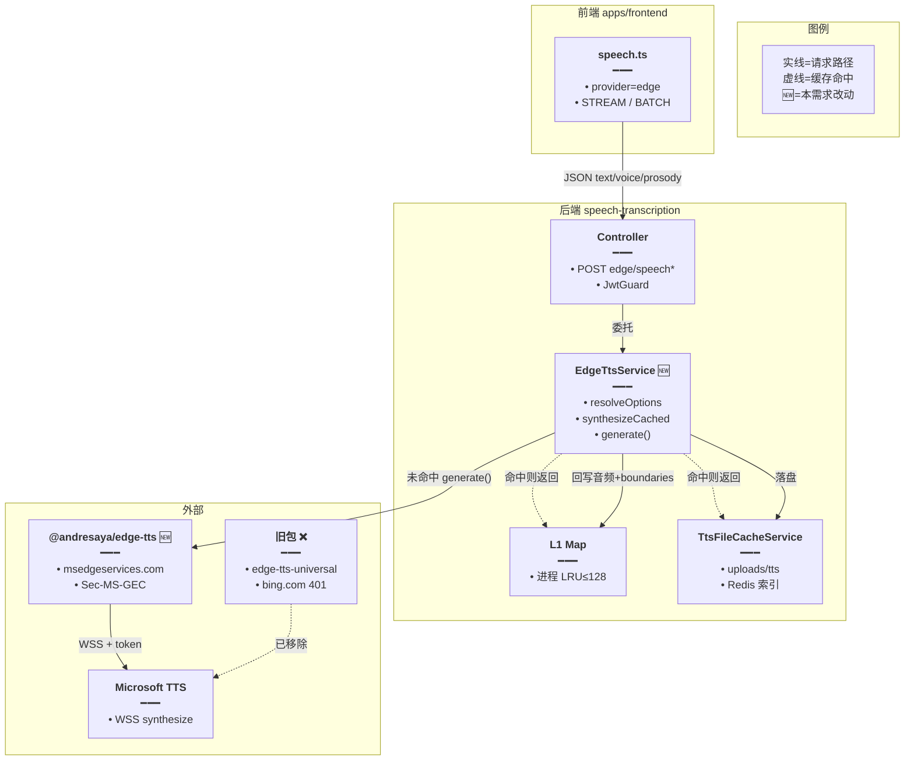
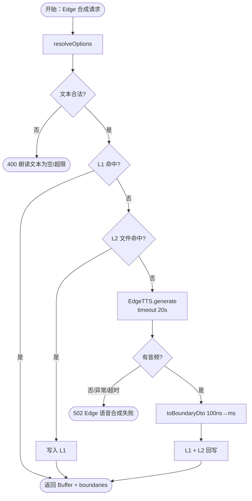
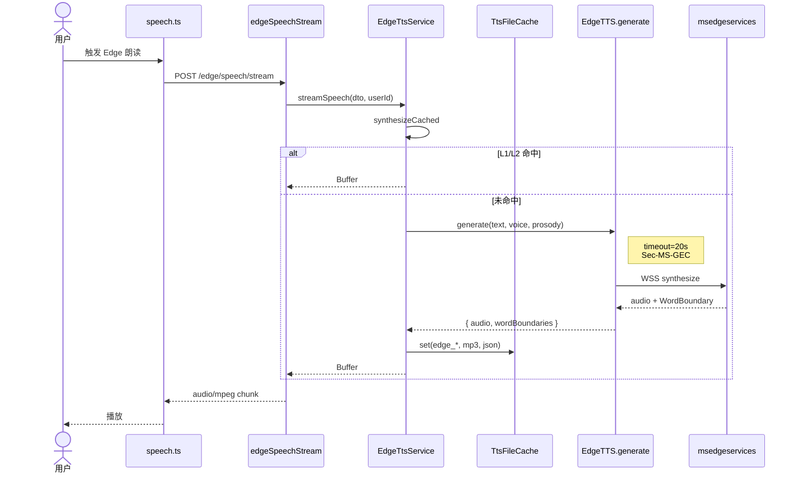
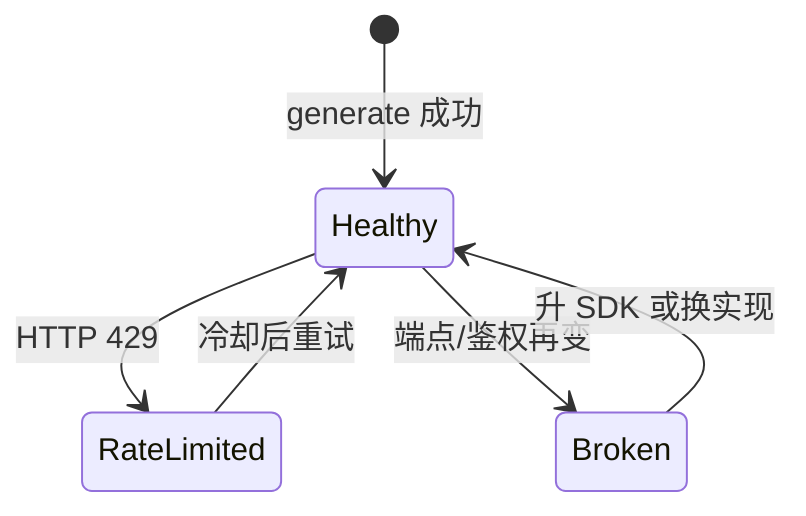

# Edge TTS 端点迁移换包 — 实现思路

> **状态**：规划（核心换包已落地，可继续打磨超时/429/许可证）  
> **日期**：2026-10-14  
> **需求摘要**：微软收紧 Edge 朗读鉴权后，旧 JS 包挂死；在不改前端契约与 L1/L2 缓存的前提下，后端换到新端点库，恢复 Edge 免费 TTS。

## 延伸阅读

- TTS 落盘缓存（L2，本方案**复用不动**）：[TTS本地文件缓存.md](./TTS本地文件缓存.md)
- 讯飞云 TTS（并列 provider，可作降级对照）：[讯飞云TTS.md](./讯飞云TTS.md)
- Python 上游端点变更参考：`rany2/edge-tts` ≥7.2.2（`api.msedgeservices.com`）

---

## 0. 读本文你将得到什么

- **问题**：`edge-tts-universal@1.4.0` 仍连 `speech.platform.bing.com`，voices **401**、`synthesize` **挂起**；前端表现为 Edge 朗读失败/一直转圈。
- **一句话方案**：后端依赖换成 `@andresaya/edge-tts`（新端点 + Sec-MS-GEC）；`EdgeTtsService.synthesize` 改用 `generate()`；Controller / 前端 API / 缓存指纹不变。
- **主要改动层**：`apps/backend` 依赖 + `edge-tts.service.ts` 合成实现；注释与 api 说明同步。
- **阶段**：M1 换包可用 → M2 超时/429/空音频 → M3（可选）许可证或 Python 子进程备选。
- **最大风险**：上游再次改鉴权 / 429 限流；`@andresaya/edge-tts` 为 **GPL-3.0**。

---

## 1. 需求与边界

### 1.1 用户故事

| 角色 | 场景 | 行为 | 期望结果 |
|------|------|------|----------|
| 已登录用户 | 设置里选 Edge 云 TTS | 听写 / 听书 / 选区朗读 | 数秒内出声；失败有明确 Toast |
| 已登录用户 | 同一句重复读 | 再次请求 | 命中 L1/L2 缓存，不打微软 |
| 开发者 | 上游短暂 429 | 连续压测 | 20s 内 502，不拖死 Nest worker |
| 听书客户端 | `/edge/speech/timed` | 要 WordBoundary | 仍返回 `audioBase64` + `boundaries`（ms） |

### 1.2 范围

| 在范围内 | 不在范围内（非目标） |
|----------|----------------------|
| 换 JS SDK、对齐新 WSS 端点 | 改前端 `speech.ts` 选路契约 |
| 保留 rate/volume/pitch、边界、缓存 | 自研完整 WebSocket 协议栈（除非 M3） |
| 合成超时与空音频校验 | 浏览器直连 Edge（仍须走 Nest） |
| 注释 / 依赖清理 | 默认 provider 改成讯飞（产品另开） |

### 1.3 约束与依赖

- 登录：`JwtGuard`；与现 Edge 路由一致。
- 复用：`EdgeTtsDto`、`edge-tts-prosody`、`TtsFileCacheService`、`buildTtsFileIds(provider:'edge')`、前端 `SPEECH_EDGE_TTS_*`。
- 实测对照：Python `edge-tts==7.3.1` OK；旧包 timeout；新包 `generate()` OK（过勤可能 429）。
- Ponytail：不改缓存与 HTTP 路径；只换合成内核。

---

## 2. 方案总览（一句话 + 要点）

**一句话方案**：丢掉仍绑旧 Bing 域的 `edge-tts-universal`，用已跟微软新端点的 `@andresaya/edge-tts`，经现有 `EdgeTtsService` 薄封装对外。

| # | 设计要点 | 理由 |
|---|----------|------|
| 1 | **只换合成内核** | Controller / FE / 缓存已稳定 |
| 2 | API 用 **`generate()`** | 返回 `{ audio, wordBoundaries }`；避免读 `protected word_boundaries` |
| 3 | **每次 new EdgeTTS** | 实例可变状态，并发安全 |
| 4 | **timeout 20s** | 旧故障是挂起；超时转 502 |
| 5 | **缓存 key 不变** | `provider=edge` + voice/rate/volume/pitch + text；旧盘文件仍可命中 |
| 6 | GPL 标风险 | 商业分发需评估；备选 Python 子进程 |

---

## 3. 现状与复用

| 能力 | 仓库中已有 | 本需求中的用法 |
|------|------------|----------------|
| Edge HTTP 入口 | `speech-transcription.controller.ts` · `edge/speech`、`stream`、`timed`、batch | **不动** |
| 选项解析 / 韵律 | `resolveOptions`、`edge-tts-prosody.ts` | **直接复用**（`+20%` / `+0Hz`） |
| L1 进程 LRU | `EdgeTtsService.speechCache` | **直接复用** |
| L2 文件缓存 | `TtsFileCacheService` + `uploads/tts/edge_*` | **直接复用** |
| 前端选路 | `utils/speech.ts` · `SPEECH_EDGE_TTS_STREAM` 等 | **不动** |
| 旧依赖 | `edge-tts-universal@1.4.0` → `speech.platform.bing.com` | **删除** |
| 新依赖 | `@andresaya/edge-tts@^1.9.1` → `api.msedgeservices.com` | **新增** |
| 对照实现 | Python `edge-tts` 7.3.1 | 验证新端点可用；可选 M3 子进程 |

**调研结论**：故障在上游端点与旧 SDK，不在 Nest 路由或缓存。最小修复 = 换包 + 改 `synthesize()` 调用形状；业务层零改动。

**故障证据（2026-10-14）**：

| 探测 | 结果 |
|------|------|
| 旧 voices：`speech.platform.bing.com/.../voices/list` | HTTP **401** |
| `edge-tts-universal` `synthesize()` | **≥15s 无响应** |
| Python `edge-tts==7.3.1` stream | **OK**（有音频字节） |
| `@andresaya/edge-tts` `generate()` | **OK**（含 wordBoundaries；过勤 **429**） |

---

## 4. 架构图



**图内方法说明**：

| 方法 | 功能 |
|------|------|
| `speech.ts` 云 TTS 选路 | 按用户 prefs 选 edge/minimax/xfyun；Edge 时打 Nest `/edge/speech*` |
| `edgeSpeech` / `edgeSpeechStream` / `edgeSpeechTimed` | Controller 入口：二进制 / 流式 / timed JSON |
| `resolveOptions` | 校验文本字节上限，映射 speed/vol/pitch → Edge 字符串 |
| `synthesizeCached` | L1→L2→上游；统一返回 `{ buffer, boundaries }` |
| `synthesize` 🆕 | `new EdgeTTS` + `generate()`；空音频抛错；异常转 502 |
| `TtsFileCacheService.get/set` | 按 `edge_` 指纹读写 mp3 与 boundaries JSON |
| `EdgeTTS.generate`（SDK） | 连新端点，返回 `audio` + `wordBoundaries` |

**读图要点**：

- 前端与 Controller 边界不变；🆕 仅在 Service↔SDK。
- 缓存仍包在上游之外，微软挂了时历史句可读盘。
- 旧 Bing 包从依赖树移除，避免误用。

---

## 5. 主流程图



**图内方法说明**：

| 方法 | 功能 |
|------|------|
| `resolveOptions` | 入口校验与韵律映射 |
| `getFromCache` / `setCache` | L1 LRU（含 touch 顺序） |
| `fileCache.get` / `getJson` / `set` | L2 音频与边界 |
| `EdgeTTS.generate` | 上游合成；支持 Abort/timeout |
| `toBoundaryDto` | WordBoundary tick → `offsetMs`/`durationMs` |

**读图要点**：

- 失败集中在上游与空音频；缓存命中不碰微软。
- 超时必须进 502，禁止无限 await（旧包故障模式）。
- 429 与鉴权失败同一 502 文案即可；M2 可区分 Toast。

---

## 6. 核心时序图



**图内方法说明**：

| 方法 | 功能 |
|------|------|
| `streamSpeech` | 一次取满 Buffer 再 yield（现实现非边下边播） |
| `synthesizeCached` | 编排三级缓存与上游 |
| `generate` | SDK 建连、发 SSML、收二进制与 metadata |
| `fileCache.set` | 成功后落盘，供跨进程复用 |

**读图要点**：

- timed / 非 stream 路径同内核，仅响应形状不同。
- 无前端改动；鉴权仍在 Nest。
- 并发：每次 `new EdgeTTS`，避免实例状态串扰。

---

## 7. （可选）状态：上游可达性



**图内方法说明**：

| 方法 | 功能 |
|------|------|
| `generate` 抛错 → `HttpException 502` | 将上游 RateLimited/Broken 暴露给前端 Toast |

---

## 8. 模块职责与接口草图

### 8.1 模块一览

| 模块 | 职责 | 新增/改动 | 预估路径 |
|------|------|-----------|----------|
| 依赖 | 删旧加新 | 改动 | `apps/backend/package.json` |
| EdgeTtsService | 合成内核 | 改动 | `.../edge-tts.service.ts` |
| Controller / DTO 注释 | 文档字符串 | 改动 | controller / dto / `api.ts` |
| 缓存 / 前端 | — | 无 | — |

### 8.2 关键接口（草图）

```typescript
// 合成内核：对接新 SDK，保持 CachedSpeech 对外形状不变
private async synthesize(resolved: EdgeTtsResolved): Promise<CachedSpeech> {
	// 实例级 timeout，防止 WSS 挂起拖死 worker
	const tts = new EdgeTTS({ timeout: EDGE_TTS_TIMEOUT_MS });
	// generate 返回独立 audio/boundaries，适合 Nest 并发
	const result = await tts.generate(resolved.text, resolved.voice, {
		// 与 resolveOptions 产出的 Edge 字符串一致
		rate: resolved.rate,
		volume: resolved.volume,
		pitch: resolved.pitch,
		// 单次调用再收一层超时
		timeout: EDGE_TTS_TIMEOUT_MS,
	});
	// Uint8Array → Buffer，供 StreamableFile / 落盘
	const buffer = Buffer.from(result.audio);
	// 空包视为上游失败，避免写坏缓存
	if (!buffer.length) throw new Error('未收到音频数据');
	// 100ns tick → 客户端 ms
	return {
		buffer,
		boundaries: this.toBoundaryDto(result.wordBoundaries ?? []),
	};
}
```

### 8.3 数据模型

| 字段/实体 | 来源 | 存储 | 说明 |
|-----------|------|------|------|
| `EdgeTtsDto` | 已有 | 请求体 | text/voice/speed/vol/pitch |
| `CachedSpeech` | Service | 内存 + 文件 | buffer + boundaries |
| L2 文件名 | `buildTtsFileIds` | `uploads/tts/edge_*` | provider 仍为 `edge` |

---

## 9. 分阶段实现步骤

| 阶段 | 目标 | 交付物 | 依赖 |
|------|------|--------|------|
| M1 | 换包可朗读 | 依赖替换 + `generate()` + 注释 | — |
| M2 | 稳态 | 超时、空音频、429 文案可选 | M1 |
| M3 | 合规备选 | GPL 评估或 Python `edge-tts` 子进程 | M2 |

### M1（已完成）

- [x] `pnpm remove edge-tts-universal` && `pnpm add @andresaya/edge-tts`
- [x] `synthesize` → `generate()` + `toBoundaryDto(wordBoundaries)`
- [x] 重启后冒烟：短中英文本有 mp3；timed 有 boundaries
- [x] 同步注释（controller / dto / frontend api）

### M2

- [ ] 统一 `EDGE_TTS_TIMEOUT_MS` 与错误码映射（429→友好提示）
- [ ] 压测：并发 N 路不串音、不泄漏实例
- [ ] 确认旧 L2 文件仍可命中（指纹未变）

### M3（可选）

- [ ] 法务确认 GPL-3.0 是否可接受
- [ ] 若否：Python 子进程封装或自研薄 WSS（对齐 rany2 常量）

---

## 10. 关键决策与备选方案

| 决策 | 选用 | 备选 | 为何不选备选 |
|------|------|------|--------------|
| SDK | `@andresaya/edge-tts` | 继续 universal | 旧端点已死 |
| 调用面 | `generate()` | `synthesize`+读 protected 字段 | TS 不允许；并发不安全 |
| 超时 | 20s | 无超时 | 再现挂死 |
| 缓存 | 保持 edge 指纹 | 换 provider 名清盘 | 无必要浪费已有文件 |
| 合规 | 暂用 GPL 包 | 立刻 Python 子进程 | M1 优先恢复；合规放 M3 |

---

## 11. 风险、边界与待确认

| 项 | 等级 | 说明 | 缓解 |
|----|------|------|------|
| 上游再改鉴权 | 高 | 历史已多次 401/403 | 跟 Python/SDK 发版；备选子进程 |
| 429 限流 | 中 | 本地连测易触发 | 超时+缓存；前端退避 |
| GPL-3.0 | 中 | 分发义务 | M3 评估 |
| 音量字符串 | 低 | SDK `validateVolume` 可能丢掉 `+` | 实测可用；异常再归一化 |
| 流式语义 | 低 | `streamSpeech` 仍是整包再写 | 与改前一致；真流式另开需求 |

**待确认**：

- [ ] 产品是否接受 GPL 依赖？（验证：法务/负责人一句）
- [ ] 429 时是否自动降级讯飞/MiniMax？（验证：产品；默认否）

---

## 12. 验收清单

| # | 用例 | 步骤 | 期望 |
|---|------|------|------|
| AC1 | 新句合成 | Edge 朗读未缓存句 | 有声；`uploads/tts` 新增 `edge_*` |
| AC2 | 缓存命中 | 同句再读 | 日志 L1/L2；不打微软 |
| AC3 | timed | 调 `/edge/speech/timed` | `boundaries.length≥1`（中文分词句） |
| AC4 | 超时 | 模拟上游 hang | ≤20s 返回 502，worker 不僵死 |
| AC5 | 旧包移除 | `package.json` | 无 `edge-tts-universal` |
| AC6 | 回归其它 provider | 切讯飞/MiniMax | 行为与改前一致 |

---

## 13. 预估改动面（实现阶段参考）

| 类型 | 路径（预估） |
|------|--------------|
| 后端依赖 | `apps/backend/package.json`、lockfile |
| 后端服务 | `apps/backend/src/services/speech-transcription/edge-tts.service.ts` |
| 注释 | `speech-transcription.controller.ts`、`dto/edge-tts.dto.ts`、`apps/frontend/src/service/api.ts` |
| 文档 | 本文；落地归档可用 `implementation-doc-from-diff` → `wiki/tts/` |

---

（本文档为规划态实现思路；核心换包已在主仓落地，以上游 SDK 与验收为准）
