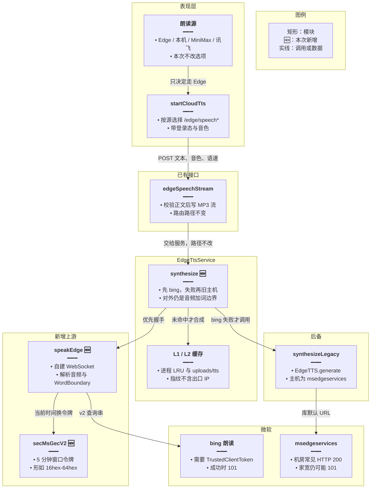
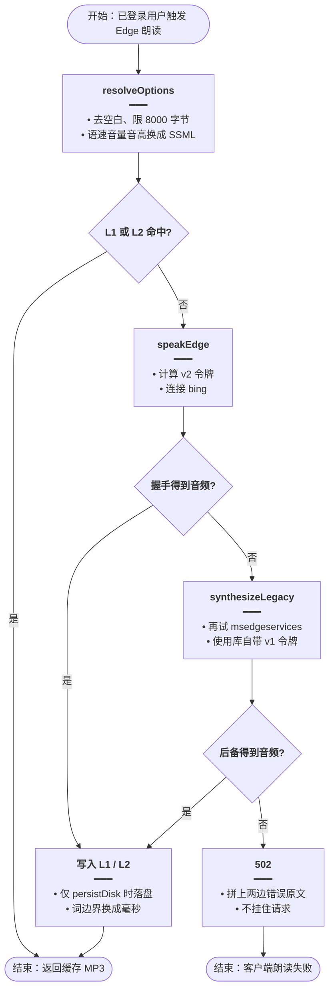
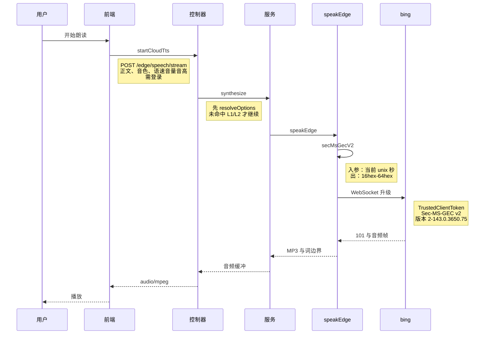
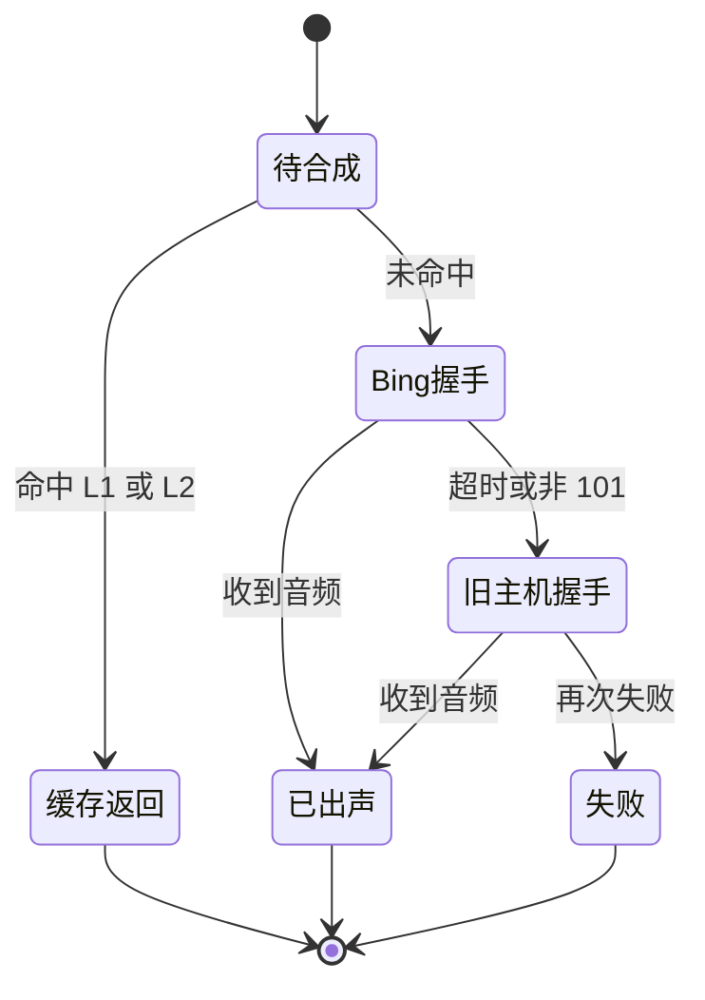

# Edge 机房握手 — 实现思路

> **状态**：规划（工作区已落地，待部署线上）  
> **日期**：2026-10-27  
> **需求摘要**：腾讯云出口连 `api.msedgeservices.com` 被回 HTTP 200，Edge 朗读全部 502；仍用免费 Edge，不换 Azure，让机房也能合成。

## 延伸阅读

- 上一轮换包（家宽可用、机房仍 200）：[EdgeTTS端点迁移.md](./EdgeTTS端点迁移.md)
- L1/L2 缓存本方案不动：[TTS本地文件缓存.md](./TTS本地文件缓存.md)
- 并列付费通道，本次不改选路：[讯飞云TTS.md](./讯飞云TTS.md)

---

## 0. 读本文你将得到什么

- **问题**：`@andresaya/edge-tts` 连 `api.msedgeservices.com`，机房握手得到 HTTP 200 而不是 101，日志是 `Unexpected server response: 200`。
- **一句话方案**：优先用 `speech.platform.bing.com` + Sec-MS-GEC v2 自建 WebSocket；失败再退回库的默认主机。
- **改动层**：只动后端合成；前端 `startCloudTts`、四个 `/edge/speech*` 路由、L1/L2 缓存不变。
- **阶段**：M1 握手（工作区已写）→ M2 部署验收 → M3 仅当 bing 也被拒再议。
- **最大风险**：微软再改令牌或把 bing 也按机房 IP 拒绝；免费接口没有稳定性承诺。

---

## 1. 需求与边界

### 1.1 用户故事

| 角色 | 场景 | 行为 | 期望结果 |
|------|------|------|----------|
| 已登录用户 | 线上 Tauri，朗读源是 Edge | 听书 / 听写 / 选区朗读 | 出 MP3，不再一直 502 |
| 已登录用户 | 本机家宽开发 | 同一操作 | 仍然出声 |
| 已登录用户 | 同一句再次读且 `persistDisk` | 命中缓存 | 不打微软 |
| 开发者 | 两条握手都失败 | 看 Nest 日志 | 502 正文带上两边的失败原因 |

### 1.2 范围

| 在范围内 | 不在范围内（非目标） |
|----------|----------------------|
| 机房可完成 Edge WebSocket 升级 | 换成 Azure / MiniMax / 讯飞 |
| Sec-MS-GEC v2 与 bing 查询串 | 改前端选路、会员、音色列表 |
| 失败时退回现有 `@andresaya/edge-tts` | 为绕过机房 IP 再挂住宅代理 |
| WordBoundary 仍换算成毫秒 | 改 L1 进程缓存 / L2 落盘指纹 |

### 1.3 约束与依赖

- 须登录。免费用户云端只有本机朗读和 Edge；会员另有 MiniMax、讯飞，本次不改。
- 客户端是 Tauri（`tauri-plugin-http`），合成发生在**服务器出网**，不是用户家宽。
- 复用 `EdgeTtsService` 的选项解析、L1/L2、`/edge/speech` 四个路由。
- `ws` 不新增直接依赖，从已安装的 `@andresaya/edge-tts` 解析，避免 `installDeps: false` 的部署缺包。
- 单次合成超时仍是 20 秒，失败尽快 502，不挂死 worker。

---

## 2. 方案总览（一句话 + 要点）

**一句话方案**：`synthesize` 先调 `speakEdge`（bing + v2 令牌）；抛错再 `synthesizeLegacy`（库默认的 msedgeservices + v1）。

| # | 设计要点 | 理由 |
|---|----------|------|
| 1 | 查询串用 `TrustedClientToken`，版本 `2-143.0.3650.75` | 与仍能出声的 edge-tts 7.3.1 对齐；只改版本前缀、令牌仍是 v1 会 403 |
| 2 | 不复用库的 `buildSynthesisUrl` | 它固定追加 `Ocp-Apim-Subscription-Key`，bing 回 401 |
| 3 | 令牌算法放在本仓 `secMsGecV2` | 运行时不调用 Python；用固定时间戳对拍 7.3.1 |
| 4 | 失败再退回 `EdgeTTS.generate` | 家宽上新主机仍可用，避免 bing 短暂失败把本地打挂 |
| 5 | 不换 Azure | 明确不做付费替换；免费额度扛不住线上听书 |

---

## 3. 现状与复用

| 能力 | 仓库中已有 | 本需求中的用法 |
|------|------------|----------------|
| Edge 路由与流式写出 | `apps/backend/src/services/speech-transcription/speech-transcription.controller.ts` | 直接复用，四个 POST 不改 |
| 选项、L1、L2、边界毫秒 | `apps/backend/src/services/speech-transcription/edge-tts.service.ts` | 扩展 `synthesize`，缓存指纹不变 |
| 库默认合成 | `@andresaya/edge-tts` 的 `EdgeTTS.generate` | 扩展为失败后备 |
| 前端 Edge 请求 | `apps/frontend/src/utils/speech.ts` 的 `startCloudTts` | 直接复用 |
| 朗读源 | `apps/frontend/src/views/setting/cloudTts/PlaybackSourcePicker.tsx` | 不适用，选路不改 |
| 上一轮换包说明 | `wiki/ideas/tts/EdgeTTS端点迁移.md` | 直接复用其「不改契约」约束；端点结论被本篇取代 |

**调研结论**：线上 502 出在服务器连微软的握手，请求体、音色、登录态都已进到 `edgeSpeechStream`。家宽用同一库能出声，所以前端和缓存不用动。库无法发出 bing 所需的 `TrustedClientToken` 查询串，合成连接要新建；`ws` 沿用该包已带上的依赖。

---

## 4. 架构图



**图内方法说明**：

| 方法 | 功能 |
|------|------|
| `startCloudTts` | 前端按当前朗读源请求云端 TTS；Edge 时打已有 `/edge/speech*`，不感知上游主机 |
| `edgeSpeechStream` | 控制器校验正文后把 MP3 写进响应；合成失败且尚未写出正文时把异常交给全局过滤器 |
| `synthesize` | 服务内合成入口：先 `speakEdge`，失败再 `synthesizeLegacy`，成功结果形状与换包前一致 |
| `speakEdge` | 用 bing 地址、v2 令牌和 Edge 143 的 User-Agent 完成 WebSocket，收 MP3 与词边界 |
| `secMsGecV2` | 按 5 分钟取整的 Windows 时间生成 `<16 hex>-<64 hex>`，供握手查询串使用 |
| `synthesizeLegacy` | 调用 `@andresaya/edge-tts` 的 `generate()`，连 `api.msedgeservices.com` |

**读图要点**：

- 表现层和路由是边界，本次新增集中在服务内侧的上游。
- 缓存仍包在 `synthesize` 之外，命中则两条微软主机都不会打到。
- 旧主机保留为后备，不是删除 `@andresaya/edge-tts`。

---

## 5. 主流程图



**图内方法说明**：

| 方法 | 功能 |
|------|------|
| `resolveOptions` | 把请求体收成文本、音色和 SSML 韵律；空文本或超长直接 400，避免无效握手 |
| `speakEdge` | 向 bing 发起一次合成；超时、非 101 或空音频都抛错，交给后备 |
| `synthesizeLegacy` | 用库的 `generate()` 再合成一次；仍失败则把库的错误原文向上抛 |

**读图要点**：

- 缓存命中直接结束，机房问题只影响未缓存的句子。
- 菱形先看 bing：这是为线上 200 准备的主路径，不是和旧主机并行。
- 两条都失败才 502，便于对照部署后的日志。

---

## 6. 核心时序图



**图内方法说明**：

| 方法 | 功能 |
|------|------|
| `startCloudTts` | 用户触发后发起云端 TTS；Edge 源走流式接口，参数沿用现有请求体 |
| `synthesize` | 控制器进入服务后的合成；本图是未命中缓存的成功路径 |
| `speakEdge` | 建连、发送 speech.config 与 SSML、收二进制音频和 `turn.end` |
| `secMsGecV2` | 在建连前生成本次查询串里的 v2 令牌 |

**读图要点**：

- 用户的出口 IP 不参与微软握手，出网站点是后端机器。
- 成功路径不经过 `synthesizeLegacy`；那条只在 `speakEdge` 抛错后出现。
- 返回给前端的仍是 MP3 流，客户端不用改播放器。

---

## 7. 状态机



**图内方法说明**：

本图无独立 callable，职责见节点要点。迁移由 `synthesize` 驱动：未命中才进入 Bing 握手，只有失败才进入旧主机。

**读图要点**：

- 缓存返回和已出声对用户相同，差别只是有没有打微软。
- 旧主机不是初始态，避免线上每次都先吃到 HTTP 200。
- 失败是终态，对应一次 502，不会在两条主机之间循环。

---

## 8. 模块职责与接口草图

### 8.1 模块一览

| 模块 | 职责 | 新增/改动 | 预估路径 |
|------|------|-----------|----------|
| v2 令牌 | 与 edge-tts 7.3.1 对齐的 Sec-MS-GEC | 新增 | `apps/backend/src/services/speech-transcription/edge-sec-ms-gec.ts` |
| 令牌自检 | 固定时间戳对拍，防算法漂移 | 新增 | 同目录 `edge-sec-ms-gec.check.ts` |
| bing 会话 | WebSocket、SSML、词边界 | 新增 | 同目录 `edge-speak.ts` |
| 合成编排 | 主路径 + 后备 + 502 文案 | 扩展 | 同目录 `edge-tts.service.ts` |
| 路由 / 前端 / 缓存 | 契约保持 | 直接复用 | controller、`speech.ts`、`tts-file-cache` |

### 8.2 关键接口（伪代码或 TypeScript 草图）

```typescript
// 合成结果仍是 MP3 加词界，调用方不用改
async function synthesize(resolved: EdgeTtsResolved): Promise<CachedSpeech> {
	// 先走 bing：机房上 msedgeservices 会直接 200
	try {
		// 库的 URL 拼不上 TrustedClientToken，所以单独建连
		return await speakEdge(resolved, 20_000);
	// 家宽可能仍只接受旧主机，bing 失败不能把本地打挂
	} catch (primary) {
		// 旧主机仍可能在家宽上成功，不能让 bing 一次失败就 502
		try {
			// 后备使用库的 generate，主机仍是 msedgeservices
			return await synthesizeLegacy(resolved);
		// 两条都失败才对客户端返回 502
		} catch (legacy) {
			// 正文拼两边原文，部署后能看出是哪一台主机拒绝
			throw new HttpException(join(primary, legacy), 502);
		}
	}
}
```

### 8.3 数据模型

| 字段/实体 | 来源 | 存储 | 说明 |
|-----------|------|------|------|
| 文本、音色、speed/vol/pitch | 请求体 `EdgeTtsDto` | 不落库 | 与换包前相同 |
| Sec-MS-GEC | `secMsGecV2` | 不存 | 5 分钟窗口，随请求计算 |
| MP3、词边界毫秒 | bing 或旧主机 | L1 内存；`persistDisk` 时 L2 | 指纹仍是 provider `edge` + 韵律 + 文本 |
| 失败原因 | 握手异常 `message` | 只进日志与 502 | 不写业务表 |

---

## 9. 分阶段实现步骤

| 阶段 | 目标 | 交付物 | 依赖 |
|------|------|--------|------|
| M1 | 机房可用的握手实现 | 令牌、自检、`speakEdge`、服务编排 | 无 |
| M2 | 线上验证 | 部署后的朗读与日志 | M1 |
| M3 | bing 仍被拒时的收口 | 只记录现象，不在本篇改供应商 | M2 失败 |

- [x] M1：`secMsGecV2(1700000000)` 与 edge-tts 7.3.1 的向量一致
- [x] M1：`speakEdge` 对本机返回 MP3，晓晓与 `en-US-EmmaMultilingualNeural` 均有音频
- [x] M1：`synthesize` 先 bing、失败再 `EdgeTTS.generate`
- [ ] M2：部署后端后，线上 Edge 朗读出声
- [ ] M2：未缓存请求的日志不再只是 `Unexpected server response: 200`
- [ ] M3：若 bing 同样非 101，把两条 `message` 记进问题单，不在本方案里换 Azure

---

## 10. 关键决策与备选方案

| 决策 | 选用 | 备选 | 为何不选备选 |
|------|------|------|--------------|
| 上游 | bing + Sec-MS-GEC v2 | 继续只连 msedgeservices | 线上已对该主机稳定返回 HTTP 200 |
| 谁组 URL | 自建 WebSocket | 只改库的 `secMsGecVersion` | 库始终追加 `Ocp-Apim-Subscription-Key`，bing 回 401 |
| 令牌 | 本仓 BigInt 实现 | 服务器安装 Python edge-tts | 部署物是 Node，不应为一次朗读拉起 Python |
| 失败 | 再试旧主机 | 失败即 502 | 家宽上旧主机仍能出声 |
| 产品 | 保持免费 Edge | Azure 语音 | 已明确不换；免费层并发和字符额度不够线上听书 |
| 依赖 | 从 edge-tts 包解析 `ws` | 把 `ws` 写进 backend 的 dependencies | 现网 `installDeps: false`，新依赖不会在只发 dist 时装上 |

---

## 11. 风险、边界与待确认

| 项 | 等级 | 说明 | 缓解 |
|----|------|------|------|
| 微软再改令牌或主机 | 高 | 免费接口无契约，家宽可用不代表下周仍可用 | 自检向量；502 保留上游原文 |
| bing 对机房也拒绝 | 高 | 本机只能证明家宽；线上尚未打这台腾讯云 | M2 看日志；失败时旧主机仍会试一次 |
| 令牌与时钟 | 中 | v2 按 5 分钟取整，时钟偏过窗口会 403 | 与 7.3.1 一样依赖系统时间；偏差过大需先对时 |
| GPL-3.0 | 中 | 后备仍引用 `@andresaya/edge-tts` | 不在本篇替换依赖 |
| 空音频 | 低 | 音色与文种不配时握手成功但无帧 | 仍抛「未收到音频数据」，与换包前一致 |

**待确认**：

- [ ] 部署后腾讯云访问 bing 是否返回 101（验证：线上读一句未缓存文本，日志不应只剩 `Unexpected server response: 200`）

---

## 12. 验收清单

| # | 用例 | 步骤 | 期望 |
|---|------|------|------|
| AC1 | 令牌 | 跑 `edge-sec-ms-gec.check.ts` | 两个固定时间戳与 7.3.1 一致，同一 5 分钟窗口结果相同 |
| AC2 | 家宽合成 | 本机 `speakEdge`，晓晓读「你好」 | 返回非空 MP3，词边界文本为「你好」 |
| AC3 | 线上未缓存 | 部署后用 Edge 读一句新文本 | 出声；若失败，502 同时含 bing 与旧主机的原因 |
| AC4 | 缓存 | 英语学习里对同一句再读，且打开落盘 | 第二次不因微软握手失败 |
| AC5 | 契约 | 看前端请求路径 | 仍是 `/edge/speech`、`/stream`、`/timed`、`/batch` |

---

## 13. 预估改动面（实现阶段参考）

| 类型 | 路径（预估） |
|------|--------------|
| 后端 | `apps/backend/src/services/speech-transcription/edge-sec-ms-gec.ts` |
| 后端 | `apps/backend/src/services/speech-transcription/edge-sec-ms-gec.check.ts` |
| 后端 | `apps/backend/src/services/speech-transcription/edge-speak.ts` |
| 后端 | `apps/backend/src/services/speech-transcription/edge-tts.service.ts` |
| 前端 | 无 |
| 文档（实现后） | 本文；正式专题仍以上一篇换包文为背景 |

---

（本文档为规划态实现思路；落地后以源码为准。上一篇换包文里的默认主机结论，以本文 bing 主路径为准。）
