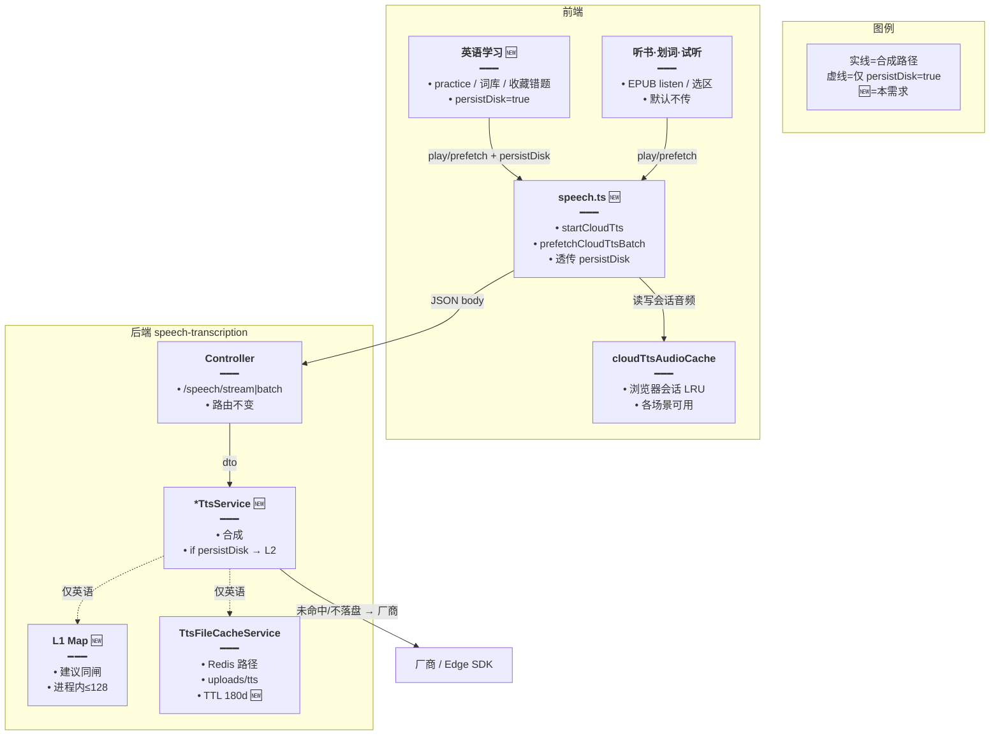
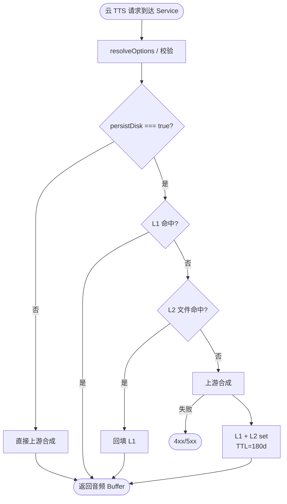
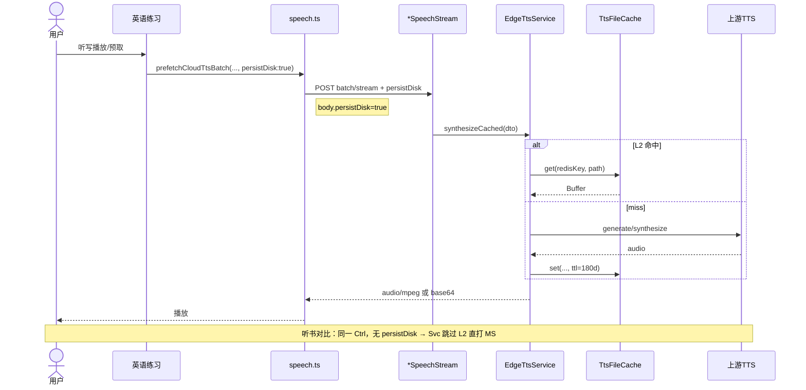

# TTS 仅英语学习落盘 — 实现思路

> **状态**：核心已落地（M1–M2）  
> **日期**：2026-10-14  
> **需求摘要**：`uploads/tts` + Redis 路径索引 **仅服务英语学习**；听书 / 划词朗读等不写不读该缓存；默认 TTL 从 30 天改为 **6 个月**。

## 延伸阅读

- 已落地 L2 机制（本需求在其上加「场景闸门」）：[TTS本地文件缓存.md](./TTS本地文件缓存.md)
- 听写 batch 预取（英语侧主消费者）：[听写TTS分批预取.md](../english/听写TTS分批预取.md)
- 听写防阻塞 / 配额 / GC：[练习听写请求防阻塞.md](../english/练习听写请求防阻塞.md)
- Edge 换包（与本闸门正交）：[EdgeTTS端点迁移.md](./EdgeTTS端点迁移.md)

---

## 0. 读本文你将得到什么

- **问题**：听书/朗读长文也会打 `TtsFileCacheService`，占盘、占 Redis 索引，且与「同句反复练」收益不对齐。
- **一句话方案**：请求体增加 **`persistDisk`（默认 false）**；仅英语学习前端传 `true` 才走 L2 get/set；默认 TTL → **15_552_000 秒（180 天 / 约 6 个月）**。
- **改动层**：后端 DTO + 四源 TTS Service 条件读写；前端 `speech.ts` 透传 + 英语学习调用方 opt-in；听书/设置试听不传。
- **阶段**：M1 后端闸门 + TTL → M2 英语学习接线 → M3 验收与存量盘说明。
- **最大风险**：遗漏英语入口未传 `true` → 练习失去落盘命中；误给听书传 `true` → 盘继续膨胀。

---

## 1. 需求与边界

### 1.1 用户故事

| 角色 | 场景 | 行为 | 期望结果 |
|------|------|------|----------|
| 学习者 | 听写 / 单词 / 经典句再播同句同音色 | 英语学习页播放或 batch 预取 | 命中 Redis 索引 → 读 `uploads/tts`，不打厂商 |
| 学习者 | EPUB 听书 / 听当前 / 划词朗读 | 连续播长文 | **不写、不读** L2；仅当次合成（前端会话 LRU 仍可） |
| 运维 | 观察磁盘 | 跑一阵听书后 | `uploads/tts` 增量主要来自英语短句，非章节长文 |
| 运维 | TTL | 英语缓存文件 | **6 个月** mtime/ZSET 到期后懒 GC 删除 |

### 1.2 范围

| 在范围内 | 不在范围内（非目标） |
|----------|----------------------|
| L2：`CACHE_MANAGER` 路径 + `uploads/tts` 读写闸门 | 拆新 HTTP 路由 / 新 Redis 连接 |
| 默认 TTL 30d → **6 个月** | 强制清空历史听书产生的旧文件（交给 TTL GC） |
| 英语学习 stream + batch 传 `persistDisk: true` | 改指纹算法 / provider 名 |
| 听书、划词、设置页试听默认不落盘 | 禁止前端 `cloudTtsAudioCache`（浏览器会话 LRU 保留） |
| | 自研按用户配额分目录（YAGNI） |

### 1.3 约束与依赖

- 复用：`TtsFileCacheService`、`buildTtsFileIds`、四源 `*TtsService`、前端 `speech.ts` 统一出口。
- 听书与英语学习 **共用** `POST .../edge|minimax|xfyun/speech/stream|batch`，无法用路径区分 → **必须请求级显式开关**。
- Ponytail：一个布尔字段 + 各 Service 两处 `if`；不引入 scene 枚举表。
- Env：`TTS_FILE_CACHE_TTL_SEC` 未设置时默认改 6 个月；已显式配置的 env **仍优先生效**。

---

## 2. 方案总览（一句话 + 要点）

**一句话方案**：L2 落盘改为 **opt-in（`persistDisk`）**，只让英语学习打开；全局默认 TTL 拉长到 6 个月以匹配「反复练同一库」。

| # | 设计要点 | 理由 |
|---|----------|------|
| 1 | **`persistDisk` 默认 false** | 听书/朗读零改即可停止占盘；安全默认 |
| 2 | **只闸 L2，不拆 API** | 共用路由；改动面最小 |
| 3 | **英语学习统一经 `speech.ts` 透传** | 一处组 body，调用方只传 options |
| 4 | **L1 进程 Map：建议一并闸** | 听书唯一长句会污染 128 槽 LRU；与「不缓存」语义一致 |
| 5 | **前端会话 LRU 保留** | 听书同会话预取仍靠浏览器内存，不碰 Redis/盘 |
| 6 | **TTL = 180 天** | 词库/听写句复用周期长；可用 env 覆盖 |
| 7 | **否决「仅 batch 落盘」** | 首题 stream、单词朗读也要命中同一文件 |

**为何不用备选**：

| 备选 | 否决原因 |
|------|----------|
| 按文本长度阈值（>N 字不缓存） | 听书短段仍会落盘；英语长句被误伤；魔法数难调 |
| 新路由 `/english/.../speech` | 前后端双倍入口，无收益 |
| 默认 true + 听书传 false | 漏改听书则继续胀盘；opt-in 更安全 |
| scene 枚举多值 | 当前只需是否落盘，布尔足够 |

---

## 3. 现状与复用

| 能力 | 仓库中已有 | 本需求用法 |
|------|------------|------------|
| L2 文件缓存 | `tts-file-cache.service.ts` + keys/enum | **扩展**：调用方决定是否 get/set |
| TTL / 预算 / 懒 GC | 同上；默认 `ttlSec=2_592_000`（30d） | **改默认** → `15_552_000`（180d） |
| Edge / MiniMax / 讯飞 / 硅基 | 各 `*tts.service.ts` 均无条件 `fileCache.get/set` | **扩展**：`persistDisk` 为真才走 |
| DTO | `EdgeTtsDto` 等；batch 用 `TtsBatchTextsDto` | **新增** optional boolean |
| 前端统一合成 | `apps/frontend/src/utils/speech.ts` · `startCloudTts` / `prefetchCloudTtsBatch` | **透传** `persistDisk` 进 JSON body |
| 英语练习预取 | `practiceTtsPrefetchPipe.ts`、`usePracticePlayback` 等 | **传 true** |
| 英语 UI 朗读 | classic/favorites/mistakes/`Board` · `playPreferred` | **传 true** |
| 听书 | `epubListenPlayUnits.ts`、`useEpubChapterListen` 等 | **不传 / false**（默认） |
| 设置试听 | `LocalTtsVoiceSetting.tsx` | **不传**（试听无落盘价值） |
| 浏览器 LRU | `cloudTtsAudioCache` | **不动**（非 Redis/盘） |

**调研结论**：故障/浪费点在「全流量无差别落盘」，不在缓存实现本身。最小正确改法是 **请求级 opt-in**；TTL 只改默认常量与 enum 注释。

---

## 4. 架构图



**图内方法说明**：

| 方法 | 功能 |
|------|------|
| `playPreferred` / `prefetchCloudTts` / `prefetchCloudTtsBatch` | 前端播放与预取入口；本需求增加 options.`persistDisk` |
| `startCloudTts` | 组 stream 请求体；把 `persistDisk` 写入 JSON |
| `prefetchCloudTtsBatch` | 组 batch 请求体；同样透传 |
| `edgeSpeech` / `*SpeechStream` / `*SpeechBatch` 等 | Controller 不变，DTO 多字段后自动进 Service |
| `synthesizeCached`（及各源等价） | 按 `persistDisk` 决定是否 L1/L2；始终可走上游合成 |
| `TtsFileCacheService.get/set` | Redis 索引 + 读盘/写盘；TTL 用新默认 180d |
| `gcExpired` | 懒 GC；仅删 ZSET 到期 member（策略不变） |

**读图要点**：

- 听书与英语共用 Controller；差异只在 body 布尔位。
- Redis/盘只挂在虚线；听书实线直连厂商（或仅前端内存命中）。
- TTL 改在 L2 服务默认值，与闸门正交。

---

## 5. 主流程图



**图内方法说明**：

| 方法 | 功能 |
|------|------|
| `resolveOptions` | 文本/韵律校验（各源已有） |
| `getFromCache` / `setCache` | L1；仅 `persistDisk` 分支进入 |
| `fileCache.get` / `fileCache.set` | L2；同上 |
| 上游 `synthesize` / `generate` / 厂商 API | 实际出声；听书唯一路径或英语 miss 路径 |

**读图要点**：

- `persistDisk=false` 是最短路径：无 Redis、无盘 IO。
- 英语 miss 与今日行为一致，仅 TTL 更长。
- 失败不写盘（保持现 `set` 仅成功后调用）。

---

## 6. 核心时序图



**图内方法说明**：

| 方法 | 功能 |
|------|------|
| `prefetchCloudTtsBatch` / `startCloudTts` | 携带 `persistDisk:true` |
| `synthesizeCached` | 分支读 L2 或上游 |
| `TtsFileCacheService.get/set` | 英语专用持久化 |
| 上游合成 | 听书默认路径；英语 miss 路径 |

**读图要点**：

- 听书与英语时序同形，差在是否进入 L2 两行。
- batch / stream / timed 共用同一布尔语义。

---

## 7. 模块职责与接口草图

### 7.1 模块一览

| 模块 | 职责 | 类型 | 路径（预估） |
|------|------|------|--------------|
| TTL 默认 | 30d→180d | 改动 | `tts-file-cache.enum.ts`、`tts-file-cache.service.ts` |
| DTO | `persistDisk?` | 新增字段 | `dto/*-tts*.dto.ts`、`tts-batch-texts.dto.ts`（或基类） |
| 四源 Service | 条件 L1/L2 | 改动 | `edge/minimax/xfyun/siliconflow-*.ts` |
| speech.ts | 透传 | 改动 | `apps/frontend/src/utils/speech.ts` |
| 英语调用方 | 传 true | 改动 | practice / Board / favorites / mistakes / library 等 |
| 听书调用方 | 不传 | 无改或确认 | `ebook/**` |

### 7.2 接口草图（≤30 行）

```typescript
// DTO：可选落盘开关；默认 false，听书零改动即关闭 L2
@IsOptional()
@IsBoolean()
persistDisk?: boolean;

// Service：仅英语学习请求读写 Redis/盘
private async synthesizeCached(dto: EdgeTtsDto, userId?: number) {
	// 解析韵律；与是否落盘无关
	const resolved = this.resolveOptions(dto);
	// 缺省 false：听书/朗读不进缓存分支
	const persist = dto.persistDisk === true;
	if (persist) {
		// L1/L2 命中则直接返回，避免打厂商
		const hit = await this.tryCacheHit(resolved, userId);
		if (hit) return hit;
	}
	// 未命中或不落盘：走上游合成
	const entry = await this.synthesize(resolved);
	if (persist) {
		// 成功后才写，避免空/失败污染盘
		await this.writeCaches(resolved, userId, entry);
	}
	return entry;
}

// 前端：英语学习 options；听书不传
await prefetchCloudTtsBatch(texts, { persistDisk: true, signal });
await playPreferred(text, { cloudSingleUtterance: true, persistDisk: true });
```

### 7.3 数据与配置

| 项 | 改前 | 改后 |
|----|------|------|
| `TTS_FILE_CACHE_TTL_SEC` 默认 | `2_592_000`（30 天） | `15_552_000`（180 天 ≈ 6 个月） |
| Redis key / 文件名指纹 | `tts:file:v1:...` | **不变**（英语旧文件可继续命中） |
| 全局 `TTS_FILE_CACHE_ENABLED=false` | 全关 L2 | 仍全关（总闸优先于 `persistDisk`） |

---

## 8. 分阶段实现步骤

| 阶段 | 目标 | 交付 | 依赖 |
|------|------|------|------|
| M1 | 后端闸门 + TTL | DTO + Service 分支；默认 180d；单测/自检：false 不写盘 | — |
| M2 | 英语 opt-in | `speech.ts` 透传；练习/词库/收藏错题/Board 传 true | M1 |
| M3 | 回归 | 听书压测盘增量≈0；英语同句二次命中 L2；文档互链 | M2 |

### M1

- [ ] enum / `ensureReady` 默认 `ttlSec = 15_552_000`；注释改「6 个月」
- [ ] 各 TTS DTO + batch DTO 增加 `persistDisk?: boolean`
- [ ] `fileCache.get/set`（及建议 L1）包在 `persistDisk === true` 内
- [ ] 本地断言：无 flag 合成后 `uploads/tts` 无新文件

### M2

- [ ] `PlayPreferredOptions` / prefetch options 增加 `persistDisk?`
- [ ] `startCloudTts`、`prefetchCloudTtsBatch` 写入 body
- [ ] 英语学习所有云 TTS 入口传 `true`（见下表）
- [ ] 听书 / 划词 / 设置试听确认未传

**英语学习接线表（实现时勾选）**：

| 入口 | 文件（现有） | 传 `persistDisk` |
|------|--------------|------------------|
| 练习 batch 管线 | `practiceTtsPrefetchPipe.ts` | true |
| 练习首题/切题 prefetch | `practice/index.tsx`、`usePracticePlayback.ts` | true |
| 结果板 / 单词朗读 | `components/result/Board.tsx` | true |
| 词库 / 收藏 / 错题 | `library/**`、`favorites/**`、`mistakes/**` | true |
| 今日复习等同类 `playPreferred` | `daily/**` 等 | true |

### M3

- [ ] 听书连续听一章：`uploads/tts` 无新增（或仅历史残留）
- [ ] 英语同句二次：Winston/日志见 L2 命中
- [ ] 更新 [TTS本地文件缓存.md](./TTS本地文件缓存.md) 文首修订一行（TTL + 场景闸门指针）

---

## 9. 关键决策与备选

| 决策 | 选用 | 备选 | 为何不用备选 |
|------|------|------|--------------|
| 闸门形态 | `persistDisk` boolean | `scene: 'english'\|...` | 布尔够用 |
| 默认值 | false（opt-in） | true（opt-out） | 防听书漏改胀盘 |
| L1 | 与 L2 同闸 | L1 始终开 | 避免听书污染进程 LRU |
| 前端内存 LRU | 保留 | 一并禁用 | 听书预取体验依赖它；非盘 |
| 存量听书文件 | TTL 自然过期 | 立刻扫盘删 | 风险高；180d 内逐步消失 |
| TTL | 180 天 | 保持 30 天 | 需求明确 6 个月 |

---

## 10. 风险、边界与待确认

| 项 | 等级 | 说明 | 缓解 |
|----|------|------|------|
| 英语入口漏传 | 高 | 失去 L2，反复打厂商 | M2 接线表 + 验收 AC2 |
| 听书误传 true | 中 | 长文落盘 | Code review；默认 false |
| `.env` 仍写 30d | 低 | 部署未改体感 | 发布说明：删旧 TTL 或改 15552000 |
| timed 听书句高亮 | 中 | `/edge/speech/timed` 若被听书用 | 默认不 persist；确认小程序听书不传 true |
| 硅基 TTS | 低 | 若仅设置试听用 | 保持默认 false |

**待确认**：

- [ ] 「朗读」是否包含聊天/知识库选区？（验证：产品；方案默认凡非英语学习均 false）
- [ ] 小程序听书是否走同一 Nest Edge timed？（验证：搜调用；同样默认不落盘）

---

## 11. 验收清单

| # | 用例 | 步骤 | 期望 |
|---|------|------|------|
| AC1 | 听书不落盘 | Edge/云 TTS 听一章新内容 | `uploads/tts` 无新 `edge_/minimax_/xfyun_` 文件 |
| AC2 | 英语落盘 | 听写新句 → 再播同句 | 首次写盘；二次 L2 命中、厂商无请求（或日志命中） |
| AC3 | batch | 练习 prefetch batch | body 含 `persistDisk:true`；盘上有短句文件 |
| AC4 | TTL 默认 | 未设 env 启动 | 日志 `ttlSec=15552000` |
| AC5 | 总闸 | `TTS_FILE_CACHE_ENABLED=false` | 即使 persistDisk 也不写盘 |
| AC6 | 试听 | 设置页云 TTS 试听 | 不落盘 |
| AC7 | 前端会话 | 听书同句预取 | 浏览器 LRU 仍可命中；无 Redis 键新增 |

---

## 12. 预估改动面

| 类型 | 路径（预估） |
|------|--------------|
| 后端缓存 | `apps/backend/src/enum/tts-file-cache.enum.ts`、`tts-file-cache.service.ts` |
| 后端 DTO | `apps/backend/src/services/speech-transcription/dto/*.dto.ts` |
| 后端 Service | `edge-tts.service.ts`、`minimax-tts.service.ts`、`xfyun-tts.service.ts`、`siliconflow-transcription.service.ts` |
| 前端核心 | `apps/frontend/src/utils/speech.ts` |
| 前端英语 | `views/englishLearning/**` 中 `playPreferred` / `prefetchCloudTts*` 调用点 |
| 文档 | 本文；落地后可修订 [TTS本地文件缓存.md](./TTS本地文件缓存.md) §0.1 |

---

（本文档为规划态实现思路；落地后可用 `implementation-doc-from-diff` 归档到 `wiki/tts/` 或 `wiki/english/`）
