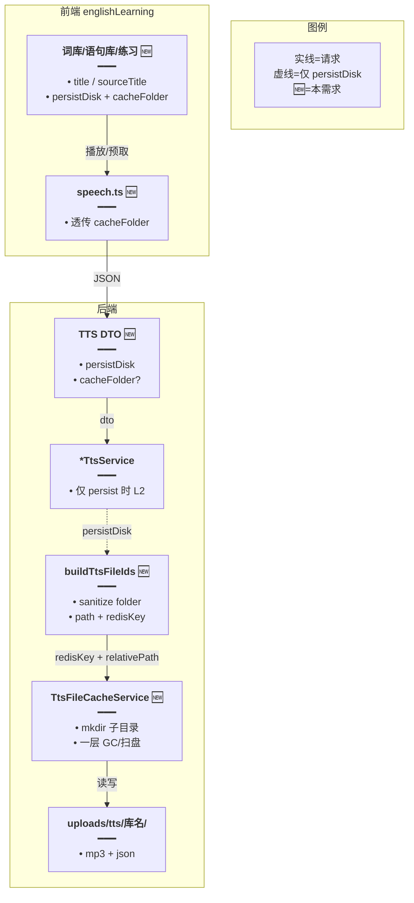
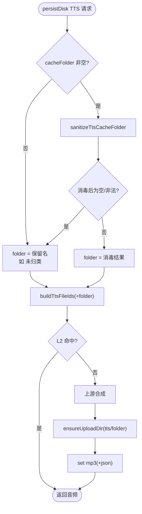
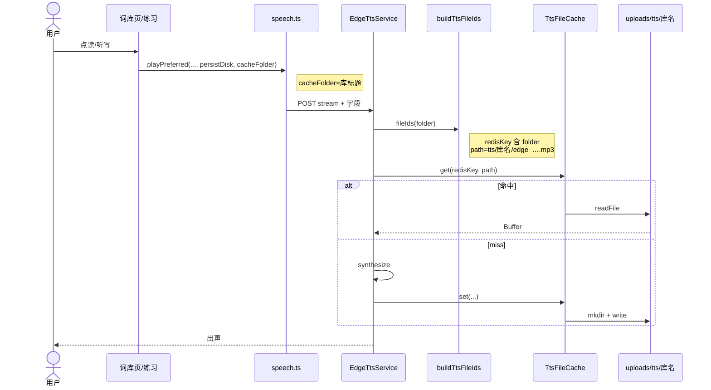

# TTS 按资源库分目录 — 实现思路

> **状态**：**§13 M4 已落地**（稳定 id 目录 + `cacheTitle`→`_meta.json`）；旧标题目录靠 TTL GC，不搬迁  
> **日期**：2026-10-14（§13 编码同日）  
> **需求摘要**：英语学习 L2 按库隔离落盘；热路径 O(1)；**目录键用稳定 id，标题只作展示旁路**。

## 延伸阅读

- L2 机制与 TTL：[TTS本地文件缓存.md](./TTS本地文件缓存.md)
- 仅英语学习落盘闸门（本需求叠加其上）：[TTS仅英语学习落盘.md](./TTS仅英语学习落盘.md)
- 听写预取：[听写TTS分批预取.md](../english/听写TTS分批预取.md)
- 前端已有落盘名清洗：`apps/frontend/src/views/englishLearning/utils/exportFileName.ts` · `safeExportBaseName`

---

## 0. 读本文你将得到什么

- **问题**：英语 TTS 需按库隔离；若目录名绑可变标题，**改名会丢命中 / 双份占盘**。
- **一句话方案（现行 M1–M2）**：`persistDisk` + `cacheFolder`（现多为标题）→ `uploads/tts/<folder>/`；Redis key 含 folder；热路径仍 O(1)。
- **一句话方案（改名最优 · §13）**：磁盘与 Redis **以稳定 `libraryId`（等）为目录键**；改名只改 DB + 可选 `_meta.json`，**零搬盘、零失效**。
- **阶段**：M1–M2 标题目录 → **M4 稳定 id 目录已落地**（`vocab_<id>` / `classic_<id>` / `pack_<id>` + `_meta.json`）。
- **迁移**：旧中文标题目录不搬迁，TTL 懒 GC；新写入一律走 id scope。

---

## 1. 需求与边界

### 1.1 用户故事

| 角色 | 场景 | 行为 | 期望结果 |
|------|------|------|----------|
| 学习者 | 词库「小学三年级上册英语单词」听写/点读 | 云 TTS + persistDisk | 文件在 `uploads/tts/小学三年级上册英语单词/*.mp3` |
| 学习者 | 语句库同理 | 同上 | `uploads/tts/<语句库标题>/` |
| 运维 | 按库清理或目检 | 打开 uploads/tts | 一眼按库分文件夹 |
| 学习者 | 收藏/错题/无库场景 | 仍 persistDisk | 进约定保留目录（如 `收藏`），不污染业务库目录 |

### 1.2 范围

| 在范围内 | 不在范围内（非目标） |
|----------|----------------------|
| `persistDisk` 路径增加一层库目录 | 听书/划词（本就不 persist） |
| 词库 + 语句库（及练习 `sourceTitle`）一致 | 按 `libraryId` 做目录（不可读） |
| Redis key 纳入 folder；一层子目录 GC/配额扫盘 | 硬链接/符号链接跨库去重 |
| 标题消毒（非法字符、长度、防 `..`） | 库改名时搬迁旧目录 |
| | 多级嵌套目录 |

### 1.3 约束与依赖

- 仅在 `persistDisk === true` 时生效；与 [TTS仅英语学习落盘.md](./TTS仅英语学习落盘.md) 正交叠加。
- 复用：`TtsFileCacheService`、`buildTtsFileIds`、练习侧已有 `sourceTitle`、导出侧 `safeExportBaseName` 规则。
- 安全：服务端为信任边界，**必须**消毒；禁止 `..`、绝对路径、空目录名。
- 性能底线：热路径仍为 **Cache get → 1 次 readFile**；禁止按库扫目录找音频。

---

## 2. 方案总览（一句话 + 要点）

**一句话方案**：请求多一个 `cacheFolder`（库标题字符串）；服务端消毒后拼进相对路径与 Redis key；写盘时 `mkdir` 子目录；GC/配额只做 **一层** 子目录遍历。

| # | 设计要点 | 理由（性能/正确性） |
|---|----------|---------------------|
| 1 | **目录用消毒后的标题，不用 Id** | 满足「按库名区分」；运维可读 |
| 2 | **Redis key 含 folder** | 索引与路径一致；改规则可换路径；O(1) 命中不变 |
| 3 | **同文同音色跨库允许重复文件** | 换目录换 key，避免跨库耦合；去重用硬链收益小、复杂度高 |
| 4 | **服务端统一 `sanitizeTtsCacheFolder`** | 防穿越；FE/BE 规则一致；热路径只做字符串替换 |
| 5 | **写时懒创建目录** | 不为所有库预 mkdir |
| 6 | **GC/扫盘一层递归** | 现实现只 `readdir(tts/)` 顶层 mp3，上线子目录后必须改，否则永不过期 |
| 7 | **缺 folder 时用保留名** | 收藏/错题等仍可落盘，不落业务库名下 |
| 8 | **库改名（现行）不搬迁** | 标题目录下的权宜；**正式方案见 §13：改用稳定 id** |

**为何不用备选**：

| 备选 | 否决原因 |
|------|----------|
| 仅改磁盘路径、Redis key 不含 folder | 索引可能指向错误路径；命中错声风险 |
| ~~目录用 `libraryId`~~（已纠正） | **§13 改为推荐**：运维可读用 `_meta.json` 旁路，不把可变标题当键 |
| 全局扁平 + DB 映射表 | 多一层查询；违背「文件夹即分类」 |
| 跨库硬链接去重 | 改音色/删库难；Windows/权限坑；收益有限 |
| 深度递归任意层级 | 无需求；扫盘变贵 |

---

## 3. 现状与复用

| 能力 | 仓库中已有 | 本需求用法 |
|------|------------|------------|
| L2 落盘 + Redis 路径 | `tts-file-cache.service.ts` / `tts-file-cache.keys.ts` | **扩展** folder 段 |
| `persistDisk` 闸门 | 各 `*tts.service.ts` + FE | **沿用**；有 folder 才分子目录 |
| 路径形状 | `tts/{provider}_{p12}_{t12}.mp3` | → `tts/{folder}/…` |
| GC / 配额扫盘 | 仅顶层 `*.mp3` | **必须扩展**一层子目录 |
| 练习库标题 | `PracticeConfig.sourceTitle`、URL `sourceTitle` | **直接作** `cacheFolder` |
| 词库/语句库 UI 标题 | `library.title` / `meta.title` | 点读时传入 |
| 文件名消毒 | `safeExportBaseName`（前端导出） | 后端对等实现（可抽同规则） |
| 收藏/错题 | 无单一库 title | 约定保留目录名 |

**调研结论**：热路径已是指纹寻址，加一层目录 **几乎零额外 IO**（写盘多一次 `mkdir`，且可依赖已存在目录）。真正必改的是 **扁平假设下的 GC/配额扫描**，否则分目录后过期文件清不掉。

**目标路径示例**：

```text
uploads/tts/
  小学三年级上册英语单词/
    edge_f97d52a7c269_f8bed26f7cc2.mp3
    edge_f97d52a7c269_f8bed26f7cc2.json   # Edge boundaries（若有）
  某语句库标题/
    edge_….mp3
  收藏/          # 保留名：非资源库场景
  错题/
```

**Redis key（改后）**：

```text
tts:file:v1:{folder}:{provider}:{paramHash}:{textHash}
→ 值仍是相对路径 tts/{folder}/{filename}
```

---

## 4. 架构图



**图内方法说明**：

| 方法 | 功能 |
|------|------|
| `playPreferred` / `prefetchCloudTts*` | 增加 options.`cacheFolder`；与 `persistDisk` 一并组 body |
| `sanitizeTtsCacheFolder` | 清洗标题→安全单段目录名；非法则回落保留名 |
| `buildTtsFileIds` | 生成含 folder 的 `relativePath` 与 `redisKey` |
| `synthesizeCached`（各源） | 把 dto.`cacheFolder` 传入 `fileIds` |
| `TtsFileCacheService.set/get` | 写前 `ensureUploadDir(子目录)`；读路径不变语义 |
| `gcExpired` / `seedUsedBytes` | 枚举顶层文件 **与** 一层子目录内 mp3/json |

**读图要点**：

- 目录名只影响 L2 路径层；厂商合成与前端会话 LRU 不变。
- 性能关键仍在 Keys→Cache 的指纹寻址，不引入「按库列表目录找文案」。

---

## 5. 主流程图



**图内方法说明**：

| 方法 | 功能 |
|------|------|
| `sanitizeTtsCacheFolder` | trim、替非法字符、截断、禁 `..` |
| `buildTtsFileIds` | 拼路径与 Redis key |
| `fileCache.get/set` | 命中/落盘；set 负责子目录存在 |

**读图要点**：

- 缺省 folder 不写到业务库目录，避免「无标题」污染错误文件夹。
- mkdir 仅 miss 写盘时发生，命中路径零额外成本。

---

## 6. 核心时序图



**图内方法说明**：

| 方法 | 功能 |
|------|------|
| `playPreferred` / `prefetchCloudTtsBatch` | 透传 `cacheFolder` |
| `buildTtsFileIds` | 计算指纹路径 |
| `get` / `set` | L2 读写；set 创建子目录 |
| `synthesize` | 上游合成（未命中） |

**读图要点**：

- batch 与 stream 共用同一 `cacheFolder`（整批同一库）。
- 听书无 `persistDisk`，本时序不触发。

---

## 7. 模块职责与接口草图

### 7.1 模块一览

| 模块 | 职责 | 类型 | 路径（预估） |
|------|------|------|--------------|
| keys + sanitize | folder→path/redisKey | 扩展 | `tts-file-cache.keys.ts` |
| 文件缓存 | mkdir；一层 GC/配额 | 扩展 | `tts-file-cache.service.ts` |
| DTO | `cacheFolder?: string` | 新增字段 | `dto/*-tts*.dto.ts` |
| 各 TTS Service | 传入 folder | 改动 | edge/minimax/xfyun |
| speech.ts | 透传 | 改动 | `utils/speech.ts` |
| 英语学习调用方 | 传库标题 | 改动 | library / practice / 保留名场景 |

### 7.2 接口草图

```typescript
// 服务端：目录名消毒（信任边界；防穿越与非法路径段）
export function sanitizeTtsCacheFolder(raw: string, fallback = '未归类'): string {
	// 去首尾空白，避免空段
	const s = raw.normalize('NFC').trim()
		// 去掉路径分隔与 Windows 非法字符
		.replace(/[\\/:*?"<>|\0]/g, '_')
		// 禁止伪装父目录
		.replace(/^\.+/, '_')
		.slice(0, 80);
	// 空或纯点则回落，保证永远是单层合法名
	return s && s !== '.' && s !== '..' ? s : fallback;
}

// 指纹：folder 进入 redisKey 与相对路径
export function buildTtsFileIds(input: {
	provider: TtsFileProvider;
	paramParts: string[];
	normalizedText: string;
	// 已消毒的单层目录名；缺省表示历史扁平（兼容读）
	folder?: string;
}) {
	const paramHash = sha256Hex(input.paramParts.join('\u0001'));
	const textHash = sha256Hex(input.normalizedText);
	const filename = `${input.provider}_${paramHash.slice(0, 12)}_${textHash.slice(0, 12)}.mp3`;
	const folder = input.folder?.trim();
	const relativePath = folder
		? `tts/${folder}/${filename}`
		: `tts/${filename}`;
	const redisKey = folder
		? `tts:file:v1:${folder}:${input.provider}:${paramHash}:${textHash}`
		: `tts:file:v1:${input.provider}:${paramHash}:${textHash}`;
	return { redisKey, relativePath, filename };
}
```

### 7.3 `cacheFolder` 取值约定

| 场景 | 传值 | 落盘目录（消毒后） |
|------|------|-------------------|
| 词库点读 / 练习 | `library.title` / `sourceTitle` | 如 `小学三年级上册英语单词` |
| 语句库 | 同上 | 同规则 |
| 词汇包 pack | pack 标题 | 同规则 |
| 收藏 | 固定 `收藏` | `收藏` |
| 错题 | 固定 `错题` | `错题` |
| 今日记词 / 复习 | 固定文案或 i18n 中文名 | 如 `今日记词` |
| 未传 | — | 服务端 `未归类` |

### 7.4 GC / 配额（性能要点）

| 操作 | 改前 | 改后（最优） |
|------|------|--------------|
| `gcExpired` | `readdir(tts)` 仅顶层 mp3 | 顶层 mp3 **+** 每个子目录内 mp3（**仅一层**） |
| `seedUsedBytes` | 同上扁平 | 同上，累计子目录文件 size |
| 热路径 get/set | 不变 | set 时 `ensureUploadDir(join(ttsDir, folder))` |

游标 GC：可把「相对路径列表」展平为一层数组再轮询，避免深度 walk。

---

## 8. 分阶段实现步骤

| 阶段 | 目标 | 交付 | 依赖 |
|------|------|------|------|
| M1 | 后端路径 + GC | sanitize、`buildTtsFileIds`、DTO、Service、一层扫盘 | persistDisk 已落地 |
| M2 | 前端透传与接线 | speech.ts；词库/语句库/练习传标题；收藏等保留名 | M1 |
| M3 | 兼容与验收 | 旧扁平文件 TTL 自消；文档互链；压测命中延迟 | M2 |

### M1

- [ ] `sanitizeTtsCacheFolder` + `buildTtsFileIds({ folder })`
- [ ] DTO `cacheFolder?: string`（MaxLength 80）
- [ ] persist 分支传入 folder（消毒后）；`set` 前确保子目录
- [ ] `gcExpired` / `seedUsedBytes` 支持一层子目录
- [ ] `toAbsolute` 后断言路径仍在 `uploads/tts` 下（防穿越双保险）

### M2

- [ ] `PlayPreferredOptions.cacheFolder`；stream/batch body 透传
- [ ] 词库/语句库点读：`cacheFolder: meta.title`
- [ ] 练习 prefetch/play：`cacheFolder: config.sourceTitle`
- [ ] 收藏/错题/今日：固定中文保留名

### M3

- [ ] 同库二次播放命中子目录文件；Redis 值含 `tts/库名/…`
- [ ] 听书仍不落盘
- [ ] 更新 [TTS仅英语学习落盘.md](./TTS仅英语学习落盘.md) / [TTS本地文件缓存.md](./TTS本地文件缓存.md) 延伸阅读

---

## 9. 关键决策与备选

| 决策 | 选用 | 备选 | 为何不用备选 |
|------|------|------|--------------|
| 目录键（现行） | 消毒后的标题 | — | M1–M2 已落地 |
| 目录键（§13 最优） | **稳定 libraryId** | 可变标题 / 改名搬盘 | 改名零成本；见 §13 |
| Redis | key 含 **稳定 scope** | 仅改 path | 防索引错位 |
| 跨库同句 | 各存一份 | 硬链共享 | 简单、隔离清晰 |
| 改名（否决） | — | `fs.rename` 整目录 + 扫 Redis | 热路径外仍贵、易竞态 |
| 无标题 | `未归类` 等保留名 | 继续扁平根目录 | 根目录逐渐清空更干净 |

---

## 10. 风险、边界与待确认

| 项 | 等级 | 说明 | 缓解 |
|----|------|------|------|
| 路径穿越 | 高 | 恶意 `../` 标题 | 服务端 sanitize + 绝对路径前缀校验 |
| GC 漏扫 | 高 | 只扫顶层则子目录永留 | M1 必改一层遍历 |
| 库改名（现行标题目录） | **高** | 改名后 miss + 双目录占盘 | **按 §13 改为 id 目录**；现行仅靠 TTL 擦旧 |
| 重名库 | 低 | 两库同名共享目录 | 通常可接受；若要隔离可后续加短 id 后缀 |
| 旧扁平文件 | 低 | 改前缓存仍在根下 | 命中旧 redis key 或至 TTL；不强制迁移 |
| 超长中文名 | 低 | 文件系统限制 | slice(0, 80) |

**待确认**：

- [ ] 保留目录中文文案是否固定（`收藏`/`错题`/`今日记词`）？（验证：产品一句；实现用常量即可）
- [ ] 两库同名是否必须物理隔离？（验证：§13 用 id 后自然隔离）
- [ ] pack 稳定键用 `streamId` 还是 history id？（验证：与 pack 实体主键对齐）

---

## 11. 验收清单

| # | 用例 | 步骤 | 期望 |
|---|------|------|------|
| AC1 | 词库分目录 | 打开「小学三年级上册英语单词」点读新词 | 出现 `uploads/tts/小学三年级上册英语单词/edge_*.mp3` |
| AC2 | 语句库一致 | 语句库点读/听写 | `uploads/tts/<语句库标题>/` |
| AC3 | 命中 | 同库同句再播 | L2 命中；无新厂商请求（或日志命中） |
| AC4 | 跨库隔离 | 两库各播相同英文句 | 两个目录下各有文件（或同名库共享——与待确认一致） |
| AC5 | 听书 | 听书一章 | 无新业务库子目录 |
| AC6 | GC | 将子目录内文件 mtime 拨旧 | 懒 GC 能删到子目录文件 |
| AC7 | 非法标题 | `../evil` 作 cacheFolder | 落在消毒后安全名或 `未归类`，不逃出 `uploads/tts` |
| AC8 | 收藏 | 收藏页朗读 | 落在 `uploads/tts/收藏/`（或约定名） |

---

## 12. 预估改动面

| 类型 | 路径（预估） |
|------|--------------|
| 后端 keys | `apps/backend/src/services/speech-transcription/tts-file-cache.keys.ts` |
| 后端 cache | `apps/backend/src/services/speech-transcription/tts-file-cache.service.ts` |
| 后端 DTO/Service | `dto/*-tts*.dto.ts`、`edge/minimax/xfyun-tts.service.ts` |
| 前端 | `apps/frontend/src/utils/speech.ts` |
| 英语学习 | `library/**`、`practice/**`、favorites/mistakes/daily 保留名 |
| 文档 | 本文；落地后回写本地文件缓存修订表 |


---

## 13. 库改名与目录键（最优 / 性能优先 · 已落地）

> **M4 已编码**：`cacheFolder` 语义为稳定 scope（如 `vocab_<libraryId>`）；可选 `cacheTitle` 仅写 `_meta.json`，不进 Redis / 路径指纹。

### 13.1 现行问题（标题作目录）

| 现象 | 原因 | 影响 |
|------|------|------|
| 改名后同句再次点读 **不命中** | Redis key / 路径含新标题，旧文件仍在旧目录 | 重复打厂商；浪费配额 |
| 磁盘出现 **新旧两个文件夹** | 不搬迁策略 | 占盘直至 TTL（最长约 6 个月） |
| 两库曾同名则 **缓存串目录** | 标题非唯一 | 错库命中风险（低概率但脏） |

**结论**：可变的「展示名」不能当持久化主键。运维「好看」与热路径「稳、快」应拆开。

### 13.2 目标

| 目标 | 度量 |
|------|------|
| 改名后缓存仍命中 | 同 `libraryId` + 同文同音色 → 仍读原 mp3，**0 次厂商** |
| 改名热路径成本 | **0 次** `rename` / 0 次批量改 Redis 音频 key |
| 运维仍能辨认库 | 打开目录或读旁路元数据能看到 **当前标题** |
| 不降低点读性能 | 仍是 Cache get → 1 次 readFile |

### 13.3 定稿方案（推荐）

**一句话**：**目录键 = 稳定 scopeId**（词库/语句库用 `libraryId`，包用 `streamId` 等）；**标题只写旁路元数据**，永不参与 Redis 音频指纹。

```text
uploads/tts/
  vocab_<libraryId>/
    _meta.json          # {"title":"小学三年级上册英语单词","kind":"vocab","updatedAt":...}
    edge_xxx_yyy.mp3
    edge_xxx_yyy.json
  classic_<libraryId>/
    _meta.json
    …
  pack_<streamId>/
    _meta.json
  收藏/                 # 保留名：无实体 id，语义固定
  错题/
  今日记词/
  复习/
```

| 层 | 键 / 内容 | 改名时 |
|----|-----------|--------|
| 磁盘目录名 | `vocab_<id>` / `classic_<id>` / `pack_<id>` | **不变** |
| Redis 音频 key | `tts:file:v1:{scope}:{provider}:{param}:{text}` | **不变** → 继续命中 |
| `_meta.json` | 当前 `title`（及 kind） | **可选**：库 PATCH 成功后写一次（单文件，O(1)） |
| DB 库标题 | 权威展示名 | 照常更新 |

**请求体演进（建议）**：

| 字段 | 含义 | 热路径 |
|------|------|--------|
| `persistDisk` | 是否落盘 | 已有 |
| `cacheScope`（或沿用 `cacheFolder` 但语义改为 scope） | 稳定段，如 `vocab_<uuid>` | **必填（有库时）** |
| `cacheTitle`（可选） | 当前标题，仅供写 `_meta.json` | **不进** redisKey / 不进路径指纹 |

前端：词库点读/练习传 `libraryId` 拼好的 scope（或 id + kind 由后端拼）；**不要再把可变 `sourceTitle` 当目录键**。  
`sourceTitle` 仍可用于 UI；落盘旁路可用同一字符串写 `_meta`。

### 13.4 为何这是性能最优

| 做法 | 改名成本 | 点读命中 | 评价 |
|------|----------|----------|------|
| **A. 稳定 id 目录 + `_meta`（定稿）** | 0 搬盘；最多 1 次写 `_meta` | 不丢 | **最优** |
| B. 标题目录 + 改名不搬（现行） | 0 | **丢命中** | 便宜但错误 |
| C. 标题目录 + `fs.rename` 整夹 | 一次 rename + 须批量改 Redis 路径值 |  theoretically 保留 | 要扫/维护索引，竞态多 |
| D. 标题目录 + 硬链/符号链接别名 | 链接维护 | 依赖平台 | Windows/权限坑；否决 |
| E. 改名时异步搬迁任务 | 队列 + IO | 窗口期双份 | 重；YAGNI |

热路径对比（A）：

```text
点读 → redis get(scopeId+指纹) → readFile(tts/vocab_<id>/….mp3)
       ↑ 与标题无关
改名 → UPDATE libraries SET title=… → 可选 writeFile(_meta.json)
       ↑ 不碰 mp3、不碰音频 redis key
```

### 13.5 运维「可读性」怎么补

不必把中文标题嵌进路径：

1. **默认**：看 `_meta.json` 的 `title`（改名后立刻新）。
2. **可选工具**：管理脚本 `ls` 时 `read _meta.json` 打印「标题 → 目录」表（离线，不影响线上热路径）。
3. **不推荐**：`uploads/tts/小学三年级… → vocab_<id>` 符号链接（跨平台差）。

若产品坚持「文件夹名必须是中文」：

- **次优妥协**：目录 = `vocab_<id>` 不变；**额外**维护可读别名 **仅文档/UI**，磁盘仍 id。  
- **再次优**：`{sanitize(title)}_{id8}` 作目录，但 Redis **只含 id**；改名 **仍不 rename**（冻结首次标题段）。可读性略好，路径仍会「名不副实」，不如纯 id + `_meta` 干净。

### 13.6 迁移（从现行标题目录 → id 目录）

| 步骤 | 行为 | 说明 |
|------|------|------|
| 1 | 新写入一律走 `vocab_<id>/…` | 立刻生效 |
| 2 | 旧 `uploads/tts/<中文标题>/` **不搬迁** | 避免一次性巨量 IO |
| 3 | 旧文件靠 **TTL 懒 GC** 消失 | 与现策略一致 |
| 4 | 改名期间短暂双份可接受 | 新 id 目录命中；旧标题目录只读到过期 |

**禁止**：上线时全量 `rename` 扫描所有 mp3 重建 Redis（慢、易错）。

### 13.7 删除库

| 策略 | 说明 |
|------|------|
| 推荐 | **不**在删库时同步删 TTS 目录（避免拖慢删除 API） |
| 回收 | 目录无新写入后靠 TTL GC；或运维按 `vocab_<id>` 手工删 |
| 可选后期 | 删库事件入队，低优先级删目录（非 M4 必须） |

### 13.8 分阶段（编码时）

| 阶段 | 内容 | 依赖 |
|------|------|------|
| M4a | ✅ DTO 沿用 `cacheFolder`（稳定 scope）+ 可选 `cacheTitle`；`buildTtsFileIds` 只用 folder | — |
| M4b | ✅ 前端词库/语句库/练习/pack 传 id scope；标题仅 `cacheTitle` | M4a |
| M4c | ✅ 库 PATCH 后 `writeScopeMeta`（失败只打日志） | M4a |
| M4d | ✅ 文档与 README 勾选 §13 已落地 | M4b |

### 13.9 验收（改名专项）

| # | 步骤 | 期望 |
|---|------|------|
| R1 | 词库 A 点读句 S → 得 `tts/vocab_<id>/….mp3` | 文件存在 |
| R2 | 将库改名为 B | DB title=B；目录名仍 `vocab_<id>` |
| R3 | 再点读句 S（同音色） | **L2 命中**；厂商无请求；`_meta.title` 可为 B |
| R4 | 磁盘无 `tts/B/` 新空目录（因标题） | 不出现标题目录 |
| R5 | 收藏/错题仍用保留中文名 | 行为不变 |

### 13.10 与本文前几节关系

- §1～§12 保留 **M1–M2 标题目录** 历史脉络；**现行以本节 §13 为准**。
- 路径示例：`uploads/tts/vocab_<libraryId>/`、`classic_<id>/`、`pack_<streamId>/`；保留名 `收藏` / `错题` / `今日记词` / `复习`。


---

（§13 M4 已落地；旧标题目录靠 TTL 自消。）
