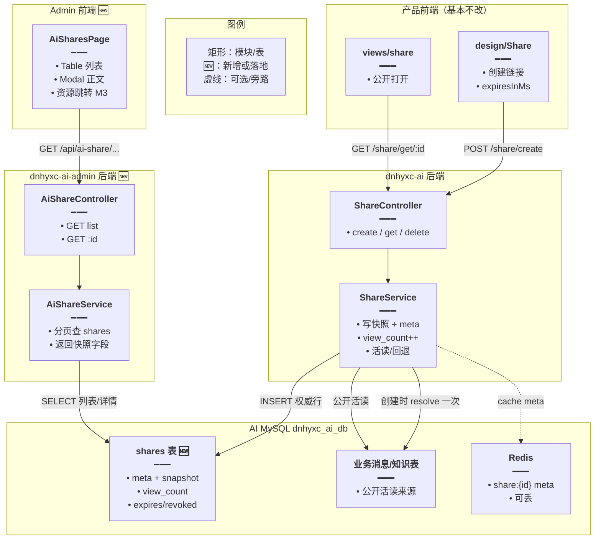
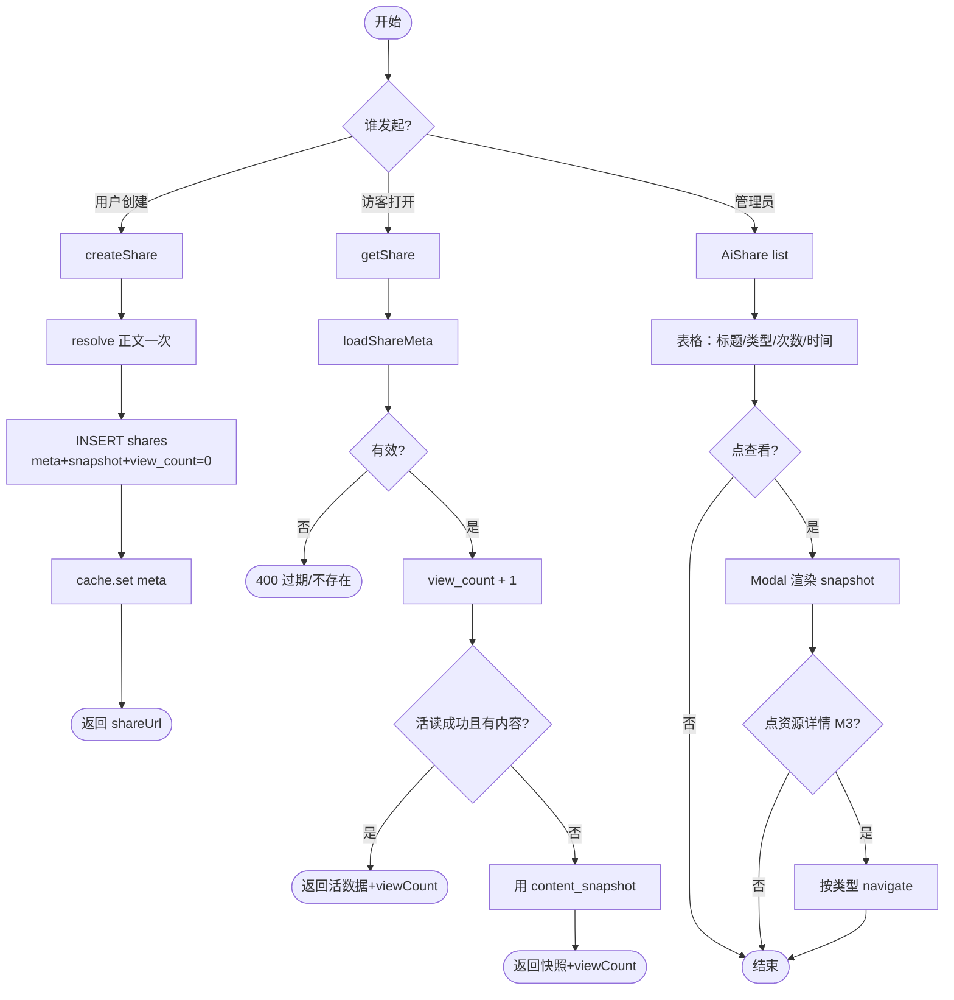
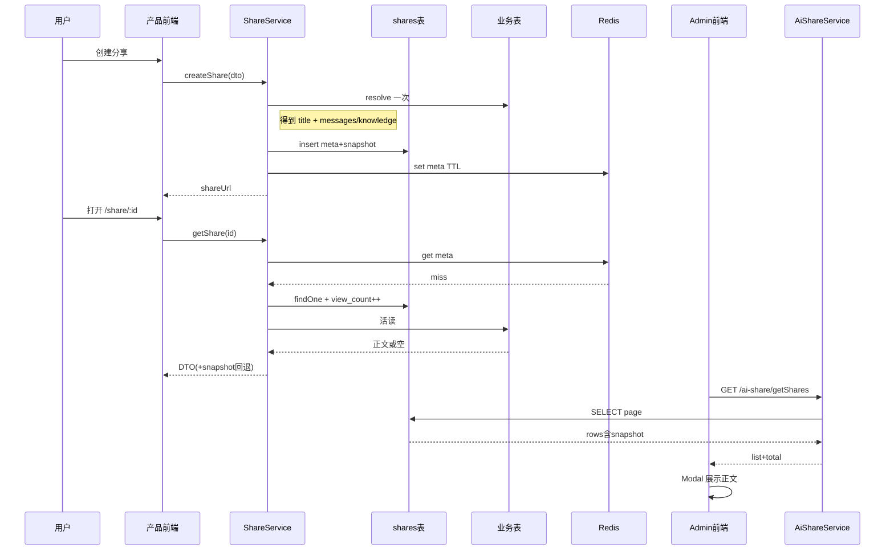
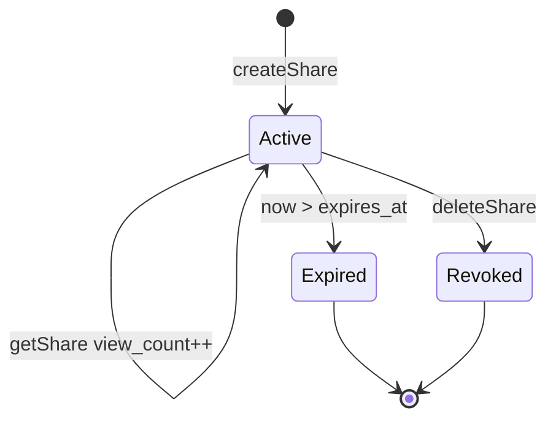

# 分享链接持久化 — 实现思路

> **状态**：规划  
> **日期**：2026-11-04  
> **需求摘要**：分享链接在服务/Redis 重启后仍按 `expiresAt` 可用；同时在 **dnhyxc-ai-admin** 提供分享记录页，展示正文快照、打开次数与资源关键信息，并预留进入资源详情。  
> **一句话方案（预告）**：AI 库 `shares` 表作权威（元数据 + 创建时正文快照 + `view_count`），Redis 旁路；公开读 miss 回源并可回退快照；Admin 按现有 `ai-*` 模式直读同库列表/预览，不调产品 HTTP、不扫 Redis。

## 延伸阅读

- 已落地的过期时长选型：[分享链接过期时间.md](./分享链接过期时间.md)（Redis TTL 与 `expiresAt` 对齐；本文补权威存储与管理台）
- 产品分享读序：`dnhyxc-ai/wiki/Share分表路由与Assistant改造.md`、`guide/15-数据持久化.md` §15.8.3
- Admin 列表+正文预览范型：`dnhyxc-ai-admin/.../views/ai-learning-note/AiLearningNotePage.tsx`；资源独立详情范型：`ai-daily-reading/:publishDate`
- 成熟产品：ChatGPT 分享持久化+个人快照；Open WebUI `shared_chat` 表存 JSON 快照；LibreChat `SharedLink` + `expiredAt`；Notion 公开链记在产品 DB

---

## 0. 读本文你将得到什么

- 要解决两件事：① 重启/清 Redis 后链接提前失效；② 管理台看不见分享正文与次数。
- 选定方案：**同一张 `shares` 表** = 跨重启权威 + Admin 数据源；创建时写入 **正文快照** 与标题；公开打开累加 **`view_count`**；Admin 直连 AI MySQL。
- 改动面：`dnhyxc-ai` Share 落库；`dnhyxc-ai-admin` 新增 `ai-share` 模块与「分享管理」页。
- 阶段：M1 落库+快照+计数 → M2 Admin 列表/预览 → M3 点进资源详情（知识先、会话后）。
- 最大风险：Admin 去扫 Redis 或复刻五套分表 resolve；或公开读只认快照却不写快照字段。

---

## 1. 需求与边界

### 1.1 用户故事

| 角色     | 场景                              | 行为       | 期望结果                                                     |
| -------- | --------------------------------- | ---------- | ------------------------------------------------------------ |
| 登录用户 | 任一口创建分享                    | 生成链接   | 返回 `shareId`、`expiresAt`（与现网一致）                    |
| 访客     | Nest/Redis 重启且未到 `expiresAt` | 打开旧链   | 仍能看到分享内容                                             |
| 访客     | 超过 `expiresAt` 或已撤销         | 打开       | 「不存在或已过期」                                           |
| 访客     | 每次成功打开分享页                | —          | `view_count` +1（管理台「分享次数」）                        |
| 管理员   | Admin「分享管理」                 | 分页浏览   | 见标题、类型、资源 id、创建/过期、打开次数、创建者           |
| 管理员   | 点「查看」                        | Modal 预览 | 见创建时快照正文（会话消息或知识文章）                       |
| 管理员   | 点「资源详情」（M3）              | 跳转       | knowledge → 知识详情；会话类 → 已有或后续会话页 / 公开链兜底 |

### 1.2 范围

| 在范围内                                                 | 不在范围内（非目标）                  |
| -------------------------------------------------------- | ------------------------------------- |
| 产品侧链接分享持久化（`ShareService`）                   | 电子书书摘图、书架公开书              |
| `shares` 表：元数据 + 快照 + `view_count` + `created_by` | 改弹窗时长 UX / 30 天上限             |
| Admin：`/ai-shares` 列表 + Modal 正文预览                | 终端用户「我的分享」C 端页            |
| M3：知识资源详情跳转；会话类深链策略                     | Admin 内嵌完整 ChatBot 编辑器         |
| Redis 热缓存                                             | 以 Redis SCAN / AOF 作为 Admin 数据源 |

### 1.3 约束与依赖

- 产品仓：复用 `resolveShareMessagesBySessionId`、空壳 `share.entity.ts`、公开 `GET /share/get/:shareId`；AI 库为 **MySQL**（字段用 `json` / `longtext`，不用 `jsonb`）。
- Admin 仓：复用 `AI` 命名连接、`ai-learning-note` 列表+Modal、`menu.ts` + `router` + seed 菜单模式；**不**调用 `dnhyxc-ai` HTTP 做常规列表（与现网一致）。
- `GetShareResponseDto.viewCount` 已在 DTO 预留但未落库——本次落地。
- Ponytail：产品六个分享入口与弹窗尽量零改；Admin 只加一页。

---

## 2. 背景

- **谁、卡在哪**：① 发出的 `/share/:id` 在重启后未到设定时间就失效；② 运营/管理要在 Admin 查「分享了什么、看了几次、资源是谁」，并希望以后能点进资源详情。
- **现状缺口**：元数据只在 Redis；无表、无 `view_count` 写入；Admin 只读 AI MySQL，**扫不到 Redis**；`share.entity.ts` 空壳；知识 Admin 页目前偏元数据列表、会话无详情页。
- **不解决会怎样**：发版丢链；管理台永远做不成「含正文」的分享台账（除非脆弱地扫 Redis 或跨仓 HTTP 拼装）。
- **硬约束**：公开读免登录；过期时长语义不变；Admin 禁止 `synchronize` 改 AI 表结构（表由产品仓 migration 建）。

---

## 3. 现状与复用

| 能力             | 仓库中已有                                    | 本需求中的用法                               |
| ---------------- | --------------------------------------------- | -------------------------------------------- |
| 创建/读/删分享   | `dnhyxc-ai/.../share/share.service.ts`        | **扩展**：DB 权威、快照、计数                |
| 空实体           | `share.entity.ts`                             | **扩展**：真实 `shares` 表                   |
| 分表拉正文       | `resolveShareMessagesBySessionId` + knowledge | **扩展**：创建时调用一次写快照；公开读可续用 |
| `viewCount` 字段 | `GetShareResponseDto` 可选字段                | **扩展**：落库并在 get 返回                  |
| Admin AI 库直连  | `typeorm-ai.config.ts`、`AI_DB_*`             | **直接复用**：注册 `AiShare` 实体            |
| 列表+正文 Modal  | `AiLearningNotePage.tsx`                      | **直接复用**交互范式                         |
| 独立详情路由     | `ai-daily-reading/:publishDate`               | **扩展**：M3 知识/会话详情跳转               |
| 菜单/路由/API    | `menu.ts`、`router/index.tsx`、`service/*`    | **新增** `/ai-shares` 全套                   |
| 过期弹窗         | `design/Share`                                | **不适用**（不改 UX）                        |

**调研结论**：持久化与 Admin **必须共用 AI 库表**；Admin 现有模式是 TypeORM 读 `dnhyxc_ai_db`，不是调产品 API。只存指针不够——Admin 若现场 resolve，要挂 chat/assistant/agent/ebook/knowledge 全套实体，改动面与风险远大于创建时写一份快照。

### 3.1 成熟产品对照（摘要）

| 产品       | 权威存储                     | 管理/审计侧                                       | 启示                              |
| ---------- | ---------------------------- | ------------------------------------------------- | --------------------------------- |
| ChatGPT    | 持久化分享记录               | 设置里管理链接；导出含 share 元数据；个人链偏快照 | 链接寿命≠缓存；台账要能离开热缓存 |
| Open WebUI | `shared_chat` + JSON 快照    | 直接读库即可展示内容                              | Admin 最省事的数据形状            |
| LibreChat  | Mongo SharedLink + expiredAt | DB 列表自然可得                                   | 计数/过期都在文档上               |
| Notion     | DB 权限/公开链               | 工作区内可见                                      | 过期与撤销在权威行上              |

---

## 4. 方案比对与最终方案

### 4.1 候选方案（总体）

#### 方案 A：仅加固 Redis + Admin SCAN Redis

- **做法**：产品仍只写 Redis；Admin 配同一 Redis，`KEYS/SCAN share:*` 列列表，打开时再调产品 `getShare` 或自解析。
- **能工作的原因**：键在则两端都能读。
- **主要代价**：重启/FLUSH 后产品与 Admin **同时失明**；SCAN 生产禁忌；与 Admin「只读 AI MySQL」架构不一致。

#### 方案 B：DB 只存指针元数据 + Admin 现场 resolve

- **做法**：`shares` 仅索引字段；公开读回查业务表；Admin 列表后按 `sessionType` 再查各消息表拼正文。
- **能工作的原因**：跨重启索引在；正文始终「最新」。
- **主要代价**：Admin 要复制产品分表路由与近 10 个实体；源删后 Admin 也空；列表页 N+1 重。

#### 方案 C：DB 元数据 + 创建时正文快照 + `view_count` + Redis 旁路（产品公开读可回查，Admin 读快照）

- **做法**：创建时用现有 resolve **写一次** `title` + `content_snapshot`；元数据与计数进同行；Redis 只缓存公开热路径；Admin `ai-share` 直读表做列表/Modal；公开 `getShare` 优先活数据，源空则回退快照，并 `view_count++`。
- **能工作的原因**：一张表同时满足「重启不丢」与「管理台含正文」；Admin 零跨仓 HTTP、零 SCAN；创建路径复用已有 resolve。
- **主要代价**：多写 JSON/longtext；快照与源可能漂移（公开仍可活读；Admin 展示「分享当时」——对审计更合理）。

### 4.2 比对

| 维度              | 方案 A                            | 方案 B                                | 方案 C                                                       |
| ----------------- | --------------------------------- | ------------------------------------- | ------------------------------------------------------------ |
| 正确性            | 清 Redis 后产品与 Admin 双挂      | 重启 OK；源删后 Admin/公开皆空        | 重启 OK；Admin 仍见快照；公开可回退快照                      |
| 复用 / 与现状契合 | 代码少，但违背 Admin 读 AI 库惯例 | 复用产品 resolve，但 Admin 要整套复刻 | 产品 resolve 创建时复用一次；Admin 复用 learning-note 页范式 |
| 改动面            | 运维 + Admin Redis 客户端         | 产品表 + Admin 多实体 resolve         | 产品表/Service + Admin 单模块单页                            |
| 复杂度            | SCAN/TTL/权限缠在一起             | 两套 resolve 长期双维护               | 一表两读路径（公开活+Admin 快照）                            |
| 体验              | 运维一疏忽全站丢链                | 列表慢；源删无内容可审                | 列表快；台账含正文；次数可见                                 |
| 风险              | 生产 SCAN、环境漂移               | Admin 实体与产品迁移不同步            | 快照体积；需限制字段/条数                                    |
| 可维护性          | 问题难复现                        | 分表一变 Admin 必改                   | 快照 schema 版本化即可                                       |

### 4.3 综合考量

合并需求后权重变为：**跨重启正确性 ≈ Admin 可读正文 ≈ 与 Admin 架构契合 > 纯改动行数**。方案 A 在 Admin 场景直接不合格。方案 B 能持久化，但「含正文的管理台」成本接近重做 ShareService，且无法满足源删后审计。方案 C 用创建时一次 resolve 换 Admin 永久简单读路径，与 Open WebUI/ChatGPT 个人快照同构，同时保留产品公开活读投资。

**放弃**：A 的零表；B 的「Admin 现场拼正文」。公开读默认仍活查（体验与现网一致），快照作 Admin 主展示与公开回退。

### 4.4 最终方案

#### 背景

Redis 唯一索引导致重启丢链；Admin 只能看 AI MySQL，要「正文 + 次数 + 资源信息 + 可进详情」，必须在 AI 库有行级记录且带可展示正文。硬约束：产品分享契约不变；Admin 不 `synchronize`；MySQL 类型约束。

#### 具体思路

1. **模块**：产品 `ShareModule` 落实体；Admin 新增 `ai-share`（controller/service/entity）+ `AiSharesPage`。
2. **数据**：`shares` 同行含指针、快照、`view_count`、`created_by`、过期/撤销；Redis 仅公开热缓存（可不含大快照，或只缓存 meta）。
3. **状态**：权威在 MySQL；公开打开异步/同步递增 `view_count`；Admin 只读（M2 可不做撤销，撤销仍走产品 API 或 M2+ 调内部接口——默认 Admin 只读台账）。
4. **边界**：创建时 resolve 失败 → 整次创建失败；快照过大 → 截断消息条数/字段并打标 `snapshot_truncated`；get 时源空 → 回退快照；计数失败不阻断返回正文。

#### 实现方案

**一句话**：`shares` 表权威存元数据+创建时快照+打开次数；Redis 旁路；Admin 直读同库做列表与正文预览，并预留资源详情跳转。

| 步骤 | 谁                         | 做什么                                           | 输入 → 输出                |
| ---- | -------------------------- | ------------------------------------------------ | -------------------------- |
| 1    | 产品 migration + `Share`   | 建 `shares`                                      | 含 snapshot / view_count   |
| 2    | `ShareService.createShare` | resolve 一次 → insert 行 → cache meta            | DTO → 链接                 |
| 3    | `ShareService.getShare`    | loadMeta → +view_count → 活读或快照回退          | shareId → 响应含 viewCount |
| 4    | Admin `AiShare` + list API | 分页查 `shares`                                  | 筛选 → list/total          |
| 5    | `AiSharesPage`             | Table + Modal 渲染快照                           | 管理员操作                 |
| 6    | M3 跳转                    | 按 `share_type`/`session_type`/`chat_session_id` | 进知识详情等               |

#### 选定原因

1. **正确性**：重启与清缓存不丢；Admin 不依赖 Redis。牺牲：多一列快照存储。
2. **复用**：创建复用 resolve；Admin 复用 learning-note 页。牺牲：不做 Admin 内嵌完整会话编辑。
3. **改动面**：产品一 Service + Admin 一页；避免 Admin 挂全部分表实体。牺牲：比「只指针」多写快照。
4. **复杂度**：一表两读，概念清晰。牺牲：需约定 snapshot JSON 形状。
5. **体验**：用户链接稳；运营看得见正文与次数。牺牲：Admin 见的是「分享当时」而非源最新。
6. **风险**：计数可用 `UPDATE ... view_count = view_count + 1` 避免丢更新。牺牲：高并发下计数非分析级精确可接受。
7. **可维护性**：与现有 `ai-*` 模块同构。牺牲：产品 migration 与 Admin 实体列需同步文档。

#### 优势

- 相对方案 A：清 Redis 后产品与 Admin 仍可用；无 SCAN。
- 相对方案 B：Admin 列表一次 SQL 出标题/次数/快照，无需五套 resolve；源删后仍可审计分享内容。

#### 怎么实现

1. 产品建表并改 `createShare`/`getShare`/`deleteShare`。
2. 创建路径：先 resolve 得 title+messages/knowledge → 写入 snapshot。
3. 公开 get：校验行 → `view_count++` → 活读，失败用 snapshot。
4. Admin 注册实体、list/detail API、页面与菜单。
5. M3：knowledge 跳转；会话类先外链 `/share/:id` 或后续会话详情页。

代码见 §9。

### 4.5 其他关键决策

#### 决策 1：Admin 数据从哪来

##### 候选

- **E1**：Admin SCAN 产品 Redis / 调产品 HTTP list（需新建且鉴权）
- **E2**：Admin TypeORM 直读 AI 库 `shares`（与 learning-note/knowledge 一致）

##### 比对

| 维度     | E1                                   | E2                          |
| -------- | ------------------------------------ | --------------------------- |
| 正确性   | Redis 丢则 Admin 空；HTTP 多一故障点 | 与持久化同源                |
| 复用     | 新造通道                             | 现有 AI 连接 + 页范式       |
| 改动面   | 产品 internal API + Admin HTTP       | Admin 单模块                |
| 复杂度   | 双端鉴权/token                       | 低                          |
| 体验     | 依赖产品进程                         | 产品挂了 Admin 仍可读历史行 |
| 风险     | 环境 URL/token                       | 实体列与 migration 对齐     |
| 可维护性 | 两套契约                             | 一表                        |

##### 综合与选定

权重：**与 Admin 架构契合、少故障点**。选 **E2**。放弃 E1「产品挂了也能经 HTTP」的错觉（库才是台账）。  
**六块摘要**：背景=Admin 从不读 Redis；思路=同库实体；方案=`ai-share` + `InjectRepository(..., 'ai')`；原因=复用/正确性；优势=相对 E1 无 SCAN/无 internal token；实现=注册实体+list。

#### 决策 2：公开读用活数据还是只用快照

##### 候选

- **F1**：公开只读快照（ChatGPT 个人 / Open WebUI）
- **F2**：公开活读业务表，空则回退快照；Admin 固定读快照

##### 比对

| 维度     | F1                    | F2                       |
| -------- | --------------------- | ------------------------ |
| 正确性   | 与创建瞬间一致        | 源更新可反映；源删有回退 |
| 复用     | 弱化 resolve 热路径   | 保留现网 resolve         |
| 改动面   | get 大改              | get 小改 + 回退          |
| 复杂度   | 单一内容源            | 双源需顺序               |
| 体验     | 改原文分享不变        | 更接近当前「指向源」     |
| 风险     | 附件 ACL 等要快照全包 | 活读失败路径要测         |
| 可维护性 | 简单                  | 略多分支                 |

##### 综合与选定

现网语义是指针回查；Admin 要的是审计快照。选 **F2**：公开 F2、Admin 快照。放弃 F1「实现更单纯」。  
**六块摘要**：背景=两套读者目标不同；思路=写一次快照服务两边；方案=get 活读→回退；原因=体验+复用；优势=相对 F1 不破坏现语义；实现=见 §9 get 伪码。

#### 决策 3：「分享次数」语义

##### 候选

- **G1**：`view_count` = 公开 `getShare` 成功次数
- **G2**：同一资源被创建分享的链接条数（聚合 count）

##### 选定：**G1 为主，列表可附带同资源链接数（SQL 聚合可选）**。用户「分享次数」在链接台账场景通常指打开/曝光；创建条数可用行数本身表达。放弃把 G2 当作唯一指标。

---

## 5. 架构图



**图内方法说明**：

| 方法 / 模块入口                                | 功能                                      |
| ---------------------------------------------- | ----------------------------------------- |
| `ShareController.create/get/delete`            | 产品分享 HTTP 入口                        |
| `ShareService.createShare`                     | 生成 id、resolve 快照、写 DB、写 Redis    |
| `ShareService.getShare`                        | 校验、计数、活读或快照回退                |
| `ShareService.resolveShareMessagesBySessionId` | 按 sessionType 取消息；创建与公开活读复用 |
| `AiShareController` list/get                   | Admin JWT 下列表与单条                    |
| `AiShareService.findPage`                      | 分页/筛选读 `shares`                      |
| `AiSharesPage`                                 | 表格展示与 Modal 预览快照                 |

**读图要点**：产品与 Admin **不经 HTTP 互调**，只共享 AI 库表；Redis 不服务 Admin；快照在写入时生成。

---

## 6. 主流程图



**图内方法说明**：

| 方法                                               | 功能                    |
| -------------------------------------------------- | ----------------------- |
| `createShare`                                      | 持久化并返回链接        |
| `resolveShareMessagesBySessionId` / knowledge 查询 | 生成快照与公开活读      |
| `loadShareMeta`                                    | Redis→DB 取元数据并校验 |
| `getShare`                                         | 公开组装响应并计数      |
| `AiShareService.findPage`                          | Admin 分页              |
| Modal 预览 / `navigate`                            | 前端展示与 M3 跳转      |

**读图要点**：创建写快照；打开计数；Admin 只读快照列；资源详情是分支而非 M1 阻塞。

---

## 7. 核心时序图



**图内方法说明**：

| 方法                  | 功能               |
| --------------------- | ------------------ |
| `createShare`         | 写权威行与缓存     |
| `resolve`（业务）     | 创建时生成快照原料 |
| `getShare`            | 公开读与计数       |
| `findPage` / list API | Admin 台账         |
| Modal 展示            | 不二次 resolve     |

**读图要点**：Admin 路径短、不碰 Redis；产品 miss 仍回源 DB。

---

## 8. 状态机



**图内方法说明**：

| 方法          | 功能                                  |
| ------------- | ------------------------------------- |
| `createShare` | 进入 Active，快照固定                 |
| `getShare`    | Active 下计数                         |
| `deleteShare` | Revoked，Admin 仍可按策略显示已撤销行 |

---

## 9. 具体实现（主链路代码）

### 9.1 模块一览

| 模块                        | 职责                | 新增/改动 | 预估路径                                          |
| --------------------------- | ------------------- | --------- | ------------------------------------------------- |
| `Share` 实体+migration      | AI 库表             | 扩展/新增 | `dnhyxc-ai/apps/backend/src/services/share/*`     |
| `ShareService`              | 快照/双写/计数/回退 | 改动      | `share.service.ts`                                |
| `AiShare` 实体              | Admin 映射同表      | 新增      | `dnhyxc-ai-admin/.../ai-share/ai-share.entity.ts` |
| `AiShareService/Controller` | 列表/详情           | 新增      | `.../services/ai-share/`                          |
| `typeorm-ai.config`         | 注册实体            | 改动      | `database/typeorm-ai.config.ts`                   |
| `AiSharesPage`              | UI                  | 新增      | `views/ai-shares/AiSharesPage.tsx`                |
| 菜单/路由/API               | 入口                | 改动      | `menu.ts`、`router/index.tsx`、`service/*`、seed  |

### 9.2 主链路实现

```typescript
// 对应 §4.4 步骤 1。MySQL 表：指针 + 快照 + 计数，供产品回源与 Admin 直读
@Entity({ name: "shares" })
export class Share {
	// URL 段；与现网无横线 UUID 一致
	@PrimaryColumn({ name: "share_id", type: "varchar", length: 64 })
	shareId: string;

	// 会话或 knowledgeId
	@Column({ name: "chat_session_id", type: "varchar", length: 64 })
	chatSessionId: string;

	@Column({
		name: "share_type",
		type: "varchar",
		length: 32,
		default: "session",
	})
	shareType: "session" | "knowledge";

	@Column({ name: "session_type", type: "varchar", length: 32, nullable: true })
	sessionType: "chat" | "assistant" | "agent" | "ebook" | null;

	// 勾选顺序；MySQL 用 json
	@Column({ name: "message_ids", type: "json", nullable: true })
	messageIds: string[] | null;

	// 列表标题，避免 Admin 解析大 JSON
	@Column({ type: "varchar", length: 500, nullable: true })
	title: string | null;

	// 创建时正文：session→{messages:[]}；knowledge→{content,title}
	@Column({ name: "content_snapshot", type: "json", nullable: true })
	contentSnapshot: Record<string, unknown> | null;

	// 快照是否截断，便于 UI 提示
	@Column({ name: "snapshot_truncated", type: "boolean", default: false })
	snapshotTruncated: boolean;

	@Column({ name: "created_by", type: "int", nullable: true })
	createdBy: number | null;

	@Column({ name: "created_at_ms", type: "bigint" })
	createdAt: number;

	@Column({ name: "expires_at_ms", type: "bigint" })
	expiresAt: number;

	@Column({ name: "revoked_at_ms", type: "bigint", nullable: true })
	revokedAt: number | null;

	// 公开成功打开次数（G1）
	@Column({ name: "view_count", type: "int", default: 0 })
	viewCount: number;
}
```

```typescript
// 对应 §4.4 步骤 2。创建时 resolve 一次写入快照，避免 Admin 复刻分表
async createShare(dto: CreateShareDto, userId?: number): Promise<CreateShareResponseDto> {
	const shareId = randomUUID().replace(/-/g, '');
	const ttl = resolveExpiresIn(dto.expiresInMs);
	const now = Date.now();
	const shareType = dto.shareType ?? 'session';
	// 先取正文：失败则不发链，保证 Admin 不会出现「有行无正文」
	const snap = await this.buildSnapshot(dto);
	await this.shareRepo.insert({
		shareId,
		chatSessionId: dto.chatSessionId,
		shareType,
		sessionType: dto.sessionType ?? null,
		messageIds: dto.messageIds ?? null,
		title: snap.title,
		contentSnapshot: snap.payload,
		snapshotTruncated: snap.truncated,
		createdBy: userId ?? null,
		createdAt: now,
		expiresAt: now + ttl,
		revokedAt: null,
		viewCount: 0,
	});
	const meta = {
		shareId,
		chatSessionId: dto.chatSessionId,
		shareType,
		sessionType: dto.sessionType,
		messageIds: dto.messageIds,
		createdAt: now,
		expiresAt: now + ttl,
	};
	try {
		await this.cache.set(this.getCacheKey(shareId), meta, ttl);
	} catch (e) {
		this.logger.warn(`分享缓存写入失败 ${shareId}: ${String(e)}`);
	}
	return {
		shareId,
		shareUrl: dto.baseUrl
			? `${dto.baseUrl}/share/${shareId}${shareType === 'knowledge' ? '?type=knowledge' : ''}`
			: `/share/${shareId}${shareType === 'knowledge' ? '?type=knowledge' : ''}`,
		createdAt: now,
		expiresAt: now + ttl,
	};
}
```

```typescript
// 对应 §4.4 步骤 3。公开读：计数 + 活读，空则回退快照（F2）
async getShare(shareId: string): Promise<GetShareResponseDto> {
	const meta = await this.loadShareMeta(shareId);
	// 计数失败不阻断正文；用单列自增减少并发覆盖
	await this.shareRepo.increment({ shareId }, 'viewCount', 1);
	const viewCount =
		(await this.shareRepo.findOne({
			where: { shareId },
			select: ['viewCount'],
		}))?.viewCount ?? 0;

	try {
		const live = await this.loadLiveContent(meta);
		return { ...live, shareId, viewCount, createdAt: meta.createdAt, expiresAt: meta.expiresAt };
	} catch {
		const row = await this.shareRepo.findOne({ where: { shareId } });
		if (!row?.contentSnapshot) {
			throw new HttpException('分享不存在或已过期', HttpStatus.BAD_REQUEST);
		}
		return this.dtoFromSnapshot(row, viewCount);
	}
}
```

```typescript
// 对应 §4.4 步骤 4～5。Admin 直读同表；Modal 用 contentSnapshot，不二次 resolve
// 文件：dnhyxc-ai-admin/.../ai-share.service.ts
async findPage(q: { pageNo: number; pageSize: number; shareType?: string; title?: string }) {
	const qb = this.shareRepo
		.createQueryBuilder('s')
		.orderBy('s.created_at_ms', 'DESC')
		.skip((q.pageNo - 1) * q.pageSize)
		.take(q.pageSize);
	if (q.shareType) qb.andWhere('s.share_type = :t', { t: q.shareType });
	if (q.title) qb.andWhere('s.title LIKE :title', { title: `%${q.title}%` });
	const [list, total] = await qb.getManyAndCount();
	return { list, total };
}
```

### 9.3 数据模型

| 字段                              | 来源      | 存储 | 说明                  |
| --------------------------------- | --------- | ---- | --------------------- |
| `share_id`                        | UUID      | PK   | URL                   |
| `chat_session_id`                 | DTO       | 列   | 资源 id               |
| `share_type` / `session_type`     | DTO       | 列   | 类型与跳转            |
| `message_ids`                     | DTO       | json | 顺序                  |
| `title`                           | resolve   | 列   | 列表                  |
| `content_snapshot`                | resolve   | json | Admin 正文 / 公开回退 |
| `view_count`                      | getShare  | int  | 分享打开次数          |
| `created_by`                      | JWT       | int  | 创建者                |
| `expires_at_ms` / `revoked_at_ms` | 服务端    | 列   | 寿命                  |
| Redis `share:{id}`                | meta 投影 | 旁路 | 可不含大快照          |

**快照 JSON 约定（最小）**：

```json
{
	"kind": "session",
	"messages": [{ "id": "...", "role": "user|assistant", "content": "..." }]
}
```

或 `{ "kind": "knowledge", "content": "...", "title": "..." }`。

---

## 10. 分阶段实现步骤

| 阶段 | 目标             | 交付物                                 | 依赖 |
| ---- | ---------------- | -------------------------------------- | ---- |
| M1   | 持久化+快照+计数 | 产品表与 Service                       | 无   |
| M2   | Admin 台账       | `ai-share` + `AiSharesPage` 列表/Modal | M1   |
| M3   | 点进资源详情     | 知识详情路由/跳转；会话兜底公开链      | M2   |

**M1**

- [ ] `shares` migration（MySQL `json`）+ 实体注册
- [ ] `createShare` 写快照；`getShare` 计数+活读回退；`deleteShare` 软撤销
- [ ] 验收：清 Redis 仍可打开；`view_count` 递增

**M2**

- [ ] Admin 实体/`typeorm-ai` 注册/模块/API
- [ ] `menu.ts` + router + seed 菜单「分享管理」
- [ ] `AiSharesPage`：列含类型、资源 id、次数、过期；Modal 渲染快照
- [ ] 验收：产品创建一条 → Admin 刷新可见正文

**M3**

- [ ] knowledge：跳转现有或新建 `/ai-knowledge/:id` 详情
- [ ] session：优先已有会话管理页；否则新开公开 `/share/:id` 或标记「暂无详情」
- [ ] 列表操作列「资源详情」按 `share_type` 分支

---

## 11. 风险、边界与待确认

| 项             | 等级 | 说明                  | 缓解                                  |
| -------------- | ---- | --------------------- | ------------------------------------- |
| 快照体积       | 中   | 长对话 JSON 大        | 限消息条数/字段；`snapshot_truncated` |
| 计数精度       | 低   | 非分析数仓            | `increment` 即可                      |
| Admin 实体漂移 | 中   | 产品加列 Admin 未同步 | 文档约定；只读子集列                  |
| 旧 Redis 链    | 低   | 无快照行              | 随 TTL 自然消失                       |
| 知识详情页缺失 | 中   | M3 前只能 Modal       | M2 Modal 已含正文                     |
| PII 留存       | 中   | 快照延长可见期        | 过期清理任务；权限仅管理员            |

**待确认**：

- [ ] Admin 是否展示已撤销/已过期行？（验证：运营要审计则默认展示并 Tag）
- [ ] `created_by` 是否在 `ShareController` 已能取到 userId？（验证：读 Jwt 装饰器）
- [ ] 会话类 M3 是否接受「打开公开分享页」作详情兜底？（验证：产品是否允许 Admin 浏览器打开前台域名）

---

## 12. 验收清单

| #   | 用例        | 步骤                           | 期望                           |
| --- | ----------- | ------------------------------ | ------------------------------ |
| AC1 | 创建打开    | 产品创建 → 打开链接            | 内容正确                       |
| AC2 | 清 Redis    | DEL 键 → 再 get                | 仍 200                         |
| AC3 | 计数        | 打开 3 次                      | `view_count`≥3；Admin 列表可见 |
| AC4 | Admin 正文  | 创建会话/知识分享 → Admin 查看 | Modal 含正文关键信息           |
| AC5 | 过期        | 改 `expires_at` 已过 → get     | 400；Admin 可标过期            |
| AC6 | 源删回退    | 删源消息后 get                 | 仍可用快照（若活读空）         |
| AC7 | M3 知识跳转 | 点资源详情                     | 进入知识详情或明确兜底         |

---

## 13. 预估改动面（实现阶段参考）

| 类型       | 路径（预估）                                                                                    |
| ---------- | ----------------------------------------------------------------------------------------------- |
| 产品前端   | 基本无；可选展示 viewCount                                                                      |
| 产品后端   | `apps/backend/src/services/share/*`、`migrations/*-shares.ts`                                   |
| Admin 前端 | `views/ai-shares/*`、`router/menu.ts`、`router/index.tsx`、`service/api.ts`、`service/index.ts` |
| Admin 后端 | `services/ai-share/*`、`database/typeorm-ai.config.ts`、`app.module`、seed 菜单                 |
| 文档落地后 | `remote-docs/wiki/chat/分享链接持久化.md`                                                       |

---

（本文档为规划态实现思路；落地后以源码与 remote-docs wiki 专题为准）
