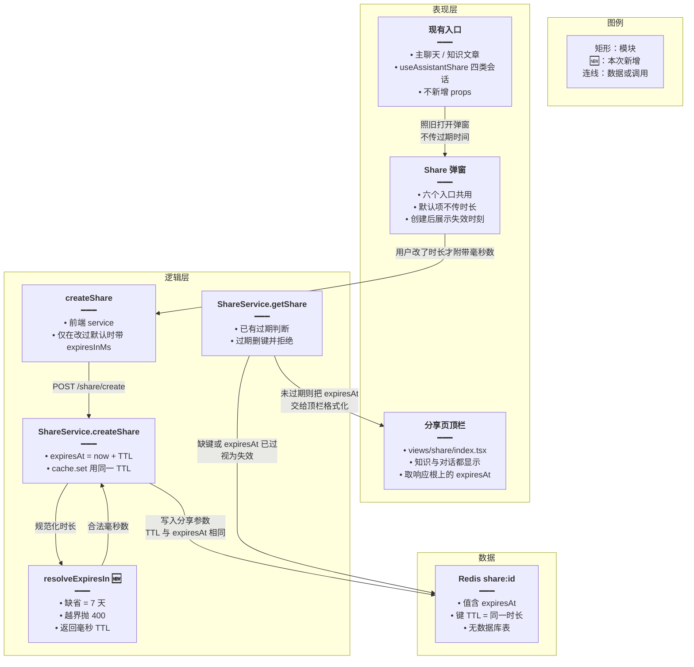
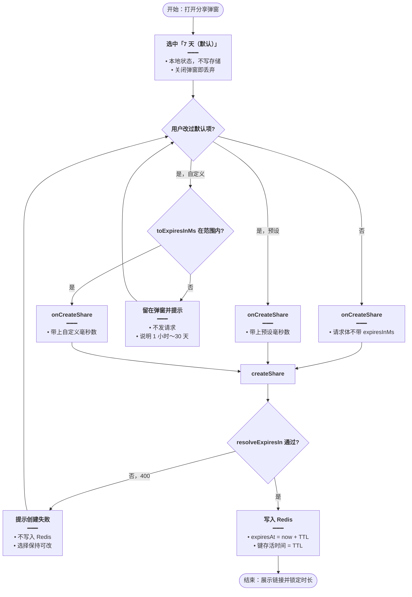
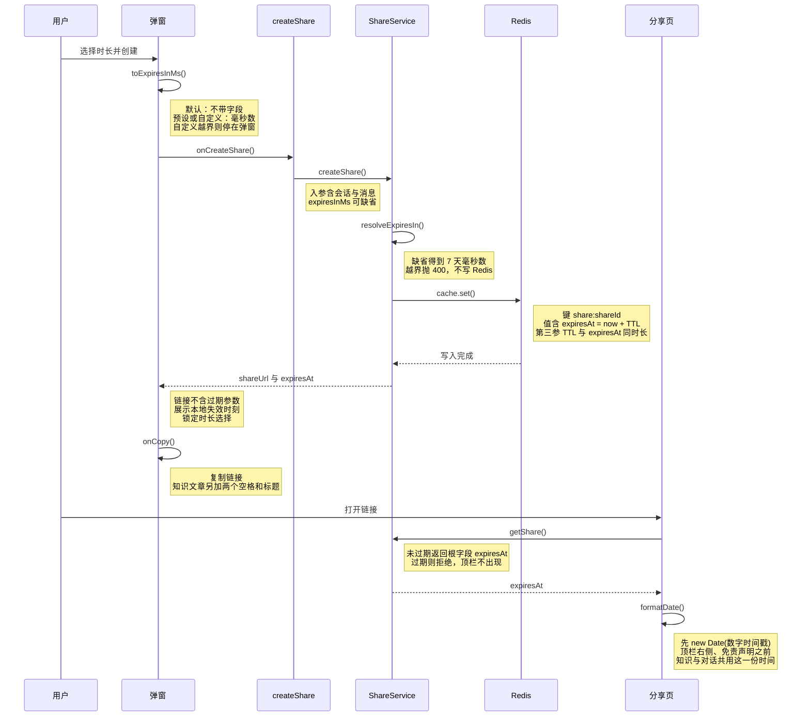
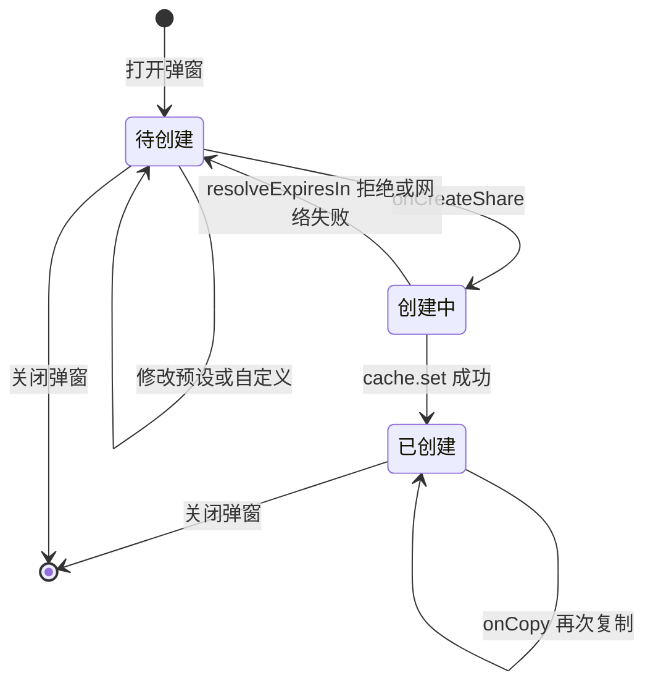

# 分享链接过期时间 — 实现思路

> **状态**：**已落地**（2026-10-22 随源码实现归档）；实现细节、改动前后代码与回归点见实现专题 [../chat/分享链接过期时间.md](../chat/分享链接过期时间.md)，本文保留规划态的方案权衡与验收清单  
> **日期**：2026-10-22  
> **需求摘要**：用户在任意分享弹窗里可选过期时间（最长 30 天）；不改则仍是 7 天。失效时刻显示在创建后的弹窗和分享页顶栏，不进链接参数。

## 延伸阅读

- 本仓会话分享行为：`apps/frontend/specs/CHATBOT.md` §10
- 分享实现（Redis 存参数、按 `sessionType` 取消息）：本仓 `wiki/Share分表路由与Assistant改造.md`
- 电子书书架「分享」是另一条产品线，**没有**分享链接：`apps/frontend/specs/ebook-share.md`

---

## 0. 读本文你将得到什么

- 问题：所有分享链接写死 7 天后失效，弹窗里不能改。
- 一句话方案：只在共用弹窗里选时长，创建时可选传入毫秒数；不传则后端继续用 7 天，并让 Redis 存活时间与 `expiresAt` 用同一个数。
- 改动面：共用弹窗 + 创建接口 + `ShareService.createShare` + 分享页顶栏；六个入口不用各写一套。
- 分三阶段：先定后端契约，再做弹窗，最后在弹窗和分享页展示失效时刻。
- 最大风险：只改 `expiresAt`、Redis TTL（存活时间）仍是 7 天，则「长于 7 天」的设置会提前消失。

---

## 1. 需求与边界

### 1.1 用户故事

| 角色 | 场景 | 行为 | 期望结果 |
|------|------|------|----------|
| 登录用户 | 主聊天、知识文章、知识库助手、英语 Agent、电子书助手、Skill 试跑，打开「创建分享链接」 | 不改过期时间，直接创建 | 与今天一致：7 天后失效 |
| 登录用户 | 同上 | 选预设（1 小时 / 1 天 / 3 天 / 30 天）或填自定义时长后创建 | 链接在所选时长后失效 |
| 访客 | 打开未过期的 `/share/:shareId` | 看顶栏 | 免责声明旁显示「将于 {本地时间} 失效」，知识文章和对话都有 |
| 访客 | 打开已创建的 `/share/:shareId` | 超过失效时刻再访问 | 得到「分享不存在或已过期」，打不开内容 |
| 登录用户 | 链接已经生成 | 再改下拉框 | 已生成的链接不变；要新时长须关掉弹窗重新创建 |

### 1.2 范围

| 在范围内 | 不在范围内（非目标） |
|----------|----------------------|
| 上表六个入口共用的 `design/Share` 弹窗 | 电子书划线「书摘卡片」：只导出图片，不走 `/share/create`，没有 Redis 过期 |
| `POST /share/create` 可选时长；不传 = 7 天 | 创建之后修改同一条链接的过期时间（无更新接口，不做） |
| Redis 键存活时间与 `expiresAt` 对齐 | 把过期时间写进分享 URL 的 query（会改变链接，且与「标题不进参数」同一原则） |
| 中英文文案 | 记住用户上次选的时长（否则「没设置」不再是 7 天） |
| 服务端拒绝超出 1 小时～30 天的值 | 数据库表、迁移（分享只在 Redis，`share.entity.ts` 是空类） |
| 弹窗与分享页顶栏都展示失效时刻（知识文章与对话） | 分享页不提供延长或修改过期时间 |

### 1.3 约束与依赖

- 创建分享已有登录守卫 `JwtGuard`；访客只读 `GET /share/get/:shareId`，不能代设过期时间。
- Web 与 Tauri 共用同一弹窗和同一接口，不分支。
- 弹窗宽 450px。过期控件放在免责声明和链接行之间（截图里那条空白），不要塞进链接输入框。
- 时长单位与现有 `cache.set` 第三参一致：**毫秒**。`RedisConfigFactory` 的默认 ttl 也是毫秒；`createShare` 今天传入 `7 * 24 * 60 * 60 * 1000`。
- 知识文章复制文案仍是「链接 + 两个空格 + 标题」。过期时间不拼进这段文字，也不进 `href`。

---

## 2. 方案总览（一句话 + 要点）

**一句话方案**：在唯一的分享弹窗里选时长，创建请求只有在用户改过默认项时才带上 `expiresInMs`；服务端用同一个毫秒数写 `expiresAt` 和 Redis TTL，不传则保持现在的 7 天。

| # | 设计要点 | 理由 |
|---|----------|------|
| 1 | 控件只加在 `apps/frontend/src/components/design/Share/index.tsx` | 六个入口都渲染这个组件，改一处即覆盖全部链接分享 |
| 2 | 默认项不传字段，而不是传 `7 天` 的毫秒数 | 「没设置」在协议上等于今天的行为，旧客户端不用改 |
| 3 | 客户端传**时长**，不传绝对时间戳 | 过期时刻由服务端 `Date.now()` 计算，避免用户电脑时钟偏差 |
| 4 | 预设 + 有上下限的自定义数字 | 仓库没有日期选择器；450px 弹窗里塞日历不划算。`HourPicker` 是 0–23 点的钟点，语义不对，不复用 |
| 5 | 允许范围 1 小时～30 天（已确认），越界返回 400 | 0 在部分 Redis 客户端表示永不过期；不设上限会让分享键一直占着 |
| 6 | 链接生成后锁定控件 | 过期时间在创建时写入 Redis，没有更新接口 |
| 7 | 弹窗和分享页都显示失效时刻（已确认） | 访客打开链接时要能看到何时失效；`getShare` 已返回 `expiresAt` |

---

## 3. 现状与复用

| 能力 | 仓库中已有 | 本需求中的用法 |
|------|------------|----------------|
| 分享弹窗 | `apps/frontend/src/components/design/Share/index.tsx` | 扩展：声明与链接行之间加时长选择 |
| 主聊天入口 | `apps/frontend/src/views/chat/index.tsx` 的 `ShareChat` | 直接复用：不增加 props |
| 知识文章入口 | `apps/frontend/src/views/knowledge/index.tsx`，`shareType="knowledge"` | 直接复用 |
| 助手类入口 | `apps/frontend/src/components/design/Assistant/useAssistantShare.tsx` | 直接复用。调用方：知识库助手（`sessionType=assistant`）、英语 Agent 与 Skill 试跑（`agent`）、电子书助手（`ebook`） |
| 创建接口 | `POST /share/create`，`CreateShareDto`，`ShareService.createShare` | 扩展：可选 `expiresInMs` |
| 默认 7 天 | `DEFAULT_EXPIRES_IN`，同时用于 `expiresAt` 与 `cache.set` TTL | 直接复用为缺省值 |
| 读取时校验 | `getShare` / `existsShare` 比较 `expiresAt` 与当前时间，过期则删键 | 直接复用，不必改判断式 |
| 下拉框 | `@ui/select` | 直接复用做预设与自定义单位 |
| 数字输入 | `@ui` 的 `Input` | 直接复用，仅自定义时出现 |
| 钟点选择 | `apps/frontend/src/components/design/HourPicker/index.tsx` | 不适用：选的是当天整点，不是「多久后失效」 |
| 分享存储 | Redis 键 `share:{shareId}`，`ShareCacheData` | 直接复用结构；只改写入时的 TTL |
| 分享表 | `apps/backend/src/services/share/share.entity.ts` 空类 | 不适用：不落库、不写迁移 |
| 文案 | `apps/frontend/src/i18n/locales/zh-CN/share.ts` 与 `en-US/share.ts` | 扩展：预设、自定义、范围错误、失效时刻 |
| 分享页顶栏 | `apps/frontend/src/views/share/index.tsx` | 扩展：用响应根上的 `expiresAt` 显示「将于某时失效」 |
| 本地时间格式 | `apps/frontend/src/utils/index.ts` 的 `formatDate` | 直接复用。它只接受 `string \| Date`，数字时间戳须先 `new Date(expiresAt)` |
| 书摘图片 | `apps/frontend/src/views/ebook/components/share/EpubQuoteShareDialog.tsx` | 不适用：不调用 `createShare` |

**调研结论**：链接分享只有一条创建链路。弹窗和 `createShare` 改完，主聊天、知识文章和四类助手会话都会带上同一套过期设置。缺的是「可选时长」字段，以及弹窗在创建前把默认项留空、把自定义值收成毫秒。读取侧已经会按 `expiresAt` 拒绝过期链接。

---

## 4. 架构图



**图内方法说明**：

| 方法 | 功能 |
|------|------|
| `createShare` | 前端已有封装，向 `POST /share/create` 提交会话与消息。本次仅在用户离开「7 天」时多带 `expiresInMs`，避免把默认值写死在每个入口 |
| `resolveExpiresIn` | 新建纯函数：参数缺省返回现有 7 天；给出的毫秒数不在 1 小时～30 天则抛 400。由 `createShare` 在写 Redis 前调用，保证 TTL 与 `expiresAt` 来自同一次计算 |
| `ShareService.createShare` | 已有创建：生成 `shareId`，把参数写入 Redis。改为使用 `resolveExpiresIn` 的结果，不再写死 `DEFAULT_EXPIRES_IN` |
| `ShareService.getShare` | 已有读取：键不存在或 `expiresAt` 早于现在则删键并报「分享不存在或已过期」。未过期时原样返回 `expiresAt`，供分享页顶栏显示。判断式不改 |

**读图要点**：

- 六个入口停在表现层，过期选择不下放到各个页面。
- 🆕 只有时长规范化；存储仍是 Redis，不新增表。
- 读路径已经能执行过期策略。未过期时把同一个 `expiresAt` 送到分享页顶栏，不另算一遍。

---

## 5. 主流程图



**图内方法说明**：

| 方法 | 功能 |
|------|------|
| `onCreateShare` | 弹窗里已有的创建回调。组装现有会话、消息、`baseUrl` 之后，按当前选项决定是否附加 `expiresInMs`，再调用前端 `createShare` |
| `toExpiresInMs` | 弹窗内把预设或「数字 + 小时/天」收成毫秒。自定义越界时返回空并让界面提示，避免发出必然 400 的请求 |
| `createShare` | 把请求交给后端。成功后的 `expiresAt` 只用于弹窗展示，不写回链接 |
| `resolveExpiresIn` | 服务端再次收口时长。缺省 7 天；非法范围拒绝创建，这样直接调接口也无法绕过弹窗 |

**读图要点**：

- 入口是打开弹窗，不是某个业务页自己的按钮。
- 三条创建分支在进入接口前汇合；只有自定义会在浏览器里先挡住非法值。
- 失败停在「可再选」；成功后控件锁定，关闭即结束，不更新已发出的链接。

---

## 6. 核心时序图



**图内方法说明**：

| 方法 | 功能 |
|------|------|
| `toExpiresInMs` | 弹窗把当前选项变成「不传」或一个毫秒数。自定义不在 1 小时～30 天时不调用后面的接口 |
| `onCreateShare` | 用户点「创建并复制链接」时触发，带上本次时长策略调用前端 `createShare` |
| `createShare` | 前端 POST。响应里的 `shareUrl` 仍只含主题与语言参数；`expiresAt` 是绝对时间，仅供展示 |
| `resolveExpiresIn` | 服务端把可选时长变成最终 TTL。这是默认 7 天和上下限的唯一真相 |
| `cache.set` | 已有 Cache 写入。第三参必须是这次的 TTL 毫秒数，不能再写死 7 天 |
| `onCopy` | 已有复制。知识文章继续在链接后加标题；过期时间不进入剪贴板文案 |
| `getShare` | 分享页已有的读取。响应根上就有 `expiresAt`；知识文章分支今天只留下 `knowledge` 对象，实现时要把根上的时间单独存下来，两种分享才能显示 |
| `formatDate` | 已有本地时间格式化，只接受 `string` 或 `Date`。数字时间戳先包一层 `new Date`，不能 `String(expiresAt)`，否则会变成非法日期 |

**读图要点**：

- 用户创建时只和弹窗说话；打开链接后才进入分享页。
- 绝对过期时刻在服务端产生。弹窗用创建响应展示，分享页用同一次写入的 `expiresAt` 展示，两边不各算一遍。
- Redis 的键存活时间和值里的 `expiresAt` 在同一次 `cache.set` 里对齐。

---

## 7. 状态机



**图内方法说明**：

| 方法 | 功能 |
|------|------|
| `onCreateShare` | 从「待创建」进入「创建中」。创建中禁止重复点击，避免同一选择打出两条链接 |
| `resolveExpiresIn` | 失败时回到「待创建」，时长选择保持用户刚才的值，方便改完再试 |
| `cache.set` | 成功后进入「已创建」。此后下拉与自定义输入禁用，因为这条链接的 TTL 已经写死 |
| `onCopy` | 停在「已创建」。只再复制已有链接，不重新计算过期时间 |

**读图要点**：

- 弹窗每次打开都从「待创建」且「7 天（默认）」开始，不恢复上次选择。
- 「已创建」没有回到「待创建」的边：要换时长必须关掉再开，从而得到新的 `shareId`。

---

## 8. 模块职责与接口草图

### 8.1 模块一览

| 模块 | 职责 | 新增/改动 | 预估路径 |
|------|------|-----------|----------|
| 时长选择 | 预设、自定义、范围提示、创建后锁定 | 扩展 | `apps/frontend/src/components/design/Share/index.tsx` |
| 文案 | 中英文预设名、范围说明、失效时刻 | 扩展 | `apps/frontend/src/i18n/locales/zh-CN/share.ts`、`en-US/share.ts` |
| 前端请求 | 可选字段透传 | 扩展 | `apps/frontend/src/service/index.ts` 的 `createShare` |
| 入参校验 | `expiresInMs` 可选整数 | 扩展 | `apps/backend/src/services/share/dto/share.dto.ts` |
| 时长收口与写入 | 缺省 7 天；TTL 与 `expiresAt` 相同 | 扩展 | `apps/backend/src/services/share/share.service.ts` |
| 六个入口 | 继续渲染同一个弹窗 | 不改 | `views/chat/index.tsx`、`views/knowledge/index.tsx`、`useAssistantShare.tsx` 及其调用方 |
| 分享页顶栏 | 未过期时显示失效时刻 | 扩展 | `apps/frontend/src/views/share/index.tsx` |
| 书摘卡片 | 图片分享 | 不改 | `views/ebook/components/share/EpubQuoteShareDialog.tsx` |

### 8.2 关键接口（伪代码或 TypeScript 草图）

```typescript
// 缺省即今天的 7 天；调用方省略字段表示用户没改默认项
const DEFAULT_EXPIRES_IN = 7 * 24 * 60 * 60 * 1000;
// 最短 1 小时；0 在部分 Redis 客户端会被当成永不过期
const MIN_EXPIRES_IN = 60 * 60 * 1000;
// 最长 30 天，避免分享键在 Redis 中无限保留
const MAX_EXPIRES_IN = 30 * 24 * 60 * 60 * 1000;

// 创建前把可选时长收成 TTL；非法值拒绝，避免静默改成另一个时长
function resolveExpiresIn(expiresInMs?: number): number {
	// 未传保持现网行为，旧客户端不用发版
	if (expiresInMs == null) return DEFAULT_EXPIRES_IN;
	// 服务端再拦一次，直接调接口也不能绕过弹窗
	if (expiresInMs < MIN_EXPIRES_IN || expiresInMs > MAX_EXPIRES_IN) {
		// 拒绝而不是夹取，避免用户以为保存了另一个时长
		throw new HttpException('过期时间超出允许范围', 400);
	}
	// 合法时长原样返回，供 expiresAt 与 Redis TTL 共用
	return expiresInMs;
}
```

```typescript
// 弹窗选项；default 表示请求里不带 expiresInMs
type ExpireChoice = 'default' | '1h' | '1d' | '3d' | '30d' | 'custom';

// 把选项收成可选毫秒；返回 undefined 表示沿用后端 7 天
function toExpiresInMs(choice: ExpireChoice, amount: number, unit: 'hour' | 'day'): number | undefined {
	// 默认项不传字段，和「用户没设置」同一语义
	if (choice === 'default') return undefined;
	// 预设写死，避免输入框和预设各算各的
	if (choice !== 'custom') return PRESET_MS[choice];
	// 自定义按单位换成毫秒，再与后端同一上下限比较
	const ms = amount * (unit === 'hour' ? 3_600_000 : 86_400_000);
	// 越界返回空，界面提示且不发请求
	return ms >= MIN_EXPIRES_IN && ms <= MAX_EXPIRES_IN ? ms : undefined;
}
```

`createShare` 现有字段保持不变，只增加可选属性：`expiresInMs?: number`。响应里的 `expiresAt` 已存在，弹窗用来格式化「将于某时失效」。

### 8.3 数据模型

| 字段/实体 | 来源 | 存储 | 说明 |
|-----------|------|------|------|
| `ExpireChoice` | 弹窗本地状态 | 内存，关闭即丢 | 初始 `'default'` |
| `expiresInMs` | 仅当用户改过默认项 | 请求体，不落库 | 相对时长，毫秒 |
| `expiresAt` | 服务端 `now + TTL` | Redis 值内字段，并出现在创建响应与 `getShare` 根上 | 已有。弹窗和分享页都只展示，不回写链接 |
| 分享页展示用时间 | `getShare` 根字段 | 页面状态，与 `knowledgeData` / `chatData` 分开 | 知识文章分支若只保存 `knowledge`，会丢掉根上的 `expiresAt` |
| Redis TTL | 与 `expiresAt` 同一毫秒数 | Redis 键过期 | 必须一起改，否则长于 7 天的设置会提前丢键 |
| 分享 URL | 现有 `shareUrl` + 主题 + 语言 | 不新增 query | 过期时间不是链接参数 |

---

## 9. 分阶段实现步骤

| 阶段 | 目标 | 交付物 | 依赖 |
|------|------|--------|------|
| M1 | 不传仍是 7 天；传入合法时长则 Redis TTL 与 `expiresAt` 一致 | 后端契约 | 无 |
| M2 | 六个入口的弹窗都能选时长，非法自定义不发请求 | 弹窗与文案 | M1 |
| M3 | 弹窗和分享页都能看见失效时刻，且不能改已生成的链接 | 锁定与展示 | M2 |

### M1 后端契约

- [ ] `CreateShareDto` 增加可选 `expiresInMs`（整数，可缺省）。
- [ ] `resolveExpiresIn`：缺省 7 天；小于 1 小时或大于 30 天返回 400，不写 Redis。
- [ ] `createShare` 用返回值同时设置 `expiresAt` 和 `cache.set` 的 TTL。
- [ ] 不改 `getShare` / `existsShare` 的比较逻辑。

### M2 弹窗

- [ ] 在免责声明与链接行之间放预设下拉；默认「7 天（默认）」。
- [ ] 选「自定义」时再出现数字和「小时 / 天」，用 `@ui` 的 `Select` 与 `Input`。
- [ ] `toExpiresInMs`：默认不传字段；自定义越界只提示，不请求。
- [ ] `zh-CN` / `en-US` 的 `share.ts` 补文案。
- [ ] 确认主聊天、知识文章、知识库助手、英语 Agent、电子书助手、Skill 试跑都出现同一控件，且这些文件本身无过期逻辑。

### M3 创建之后

- [ ] 成功后用响应里的 `expiresAt` 显示本地失效时刻，并禁用时长控件。
- [ ] 分享页顶栏右侧、免责声明之前显示同一时刻。知识文章和对话都从响应根上读取，不从 `knowledge.updatedAt` 拿。
- [ ] `formatDate(new Date(expiresAt))`。顶栏现在是固定高度 `h-12.5`，窄屏放不下时允许换行，不要把字裁掉。
- [ ] 文案键例如 `share.header.expiresAt`：中文「将于 {time} 失效」，英文 “Expires at {time}”。
- [ ] 关闭弹窗后选项回到「7 天（默认）」（可并进现有 `open` 变化时清空 `shareInfo` 的清理）。
- [ ] 再次复制不重新创建；知识文章标题后缀保持不变。过期的链接仍走现有错误，不显示顶栏时间。

---

## 10. 关键决策与备选方案

| 决策 | 选用 | 备选 | 为何不选备选 |
|------|------|------|--------------|
| 覆盖范围 | 只改共用弹窗和创建接口 | 六个页面各加一套控件 | 入口还会增加，分叉后默认值容易不一致 |
| 「没设置」 | 省略 `expiresInMs` | 前端总是传 7 天的毫秒数 | 省略才能让旧客户端和「用户没动」走同一条后端默认 |
| 时间语义 | 相对时长，服务端取 `now` | 前端传绝对 `expiresAt` | 用户本机时钟不准会让链接提前或延后失效 |
| 控件形态 | 预设 + 数字与单位 | 日期时间选择器 | 仓库没有日历组件；弹窗只有 450px |
| 钟点组件 | 不用 `HourPicker` | 用它选「几点失效」 | 它只表达 0–23 点，表达不了「1 天后」 |
| 上限 | 30 天（已确认） | 不设上限，或只到 7 天 | 不设上限会堆积 Redis；封顶 7 天则自定义没有意义 |
| 分享页展示 | 顶栏显示失效时刻（已确认） | 只在创建弹窗里显示 | 打开链接的人看不到何时失效；数据已经在 `getShare` 根上 |
| 越界 | 400，不写入 | 静默夹到上下限 | 夹取会让用户以为选了 60 天，实际只存了 30 天 |
| 创建后修改 | 不支持，需重新创建 | 新增更新接口 | `UpdateShareDto` 没有对应路由；一条链接的 TTL 已在 Redis 上 |
| 记住上次选择 | 不记住 | `localStorage` | 记住之后，打开弹窗就不再是「当前默认 7 天」 |
| 书摘卡片 | 不动 | 给图片弹窗也加过期时间 | 该弹窗不创建可过期的链接 |

---

## 11. 风险、边界与待确认

| 项 | 等级 | 说明 | 缓解 |
|----|------|------|------|
| TTL 与 `expiresAt` 不一致 | 高 | 只改值里的时间、TTL 仍是 7 天时，30 天的链接在第 8 天就会被 Redis 删掉 | 两处使用 `resolveExpiresIn` 的同一次返回值 |
| TTL 单位写错 | 高 | 若把毫秒当成秒，7 天会变成约 19 小时 | 与现有 `DEFAULT_EXPIRES_IN` 使用同一毫秒常量，不另换单位 |
| 自定义输入为 0 或空 | 中 | 0 可能被缓存库当成永不过期 | 前端不提交；后端小于 1 小时即 400 |
| 创建成功后用户以为改下拉会生效 | 中 | 控件仍可点时会产生错觉 | 进入「已创建」后禁用，并写明失效时刻 |
| 顶栏被裁切 | 低 | 现顶栏高度固定为 `h-12.5`，再加上失效文案可能溢出 | 窄屏允许换行；时间用已有 `formatDate` |

**已确认**（2026-10-22）：

- 最长 **30 天**，不再上调到 90 天。
- 分享页顶栏要显示失效时刻。知识文章和对话共用响应根上的 `expiresAt`。

---

## 12. 验收清单

| # | 用例 | 步骤 | 期望 |
|---|------|------|------|
| AC1 | 不设置 | 打开弹窗，保持「7 天（默认）」，创建 | 请求无 `expiresInMs`；约 7 天后 `getShare` 失败 |
| AC2 | 短预设 | 选 1 小时后创建，等到点再打开链接 | 该时刻后返回已过期；Redis 键不应再多留数天 |
| AC3 | 长于现在的默认 | 选 30 天，创建满 8 天再访问 | 链接仍可打开。若第 8 天就没了，说明 TTL 仍被写死为 7 天 |
| AC4 | 自定义越界 | 填 0、或 31 天，点创建 | 弹窗提示范围，不发请求；若直接调接口则 400 且无新键 |
| AC5 | 全部入口 | 主聊天、知识文章、知识库助手、英语 Agent、电子书助手、Skill 试跑各打开一次分享弹窗 | 都有同一时长控件，默认都是 7 天 |
| AC6 | 创建后锁定 | 链接出现后改下拉再点复制 | 剪贴板仍是原链接；`shareId` 不变 |
| AC7 | 重开即默认 | 选过 1 天，关掉再开 | 回到「7 天（默认）」 |
| AC8 | 链接不被污染 | 查看地址栏与知识文章复制文本 | 无 `expires` 一类参数；知识文章仍是「链接 + 两个空格 + 标题」 |
| AC9 | 书摘卡片 | 打开 EPUB 划线分享 | 仍只导出图片，没有过期时间 |
| AC10 | 语言 | 中英文各创建一次，并打开分享页 | 预设、范围提示、弹窗和顶栏的失效时刻随当前语言 |
| AC11 | 分享页顶栏 | 分别打开一条知识文章链接和一条对话链接 | 顶栏在免责声明前显示「将于 yyyy-MM-dd HH:mm:ss 失效」；过期链接不出现该行 |

---

## 13. 预估改动面（实现阶段参考）

| 类型 | 路径（预估） |
|------|--------------|
| 前端 | `apps/frontend/src/components/design/Share/index.tsx` |
| 前端 | `apps/frontend/src/service/index.ts` |
| 前端 | `apps/frontend/src/i18n/locales/zh-CN/share.ts`、`en-US/share.ts` |
| 前端 | `apps/frontend/src/views/share/index.tsx` |
| 后端 | `apps/backend/src/services/share/dto/share.dto.ts` |
| 后端 | `apps/backend/src/services/share/share.service.ts` |
| 明确不改 | 六个入口页面、`useAssistantShare.tsx`、`EpubQuoteShareDialog.tsx`、`share.entity.ts` |
| 文档（实现后） | 若要归档，再用实现专题写进 remote-docs wiki，不在本规划文里补实现 |

---

（本文档为规划态实现思路；落地后以源码为准）
