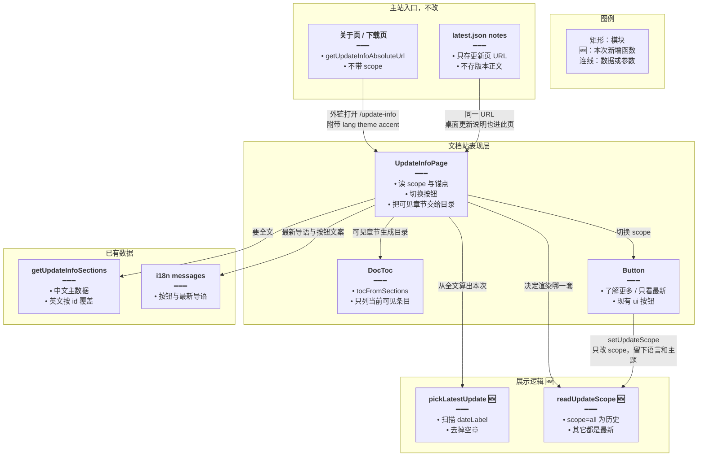
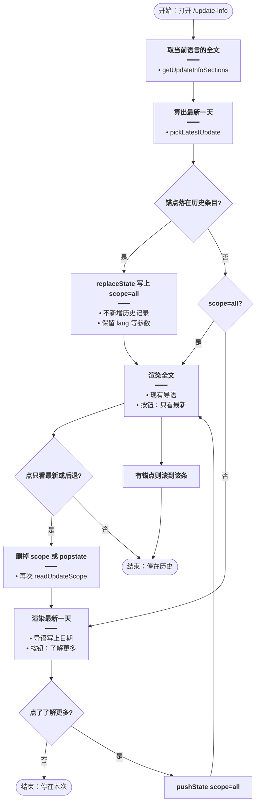
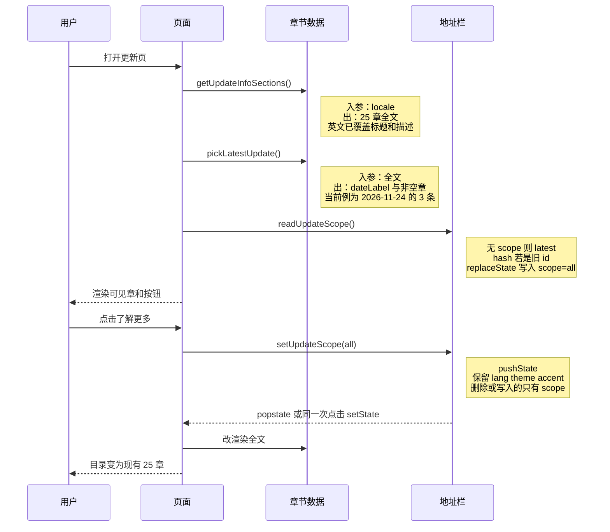
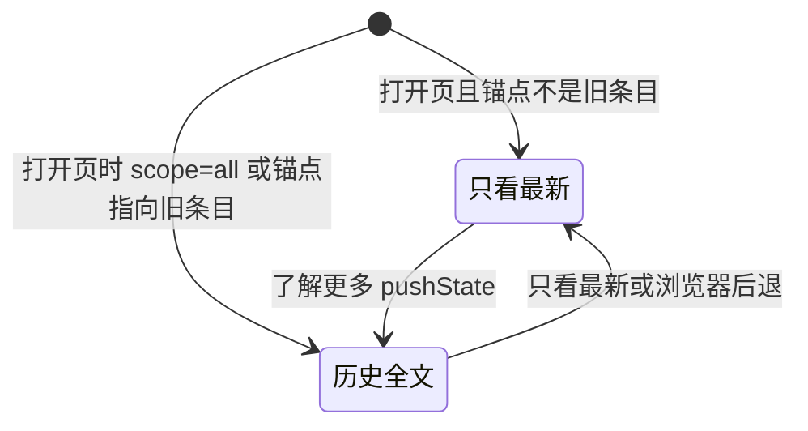

# 更新信息只看最新 — 实现思路

> **状态**：已落地（实现归档见 [meta/更新信息只看最新.md](../meta/更新信息只看最新.md)；本文保留方案比对）  
> **日期**：2026-11-24  
> **需求摘要**：打开更新信息页时先看到最近一次写入的更新，其余历史不铺开；点「了解更多」再看现在这套按产品分域的全文。  
> **一句话方案（预告）**：仍用现有章节数据，按最大 `dateLabel` 滤出「本次」；默认只渲染这一天，`?scope=all` 展开全文，旧锚点自动展开并滚到该条。

## 延伸阅读

- 已落地实现：[meta/更新信息只看最新.md](../meta/更新信息只看最新.md)
- 产品文维护约定：本仓 `.cursor/skills/implementation-doc-from-diff/references/product-user-docs.md`、`product-pages-sync.md`（条目仍按分域追加，日期写当天）
- 页面现状：`micro-apps/remote-docs/src/views/updateInfo/index.tsx`
- 桌面更新只负责安装包：`apps/frontend/src/utils/updater.ts`、`apps/frontend/latest.json` 的 `notes` 已是更新页地址，不是按版本写的正文

---

## 0. 读本文你将得到什么

- 要解决的是更新页一打开就把约 444 条历史和当天更新一起铺开
- 选定方案：同一页用最大更新日期过滤，历史走地址栏 `scope=all`
- 改动落在文档站页面和章节数据上的纯函数，主站关于页、下载页、`latest.json` 不改
- 分两阶段：先滤出并展示最新一天，再补锚点、返回和中英文文案
- 最大风险是作者没把 `dateLabel` 写成发布当天，页面会停在更早的那一天

---

## 1. 需求与边界

### 1.1 用户故事

| 角色 | 场景 | 行为 | 期望结果 |
|------|------|------|----------|
| 使用者 | 从关于页「查看更新说明」、下载页或文档站进入 `/update-info` | 打开页面 | 只看到日期最新的那一批条目，以及它们所在的产品章节 |
| 使用者 | 已经看完本次更新 | 点「了解更多」 | 看到与现在相同的全部分域目录和正文 |
| 使用者 | 看完历史 | 点「只看最新」或浏览器后退 | 回到只含最新一天的视图 |
| 使用者 | 收藏了某条旧更新的锚点（如 `#s2-18`） | 打开该链接 | 自动展开历史并滚到该条 |
| 维护者 | 按现有约定往某一章追加一条，`dateLabel` 写当天 | 发布文档站 | 不用改页面结构，新条自动成为「本次」 |

### 1.2 范围

| 在范围内 | 不在范围内（非目标） |
|----------|----------------------|
| 文档站 `/update-info` 的默认视图、了解更多、只看最新、旧锚点 | 产品指南、插件手册、法律页 |
| 用现有 `dateLabel` 定义「本次」 | 给 444 条补批次号、按 Tauri 版本 `1.0.198` 切正文 |
| 中英文界面文案（按钮、最新视图导语） | 重写 `项目更新信息.md` 的分域结构，或改 GitHub Wiki 同步脚本 |
| 过滤后的目录仍用现有 `DocToc` | 历史列表虚拟滚动、全文搜索 |

### 1.3 约束与依赖

- 更新页在 `micro-apps/remote-docs`，主站用 `getUpdateInfoAbsoluteUrl` 打开外链，并附带 `lang` / `theme` / `accent`。改地址栏时这三个参数必须留着。
- 正文数据是 `updateInfoSections.ts` 的中文主数据，英文用同 id 覆盖。过滤不能另维护一份英文列表。
- 维护约定是：新能力归入已有产品章，每条一个 `dateLabel`，日期用当天。页面不能要求作者再填一个「批次」字段。
- 桌面自动更新（`check` / `latest.json`）和这篇产品说明是两条线。`notes` 只是更新页 URL，没有按版本存放的更新正文。本次展示不能去绑安装包版本。
- 路由是文档站自己的 `NavigationProvider`，只同步 pathname，不同步 search。范围状态不能指望这个路由上下文。

---

## 2. 背景

- **谁、在什么场景、卡在哪**：使用者从关于页或下载页来看「这次更新了什么」。`UpdateInfoPage` 对 `getUpdateInfoSections` 的 25 章、约 444 条直接 `map` 成正文，目录也是全文目录。最新三条（2026-11-24，都在「英语学习」章）混在整本能力说明里。
- **现状缺口**：数据按产品域排列，不按发布日排列；页上没有「最新 / 历史」两种视图。`dateLabel` 已经能标出最新一天（当前最大值为 `2026-11-24`，3 条；前一天 `2026-11-23` 另有 1 条），但页面没有用它做默认裁剪。
- **不解决会怎样**：更新页继续充当「能力总目录」。找本次变更要自己在目录里翻，和「更新信息」这个入口的预期不一致。
- **硬约束**：不能把历史删掉；不能为了「本次」去改 Wiki 同步或主站更新安装包流程；英文仍走现有 overlay；带 `lang` 的外链打开后默认就是最新视图。

---

## 3. 现状与复用

| 能力 | 仓库中已有 | 本需求中的用法 |
|------|------------|----------------|
| 更新页渲染 | `micro-apps/remote-docs/src/views/updateInfo/index.tsx` | 扩展：同一套 section/item 结构，改成按范围渲染 |
| 章节数据与取数 | `updateInfoSections.ts` 的 `UpdateInfoSection`、`getUpdateInfoSections`、`getUpdateInfoIntro` | 直接复用；新增纯函数挑出最大 `dateLabel` |
| 英文正文 | `updateInfoSectionsEnOverlay.ts`，按条目 id 覆盖 title/description | 直接复用：先取当前语言的章节，再过滤，不改 overlay |
| 目录 | `components/design/DocToc` 的 `tocFromSections` | 直接复用：传入「当前要显示的章节」，最新视图目录自然变短 |
| 按钮 | `components/ui` 的 `Button` | 直接复用：`variant="link"` 做了解更多 / 只看最新 |
| 文案表 | `src/i18n/index.tsx` 已有 `updateInfoPage.item.dateLabel` | 扩展：按钮和最新视图导语 |
| 语言切换改地址栏 | `setLocale` 用 `URL` + `replaceState` 改 `lang` | 直接复用这一写法改 `scope`，避免冲掉 `lang` / `theme` / `accent` |
| 产品文源 | `wiki/项目更新信息.md`，发布时 `wiki-sync-update-info` 推到 GitHub Wiki | 不适用：仍是全文源，页面只做展示裁剪 |
| 桌面更新 | `apps/frontend/src/utils/updater.ts`，`latest.json` 的 `notes` 指向 `/update-info` | 直接复用：链接不改，打开即为最新视图 |
| 主站入口 | `setting/about/index.tsx`、`desktopDownload/index.tsx` 的 `getUpdateInfoAbsoluteUrl` | 直接复用：不追加 `scope`，缺省即最新 |

**调研结论**：最新一天可以从现有 `dateLabel` 算出来，不必新接口、新表或第二份正文。缺的是「算最大日期、默认只渲染那一天、用地址栏记住是否展开历史」。全文目录、英文覆盖、外链参数都已够用。安装包版本和这条产品说明没有条目级对应关系，不能拿 `latest.json` 当「本次」的数据源。

---

## 4. 方案比对与最终方案

### 4.1 候选方案

#### 方案 A：同页按最大 `dateLabel` 过滤（扩展现有页面）

- **做法**：在 `updateInfoSections.ts` 增加 `pickLatestUpdate`。页面默认渲染它返回的章节；点「了解更多」把地址栏设为 `?scope=all` 并渲染 `getUpdateInfoSections` 的全文；「只看最新」删掉该参数。目录继续用 `tocFromSections`。锚点若不在最新一天里，进入页时改为 `scope=all` 再滚动。
- **能工作的原因**：每条已有 `YYYY-MM-DD` 的 `dateLabel`，字符串比较就是时间顺序。维护约定要求日期写当天，所以全表最大值就是最近一次写入。英文覆盖不改日期，过滤对两种语言同一天。
- **主要代价**：同一次功能若被写成相邻两天，较旧那天要再点一次才看见。正文描述里的「某日补充」如果不改 `dateLabel`，也不会升到本次。

#### 方案 B：拆成「最新」与「历史」两份数据（新增数据源）

- **做法**：维护者把本次条目写进新的 `latest` 列表，历史留在现有 25 章。页面默认只 import 最新列表；了解更多再加载现有 `UPDATE_INFO_SECTIONS_ZH`。Markdown 姊妹稿也拆成文首「本次」和后面的档案。
- **能工作的原因**：默认视图的数据里根本没有历史，不会漏滤。跨日的一次发布可以由人把相关条放进同一份 latest。
- **主要代价**：每写一条要决定它属于 latest 还是某一章，并在下次发布时把旧 latest 挪回分域章节。英文 overlay、Wiki 全文、现有「归入已有章节」约定都要跟着改。和现在「追加一条即可」的维护方式冲突。

#### 方案 C：给每条增加批次号，默认只显示最新批次（扩展数据模型）

- **做法**：`UpdateInfoBullet` 增加可选 `batch`。未填的旧条算历史。页面取最大 batch（或约定 `latest` 这个字面值）作为本次。跨日的功能填同一个 batch，就能出现在默认视图。
- **能工作的原因**：批次和日历脱钩，一次发布跨 11-23 与 11-24 时可以标成同一批。历史视图忽略该字段，仍渲染全文。
- **主要代价**：444 条旧数据要定回填规则；之后每次写作都多一个必填概念。作者今天已经要写 `dateLabel`，再加批次容易漏，漏了新条就不会出现在默认视图。

### 4.2 比对

| 维度 | 方案 A | 方案 B | 方案 C |
|------|--------|--------|--------|
| 正确性（失败路径、边界、数据是否会错） | 最大日期唯一且格式固定为 `YYYY-MM-DD` 时，最新一天不会漏条、也不会把更早的条算进来。跨日同一功能会拆开。锚点不在最新集合里时必须改 scope，否则目标节点不在 DOM 中 | 人放进 latest 的条一定显示。漏搬回历史时，下次默认视图仍带着旧条 | 批次填对就对。漏填 batch 的新条不会出现在默认视图，比漏改日期更隐蔽 |
| 复用 / 与现状契合 | 复用章节数组、overlay、`DocToc`、外链。对齐「日期用当天、归入已有章」 | 要拆 Markdown 与 TS，和 Wiki 同步的「整篇推送」以及分域追加约定都不契合 | 章节和 overlay 仍可复用，但数据契约和写作约定都要加字段 |
| 改动面（要动哪些路径） | `updateInfoSections.ts`、`updateInfo/index.tsx`、`i18n/index.tsx`，英文导语常量 | 上述文件，再加上姊妹稿结构、overlay 的第二份索引、Wiki 源文档 | 类型、全部新条写法、回填策略、页面；旧条可暂不填 |
| 复杂度（新概念、新状态、新依赖） | 新概念只有「最大日期 = 本次」和地址栏 `scope`。无新依赖 | 新概念是两套正文源，以及「下次发布把 latest 归档」 | 新概念是批次，和已有日期并存 |
| 体验（延迟、步骤数、失败时用户看到什么） | 首屏只有当天有条目的章（当前是 1 章 3 条）。历史一次点击，无第二请求。无日期时退回全文，页面不会空 | 首屏更短，但作者没归档时用户会把旧条当成这次更新 | 跨日一次发布可以一次看完。作者漏填时用户看到的「本次」是空的或停在上一批 |
| 风险（迁移、互斥、并发、回滚） | 不改已发布 URL。旧链接无 `scope` 时从「全文」变成「最新」，这是本需求要的行为。带锚点的旧链接要在进入时展开，否则书签失效 | 姊妹稿一拆，Wiki 与页面容易各写各的。回滚要合并文件 | 回填 444 条容易把旧条标进最新批次。回滚要删字段并改所有新条 |
| 可维护性（以后改一处还是改多处） | 新条仍只改中文主数据、同 id 英文、姊妹稿三处，和现在一样。过滤逻辑一处 | 新条要改 latest 列表，下次还要挪回分域，写两遍 | 新条多写 batch，过滤和日期两套规则要同时记得 |

### 4.3 综合考量

这条需求的权重依次是：和现有写作方式契合、默认视图确实不铺历史、改动面小。更新页的「本次」在数据里没有批次，只有每条的日期；桌面安装包版本也没有对应正文。所以正确性的标准是「最大 `dateLabel` 那一天的条目都出现，更早的不出现」，而不是「一次功能讨论里的相邻几天合并」。

方案 A 在这三项上都成立，并且历史仍是现在这份全文，了解更多不会变成另一套信息架构。

放弃方案 B 的优点：作者可以手工把跨日条目放进同一次首屏。这个优点要靠双份正文维持，和「追加到已有章」冲突，漏归档时首屏是错的。放弃方案 C 的优点：同一次发布可以跨日历日。现有约定已经用「日期写当天」表达发布日，再引入批次会让漏填的新条从首屏消失；真要跨日合并时，把较旧那条的 `dateLabel` 改成发布日即可，不必新字段。

### 4.4 最终方案

#### 背景

更新页现在把 25 个产品章全部渲染出来。条目带 `dateLabel`，但页面不用它裁剪。桌面更新的 `notes` 只指向这个 URL，不能当作本次正文。写作约定是往已有章追加、日期写当天，英文按 id 覆盖。默认视图必须从这份数据里算出最新一天，历史必须还在，而且一次点击就能看到现在的全文。

#### 具体思路

1. **模块**：不新增页面。`updateInfoSections.ts` 增加纯函数；`index.tsx` 按范围选章节并渲染按钮；`i18n/index.tsx` 增加按钮和导语。`DocToc`、overlay、主站外链不动。
2. **数据**：`getUpdateInfoSections(locale)` 仍返回全文。`pickLatestUpdate` 扫描全部 `dateLabel`，留下等于最大值的条目，并丢掉因此变空的章。日期字段不参与英文覆盖，两种语言结果同一天。
3. **状态**：放在地址栏 `scope`，不放 `useState` 作为唯一来源，也不放 `NavigationProvider`。缺省或非 `all` 都是最新。这样关于页现有链接不用改；刷新、复制链接、语言切换的 `replaceState` 都不会丢范围。组件里用 state 镜像地址栏，以便 `popstate` 能回到上一个范围。
4. **边界**：没有任何 `dateLabel` 时渲染全文，不显示空页。锚点 id 不在最新集合、但在全文里存在时，进入即写入 `scope=all`（`replaceState`，不额外堆一条历史）并在渲染后滚到该 id。未知锚点不展开。切换范围后把正文滚动容器回到顶部，避免停在旧偏移。

#### 实现方案

**一句话**：仍用现有章节数据，按最大 `dateLabel` 滤出「本次」；默认只渲染这一天，`?scope=all` 展开全文，旧锚点自动展开并滚到该条。

| 步骤 | 谁 | 做什么 | 输入 → 输出 |
|------|----|--------|-------------|
| 1 | `getUpdateInfoSections` | 按语言拿出全文 | `locale` → `UpdateInfoSection[]` |
| 2 | `pickLatestUpdate` | 求最大日期并丢掉空章 | 全文 → `{ dateLabel, sections }` |
| 3 | `readUpdateScope` + 锚点判断 | 决定本次渲染哪一套 | 地址栏 `scope`、`hash`、两套章节 → `'latest'` 或 `'all'` |
| 4 | `UpdateInfoPage` | 渲染导语、切换按钮、`DocToc` 和条目 | 选中的章节 → 页面。最新导语带上 `dateLabel`；全文沿用现有导语 |
| 5 | `setUpdateScope` | 切换时改 `scope` 并保留其它查询参数 | `'all'` 或 `'latest'` → `pushState`。回到最新时删除 `scope` |

#### 选定原因

1. **复用**：日期、章节、英文覆盖、目录都是现成的，所以不新做数据源。牺牲：跨日条目不能自动并进同一次首屏。
2. **正确性**：最大日期的比较是全表扫描，同一天的条不会因为排在后面的章而被丢掉；空日期退回全文。牺牲：描述正文里的「补充日期」不算数，只认 `dateLabel`。
3. **改动面**：只动文档站三个文件。牺牲：主站关于页按钮文案仍是「查看更新说明」，不会变成「查看本次更新」；链接行为已经符合默认最新，不必改主站。
4. **体验**：首屏从 25 章降到「这一天涉及的章」，历史仍是一次点击，没有第二次请求。牺牲：想看昨天要多一次操作。
5. **风险**：不迁移正文。牺牲：已经收藏、且不带锚点的 `/update-info` 会从全文变成最新视图。这是需求本身，带锚点的旧链接用进入时展开补上。
6. **可维护性**：新条仍按现在的三处同步写。牺牲：作者必须把 `dateLabel` 写成发布日，页面没有第二套「手动置顶」。

#### 优势

- 相对方案 B：新条继续追加到原章节，Wiki 整篇同步不用拆文，不存在「latest 忘记归档」。
- 相对方案 C：不回填 444 条，也不让漏填批次的新条从首屏消失；发布日已经写在 `dateLabel` 上。

#### 怎么实现

1. `pickLatestUpdate` 用字符串比较找出最大 `dateLabel`，过滤条目，去掉空章。没有日期则原样返回全文，`dateLabel` 为空。
2. 页面用 `readUpdateScope` 读 `scope=all`。若 hash 指向的 id 不在最新结果中、且全文里有这个 id，则 `replaceState` 补上 `scope=all`。
3. `visible` 为最新结果或全文。导语、按钮文案、`tocFromSections(visible)` 都从 `visible` 来。
4. 按钮调用 `setUpdateScope`：`pushState` 只改 `scope`，留下 `lang`、`theme`、`accent`。监听 `popstate` 把 state 设回地址栏。
5. 切换后对 `DocToc` 的滚动容器执行 `scrollTo`。锚点展开用现有 `scrollIntoView`，与目录点击同一方式。

主要实现代码见 §9.2、§9.3。

### 4.5 其他关键决策

#### 决策：范围记在地址栏，还是只记在组件 state

##### 候选

**方案 D：只放 `useState`，默认 `latest`**

- **做法**：按钮 `setScope`。刷新、从关于页重新打开都回到最新。不改 URL。
- **能工作的原因**：默认行为满足「先看本次」。实现比地址栏短。
- **主要代价**：了解更多的结果不能复制给别人；浏览器后退不会从历史回到本次；旧锚点要在同一次 mount 里另写分支，和按钮状态可能不一致。语言切换的 `replaceState` 也没法带上「正在看历史」。

**方案 E：地址栏 `scope=all` 为历史，缺省为最新**

- **做法**：见 §4.4。组件 state 只是地址栏的镜像，`popstate` 时重读。
- **能工作的原因**：文档站已经用地址栏保存 `lang`，同一 `URL` 对象可以改一个参数。`NavigationProvider` 只看 pathname，不会在改 search 时把页面切走。
- **主要代价**：页面要自己听 `popstate`。路由上下文帮不上这个忙。

##### 比对

| 维度 | 方案 D | 方案 E |
|------|--------|--------|
| 正确性 | 刷新后历史视图丢失。带旧锚点时若忘记在首屏改 state，节点不存在，滚动无效 | 刷新、复制、后退和锚点用同一个 `scope`，不会各写一套 |
| 复用 | 不碰现有 URL 写法 | 复用 `setLocale` 已使用的 `URL` + `history` |
| 改动面 | 只改页面组件 | 页面多一个读/写 search 的函数，仍不改路由提供者 |
| 复杂度 | state 一个 | state 加地址栏，两者用同一读函数对齐 |
| 体验 | 后退无效；链接无法停在历史 | 后退回到本次；历史链接可转发 |
| 风险 | 低，但和「外链打开文档」的使用方式不一致 | `replaceState` 补锚点时不能 `pushState`，否则打开旧书签会多一条历史 |
| 可维护性 | 范围规则散在点击回调里 | 读和写各一个函数，按钮和锚点共用 |

##### 综合考量

文档页是外链打开的，范围会不会留在链接里，比少写一个 `history` 调用更重要。方案 D 少一次地址栏同步，但分享和锚点都会再长出特例。选方案 E。放弃 D 的「完全不碰 history」这一点。

##### 最终方案（地址栏）

**背景**：`lang` 已经在 search 里，路由又不保存 search。范围若只放 state，和语言参数不是同一层。

**具体思路**：缺省等于最新，这样现有外链零修改。只有历史才写出 `scope=all`。锚点补参数用 `replaceState`，按钮切换用 `pushState`，后退才能从历史回到本次。

**实现方案**：`readUpdateScope` / `setUpdateScope` 放在 `updateInfoSections.ts` 旁，页面不直接拼字符串。

**选定原因**：正确性上锚点和按钮同一来源。牺牲一个 `popstate` 监听。体验上链接可转发。牺牲「实现更短」。

**优势**：相对方案 D，旧锚点、刷新和后退不会各写一个布尔值。

**怎么实现**：见 §9.3。

---

## 5. 架构图



**图内方法说明**：

| 方法 | 功能 |
|------|------|
| `pickLatestUpdate(sections)` | 在已本地化的全文里找出最大 `dateLabel`，只保留这一天的条目并去掉空章。没有日期时原样返回，避免空白页 |
| `readUpdateScope()` | 读地址栏：`scope=all` 表示历史全文，缺省和其它值都表示只看最新。页面初始化和 `popstate` 都走它 |
| `setUpdateScope(next, mode)` | 把范围写回地址栏。历史写入 `scope=all`，最新则删除该参数；按钮用压栈，旧锚点用替换，其它查询参数保持不动 |
| `getUpdateInfoSections(locale)` | 现有入口。按界面语言返回 25 章；英文只覆盖标题和描述，不改日期和 id |
| `tocFromSections(sections)` | 现有目录函数。把当前可见章和条目标成二级、三级目录，不关心数据是全文还是最新一天 |
| `getUpdateInfoAbsoluteUrl(locale)` | 主站外链。继续打开不带 `scope` 的更新页，因此关于页和下载页落地就是最新视图 |

**读图要点**：

- 裁剪发生在文档站页面，主站更新安装包和 Wiki 同步不进入这条链路。
- 新增的只有两个纯函数；目录、按钮、章节数据都是原模块。
- 关于页链接不带 `scope`，和 `latest.json` 的 `notes` 用的是同一个地址，打开结果都是最新一天。

---

## 6. 主流程图



**图内方法说明**：

| 方法 | 功能 |
|------|------|
| `getUpdateInfoSections(locale)` | 进入页和切换语言时取全文，后面的过滤都基于这次结果 |
| `pickLatestUpdate(sections)` | 得到最新一天的章节。锚点是否属于历史，用这份结果和全文的 id 对照 |
| `readUpdateScope()` | 判断菱形「scope=all」和后退之后的重读都调用它，避免按钮和地址栏各判一次 |
| `setUpdateScope(next)` | 了解更多写入 `all`，只看最新删除参数。按钮走 `pushState`；锚点强制展开走 `replaceState`，两种都留在这个函数的 mode 参数里 |

**读图要点**：

- 默认分支不经过全文渲染。全文只在地址栏已经是历史，或锚点指向旧条目时出现。
- 锚点展开用替换当前历史记录，避免用户一点后退就离开文档站。
- 按钮展开用新增历史记录，后退能回到本次。

---

## 7. 核心时序图



**图内方法说明**：

| 方法 | 功能 |
|------|------|
| `getUpdateInfoSections()` | 页面向章节模块要当前语言的全文，一次打开只依赖这份内存数据 |
| `pickLatestUpdate()` | 章节模块返回最新一天。页面用返回的 `dateLabel` 填导语，用 `sections` 做默认正文 |
| `readUpdateScope()` | 页面读地址栏。旧锚点时由页面接着调用写入，不在读函数里改历史记录 |
| `setUpdateScope(all)` | 用户点了解更多时写入 `scope=all` 并压栈。只看最新时删除该参数，同样压栈 |

**读图要点**：

- 全文始终来自同一次内存数据，了解更多不再请求接口，也不会再读 Markdown。
- 地址栏是范围的来源；页面上的 setState 发生在读到或写入 search 之后。
- 主站和 `latest.json` 不在这条时序里，它们只负责把用户送到没有 `scope` 的 URL。

---

## 8. 状态机



**图内方法说明**：

| 方法 | 功能 |
|------|------|
| `setUpdateScope(all)` | 「了解更多」迁移：压栈并进入历史全文 |
| `setUpdateScope(latest)` | 「只看最新」迁移：删除 `scope` 后压栈 |
| `readUpdateScope()` | 后退时重读地址栏，决定回到哪一侧。锚点强制展开不经过「只看最新」这个状态 |

**读图要点**：

- 两个稳定状态对应地址栏有没有 `scope=all`。
- 打开瞬间可以不经过「只看最新」，旧书签不会先闪一屏短列表再展开。

---

## 9. 具体实现（主链路代码）

### 9.1 模块一览

| 模块 | 职责 | 新增/改动 | 预估路径 |
|------|------|-----------|----------|
| 挑选与地址栏 | 最大日期、读/写 scope | 扩展 | `micro-apps/remote-docs/src/views/updateInfo/updateInfoSections.ts` |
| 页面 | 选可见章节、按钮、导语、滚动 | 扩展 | `micro-apps/remote-docs/src/views/updateInfo/index.tsx` |
| 文案 | 了解更多、只看最新、最新导语 | 扩展 | `micro-apps/remote-docs/src/i18n/index.tsx` |
| 英文导语 | 最新视图一句英文 | 扩展 | `micro-apps/remote-docs/src/views/updateInfo/updateInfoSectionsEnOverlay.ts` |
| 目录 / 主站 / Wiki | 保持现状 | 不改 | `DocToc`、`remote-docs-url.ts`、`latest.json`、`项目更新信息.md` |

### 9.2 主链路实现

```typescript
// 对应 §4.4 步骤 2。从全文算出「本次」，调用方不必再扫一遍日期
export function pickLatestUpdate(sections: UpdateInfoSection[]): {
	// 最大更新日期；空串表示数据里没有日期，调用方应直接渲染全文
	dateLabel: string;
	// 仍是原章节结构，只是条目变少。目录函数不用换
	sections: UpdateInfoSection[];
} {
	// 日期都是 YYYY-MM-DD，字符串大小就是先后，不必解析成 Date
	let dateLabel = '';
	// 按现有章节顺序扫描，避免为找最大值单独做一次排序
	for (const section of sections) {
		// 同一章里后写的条目日期可能更早，必须逐条比，不能只看章末
		for (const item of section.items) {
			// 更大的日期才覆盖，相等时保留先扫到的值即可，结果都是同一天
			if (item.dateLabel > dateLabel) dateLabel = item.dateLabel;
		}
	}
	// 没有日期时退回全文，避免上线后空白
	if (!dateLabel) return { dateLabel: '', sections };
	// 先按天筛条目，再丢掉空章，目录才不会出现没有正文的标题
	const next = sections
		// 展开原章是为了保留 id 和标题，目录锚点不用改
		.map((section) => ({
			// 章节 id、标题沿用原文，过滤不改信息架构
			...section,
			// 只留发布日当天的条，更早的留给历史视图
			items: section.items.filter((item) => item.dateLabel === dateLabel),
		}))
		// 当天没写到的产品章不出现在默认目录里
		.filter((section) => section.items.length > 0);
	// 把日期一并返回，导语不用再扫一遍
	return { dateLabel, sections: next };
}
```

```typescript
// 对应 §4.4 步骤 3 与 §4.5。范围只认这一个参数，缺省就是最新，现有外链不用改
export function readUpdateScope(search: string): 'latest' | 'all' {
	// 只把 all 当成历史，防止以后误加的其它值把默认视图变成全文
	const scope = new URLSearchParams(search).get('scope');
	// 缺省和无参数都是最新，关于页现有外链不用追加查询
	return scope === 'all' ? 'all' : 'latest';
}

// 对应 §4.4 步骤 5。mode 区分压栈和替换，锚点展开不能给后退多留一层
export function setUpdateScope(next: 'latest' | 'all', mode: 'push' | 'replace') {
	// 基于当前 URL 改，lang、theme、accent 会留下来
	const url = new URL(window.location.href);
	// 历史必须写进链接，刷新和转发才还停在全文
	if (next === 'all') url.searchParams.set('scope', 'all');
	// 最新视图不把 scope=latest 写进链接，缺省和无参数是同一种状态
	else url.searchParams.delete('scope');
	// 按钮用 push 才能后退；锚点用 replace，避免打开书签多一层
	const write = mode === 'push' ? window.history.pushState : window.history.replaceState;
	// 第一个参数传 null，文档站路由不读 history.state
	write.call(window.history, null, '', url.toString());
}
```

```tsx
// 对应 §4.4 步骤 3、4。语言一变就重取全文，英文覆盖仍走原入口
const all = useMemo(() => getUpdateInfoSections(locale), [locale]);
// 全文不变就不重扫日期，切换范围时不用再算
const latest = useMemo(() => pickLatestUpdate(all), [all]);
// 首屏以地址栏为准，而不是写死 latest，这样刷新停在历史时不会闪回
const [scope, setScope] = useState<'latest' | 'all'>(() => readUpdateScope(window.location.search));
// 没有日期时不进入短列表，显示全文，避免空白
const showingLatest = scope === 'latest' && latest.dateLabel !== '';
// 导语、按钮、正文共用这一份，避免目录和正文各滤一次
const visible = showingLatest ? latest.sections : all;
// 目录只包含当前可见章，最新视图不会再列出 400 多条
const toc = useMemo(() => tocFromSections(visible), [visible]);
```

### 9.3 数据模型

| 字段/实体 | 来源 | 存储 | 说明 |
|-----------|------|------|------|
| `UpdateInfoBullet.dateLabel` | 已有章节数据 | 内存中的 TS 常量 | 「本次」的唯一依据。格式 `YYYY-MM-DD` |
| `scope` | 地址栏 search | 浏览器历史记录 | 仅 `all` 表示历史；缺省表示最新 |
| `hash` | 地址栏 | 浏览器 | 条目或章节 id。不在最新集合内则强制 `scope=all` |
| 英文 title/description | overlay 同 id | 内存 | 过滤发生在覆盖之后，日期仍用中文主数据上的值 |
| Tauri `notes` | `latest.json` | 安装包更新描述 | 只保存页面 URL，不参与过滤 |

---

## 10. 分阶段实现步骤

| 阶段 | 目标 | 交付物 | 依赖 |
|------|------|--------|------|
| M1 | 打开页面只看到最新一天 | `pickLatestUpdate`、页面默认渲染、导语与了解更多 | 无 |
| M2 | 历史可打开、可退回、旧锚点可用 | `scope` 读写、`popstate`、只看最新、锚点滚动 | M1 |

M1

- [ ] 在 `updateInfoSections.ts` 实现 `pickLatestUpdate`，并用当前数据断言：最大日期为 `2026-11-24`、结果只有含该日期的章、这些章里没有更早的 `dateLabel`
- [ ] `index.tsx` 默认把 `visible` 设为最新结果；无日期时用全文
- [ ] 最新导语包含该日期；按钮「了解更多」先用本地 state 展开全文，证明过滤结果正确
- [ ] 中英文各看一次：同一天、同一批 id，英文标题来自 overlay

M2

- [ ] 用 `readUpdateScope` / `setUpdateScope` 替换 M1 的本地布尔值；了解更多 `pushState`，刷新后仍是历史
- [ ] 「只看最新」删除 `scope`；浏览器后退回到本次，并滚回顶部
- [ ] 打开 `#s2-18` 这类不在最新一天的锚点时，不先闪最新列表，直接是全文并滚到该标题
- [ ] 切换语言后 `scope` 仍在；`lang`、`theme`、`accent` 不被按钮清掉
- [ ] 关于页和下载页的外链不改，打开后是最新视图

---

## 11. 风险、边界与待确认

| 项 | 等级 | 说明 | 缓解 |
|----|------|------|------|
| `dateLabel` 没写成发布当天 | 高 | 新条会留在历史里，首屏停在上一个最大日期 | 继续遵守「日期用当天」。M1 的断言用当前最大日期做样例，改数据后要改断言里的期望日期 |
| 同一次功能跨两天 | 中 | 较旧那天要进历史 | 若这批必须同屏，把它们的 `dateLabel` 改成同一个发布日。不另加批次字段 |
| 无锚点的旧书签从全文变成短列表 | 中 | 这是需求要的默认行为 | 需要全文的链接使用 `?scope=all`。带条目 hash 的旧链接会自动展开 |
| 描述里的「补充日期」与 `dateLabel` 不一致 | 低 | 只改了描述、没改 `dateLabel` 的旧条不会升到本次 | 有实质更新时改 `dateLabel` 为当天 |
| `popstate` 与 `NavigationProvider` 都监听 | 低 | 提供者只改 pathname state，同页后退不会卸掉更新页 | 页面自己重读 `scope` |

**待确认**：

- [ ] 无。本次定义采用全表最大 `dateLabel`，不再并入相邻日期。若产品以后坚持「昨天加今天算一次」，验证方式是看默认视图是否漏了必须同屏的条目，再改 `dateLabel` 而不是改过滤窗口。

---

## 12. 验收清单

| # | 用例 | 步骤 | 期望 |
|---|------|------|------|
| AC1 | 默认只看本次 | 不带 `scope` 打开 `/update-info` | 只显示 `dateLabel` 最大的那一天；当前数据是 2026-11-24 的条目。更早的条不在正文和目录里 |
| AC2 | 了解更多 | 在 AC1 页面点「了解更多」 | 地址栏出现 `scope=all`，25 章全文和现有导语出现，目录恢复为现在的全文目录 |
| AC3 | 退回本次 | 在历史视图点「只看最新」，或按浏览器后退 | `scope` 消失，再次只剩最新一天，滚动在顶部 |
| AC4 | 旧锚点 | 打开 `/update-info#` 加一条不在最新一天的条目 id | 直接是全文，该标题在视口内，中间不停留在短列表 |
| AC5 | 外链参数 | 带 `lang=en-US` 以及 theme、accent 打开，再点了解更多和切换语言 | 英文文案与中文同一天；三个外观参数都还在；历史范围不被语言切换清掉 |
| AC6 | 空日期退回 | 构造全部 `dateLabel` 为空的输入调用 `pickLatestUpdate` | 返回原章节，页面走全文，不出现空白主栏 |
| AC7 | 主站入口 | 从关于页「查看更新说明」和下载页更新链接打开 | URL 仍是现有外链，落地为最新视图。安装包检查更新的流程不变 |

---

## 13. 预估改动面（实现阶段参考）

| 类型 | 路径（预估） |
|------|--------------|
| 文档站 | `micro-apps/remote-docs/src/views/updateInfo/updateInfoSections.ts` |
| 文档站 | `micro-apps/remote-docs/src/views/updateInfo/updateInfoSectionsEnOverlay.ts`（仅最新导语英文） |
| 文档站 | `micro-apps/remote-docs/src/views/updateInfo/index.tsx` |
| 文档站 | `micro-apps/remote-docs/src/i18n/index.tsx` |
| 后端 | 无 |
| 主站 | 无 |
| 文档（实现后） | 若需要归档，再写 `wiki` 下的实现说明；本文保持规划 |

---

（本文档为规划态实现思路；落地后以源码与 remote-docs wiki 专题为准）
