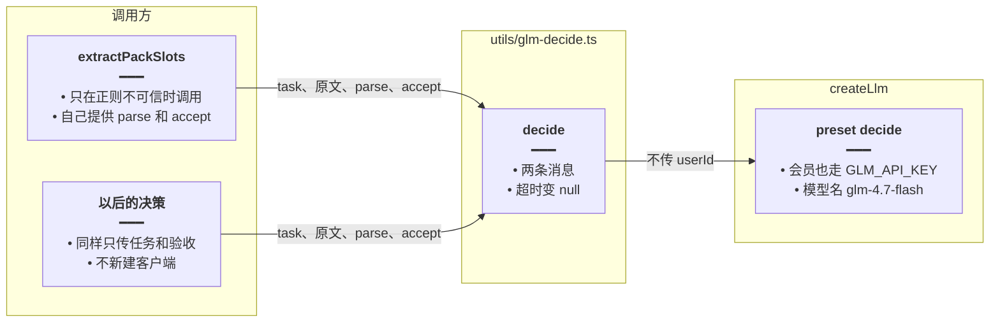
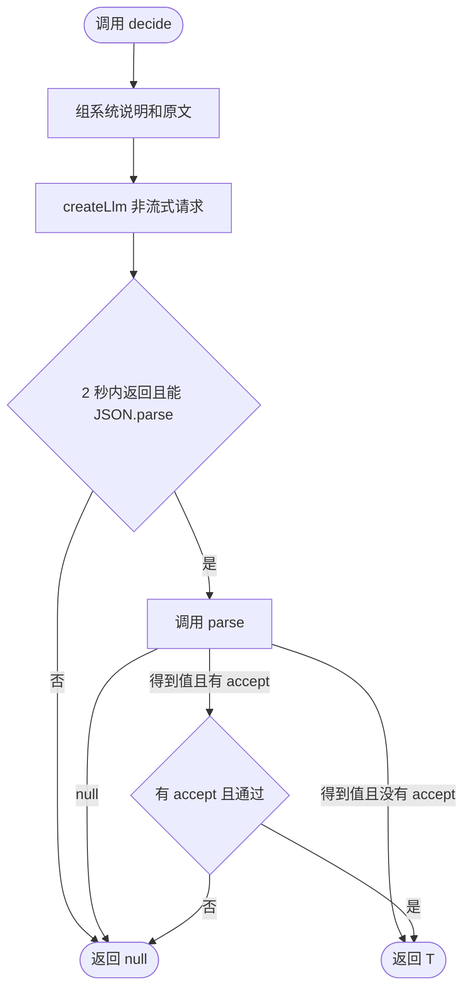
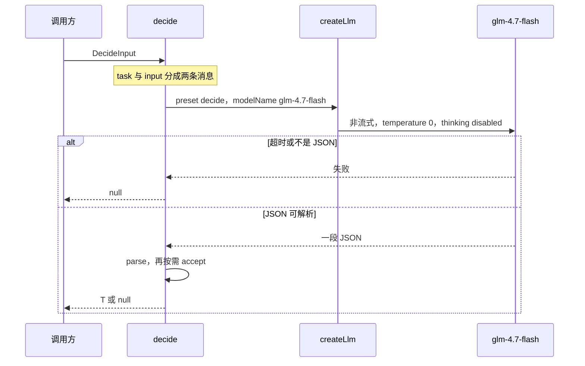
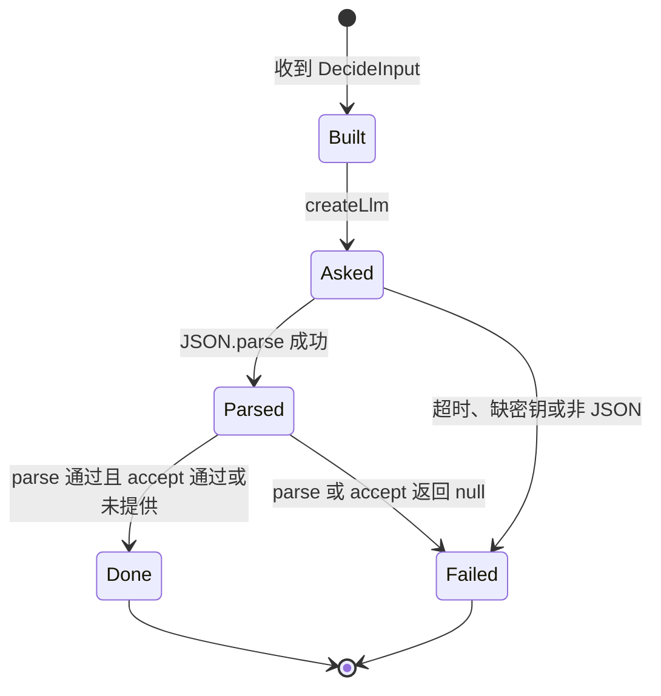

# 通用 Flash 决策 — 实现思路

> **状态**：规划  
> **日期**：2026-10-27  
> **需求摘要**：把 `glm-4.7-flash` 收成一个无会话的决策函数。任何功能传入任务说明、原文和验收规则就能调用；会员档、对话 Agent、用户自定义大模型都不改变这次决策用的模型。

## 延伸阅读

- [english/Agent词句认意图.md](./english/Agent词句认意图.md)（第一个调用方：正则不可信时才抽词句槽位，验收仍留在词句模块）
- [english/决策改用千问.md](./english/决策改用千问.md)（后续规划：同一 `decide` 档从智谱 `glm-4.7-flash` 改到硅基千问 3.6。本篇「不切硅基」只约束不要跟着会员对话模型走）
- [agent/Agent业务消息分表.md](./agent/Agent业务消息分表.md)（对话 Agent 是另一条链路，本篇不接入它的会话和工具）

---

## 0. 读本文你将得到什么

- 要解决的问题：每个功能自己 `createLlm` 做一次 JSON 判断，会抄错模型、带上会员的硅基凭证，或把对话历史塞进一次本该很短的决策。
- 一句话方案：`apps/backend/src/utils/glm-decide.ts` 提供 `decide()`。它固定用智谱 `glm-4.7-flash`、关思考、温度 0、只发两条消息；结构解析和业务验收由调用方传入。
- 改动层：在 `createLlm` 增加 `decide` 档，会员和非会员都走 `GLM_API_KEY`。词句抽槽改为调用它。不改对话 Agent，不改前端。
- 分两阶段：M1 交出可调用的 `decide()` 并用词句抽槽接上；M2 用假模型返回锁住超时、坏 JSON 和验收失败。
- 最大风险：调用方把业务规则写进提示词后不再验收。封装只保证「一次短调用、失败变 null」，挡编造仍是调用方的 `accept`。

---

## 1. 需求与边界

### 1.1 用户故事

| 角色 | 场景 | 行为 | 期望结果 |
|------|------|------|----------|
| 后端功能 | 规则已经够用 | 不调用 `decide()` | 没有额外模型请求 |
| 后端功能 | 需要一次结构化判断 | 传入任务说明、原文、`parse`、可选 `accept` | 得到类型 `T`，或得到 `null` 后走自己的回退 |
| 会员用户 | 对话已经切到硅基大模型 | 同一次决策 | 决策仍打智谱 `glm-4.7-flash`，不跟着会员档漂移 |
| 维护者 | 下一个功能也要做短决策 | 只写任务和验收 | 不复制超时、关思考、JSON 解析和凭证选择 |

### 1.2 范围

| 在范围内 | 不在范围内 |
|----------|------------|
| 无状态的一次 JSON 决策 | 带工具循环、记忆、流式回复的对话 Agent |
| 固定 `glm-4.7-flash`、关思考、温度 0、约 2 秒超时 | 让调用方自选模型，或读取用户设置页的自定义大模型 |
| `parse` 校验形状，`accept` 校验业务 | 在封装里写「主题必须是子串」这类某一功能的规则 |
| 失败统一返回 `null` | 失败重试多次、或把异常抛进用户正在看的对话 |
| 词句抽槽作为第一个调用方 | 替换词句模块已有的正则快路径 |

### 1.3 已确认的决策

- 形态是函数，不是新建一个 Nest Agent。对话 Agent 负责聊天和工具；`decide()` 只回答「这段输入按这个任务得到什么结构」。
- 凭证对齐现有 OCR 档：会员表和非会员表都用 `GLM_API_KEY` / `GLM_BASE_URL`。`decide()` 不传 `userId`，也不传用户凭证 resolver。
- 模型名在 `glm-decide.ts` 写成常量 `glm-4.7-flash`，不读 `GLM_MODEL_NAME`。那个环境变量是对话默认模型，以后改成更大的模型时，决策不能跟着变。
- 不新增依赖。形状校验是调用方传入的 `parse`，不用再引一套 schema 库。
- `response_format: json_object` 只保证输出是 JSON，不保证字段对。`parse` 仍然要跑。
- 验收失败不重试。模型第二次仍会编。超时预算约 2 秒，重试会把生成卡在决策上。
- 缺 `GLM_API_KEY`、超时、非 JSON、`parse` 或 `accept` 返回 null，全部变成 `null`。调用方决定退回规则还是放弃这次动作。

---

## 2. 现状与差距

| 现状 | 差距 | 本方案 |
|------|------|--------|
| `createLlm` 按 preset 选凭证。`englishLearning` 对会员会切到硅基 | 只改 `modelName` 仍可能把 `glm-4.7-flash` 这个名字打到硅基上 | 新增 `decide` 档，两张表都走 GLM，调用时再写死模型名 |
| `ocr` 档已经对会员也固定 GLM | 决策还没有同样的档 | `decide` 档照 `ocr` 的凭证策略，模型换成 `glm-4.7-flash` |
| 对话 `GlmService` 默认开思考、可流式、会拼历史 | 拿来做槽位会慢，也会把上一句主题带进来 | `decide()` 只有一条系统说明和一条原文，`streaming: false`，思考关闭 |
| 词句认意图若在 `pack-ask` 里直接建客户端 | 下一处决策会再抄一遍超时和解析 | 词句只提供 `task` / `parse` / `accept`，HTTP 只留在 `decide()` |

---

## 3. 方案概述

1. `createLlm` 增加 preset `decide`。非会员表和会员表都调用现有的 GLM 环境凭证，不走硅基。
2. `decide(input)` 用该 preset 发一次非流式请求：系统消息是 `input.task`，用户消息是 `input.input`，温度 0，`maxTokens` 只够一小段 JSON，`modelKwargs` 带上 `GLM_THINKING_DISABLED_KWARGS` 和 `response_format: { type: 'json_object' }`。
3. 返回文本先 `JSON.parse`。失败即 `null`。成功则调用 `input.parse`。`parse` 得到值后，若有 `input.accept`，用原文再滤一次。
4. 调用方保持自己的快路径。词句模块仍先 `parsePackAsk`，只有 `askTrusted` 为否才调用 `decide()`，再用已有的 `acceptSlots` 当 `accept`。

---

## 4. 架构图



**图内方法说明**：

| 方法 | 功能 |
|------|------|
| `extractPackSlots(userText)` | 词句模块的第一个调用方。把抽槽说明和原话交给 `decide()`，验收规则仍是「主题必须出现在原话里」 |
| `decide(input)` | 通用入口。负责组消息、限时、解析 JSON，并把 `parse` / `accept` 的失败收成 `null` |
| `createLlm(config, { preset: 'decide', modelName: 'glm-4.7-flash' })` | 复用现有客户端工厂。`decide` 档保证密钥和地址来自 `GLM_*`，模型名由这次调用写死 |

**读图要点**：

- 调用方不碰 HTTP。换超时或关思考只改 `decide()`。
- `preset decide` 不读取用户设置页的自定义模型，避免决策模型随个人配置变化。
- 对话 Agent 不在这张图里。它继续走自己的 preset 和会话。

---

## 5. 主流程图



**图内方法说明**：

| 方法 | 功能 |
|------|------|
| `decide(input)` | 整张图的入口和出口。出口只有 `T` 或 `null` |
| `createLlm` | 发出唯一一次模型请求。温度 0，关闭思考，限制输出长度 |
| `parse(raw)` | 调用方检查字段类型。缺字段或类型不对返回 `null` |
| `accept(value, input)` | 调用方的业务闸门。词句场景用它丢掉不在原话里的主题 |

**读图要点**：

- `JSON.parse` 失败和 `parse` 失败都走 `null`，调用方不用区分网络错误和坏结构。
- 没有 `accept` 时，形状通过就可以返回。需要防编造的功能必须自己传 `accept`。
- 图上没有第二条模型请求。

---

## 6. 时序图



**图内方法说明**：

| 方法 | 功能 |
|------|------|
| `decide(input)` | 把调用方输入变成两条消息，并在返回前跑 `parse` 和 `accept` |
| `createLlm` | 按 `decide` 档取 `GLM_API_KEY` 和 `GLM_BASE_URL`，不带用户 resolver |
| `parse(raw)` | 出现在「JSON 可解析」分支。形状不对则调用方收到 `null` |
| `accept(value, input)` | 出现在同一分支的后一步。业务不通过同样收到 `null` |

**读图要点**：

- `Caller` 看不到密钥和 HTTP 细节。
- 失败分支不把模型原文抛回用户界面。调用方用 `null` 执行自己的回退，例如词句退回正则。

---

## 7. 状态图



**图内方法说明**：

| 方法 | 功能 |
|------|------|
| `decide(input)` | `Built` 的入口。此时还没发请求 |
| `createLlm` | `Built` 到 `Asked` |
| `parse(raw)` | `Parsed` 的出边之一。失败进入 `Failed` |
| `accept(value, input)` | 与 `parse` 一起决定 `Done` 还是 `Failed` |

**读图要点**：

- `Done` 和 `Failed` 都结束这次调用。`Failed` 的对外结果是 `null`，不是抛错。
- 状态机没有「再问一次」。

---

## 8. 模块职责与接口草图

### 8.1 模块一览

| 模块 | 职责 | 新增/改动 | 预估路径 |
|------|------|-----------|----------|
| `decide` | 组消息、超时、JSON、调用 `parse` / `accept` | 新增 | `apps/backend/src/utils/glm-decide.ts` |
| preset `decide` | 会员和非会员都用 GLM 密钥 | 改动 | `apps/backend/src/utils/create-llm.ts` |
| 词句 `extractPackSlots` | 第一个调用方，提供抽槽说明和子串验收 | 改动 | `apps/backend/src/services/agent/pack-ask.ts` 或紧邻文件 |
| 检查 | 假返回覆盖坏 JSON 和验收失败 | 新增 | `apps/backend/src/utils/glm-decide.check.ts` |

### 8.2 关键接口

```typescript
// 调用方交给通用决策的全部输入，不含会话和工具
type DecideInput<T> = {
	// 这一次要决定什么，由业务自己写，封装层不内置词句规则
	task: string;
	// 模型只能看到的原文
	input: string;
	// 把 JSON 收成业务类型；形状不对返回 null
	parse: (raw: unknown) => T | null;
	// 业务验收；不传则结构通过即可
	accept?: (value: T, input: string) => T | null;
};

// 成功得到 T；失败得到 null，让调用方走自己的回退
function decide<T>(input: DecideInput<T>): Promise<T | null>;
```

调用约定：

- `task` 写输出字段和「不要解释」。不要把某一功能的历史对话拼进来。
- `input` 是本次要判断的原文。词句场景就是本轮用户消息。
- `parse` 只认类型。例如两侧都是 `{ topic?: string; count?: number }`，多出来的解释文字直接丢掉。
- `accept` 认业务。词句场景继续要求主题是原文的连续片段；数量对不上时由词句模块改成 100，而不是由 `decide()` 改。
- 返回 `null` 时调用方必须已有回退。词句回退是现有正则；正则也空则不生成。

---

## 9. 分阶段实现步骤

| 阶段 | 目标 | 交付物 | 依赖 |
|------|------|--------|------|
| M1 | 任意后端功能能用同一函数做一次短决策 | preset `decide`、`decide()`、词句抽槽改调用它 | 现有 `createLlm` 与 `GLM_THINKING_DISABLED_KWARGS` |
| M2 | 失败路径不靠真模型 | `glm-decide.check.ts` 注入假完成函数 | M1 |

### M1

- [ ] `SiliconFlowLlmPreset` 增加 `'decide'`。`siliconFlowResolvePresets` 和 `memberSiliconFlowResolvePresets` 都用 GLM 环境凭证，与 `ocr` 档一样不切硅基。
- [ ] `decide()` 调用 `createLlm` 时写 `modelName: 'glm-4.7-flash'`、`streaming: false`、`temperature: 0`、`maxTokens` 约 400，并带上关闭思考和 `json_object`。
- [ ] 用 `AbortSignal.timeout` 约 2 秒。中止、缺密钥、空内容都 `catch` 成 `null`。
- [ ] 词句 `extractPackSlots` 改为调用 `decide()`，删除它自己的客户端创建。`askTrusted` 和 `acceptSlots` 留在词句模块。

### M2

- [ ] 假完成返回合法 JSON 时，`parse` 的结果原样出去。
- [ ] 假完成返回带说明的非 JSON 时，结果是 `null`。
- [ ] `accept` 返回 `null` 时，结果是 `null`，且完成函数只被调用一次。

---

## 10. 关键决策与备选方案

| 决策 | 选用 | 备选 | 为何不选备选 |
|------|------|------|--------------|
| 形态 | 一个泛型函数 `decide()` | 新建带工具循环的 Agent | 决策不需要选工具。Agent 会把每次判断拖进会话、历史和流式，调用点也更重 |
| 形态 | 同上 | 每个功能复制一段 `createLlm` | 超时、关思考和凭证会分叉。下一处决策改一处漏一处 |
| 模型 | 常量 `glm-4.7-flash` | 跟随 `GLM_MODEL_NAME` 或会员硅基模型 | 对话模型以后换大模型时，短决策会变慢变贵，会员和非会员的判断还会不一致 |
| 凭证 | 新 preset，两张表都走 `GLM_*`，且不传 `userId` | 复用 `englishLearning` 再覆盖模型名 | 会员档的密钥和地址是硅基。只改模型名仍可能打到错误的服务 |
| 校验 | 调用方 `parse` + 可选 `accept` | 封装内置全部业务规则 | 规则一内置就不通用。词句的子串规则不能约束以后的阅读配置或其它判断 |
| 校验 | 同上 | 引入 schema 库 | 现有代码没有这层依赖。一个函数参数已经够把坏 JSON 挡在外面 |
| 失败 | 返回 `null`，不重试 | 坏 JSON 再请求一次 | 2 秒预算会被翻倍。验收失败再问，模型仍可能编 |
| 接入 | 调用方自己决定何时调用 | 所有用户消息都先过 `decide()` | 简单句已经被正则覆盖。每句都打模型更慢，也没有更准 |

---

## 11. 风险、边界与待确认

| 项 | 等级 | 说明 | 缓解 |
|----|------|------|------|
| 调用方省略验收 | 高 | 封装不能知道「主题必须来自原文」 | 文档和词句接入把 `accept` 留在业务侧；需要防编造的功能不把提示词当唯一约束 |
| 缺 GLM 密钥 | 中 | 部署只有硅基密钥时决策不可用 | 返回 `null`。词句退回正则，不阻断其它对话 |
| JSON 模式仍缺字段 | 中 | `json_object` 只保证是对象 | `parse` 缺字段即 `null` |
| 任务说明写太长 | 低 | 调用方把整段历史塞进 `task` | 约定 `task` 是固定说明，`input` 只放本次原文 |

---

## 12. 验收清单

| # | 用例 | 步骤 | 期望 |
|---|------|------|------|
| AC1 | 结构通过 | 假模型返回调用方声明的字段 | `decide()` 返回 `parse` 的结果 |
| AC2 | 坏输出 | 返回 Markdown 或解释句 | `null`，不抛到调用方 |
| AC3 | 业务闸门 | `accept` 拒绝该值 | `null`，且模型只调用一次 |
| AC4 | 超时 | 请求超过约 2 秒 | `null` |
| AC5 | 会员对话 | 用户对话走硅基大模型时另做一次决策 | 决策请求的地址和密钥仍是 `GLM_*`，模型名是 `glm-4.7-flash` |
| AC6 | 词句接入 | 正则不可信的一句 | 只通过 `decide()` 打一次 flash；可信的一句不打 |
| AC7 | 不改对话 | 普通聊天 | 不经过 `decide()`，回复模型与现在相同 |

---

## 13. 预估改动面（实现阶段参考）

| 类型 | 路径（预估） |
|------|----------------|
| 后端 | `apps/backend/src/utils/create-llm.ts` 增加 preset；新建 `apps/backend/src/utils/glm-decide.ts` |
| 接入 | 词句 `extractPackSlots` 改为调用 `decide()`。见 [Agent词句认意图.md](./english/Agent词句认意图.md) |
| 检查 | `apps/backend/src/utils/glm-decide.check.ts` |
| 前端 | 无 |

---

## 14. 复刻清单

1. 在统一的模型工厂里加一个档，使付费档和免费档都使用同一家小模型的密钥，避免决策模型随用户档位变化。
2. 写一个泛型函数：系统说明与原文分两条消息，温度 0，关闭思考，限制输出长度，约 2 秒超时。
3. 输出先按 JSON 解析，再交给调用方的形状函数和可选验收函数。任一失败返回空，不重试。
4. 第一个业务只在自己的快路径不可信时调用它，并保留该业务原来的回退。
5. 用假模型返回锁住坏 JSON、验收失败和「只调用一次」。
