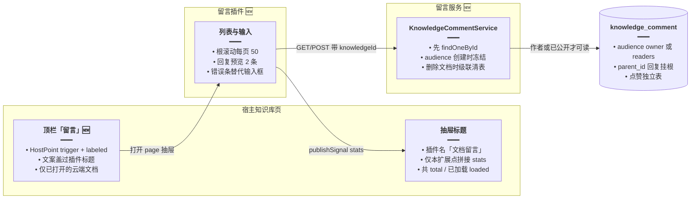
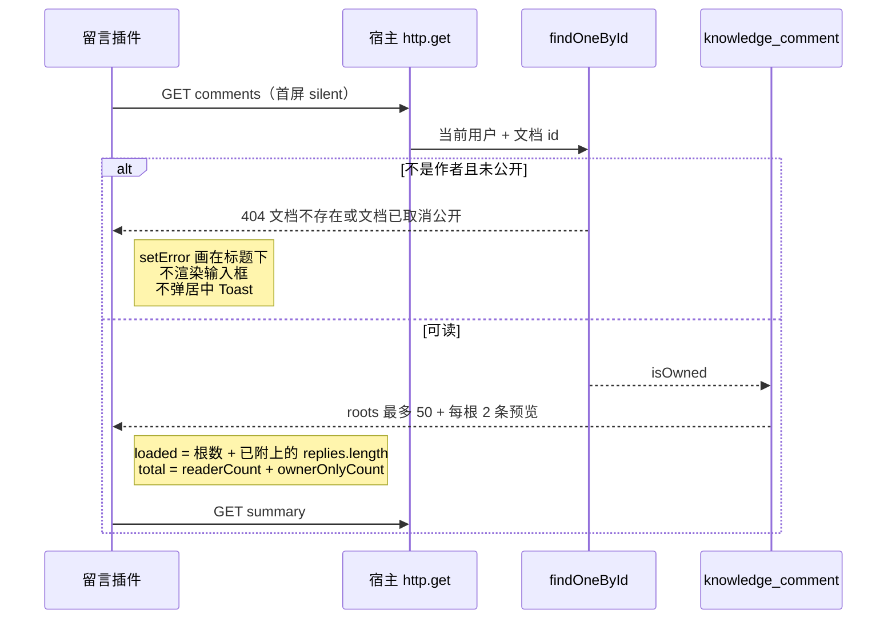

# 知识库文档留言

> **文档角色**：已落地实现归档（主文档）。规划比对与取舍仍在 [../ideas/knowledge/文档留言插件.md](../ideas/knowledge/文档留言插件.md)；和代码不一致时以本文与源码为准。  
> **日期**：2026-11-23

## 延伸阅读

- [../ideas/knowledge/文档留言插件.md](../ideas/knowledge/文档留言插件.md)（选定方案与公开时不自动释放的比对）
- [../ideas/plugins/插件接入点统一.md](../ideas/plugins/插件接入点统一.md)（`page` 抽屉角色）

登录用户在当前打开的云端文档上留言、回复和点赞。能不能看见抽屉，跟能不能读这篇文档走同一条规则：作者本人，或文档已经公开。文档从仅自己可见改成公开时，私有期写下的留言不会自动进公开讨论，作者要点一次才放出去。

## 1. 背景与目标

知识库页原先没有评论。读者只能看正文。作者把文档公开后，也没有办法把「写的时候只想自己看」和「现在愿意给读者看」分开。

本轮做成：

- 顶栏入口与「回收站」同一套：图标加文字，文案是「留言」。抽屉标题仍是插件注册名「文档留言」。
- 标题右侧实时显示「共 N 条 / 已加载 N 条」。已加载含已经拿回来的根留言，以及这些根下面已经附上的回复（含首屏每条根自带的最早 2 条）。
- 根列表与回复续页都是每页 50 条。根列表滑到底继续取；回复默认只露 2 条，其余点「还有 N 条回复」。
- 文档不存在或对方已取消公开时，标题正下方显示「文档不存在或文档已取消公开」，并且不出现输入框。
- 删除文档时，这篇下面的留言和点赞一并删掉。

## 2. 改动范围

宿主仓 `dnhyxc-ai`（相对本仓根）：

- `apps/backend/src/migrations/1794800000000-knowledge-comment.ts`（新表）
- `apps/backend/src/services/knowledge-comment/`（实体、规则、服务、控制器、模块）
- `apps/backend/src/services/knowledge/knowledge.service.ts`（找不到文档的文案；删除文档时清留言）
- `apps/backend/src/services/knowledge/knowledge.module.ts`、`apps/backend/src/app.module.ts`（挂上留言模块）
- `apps/frontend/src/federation/points/catalog.ts`（扩展点 `knowledge.article`）
- `apps/frontend/src/federation/host/HostPoint.tsx`（文字按钮、标题条数）
- `apps/frontend/src/federation/runtime/index.ts`（`http.get` 可静默）
- `packages/federation-kit/src/config/types.ts`（`HostHttpClient.get` 增加可选 `silent`）
- `apps/frontend/src/views/knowledge/index.tsx`（顶栏入口与抽屉正文）
- `apps/frontend/src/views/knowledge/KnowledgeEditorToolbar.tsx`（`extra` 插槽）
- `apps/frontend/src/i18n/locales/zh-CN/knowledge.ts`、`en-US/knowledge.ts`（「留言」、条数文案）
- `apps/frontend/src/service/api.ts`、`apps/frontend/src/service/index.ts`、`apps/frontend/src/store/knowledge.ts`（评论接口与当前文档是否他人公开）

插件仓 `micro-apps/dnhyxc-ai-plugins`（不在本仓 git 里）：

- `src/views/knowledge-comments/index.tsx`
- `src/i18n/locales/zh-CN.ts`、`en-US.ts`
- `vite.config.ts`（暴露 `./KnowledgeComments`）

已删除、不再维护：`apps/backend/src/services/knowledge-comment/knowledge-comment.rules.spec.ts`。规则仍在 `knowledge-comment.rules.ts`。

公开文档的快捷键，以及他人公开文档上助手只读，是「公开之后才能把私有留言放出去」的配套，不另开专题。

## 3. 实现思路

留言不做成知识库页里的一块本地组件。扩展点 `knowledge.article` 是页面级非模态抽屉。插件只负责列表和输入，宿主负责按钮和抽屉标题。词库抽屉也有 `stats`，宿主只在 `pointId === 'knowledge.article'` 时把条数写进标题。

受众在创建根留言时冻结。`audienceForRoot` 只看文档此刻是否公开：未公开记 `owner`，已公开记 `readers`。之后把文档设为公开，不会把旧行改成 `readers`。整批放出走 `release`（作者、且文档已公开）。单条「公开留言 / 取消公开」只改这一行，不改它下面的回复，也不改文档的 `isPublic`。

分页用一个 `PAGE = 50`。多取 1 条用来判断还有没有下一页。首屏每个根另带最早 `REPLY_PREVIEW = 2` 条回复。第一次打开可能看到「已加载 54」：50 条根加上已经附在响应里的 4 条预览回复。`replyCount` 是该线程的总数，不能拿来当已加载。

首屏列表失败时，插件自己把错误画在标题下。这次 GET 带 `silent: true`，宿主 HTTP 客户端不再居中弹一条同样的 Toast。续页失败仍 Toast，并且记下失败游标，避免滚到底反复打同一页。





## 4. 关键代码对比与注释

### 4.1 `findOneById`（`apps/backend/src/services/knowledge/knowledge.service.ts`）

**对比范围**：`findOneById` 全函数。留言列表、摘要、回复都先走它，所以找不到或未公开的文案在这里改一次即可。

**改动前** · `apps/backend/src/services/knowledge/knowledge.service.ts`（基线 `HEAD`，约 L251–L270）

```typescript
// 注释说明读权限：作者看自己的任意一篇，其他登录用户只能看已公开的
/** 本人任意，或已公开条目（任意登录用户可读） */
// 按用户与文档 id 取一篇，并带上是不是作者，供留言过滤 owner 行
async findOneById(
	// 当前登录用户，用来判断这篇是不是他的
	userId: number,
	// 文档主键，留言接口从路径带进来
	id: string,
	// 返回文档行，并多一个 isOwned，避免调用方再查一次作者
): Promise<Knowledge & { isOwned: boolean }> {
	// 先按作者查，命中就不用再看公开标记
	const owned = await this.knowledgeRepository.findOne({
		// 主键和作者同时匹配，防止拿到别人的未公开文档
		where: { id, authorId: userId },
	});
	// 是作者则直接返回，留言侧会看到 owner 行
	if (owned) {
		// 拷贝实体并标 isOwned，不改数据库里的行
		return Object.assign(owned, { isOwned: true });
	}
	// 不是作者时只接受已公开的那一行
	const pub = await this.knowledgeRepository.findOne({
		// isPublic 为真才允许访客读，和知识库详情同一条规则
		where: { id, isPublic: true },
	});
	// 未公开或不存在都走同一个 404，避免探出「这篇锁着」
	if (!pub) {
		// 旧文案偏内部表名，抽屉和 Toast 都会原样显示
		throw new NotFoundException('知识库条目不存在');
	}
	// 访客读到公开文档，留言侧据此隐藏 owner 行
	return Object.assign(pub, { isOwned: false });
}
```

**改动后** · `apps/backend/src/services/knowledge/knowledge.service.ts`（当前，约 L264–L282）

```typescript
// 读权限不变：作者任意，其他人仅已公开
/** 本人任意，或已公开条目（任意登录用户可读） */
// 留言与详情共用，文案改成读者能看懂的句子
async findOneById(
	// 当前登录用户
	userId: number,
	// 文档主键
	id: string,
	// 带 isOwned，留言用它决定能不能看见仅作者可见的行
): Promise<Knowledge & { isOwned: boolean }> {
	// 作者优先，未公开的自己的文档也能进留言
	const owned = await this.knowledgeRepository.findOne({
		// 主键加作者，避免串到别人的文档
		where: { id, authorId: userId },
	});
	// 命中即作者
	if (owned) {
		// isOwned 为真时列表不过滤 audience
		return Object.assign(owned, { isOwned: true });
	}
	// 访客只查公开行
	const pub = await this.knowledgeRepository.findOne({
		// 取消公开后这里落空，留言接口变成 404
		where: { id, isPublic: true },
	});
	// 不存在和已取消公开对访客是同一结果
	if (!pub) {
		// 这句话会进抽屉标题下的错误条
		throw new NotFoundException('文档不存在或文档已取消公开');
	}
	// 访客，留言服务会丢掉 audience=owner 的根
	return Object.assign(pub, { isOwned: false });
}
```

**变更摘要**：分支不变，404 文案改为「文档不存在或文档已取消公开」。

### 4.2 `requireOwned`（`apps/backend/src/services/knowledge/knowledge.service.ts`）

**对比范围**：`requireOwned` 全函数。删除、改可见性等作者操作共用它，文案与 `findOneById` 对齐。

**改动前** · `apps/backend/src/services/knowledge/knowledge.service.ts`（基线 `HEAD`，约 L608–L616）

```typescript
// 作者专用入口：改公开、改分类、删除前确认这篇属于当前用户
private async requireOwned(userId: number, id: string): Promise<Knowledge> {
	// 只查自己的行，访客即使文档已公开也不能走这里
	const row = await this.knowledgeRepository.findOne({
		// 主键和作者一起匹配
		where: { id, authorId: userId },
	});
	// 不是自己的，或已经删掉
	if (!row) {
		// 旧文案与详情 404 相同，偏内部
		throw new NotFoundException('知识库条目不存在');
	}
	// 交给调用方改字段或删除
	return row;
}
```

**改动后** · `apps/backend/src/services/knowledge/knowledge.service.ts`（当前，约 L622–L630）

```typescript
// 作者专用入口，文案与详情、留言 404 用同一句
private async requireOwned(userId: number, id: string): Promise<Knowledge> {
	// 仍然只认作者，公开访客进不来
	const row = await this.knowledgeRepository.findOne({
		// 主键加作者
		where: { id, authorId: userId },
	});
	// 找不到就拒绝后续修改
	if (!row) {
		// 与 findOneById 同一句，避免同一篇文档两种说法
		throw new NotFoundException('文档不存在或文档已取消公开');
	}
	// 返回可写的那一行
	return row;
}
```

**变更摘要**：只改 404 文案。`remove` 里作者找不到文档时另有一处同样的句子（见 4.3）。

### 4.3 `remove`（`apps/backend/src/services/knowledge/knowledge.service.ts`）

**对比范围**：`remove` 全函数。同一事务里先快照进回收站，再删助手会话，再删留言与点赞，最后删文档。

**改动前** · `apps/backend/src/services/knowledge/knowledge.service.ts`（基线 `HEAD`，约 L150–L179）

```typescript
// 删除只回收文档和助手会话，当时还没有留言表
async remove(userId: number, id: string): Promise<void> {
	// 整段放进一个事务，快照失败就不会删主表
	await this.knowledgeRepository.manager.transaction(async (manager) => {
		// 事务内的文档仓库
		const knowledgeRepo = manager.getRepository(Knowledge);
		// 回收站快照仓库
		const trashRepo = manager.getRepository(KnowledgeTrash);
		// 这篇文档上的助手会话
		const assistantSessionRepo = manager.getRepository(AssistantSession);
		// 只删作者自己的
		const row = await knowledgeRepo.findOne({
			// 主键加作者
			where: { id, authorId: userId },
		});
		// 不是自己的或已不存在
		if (!row) {
			// 旧文案
			throw new NotFoundException('知识库条目不存在');
		}
		// 先组回收站快照，正文还能恢复
		const trash = trashRepo.create({
			// 原文档 id，恢复时认这篇
			originalId: row.id,
			// 标题允许空
			title: row.title ?? null,
			// 正文允许空
			content: row.content ?? null,
			// 作者名快照
			author: row.author ?? null,
			// 作者 id 快照
			authorId: row.authorId ?? null,
			// 原创建时间
			sourceCreatedAt: row.createdAt ?? null,
			// 原更新时间
			sourceUpdatedAt: row.updatedAt ?? null,
		// 满足回收站实体的可选字段，避免多写列
		} satisfies Partial<KnowledgeTrash>);
		// 快照先落库
		await trashRepo.save(trash);
		// 讲解放在源码注释之上：会话绑在文档 uuid 上，主表删除前清掉
		// 助手会话按知识条目 uuid 绑定，主表删除前一并清理（消息随 session CASCADE）
		// 消息随会话级联，这里只删会话行
		await assistantSessionRepo.delete({ knowledgeArticleId: row.id });
		// 最后删文档行
		await knowledgeRepo.delete({ id });
	});
}
```

**改动后** · `apps/backend/src/services/knowledge/knowledge.service.ts`（当前，约 L152–L192）

```typescript
// 删除文档时把留言和点赞放进同一事务，避免留下指到已删文档的行
async remove(userId: number, id: string): Promise<void> {
	// 快照、会话、留言、主表要么一起成功
	await this.knowledgeRepository.manager.transaction(async (manager) => {
		// 文档仓库
		const knowledgeRepo = manager.getRepository(Knowledge);
		// 回收站
		const trashRepo = manager.getRepository(KnowledgeTrash);
		// 助手会话
		const assistantSessionRepo = manager.getRepository(AssistantSession);
		// 只允许作者删
		const row = await knowledgeRepo.findOne({
			// 主键加作者
			where: { id, authorId: userId },
		});
		// 不是作者
		if (!row) {
			// 与详情同一句
			throw new NotFoundException('文档不存在或文档已取消公开');
		}
		// 回收站快照，留言不进快照
		const trash = trashRepo.create({
			// 原 id
			originalId: row.id,
			// 标题
			title: row.title ?? null,
			// 正文
			content: row.content ?? null,
			// 作者名
			author: row.author ?? null,
			// 作者 id
			authorId: row.authorId ?? null,
			// 原创建时间
			sourceCreatedAt: row.createdAt ?? null,
			// 原更新时间
			sourceUpdatedAt: row.updatedAt ?? null,
		// 只填回收站需要的字段
		} satisfies Partial<KnowledgeTrash>);
		// 先保存快照
		await trashRepo.save(trash);
		// 源码原注释保留：会话在主表删除前清掉
		// 助手会话按知识条目 uuid 绑定，主表删除前一并清理（消息随 session CASCADE）
		// 删会话，消息随级联
		await assistantSessionRepo.delete({ knowledgeArticleId: row.id });
		// 留言仓库走同一事务管理器
		const commentRepo = manager.getRepository(KnowledgeComment);
		// 点赞没有文档 id，只能先拿到留言 id 再删
		const likeRepo = manager.getRepository(KnowledgeCommentLike);
		// 这篇文档下的全部留言 id，含已软删行，避免点赞残留
		const commentRows = await commentRepo.find({
			// 按文档 id，不按当前用户，读者的留言也要清
			where: { knowledgeId: row.id },
			// 只要 id，少读正文
			select: { id: true },
		});
		// 没有留言就不必打点赞删除
		if (commentRows.length > 0) {
			// 点赞表用留言 id 关联
			await likeRepo.delete({
				// 一次删掉这些留言上的全部点赞
				commentId: In(commentRows.map((item) => item.id)),
			});
		}
		// 再删留言行本身
		await commentRepo.delete({ knowledgeId: row.id });
		// 最后删文档
		await knowledgeRepo.delete({ id });
	});
}
```

**变更摘要**：404 文案对齐；在删主表之前按文档 id 删点赞和留言。回收站不恢复留言。

### 4.4 `PAGE` 与 `list`（`apps/backend/src/services/knowledge-comment/knowledge-comment.service.ts`）

**对比范围**：页大小常量，以及 `list` 全函数。基线没有留言服务，无改动前。

**改动后** · `apps/backend/src/services/knowledge-comment/knowledge-comment.service.ts`（当前，约 L17–L101）

```typescript
// 根列表和回复续页共用一页，避免一边 20 一边 50
/** 根列表与回复续页同一页大小。 */
// 50 与回复「查看更多」一致，首屏一次多拿一些根
const PAGE = 50;
// 首屏不要把一个长线程全带上，其余走回复分页
/** 首屏每个根只带最早的回复，其余走回复分页。 */
// 2 条是抽屉里默认能看见的回复
const REPLY_PREVIEW = 2;

// 根列表：先确认读权限，再按时间倒序游标取一页
async list(
	// 当前用户，传给 findOneById
	userId: number,
	// 文档 id
	knowledgeId: string,
	// 空表示第一页；有值则从上一页最后一条继续
	cursor?: string,
	// 本页根，以及下一页游标
): Promise<{ roots: CommentView[]; nextCursor: string | null }> {
	// 不是作者且未公开时在这里 404，列表不会返回空数组冒充成功
	const doc = await this.knowledgeService.findOneById(userId, knowledgeId);
	// 查询留言表
	const qb = this.comments.createQueryBuilder('c');
	// 只取这篇文档
	qb.where('c.knowledge_id = :knowledgeId', { knowledgeId });
	// 软删的不出现
	qb.andWhere('c.deleted_at IS NULL');
	// 根的 parent 为空，回复不进这一页
	qb.andWhere('c.parent_id IS NULL');
	// 访客看不见仅作者可见的根
	if (!doc.isOwned) qb.andWhere("c.audience = 'readers'");
	// 把游标拆成时间和 id
	const mark = this.parseCursor(cursor);
	// 有游标才加「比上一页更旧」的条件
	if (mark) {
		// 同一时间再用 id 打破平局，避免重复或漏行
		qb.andWhere(
			// 创建时间更早，或时间相同但 id 更小
			'(c.created_at < :time OR (c.created_at = :time AND c.id < :id))',
			// time 与 id 来自游标
			mark,
		);
	}
	// 新的根在前
	qb.orderBy('c.created_at', 'DESC');
	// 时间相同再按 id，与游标条件一致
	qb.addOrderBy('c.id', 'DESC');
	// 多取 1 条，用来判断还有没有下一页
	qb.take(PAGE + 1);
	// 执行查询
	const rows = await qb.getMany();
	// 返回给客户端的只有一页
	const page = rows.slice(0, PAGE);
	// 每个根附上最早的预览回复，以及该线程总数
	const replies = await this.repliesFor(
		// 同一篇文档
		knowledgeId,
		// 本页根 id
		page.map((row) => row.id),
		// 作者才能看到 owner 回复
		doc.isOwned,
	);
	// 补用户名、点赞、是否本人
	const views = await this.toViews(
		// 本页根
		page,
		// 文档作者，用来标「作者」
		doc.authorId,
		// 当前用户，用来标 mine / liked
		userId,
		// 预览回复
		replies,
	);
	// 本页最后一条用来生成下一页游标
	const last = page[page.length - 1];
	// 组装响应
	return {
		// 已带预览回复的根
		roots: views,
		// 多取的那条存在才给游标，否则没有下一页
		nextCursor:
			// 行数超过一页且本页非空
			rows.length > PAGE && last ? this.cursorOf(last) : null,
	};
}
```

**变更摘要**：新接口。`listReplies` 使用同一个 `PAGE`。预览条数由 `repliesFor` 截到 `REPLY_PREVIEW`，`replyCount` 仍是全线程条数。

### 4.5 `audienceForRoot`（`apps/backend/src/services/knowledge-comment/knowledge-comment.rules.ts`）

**对比范围**：`audienceForRoot` 全函数。基线无此文件。

**改动后** · `apps/backend/src/services/knowledge-comment/knowledge-comment.rules.ts`（当前，约 L10–L13）

```typescript
// 根的受众只在创建时算一次，之后改文档公开不会回写这一行
/** 根留言的受众只看文档此刻是否公开，客户端不能改。 */
// 入参是文档是否公开，不接受客户端传 audience
export function audienceForRoot(isPublic: boolean): CommentAudience {
	// 已公开则读者可见；未公开则只有作者侧能看见
	return isPublic ? 'readers' : 'owner';
}
```

**变更摘要**：纯函数。回复用 `placeReply` 复制根的受众，不单独再算。

### 4.6 `hostHttp`（`apps/frontend/src/federation/runtime/index.ts`）

**对比范围**：`hostHttp` 整个常量。插件首屏要静默，类型上只放宽 GET。

**改动前** · `apps/frontend/src/federation/runtime/index.ts`（基线 `HEAD`，约 L43–L51）

```typescript
// 插件拿到的 HTTP 与页面是同一个客户端，失败默认会 Toast
const hostHttp: HostHttpClient = {
	// GET 只收 URL，插件无法关掉错误提示
	get: ((url: string) => http.get(url)) as HostHttpClient['get'],
	// POST 仍只传 URL 和 body
	post: ((url: string, body?: unknown) =>
		// 转发到页面 HTTP
		http.post(url, body)) as HostHttpClient['post'],
	// PUT 同样
	put: ((url: string, body?: unknown) =>
		// 转发
		http.put(url, body)) as HostHttpClient['put'],
	// DELETE 只传 URL
	delete: ((url: string) => http.delete(url)) as HostHttpClient['delete'],
};
```

**改动后** · `apps/frontend/src/federation/runtime/index.ts`（当前，约 L43–L51）

```typescript
// GET 增加可选配置，让插件在自己画错误时关掉居中 Toast
const hostHttp: HostHttpClient = {
	// silent 为真时页面 HTTP 不弹业务错误
	get: ((url: string, config?: { silent?: boolean }) =>
		// 第二个参数原样交给 HttpClient.get
		http.get(url, config)) as HostHttpClient['get'],
	// 写接口仍会 Toast，留言发送失败需要提示
	post: ((url: string, body?: unknown) =>
		// 不改 POST
		http.post(url, body)) as HostHttpClient['post'],
	// PUT 不改
	put: ((url: string, body?: unknown) =>
		// 不改
		http.put(url, body)) as HostHttpClient['put'],
	// DELETE 不改
	delete: ((url: string) => http.delete(url)) as HostHttpClient['delete'],
};
```

**变更摘要**：`packages/federation-kit` 里 `HostHttpClient.get` 的签名同步增加可选 `config`。iframe 桥的 `http.get` 仍只传 URL。留言插件走模块联邦，不走那条桥。

### 4.7 扩展点 `knowledge.article`（`apps/frontend/src/federation/points/catalog.ts`）

**对比范围**：`pointDefs` 中新增的一项。基线没有 `POINT.knowledgeArticle`。

**改动后** · `apps/frontend/src/federation/points/catalog.ts`（当前，约 L312–L325）

```typescript
// 知识库正文页的抽屉扩展点，与单词卡、电子书阅读并列
{
	// 稳定 id，宿主和插件注册表都用这个字符串
	id: POINT.knowledgeArticle,
	// 只有页面级抽屉，没有工具条动作
	roles: [
		{
			// page：抽屉挂在知识库页，不挂在布局层
			kind: 'page',
			// 槽位名，打开和关闭都用它
			slot: 'drawer',
			// 打开时不额外塞业务载荷，文档 id 走 context
			payload: 'none',
			// 触发器是图标；文字形态由 HostPoint 的 labeled 决定
			trigger: 'icons',
			// 非模态、不保留到别的路由，关页即关
			drawer: { owner: 'page', modal: false, persist: false },
		},
	],
	// 插件读这三项：文档 id、是否公开、是不是作者
	contextKeys: ['knowledgeId', 'docPublic', 'docOwned'],
	// stats 给抽屉标题。宿主只在这个 pointId 上显示
	signals: ['stats'],
	// 留言没有给宿主调用的命令
	commands: [],
},
```

**变更摘要**：新扩展点。插件注册表的 surface 指向 `knowledge.article`。

### 4.8 `HostPoint`（`apps/frontend/src/federation/host/HostPoint.tsx`）

**对比范围**：`export function HostPoint`。中间未改的匹配、遮罩、Drawer 其余 props 用 `// ...` 对称省略。下面只展开触发器分支和标题。

**改动前** · `apps/frontend/src/federation/host/HostPoint.tsx`（基线 `HEAD`，函数约 L72 起；触发器约 L178–L230；标题约 L303–L307）

```tsx
// 扩展点宿主：触发器与抽屉正文是同一组件的两种 part
export function HostPoint({
	// 扩展点 id
	pointId,
	// 槽位
	slot,
	// 动作槽载荷，抽屉触发器不用
	payload,
	// 缺省画正文，知识库顶栏会传 trigger
	part = 'body',
	// 盖过插件标题；当时只给词库统计用
	title: titleProp,
	// 外层类名
	className,
	// 抽屉类名
	drawerClassName,
	// 抽屉内联样式
	drawerStyle,
// 参数类型
}: HostPointProps) {
	// 省略：插件匹配、槽位会话、遮罩，与留言无关
	// ...
	// 抽屉触发器：当时一律是带 Tooltip 的纯图标
	if (part === 'trigger' && slotSpec.kind === 'drawer') {
		// 没有插件就不占位
		if (matched.length === 0) return null;
		// contents 让按钮跟顶栏其它按钮同一行
		return (
			// 不额外生成盒子，避免顶栏间距被包一层 div
			<div className={cn('contents', className)}>
				// 该槽上每个已启用插件一枚按钮
				{matched.map((plugin) => {
					// 按钮无障碍名用插件标题
					const label = pickPluginLocaleText(plugin.title, locale) || plugin.id;
					// 当前这枚是否已经打开
					const open = session.open && session.pluginId === plugin.id;
					// 纯图标外包 Tooltip，悬停才看见标题
					return (
					// 悬停才看见标题，按钮本身没有文字
						<Tooltip
							// 列表 key
							key={plugin.id}
							// 顶栏空间在按钮下面
							side="bottom"
							// 与按钮拉开一点
							sideOffset={6}
							// 稍晚出现，避免划过闪一下
							delayDuration={200}
							// 与其它顶栏提示一样带阴影
							shadow
							// 提示内容是插件名
							content={label}
						>
						// 纯图标按钮，和当时其它顶栏插件一致
							<Button
								// 避免当表单提交
								type="button"
								// 幽灵按钮，只有图标
								variant="ghost"
								// 小尺寸方形
								size="icon-sm"
						// 打开时浅底，未打开只在悬停变色
								className={cn(
									// 图标描边动画，并允许 svg 溢出以画出动画
									'lucide-stroke-draw-hover [&_svg]:overflow-visible',
							// 用打开态切换两套 class
									open
										// 已打开：浅底加强调色
										? 'bg-theme/15 text-teal-500'
										// 未打开：常态半透明，悬停强调色
										: 'text-textcolor/80 hover:text-teal-500',
								)}
								// 给读屏一个按下态
								aria-pressed={open}
								// 没有可见文字时必须有名字
								aria-label={label}
						// 点按打开或关掉这只抽屉
								onClick={() => {
									// 已打开则关掉并释放样式隔离占用
									if (open) {
										// 释放这枚插件占的 portal
										clearPluginPortalClaim(plugin.id);
										// 关槽位
										closePoint(pointId, slot);
										// 不再走打开
										return;
									}
									// 打开前占用样式隔离目标
									claimPluginPortalTarget(
										// 插件 id
										plugin.id,
										// 入口、远端名、id 组成隔离域
										styleRealmKey(plugin.entry, plugin.remoteName, plugin.id),
									);
									// 写入打开会话
									const opened = openPoint(pointId, plugin.id, slot, {});
									// 没打开成功就不要占着隔离域
									if (!opened) clearPluginPortalClaim(plugin.id);
								}}
							>
								// 注册表里的图标
								<PluginIcon name={plugin.host?.icon} className="size-4" />
							</Button>
						</Tooltip>
					);
				})}
			</div>
		);
	}
	// 省略：action 槽与抽屉正文，直到标题
	// ...
	// 标题是字符串：显式 title，否则插件标题
	const title =
		// 调用方传入的优先
		titleProp ??
		// 否则用插件多语言标题，再不行用 id
		(plugin ? pickPluginLocaleText(plugin.title, locale) || plugin.id : '');
	// 省略：Drawer 把 title 原样放进标题栏，直到函数闭合
	// ...
}
```

**改动后** · `apps/frontend/src/federation/host/HostPoint.tsx`（当前，函数约 L72–L410；触发器约 L182–L253；标题约 L328–L346）

```tsx
// 同一组件：知识库顶栏要文字按钮，抽屉标题要拼条数
export function HostPoint({
	// 扩展点 id，标题条数只认 knowledge.article
	pointId,
	// 槽位
	slot,
	// 动作载荷
	payload,
	// trigger 画按钮，body 画抽屉
	part = 'body',
	// 为真时用顶栏文字链，而不是纯图标
	labeled = false,
	// 盖过插件标题。顶栏传入「留言」，抽屉不传所以仍是「文档留言」
	title: titleProp,
	// 外层类名
	className,
	// 抽屉类名
	drawerClassName,
	// 抽屉样式
	drawerStyle,
// 含新增的 labeled
}: HostPointProps) {
	// 省略：匹配与会话未改
	// ...
	// 抽屉触发器。电子书等不传 labeled，仍走下面的纯图标
	if (part === 'trigger' && slotSpec.kind === 'drawer') {
		// 没插件不占位
		if (matched.length === 0) return null;
		// 与顶栏同一行
		return (
			// contents 避免多一层间距
			<div className={cn('contents', className)}>
				// 每枚插件一个按钮，文字或图标由 labeled 决定
				{matched.map((plugin) => {
					// 字符串 title 优先，这样顶栏可以写「留言」而抽屉标题仍用插件名
					const label =
						// 只接受字符串，词库那种 React 节点标题不拿来当按钮文案
						(typeof titleProp === 'string' ? titleProp : '') ||
						// 回退插件标题
						pickPluginLocaleText(plugin.title, locale) ||
						// 再回退 id
						plugin.id;
					// 是否已打开
					const open = session.open && session.pluginId === plugin.id;
					// 开关抽成函数，文字按钮和纯图标共用
					const toggle = () => {
						// 再点一次关闭
						if (open) {
							// 释放样式隔离
							clearPluginPortalClaim(plugin.id);
							// 关槽
							closePoint(pointId, slot);
							// 结束
							return;
						}
						// 打开前占隔离域
						claimPluginPortalTarget(
							// 插件 id
							plugin.id,
							// 隔离域 key
							styleRealmKey(plugin.entry, plugin.remoteName, plugin.id),
						);
						// 打开槽位
						const opened = openPoint(pointId, plugin.id, slot, {});
						// 失败则释放
						if (!opened) clearPluginPortalClaim(plugin.id);
					};
					// 知识库顶栏走文字链，和回收站同一套
					if (labeled) {
						// 链接按钮：无底，悬停只改字色
						return (
							// 链接按钮：无底，悬停只改字色
							<Button
								// key
								key={plugin.id}
								// 非提交
								type="button"
								// link 变体，高度和旁边的回收站一致
								variant="link"
								// 去掉 link 默认的横向内边距，悬停强调色，带描边动画
								className="lucide-stroke-draw-hover flex items-center gap-1 px-0! text-textcolor transition-none hover:text-teal-500 has-[>svg]:px-0!"
								// 按下态
								aria-pressed={open}
								// 名字与可见文字相同
								aria-label={label}
								// 开关
								onClick={toggle}
							>
								// 16px 槽把图标限制住，避免把链接按钮撑高
								<span className="relative inline-flex size-4 shrink-0 items-center justify-center overflow-hidden [&_svg]:size-4">
									// 注册表图标，16px 槽把 svg 限制住，避免 link 按钮被图标撑高
									<PluginIcon name={plugin.host?.icon} />
								</span>
								// 可见文案「留言」
								<span>{label}</span>
							</Button>
						);
					}
					// 其它扩展点保持纯图标加 Tooltip
					return (
						// 不传 labeled 的扩展点仍用提示加图标
						<Tooltip
							// key
							key={plugin.id}
							// 下方
							side="bottom"
							// 间距
							sideOffset={6}
							// 延迟
							delayDuration={200}
							// 阴影
							shadow
							// 插件名
							content={label}
						>
							// 图标按钮，电子书等入口保持原样
							<Button
								// 非提交
								type="button"
								// 幽灵
								variant="ghost"
								// 小图标
								size="icon-sm"
							// 打开与未打开两套颜色
								className={cn(
									// 描边动画
									'lucide-stroke-draw-hover [&_svg]:overflow-visible',
								// 已打开走浅底
									open
										// 已打开
										? 'bg-theme/15 text-teal-500'
										// 未打开
										: 'text-textcolor/80 hover:text-teal-500',
								)}
								// 按下态
								aria-pressed={open}
								// 无可见文字
								aria-label={label}
								// 与文字按钮同一套开关
								onClick={toggle}
							>
								// 图标
								<PluginIcon name={plugin.host?.icon} className="size-4" />
							</Button>
						</Tooltip>
					);
				})}
			</div>
		);
	}
	// 省略：action 槽，直到标题
	// ...
	// 纯文本标题，后面再决定要不要拼条数
	const titleText =
		// 显式 title 优先。抽屉实例不传，所以是插件名
		titleProp ??
		// 插件标题或 id
		(plugin ? pickPluginLocaleText(plugin.title, locale) || plugin.id : '');
	// 只有知识库文档抽屉读 stats，词库抽屉的 stats 形状相同但不能写到别人的标题上
	const commentStats =
		// 扩展点不对就当没有条数
		pointId === 'knowledge.article' ? readStats(pointId) : null;
	// 没有条数时标题仍是字符串；有条数时拼一行小字
	const title =
		// 插件还没上报，或已经卸载并上报 null
		commentStats == null ? (
			// 保持原来的字符串标题
			titleText
		// 有条数时才换成带统计的节点，否则标题保持纯文本
		) : (
			// 标题和条数同一行，条数可截断
			<span className="inline-flex min-w-0 items-baseline gap-2">
				// 插件名不收缩
				<span className="shrink-0">{titleText}</span>
						// 次要文字，条数过长时截断
				<span className="truncate text-sm font-normal text-textcolor/50">
					// 文案在知识库 i18n，数字来自插件信号
					{t('knowledge.comments.summary', {
						// 读者可见加仅作者可见
						total: commentStats.total,
						// 已经取回的根和已附上的回复
						loaded: commentStats.loaded,
					})}
				</span>
			</span>
		);
	// 省略：Drawer 使用 title，直到函数闭合
	// ...
}
```

**变更摘要**：`labeled` 只影响触发器。知识库页对 trigger 传入 `labeled` 和 `title={t('knowledge.toolbar.comments')}`（约 L1589–L1598）。正文那个 `HostPoint` 不传 `title`，标题仍是「文档留言」并拼接条数。

### 4.9 `load` 与条数（插件 `src/views/knowledge-comments/index.tsx`）

**对比范围**：插件文件为新增。下面摘 `const load = useCallback(...)` 全段（含依赖），以及组件里上报 `stats` 的两个 `useEffect`。基线无此文件。

**改动后** · `micro-apps/dnhyxc-ai-plugins/src/views/knowledge-comments/index.tsx`（当前，`load` 约 L268–L325，条数约 L371–L386）

```tsx
// 拉一页根。首屏失败写进 error；续页失败 Toast 并记住游标
const load = useCallback(
	// doc 是当前文档上下文；cursor 空表示第一页
	async (doc: DocCtx, cursor?: string) => {
		// 没有 HTTP 桥就无法请求
		if (!api.http) return;
		// 续页要占住 paging，避免滚动事件叠两次
		if (cursor) {
			// 已经在取下一页
			if (paging.current) return;
			// 占住，直到 finally
			paging.current = true;
		}
		// 首屏和续页都显示加载
		setLoading(true);
		// 新的一次请求清掉上一次错误
		setError(null);
		// 请求与汇总
		try {
			// 游标放查询串
			const query = cursor ? `?cursor=${encodeURIComponent(cursor)}` : '';
			// 解包 { data } 或原始 JSON
			const page = unwrap<{ roots: Comment[]; nextCursor: string | null }>(
				// 首屏 silent，404 只留给下面的 setError
				await api.http.get(
					// 这篇文档的根列表
					`/knowledge/${doc.knowledgeId}/comments${query}`,
					// 续页不静默，失败要 Toast
					cursor ? undefined : { silent: true },
				),
			);
			// 续页追加，首屏替换
			if (cursor) {
				// 已有根后面接这一页
				setRoots((prev) => [...prev, ...page.roots]);
			// 没有游标是第一页，要替换而不是追加
			} else {
				// 首屏替换时，已经展开的线程保留已经拉过的回复
				setRoots((prev) =>
					// 按新的一页根来排
					page.roots.map((root) => {
						// 没展开过就用服务端预览
						if (!expandedRef.current[root.id]) return root;
						// 找出替换前那一行
						const old = prev.find((row) => row.id === root.id);
						// 旧回复并不比新预览多，就用新的
						if (
							// 没有旧回复
							!old?.replies ||
							// 旧的不比预览长
							old.replies.length <= (root.replies?.length ?? 0)
						// 旧回复更长才保留，否则用服务端新预览
						) {
							// 用服务端这一行
							return root;
						}
						// 保留已展开的回复，游标仍用新的，便于继续
						return {
							// 新的根字段
							...root,
							// 已经拉过的回复
							replies: old.replies,
							// 下一页回复游标
							repliesNextCursor: root.repliesNextCursor,
						};
					}),
				);
			}
			// 这一页成功，清掉失败游标
			failedCursor.current = null;
			// 没有下一页时是 null
			setNextCursor(page.nextCursor);
			// 条数分子用汇总接口，不拿本页长度冒充总数
			await pullSummary(doc);
			// 首屏若有已经展开的线程，把没取完的回复补上
			if (!cursor) await refillOpen(doc, page.roots);
			// 给调用方
			return page.roots;
		// 请求失败：续页提示，首屏留给标题下的错误条
		} catch (e) {
			// 后端 message 优先，否则用「留言加载失败」
			const message = errText(e, t('knowledgeComments.loadFailed'));
			// 续页和首屏分开
			if (cursor) {
				// 记住这个游标，滚在底部时不要立刻重试
				failedCursor.current = cursor;
				// 续页仍用 Toast，列表保留已有行
				api.ui?.showToast({ message, type: 'error' });
			// 第一页失败不 Toast，避免和错误条重复
			} else {
				// 首屏错误交给标题下的那一条
				setError(message);
			}
		// 无论成败都放开分页锁并结束加载
		} finally {
			// 允许下一次续页
			paging.current = false;
			// 结束加载
			setLoading(false);
		}
	},
	// HTTP、汇总、补回复和文案变了才换函数
	[api.http, pullSummary, refillOpen, t],
);

// 汇总就绪后把条数交给宿主标题
useEffect(() => {
	// 桥没有信号或汇总还没回来，不要用 0 盖住上一次
	if (!point?.publishSignal || !summaryReady) return;
	// 已加载 = 每条根 1，加上已经放进 replies 的条数（含预览）
	const loaded = roots.reduce(
		// 累加根和已附上的回复
		(sum, row) => sum + 1 + (row.replies?.length ?? 0),
		// 从 0 开始
		0,
	);
	// 宿主只在 knowledge.article 上显示
	point.publishSignal('stats', {
		// 读者可见加仅作者可见
		total: readerCount + ownerOnlyCount,
		// 已经在列表状态里的条数
		loaded,
	});
	// 这些变了就重发
}, [point, summaryReady, readerCount, ownerOnlyCount, roots]);

// 卸载时清掉标题条数，避免下一篇文档先闪旧数字
useEffect(() => {
	// 取出发布函数，清理时 point 可能已变
	const publish = point?.publishSignal;
	// 组件卸载
	return () => publish?.('stats', null);
	// point 换了就重新登记清理
}, [point]);
```

**变更摘要**：首屏静默失败只留错误条。已加载把预览回复算进去，所以 50 条根加 4 条预览会显示 54。卸载时 `stats` 置空。

### 4.10 `KnowledgeComments` 的错误条与输入框（插件 `src/views/knowledge-comments/index.tsx`）

**对比范围**：`export default function KnowledgeComments`。列表行、发送、点赞用 `// ...` 省略；错误条、空列表 Loading、输入框是否出现按当前 return 摘全。基线无此文件。

**改动后** · `micro-apps/dnhyxc-ai-plugins/src/views/knowledge-comments/index.tsx`（当前，函数约 L131 起，return 约 L958–L1027）

```tsx
// 留言抽屉正文：错误、提示、列表、输入框叠成一列
export default function KnowledgeComments({ api }: HostBridgeProps) {
	// 省略：上下文、load、滚动、单条渲染
	// ...
	// 占满抽屉剩余高度
	return (
		// 一列撑满抽屉：提示、列表、输入框上下排
		<div className="flex h-full min-h-0 flex-col text-textcolor">
			// 有错误就占标题下那一条，不再在列表中间写一段
			{error ? (
				// 标题正下方、左对齐；首屏 404 的句子显示在这里
				<p className="border-b border-theme/10 px-3 py-2 text-xs text-destructive">
					// 后端 message，文档不可读时就是约定的那一句
					{error}
				</p>
			// 没有错误就不占这行
			) : null}
			// 未公开且是作者才出现私有提示，错误条优先
			{!error && !ctx.docPublic && ctx.docOwned ? (
				// 没有错误、文档未公开、且是作者，才提示私有留言不会自动公开
				<p className="border-b border-theme/10 px-3 py-2 text-xs text-textcolor/70">
					// 「文档未公开时，留言仅自己可见；公开文档需同意后才公开」
					{t('knowledgeComments.privateHint')}
				</p>
			// 已公开或不是作者时不显示这句
			) : null}
			// 已公开但仍有仅自己可见的根，才给出整批放出
			{ctx.docPublic && ctx.docOwned && ownerOnlyCount > 0 ? (
				// 文档已公开且仍有仅自己可见的根，才提供整批放出
				<div className="flex items-center justify-between gap-2 border-b border-theme/10 px-3 py-2 text-xs text-textcolor/70">
					// 「还有 N 条仅自己可见」
					<p>{t('knowledgeComments.locked', { count: ownerOnlyCount })}</p>
					// 链接按钮，高度随文字，不占一整行
					<Button
						// 非提交
						type="button"
						// 与顶栏文字按钮同一变体
						variant="link"
						// 去掉 link 默认的大高度
						className="h-auto shrink-0 px-0 py-0 text-xs font-normal"
						// 把这篇的 owner 根改成 readers
						onClick={() => void release()}
					>
						// 「公开这些留言」
						{t('knowledgeComments.release')}
					</Button>
				</div>
			// 没有待放出的私有根时不显示这条
			) : null}
			// 一个根都没有时，Loading 单独占满剩余高度才能垂直居中
			{loading && roots.length === 0 ? (
				// 还没有任何根时，Loading 作为列的 flex 子项才能垂直居中
				<Loading className="min-h-0 flex-1" />
			// 已经有根，或这次加载已经结束，改由滚动区承接
			) : (
				// 已有根或加载结束，列表自己滚动
				<ScrollArea
					// 用来判断内容是否不满一屏，好继续补第一页
					ref={listRef}
					// 自己滚动，不把抽屉撑高
					className="min-h-0 flex-1"
					// 距底部 72px 内取下一页根
					onScroll={onScroll}
				>
					// 省略：空态、根列表、仅自己可见分组、加载更多文案
					// ...
				</ScrollArea>
			)}
			// 文档不可读时不渲染输入框
			{error ? null : (
				// 有错误就不给输入框，避免对着不存在的文档发送
				<div className="border-t border-theme/10 p-3">
					// 与回复框同一套：计数、回车发送
					{composerBox(
						// 当前草稿
						draft,
						// 占位
						t('knowledgeComments.placeholder'),
						// 发送按钮
						t('knowledgeComments.send'),
						// 改草稿
						setDraft,
						// 回车或按钮发送
						() => void send(draft),
					)}
				</div>
			)}
		</div>
	);
}
```

**变更摘要**：错误条占标题下的位置。空列表的 Loading 用 `flex-1` 居中。`error` 为真时不渲染输入框。

## 5. 兼容性与影响

- 读文档的规则没变：作者，或已公开。变的是 404 文案。删除、改分类、改可见性里「不是作者」也会看到同一句。
- 公开文档不会改历史留言的 `audience`。要给读者看，用「公开这些留言」或单条「公开留言」。单条不带动回复。
- 顶栏「留言」只在已经打开的云端文档上出现。草稿没有文档 id，不挂触发器。
- 删除文档会物理删除留言和点赞。回收站恢复不会带回留言。
- 插件 `http.get` 的第二个参数只有模块联邦宿主会转发。iframe 插件若也想静默，需要另接桥。

## 6. 风险与回归

- 打开自己的未公开文档：有私有提示，能写。公开文档后这些留言仍在「仅自己可见」，直到点公开。
- 打开他人已公开文档：无私有提示，看不到 owner 行。对方取消公开后再开抽屉：标题下错误条，无输入框，无居中 Toast。
- 超过 50 条根时滑到底再加载。回复超过 2 条时先点「还有 N 条回复」。
- 首屏 50 条根且其中 2 条根各带 2 条预览时，标题为「已加载 54」。
- 删除文档后留言接口 404。回收站恢复后留言为空。
- 电子书等纯图标触发器仍是 Tooltip，不被 `labeled` 影响。词库抽屉标题不出现留言条数。

## 7. 未涵盖

- 表情、图片、楼中楼（回复只挂在根上）。
- 回收站不恢复留言。
- iframe 插件的 `http.get` 仍不能带 `silent`。

## 8. 相关源码路径

| 说明 | 路径 |
| ---- | ---- |
| 读权限与删除时清留言 | `apps/backend/src/services/knowledge/knowledge.service.ts` |
| 列表、分页、放出 | `apps/backend/src/services/knowledge-comment/knowledge-comment.service.ts` |
| 受众冻结 | `apps/backend/src/services/knowledge-comment/knowledge-comment.rules.ts` |
| 建表 | `apps/backend/src/migrations/1794800000000-knowledge-comment.ts` |
| 扩展点 | `apps/frontend/src/federation/points/catalog.ts` |
| 顶栏按钮与标题条数 | `apps/frontend/src/federation/host/HostPoint.tsx` |
| 静默 GET | `apps/frontend/src/federation/runtime/index.ts` |
| 顶栏挂载 | `apps/frontend/src/views/knowledge/index.tsx` |
| 插件界面 | `micro-apps/dnhyxc-ai-plugins/src/views/knowledge-comments/index.tsx` |

---

（若与仓库最新源码不一致，以源码为准）


