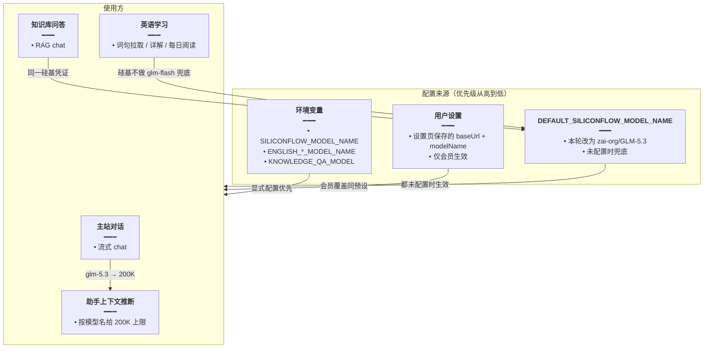

# 默认对话模型升级 GLM-5.3

> **状态**：已落地 | **日期**：2026-11-11 | **功能域**：模型接入
> **需求摘要**：硅基流动默认对话模型从 `Pro/zai-org/GLM-5.1` 换成 `zai-org/GLM-5.3`，覆盖主站对话、知识库问答、英语学习与助手上下文推断；设置页预设与多语言文案同步改名，用户没有手动配置时自动走新模型。

## 延伸阅读

- 模型工厂与预设：[创建LLM.md](./创建LLM.md)
- 设置页预设与联动：[LLM设置UI预设.md](./LLM设置UI预设.md)
- 硅基对话凭证与模型统一：[硅基对话统一.md](./硅基对话统一.md)
- 每日阅读的模型限制与兜底：[每日阅读限流降级.md](../english/每日阅读限流降级.md)

---

## 1. 背景与目标

硅基流动上线 GLM-5.3 后，`Pro/zai-org/GLM-5.1` 不再是推荐档位。本轮把**所有「未显式配置」的默认值**统一到新模型，并保证依赖模型名的分支同步更新：

1. **默认值集中在一处**：后端 `DEFAULT_SILICONFLOW_MODEL_NAME` 是各模块的兜底，改这里即可覆盖未配置环境。
2. **配置注释同步**：`ModelEnum` / `KnowledgeQaEnum` 的注释写明默认值，避免运维按旧名字排查。
3. **上下文推断补新名**：助手按模型名推断 200K 上下文，需同时识别 `glm-5.3` 与 `glm-5_3` 两种写法。
4. **自检用例换新名**：每日阅读的启动自检用真实默认模型验证「硅基不做 glm-flash 兜底」。
5. **前端预设与文案**：设置页的硅基流动联动预设改成新模型，i18n 键由 `glm51` 改为 `glm53`。

**不改的部分**：`DECIDE_MODEL_NAME`（短决策固定 `Qwen/Qwen3.6-35B-A3B`）、OCR 视觉模型、智谱 `GLM_MODEL_NAME`，它们有独立用途，不跟随对话模型。

## 2. 改动范围

| 层 | 路径 | 说明 |
| --- | --- | --- |
| 后端 | `apps/backend/src/utils/create-llm.ts` | 默认硅基模型常量 |
| 后端 | `apps/backend/src/enum/config.enum.ts` | 三处默认值注释 |
| 后端 | `apps/backend/src/services/assistant/assistant.service.ts` | 上下文上限推断补 `glm-5.3` |
| 后端 | `apps/backend/src/services/english-learning/reading-llm-limit.ts` | 启动自检模型名 |
| 前端 | `apps/frontend/src/views/setting/llm/index.tsx` | 环境默认值 + 服务商预设 |
| 前端 | `apps/frontend/src/i18n/locales/zh-CN/setting.ts` | 预设展示名 |
| 前端 | `apps/frontend/src/i18n/locales/en-US/setting.ts` | 预设展示名 |

## 3. 实现思路

### 3.1 默认值的生效链路



### 3.2 关键决策与权衡

| 决策 | 备选 | 为什么选它 |
| --- | --- | --- |
| 只改「默认值」不动已有用户设置 | 强制迁移所有用户模型 | 用户可能主动选了别的模型，强制改会覆盖偏好 |
| 模型名同时匹配 `glm-5.3` / `glm-5_3` | 只匹配点号 | 环境变量常用下划线写法，漏匹配会退到 32K 误判 |
| 保留 `glm-5.1` 匹配 | 直接删旧名 | 已有环境仍可能配置旧模型，删掉会让其上下文预算骤降 |
| 前端 i18n 键改名 `glm51 → glm53` | 沿用旧键只改文案 | 键名与模型语义一致，避免后人误以为还是 5.1 |
| 每日阅读自检换新名 | 保留旧名自检 | 自检要覆盖「真实默认模型」，旧名不再代表线上 |

## 4. 关键代码对比

### 4.1 默认模型常量 `DEFAULT_SILICONFLOW_MODEL_NAME`

**改动前** · `apps/backend/src/utils/create-llm.ts`（基线，约 L24–L25）

```typescript
// 各模块未配置 SILICONFLOW_MODEL_NAME 时的默认值（有效会员）
// 旧默认：带 Pro/ 前缀的 GLM-5.1
export const DEFAULT_SILICONFLOW_MODEL_NAME = 'Pro/zai-org/GLM-5.1';
```

**改动后** · `apps/backend/src/utils/create-llm.ts`（当前，约 L24–L25）

```typescript
// 各模块未配置 SILICONFLOW_MODEL_NAME 时的默认值（有效会员）
// 新默认：硅基流动上架的 GLM-5.3，去掉 Pro/ 前缀
export const DEFAULT_SILICONFLOW_MODEL_NAME = 'zai-org/GLM-5.3';
```

**变更摘要**：只改常量值；所有「未配置模型名」的调用方会同时切到新模型。

### 4.2 配置枚举注释

**对比范围**：三处 JSDoc 中的默认模型说明（仅注释变更，枚举成员与取值不变）。

**改动前** · `apps/backend/src/enum/config.enum.ts`（基线，约 L80、L93、L164）

```typescript
// 主站 Chat：模型名配置项的说明
/** 主站 Chat 流式对话：硅基流动 Chat 模型名，默认 Pro/zai-org/GLM-5.1。 */
// 英语学习词句拉取：说明同样写着旧默认（该段 JSDoc 在源码中位于 ZHIPU_API_KEY 上方，属历史漂移）
/** 英语学习词句拉取：硅基流动 Chat 模型名（`/v1/chat/completions`），默认 Pro/zai-org/GLM-5.1。 */
// 知识库 RAG 问答：说明写着旧默认
/** 知识库 RAG 问答 Chat 模型名（硅基流动 `/v1/chat/completions`），默认 Pro/zai-org/GLM-5.1。 */
```

**改动后** · `apps/backend/src/enum/config.enum.ts`（当前，约 L80、L93、L164）

```typescript
// 主站 Chat：模型名配置项的说明，默认名同步
/** 主站 Chat 流式对话：硅基流动 Chat 模型名，默认 zai-org/GLM-5.3。 */
// 英语学习词句拉取：说明同步为新默认（JSDoc 位置未调整）
/** 英语学习词句拉取：硅基流动 Chat 模型名（`/v1/chat/completions`），默认 zai-org/GLM-5.3。 */
// 知识库 RAG 问答：说明同步为新默认
/** 知识库 RAG 问答 Chat 模型名（硅基流动 `/v1/chat/completions`），默认 zai-org/GLM-5.3。 */
```

**变更摘要**：枚举成员 `SILICONFLOW_MODEL_NAME` / `KNOWLEDGE_QA_MODEL` 等取值不变，仅把注释里的默认模型改成新名字，避免运维按旧名排查。顺带记录：英语学习那段 JSDoc 实际挂在 `ZHIPU_API_KEY` 上方，属历史漂移，本轮未调整位置。

### 4.3 助手上下文上限推断

**对比范围**：`AssistantService.getModelOfficialMaxInputTokens` 全方法。

**改动前** · `apps/backend/src/services/assistant/assistant.service.ts`（基线，约 L259–L287）

```typescript
	/**
	 * 按模型名推断官方「最大输入上下文」；优先读 ASSISTANT_MODEL_MAX_INPUT_TOKENS。
	 */
	private getModelOfficialMaxInputTokens(modelName: string): number {
		// 环境变量显式覆盖优先
		const raw = this.configService.get<string>(
			// 配置键
			ModelEnum.ASSISTANT_MODEL_MAX_INPUT_TOKENS,
		);
		// 解析成数字；空值与非法值给 NaN
		const fromEnv =
			// 空值不解析成数字，避免 Number('') 得 0
			raw != null && raw !== '' ? Number.parseInt(raw, 10) : Number.NaN;
		// 合理下界 4096 才认可
		if (Number.isFinite(fromEnv) && fromEnv >= 4096) {
			// 取整返回
			return Math.floor(fromEnv);
		}

		// 模型名统一小写，便于包含匹配
		const name = modelName.toLowerCase();
		// GLM 4.7 / 5.x 文本模型按 200K 处理
		if (
			// 点号写法 4.7
			name.includes('glm-4.7') ||
			// 下划线写法 4.7
			name.includes('glm-4_7') ||
			// 点号写法 5.1
			name.includes('glm-5.1') ||
			// 下划线写法 5.1
			name.includes('glm-5_1')
		) {
			// 返回 200K
			return GLM_DEFAULT_MAX_INPUT_TOKENS;
		}
		// 其余 GLM-4 系列按 128K
		if (name.includes('glm-4')) {
			// 128K
			return 128_000;
		}
		// 未知模型给保守值
		return 32_000;
	}
```

**改动后** · `apps/backend/src/services/assistant/assistant.service.ts`（当前，约 L259–L287）

```typescript
	/**
	 * 按模型名推断官方「最大输入上下文」；优先读 ASSISTANT_MODEL_MAX_INPUT_TOKENS。
	 */
	private getModelOfficialMaxInputTokens(modelName: string): number {
		// 环境变量显式覆盖优先
		const raw = this.configService.get<string>(
			// 配置键
			ModelEnum.ASSISTANT_MODEL_MAX_INPUT_TOKENS,
		);
		// 解析成数字；空值与非法值给 NaN
		const fromEnv =
			// 空值不解析成数字，避免 Number('') 得 0
			raw != null && raw !== '' ? Number.parseInt(raw, 10) : Number.NaN;
		// 合理下界 4096 才认可
		if (Number.isFinite(fromEnv) && fromEnv >= 4096) {
			// 取整返回
			return Math.floor(fromEnv);
		}

		// 模型名统一小写，便于包含匹配
		const name = modelName.toLowerCase();
		// GLM 4.7 / 5.x 文本模型按 200K 处理
		if (
			// 点号写法 4.7
			name.includes('glm-4.7') ||
			// 下划线写法 4.7
			name.includes('glm-4_7') ||
			// 点号写法 5.1（兼容存量配置）
			name.includes('glm-5.1') ||
			// 下划线写法 5.1（兼容存量配置）
			name.includes('glm-5_1') ||
			// 点号写法 5.3（本轮新默认）
			name.includes('glm-5.3') ||
			// 下划线写法 5.3（环境变量常用写法）
			name.includes('glm-5_3')
		) {
			// 返回 200K
			return GLM_DEFAULT_MAX_INPUT_TOKENS;
		}
		// 其余 GLM-4 系列按 128K
		if (name.includes('glm-4')) {
			// 128K
			return 128_000;
		}
		// 未知模型给保守值
		return 32_000;
	}
```

**变更摘要**：新增 `glm-5.3` / `glm-5_3` 两个匹配分支，旧 5.1 分支保留以兼容存量环境；常量注释同步补 5.3。

### 4.4 每日阅读启动自检

**对比范围**：`assertReadingLlmLimitSelfCheck` 中「硅基流动不做 glm-flash 兜底」的断言片段（同函数其余断言未改动）。

**改动前** · `apps/backend/src/services/english-learning/reading-llm-limit.ts`（基线，约 L236–L244）

```typescript
	// 硅基流动的 GLM-5.1 不支持 glm-flash，兜底必须为空
	if (
		// 解析兜底模型
		resolveReadingFallback(
			// 旧默认模型
			'Pro/zai-org/GLM-5.1',
			// 硅基流动根路径
			'https://api.siliconflow.cn/v1',
		// 结束调用
		) != null
	) {
		// 有兜底即视为配置错误
		throw new Error('siliconflow must not glm-flash fallback');
	// 结束断言
	}
```

**改动后** · `apps/backend/src/services/english-learning/reading-llm-limit.ts`（当前，约 L237–L244）

```typescript
	// 硅基流动的 GLM-5.3 不支持 glm-flash，兜底必须为空
	if (
		// 解析兜底模型
		resolveReadingFallback(
			// 新默认模型，与线上实际一致
			'zai-org/GLM-5.3',
			// 硅基流动根路径
			'https://api.siliconflow.cn/v1',
		// 结束调用
		) != null
	) {
		// 有兜底即视为配置错误
		throw new Error('siliconflow must not glm-flash fallback');
	// 结束断言
	}
```

**变更摘要**：自检输入换成真实默认模型；断言逻辑不变。

### 4.5 设置页环境默认值

**改动前** · `apps/frontend/src/views/setting/llm/index.tsx`（基线，约 L56–L58）

```typescript
// 读取环境变量里的硅基模型名
function readEnvSiliconflowModelName(): string {
	// 环境变量优先，未配置时用旧默认
	return readEnvTrimmed('VITE_SILICONFLOW_MODEL_NAME') || 'Pro/zai-org/GLM-5.1';
}
```

**改动后** · `apps/frontend/src/views/setting/llm/index.tsx`（当前，约 L56–L58）

```typescript
// 读取环境变量里的硅基模型名
function readEnvSiliconflowModelName(): string {
	// 环境变量优先，未配置时用新默认
	return readEnvTrimmed('VITE_SILICONFLOW_MODEL_NAME') || 'zai-org/GLM-5.3';
}
```

**变更摘要**：设置页初始展示与后端默认值保持一致，避免前后端显示不同模型。

### 4.6 服务商联动预设

**改动前** · `apps/frontend/src/views/setting/llm/index.tsx`（基线，约 L86–L92）

```typescript
	// 硅基流动预设：旧模型 + 旧文案键
	{
		// 服务商根路径
		baseUrl: 'https://api.siliconflow.cn/v1',
		// 旧默认模型
		modelName: 'Pro/zai-org/GLM-5.1',
		// Base URL 展示文案
		baseUrlLabelKey: 'setting.llm.baseUrlOption.siliconflow' as const,
		// 模型展示文案键：glm51
		modelLabelKey: 'setting.llm.modelOption.glm51' as const,
	},
```

**改动后** · `apps/frontend/src/views/setting/llm/index.tsx`（当前，约 L86–L92）

```typescript
	// 硅基流动预设：新模型 + 新文案键
	{
		// 服务商根路径
		baseUrl: 'https://api.siliconflow.cn/v1',
		// 新默认模型
		modelName: 'zai-org/GLM-5.3',
		// Base URL 展示文案
		baseUrlLabelKey: 'setting.llm.baseUrlOption.siliconflow' as const,
		// 模型展示文案键：glm53
		modelLabelKey: 'setting.llm.modelOption.glm53' as const,
	},
```

**变更摘要**：预设的模型值与文案键同时改名；`LLM_BASE_URL_TO_MODEL` / `LLM_MODEL_TO_BASE_URL` 由该数组派生，联动关系自动生效。

### 4.7 多语言预设文案

**改动前** · `apps/frontend/src/i18n/locales/zh-CN/setting.ts`（基线，约 L151）／`apps/frontend/src/i18n/locales/en-US/setting.ts`（基线，约 L157）

```typescript
// 中文：旧键名 glm51，展示旧模型
'setting.llm.modelOption.glm51': 'Pro/zai-org/GLM-5.1',
// 英文：旧键名与旧模型
'setting.llm.modelOption.glm51': 'Pro/zai-org/GLM-5.1',
```

**改动后** · `apps/frontend/src/i18n/locales/zh-CN/setting.ts`（当前，约 L151）／`apps/frontend/src/i18n/locales/en-US/setting.ts`（当前，约 L157）

```typescript
// 中文：新键名 glm53，展示新模型
'setting.llm.modelOption.glm53': 'zai-org/GLM-5.3',
// 英文：新键名与新模型
'setting.llm.modelOption.glm53': 'zai-org/GLM-5.3',
```

**变更摘要**：键名与模型名同时更新；旧键已无引用，若其它分支仍在用会直接显形为缺失文案，便于发现遗漏。

## 5. 兼容性与影响

- **已有用户设置**：数据库里已保存的 `modelName` 不受影响；只有「未配置 / 走默认」的用户切到新模型。
- **环境变量**：已配置 `SILICONFLOW_MODEL_NAME` / `VITE_SILICONFLOW_MODEL_NAME` 的部署保持原值，需要新模型时应显式改名或删掉变量。
- **上下文预算**：默认模型变为 `glm-5.3` 后，助手按 200K 推断；若线上模型实际上限不同，用 `ASSISTANT_MODEL_MAX_INPUT_TOKENS` 覆盖。
- **每日阅读兜底**：硅基流动仍不启用 glm-flash 兜底；重试策略只针对智谱 1305 过载。
- **短决策模型不变**：`DECIDE_MODEL_NAME` 仍为 `Qwen/Qwen3.6-35B-A3B`，不随对话模型漂移。
- **前端文案缺失风险**：任何仍引用 `setting.llm.modelOption.glm51` 的地方会失去文案，构建时应搜索确认无残留。

### 回归建议

1. 未配置模型名的环境启动后，主站对话请求体中的 `model` 为 `zai-org/GLM-5.3`。
2. 知识库问答与英语学习词句拉取同样走新模型。
3. 助手长对话（> 32K）不再被误判截断，能用到约 200K 预算。
4. 设置页打开 → 硅基流动预设显示 `zai-org/GLM-5.3`；选 Base URL 自动联动模型名，反向亦然。
5. 中英文界面预设文案一致，无缺失键。
6. 每日阅读启动自检通过（硅基不产生 glm-flash 兜底）。
7. 显式配置旧模型 `Pro/zai-org/GLM-5.1` 的环境仍能正常对话（上下文按 200K 推断）。

## 6. 相关源码路径

| 说明 | 路径 |
| --- | --- |
| 模型工厂与默认值 | `apps/backend/src/utils/create-llm.ts` |
| 配置枚举注释 | `apps/backend/src/enum/config.enum.ts` |
| 助手上下文推断 | `apps/backend/src/services/assistant/assistant.service.ts` |
| 每日阅读自检 | `apps/backend/src/services/english-learning/reading-llm-limit.ts` |
| 设置页预设 | `apps/frontend/src/views/setting/llm/index.tsx` |
| 中文文案 | `apps/frontend/src/i18n/locales/zh-CN/setting.ts` |
| 英文文案 | `apps/frontend/src/i18n/locales/en-US/setting.ts` |

---

（若与仓库最新源码不一致，以源码为准）
