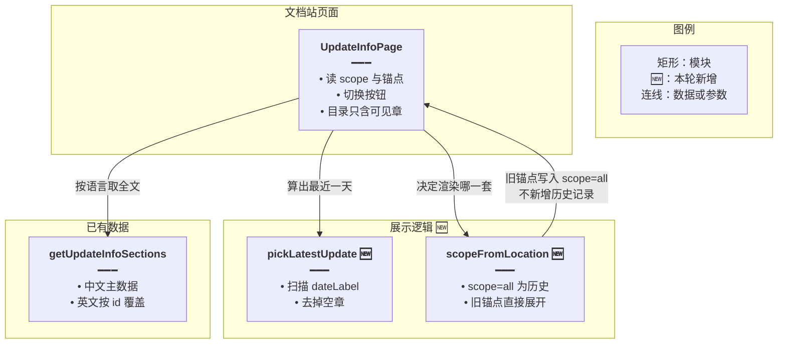
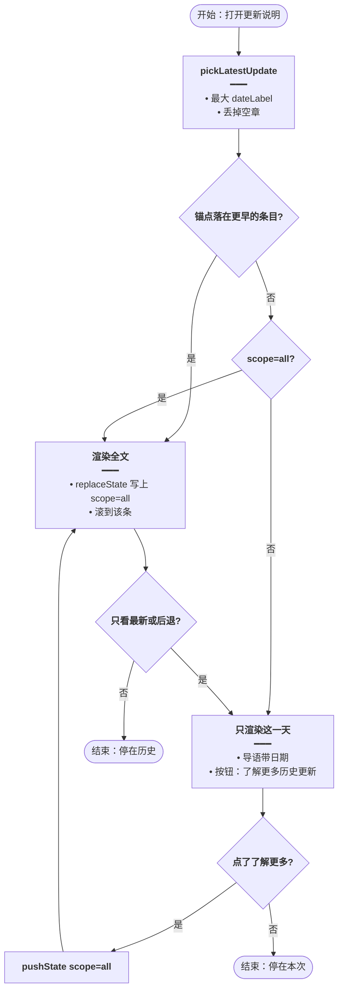

# 更新信息只看最新

> **文档角色**：本功能的实现归档（主文档）。  
> **延伸阅读**：方案比对见 [ideas/更新信息只看最新.md](../ideas/更新信息只看最新.md)。维护约定见本仓 `.cursor/skills/implementation-doc-from-diff/references/product-user-docs.md` §2。

## 1. 背景与目标

更新说明页原先把全部分域历史一次铺开。使用者从关于页或下载页进来，是想看这次写了什么。

本轮不另做一份「最新」清单，也不按安装包版本切正文。每条已有 `dateLabel`（`YYYY-MM-DD`）。页面取全表最大的那一天作为默认视图；`?scope=all` 或「了解更多历史更新」才渲染原来的全文。旧锚点若不在这一天里，进入时直接展开历史并滚到该条。

## 2. 改动范围

- `../micro-apps/remote-docs/src/views/updateInfo/index.tsx`
- `../micro-apps/remote-docs/src/views/updateInfo/updateInfoSections.ts`（挑选、地址栏、导语；另追加产品条目 `s21-4`）
- `../micro-apps/remote-docs/src/views/updateInfo/updateInfoSectionsEnOverlay.ts`（最新导语英文、`s21-4`）
- `../micro-apps/remote-docs/src/i18n/index.tsx`（两个按钮文案）
- `../micro-apps/remote-docs/src/views/projectGuide/projectGuideSections.ts` 与 `projectGuideSectionsEnOverlay.ts`（指南里「怎么看更新说明」）
- `../micro-apps/remote-docs/wiki/项目更新信息.md`、`../micro-apps/remote-docs/wiki/项目指南.md`
- 本仓 `.cursor/skills/implementation-doc-from-diff/SKILL.md` 与 `references/product-user-docs.md`、`references/product-pages-sync.md`（写更新文时日期必须是当天，预览先看默认视图）

主站关于页、下载页和 `latest.json` 的地址没有改。它们本来就不带 `scope`，打开后就是最新一天。

## 3. 实现思路

- 「本次」= 全表最大 `dateLabel`。写作约定已是「日期写当天、追加到原产品章」，所以新条只要日期是发布日，就会自动出现在默认视图。
- 不拆 Markdown、不加批次号。跨两天却必须同屏时，把这几条的日期写成同一个发布日。
- 范围放在地址栏：缺省是最新，只有 `scope=all` 是历史。语言、主题、强调色仍留在同一条 URL 上。
- 按钮切换用 `pushState`，浏览器后退能回到上一个范围。旧锚点强制展开用 `replaceState`，避免打开书签多一层历史。回到最新时清掉 hash，否则刷新又会被旧锚点展开。
- 没有任何日期时渲染全文，避免空白页。
- 目录继续用现有 `tocFromSections`，只传入当前要显示的章节。



**读图要点**：裁剪发生在文档站页面。主站外链和安装包更新说明仍只打开不带 `scope` 的地址。英文覆盖不改日期，两种语言滤出来的是同一天。



**读图要点**：默认路径不渲染全文。旧锚点在首屏就已经是历史，中间不闪短列表。

## 4. 关键代码对比与注释

### 4.1 `UpdateInfoPage`（`../micro-apps/remote-docs/src/views/updateInfo/index.tsx`）

**对比范围**：`UpdateInfoPage` 全函数。基线把 `getUpdateInfoSections` 的结果全部渲染；当前按 `scope` 在最新一天和全文之间切换。

**改动前** · `../micro-apps/remote-docs/src/views/updateInfo/index.tsx`（基线，约 L11–L70）

```tsx
// 旧页面只有一种视图：当前语言下的全部分域条目
export default function UpdateInfoPage() {
	// 文案和语言都来自文档站 i18n，当时没有最新/历史两套导语
	const { t, locale } = useI18n();
	// 全文即可见内容，语言一变就整表重取，避免中英文各维护一份列表
	const sections = useMemo(() => getUpdateInfoSections(locale), [locale]);
	// 页首始终是能力总目录那段说明，没有「这一天」的短导语
	const intro = useMemo(() => getUpdateInfoIntro(locale), [locale]);
	// 目录按全文生成，所以一打开就是 25 章
	const toc = useMemo(() => tocFromSections(sections), [sections]);
	// 目录无障碍名称随语言变，不进章节数据
	const tocLabel = locale === 'en-US' ? 'Contents' : '目录';
	// 返回整页结构；范围和导语已经在函数上方算完，JSX 只负责排出来
	return (
		// 整页撑满文档站壳，避免更新说明自己再滚一层窗口
		<div className="relative flex h-full min-h-0 w-full flex-col overflow-hidden bg-theme-background text-textcolor">
			// 顶栏标题走路由文案，独立站才显示，嵌入主站时 Header 自己返回空
			<Header
				// 与路由表「更新信息」同一句，避免页内再写死标题
				title={t('route.updateInfo.title')}
				// 卷轴图标只作识别，不参与数据
				icon={ScrollText}
				// 琥珀色和其它文档页的图标色区分开
				iconClassName="size-5 shrink-0 text-amber-400"
			/>
			// 目录和正文共用全文，没有第二套数据
			<DocToc toc={toc} label={tocLabel}>
				// 正文宽度限制在阅读行宽，和产品指南页一致
				<main className="mx-auto w-full max-w-4xl p-4">
					// 总目录导语，下方直接接全部章节
					<p className="mb-10 text-[15px] leading-7 text-textcolor/72">
						// 插值是整段说明，没有日期
						{intro}
					// 段落到此结束，后面才接按钮或下一条
					</p>
					// 每一章都渲染，空章在数据里本来就不存在
					{sections.map((section) => (
						// 章与章之间留出滚动间距，最后一章不再多垫一块
						<section key={section.id} className="pb-14 last:pb-4">
							// 章标题的 id 给目录锚点用
							<h2
								// 与目录项 id 相同，点击目录才能滚到这章
								id={section.id}
								// scroll-mt 避开顶栏遮挡
								className="mb-6 scroll-mt-4 text-base font-semibold text-textcolor sm:text-lg"
							>
								// 章名已含序号，页面不再另编
								{section.title}
							// 章标题结束，目录锚点使用的 id 在开标签上
							</h2>
							// 章内条目纵向排开
							<div className="flex flex-col gap-8">
								// 一条能力一块，key 用稳定 id，避免日期改了以后错位
								{section.items.map((item) => (
									// 一条更新一块；key 用稳定 id，日期改了也不会把相邻条对错
									<article key={item.id}>
										// 窄屏标题和日期上下排，宽屏同一行两端对齐
										<div className="flex flex-col gap-2 sm:flex-row sm:items-baseline sm:justify-between sm:gap-6">
											// 条目标题也是锚点
											<h3
												// id 与目录三级项一致
												id={item.id}
												// 标题留出滚动边距，避免被滚动容器顶边挡住
												className="scroll-mt-4 text-[15px] font-medium leading-snug text-textcolor"
											>
												// 标题是产品语言，不含路径
												{item.title}
											// 条目标题结束
											</h3>
											// dateTime 用原始日期，便于机器读
											<time
												// 机器可读日期用数据原值，不带「更新：」前缀
												dateTime={item.dateLabel}
												// 日期不换行、用等宽数字，避免标题长短把日期挤变形
												className="shrink-0 text-xs tabular-nums text-textcolor/45"
											>
												// 「更新：日期」走 i18n，中英文前缀不同
												{t('updateInfoPage.item.dateLabel', {
													// 展示用的就是数据里的 dateLabel
													date: item.dateLabel,
												// 日期参数到此结束，前缀「更新：」由文案表拼接
												})}
											// 日期节点结束
											</time>
										// 这一层布局结束，不把间距留到下一章
										</div>
										// 正文是一段说明，不解析 Markdown
										<p className="mt-2.5 text-[14px] leading-7 text-textcolor/68">
											// 正文是已写好的一段说明，页面不再解析 Markdown
											{item.description}
										// 段落到此结束，后面才接按钮或下一条
										</p>
									// 这一条结束，下一条仍在同一章里
									</article>
								// 这一层 map 结束，回到上一层章节或正文
								))}
							// 这一层布局结束，不把间距留到下一章
							</div>
						// 这一章结束，下一章从新的标题开始
						</section>
					// 这一层 map 结束，回到上一层章节或正文
					))}
				// 正文结束，滚动发生在外层 viewport
				</main>
			// 目录和正文这一对结束
			</DocToc>
		// 这一层布局结束，不把间距留到下一章
		</div>
	);
}
```

**改动后** · `../micro-apps/remote-docs/src/views/updateInfo/index.tsx`（当前，约 L29–L145）

```tsx
// 页面仍是同一个组件，默认只画最近一天，历史留在同页
export default function UpdateInfoPage() {
	// t 出按钮文案，locale 决定章节语言和导语语言
	const { t, locale } = useI18n();
	// 全文仍一次性取出，了解更多不再发请求
	const all = useMemo(() => getUpdateInfoSections(locale), [locale]);
	// 最近一天从这份全文算，语言切换不必重扫另一套英文表
	const latest = useMemo(() => pickLatestUpdate(all), [all]);
	// 首屏以地址栏为准：旧锚点在初始化时就已经是 all，避免先画短列表
	const [scope, setScope] = useState<UpdateScope>(() => readScope(locale));
	// 按钮和后退要滚回顶部；锚点进入时不能被这次滚动盖掉
	const scrollTop = useRef(false);
	// 没有日期时不进短列表，否则主栏是空的
	const showingLatest = scope === 'latest' && latest.dateLabel !== '';
	// 导语、按钮、目录、正文共用这一份，避免各滤一次
	const visible = showingLatest ? latest.sections : all;
	// 最新视图用带日期的短导语，历史视图沿用原来的总目录说明
	const intro = showingLatest
		// 日期来自 pickLatestUpdate，中英文模板各自替换 {date}
		? getUpdateInfoLatestIntro(locale, latest.dateLabel)
		// 全文导语不带日期，避免历史页也被说成「这一天」
		: getUpdateInfoIntro(locale);
	// 目录只含当前可见章，最新视图不会再列出全部历史
	const toc = useMemo(() => tocFromSections(visible), [visible]);
	// 目录名称仍只随语言变
	const tocLabel = locale === 'en-US' ? 'Contents' : '目录';
	// 旧锚点把 state 设成 all 之后，地址栏还没有 scope 时补上，且不压新历史
	useEffect(() => {
		// 已经是 scope=all 的链接不要再 replace，否则后退栈会被改写
		if (scope === 'all' && readUpdateScope(window.location.search) !== 'all') {
			// replace 不压栈，打开旧书签再后退会离开文档站，而不是多停一层
			setUpdateScope('all', 'replace');
		}
	// scope 变了才再判断，按钮 push 之后 search 已经是 all，不会重复写
	}, [scope]);
	// 文档站路由只同步 pathname，后退改 search 时要自己重读 scope
	useEffect(() => {
		// 回到最新，或历史页没有锚点时，滚回顶部；带着锚点回来则交给下面的滚动
		const onPop = () => {
			// 后退后的范围只看 search，hash 留给滚动
			const next = readUpdateScope(window.location.search);
			// 没有 # 时后面没有标题可滚
			const id = window.location.hash.replace(/^#/, '');
			// 回到最新，或历史页没有锚点，才强制回顶
			scrollTop.current = next === 'latest' || !id;
			// 与地址栏对齐，不在 pop 里再改 history
			setScope(next);
		};
		// popstate 不会由 pushState 触发，按钮切换另写 setScope
		window.addEventListener('popstate', onPop);
		// 离开页面就摘掉监听，避免卸掉更新页后还 setState
		return () => window.removeEventListener('popstate', onPop);
	// 监听与 scope 无关，只挂一次
	}, []);
	// 布局提交后再滚，旧锚点的标题已经在 DOM 里
	useLayoutEffect(() => {
		// 正文滚的是目录组件里的 viewport，不是 window
		const viewport = document
			// 正文 main 在目录的滚动视口里面，不能滚 window
			.querySelector('main')
			// Radix viewport 才是实际滚动的节点
			?.closest<HTMLElement>('[data-slot="scroll-area-viewport"]');
		// 按钮或后退要求回顶时，不再去对旧 hash
		if (scrollTop.current) {
			// 用完就清，下一次锚点进入才不会被当成回顶
			scrollTop.current = false;
			// 切视图后停在旧偏移会看不到导语
			viewport?.scrollTo({ top: 0 });
			// 已经滚回顶部，不再按 hash 跳，避免刚回顶又被锚点拉走
			return;
		}
		// 没有要求回顶时，才按地址栏锚点滚
		const id = window.location.hash.replace(/^#/, '');
		// 没有锚点就保持当前位置
		if (!id) return;
		// 与目录点击同一方式，章标题的 scroll-mt 仍然生效
		document.getElementById(id)?.scrollIntoView({ block: 'start' });
	// 范围或可见章节变了，标题节点才可能刚挂上
	}, [scope, visible]);
	// 最新和历史互相切换；没有日期时按钮不渲染，这里也不会被点到
	const onToggle = useCallback(() => {
		// 当前是最新就去历史，当前是历史就回最新
		const next: UpdateScope = showingLatest ? 'all' : 'latest';
		// 切换后回顶，避免停在上一视图的滚动位置
		scrollTop.current = true;
		// 先改地址栏再改 state，effect 里不会把刚 push 的 all 再 replace 一次
		setUpdateScope(next, 'push');
		// state 跟上地址栏，按钮文案和可见章节一起变
		setScope(next);
	// showingLatest 变了，下一次点击的方向才对
	}, [showingLatest]);
	// 返回整页结构；范围和导语已经在函数上方算完，JSX 只负责排出来
	return (
		// 整页撑满文档站壳，更新说明不再自己滚 window
		<div className="relative flex h-full min-h-0 w-full flex-col overflow-hidden bg-theme-background text-textcolor">
			// 顶栏标题仍走路由文案
			<Header
				// 与「更新信息」路由同一句
				title={t('route.updateInfo.title')}
				// 卷轴图标只作识别
				icon={ScrollText}
				// 琥珀色和其它文档页区分
				iconClassName="size-5 shrink-0 text-amber-400"
			/>
			// 目录数据已经是 visible，不是全文
			<DocToc toc={toc} label={tocLabel}>
				// 阅读行宽与改动前相同
				<main className="mx-auto w-full max-w-4xl p-4">
					// 导语和按钮之间的间距改到按钮上，没有按钮时用下面的空垫
					<p className="text-[15px] leading-7 text-textcolor/72">{intro}</p>
					// 有日期才提供切换；全表没有日期时只显示全文
					{latest.dateLabel ? (
						// 用现有链接按钮，不新做一种控件
						<Button
							// 明确是按钮，避免链接触发导航
							type="button"
							// 链接样式，不做成第二主按钮
							variant="link"
							// 上贴导语、下留出到章节的距离
							className="mt-3 mb-10 h-auto px-0"
							// 点一下在最新和历史之间切换
							onClick={onToggle}
						>
							// 当前是最新就去历史，当前是历史就回最新
							{showingLatest
								// 历史入口的文案
								? t('updateInfoPage.latest.more')
								// 从历史回到本次的文案
								: t('updateInfoPage.latest.only')}
						// 切换按钮结束
						</Button>
					// 没有可展示的日期时，不渲染按钮，改走下面的间距
					) : (
						// 没有切换按钮时仍留出导语和正文的间距
						<div className="mb-10" />
					// 有日期与无日期两个分支到此结束
					)}
					// 渲染可见章，不再写死全文
					{visible.map((section) => (
						// 章间距与改动前相同，最后一章不再多垫
						<section key={section.id} className="pb-14 last:pb-4">
							// 章标题仍是目录锚点
							<h2
								// id 与目录二级项相同
								id={section.id}
								// scroll-mt 避开滚动容器顶部遮挡
								className="mb-6 scroll-mt-4 text-base font-semibold text-textcolor sm:text-lg"
							>
								// 章名已含序号
								{section.title}
							// 章标题结束，目录锚点使用的 id 在开标签上
							</h2>
							// 章内条目纵向排开
							<div className="flex flex-col gap-8">
								// 一条能力一块，key 仍是稳定 id
								{section.items.map((item) => (
									// 一条更新一块；key 用稳定 id，日期改了也不会把相邻条对错
									<article key={item.id}>
										// 窄屏上下排，宽屏标题和日期同一行
										<div className="flex flex-col gap-2 sm:flex-row sm:items-baseline sm:justify-between sm:gap-6">
											// 条目标题也是锚点
											<h3
												// 与目录三级项 id 相同
												id={item.id}
												// 标题留出滚动边距，避免被滚动容器顶边挡住
												className="scroll-mt-4 text-[15px] font-medium leading-snug text-textcolor"
											>
												// 标题是产品语言
												{item.title}
											// 条目标题结束
											</h3>
											// dateTime 给机器读原始日期
											<time
												// 机器可读日期用数据原值，不带「更新：」前缀
												dateTime={item.dateLabel}
												// 日期不换行、用等宽数字，避免标题长短把日期挤变形
												className="shrink-0 text-xs tabular-nums text-textcolor/45"
											>
												// 「更新：日期」的前缀走 i18n
												{t('updateInfoPage.item.dateLabel', {
													// 展示的就是这条的 dateLabel
													date: item.dateLabel,
												// 日期参数到此结束，前缀「更新：」由文案表拼接
												})}
											// 日期节点结束
											</time>
										// 这一层布局结束，不把间距留到下一章
										</div>
										// 正文仍是一段说明，不解析 Markdown
										<p className="mt-2.5 text-[14px] leading-7 text-textcolor/68">
											// 正文是已写好的一段说明，页面不再解析 Markdown
											{item.description}
										// 段落到此结束，后面才接按钮或下一条
										</p>
									// 这一条结束，下一条仍在同一章里
									</article>
								// 这一层 map 结束，回到上一层章节或正文
								))}
							// 这一层布局结束，不把间距留到下一章
							</div>
						// 这一章结束，下一章从新的标题开始
						</section>
					// 这一层 map 结束，回到上一层章节或正文
					))}
				// 正文结束，滚动发生在外层 viewport
				</main>
			// 目录和正文这一对结束
			</DocToc>
		// 这一层布局结束，不把间距留到下一章
		</div>
	);
}
```

**变更摘要**：默认数据从全文改成 `visible`。增加范围 state、地址栏同步、切换按钮和两种导语。条目卡片的排版没有改。

### 4.2 `readScope`（`../micro-apps/remote-docs/src/views/updateInfo/index.tsx`）

**对比范围**：`readScope` 全函数。基线中不存在。

**改动后** · `../micro-apps/remote-docs/src/views/updateInfo/index.tsx`（新增，约 L18–L27）

```tsx
// 首屏范围必须在第一次 render 就算完，不能等 effect 再从短列表跳到历史
function readScope(locale: Parameters<typeof getUpdateInfoSections>[0]): UpdateScope {
	// 无 window 时无法读地址栏，先按最新，独立站实际在浏览器里运行
	if (typeof window === 'undefined') return 'latest';
	// 用当前语言的全文判断锚点 id 在不在，英文覆盖不改 id
	const all = getUpdateInfoSections(locale);
	// 搜索、hash、全文、最近一天四份一起交给纯函数，页面不再各写一遍判断
	return scopeFromLocation(
		// 只从 search 读 scope，外链没带这个参数就是最新
		window.location.search,
		// hash 用来区分本次锚点和更早的锚点
		window.location.hash,
		// 全文用来确认 id 存在
		all,
		// 最近一天用来判断这个锚点要不要展开历史
		pickLatestUpdate(all).sections,
	);
}
```

**变更摘要**：纯新增。把「旧锚点是否强制历史」从渲染里拆出去，保证首屏 state 已经是最终范围。

### 4.3 `pickLatestUpdate`（`../micro-apps/remote-docs/src/views/updateInfo/updateInfoSections.ts`）

**对比范围**：`pickLatestUpdate` 全函数。基线中不存在。

**改动后** · `../micro-apps/remote-docs/src/views/updateInfo/updateInfoSections.ts`（新增，约 L3329–L3347）

```tsx
// 从已本地化的全文算出「本次」，调用方不用再扫日期
export function pickLatestUpdate(sections: UpdateInfoSection[]): {
	// 最大更新日期；空串表示没有日期，调用方应渲染全文
	dateLabel: string;
	// 仍是原章节结构，目录函数不用换
	sections: UpdateInfoSection[];
// 返回类型单独一行，是为了把 dateLabel 和 sections 两个字段写清楚
} {
	// YYYY-MM-DD 的字符串顺序就是时间顺序，不必解析成 Date
	let dateLabel = '';
	// 按现有章节顺序扫描，后写的条可能日期更早，不能只看章末
	for (const section of sections) {
		// 章内后写的条日期可能更早，必须逐条比
		for (const item of section.items) {
			// 更大的日期才覆盖；相等时保留先看到的值，结果仍是同一天
			if (item.dateLabel > dateLabel) dateLabel = item.dateLabel;
		}
	}
	// 没有日期就原样返回，避免上线后空白
	if (!dateLabel) return { dateLabel: '', sections };
	// 先按天筛条目，再丢掉因此变空的章，目录才不会出现没正文的标题
	const next = sections
		// 展开原章是为了保留 id 和标题
		.map((section) => ({
			// 章节 id 和标题沿用原文，锚点不用改
			...section,
			// 只留发布日当天的条
			items: section.items.filter((item) => item.dateLabel === dateLabel),
		// map 回调结束，下一行丢掉因此变空的章
		}))
		// 当天没写到的产品章不出现在默认目录
		.filter((section) => section.items.length > 0);
	// 日期一并返回，导语不用再扫一遍
	return { dateLabel, sections: next };
}
```

**变更摘要**：纯新增。同一天的条目全部保留，更早的留给历史视图。

### 4.4 `scopeFromLocation` 与 `setUpdateScope`

**对比范围**：两个全函数。基线中不存在。

**改动后** · `../micro-apps/remote-docs/src/views/updateInfo/updateInfoSections.ts`（新增，约 L3368–L3393）

```tsx
// 地址栏优先于锚点：已经声明要看历史时，不再被 hash 改回最新
export function scopeFromLocation(
	// 当前 search，只认 scope
	search: string,
	// 当前 hash，用来判断是不是旧条目
	hash: string,
	// 全文，用来确认这个 id 确实存在
	all: UpdateInfoSection[],
	// 最近一天，用来区分「锚点就在本次」和「锚点在历史」
	latestSections: UpdateInfoSection[],
// 返回值只有 latest 或 all，调用方不用再解释其它字符串
): UpdateScope {
	// 显式 scope=all 直接是历史，包含刷新和转发来的链接
	if (readUpdateScope(search) === 'all') return 'all';
	// 去掉 #，空 hash 表示没有锚点
	const id = hash.replace(/^#/, '');
	// 没有锚点就按默认：最新
	if (!id) return 'latest';
	// 锚点就在最近一天里，留在短列表并滚到它
	if (updateInfoHasId(latestSections, id)) return 'latest';
	// 锚点在更早的条目里，首屏直接是全文
	if (updateInfoHasId(all, id)) return 'all';
	// 未知锚点不展开历史，避免随便一个 hash 把全文拉出来
	return 'latest';
}

// 按钮用 push，旧锚点补参数用 replace。回到最新时清掉 hash，否则刷新又会被旧锚点展开
export function setUpdateScope(next: UpdateScope, mode: 'push' | 'replace') {
	// 基于当前 URL 改，lang、theme、accent 会留下来
	const url = new URL(window.location.href);
	// 历史必须写进链接，刷新才还停在全文
	if (next === 'all') url.searchParams.set('scope', 'all');
	// 不是历史就是回到最新，不能把其它取值写成 scope
	else {
		// 最新视图不写 scope=latest，缺省和无参数是同一种状态
		url.searchParams.delete('scope');
		// 留下旧锚点的话，下一次打开会再次走 scopeFromLocation 的历史分支
		url.hash = '';
	}
	// 按钮压栈才能后退；锚点用替换，打开书签不会多一层
	const write =
		// push 留给按钮，replace 留给旧锚点补参数
		mode === 'push' ? window.history.pushState : window.history.replaceState;
	// history.state 文档站路由不读，传 null
	write.call(window.history, null, '', url.toString());
}
```

**变更摘要**：纯新增。范围只有「最新 / 全部」两种，并且和锚点、后退共用这一套判断。

### 4.5 按钮文案（`../micro-apps/remote-docs/src/i18n/index.tsx`）

**对比范围**：`messages` 全文案表。中间未改的路由、导航、首页文案用 `// ...` 对称省略，只展开日期前缀和本轮新增的两个按钮键。

**改动前** · `../micro-apps/remote-docs/src/i18n/index.tsx`（基线，约 L13–L51）

```tsx
// 中英文案放在同一张表，页面用当前 locale 取值
const messages = {
	// 中文是默认语言
	'zh-CN': {
		// 以下路由、顶栏、导航文案本轮未改
		// ...
		// 条目日期前缀已经存在，按钮不能复用这句
		'updateInfoPage.item.dateLabel': '更新：{date}',
		// 导航和首页文案本轮未改
		// ...
	},
	// 英文按同一批 key 覆盖
	'en-US': {
		// 以下英文路由与导航文案本轮未改
		// ...
		// 英文日期前缀，和中文同一 key
		'updateInfoPage.item.dateLabel': 'Updated: {date}',
		// 其余英文文案本轮未改
		// ...
	},
};
```

**改动后** · `../micro-apps/remote-docs/src/i18n/index.tsx`（当前，约 L13–L55）

```tsx
// 中英文案放在同一张表，页面用当前 locale 取值
const messages = {
	// 中文是默认语言
	'zh-CN': {
		// 以下路由、顶栏、导航文案本轮未改
		// ...
		// 条目日期前缀保持原句，按钮另起 key
		'updateInfoPage.item.dateLabel': '更新：{date}',
		// 最新视图上的入口，点了才展开历史
		'updateInfoPage.latest.more': '了解更多历史更新',
		// 历史视图上的返回，点了回到最近一天
		'updateInfoPage.latest.only': '只看最新',
		// 导航和首页文案本轮未改
		// ...
	},
	// 英文按同一批 key 覆盖
	'en-US': {
		// 以下英文路由与导航文案本轮未改
		// ...
		// 英文日期前缀，和中文同一 key
		'updateInfoPage.item.dateLabel': 'Updated: {date}',
		// 与中文「了解更多历史更新」同一 key
		'updateInfoPage.latest.more': 'See earlier updates',
		// 与中文「只看最新」同一 key
		'updateInfoPage.latest.only': 'Latest only',
		// 其余英文文案本轮未改
		// ...
	},
};
```

**变更摘要**：只加两个按钮 key。日期前缀、路由标题没有改。

## 5. 行为变化与兼容性

- 不带 `scope`、也不带旧锚点的 `/update-info` 从「全部历史」变成「最近一天」。这是本需求要的默认行为。
- `?scope=all` 仍是原来的分域全文。
- `#` 指向更早条目的旧书签会自动变成 `?scope=all` 并滚到该条。
- 关于页、下载页的外链不用改。切换语言不会清掉 `scope`。
- 新条目要出现在默认视图，`dateLabel` 必须是全表最大的那一天。只在正文里写「某日补充」、不改日期，不会升到本次。
- 后续可做：若产品坚持「昨天加今天算一次」，应改这几条的 `dateLabel`，而不是在页面里加滑动窗口。

## 6. 测试与回归建议

- 打开 `/update-info`：只有最大 `dateLabel` 那天，导语含该日期，目录没有更早的章。
- 点「了解更多历史更新」：地址栏出现 `scope=all`，原产品章和历史条目都在。点「只看最新」或后退后回到这一天，并滚回顶部。
- 打开指向更早条目的 hash：首屏就是全文，该标题在视口内。
- 带 `lang=en-US` 再点了解更多：英文标题与中文同一批 id，`lang` 还在。
- `pickLatestUpdate` 的自检在直接执行 `updateInfoSections.ts` 时运行：最大日期的条目都在、空章被丢掉、空日期退回全文、旧锚点得到 `all`。页面 import 不会跑这段。

## 7. 相关文档与代码索引

| 说明 | 路径 |
|------|------|
| 页面 | `../micro-apps/remote-docs/src/views/updateInfo/index.tsx` |
| 挑选与地址栏 | `../micro-apps/remote-docs/src/views/updateInfo/updateInfoSections.ts` |
| 英文导语与条目 | `../micro-apps/remote-docs/src/views/updateInfo/updateInfoSectionsEnOverlay.ts` |
| 按钮文案 | `../micro-apps/remote-docs/src/i18n/index.tsx` |
| 方案比对 | `../micro-apps/remote-docs/wiki/ideas/更新信息只看最新.md` |

---

（若与仓库最新源码不一致，以源码为准）
