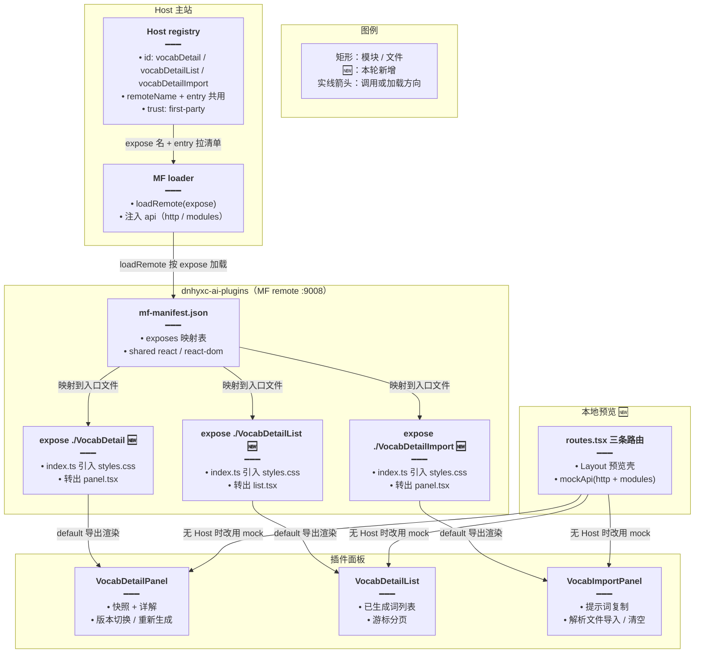

# 单词详解插件接入（VocabDetail / VocabDetailList / VocabDetailImport）

> 文档角色：本轮在 `dnhyxc-ai-plugins` 新增三个「单词详解」远程插件（详情面板、已生成列表、手动导入面板）的接入归档，覆盖 Module Federation 暴露、独立预览路由、预览壳导航、首页目录与中英文案登记。面板内部业务逻辑不在本篇展开。
>
> **当前 Host 契约**：旧的 `modules:vocabDetail` / `modules:vocabDetailImport` 与 `api.modules.vocabDetail*` 已移除，三个插件统一声明 `modules:point`，通过 `api.modules.point` 读取各自 `host.surface` 对应的扩展点。通用目录、槽位与命令见 [声明式扩展点.md](./声明式扩展点.md)，英语页的实际上下文和 payload 见 [学习页扩展点.md](../english/学习页扩展点.md)；本轮 Remote 的 `PointModule`、`previewPoint` 和六条预览路由完整前后代码见 [统一 point 模块桥](./统一point模块桥.md)。本篇只保留 expose、预览与接入差异，避免双份维护。

## 1. 背景与目标

英语学习场景里，「单词卡」需要三个可独立加载的面板：

| 能力 | 用户入口（主站侧） | 插件形态 |
| ---- | ------------------ | -------- |
| 单词卡详解 | 收藏星后的图标 + 抽屉 | `./VocabDetail` |
| 已生成详解列表 | 词库顶栏收藏右侧 | `./VocabDetailList` |
| 手动导入详解 | 词库卡片编辑右侧 | `./VocabDetailImport` |

本轮目标是把这三块作为**同一 MF remote（`dnhyxc-ai-plugins`，端口 9008）的三个 expose** 接入，并补齐独立预览所需的路由、导航、首页卡片与双语文案，让开发者在 Host 之外也能单独验收面板。

## 2. 改动范围

| 文件 | 改动性质 | 说明 |
| ---- | -------- | ---- |
| `vite.config.ts` | 新增 | `federation.exposes` 增加三个 expose |
| `src/router/routes.tsx` | 初版新增、本轮修改 | 三个预览路由保留；当前共享 `previewPoint`，统一注入 `modules.point` |
| `src/layout/index.tsx` | 新增 | 预览壳导航增加三项 |
| `src/views/home/index.tsx` | 新增 | 首页目录卡片增加三项（含图标 import） |
| `src/i18n/locales/zh-CN.ts` | 新增 | `layout.*` / `home.*` / `vocabDetail.*` / `vocabDetailList.*` / `vocabImport.*` |
| `src/i18n/locales/en-US.ts` | 新增 | 与中文侧键名一一对应的英文文案 |
| `plugin-info.md` | 新增 | 预览路由表、expose 登记表各加三行 |

§4 的 expose、导航、首页和文案是初版纯新增记录；2026-11-14 的桥接修改不是纯新增，其完整前后对比统一收录在 [统一 point 模块桥](./统一point模块桥.md)，本篇不再复制一套容易漂移的路由代码。

## 3. 实现思路

### 3.1 三个 expose 名与入口

| expose | 入口文件 | 实际面板 | registry `id` |
| ------ | -------- | -------- | ------------- |
| `./VocabDetail` | `src/views/vocab-detail/index.ts` | `panel.tsx` | `vocabDetail` |
| `./VocabDetailList` | `src/views/vocab-detail-list/index.ts` | `list.tsx` | `vocabDetailList` |
| `./VocabDetailImport` | `src/views/vocab-detail-import/index.ts` | `panel.tsx` | `vocabDetailImport` |

三个入口文件都是两行式：

- 先 `import '@/styles.css'`：Host 不执行 remote 的 `main`，样式必须由每个 expose 入口自行注入（仓库既有约定，见 `plugin-info.md` 样式契约）。
- 再 `export { default } from './panel'`（列表为 `./list`）：只做转出，保持入口稳定，面板重构不影响 Host 侧的 expose 名。

expose 名用 **PascalCase**、registry `id` 用 **camelCase** 且与 expose 名去前缀后一致，这是仓库既有命名惯例（`./LearningNotes` ↔ `learningNotes`），便于人工核对。

### 3.2 当前 registry、point API 与预览 mock

三个 expose 和独立预览路由保持不变，但 Host 不再注入 `modules.vocabDetail` / `modules.vocabDetailImport`。当前 registry 的关键声明为：

| registry `id` | `host.surface` | `host.slot` | 权限 |
| ------------- | -------------- | ----------- | ---- |
| `vocabDetail` | `english.vocab.card` | `card-action` | `modules:point`、`ui:toast`、`http:plugin-api` |
| `vocabDetailList` | `english.vocab.library` | `drawer` | `modules:point`、`ui:toast`、`http:plugin-api` |
| `vocabDetailImport` | `english.vocab.library` | `library-card-action` | `modules:point`、`ui:toast`、`http:plugin-api` |

`HostCapabilities.buildModules(permissions, plugin)` 当前会额外收到完整 `PluginDescriptor`。`modules:point` 只是权限门闩，运行时还会读取 `plugin.host.surface` 并查询扩展点目录；只有 surface 已登记时才注入对应的 `api.modules.point`，所以权限和 `host.surface` 缺一不可。

插件可见的统一模块面如下：

| 方法 | 当前语义 |
| ---- | -------- |
| `getContext()` | 读取当前点上下文；词库点只含目录登记的 `libraryId`，词卡点无页面 context |
| `getPayload(slot)` | 读取指定槽位本次打开的 payload；详情读 `drawer`，导入读 `import-drawer` |
| `subscribe(listener)` | 订阅 context、payload 或槽位变化；回调不带数据，需在回调里重新读取，并保存返回的退订函数 |
| `publishSignal(name, value)` | 发布目录已声明的信号；词卡为 `pending`，词库为 `stats`，未声明的信号会被忽略 |
| `command(name, arg)` | 调用 Host 命令；词卡支持 `play` / `stop`，词库支持 `pickJsonFile` / `openCard` |

词卡 `card-action` 的 payload 当前包含 `word`、`pos`、`ipa`、`translationZh`、`example`；词库卡导入入口的 payload 为 `{ libraryId, title }`。`openCard` 接受词字符串或 `{ word }`，Host 会以 `{ word, source: 'list' }` 打开 `vocabDetail` 的词卡抽屉。未登记的命令抛 `UNKNOWN_POINT_COMMAND`，已登记但页面尚未绑定实现时抛 `POINT_COMMAND_UNBOUND`。

独立预览仍使用原来的 `mockApi(extra)` 和 `http` mock：详情 `http.get` 提供 `detail` / `source` / `versions`，列表和导入提供分页数据，`http.post` 模拟重新生成与停止，这些有效归档不变。当前三条单词路由共享一个 `previewPoint`：`getContext` 返回预览词库，`getPayload` 按 `drawer` / `import-drawer` 分流，`command` 统一处理 `play` / `stop` / `openCard` / `pickJsonFile`。朗读仍用浏览器 `SpeechSynthesisUtterance`，先 `cancel` 再读，`onend` / `onerror` 都 resolve；选文件固定返回 `Promise.resolve(null)` 表示取消。这样预览与真 Host 使用同一份面板代码，同时不再依赖已删除的专属模块。

### 3.3 预览路由与 embed 的关系

- `routes.tsx` 顶层有两条分支：
  - `path: '/'` + `<Layout />`：带预览壳（导航栏 + `<Outlet />`），是开发者本地验收用的「有壳预览」。
  - `path: '/embed/...'`：无壳落地页，供 Host registry 配 `trust: "untrusted"` 时的 `iframeUrl` 使用。
- 本轮三个插件只加了**有壳预览路由**，没有加 `/embed/*` 路由。意思是它们按 **first-party MF 插件**（`trust: "first-party"`）接入：Host 走 `loadRemote` 直接渲染面板，不需要 iframe 兜底页。
- 三个预览路由的 path 与主站业务树对齐（`english-learning/vocab-detail*`），方便从 Host 的页面路径直接推断预览地址；外层统一包 `div.h-full.min-h-112`，给抽屉/列表面板一个可滚动的最小高度。
- 详情、列表、导入三个路由各自构造独立的 `mockApi(...)`，互不共享状态；`previewDetail` / `previewSnapshot` 来自 `src/views/vocab-detail/preview.ts`，是纯静态样例，改一处即可同时影响三个预览页。

### 3.4 导航与首页入口

- `Layout` 把导航项收敛到 `allLinks`：
  - `visibleOnNav = allLinks.slice(0, 2)`：首页、学习笔记常驻导航。
  - `overflowLinks = allLinks.slice(2)`：其余项在 `md+` 平铺，窄屏收进「更多」下拉。
  - 新增三项插在「学习笔记」之后、EPUB 之前，因此自然进入 overflow 组，无需改渲染逻辑。
- 首页 `pages` 数组按「学习工具 / 电子书 / 多媒体」分组渲染，新增三项都归 `home.category.learning`，图标分别用 `TextSearch`（详解）、`List`（列表）、`FileUp`（导入）。

### 3.5 i18n key 分组

| 前缀 | 用途 | 特点 |
| ---- | ---- | ---- |
| `layout.*` | 预览壳导航文案 | 短名词，直接进 `NavItem.label` |
| `home.*` | 首页卡片标题/描述 | `desc` 固定写成 `expose ./X · registry y`，便于对照 expose 与 registry id |
| `vocabDetail.*` | 详情面板 | 含 `kind.*`（词根/词缀类型）、`version.*`（导入/原生成/新生成）等子分组 |
| `vocabDetailList.*` | 已生成列表 | 空态、失败、重试、未启用提示四条 |
| `vocabImport.*` | 手动导入 | 统计项、提示词、文件选择、清空确认；含 `{title}` / `{total}` 等插值占位符 |

中文与英文键名严格一一对应，只改值，不改 key，避免 `t()` 回退到 key 本身。

### 3.6 plugin-info 登记约定

`plugin-info.md` 是本包的接入说明书，本轮补两处：

1. **预览路由表**：`/english-learning/vocab-detail`、`/english-learning/vocab-detail-list`，标注「预览壳 + mock」。
2. **Expose 表**：三个 expose 各一行，写清业务归属（收藏星后图标 + 抽屉 / 词库顶栏 / 词库卡片编辑右侧）与 registry `id`。

新插件登记约定（文末原有说明仍然成立）：在 `src/views/<name>/` 建模块 → `vite.config.ts` 的 `exposes` 加一条 → Host registry 加一条（**共用同一 `remoteName` 与 `entry`**，只换 `expose` 与 `id`）。

### 3.7 架构图



**读图要点**：三个插件共用同一个 remote 与 entry，只在 `exposes` 与 registry `id` 上分叉；预览路由不经过 registry，直接用 `mockApi` 顶替 Host 注入的 `api`，因此面板必须只依赖 `api.http` / `api.modules` 这一个抽象面。

## 4. 初版接入代码与当前桥接索引

### 4.1 `federation.exposes`（`vite.config.ts`）

**改动后** · `vite.config.ts`（约 L46–L55）

```ts
				// Module Federation 暴露表：键名即 Host loadRemote 使用的 expose 名
				exposes: {
					// 既有：EPUB 想法列表，阅读页抽屉使用
					'./EbookIdeas': './src/views/ebook/ideas/index.tsx',
					// 既有：EPUB 全书划线列表
					'./EbookHighlights': './src/views/ebook/highlights/index.tsx',
					// 既有：阅读页 Host 槽测试面板
					'./EbookTestBookInfo': './src/views/ebook/toolbar-test/index.ts',
					// 既有：英语学习笔记
					'./LearningNotes': './src/views/learning-notes/index.tsx',
					// 既有：视频播放器
					'./VideoPlayer': './src/views/video-player/index.tsx',
					// 新增：单词卡详解，入口先引入样式再转出 panel
					'./VocabDetail': './src/views/vocab-detail/index.ts',
					// 新增：已生成详解列表，入口转出 list
					'./VocabDetailList': './src/views/vocab-detail-list/index.ts',
					// 新增：手动导入详解，入口转出 panel
					'./VocabDetailImport': './src/views/vocab-detail-import/index.ts',
				},
```

### 4.2 预览路由依赖的 import（`src/router/routes.tsx`）

**改动后** · `src/router/routes.tsx`（当前源码，约 L1–L15）

```tsx
// 从 react-router 取 Link 与 RouteObject 类型，用于声明路由表和首页回退链接
import { Link, type RouteObject } from 'react-router';
// 预览壳 Layout 提供顶部导航与 Outlet，让独立预览复用统一页面框架
import Layout from '@/layout';
// mockApi 与 mockPlugin 在 Host 之外构造最小运行环境，保证预览仍渲染真实面板
import { mockApi, mockPlugin } from '@/utils/mockHost';
// 引入 EPUB 划线列表，保留既有独立预览入口
import EbookHighlightsApp from '@/views/ebook/highlights';
// 引入 EPUB 想法列表，保留既有独立预览入口
import IdeasListApp from '@/views/ebook/ideas';
// 引入阅读页书信息测试面板，供 toolbar 槽独立验收
import EbookTestBookInfoApp from '@/views/ebook/toolbar-test/book-info';
// 引入 untrusted iframe 落地页，保持 embed 路由与有壳预览分离
import { EmbedIdeasList, EmbedLearningNotes } from '@/views/embed';
// 引入预览首页，集中展示所有可独立打开的插件
import Home from '@/views/home';
// 引入学习笔记面板，保留既有学习工具预览
import LearningNotesApp from '@/views/learning-notes';
// 引入视频播放器，保留既有多媒体预览
import VideoPlayerApp from '@/views/video-player';
// 引入单词详解面板，让预览与 expose 使用同一份业务组件
import VocabDetailApp from '@/views/vocab-detail';
// 引入统一 PointModule 类型，约束单词与电子书预览桥都实现五方法契约
import type { PointModule } from '@/views/vocab-detail/point';
// 引入共享静态样例，供详情、列表、导入和 previewPoint 保持一致的数据来源
import { previewDetail, previewSnapshot } from '@/views/vocab-detail/preview';
// 引入手动导入面板，复用真实 import-drawer 消费逻辑
import VocabDetailImportApp from '@/views/vocab-detail-import';
// 引入已生成详解列表，复用真实词库 context 与 stats 信号逻辑
import VocabDetailListApp from '@/views/vocab-detail-list';
```

### 4.3 当前预览桥与三条单词路由索引

当前 `src/router/routes.tsx` 只有一个 `previewPoint`，三个单词预览路由都通过 `modules: { point: previewPoint }` 注入它；不存在 `createMockPoint`、`mockVocabCardPoint`、`mockVocabLibraryPoint` 或 `mockVocabImportPoint`。这样同一组静态样例可以按插件读取的槽位分流，同时避免三份 mock 对同一命令给出不同语义。

- `previewPoint.getContext()` 返回 `{ libraryId: 'preview-library' }`，供列表和导入面板识别词库。
- `previewPoint.getPayload('drawer')` 返回 `previewSnapshot`，供详解面板渲染当前单词。
- `previewPoint.getPayload('import-drawer')` 返回预览词库的 `libraryId` 与 `title`，供导入面板显示目标。
- `previewPoint.command()` 统一模拟 `play`、`stop`、`openCard` 和 `pickJsonFile`；其中选文件返回 `Promise.resolve(null)`，表示用户取消，不会触发隐藏文件框。
- 三条路由的外层均为 `div.h-full.min-h-112`，HTTP mock 与初版一致，只把专属业务模块替换为统一 `point`。

完整的 `PointModule` import、`ebookPoint`、`previewPoint`、旧 mock 删除代码，以及六条预览路由的成对前后代码，统一见 [统一 point 模块桥](./统一point模块桥.md) §4.4–§4.7。本篇不再复制第二份“当前实现”，防止后续修改路由时两份代码互相冲突。

### 4.4 预览壳导航（`src/layout/index.tsx`）

**对比范围**：`Layout` 内 `const allLinks: NavItem[]` 完整数组（新增三项）。

**改动后** · `src/layout/index.tsx`（约 L37–L59）

```tsx
	// 导航全集：常驻项与溢出项都从这里切分，新增入口只改这一处
	const allLinks: NavItem[] = [
		// 首页：end 精确匹配，避免任何路由都点亮首页
		{ to: '/', label: t('layout.home'), end: true },
		// 学习笔记：常驻导航的第二项
		{ to: '/english-learning/notes', label: t('layout.learningNotes') },
		// 新增：单词详解，标签走 i18n，切换语言即同步
		{
			// 目标路径与预览路由一致
			to: '/english-learning/vocab-detail',
			// 导航文案键
			label: t('layout.vocabDetail'),
		},
		// 新增：已生成详解列表
		{
			// 目标路径与预览路由一致
			to: '/english-learning/vocab-detail-list',
			// 导航文案键
			label: t('layout.vocabDetailList'),
		},
		// 新增：手动导入详解
		{
			// 目标路径与预览路由一致
			to: '/english-learning/vocab-detail-import',
			// 复用 vocabImport.* 前缀，与面板文案同组
			label: t('layout.vocabImport'),
		},
		// 既有：EPUB 想法列表
		{ to: '/ebook/plugins/ideas-list', label: t('layout.ideasList') },
		// 既有：EPUB 全书划线
		{ to: '/ebook/plugins/highlights', label: t('layout.ebookHighlights') },
		// 既有：阅读页书信息测试
		{
			// 目标路径
			to: '/ebook/plugins/toolbar-test',
			// 导航文案键
			label: t('layout.ebookTestBookInfo'),
		},
		// 既有：视频播放器
		{ to: '/video-player', label: t('layout.videoPlayer') },
	];
```

### 4.5 首页图标 import（`src/views/home/index.tsx`）

**改动后** · `src/views/home/index.tsx`（约 L1–L14）

```tsx
// lucide 图标集中导入，供首页卡片按分类取用
import {
	// 卡片尾部箭头
	ArrowRight,
	// 电子书分类图标
	BookOpen,
	// 学习工具分类图标
	Brain,
	// 新增：导入卡片图标，表达「上传文件」
	FileUp,
	// 划线分类图标
	Highlighter,
	// EPUB 分类图标
	Library,
	// 图标类型，用于 PageDef.icon 声明
	type LucideIcon,
	// 新增：列表卡片图标
	List,
	// 多媒体分类图标
	Play,
	// 首页标题装饰图标
	Sparkles,
	// 新增：详解卡片图标，表达「检索词义」
	TextSearch,
	// 快速开始图标
	Zap,
	// 结束图标导入：所有图标均来自 lucide-react 的具名导出
} from 'lucide-react';
```

### 4.6 首页卡片（`src/views/home/index.tsx`）

**对比范围**：`Home` 组件内 `const pages: PageDef[]` 数组新增的三项（其余卡片与基线一致，用对称省略标注）。

**改动后** · `src/views/home/index.tsx`（约 L31–L59）

```tsx
	// 首页目录卡片：每项对应一个独立预览路由
	const pages: PageDef[] = [
		// 省略与基线一致的学习笔记卡片，本节只聚焦新增入口
		// ...（学习笔记卡片未改动）
		// 新增：单词详解卡片
		{
			// 指向详情预览路由
			to: '/english-learning/vocab-detail',
			// 卡片标题键
			title: t('home.vocabDetail.title'),
			// 卡片描述键，内容固定写 expose / registry，便于核对
			desc: t('home.vocabDetail.desc'),
			// 归入学习工具分类
			category: t('home.category.learning'),
			// 详解图标
			icon: TextSearch,
		},
		// 新增：已生成详解列表卡片
		{
			// 指向列表预览路由
			to: '/english-learning/vocab-detail-list',
			// 卡片标题键
			title: t('home.vocabDetailList.title'),
			// 卡片描述键
			desc: t('home.vocabDetailList.desc'),
			// 同样归入学习工具
			category: t('home.category.learning'),
			// 列表图标
			icon: List,
		},
		// 新增：手动导入卡片
		{
			// 指向导入预览路由
			to: '/english-learning/vocab-detail-import',
			// 卡片标题键
			title: t('home.vocabImport.title'),
			// 卡片描述键
			desc: t('home.vocabImport.desc'),
			// 归入学习工具分类
			category: t('home.category.learning'),
			// 导入图标
			icon: FileUp,
		},
		// 省略与基线一致的 EPUB / 多媒体卡片，避免重复贴未改内容
		// ...（EPUB 与多媒体卡片未改动）
	];
```

### 4.7 中文文案：导航与首页分组（`src/i18n/locales/zh-CN.ts`）

**改动后** · `src/i18n/locales/zh-CN.ts`（约 L32–L34）

```ts
	// 导航：单词详解入口
	'layout.vocabDetail': '单词解析',
	// 导航：已生成列表入口
	'layout.vocabDetailList': '单词解析列表',
	// 导航：手动导入入口
	'layout.vocabImport': '导入单词解析',
```

**改动后** · `src/i18n/locales/zh-CN.ts`（约 L56–L63）

```ts
	// 首页卡片标题：单词详解
	'home.vocabDetail.title': '单词解析',
	// 首页卡片描述：写明 expose 与 registry id，便于对照配置
	'home.vocabDetail.desc': 'expose ./VocabDetail · registry vocabDetail',
	// 首页卡片标题：已生成列表
	'home.vocabDetailList.title': '单词解析列表',
	// 描述行过长拆行：键名行
	'home.vocabDetailList.desc':
		// 描述值：对应 expose 与 registry id
		'expose ./VocabDetailList · registry vocabDetailList',
	// 首页卡片标题：手动导入
	'home.vocabImport.title': '导入单词解析',
	// 描述行过长拆行：键名行
	'home.vocabImport.desc':
		// 描述值：对应 expose 与 registry id
		'expose ./VocabDetailImport · registry vocabDetailImport',
```

### 4.8 中文文案：详情面板（`src/i18n/locales/zh-CN.ts`）

**改动后** · `src/i18n/locales/zh-CN.ts`（约 L181–L204）

```ts
	// 词根词缀类型：前缀
	'vocabDetail.kind.prefix': '前缀',
	// 词根词缀类型：词根
	'vocabDetail.kind.root': '词根',
	// 词根词缀类型：后缀
	'vocabDetail.kind.suffix': '后缀',
	// 词根词缀类型：词干
	'vocabDetail.kind.base': '词干',
	// 分区标题：词根词缀
	'vocabDetail.morphology': '词根词缀',
	// 分区标题：记忆方式
	'vocabDetail.memory': '记忆方式',
	// 分区标题：详细释义
	'vocabDetail.senses': '详细释义',
	// 分区标题：例句
	'vocabDetail.examples': '例句',
	// 分区标题：派生词
	'vocabDetail.family': '派生',
	// 分区标题：搭配
	'vocabDetail.collocations': '搭配',
	// 分区标题：近义词
	'vocabDetail.synonyms': '近义',
	// 加载态：正在生成解析
	'vocabDetail.loading': '正在生成解析…',
	// 按钮：停止生成
	'vocabDetail.stopGenerate': '停止生成',
	// 按钮：重新生成
	'vocabDetail.regenerate': '重新生成',
	// 版本来源：手动导入
	'vocabDetail.version.manual': '导入',
	// 版本来源：原生成
	'vocabDetail.version.generated': '原生成',
	// 版本来源：重新生成
	'vocabDetail.version.regen': '新生成',
	// 状态：正在停止
	'vocabDetail.stopping': '正在停止',
	// 状态：已停止生成
	'vocabDetail.stopped': '已停止生成',
	// 按钮：失败后重试
	'vocabDetail.retry': '重试',
	// 错误态：解析加载失败
	'vocabDetail.loadFailed': '解析加载失败',
	// 空态：尚未选中单词
	'vocabDetail.empty': '还没有选中单词',
	// 发音按钮：播放
	'vocabDetail.play': '播放',
	// 发音按钮：停止
	'vocabDetail.stop': '停止',
```

### 4.9 中文文案：已生成列表与导入（`src/i18n/locales/zh-CN.ts`）

**改动后** · `src/i18n/locales/zh-CN.ts`（约 L206–L209）

```ts
	// 空态：该词库还没有解析
	'vocabDetailList.empty': '这本库还没有解析',
	// 错误态：列表加载失败
	'vocabDetailList.failed': '列表加载失败',
	// 按钮：重试
	'vocabDetailList.retry': '重试',
	// 前置条件：未启用单词详解插件
	'vocabDetailList.needDetail': '请先启用单词解析',
```

**改动后** · `src/i18n/locales/zh-CN.ts`（约 L211–L241）

```ts
	// 词库标题：带词库名插值
	'vocabImport.library': '当前词库：{title}',
	// 词库标签：无插值的短标签
	'vocabImport.libraryLabel': '当前词库',
	// 统计项：新增条数
	'vocabImport.statAdded': '新增',
	// 统计项：覆盖条数
	'vocabImport.statReplaced': '覆盖',
	// 统计项：不在词库中的词
	'vocabImport.statMissing': '不在库中',
	// 统计项：格式不合法
	'vocabImport.statInvalid': '格式不对',
	// 空态：还没有选中词库
	'vocabImport.noLibrary': '还没有选中词库',
	// 操作说明：过长拆行，键名行
	'vocabImport.hint':
		// 说明文案：把导出与提示词交给外部 agent，再导入结果
		'把词库导出和提示词发给外部 agent，再导入它产出的解析文件。只替换已有的手动解析，其余保持原样。',
	// 区块标题：提示词
	'vocabImport.promptTitle': '提示词',
	// 按钮：复制提示词
	'vocabImport.copyPrompt': '复制',
	// 复制成功提示
	'vocabImport.copied': '已复制',
	// 复制失败提示
	'vocabImport.copyFailed': '复制失败',
	// 按钮：选择解析文件
	'vocabImport.chooseFile': '选择解析文件',
	// 按钮：清空导入解析
	'vocabImport.clear': '清空导入解析',
	// 区块标题：已导入
	'vocabImport.importedTitle': '已导入',
	// 已导入摘要：总数与已加载数插值
	'vocabImport.importedSummary': '共 {total} 条 / 已加载 {loaded} 条',
	// 空态：该库还没有导入词
	'vocabImport.importedEmpty': '这本库还没有导入的词',
	// 前置条件：未启用单词详解插件
	'vocabImport.needDetail': '请先启用单词解析',
	// 错误态：已导入词加载失败
	'vocabImport.listFailed': '已导入词加载失败',
	// 按钮：重试
	'vocabImport.retry': '重试',
	// 确认弹窗标题
	'vocabImport.clearTitle': '清空导入解析',
	// 确认弹窗说明过长，键名行
	'vocabImport.clearDesc':
		// 说明文案：只删本人导入，之后回落到全站缓存或重新生成
		'只删除你在这本库里已导入的解析。之后点这些词会回到全站缓存或重新生成，不影响其他用户。',
	// 错误：文件不是可导入 JSON
	'vocabImport.badFile': '文件不是可导入的 JSON',
	// 错误：条数超上限
	'vocabImport.tooMany': '一次最多导入 2000 条，请拆开文件',
	// 错误：导入失败
	'vocabImport.failed': '导入失败',
	// 结果统计过长，键名行
	'vocabImport.counts':
		// 统计文案：新增 / 覆盖 / 不在库 / 格式不对 四项插值
		'新增 {imported}，覆盖 {overwritten}，不在库中 {skippedNotInLibrary}，格式不对 {skippedInvalid}',
	// 明细：不在库中的词列表
	'vocabImport.notInLibrary': '不在库中：{words}',
	// 明细：格式不对的词列表
	'vocabImport.invalid': '格式不对：{words}',
```

### 4.10 英文文案：导航与首页分组（`src/i18n/locales/en-US.ts`）

**改动后** · `src/i18n/locales/en-US.ts`（约 L32–L34）

```ts
	// 导航：单词详解入口
	'layout.vocabDetail': 'Word analysis',
	// 导航：已生成列表入口
	'layout.vocabDetailList': 'Word analysis list',
	// 导航：手动导入入口
	'layout.vocabImport': 'Import word analysis',
```

**改动后** · `src/i18n/locales/en-US.ts`（约 L56–L63）

```ts
	// 首页卡片标题：单词详解
	'home.vocabDetail.title': 'Word analysis',
	// 首页卡片描述：与中文侧同结构，标注 expose 与 registry id
	'home.vocabDetail.desc': 'expose ./VocabDetail · registry vocabDetail',
	// 首页卡片标题：已生成列表
	'home.vocabDetailList.title': 'Word analysis list',
	// 描述过长拆行：键名行
	'home.vocabDetailList.desc':
		// 描述值：expose 与 registry id
		'expose ./VocabDetailList · registry vocabDetailList',
	// 首页卡片标题：手动导入
	'home.vocabImport.title': 'Import word analysis',
	// 描述过长拆行：键名行
	'home.vocabImport.desc':
		// 描述值：expose 与 registry id
		'expose ./VocabDetailImport · registry vocabDetailImport',
```

### 4.11 英文文案：详情面板（`src/i18n/locales/en-US.ts`）

**改动后** · `src/i18n/locales/en-US.ts`（约 L187–L210）

```ts
	// 词根词缀类型：前缀
	'vocabDetail.kind.prefix': 'prefix',
	// 词根词缀类型：词根
	'vocabDetail.kind.root': 'root',
	// 词根词缀类型：后缀
	'vocabDetail.kind.suffix': 'suffix',
	// 词根词缀类型：词干
	'vocabDetail.kind.base': 'base',
	// 分区标题：词根词缀
	'vocabDetail.morphology': 'Roots and affixes',
	// 分区标题：记忆方式
	'vocabDetail.memory': 'Memory hook',
	// 分区标题：详细释义
	'vocabDetail.senses': 'Meanings',
	// 分区标题：例句
	'vocabDetail.examples': 'Examples',
	// 分区标题：派生词
	'vocabDetail.family': 'Word family',
	// 分区标题：搭配
	'vocabDetail.collocations': 'Collocations',
	// 分区标题：近义词
	'vocabDetail.synonyms': 'Synonyms',
	// 加载态：正在生成解析
	'vocabDetail.loading': 'Preparing the analysis…',
	// 按钮：停止生成
	'vocabDetail.stopGenerate': 'Stop',
	// 按钮：重新生成
	'vocabDetail.regenerate': 'Regenerate',
	// 版本来源：手动导入
	'vocabDetail.version.manual': 'Imported',
	// 版本来源：原生成
	'vocabDetail.version.generated': 'Original',
	// 版本来源：重新生成
	'vocabDetail.version.regen': 'New',
	// 状态：正在停止
	'vocabDetail.stopping': 'Stopping',
	// 状态：已停止生成
	'vocabDetail.stopped': 'Generation stopped',
	// 按钮：失败后重试
	'vocabDetail.retry': 'Retry',
	// 错误态：解析加载失败
	'vocabDetail.loadFailed': 'Could not load the analysis',
	// 空态：尚未选中单词
	'vocabDetail.empty': 'No word selected',
	// 发音按钮：播放
	'vocabDetail.play': 'Play',
	// 发音按钮：停止
	'vocabDetail.stop': 'Stop',
```

### 4.12 英文文案：已生成列表与导入（`src/i18n/locales/en-US.ts`）

**改动后** · `src/i18n/locales/en-US.ts`（约 L212–L215）

```ts
	// 空态：该词库还没有解析
	'vocabDetailList.empty': 'This library has no analyses yet',
	// 错误态：列表加载失败
	'vocabDetailList.failed': 'Could not load the list',
	// 按钮：重试
	'vocabDetailList.retry': 'Retry',
	// 前置条件：未启用单词详解插件
	'vocabDetailList.needDetail': 'Enable Word analysis first',
```

**改动后** · `src/i18n/locales/en-US.ts`（约 L217–L247）

```ts
	// 词库标题：带词库名插值
	'vocabImport.library': 'Library: {title}',
	// 词库标签：无插值短标签
	'vocabImport.libraryLabel': 'Library',
	// 统计项：新增条数
	'vocabImport.statAdded': 'Added',
	// 统计项：覆盖条数
	'vocabImport.statReplaced': 'Replaced',
	// 统计项：不在词库中的词
	'vocabImport.statMissing': 'Not in library',
	// 统计项：格式不合法
	'vocabImport.statInvalid': 'Invalid',
	// 空态：还没有选中词库
	'vocabImport.noLibrary': 'No library selected',
	// 操作说明过长，键名行
	'vocabImport.hint':
		// 说明文案：导出与提示词交给外部 agent，再导入结果
		'Send the library export and this prompt to an external agent, then import the analysis file it returns. Only existing manual analyses are replaced.',
	// 区块标题：提示词
	'vocabImport.promptTitle': 'Prompt',
	// 按钮：复制提示词
	'vocabImport.copyPrompt': 'Copy',
	// 复制成功提示
	'vocabImport.copied': 'Copied',
	// 复制失败提示
	'vocabImport.copyFailed': 'Could not copy',
	// 按钮：选择解析文件
	'vocabImport.chooseFile': 'Choose an analysis file',
	// 按钮：清空导入解析
	'vocabImport.clear': 'Clear imported analysis',
	// 区块标题：已导入
	'vocabImport.importedTitle': 'Imported',
	// 已导入摘要：总数与已加载数插值
	'vocabImport.importedSummary': '{total} total / {loaded} loaded',
	// 空态：该库还没有导入词
	'vocabImport.importedEmpty': 'No imported words in this library',
	// 前置条件：未启用单词详解插件
	'vocabImport.needDetail': 'Enable Word analysis first',
	// 错误态：已导入词加载失败
	'vocabImport.listFailed': 'Could not load imported words',
	// 按钮：重试
	'vocabImport.retry': 'Retry',
	// 确认弹窗标题
	'vocabImport.clearTitle': 'Clear imported analysis',
	// 确认弹窗说明过长，键名行
	'vocabImport.clearDesc':
		// 说明文案：只删本人导入，之后回落到共享缓存或重新生成
		'This deletes only your imported analyses for words in this library. Opening them again uses the shared cache or generates anew. Other accounts are unchanged.',
	// 错误：文件不是可导入 JSON
	'vocabImport.badFile': 'This file is not importable JSON',
	// 错误：条数超上限
	'vocabImport.tooMany': 'At most 2000 items. Split the file.',
	// 错误：导入失败
	'vocabImport.failed': 'Import failed',
	// 结果统计过长，键名行
	'vocabImport.counts':
		// 统计文案：新增 / 覆盖 / 不在库 / 格式不对 四项插值
		'Added {imported}, replaced {overwritten}, not in library {skippedNotInLibrary}, invalid {skippedInvalid}',
	// 明细：不在库中的词列表
	'vocabImport.notInLibrary': 'Not in this library: {words}',
	// 明细：格式不对的词列表
	'vocabImport.invalid': 'Invalid: {words}',
```

### 4.13 `plugin-info.md` 登记行

**改动后** · `plugin-info.md`（预览路由表，约 L35–L36）

| 路径 | 页面 |
| ---- | ---- |
| `/english-learning/vocab-detail` | 单词解析（预览壳，mock 快照与解析） |
| `/english-learning/vocab-detail-list` | 单词解析列表（预览壳，mock 列表） |

**改动后** · `plugin-info.md`（Expose 表，约 L83–L85）

| expose | 说明 | registry `id` |
| ------ | ---- | ------------- |
| `./VocabDetail` | 英语学习 · 单词卡详解（收藏星后的图标 + 抽屉） | `vocabDetail` |
| `./VocabDetailList` | 英语学习 · 已生成详解列表（词库顶栏收藏右侧） | `vocabDetailList` |
| `./VocabDetailImport` | 英语学习 · 手动导入单词详解（词库卡片编辑右侧） | `vocabDetailImport` |

## 5. 风险、边界与回归建议

- **预览 mock 未按 URL 细分**：详情/列表/导入三个 `http.get` 都忽略入参。接真实 Host 前如需在预览验证「不同词返回不同解析」，需要把 `get` 改成读 `url` 参数；否则预览只能验证渲染与交互。
- **语音合成依赖浏览器**：`previewPoint.command('play', ...)` 用 `speechSynthesis`，无语音库的环境只会在 `onerror` 后立即 resolve，属于预期降级。
- **未加 `/embed/*`**：三个插件按 first-party MF 接入；若后续需要 `trust: "untrusted"`，必须补无壳落地页并在 registry 配 `iframeUrl`。
- **导航拥挤**：新增三项进入 overflow 组，`md` 以下收进「更多」下拉；回归时重点看该下拉的高度与滚动（与本轮 `DropdownMenuContent` 的滚动区改造相关）。
- **i18n 缺键**：`t()` 在缺键时可能回显 key，回归时切换中英文各扫一遍导航、首页、三个面板。

建议回归路径：

1. `/` 首页卡片三项可点，图标与分类正确；
2. 顶部导航（宽屏平铺 / 窄屏「更多」）三项可跳转且高亮正确；
3. `/english-learning/vocab-detail` 版本菜单可切换三种来源、重新生成与停止有反馈；
4. `/english-learning/vocab-detail-list`、`/english-learning/vocab-detail-import` 各渲染一条 mock 数据；
5. 主站以 `loadRemote` 加载三个 expose，面板样式未丢失（入口 `import '@/styles.css'` 生效）。

## 6. 相关源码路径

| 说明 | 路径 |
| ---- | ---- |
| MF 暴露配置 | `vite.config.ts` |
| 预览路由与共享 previewPoint | `src/router/routes.tsx` |
| 当前 PointModule 与载荷解析 | `src/views/vocab-detail/point.ts` |
| 预览壳导航 | `src/layout/index.tsx` |
| 首页目录 | `src/views/home/index.tsx` |
| 中文文案 | `src/i18n/locales/zh-CN.ts` |
| 英文文案 | `src/i18n/locales/en-US.ts` |
| 插件登记说明 | `plugin-info.md` |
| 详情面板入口 | `src/views/vocab-detail/index.ts` |
| 列表面板入口 | `src/views/vocab-detail-list/index.ts` |
| 导入面板入口 | `src/views/vocab-detail-import/index.ts` |
| 预览静态样例 | `src/views/vocab-detail/preview.ts` |

---

（若与仓库最新源码不一致，以源码为准）
