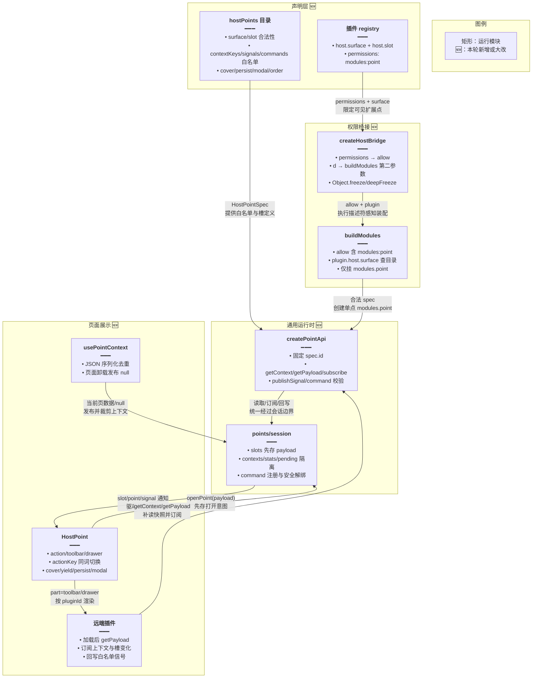
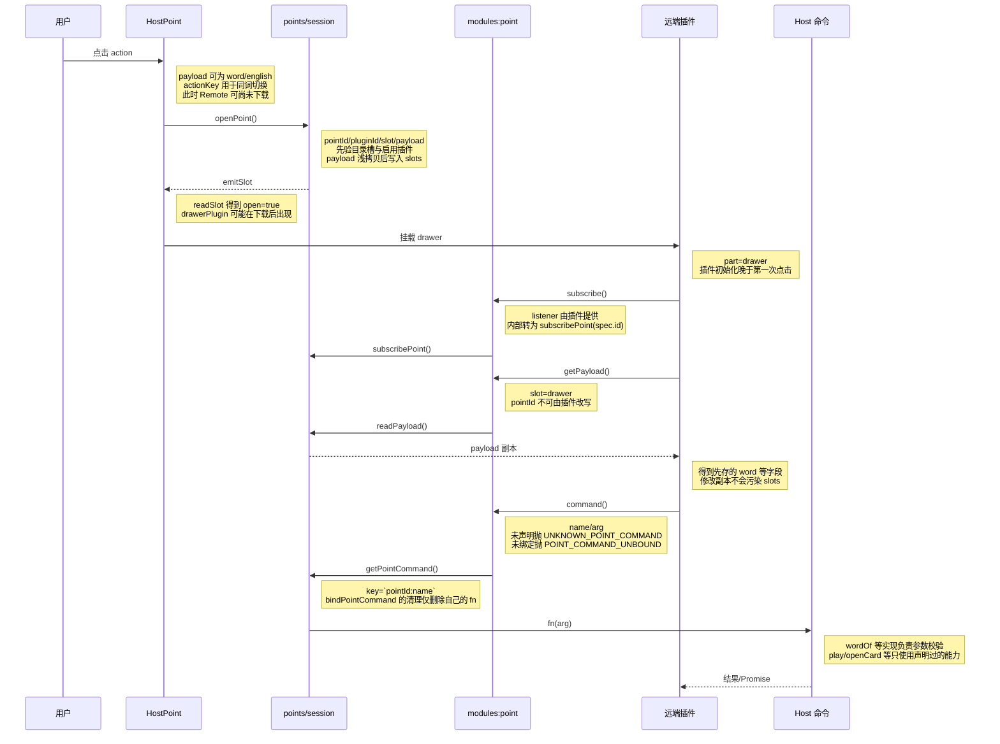

# 声明式扩展点运行时与 `modules:point`

> 延伸阅读：[阅读页扩展点](./阅读页扩展点.md) · [学习页扩展点](../english/学习页扩展点.md) · [详解抽屉瞬时让位](../english/详解抽屉瞬时让位.md)
>
> 文档角色：本篇只讲**通用声明式扩展点目录、内存会话、宿主挂载组件、命令桥接与 `modules:point` 权限装配**。下文代码块记录的是角色编译之前的目录形状。和源码不一致时，以 `apps/frontend/src/federation/points/` 为准。
>
> **现行实现**：目录写四种角色（`toolbar`、`toggle`、`page`、`command`），`compilePoint` 编译成槽。盖住和让位写在 `stacks`，不写在点的 `covers` 或槽的 `yieldTo` 上。不依赖页面闭包的命令在 `points/command.ts`，由 `runtime/index.ts` 启动时导入。`navigateToCfi`、`openThought`、`openReading`、`exportWords` 仍由对应页面绑定。抽屉、图标和顶栏都由 `HostPoint` 画，`PluginHostSurface` 已删除。

## 1. 背景与目标

旧模型要求每接一个插件，就在主项目增加一个 `modules/<pluginId>` 目录、一套 Host API 和一段 `buildModules` 分支。插件与主项目源码因此双向耦合：远端插件能调用什么，不只由 registry 决定，还取决于主项目是否为它写过专属模块。

本轮把可复用能力收敛为四层声明：

1. **挂载声明**：`POINT` 与 `pointDefs` 先登记角色、上下文键、信号和命令；`compilePoint` 得到槽。插件只能使用已经登记的组合。
2. **会话声明**：`session.ts` 用内存 Map 保存槽位会话、页面上下文、统计、pending 与命令实现。冷启动时即使远端插件还没下载，点击载荷也能先写入，再由插件加载后读取。
3. **渲染声明**：`HostPoint` 根据 `action`、`toolbar`、`drawer` 三种槽类型渲染，并统一处理同词切换、覆盖、让位、持久挂载、模态和顺序。
4. **权限声明**：registry 只声明 `modules:point` 与 `host.surface`；桥接层把当前插件描述符传给 `buildModules`，宿主按 surface 找到目录项，仅向该插件暴露一个冻结的 `api.modules.point`。

核心权衡是：**目录仍在主项目内，新增“挂载位置”需要主项目登记；但新增“已登记位置上的插件”不再需要改主项目。** 这既避免任意插件自造 DOM 挂载点，又消除了每个插件一套专属 Host API 的重复建设。

## 2. 改动范围与行为边界

| 层 | 路径 | 本篇覆盖内容 |
| --- | --- | --- |
| 通用挂载 | `apps/frontend/src/federation/host/HostPoint.tsx` | 三类槽渲染、同词切换、精细订阅、portal claim、drawer 布局行为 |
| 通用目录 | `apps/frontend/src/federation/points/catalog.ts` | 扩展点、槽位、白名单、信号、命令、覆盖关系与布局顺序 |
| 通用会话 | `apps/frontend/src/federation/points/session.ts` | 冷启动载荷、上下文裁剪、stats/pending、cover/yield 所需状态、命令安全解绑 |
| 通用插件 API | `apps/frontend/src/federation/points/api.ts` | 单点 API、未知命令与未绑定命令错误 |
| 通用命令注册 | `apps/frontend/src/federation/points/command.ts` | 启动时绑定的命令。页面闭包命令不写在这里 |
| 页面上下文 Hook | `apps/frontend/src/federation/points/usePointContext.ts` | 序列化去重、发布与卸载清空 |
| 公共出口 | `apps/frontend/src/federation/index.ts` | 通用扩展点导出；旧专属导出删除仅列契约，不展开电子书实现 |
| 接入约定 | `apps/frontend/src/federation/modules/README.md` | 已登记扩展点与新挂载位置的两套接入规则 |
| 运行时 | `apps/frontend/src/federation/runtime/index.ts` | `buildModules(allow, plugin)` 与通用 `modules:point` 装配 |
| 桥接包 | `packages/federation-kit/src/bridge/createHostBridge.ts` | 将当前 `PluginDescriptor` 传给 `buildModules` |
| 桥接类型 | `packages/federation-kit/src/config/types.ts` | `HostCapabilities.buildModules` 第二参数 |
| 权限示例 | `apps/frontend/src/i18n/locales/zh-CN/plugins.ts`、`apps/frontend/src/i18n/locales/en-US/plugins.ts` | 中英文示例从 `modules:ebook` 改为 `modules:point` |

行为上有三条明确边界：

- `modules:point` 是**能力入口权限**，不是任意数据通行证；最终能获得哪个点，还由当前插件的 `host.surface` 与 `hostPoints` 交集决定。
- `HostPoint` 不替业务页面决定数据；业务页通过 `payload` 和 `usePointContext` 提供数据，目录中的 `contextKeys` 再裁剪可公开字段。
- 内存会话不是持久化存储。`persist` 只表示 React 抽屉在关闭/覆盖期间保留挂载与退场，不表示刷新页面后恢复会话。

## 3. 架构与调用链

来源：本文对**改动后**架构的归纳；对应 `apps/frontend/src/federation/points/catalog.ts`（约 L1–L147）、`session.ts`（约 L1–L494）、`api.ts`（约 L1–L26）、`host/HostPoint.tsx`（约 L1–L265）、`runtime/index.ts`（约 L213–L241）与 `packages/federation-kit/src/bridge/createHostBridge.ts`（约 L7–L88）。



**读图要点**：点击路径是“先写 `slots`，后由远端 `getPayload` 补读”，所以冷启动不会丢第一次点击。权限链不是单纯的 `allow.has`，而是“权限 + 当前插件 surface + 主项目目录”三者共同决定；插件无法通过传别的 pointId 横向读取其它扩展点。

来源：本文对改动后冷启动与运行期调用的归纳；消息参数对应 `HostPoint.tsx` 约 L149–L197、`session.ts` 约 L153–L207、`api.ts` 约 L10–L26、`commands.ts` 全文件。



**读图要点**：`subscribe()` 与 `getPayload()` 都来自同一个冻结 API，但前者订阅整个点，后者只读目标槽快照。命令查表与业务执行分离；目录声明不存在的名字和声明了却尚未绑定的名字具有不同错误，便于定位接入问题。

## 4. 关键机制与验收语义

### 4.1 冷启动：载荷先存后读

`openPoint` 在远端代码是否已下载之外，先校验扩展点、槽位和 registry 中已启用的插件匹配关系，随后立即把 `{ pluginId, open: true, payload: { ...payload }, covered: false }` 写入 `slots`。`HostPoint` 通过 `readSlot` 重绘；远端挂载后调用 `api.modules.point.getPayload(slot)` 补读。载荷读写都做浅拷贝，防止调用方或插件后续修改原对象而绕过会话通知。

### 4.2 `actionKey`：同词切换、异词替换

动作槽从 `payload.word` 或 `payload.english` 提取关键文本，执行 trim、连续空白折叠和小写归一。当前目标槽已经由同一插件打开、且归一化 key 相同，再次点击就是关闭；否则调用 `openPoint` 整份替换会话。没有有效 key 的词类载荷会禁用按钮，避免空词打开详解。

### 4.3 三类订阅与稳定快照

- `subscribeSlot(pointId, slot)`：只监听一个槽；抽屉开关不被其它槽打扰。
- `subscribePoint(pointId)`：监听该点上下文或任意槽变化；插件用它重读 `getContext/getPayload`。
- `subscribeSignals(listener)`：监听 pending/stats 的全局 revision；`HostPoint` 只借 revision 触发重读，不在快照中暴露整个 Map。
- 空槽始终返回冻结的 `EMPTY`，无 yield 目标时返回冻结的 `NO_SLOT`，避免 `useSyncExternalStore` 因每次新对象而循环渲染。

### 4.4 上下文白名单与副本

`publishPointContext` 只遍历 `spec.contextKeys`，忽略未声明键、`null` 和空字符串；所有有效键都缺失时保存 `null`。相同键值与键数量不会重复通知。`readContext` 返回浅拷贝；`usePointContext` 通过 JSON 字符串比较页面输入，避免父组件每次创建新对象都造成发布。

### 4.5 stats 校验与 pending 隔离

`stats` 只接受声明了该信号的扩展点。`null` 明确清除统计；普通值仅读取 `total/loaded`，数字转换后必须有限，再向下取整并截到非负。坏数据不会覆盖上一份有效值。pending 以 `pointId + pluginId + lemmaKey(word)` 隔离，词形 key 同样做空格和大小写归一；重复布尔值不通知，关抽屉不清 pending。

### 4.6 cover、yield、persist、modal、order

| 机制 | 状态/配置来源 | 运行语义 |
| --- | --- | --- |
| `covers` / `coverPoint` | `HostPointSpec.covers` + `SlotSession.covered` | 上层列表打开时保留下层抽屉的 `open` 与 payload，只标记覆盖；关闭上层再 `uncoverPoint` |
| `yieldTo` | `slot.layout.yieldTo` + 目标槽订阅 | 目标槽开着且未被覆盖时，当前抽屉只隐藏并禁交互，不响应外部关闭。现行隐藏是内容区内联 `opacity: 0` 并关掉动画，见 [详解抽屉瞬时让位](../english/详解抽屉瞬时让位.md) |
| `persist` | `slot.layout.persist` | 普通关闭或覆盖期间保留挂载，以支持退场；只有“已关闭且被覆盖”同时成立才卸载，被覆盖时不播退场 |
| `modal` | `slot.layout.modal` | 默认锁 body 滚动；`false` 时用 plain overlay，便于再叠一层 |
| `order` | `layoutDrawerSlots` 排序 | 数值小的先挂、位于下层；未写默认 `2` |

### 4.7 命令安全解绑

命令注册键为 `${pointId}:${name}`，后注册可以替换先注册。返回的清理函数只有在 Map 中当前值仍等于自己注册的 `fn` 时才删除；因此旧 effect 的迟到清理不会误删新实现。插件调用时还要先通过 `spec.commands.includes(name)`，未声明与未绑定分别报错。

## 5. 完整实现与前后对照

### 5.1 `catalog.ts`：扩展点与布局声明

**改动前：不存在。** 基线 `58d0e2a1` 没有 `apps/frontend/src/federation/points/catalog.ts`，也没有统一的 surface/slot 目录。

**改动后** · `apps/frontend/src/federation/points/catalog.ts`（新增文件，完整实现，约 L1–L147）

```typescript
/**
 * 主项目事先登记的扩展点。插件只能挂到这里已有的 id 和槽位上。
 */
// 定义单个槽位的完整契约，让渲染、权限和布局共享同一份声明。
export type HostPointSlot = {
	// name 是 registry 与 HostPoint 对齐的槽名，必须稳定在点内唯一。
	name: string;
	// kind 限定三种渲染策略，防止同一槽同时按按钮和抽屉处理。
	kind: 'action' | 'drawer' | 'toolbar';
	/** 动作槽点击后打开的抽屉槽。载荷写在那个槽上。 */
	// opens 把动作按钮与目标抽屉关联，点击载荷才能写入正确会话。
	opens?: string;
	/**
	 * 布局怎么挂这个抽屉。不写就由布局挂一个普通抽屉，离开英语学习时关掉。
	 * order 小的先挂，后挂的盖在上面。
	 */
	// layout 只描述抽屉行为，不侵入业务插件实现。
	layout?: {
		/** 页面自己画，布局只负责离开时关掉 */
		// page 标记挂载责任归属，避免布局和业务页重复渲染同一抽屉。
		page?: boolean;
		/** 一直挂着，关掉时保留退场。被盖住时不播退场 */
		// persist 保留 React 挂载以完成退场，但不承担跨刷新持久化。
		persist?: boolean;
		/** false：不锁焦点，方便上面再叠一层 */
		// modal 控制焦点与滚动锁，非模态抽屉可让上层继续交互。
		modal?: boolean;
		/** 目标槽开着且没被盖住时，本抽屉只隐藏，不关闭 */
		// yieldTo 声明让位目标，保留下层会话而不是真正关闭。
		yieldTo?: { point: string; slot: string };
		// order 决定全局抽屉挂载顺序，小值先挂以免遮挡上层。
		order?: number;
	};
};
// 定义一个扩展点的全部公开边界，运行时的每次读写都可回查此类型。
export type HostPointSpec = {
	// id 对应 registry 的 host.surface，是 API 与页面挂载的共同标识。
	id: string;
	// slots 列出宿主实际实现的槽，插件不能自造额外槽名。
	slots: readonly HostPointSlot[];
	// contextKeys 是页面数据白名单，防止把完整页面对象泄露给插件。
	contextKeys: readonly string[];
	// signals 限制插件可回写的主站 UI 信号，当前仅 pending 与 stats。
	signals: readonly ('pending' | 'stats')[];
	// commands 列出可调主站命令，未知名字会在 API 层直接拒绝。
	commands: readonly string[];
	// covers 声明一个槽对另一个点的槽的覆盖关系，用于保留下层现场。
	covers?: { slot: string; targetPoint: string; targetSlot: string };
};
// 集中定义稳定扩展点 id，页面、registry 示例和命令注册复用常量避免拼写漂移。
export const POINT = {
	// vocabCard 标识单词卡上的动作与详解抽屉。
	vocabCard: 'english.vocab.card',
	// vocabLibrary 标识单词库列表、工具栏与导入抽屉。
	vocabLibrary: 'english.vocab.library',
	// classicCard 标识语句卡上的扩展入口。
	classicCard: 'english.classic.card',
	// classicLibrary 标识语句库列表扩展位置。
	classicLibrary: 'english.classic.library',
	// mistakes 标识错题集列表扩展位置。
	mistakes: 'english.mistakes',
	// review 标识复习列表扩展位置。
	review: 'english.review',
	// favorites 标识收藏列表扩展位置。
	favorites: 'english.favorites',
	// dailyReading 标识每日阅读列表扩展位置。
	dailyReading: 'english.dailyReading',
	// ebookRead 仅登记通用目录项，具体阅读页适配由姊妹文档展开。
	ebookRead: 'ebook.read',
// as const 固定 id 字面量，确保 HostPointSpec 与调用处获得精确类型。
} as const;
// listPoint 复用列表类页面的三槽结构，同时保留各点自己的上下文键。
function listPoint(id: string, contextKeys: readonly string[]): HostPointSpec {
	// 返回完整目录项，避免多个列表点复制同一组槽声明。
	return {
		// id 原样写入，保证 catalog 键与 spec.id 一致。
		id,
		// slots 同时提供工具栏、列表项动作和抽屉，覆盖常见列表插件形态。
		slots: [
			// toolbar 槽内联渲染工具插件，不产生打开会话。
			{ name: 'toolbar', kind: 'toolbar' },
			// item-action 点击后把当前行载荷写入 drawer。
			{ name: 'item-action', kind: 'action', opens: 'drawer' },
			// drawer 承载动作槽对应的远端详情正文。
			{ name: 'drawer', kind: 'drawer' },
		],
		// contextKeys 使用调用方白名单，防止不同列表共享错误字段。
		contextKeys,
		// signals 默认为空，列表点未声明时不能回写 pending/stats。
		signals: [],
		// commands 默认为空，通用列表结构不自动获得宿主命令。
		commands: [],
	};
}
// hostPoints 是运行时唯一可信目录，所有权限与挂载校验都从这里取契约。
export const hostPoints: Record<string, HostPointSpec> = {
	// 单词卡点使用计算属性键，确保与 POINT.vocabCard 永远一致。
	[POINT.vocabCard]: {
		// id 与目录键重复存储，便于把 spec 单独传入 API 工厂。
		id: POINT.vocabCard,
		// slots 声明卡按钮和持久详解抽屉，不提供无上下文的工具栏。
		slots: [
			// card-action 点击后打开同点的 drawer。
			{ name: 'card-action', kind: 'action', opens: 'drawer' },
			// drawer 保留挂载且 order=1，使其位于默认顺序之下或按声明叠放。
			{ name: 'drawer', kind: 'drawer', layout: { persist: true, order: 1 } },
		],
		// contextKeys 为空，因为词条经动作 payload 传递而非页面公共上下文。
		contextKeys: [],
		// signals 允许 pending，让词卡按钮按插件和词显示独立 Spinner。
		signals: ['pending'],
		// commands 仅开放朗读和停止，不把底层 speech 函数直接交给插件。
		commands: ['play', 'stop'],
	},
	// 单词库点包含列表、导入和覆盖词卡抽屉所需的完整声明。
	[POINT.vocabLibrary]: {
		// id 固定为单词库 surface，运行时只给该 surface 的插件此 spec。
		id: POINT.vocabLibrary,
		// slots 把列表项、列表级和导入入口拆开，避免一个槽承担多种 payload。
		slots: [
			// toolbar 承载列表级工具。
			{ name: 'toolbar', kind: 'toolbar' },
			// item-action 把当前词条打开到 item-drawer。
			{ name: 'item-action', kind: 'action', opens: 'item-drawer' },
			// item-drawer 保存列表项详情会话。
			{ name: 'item-drawer', kind: 'drawer' },
			// drawer 由页面自挂并负责覆盖词卡详解，布局不重复挂载。
			{ name: 'drawer', kind: 'drawer', layout: { page: true } },
			// library-card-action 打开独立导入抽屉，与列表项详情隔离。
			{ name: 'library-card-action', kind: 'action', opens: 'import-drawer' },
			// import-drawer 使用多行布局声明，以同时表达持久、非模态、顺序和让位。
			{
				// name 与动作槽 opens 对齐，点击载荷才能进入导入会话。
				name: 'import-drawer',
				// kind 为 drawer，HostPoint 才按会话渲染远端正文。
				kind: 'drawer',
				// layout 定义导入抽屉与其它详情抽屉的叠放策略。
				layout: {
					// persist 保留导入页现场和关闭退场，不因暂时隐藏重置表单。
					persist: true,
					// modal=false 不锁焦点，使上层详解可以继续叠加。
					modal: false,
					// order=0 先挂到底层，后续抽屉可以盖在它上面。
					order: 0,
					// yieldTo 指向词卡详解，目标打开时导入抽屉只隐藏不关闭。
					yieldTo: { point: POINT.vocabCard, slot: 'drawer' },
				},
			},
		],
		// contextKeys 只公开 libraryId，插件无法读取页面对象里的其它字段。
		contextKeys: ['libraryId'],
		// signals 允许 stats，使列表插件能回写总数和已加载数。
		signals: ['stats'],
		// commands 只允许选 JSON 与打开词卡两个明确能力。
		commands: ['pickJsonFile', 'openCard'],
		// covers 声明列表 drawer 覆盖词卡 drawer 时保留下层会话。
		covers: {
			// slot 指定触发覆盖的是当前点的 drawer。
			slot: 'drawer',
			// targetPoint 指向词卡点，避免误伤同点其它抽屉。
			targetPoint: POINT.vocabCard,
			// targetSlot 精确指向词卡详解抽屉。
			targetSlot: 'drawer',
		},
	},
	// 语句卡点只声明动作与抽屉，不额外获得信号或命令。
	[POINT.classicCard]: {
		// id 与语句卡 surface 对齐。
		id: POINT.classicCard,
		// slots 复用卡片常见的两槽交互结构。
		slots: [
			// card-action 将当前语句载荷交给 drawer。
			{ name: 'card-action', kind: 'action', opens: 'drawer' },
			// drawer 渲染对应插件详情。
			{ name: 'drawer', kind: 'drawer' },
		],
		// contextKeys 为空，当前语句由 payload 提供。
		contextKeys: [],
		// signals 为空，语句卡插件不能写词卡 pending 或词库 stats。
		signals: [],
		// commands 为空，未登记能力一律不能调用。
		commands: [],
	},
	// 语句库点在通用列表项基础上展开 slots，以替换掉 listPoint 的默认槽表。
	[POINT.classicLibrary]: {
		// 展开通用列表声明，复用 id、contextKeys、signals 与 commands。
		...listPoint(POINT.classicLibrary, ['libraryId']),
		// slots 覆盖默认槽表，增加语句库卡动作和导入抽屉。
		slots: [
			// toolbar 承载语句库级工具。
			{ name: 'toolbar', kind: 'toolbar' },
			// item-action 打开列表项详情抽屉。
			{ name: 'item-action', kind: 'action', opens: 'item-drawer' },
			// item-drawer 渲染当前语句详情。
			{ name: 'item-drawer', kind: 'drawer' },
			// drawer 承载语句库级详情。
			{ name: 'drawer', kind: 'drawer' },
			// library-card-action 打开语句导入抽屉。
			{ name: 'library-card-action', kind: 'action', opens: 'import-drawer' },
			// import-drawer 使用默认布局，未声明的 persist/modal/order 不擅自继承单词库。
			{ name: 'import-drawer', kind: 'drawer' },
		],
	},
	// 错题集使用通用列表结构，仅公开 kind 作为筛选上下文。
	[POINT.mistakes]: listPoint(POINT.mistakes, ['kind']),
	// 复习页同样只公开 kind，避免不同页面上下文串用。
	[POINT.review]: listPoint(POINT.review, ['kind']),
	// 收藏页只公开收藏类型 kind，其它页面状态仍留在主站。
	[POINT.favorites]: listPoint(POINT.favorites, ['kind']),
	// 每日阅读只公开 origin，让插件知道列表来源而不获得整个路由状态。
	[POINT.dailyReading]: listPoint(POINT.dailyReading, ['origin']),
	// 阅读点只在此登记通用契约，具体页面与 iframe 转接不在本篇展开。
	[POINT.ebookRead]: {
		// id 使用阅读扩展点常量，保证权限装配能找到同一目录项。
		id: POINT.ebookRead,
		// slots 提供工具栏和由页面自挂的抽屉。
		slots: [
			// toolbar 承载阅读页工具正文。
			{ name: 'toolbar', kind: 'toolbar' },
			// drawer 标记 page=true，避免全局布局重复挂载。
			{ name: 'drawer', kind: 'drawer', layout: { page: true } },
		],
		// contextKeys 仅允许书籍标识与标题这两个公开字段。
		contextKeys: ['bookId', 'bookTitle'],
		// signals 为空，阅读点不接收学习列表的统计或 pending。
		signals: [],
		// commands 白名单只列目录契约，不在此展开具体阅读处理器。
		commands: ['navigateToCfi', 'openThought', 'closeIdeasList'],
	},
};
// getHostPoint 把未登记 id 统一归为 null，给权限、上下文和 UI 提供一致拒绝路径。
export function getHostPoint(id: string): HostPointSpec | null {
	// 直接读取目录并用 null 兜底，避免调用方误把 undefined 当成有效 spec。
	return hostPoints[id] ?? null;
}
/** 布局要关掉的全部门抽屉。page 的由页面自己挂，其余由布局挂。order 小的在下面。 */
// layoutDrawerSlots 预计算全部抽屉及顺序，布局无需理解每个扩展点的内部结构。
export const layoutDrawerSlots = Object.values(hostPoints)
	// flatMap 展开每个点的槽表，同时保留所属 pointId 供后续关闭与挂载。
	.flatMap((spec) =>
		// 对单个 spec 继续处理槽表，只让抽屉进入全局布局清单。
		spec.slots
			// filter 排除 action 和 toolbar，因为它们没有全局抽屉生命周期。
			.filter((slot) => slot.kind === 'drawer')
			// map 把槽定义和点 id 组合，避免布局仅凭槽名发生跨点冲突。
			.map((slot) => ({ pointId: spec.id, slot })),
	)
	// sort 按 order 升序排列，缺省值 2 让显式 0/1 先挂到下层。
	.sort((a, b) => (a.slot.layout?.order ?? 2) - (b.slot.layout?.order ?? 2));
```

**变更摘要**：新增统一目录后，挂载合法性、公开上下文、可写信号、可调命令和抽屉布局都由声明驱动；插件新增不再等价于新增一套 `modules/<pluginId>` 实现。

### 5.2 `session.ts`：唯一内存会话与信号中心

**改动前：不存在。** 基线没有通用槽会话；专属模块各自保存快照、pending 与统计，无法让冷启动载荷、覆盖关系和订阅语义复用。

**改动后** · `apps/frontend/src/federation/points/session.ts`（新增文件，完整实现，约 L1–L494）

```typescript
/**
 * 扩展点的唯一内存状态：槽位会话、页面上下文、回写信号。
 * 冷启动时插件还没下载，打开载荷必须先落在这里。
 */
// 引入已启用的 surface 插件查询，openPoint 借此拒绝未启用或槽位不匹配的打开请求。
import { listHostSurfacePlugins } from '@dnhyxc-ai/federation-kit';
// 引入目录查询，所有槽、上下文和信号写入都以主项目声明为准。
import { getHostPoint } from './catalog';
// 定义槽会话快照，让 HostPoint 和插件 API 读取同一份打开状态与载荷。
export type SlotSession = {
	// pluginId 指明要渲染哪个远端；关闭后清空以避免误挂旧插件。
	pluginId: string | null;
	// open 区分真正关闭与仅被覆盖，覆盖时仍保留 true。
	open: boolean;
	// payload 保存动作点击时的数据，支持远端晚加载后的补读。
	payload: Record<string, unknown> | null;
	// covered 只控制隐藏和交互，不销毁 open 与 payload。
	covered: boolean;
};
// 冻结共享空会话，未打开槽的 snapshot 引用始终稳定。
const EMPTY: SlotSession = Object.freeze({
	// 空会话不指向任何插件，避免渲染旧远端。
	pluginId: null,
	// 空会话默认关闭，HostPoint 不占位。
	open: false,
	// 空会话没有载荷，getPayload 自然返回 null。
	payload: null,
	// 空会话未被覆盖，避免无意义地隐藏后续内容。
	covered: false,
});
// 每个「扩展点 + 槽」一份会话。插件还没下载时，打开的载荷先落在这里
// slots 以复合键隔离不同点和槽，是冷启动先存后读的核心容器。
const slots = new Map<string, SlotSession>();
// 只关心某一个槽开关的订阅者，HostPoint 的抽屉靠这个重绘
// slotListeners 按槽拆分监听，避免其它抽屉变化导致当前组件重绘。
const slotListeners = new Map<string, Set<() => void>>();
// 关心整个点的订阅者：上下文变了，或这个点上任意槽开关了，都会被叫到
// pointListeners 面向插件 API，让上下文和槽变化都能触发插件重读。
const pointListeners = new Map<string, Set<() => void>>();
// 页面交给插件的上下文，只留目录里声明的键，例如词库的 libraryId
// contexts 按点保存裁剪后的页面数据，不直接暴露业务页原始对象。
const contexts = new Map<string, Record<string, unknown> | null>();
// 顶栏统计单独放，关抽屉不会把它清掉
// statsByPoint 独立于 slots，抽屉关闭不应抹掉列表顶栏数字。
const statsByPoint = new Map<
	// 键是扩展点 id，单词库和别的点各记一份
	string,
	// null 表示插件声明这份统计作废
	{ total: number; loaded: number } | null
	// 结束统计 Map 的类型参数
>();
/** 进行中按「点 + 插件 + 词」分开，关抽屉不清，避免两枚按钮一起转。 */
// pending 用复合键保存布尔值，确保不同插件和不同词互不影响。
const pending = new Map<string, boolean>();
// play、openCard 等由主站启动时挂上，插件按名字调用
// commands 将名称映射到主站实现，插件不能注入或替换这张表。
const commands = new Map<string, (arg: unknown) => unknown>();
// 转圈和顶栏数字的订阅者。它们不绑在某一个槽上
// signalListeners 独立承载 UI 信号订阅，避免槽订阅者被每次 pending 打扰。
const signalListeners = new Set<() => void>();
// 每写一次信号加一。useSyncExternalStore 拿这个数判断要不要重绘
// signalRev 是稳定数字快照，只有实际通知时才递增。
let signalRev = 0;
// 槽在 Map 里的键。点 id 用点号，槽名用连字符，冒号不会和它们粘在一起
// slotKey 统一复合键格式，读写和订阅必须使用同一编码。
function slotKey(pointId: string, slot: string): string {
	// 例如 english.vocab.card:drawer
	// 用冒号拼接点与槽，避免两个维度分别编码造成键不一致。
	return `${pointId}:${slot}`;
	// 结束 slotKey
}
// 进行中的词先收成同一把键，Apple 和 apple、多空格都算同一个词
// lemmaKey 统一 pending 与 actionKey 所需的词形归一语义。
function lemmaKey(word: string): string {
	// 去掉首尾空白，中间连续空白收成一个空格，再忽略大小写
	// 归一化后再查 Map，避免同词仅格式不同就出现两份 pending。
	return word.trim().replace(/\s+/g, ' ').toLowerCase();
	// 结束 lemmaKey
}
// 某个槽开、关或被盖住时，叫醒这个槽和整个点的订阅者
// emitSlot 同时通知两种粒度，因为 HostPoint 关心槽而插件可能关心整个点。
function emitSlot(pointId: string, slot: string): void {
	// 先算出槽键，下面两拨订阅者用的不是同一把
	// key 只用于槽监听，点监听仍使用原始 pointId。
	const key = slotKey(pointId, slot);
	// 拷一份再调用：订阅者若在回调里退订，不会漏掉后面的人
	// 遍历副本隔离回调内退订对本轮通知顺序的影响。
	for (const listener of [...(slotListeners.get(key) ?? [])]) listener();
	// 订了整个点的人也能看见槽变化，例如词库上下文订阅会跟着抽屉刷新
	// 点监听也遍历副本，保证插件退订不会跳过其它插件。
	for (const listener of [...(pointListeners.get(pointId) ?? [])]) listener();
	// 结束 emitSlot
}
// 只叫醒这个点的订阅者。上下文变化走这里，不带动别的点
// emitPoint 用于非槽变化，避免无关节点收到通知。
function emitPoint(pointId: string): void {
	// 同样先拷贝，避免回调里退订打乱遍历
	// 快照遍历保证通知期间增删监听不会破坏本轮迭代。
	for (const listener of [...(pointListeners.get(pointId) ?? [])]) listener();
	// 结束 emitPoint
}
// 转圈或顶栏数字变了，只叫醒信号订阅者。槽位和上下文订阅不跟着转圈重读
// emitSignals 先推进 revision 再通知，useSyncExternalStore 才能检测变化。
function emitSignals(): void {
	// 快照从数字变成新值，useSyncExternalStore 才会认为状态变了
	// 自增只发生在有效写入后，重复值不会引发渲染。
	signalRev += 1;
	// 拷贝后再调，退订发生在回调里也不影响这一轮
	// 遍历副本让组件卸载与通知重入保持安全。
	for (const listener of [...signalListeners]) listener();
	// 结束 emitSignals
}
// 读某一个槽。没开过时返回同一份冻结空会话，引用不变，订阅才不会死循环
// readSlot 是 useSyncExternalStore 的槽快照入口，必须保持空态引用稳定。
export function readSlot(pointId: string, slot: string): SlotSession {
	// ?? 而不是新建对象：空槽每次都是 EMPTY 这一个引用
	// 已写槽返回当前会话，未写槽共享 EMPTY，避免无限重渲染。
	return slots.get(slotKey(pointId, slot)) ?? EMPTY;
	// 结束 readSlot
}
// 订阅一个槽的开、关和覆盖。HostPoint 用它决定画不画抽屉
// subscribeSlot 返回精准退订函数，供组件 effect 或 store 清理。
export function subscribeSlot(
	// 只听这一个扩展点
	// pointId 限定监听范围，避免不同业务点互相唤醒。
	pointId: string,
	// 只听这一个槽，词卡抽屉和词库列表抽屉互不叫醒
	// slot 再缩小到具体槽，实现精细订阅。
	slot: string,
	// 状态变了就调用，调用方自己再 readSlot
	// listener 不接收可变对象，消费者始终重新读取最新快照。
	listener: () => void,
	// 返回退订函数，组件卸载时用
): () => void {
	// 和 slots 用同一把键
	// key 复用 slotKey，确保通知能准确找到监听集合。
	const key = slotKey(pointId, slot);
	// 这个槽第一次有人订阅时才建 Set
	// 读取或创建 Set，避免覆盖同槽已有组件的监听。
	const set = slotListeners.get(key) ?? new Set();
	// 同一个函数重复订阅只会留一份
	// Set 去重降低重复 effect 注册造成的重复通知。
	set.add(listener);
	// 新 Set 要写回 Map；已有的 Set 再写一次也还是同一个
	// 写回集合覆盖首次创建场景，后续订阅共享同一容器。
	slotListeners.set(key, set);
	// 退订只拿掉这一个监听，别的组件还留着
	// 清理函数返回 delete 的布尔结果但类型上按 void 使用，不影响其它监听。
	return () => set.delete(listener);
	// 结束 subscribeSlot
}
// 订阅整个点：上下文变了，或这个点上任意槽变了，都会调到 listener
// subscribePoint 给插件提供统一重读入口，无需暴露内部多个 Map。
export function subscribePoint(
	// 词库上下文和语句库上下文各订各的
	// pointId 把订阅固定到 API 创建时的 spec.id。
	pointId: string,
	// 回调里不再带数据，读的人自己 readContext 或 readSlot
	// listener 只作失效通知，避免快照在回调参数里被长期持有。
	listener: () => void,
	// 返回退订函数
): () => void {
	// 这个点还没有订阅者时新建 Set
	// 复用现有点监听集合，避免后订阅者覆盖先订阅者。
	const set = pointListeners.get(pointId) ?? new Set();
	// Set 去重，严格重复的监听函数不会存两份
	// 重复函数只存一次，保持通知次数可预测。
	set.add(listener);
	// 把 Set 放回这个点名下
	// 首次创建的集合必须写回 Map 才能被 emitPoint 找到。
	pointListeners.set(pointId, set);
	// 卸载时只删除自己
	// 返回精准解绑，避免插件卸载后仍收到会话更新。
	return () => set.delete(listener);
	// 结束 subscribePoint
}
// 订阅转圈和顶栏数字。不区分是哪个点写的信号
// subscribeSignals 提供 revision 型全局信号订阅，具体状态由读取函数再取。
export function subscribeSignals(listener: () => void): () => void {
	// 直接进总集合，emitSignals 时一律叫到
	// 信号监听不按槽分桶，因为 HostPoint 还需自行判断当前插件和词。
	signalListeners.add(listener);
	// 退订后不再因为别的按钮转圈而重绘
	// 删除当前 listener，防止卸载组件被保留在全局集合。
	return () => signalListeners.delete(listener);
	// 结束 subscribeSignals
}
// useSyncExternalStore 的快照。数字没变就不要重绘
// readSignalRev 只暴露单调递增数字，不把可变 Map 引用当快照。
export function readSignalRev(): number {
	// 返回当前代数，不在这里自增
	// 读取必须无副作用，否则 React 多次读快照会制造假变化。
	return signalRev;
	// 结束 readSignalRev
}
// 打开目录里已有的一个槽。插件可以还没下载，载荷先记在槽上
// openPoint 是冷启动写入入口，返回值只表示这次打开意图是否被接受。
export function openPoint(
	// 只能打开 catalog 里登记过的点
	// pointId 指明业务扩展点，用于查目录与限定状态隔离。
	pointId: string,
	// 必须是这个点上已启用的插件，不能凭空指定一个 id
	// pluginId 来自 registry 匹配结果，最终还要与启用列表核对。
	pluginId: string,
	// 要打开的槽。动作按钮传来的是它 opens 指向的抽屉槽
	// slot 指明载荷保存位置，后续 getPayload 使用同一槽名。
	slot: string,
	// 冷启动载荷。词卡是词，导入是词库 id 和标题
	// payload 在插件代码加载前写入，是首次点击不丢失的关键。
	payload: Record<string, unknown>,
	// false：点或槽不存在，或这个插件当前没挂在能打开该槽的位置上
): boolean {
	// 未登记的点没有槽表
	// 先取 spec，未登记 surface 在后续可选链中直接失败。
	const spec = getHostPoint(pointId);
	// 插件不能自造槽名。目录里没有这个槽就当没打开
	// 槽校验先于任何写入，非法目标不会留下 Map 垃圾。
	if (!spec?.slots.some((item) => item.name === slot)) return false;
	// 找出哪个动作槽负责打开这个抽屉，例如 card-action 打开 drawer
	// opener 允许 registry 挂动作槽而非直接挂 drawer 的插件通过校验。
	const opener = spec.slots.find((item) => item.opens === slot)?.name;
	// 已启用插件里，槽位要么就是这个抽屉，要么是负责打开它的按钮
	// enabled 同时核对启用状态、插件 id 和合法槽位，防止伪造打开请求。
	const enabled = listHostSurfacePlugins(pointId).some(
		// 先对上插件 id，再看它声明的 host.slot
		// 每个候选插件都必须满足完整匹配，不能只凭 surface 放行。
		(plugin) =>
			// 插件 id 必须与本次打开目标一致，避免同点其它插件被误开。
			plugin.id === pluginId &&
			// 列表按钮直接挂在 drawer 上；词卡按钮挂在 card-action 上，两者都能开抽屉
			// host.slot 可以是目标槽或其动作 opener，与两种 registry 接入方式兼容。
			(plugin.host?.slot === slot || plugin.host?.slot === opener),
		// 结束这一条插件是否匹配
	);
	// 没启用或槽位对不上：不写会话，调用方看到 false
	// 失败提前返回，保证 UI 不把未授权请求当成已打开。
	if (!enabled) return false;
	// 通过检查后再算键，避免给非法槽留下空记录
	// key 只在全部校验通过后使用，维持 Map 内容可信。
	const key = slotKey(pointId, slot);
	// 整份替换。后一次打开盖住前一次的词和插件
	// slots.set 替换完整会话，使异词或异插件切换不残留旧字段。
	slots.set(key, {
		// 抽屉渲染时按这个 id 找插件正文
		// pluginId 固定本次远端身份，HostPoint 据此查描述符。
		pluginId,
		// 标记为开。覆盖只藏起来，不会把 open 改回 false
		// open=true 表示逻辑会话存在，与后续 covered 相互独立。
		open: true,
		// 浅拷贝：调用方随后改自己的对象，不会改到已经记下的载荷
		// payload 副本隔离调用方后续变更，保证快照语义。
		payload: { ...payload },
		// 新打开的槽自己不被盖住。词库列表再去盖词卡抽屉
		// covered 重置防止重新打开后仍沿用旧的隐藏状态。
		covered: false,
		// 结束这一份新会话
	});
	// 让抽屉和订了这个点的界面读到新会话
	// 写入后统一 emitSlot，确保 HostPoint 与插件订阅同步失效。
	emitSlot(pointId, slot);
	// 词库的 drawer 会盖住词卡抽屉；打开别的槽不会去盖
	// 只有目录声明的触发槽才执行覆盖，避免任意抽屉互相隐藏。
	if (spec.covers?.slot === slot) {
		// 被盖的抽屉保持 open，只是加上 covered，这样没有退场动画
		// coverPoint 复用统一状态转换，不在这里直接篡改目标会话。
		coverPoint(spec.covers.targetPoint, spec.covers.targetSlot);
		// 结束「这个槽负责覆盖别的抽屉」
	}
	// 会话已经写下，调用方可以认为抽屉打开了
	// true 只表示接受并存储，不要求远端代码已经加载完成。
	return true;
	// 结束 openPoint
}
// 关掉一个槽。若这个槽盖着别的抽屉，把被盖的那层重新露出来，但不关掉它
// closePoint 清理当前槽并在需要时撤销覆盖，保持下层现场。
export function closePoint(pointId: string, slot: string): void {
	// 用来判断这个槽是不是「盖住别人」的那一个
	// spec 提供 covers 关系，关闭动作不能靠调用方另传目标。
	const spec = getHostPoint(pointId);
	// 没有这条会话时，下面的 cur 是 undefined
	// key 定位当前槽，未登记点也只读自己的键。
	const key = slotKey(pointId, slot);
	// 从未打开、也没被盖住时，cur 是空的
	// cur 保留当前状态以判断此次关闭是否幂等。
	const cur = slots.get(key);
	// 已经是关闭且未覆盖就直接返回，避免关一次通知一次
	// 三个字段均为空说明无可清理状态，重复关闭不应触发渲染。
	if (!cur?.open && !cur?.pluginId && !cur?.covered) return;
	// 换成一份明确关闭的会话，不从 Map 里删键
	// 保留关闭快照而非 delete，让读方能稳定观察到状态转换。
	slots.set(key, {
		// 抽屉不再指向任何插件
		// pluginId 清空，持久挂载时也不会误显示旧插件标题。
		pluginId: null,
		// HostPoint 看到 open 为 false 就不画抽屉
		// open=false 驱动 Drawer 关闭或退场。
		open: false,
		// 载荷丢掉，下次打开必须重新带上词或词库
		// payload=null 防止下一次会话误读旧数据。
		payload: null,
		// 自己也不再处于被覆盖状态
		// covered 复位，保证后续打开从可见状态开始。
		covered: false,
		// 结束关闭后的会话
	});
	// 通知这个槽收起
	// 状态替换后通知订阅者，驱动关闭动画或卸载。
	emitSlot(pointId, slot);
	// 关掉词库列表抽屉时，把词卡抽屉的 covered 拿掉，详解还开着
	// 当前槽若负责覆盖，关闭后必须恢复目标槽可见性。
	if (spec?.covers?.slot === slot) {
		// 只取消覆盖，不调用 closePoint，词卡里的词还在
		// uncoverPoint 仅改 covered，保留下层 open 和 payload。
		uncoverPoint(spec.covers.targetPoint, spec.covers.targetSlot);
		// 结束揭开被盖抽屉
	}
	// 结束 closePoint
}
// 把一个槽标成被盖住。open 和载荷保持原样，抽屉组件只是看不见
// coverPoint 只表达视觉层级，不把覆盖误建模为关闭。
export function coverPoint(pointId: string, slot: string): void {
	// 被盖的多半是词卡 drawer
	// key 定位需要隐藏的目标槽，与触发覆盖的上层槽不同。
	const key = slotKey(pointId, slot);
	// 词卡还没开过时也要有一份会话，才能记下 covered
	// cur 使用显式空会话兜底，后续展开时能安全设置 covered。
	const cur = slots.get(key) ?? {
		// 没有插件正文可藏
		// 空 pluginId 表示当前没有远端需要渲染。
		pluginId: null,
		// 本来就没开
		// open=false 保留未打开事实，覆盖不创造会话。
		open: false,
		// 没有词
		// payload=null 避免凭空制造冷启动数据。
		payload: null,
		// 先按未覆盖来填，下面再改成 true
		// covered=false 让统一替换逻辑同时覆盖已存在与新建会话。
		covered: false,
		// 结束这份占位会话
	};
	// 已经盖住就不再写、也不再通知，避免列表和详解互相刷新
	// 幂等短路防止重复打开上层导致无意义渲染。
	if (cur.covered) return;
	// 保留原来的 open 和词，只把 covered 设为 true
	// 展开 cur 再覆盖单字段，确保插件与载荷原样保留。
	slots.set(key, { ...cur, covered: true });
	// 详解抽屉靠这次通知加上 invisible，不走关闭动画
	// 通知槽监听者重读 covered，而不是伪造 open=false。
	emitSlot(pointId, slot);
	// 结束 coverPoint
}
// 取消覆盖。抽屉若本来开着，会在原处重新出现
// uncoverPoint 恢复视觉状态，不重新打开或重建下层插件。
export function uncoverPoint(pointId: string, slot: string): void {
	// 和 coverPoint 用同一把槽键
	// key 保证覆盖与揭开操作命中同一会话。
	const key = slotKey(pointId, slot);
	// 没有会话，或根本没被盖住
	// cur 读取当前值以支持幂等判断。
	const cur = slots.get(key);
	// 未覆盖时不写 Map，关闭列表时重复揭开也不会多通知一次
	// 仅 covered=true 才需要转换，其它状态直接返回。
	if (!cur?.covered) return;
	// open、插件和载荷都留着，只清 covered
	// 保留会话其余字段，使下层在原位置继续显示。
	slots.set(key, { ...cur, covered: false });
	// 详解抽屉去掉 invisible
	// 通知后 HostPoint 重读并恢复交互与可见性。
	emitSlot(pointId, slot);
	// 结束 uncoverPoint
}
// 页面把当前库、错题类型等交给这个点。离开页面时传 null
// publishPointContext 是页面数据进入插件运行时的唯一白名单入口。
export function publishPointContext(
	// 上下文按点隔离，词库的 libraryId 不会出现在错题集上
	// pointId 决定使用哪条 contextKeys 规则及保存到哪个 Map 项。
	pointId: string,
	// null 表示页面离开或还没有可发布的值
	// data 是业务页候选对象，发布前仍需逐键裁剪。
	data: Record<string, unknown> | null,
	// 返回 void 表示只发布状态，调用方应通过订阅和 readContext 获取裁剪结果。
): void {
	// 未登记的点不接收上下文
	// spec 决定白名单，未登记 surface 无法接受任何页面数据。
	const spec = getHostPoint(pointId);
	// 没有目录就无法知道该留哪些键
	// 缺少目录时直接拒绝，避免默认公开整个 data。
	if (!spec) return;
	// 清空：页面卸载或还没选中库
	// null 走单独分支，以区分首次清空、重复清空和真实清除旧值。
	if (!data) {
		// 这个点从来没发布过。先放一个 null，让下一次清空走下面的分支
		// 首次 null 只初始化状态，不通知没有必要的订阅更新。
		if (contexts.get(pointId) == null && !contexts.has(pointId)) {
			// 记下「已经清空过」，但当时没有旧值，不通知订阅方
			// contexts.set 建立已知空态，后续逻辑可区分未发布与已清空。
			contexts.set(pointId, null);
			// 第一次清空到此结束
			// 返回避免首次初始化触发 emitPoint。
			return;
			// 结束「从未发布过」
		}
		// 已经是 null 时再清空不再通知，避免页面每次渲染都叫醒插件
		// 重复清空幂等返回，维持稳定渲染。
		if (contexts.get(pointId) == null) return;
		// 原先有 libraryId 或 kind，现在页面离开了
		// 真正清除旧上下文，插件随后读到 null 而不是过期 id。
		contexts.set(pointId, null);
		// 只通知这个点，插件的 getContext 会读到 null
		// 清空后通知点订阅者，其它扩展点不受影响。
		emitPoint(pointId);
		// 清空有旧值的情况到此结束
		// 返回防止继续进入对象裁剪流程。
		return;
		// 结束 data 为 null
	}
	// 只收集目录允许的键，插件读到的对象里不会多出别的字段
	// next 从空对象开始构建，确保未声明字段不会被展开复制。
	const next: Record<string, unknown> = {};
	// 词库声明 libraryId，错题集和复习声明 kind，每日阅读声明 origin
	// 遍历白名单而非输入对象，保证裁剪规则由宿主目录控制。
	for (const key of spec.contextKeys) {
		// 没传、null、空字符串都不当成有效上下文
		// 仅接受已声明且非空的关键字段，数字 0 等有效值仍可保留。
		if (key in data && data[key] != null && data[key] !== '')
			// 原样留下，数字和字符串都不改
			// 逐键拷贝最小公开数据集，避免附带页面内部状态。
			next[key] = data[key];
		// 结束这一个声明键
	}
	// 拿上一份做比较，相同就不要再 emit
	// prev 用于值级去重，而不是依赖输入对象引用。
	const prev = contexts.get(pointId);
	// 键的集合和每个值都一样才算没变
	// same 同时比较前值、白名单值和键数量，防止残留已删除键。
	const same =
		// 上一份是 null 时不算相同，空对象要能把旧值清掉
		// prev 必须非空，才能与 next 做字段比较。
		prev != null &&
		// 目录里每个键的值都还是上次那一个
		// every 检查所有声明键，任何有效值变化都会触发发布。
		spec.contextKeys.every((key) => prev[key] === next[key]) &&
		// 防止上一份多出目录里已经删掉的键时被当成相同
		// 键数量一致补足 every 无法发现额外字段的盲点。
		Object.keys(prev).length === Object.keys(next).length;
	// 页面每次渲染都 publish 同一份时，停在这里
	// 相同数据不通知，降低父组件重渲染对插件的放大影响。
	if (same) return;
	// 一个有效键都没有时记 null，和「离开页面」读起来一样
	// 仅在 next 有字段时保存对象，否则统一为空态。
	contexts.set(pointId, Object.keys(next).length > 0 ? next : null);
	// 插件订阅这个点后重读 getContext
	// 实际变化后通知当前点，插件自行获取裁剪副本。
	emitPoint(pointId);
	// 结束 publishPointContext
}
// 插件读当前页上下文。返回副本，插件改返回值不会改到内存里的那份
// readContext 把内部快照转换为插件安全可读的浅拷贝。
export function readContext(pointId: string): Record<string, unknown> | null {
	// 没发布过或已清空时是 null
	// row 读取指定点的裁剪结果，不允许调用方指定字段。
	const row = contexts.get(pointId);
	// 有值就浅拷贝。没值返回 null，不返回空对象，方便插件判断页面还没准备好
	// 浅拷贝隔离顶层字段写入，空态保持明确 null。
	return row ? { ...row } : null;
	// 结束 readContext
}
// 读某个已打开槽的载荷，同样返回副本
// readPayload 提供冷启动补读和后续槽切换读取。
export function readPayload(
	// 词卡载荷在 english.vocab.card 上，不在词库点上
	// pointId 由单点 API 闭包固定，防止跨点读取。
	pointId: string,
	// 抽屉槽名，例如 drawer、import-drawer
	// slot 由插件指定但只能命中当前点自己的会话键。
	slot: string,
	// 槽没开过，或已经关掉时，是 null
): Record<string, unknown> | null {
	// readSlot 对空槽返回冻结的 EMPTY，其 payload 就是 null
	// 通过统一 readSlot 获取当前快照，避免另建一套会话语义。
	const payload = readSlot(pointId, slot).payload;
	// 浅拷贝，插件改词字段不会写回会话
	// 有载荷时返回顶层副本，插件不能绕过 openPoint 静默改状态。
	return payload ? { ...payload } : null;
	// 结束 readPayload
}
// 读顶栏统计。关抽屉不影响这里，只有 publishSignal 会改它
// readStats 从独立统计表读取，不依赖抽屉是否打开。
export function readStats(
	// 目前只有单词库声明了 stats
	// pointId 隔离不同扩展点的统计，不做跨点求和。
	pointId: string,
	// 还没写过，或插件用 null 作废后，返回 null
): { total: number; loaded: number } | null {
	// 直接取这个点的一份，不和别的点加总
	// row 是内部规范化后的有限非负整数统计。
	const row = statsByPoint.get(pointId);
	// 副本给顶栏用，调用方改 total 不会改到 Map 里的数字
	// 返回浅拷贝维持快照边界，空值仍返回 null。
	return row ? { ...row } : null;
	// 结束 readStats
}
// 词卡按钮问自己转不转：同一个词上两个插件的进行中互不影响
// isPointPending 用三维复合键判断当前按钮是否应显示 Spinner。
export function isPointPending(
	// 哪个扩展点，单词卡和单词库的进行中不混用
	// pointId 隔离不同页面的进行态。
	pointId: string,
	// 哪一个插件。别的插件把同一词标成进行中时，这个按钮不转
	// pluginId 隔离同点不同插件的任务。
	pluginId: string,
	// 词条原文。Apple 和 apple 会收成同一个键
	// word 提供当前动作按钮对应的词条。
	word: string,
	// 只有显式写过 true 才算进行中，没记录过的词是 false
): boolean {
	// \0 隔开三段，避免点 id 和插件 id 粘连后撞键
	// 三段键先归一词形，再严格比较 true，未写或 false 都不转圈。
	return pending.get(`${pointId}\0${pluginId}\0${lemmaKey(word)}`) === true;
	// 结束 isPointPending
}
// 插件把主站要画的状态写回来。目录里没声明的信号名直接丢掉
// publishSignal 是远端写主站 UI 状态的受控入口，不接受任意字段。
export function publishSignal(
	// 信号只属于这一个扩展点
	// pointId 用于查信号白名单并隔离保存位置。
	pointId: string,
	// 目前只认 pending 和 stats，名字必须写在该点的 signals 里
	// name 决定走统计还是 pending 的独立校验分支。
	name: string,
	// pending 是 { pluginId, key, on }，stats 是 { total, loaded } 或 null
	// value 保持 unknown，必须经运行时校验才能写入。
	value: unknown,
	// 返回 void 表示只写会话并通知订阅者，不向插件回传内部 Map 或快照。
): void {
	// 未登记的点没有信号表，后面连目录都对不上
	// spec 提供该点允许回写的信号列表。
	const spec = getHostPoint(pointId);
	// 错题集这类空信号表，或插件自造的名字，都不写入、也不通知界面
	// 未声明信号直接丢弃，防止权限扩大和无效渲染。
	if (!spec?.signals.includes(name as 'pending' | 'stats')) return;
	// 词库顶栏的总数和已加载数。坏数字不能盖掉上一份好数字
	// stats 分支独立处理清空、数字转换与规范化。
	if (name === 'stats') {
		// null 表示插件声明这份统计作废，顶栏回到没有数字
		// null/undefined 是显式清空协议，不进入数值转换。
		if (value == null) {
			// 本来就没有统计时不再通知，避免订阅方空转重绘
			// 已空状态重复清空直接返回，保持 revision 稳定。
			if (statsByPoint.get(pointId) == null) return;
			// 清掉上一份，readStats 随后返回 null
			// 保存 null 而非删除键，让作废语义显式可见。
			statsByPoint.set(pointId, null);
			// 通知词库顶栏和其它订阅了信号的界面
			// 有效清空后推进信号 revision。
			emitSignals();
			// 清空到此结束，不再往下按数字解析
			// 返回避免 null 被当作对象读取。
			return;
			// 结束「值为 null」这一支
		}
		// 只取 total / loaded，插件多传的字段不进顶栏
		// 将 unknown 收窄为可选字段视图，后续仍需 Number 与有限性校验。
		const row = value as { total?: unknown; loaded?: unknown };
		// 字符串数字也能用；缺字段会变成 NaN，下一行丢掉
		// total 统一转数值，兼容插件序列化后的字符串数字。
		const total = Number(row.total);
		// 已加载条数单独转，两个里有一个非法就整份不写
		// loaded 独立转换，确保两个字段都参与有效性判断。
		const loaded = Number(row.loaded);
		// NaN、Infinity 不覆盖上一份有效统计
		// 非有限值直接丢弃，避免顶栏被坏数据清空或显示异常。
		if (!Number.isFinite(total) || !Number.isFinite(loaded)) return;
		// 顶栏只显示非负整数
		// 通过同一份对象写入两项，保证统计快照内部一致。
		statsByPoint.set(pointId, {
			// 3.2 收成 3，负数收成 0
			// total 向下取整并截断负数，满足计数显示语义。
			total: Math.max(0, Math.floor(total)),
			// 已加载条数同样不出现小数和负数
			// loaded 使用相同规范化规则，避免两种计数口径不同。
			loaded: Math.max(0, Math.floor(loaded)),
			// 结束这一份统计
		});
		// 数字变了才走到这里，让顶栏重读 readStats
		// 有效统计写入后通知所有信号订阅者。
		emitSignals();
		// stats 处理完就返回，避免把统计对象再当成 pending
		// 明确结束分支，防止复用下方 pending 字段校验。
		return;
		// 结束 stats 分支
	}
	// 剩下的登记信号是 pending：哪个插件的哪个词正在转
	// pending 需要三个严格字段，缺任一项都不能定位按钮。
	const row = value as { pluginId?: unknown; key?: unknown; on?: unknown };
	// 缺插件 id 或缺词时无法分开两枚按钮，整条丢掉
	// pluginId 与 key 必须为字符串，拒绝对象字符串化造成的键污染。
	if (typeof row.pluginId !== 'string' || typeof row.key !== 'string') return;
	// on 必须是布尔。省略或传 1 不算开始转圈
	// 严格布尔校验避免 truthy 值意外启动或停止 Spinner。
	if (typeof row.on !== 'boolean') return;
	// 和 isPointPending 用同一把键，大小写和多余空格先收平
	// id 与读取函数采用同一分隔符和 lemmaKey，保证写读一致。
	const id = `${pointId}\0${row.pluginId}\0${lemmaKey(row.key)}`;
	// 重复写同一个 true/false 不通知，按钮不会因此再渲染一次
	// 相同布尔值幂等返回，避免远端频繁上报导致无效渲染。
	if (pending.get(id) === row.on) return;
	// 关抽屉不清这张表，转圈状态跟按钮走，不跟抽屉开关走
	// 写入独立 pending 表，任务状态不会被槽会话关闭顺带重置。
	pending.set(id, row.on);
	// 词卡按钮靠这次通知改 Spinner
	// 只有实际状态变化才推进 revision。
	emitSignals();
	// 结束 publishSignal
}
// 主站在启动时把 play、openCard 这类实现挂上。插件只能按目录里的名字调用
// bindPointCommand 返回带身份校验的解绑器，适应 effect 重注册和乱序清理。
export function bindPointCommand(
	// 命令跟扩展点走，词卡的 play 不会出现在词库上
	// pointId 使命令实现按扩展点隔离。
	pointId: string,
	// 目录 commands 里的名字，例如 play、stop、pickJsonFile、openCard
	// name 与目录白名单共同决定插件能否调用。
	name: string,
	// 插件传来的参数原样交给实现，由实现自己校验
	// fn 是主站可信实现，unknown 参数校验留在具体命令内。
	fn: (arg: unknown) => unknown,
	// 返回解绑函数，供重复注册时撤掉上一次
): () => void {
	// 同一个点的不同命令靠这个键分开
	// key 同时包含点与命令名，避免不同点的同名实现互相覆盖。
	const key = `${pointId}:${name}`;
	// 后注册的同名命令盖住先注册的
	// set 支持新 effect 替换旧实现，旧引用仍可用于安全清理判断。
	commands.set(key, fn);
	// 调用方在清理时执行这个函数
	// 返回闭包捕获本次 fn，清理时不盲目删除当前键。
	return () => {
		// 只删掉自己挂上的那一个。期间若已换成新函数，旧清理不能把新的删掉
		// 引用相等才删除，防止旧 effect 的迟到 cleanup 误删新命令。
		if (commands.get(key) === fn) commands.delete(key);
		// 结束解绑
	};
	// 结束 bindPointCommand
}
// api.modules.point.command 用它找到实现；没有绑定时由调用方抛 POINT_COMMAND_UNBOUND
// getPointCommand 只负责查表，把目录错误与未绑定错误留给 API 层区分。
export function getPointCommand(
	// 与 bindPointCommand 的点 id 必须一致
	// pointId 限定命令查找范围，防止跨点调用同名实现。
	pointId: string,
	// 插件传入的命令名。目录没声明的名字在 api 层就被拒绝，到不了这里
	// name 已经过 spec.commands 校验，此处只查可信注册表。
	name: string,
	// 没人 bind 过时是 undefined
): ((arg: unknown) => unknown) | undefined {
	// 键和注册时一致，取不到就表示这条命令还没有实现
	// 使用同一 key 编码返回实现或 undefined，不在这里提供兜底可执行函数。
	return commands.get(`${pointId}:${name}`);
	// 结束 getPointCommand
}
```

**变更摘要**：通用会话把“打开意图”“页面上下文”“回写信号”“命令实现”分开存储。槽位关闭只清槽载荷，不会误清统计或 pending；覆盖只改 `covered`，不会误清下层会话。

### 5.3 `api.ts`：单点、冻结、可校验的插件 API

**对比范围**：`createPointApi` 全函数。相对基线 `58d0e2a1` 整文件为纯新增，因此没有可对照的旧函数体。下面「注释补上之前」是本轮给五个方法补源码注释之前的工作区版本；「改动后」是当前源码。

**注释补上之前** · `apps/frontend/src/federation/points/api.ts`（工作区，约 L10–L24）

```typescript
/** 一个插件只拿到它自己 surface 上的那一个点。 */
// 按该插件 surface 对应的目录项创建一次，返回值挂到 modules.point
export function createPointApi(spec: HostPointSpec) {
	// 冻结后远端改不了方法，也加不上目录里没有的能力
	return Object.freeze({
		// 当时没有源码注释：点 id 已在闭包里，但没写明离开页面后是 null、未声明键已被裁掉
		getContext: () => readContext(spec.id),
		// 当时没有源码注释：没写明槽没打开时返回 null
		getPayload: (slot: string) => readPayload(spec.id, slot),
		// 当时没有源码注释：没写明回写信号不会唤醒这次订阅
		subscribe: (listener: () => void) => subscribePoint(spec.id, listener),
		// 当时没有源码注释：没写明名字必须在目录的 signals 里
		publishSignal: (name: string, value: unknown) =>
			// 调用会话层；未声明的名字在那里丢掉
			publishSignal(spec.id, name, value),
		// 当时没有源码注释：没写明没有参数时也必须传 undefined
		command: (name: string, arg: unknown) => {
			// 目录没声明的名字不查实现
			if (!spec.commands.includes(name))
				// 与「还没绑定」分开，插件能判断是声明写错
				throw new Error('UNKNOWN_POINT_COMMAND');
			// 目录允许后再查当前页面注册的函数
			const fn = getPointCommand(spec.id, name);
			// 页面还没 bind，或离开页面后已经解绑
			if (!fn) throw new Error('POINT_COMMAND_UNBOUND');
			// 参数和返回值都不改，由具体命令自己校验
			return fn(arg);
		},
	});
}
```

**改动后** · `apps/frontend/src/federation/points/api.ts`（当前，约 L1–L37）

```typescript
// 目录项类型带上点 id 和命令白名单，工厂不用再向插件要 pointId
import type { HostPointSpec } from './catalog';
// 会话层负责存取；本文件只把当前点绑进去，并拦住目录外的命令
import {
	// 按点 id 和命令名取页面注册的实现；没绑过是 undefined
	getPointCommand,
	// 写入顶栏统计或 pending；未登记的信号名在会话层被丢掉
	publishSignal,
	// 读已被 contextKeys 裁过的页面上下文本副本
	readContext,
	// 读某个槽当前载荷的副本；槽关闭时是 null
	readPayload,
	// 上下文或任意槽变化时调用 listener；publishSignal 不走这里
	subscribePoint,
// 只从会话模块取这五个函数，插件 API 不再自持一份 Map
} from './session';

/** 一个插件只拿到它自己 surface 上的那一个点。 */
// buildModules 按该插件的 host.surface 调一次，返回值就是 modules.point
export function createPointApi(spec: HostPointSpec) {
	// 冻结后远端替换不了方法，也追加不了目录外的能力
	return Object.freeze({
		// 无参：点 id 在闭包里，插件不能改去读另一个点
		// 只读这个点的页面上下文。目录没声明的键已被裁掉，页面离开后是 null
		getContext: () => readContext(spec.id),
		// 槽名由插件传入；点仍然是创建 API 时的 spec.id
		// 只读这个点上某个已打开槽的载荷。槽名由插件传入，槽没开是 null
		getPayload: (slot: string) => readPayload(spec.id, slot),
		// 返回退订函数，插件卸载时摘掉 listener，避免点已经离开还被回调
		// 上下文变了，或这个点任意槽开关时调用 listener。回写信号不会进来
		subscribe: (listener: () => void) => subscribePoint(spec.id, listener),
		// 第一参由闭包补成 spec.id，插件不能把信号写到别的点
		// 把外壳要画的状态写回这个点。名字必须是目录里声明的信号
		publishSignal: (name: string, value: unknown) =>
			// 未声明的名字在 session 里直接丢掉，不会通知界面
			publishSignal(spec.id, name, value),
		// 第二参类型是 unknown 不是可选；漏传会在插件自己的类型检查里失败
		// 第二个参数必须传。插件没有参数时传 undefined，漏传会在类型检查阶段失败
		command: (name: string, arg: unknown) => {
			// 目录没声明的命令不往下找实现，避免插件调到别的点的能力
			if (!spec.commands.includes(name))
				// 固定错误码，和下面的未绑定区分开
				throw new Error('UNKNOWN_POINT_COMMAND');
			// 目录有名字，但当前页面还没 bind，或离开页面后已经解绑
			const fn = getPointCommand(spec.id, name);
			// 和「名字不存在」分开抛，插件能区分写错命令和页面还没挂上
			if (!fn) throw new Error('POINT_COMMAND_UNBOUND');
			// 参数原样交给页面注册的实现，返回值也原样交回插件
			return fn(arg);
		},
	});
}
```

**变更摘要**：五个方法补上了源码注释。`getContext` 写明未声明键已裁掉、离开页面是 `null`；`subscribe` 写明回写信号不会唤醒订阅；`command` 写明没有参数时也要传 `undefined`，并用 `UNKNOWN_POINT_COMMAND` 与 `POINT_COMMAND_UNBOUND` 分开「名字不在目录」和「页面还没绑定」。行为与补注释前相同。

方法结尾的 `},` 与函数结尾的 `});` 只闭合对象和函数，两侧都没有单独注释。

### 5.4 `commands.ts`：主站能力注册到统一命令表

**改动前：不存在。** 基线的朗读、选文件、打开详解分别散落在专属 `modules` 装配中，没有统一注册、目录白名单和安全解绑。

**改动后** · `apps/frontend/src/federation/points/commands.ts`（新增文件，完整实现，约 L1–L72）

```typescript
// 引入受控朗读与停止函数，命令层复用主站语音策略而不把底层能力直接暴露。
import { playPreferred, stopAllPlayback } from '@/utils/speech';
// 引入学习 JSON 文件选择器，让导入插件通过命令获得系统文件框能力。
import { pickEnglishLearningJsonFile } from '@/views/englishLearning/import/englishLearningImportFile';
// 引入语音缓存目录常量，把词卡音频与其它业务缓存隔离。
import { TTS_CACHE_FOLDER } from '@/views/englishLearning/utils/ttsCacheFolder';
// 引入扩展点 id 常量，命令注册键与目录声明保持一致。
import { POINT } from './catalog';
// 引入统一命令注册和槽打开函数，主站实现与插件调用通过会话层解耦。
import { bindPointCommand, openPoint } from './session';
// 朗读和开详解的入参不固定：插件可能传词字符串，也可能传带 word 的载荷
// wordOf 把两种插件输入归一为修剪后的字符串，拒绝非字符串进入朗读或抽屉。
function wordOf(arg: unknown): string {
	// 纯字符串去掉首尾空白；只剩空白时后面会当成「没有词」
	// 字符串分支直接归一，保持简单调用形式兼容。
	if (typeof arg === 'string') return arg.trim();
	// 对象形态只认 word 字段，和词卡载荷、列表行用的是同一个键
	// 通过 in 收窄对象，避免把数组或 null 当作有效词条载荷。
	if (arg && typeof arg === 'object' && 'word' in arg) {
		// 先取出 word，类型还没确认，避免把数字或 null 直接送去朗读
		// 读取后仍保持 unknown，下一行继续运行时校验。
		const word = (arg as { word?: unknown }).word;
		// 不是字符串就当成没有词，不把 [object Object] 送进 TTS 或抽屉
		// 仅字符串被接受并 trim，其它类型统一归为空串。
		return typeof word === 'string' ? word.trim() : '';
		// 结束 { word } 这一支，字符串已修剪，其它类型已变成空串
	}
	// 缺参、null，或对象里根本没有 word：两条命令都按无词处理
	// 空串让调用方走安全失败路径，而不是隐式字符串化未知输入。
	return '';
}
// 词卡 play：插件不能直接调主站朗读，只能经这条命令读当前词
// 注册词卡 play，命令名必须与 catalog 的 commands 白名单一致。
bindPointCommand(POINT.vocabCard, 'play', (arg) => {
	// 字符串和 { word } 收成同一个词条
	// wordOf 统一处理插件的不同载荷风格并排除非法类型。
	const word = wordOf(arg);
	// 空白词不发起合成；已完成的 Promise 让插件把这次当成正常结束，而不是播放失败
	// 空输入返回 resolved Promise，保持 play 总是可 await 的契约。
	if (!word) return Promise.resolve();
	// 会员优先云端、失败回本机；同一词的音频写入磁盘，下次不再合成
	// 委托 playPreferred 保留主站语音选择与回退策略。
	return playPreferred(word, {
		// 合成结果落到磁盘缓存
		// persistDisk 开启复用，避免同词反复合成。
		persistDisk: true,
		// 只进单词详解目录，不和语句、练习的语音缓存混在一起
		// cacheFolder 限定业务目录，便于缓存管理和避免键冲突。
		cacheFolder: TTS_CACHE_FOLDER.vocabDetail,
		// 结束这一次 playPreferred：缓存开关和目录只作用于当前词
	});
	// 结束 play 回调的注册，调用名固定为词卡点上的 play
});
// 词卡 stop：关抽屉或插件主动停读时调用，停掉当前正在播的声音
// 注册 stop 无参数命令，统一停止主站当前播放。
bindPointCommand(POINT.vocabCard, 'stop', () => {
	// 不按词过滤，本机和云端正在播的都停
	// stopAllPlayback 清理所有播放源，避免关抽屉后声音残留。
	stopAllPlayback();
	// 结束 stop
});
// 词库 pickJsonFile：导入插件弹不出系统文件框，借主站选一个 JSON
// 注册词库选文件命令，pointId 与命令名共同限定调用范围。
bindPointCommand(
	// POINT.vocabLibrary 把文件选择能力限定到单词库扩展点。
	POINT.vocabLibrary,
	// pickJsonFile 与目录白名单一致，未声明扩展点无法调用。
	'pickJsonFile',
	// 回调不接收插件参数，文件筛选与系统对话框由主站选择器负责。
	() =>
		// 取消得到 null；选了非 .json 会抛 accept，由插件自己接
		// 原样返回选择 Promise，保留取消和类型错误语义。
		pickEnglishLearningJsonFile(),
	// 结束 pickJsonFile 的注册，选文件的结果原样交给插件
);
// 词库 openCard：列表里点开某个词的详解。插件可能还没下载，词先记在词卡抽屉槽上
// 注册 openCard，把列表词条转换为词卡点的冷启动载荷。
bindPointCommand(POINT.vocabLibrary, 'openCard', (arg) => {
	// 没有词就不开抽屉，避免空详解盖住列表
	// 先归一输入，后续只处理有效词条。
	const word = wordOf(arg);
	// false 表示这次没打开；下面插件未启用时也是 false，插件不用区分两种原因
	// 空词安全返回 false，不产生空会话。
	if (!word) return false;
	// 固定打开 vocabDetail 的词卡抽屉。它未启用，或槽位对不上时，openPoint 返回 false
	// openPoint 统一执行目录、启用和槽校验，并在插件晚加载时先存载荷。
	return openPoint(POINT.vocabCard, 'vocabDetail', 'drawer', {
		// 详解只凭这个词取内容；音标和释义等由插件自己再读
		// word 是插件初始化的最小必要数据。
		word,
		// list 表示从词库列表点开，不是词卡按钮。这条命令只打开，不会再次点击关掉
		// source 标记来源，便于插件区分列表触发和卡片触发。
		source: 'list',
		// 结束 openPoint 的载荷；返回值就是词卡抽屉这次有没有打开
	});
	// 结束 openCard 回调的注册，调用名固定为词库点上的 openCard
});
```

**变更摘要**：主站业务函数不再逐个塞入专属 `api.modules.<pluginId>`，而是通过 `bindPointCommand` 注册到通用命令表；目录决定是否可调用，具体实现负责 `unknown` 参数校验。

### 5.5 `usePointContext.ts`：页面上下文的发布与清理

**改动前：不存在。** 基线由专属 Host API 分别保存上下文，缺少通用的序列化去重和页面卸载清理 Hook。

**改动后** · `apps/frontend/src/federation/points/usePointContext.ts`（新增文件，完整实现，约 L1–L19）

```typescript
// 引入 useEffect，将上下文发布和卸载清理绑定到页面生命周期。
import { useEffect } from 'react';
// 引入统一发布函数，最终由目录白名单裁剪数据并通知当前点。
import { publishPointContext } from './session';
/** 页面把当前上下文交给扩展点，离开时清空。序列化后相同则不重复写入。 */
// usePointContext 接收点 id 和候选数据，把对象变化转换为稳定的发布时机。
export function usePointContext(
	// pointId 指定发布目标，切换点时旧 effect 会先清理旧上下文。
	pointId: string,
	// data 是页面候选上下文；null 表示没有可公开数据。
	data: Record<string, unknown> | null,
// void 表示 Hook 不返回状态，只执行副作用。
): void {
	// JSON 字符串把值变化转为可比较依赖，避免父组件新建同值对象导致重复发布。
	const json = data ? JSON.stringify(data) : '';
	// 第一个 effect 在点或序列化值变化时发布最新上下文。
	useEffect(() => {
		// 发布前从 JSON 还原对象，保证 effect 使用与依赖比较完全相同的快照。
		publishPointContext(
			// pointId 固定目标点，目录会进一步裁剪允许字段。
			pointId,
			// 非空 JSON 才解析为对象，否则发布 null 表达空上下文。
			json ? (JSON.parse(json) as Record<string, unknown>) : null,
		);
	// pointId 与 json 共同决定重发，避免依赖原始对象引用造成无效 effect。
	}, [pointId, json]);
	// 第二个 effect 只绑定点生命周期，在卸载或切换点时清除旧点数据。
	useEffect(() => {
		// 返回清理函数，页面离开时发布 null，防止下一个页面读到过期上下文。
		return () => publishPointContext(pointId, null);
	// 只依赖 pointId，数据每次变化不应先执行一次额外的 null 清空。
	}, [pointId]);
}
```

**变更摘要**：`json` 同时充当去重依据和 effect 内快照来源；清理 effect 不依赖 `json`，所以普通数据更新不会先闪一次 `null`。

### 5.6 `HostPoint.tsx`：三类槽渲染与抽屉行为

**改动前：不存在。** 基线只有通用页面/表面宿主，没有“目录槽 + 会话快照 + 布局声明”三合一的组件。

**改动后** · `apps/frontend/src/federation/host/HostPoint.tsx`（新增文件，完整实现，约 L1–L265）

```tsx
/**
 * 扩展点在页面上的挂载：没有已启用插件时不占位。
 * action 画按钮，toolbar 内联正文，drawer 在会话打开时画抽屉。
 */
// 引入 Drawer，统一承载扩展点远端正文及覆盖、模态和退场行为。
import { Drawer } from '@design/Drawer';
// 从 federation-kit 引入 portal、文案和样式域工具，保证多个宿主入口共享同一套机制。
import {
	// claimPluginPortalTarget 声明当前插件的 portal 目标，供样式与渲染归属识别。
	claimPluginPortalTarget,
	// clearPluginPortalClaim 在卸载或关闭时释放声明，避免旧插件残留占用。
	clearPluginPortalClaim,
	// pickPluginLocaleText 按 Host locale 选择插件标题，保持按钮与抽屉文案一致。
	pickPluginLocaleText,
	// styleRealmKey 根据远端身份生成样式域键，避免不同插件样式串用。
	styleRealmKey,
// 从 federation-kit 完成工具导入，业务组件无需自行拼 portal 元数据。
} from '@dnhyxc-ai/federation-kit';
// 引入 surface 插件订阅 Hook，启用偏好或 registry 变化时可重新计算匹配插件。
import { useHostSurfacePlugins } from '@dnhyxc-ai/federation-kit/react';
// 引入统一按钮和加载图标，动作槽无需各页面重复实现视觉与忙碌态。
import { Button, Spinner } from '@ui/index';
// 从 React 引入样式类型和生命周期/外部存储 Hook，支撑稳定订阅与 DOM 清理。
import {
	// CSSProperties 约束 drawerStyle，保留业务页对抽屉内容的局部定制。
	type CSSProperties,
	// useEffect 处理 claim、失效插件关闭和 body 滚动锁等副作用。
	useEffect,
	// useRef 保存当前 claim 的插件 id，避免渲染间丢失清理目标。
	useRef,
	// useSyncExternalStore 以稳定快照订阅槽和信号，兼容 React 并发渲染。
	useSyncExternalStore,
// 从 react 完成导入，所有 Hook 都用于 HostPoint 的订阅与清理。
} from 'react';
// 引入 useI18n 获取当前语言，插件标题随 Host 语言切换。
import { useI18n } from '@/hooks';
// 引入 cn 合并条件类名，业务定制类不会覆盖掉布局必需类。
import { cn } from '@/lib/utils';
// 引入目录查询，组件只渲染已经登记的点与槽。
import { getHostPoint } from '../points/catalog';
// 从通用会话引入读写和订阅函数，组件不直接操作内部 Map。
import {
	// closePoint 处理同词再次点击、外部关闭和插件失效后的会话清理。
	closePoint,
	// isPointPending 按当前点、插件和词查询按钮忙碌态。
	isPointPending,
	// openPoint 在点击时先写会话，支持远端晚加载。
	openPoint,
	// readSignalRev 提供单调数字快照，驱动 pending 状态重读。
	readSignalRev,
	// readSlot 获取当前槽或 yield 目标槽的稳定快照。
	readSlot,
	// subscribeSignals 订阅 stats/pending 的失效通知。
	subscribeSignals,
	// subscribeSlot 精细订阅一个槽的开关与覆盖变化。
	subscribeSlot,
// 从会话模块完成导入，渲染层只依赖公开会话 API。
} from '../points/session';
// 引入 PluginHostPage，由统一页面宿主负责实际远端加载与错误边界。
import { PluginHostPage } from './PluginHostPage';
// 引入 PluginIcon，动作按钮按 registry 图标配置展示插件入口。
import { PluginIcon } from './PluginIcon';
// 统一定义抽屉宽度类，页面导出复用时能保持相同宽度约束。
const pointDrawerWidth = 'w-full sm:max-w-[420px]';
// 冻结 yield 目标不存在时的共享空快照，避免 server snapshot 或空目标每次生成新对象。
const NO_SLOT = Object.freeze({
	// pluginId=null 表示没有上层插件，参与 yielded 计算时不会误开。
	pluginId: null,
	// open=false 让无 yieldTo 的抽屉保持正常交互。
	open: false,
	// payload=null 表示共享空态不携带任何业务数据。
	payload: null,
	// covered=false 避免空目标被误判为已覆盖。
	covered: false,
});
// 导出宽度常量，布局或页面需要相同样式时无需复制字符串。
export { pointDrawerWidth };
// 定义 HostPoint 输入，调用方只给点、槽、动作载荷和样式，不直接传插件实现。
export type HostPointProps = {
	// pointId 对应 catalog 与 registry 的 surface。
	pointId: string;
	// slot 选择目录中的一个具体槽，决定 action/toolbar/drawer 渲染分支。
	slot: string;
	/** 动作槽点击时写入打开槽的载荷 */
	// payload 携带当前词或行数据，点击时由 openPoint 浅拷贝保存。
	payload?: Record<string, unknown>;
	// className 定制工具栏容器或抽屉正文布局，不改变通用状态逻辑。
	className?: string;
	// drawerClassName 合并到 Drawer，本页面可调整定位与层级样式。
	drawerClassName?: string;
	// drawerStyle 提供必要的内联样式出口，适配特殊页面尺寸。
	drawerStyle?: CSSProperties;
};
// actionKey 归一动作载荷身份，用于判断同词再次点击应关闭还是替换。
function actionKey(payload: Record<string, unknown> | undefined): string {
	// raw 优先读取 word，其次 english，其它载荷没有词身份则为空串。
	const raw =
		// word 为字符串时采用它，保持词卡和列表词条的主键一致。
		typeof payload?.word === 'string'
			// 条件成立时读取已确认类型的 word，作为动作身份的首选值。
			? payload.word
			// word 不可用时尝试 english，兼容语句类动作载荷。
			: typeof payload?.english === 'string'
				// english 通过字符串校验后作为回退身份，避免无词载荷误入后续归一。
				? payload.english
				// 两种字段都无效时返回空串，后续可禁用词类按钮。
				: '';
	// trim、折叠连续空白并忽略大小写，让同词格式差异不会绕过切换判断。
	return raw.trim().replace(/\s+/g, ' ').toLowerCase();
}
// HostPoint 是页面唯一需要放置的通用组件，内部完成目录、权限结果和会话的组合。
export function HostPoint({
	// pointId 决定目录项、插件列表和会话命名空间。
	pointId,
	// slot 决定本次渲染的槽定义与订阅目标。
	slot,
	// payload 仅对动作点击有意义，drawer 从会话读取而不是直接消费它。
	payload,
	// className 保留页面布局定制入口。
	className,
	// drawerClassName 允许抽屉外观按页面微调。
	drawerClassName,
	// drawerStyle 提供 Drawer contentStyle 的透传。
	drawerStyle,
// HostPointProps 保证页面只能传已声明的挂载参数。
}: HostPointProps) {
	// locale 用于解析按钮和抽屉的多语言插件标题。
	const { locale } = useI18n();
	// spec 查询当前点，未登记时最终返回 null。
	const spec = getHostPoint(pointId);
	// slotSpec 精确查当前槽，防止插件自造槽进入渲染。
	const slotSpec = spec?.slots.find((item) => item.name === slot);
	// plugins 订阅当前 surface 已启用插件，后续按 host.slot 和 session.pluginId 匹配。
	const plugins = useHostSurfacePlugins(pointId);
	// session 订阅当前槽快照，让开关、覆盖和载荷变化驱动组件重绘。
	const session = useSyncExternalStore(
		// subscribe 回调只绑定当前 pointId+slot，其它槽变化不会唤醒此组件。
		(listener) => subscribeSlot(pointId, slot, listener),
		// client snapshot 读取当前槽，空槽由 readSlot 返回稳定 EMPTY。
		() => readSlot(pointId, slot),
		// server snapshot 使用同一会话函数，保持 SSR 与客户端初始快照一致。
		() => readSlot(pointId, slot),
	);
	// 订阅全局信号 revision，只需让组件重绘后再按词查询 pending。
	useSyncExternalStore(subscribeSignals, readSignalRev, () => 0);
	// layout 从槽声明读取抽屉行为，action/toolbar 没有时自然为 undefined。
	const layout = slotSpec?.layout;
	// yieldTo 提取让位目标，后续订阅和关闭拦截共用同一配置。
	const yieldTo = layout?.yieldTo;
	// upper 订阅让位目标槽，目标开关或覆盖变化会重新计算 yielded。
	const upper = useSyncExternalStore(
		// 有 yieldTo 才订阅目标槽，否则返回空清理函数避免无效全局监听。
		(listener) =>
			// 条件表达式保留目标 point/slot 闭包，目标变化时 React 会重新订阅。
			yieldTo ? subscribeSlot(yieldTo.point, yieldTo.slot, listener) : () => {},
		// 客户端有目标则读目标槽，无目标返回共享 NO_SLOT 稳定引用。
		() => (yieldTo ? readSlot(yieldTo.point, yieldTo.slot) : NO_SLOT),
		// 服务端统一返回 NO_SLOT，避免依赖客户端内存 Map 的初始水合差异。
		() => NO_SLOT,
	);
	// 只有目标打开且自身未被覆盖时才让位，避免目标已隐藏仍挡住当前抽屉。
	const yielded = Boolean(yieldTo && upper.open && !upper.covered);
	// drawerPlugin 只在抽屉槽按会话 pluginId 查当前仍启用的插件。
	const drawerPlugin =
		// kind 限定只有 drawer 需要远端正文，action/toolbar 不读取会话插件。
		slotSpec?.kind === 'drawer'
			// find 精确匹配 session.pluginId，插件被禁用后会得到 undefined。
			? plugins.find((item) => item.id === session.pluginId)
			// 非抽屉槽不设置 drawerPlugin，避免无关查找。
			: undefined;
	// claimedId 保存 portal claim 所有者，卸载和关闭时可精确释放。
	const claimedId = useRef<string | null>(null);
	// targetSlot 优先使用动作槽 opens，否则回退当前槽，兼容直接打开 drawer。
	const targetSlot = slotSpec?.opens ?? slot;
	// matched 只保留 registry 声明到当前槽的插件，无匹配时组件不占位。
	const matched = plugins.filter((plugin) => plugin.host?.slot === slot);
	// 卸载 effect 释放仍然存在的 portal claim，避免组件销毁后样式目标泄漏。
	useEffect(() => {
		// 返回清理函数，只在组件最终卸载时读取最新 ref。
		return () => {
			// 有 claim 才清理，避免对空 id 调用底层清理逻辑。
			if (claimedId.current) clearPluginPortalClaim(claimedId.current);
		};
	// 空依赖确保注册一次卸载清理，最新值通过 ref 获取而非重建 effect。
	}, []);
	// 持久抽屉需要监听插件启用状态，防止已禁用插件的会话永久残留。
	useEffect(() => {
		// 非 persist 抽屉由正常 mounted 计算处理，无需额外关闭会话。
		if (!layout?.persist) return;
		// 会话仍打开但 drawerPlugin 已消失时，说明插件被禁用或 registry 不再匹配。
		if (session.open && session.pluginId && !drawerPlugin) {
			// closePoint 清除插件与载荷，避免后续重新启用时误恢复过期现场。
			closePoint(pointId, slot);
		}
	// persist 策略决定此清理是否启用，变化时重新评估。
	}, [
		// layout?.persist 变化会切换失效会话清理策略。
		layout?.persist,
		// drawerPlugin 变为空时需要立即关闭残留会话。
		drawerPlugin,
		// session.open 决定是否存在需要校验的打开会话。
		session.open,
		// session.pluginId 提供非空目标，避免对空会话做无意义关闭。
		session.pluginId,
		// pointId 变化后关闭函数必须指向新点。
		pointId,
		// slot 变化后关闭函数必须指向新槽。
		slot,
	]);
	// 非模态抽屉打开就锁滚动。让位时不解开，否则详解上锁前页面会跳一帧。
	useEffect(() => {
		// 只排除模态抽屉和未打开的槽。让位不再提前返回。
		if (layout?.modal !== false || !session.open) return;
		// prev 保存原始 overflow，清理时必须恢复页面自己的样式而非硬编码空串。
		const prev = document.body.style.overflow;
		// hidden 禁止背景滚动。导入抽屉让给详解时这把锁继续留着。
		document.body.style.overflow = 'hidden';
		// 返回清理函数，在依赖变化或组件卸载时恢复原滚动设置。
		return () => {
			// 使用先前值恢复，避免破坏页面已有的 overflow 配置。
			document.body.style.overflow = prev;
		};
	// 只跟模态配置和开关走。yielded 变化不再重跑，避免清理函数先放开滚动。
	}, [layout?.modal, session.open]);
	// 点或槽未登记时不渲染，防止任意 registry surface 直接生成 UI。
	if (!spec || !slotSpec) return null;
	// toolbar 分支内联渲染所有匹配插件，不经过槽会话开关。
	if (slotSpec.kind === 'toolbar') {
		// 没有匹配插件时返回 null，保证工具栏不留空容器。
		if (matched.length === 0) return null;
		// 返回工具栏容器，让多个插件正文按页面布局排列。
		return (
			// contents 保持子项参与父布局，className 仅追加页面定制。
			<div className={cn('contents', className)}>
				{/* 遍历当前槽匹配插件，每个远端有独立 key 和 toolbar part。 */}
				{matched.map((plugin) => (
					// PluginHostPage 负责远端加载，当前组件只提供身份和展示部件。
					<PluginHostPage
						// key 使用稳定插件 id，registry 顺序变化时保持远端实例身份。
						key={plugin.id}
						// pluginId 指定要加载的远端。
						pluginId={plugin.id}
						// part=toolbar 让远端导出对应工具栏内容而非抽屉正文。
						part="toolbar"
						// 类名解除页面宿主的默认最小高度并限制宽度，适配内联工具栏。
						className="h-auto! min-h-0 w-full max-w-full"
						// 自闭合当前工具栏远端，所有必需 props 均已显式传入。
					/>
				))}
			// 结束工具栏容器，所有匹配插件均已内联挂载。
			</div>
		);
	}
	// action 分支为每个匹配插件画按钮，点击统一写入目标槽。
	if (slotSpec.kind === 'action') {
		// 没有匹配插件时返回 null，避免业务卡片出现空动作位。
		if (matched.length === 0) return null;
		// Fragment 直接返回按钮组，不额外引入影响卡片布局的包裹元素。
		return (
			// Fragment 根节点容纳同槽多个插件按钮。
			<>
				{/* 遍历匹配插件，每个按钮独立计算标题、词 key 和 pending。 */}
				{matched.map((plugin) => {
					// label 优先使用本地化标题，缺失时回退插件 id 保证可访问名称非空。
					const label = pickPluginLocaleText(plugin.title, locale) || plugin.id;
					// key 从当前动作载荷归一得到，用于同词判断与空词禁用。
					const key = actionKey(payload);
					// pending 仅对有效 word 字符串和有效 key 查询，english 载荷不错用词卡忙碌态。
					const pending =
						// 条件同时要求 word 字段类型正确且 key 非空，避免空词查询 Map。
						typeof payload?.word === 'string' && key
							// 按当前点、当前插件和原始 word 查询，lemmaKey 在会话层归一。
							? isPointPending(pointId, plugin.id, payload.word)
							// 非词卡载荷或无效 key 不显示 Spinner。
							: false;
					// 返回单个插件按钮，内部处理冒泡、切换和 pending 图标。
					return (
						// Button 统一动作视觉与交互，key 固定插件实例。
						<Button
							// key 使用插件 id，避免同槽多个按钮重用时状态串位。
							key={plugin.id}
							// type=button 防止按钮位于表单时触发提交。
							type="button"
							// ghost 保持卡片动作轻量，不喧宾夺主。
							variant="ghost"
							// sm 控制按钮密度，与卡片其它动作一致。
							size="sm"
							// 词类载荷存在但 actionKey 为空时禁用，避免空词打开抽屉。
							disabled={Boolean(
								// payload 必须存在且声明 word/english 之一，才启用空 key 校验。
								payload && ('word' in payload || 'english' in payload) && !key,
							)}
							// aria-label 提供本地化插件名，图标按钮因此可被辅助技术识别。
							aria-label={label}
							// aria-busy 暴露当前插件当前词的异步进行态。
							aria-busy={pending}
							// 类名固定紧凑尺寸、边框与 hover，保持所有扩展动作一致。
							className="h-7 w-7 shrink-0 rounded-md border border-theme/10 p-0 text-textcolor/55 hover:border-theme/20 hover:bg-theme/10 hover:text-teal-600"
							// pointer down 阻止冒泡，避免卡片在 click 前先被选中或展开。
							onPointerDown={(event) => event.stopPropagation()}
							// click 执行同词切换或打开新会话，并阻止触发卡片自身点击。
							onClick={(event) => {
								// 阻止冒泡，确保扩展按钮不会同时触发行业务。
								event.stopPropagation();
								// 点击瞬间重读目标槽，避免 render 闭包中的旧 session 导致误判。
								const current = readSlot(pointId, targetSlot);
								// 当前槽已开、同插件且归一 key 相同，说明此次点击应切换关闭。
								if (
									// current.open 排除已关闭旧会话。
									current.open &&
									// pluginId 必须相同，另一插件的打开不应被此按钮关闭。
									current.pluginId === plugin.id &&
									// key 必须非空，无词身份的动作不启用同词切换。
									key &&
									// 当前载荷也经 actionKey 归一，格式差异不会误判为异词。
									key === actionKey(current.payload ?? undefined)
								// 全部条件成立才进入同词关闭分支，避免后续 openPoint 立即重开。
								) {
									// 同词同插件再次点击关闭目标槽，并保留下层覆盖恢复逻辑。
									closePoint(pointId, targetSlot);
									// 返回防止紧接着又执行 openPoint 把刚关闭的会话重开。
									return;
								}
								// 异词、异插件或已关闭时写入新会话，空 payload 归为空对象。
								openPoint(pointId, plugin.id, targetSlot, payload ?? {});
							}}
							// 结束按钮属性区并进入子节点，后续只负责忙碌图标与普通图标切换。
						>
							{/* pending 时用 Spinner 替换图标，保持按钮尺寸不跳变。 */}
							{pending ? (
								// Spinner 标记 aria-hidden，忙碌信息已由 Button 的 aria-busy 表达。
								<Spinner className="size-3.5 text-textcolor/55" aria-hidden />
							// pending 为 false 时切回普通插件图标，保持同一按钮占位与尺寸。
							) : (
								// 非忙碌态显示 registry 图标，图标缺失由 PluginIcon 自身兜底。
								<PluginIcon name={plugin.host?.icon} className="size-3.5" />
							)}
						// 结束动作按钮，当前插件的点击与忙碌逻辑已闭合。
						</Button>
					);
				})}
			// 结束 Fragment，按钮组不向卡片引入额外布局节点。
			</>
		);
	}
	// plugin 只取当前会话仍匹配的插件，供挂载、标题和 open 状态共同判断。
	const plugin = drawerPlugin;
	// persist 转为布尔，未声明时与普通抽屉一致。
	const persist = Boolean(layout?.persist);
	// mounted 区分持久挂载与普通按需挂载，覆盖中的持久抽屉可保留退场和现场。
	const mounted = persist
		// 持久模式仅在“明确关闭且被覆盖”时卸载，其余状态保留以支持退场与覆盖隐藏。
		? !(session.open === false && session.covered)
		// 普通模式必须同时打开且插件有效才挂载，关闭即卸载。
		: Boolean(session.open && plugin);
	// 不满足挂载条件时先释放 claim，再返回 null。
	if (!mounted) {
		// 有历史 claim 时必须释放，否则后续插件可能继承错误 portal 目标。
		if (claimedId.current) {
			// 按 ref 中的插件 id 清理，避免依赖当前已经不存在的 plugin。
			clearPluginPortalClaim(claimedId.current);
			// ref 置空，防止重复卸载时再次清理同一目标。
			claimedId.current = null;
		}
		// 返回 null 表示无匹配插件或当前槽无需占位。
		return null;
	}
	// 打开且插件有效时声明 portal 目标，供远端正文与样式域对齐。
	if (session.open && plugin) {
		// claim 使用插件 id 和远端样式域 key，避免同 id 不同 remote 的样式混用。
		claimPluginPortalTarget(
			// 第一个参数固定当前插件 id，清理时也以此为准。
			plugin.id,
			// styleRealmKey 组合入口、remoteName 和 id，唯一定位样式域。
			styleRealmKey(plugin.entry, plugin.remoteName, plugin.id),
		);
		// ref 记录最新 claim 所有者，关闭或卸载可精确释放。
		claimedId.current = plugin.id;
	// 已挂载但当前不打开或插件无效时，只清旧 claim，不立即改变持久挂载策略。
	} else if (claimedId.current) {
		// 清理旧插件 portal 目标，防止隐藏期间仍被识别为活跃所有者。
		clearPluginPortalClaim(claimedId.current);
		// 清空 ref，下一次打开可重新 claim。
		claimedId.current = null;
	}
	// title 仅在插件有效时取本地化标题，否则为空供 Drawer 关闭态使用。
	const title = plugin
		// 本地化标题为空时回退插件 id，避免抽屉标题完全缺失。
		? pickPluginLocaleText(plugin.title, locale) || plugin.id
		// 无有效插件时使用空串，不显示旧插件名称。
		: '';
	// 下面这份 Drawer 属性是让位语义落地时的摘录。面板立刻透明、从列表打开不滑入的现行写法见详解抽屉瞬时让位。
	// 返回 Drawer，open、覆盖、让位、模态和持久挂载分别由对应声明驱动。
	return (
		// Drawer 统一负责焦点、遮罩与动画，扩展点只提供状态和回调。
		<Drawer
			// open 必须同时满足会话打开和插件有效，持久挂载不等于始终可见。
			open={Boolean(session.open && plugin)}
			// 未显式 modal=false 时使用模态，保持默认焦点与滚动约束。
			modal={layout?.modal !== false}
			// 非模态时使用 plain overlay，减少遮罩对上层叠加交互的影响。
			plainOverlay={layout?.modal === false}
			// yielded 时隐藏遮罩且禁指针，避免不可见下层仍拦截上层操作。
			overlayClassName={yielded ? 'pointer-events-none opacity-0' : undefined}
			// title 使用当前插件本地化标题，切换插件时同步更新。
			title={title}
			// width 复用统一常量，所有扩展抽屉保持一致最大宽度。
			width={pointDrawerWidth}
			// bodyClassName 清除默认 padding 并隐藏溢出，让远端控制完整正文布局。
			bodyClassName="overflow-hidden p-0"
			// className 合并覆盖/让位隐藏类与页面定制类，隐藏时同时禁交互。
			className={cn(
				// covered 或 yielded 都仅视觉隐藏，不把逻辑 open 改为 false。
				(session.covered || yielded) && 'pointer-events-none invisible',
				// drawerClassName 最后合并，保留页面级定位与尺寸扩展。
				drawerClassName,
			)}
			// contentStyle 透传页面内联样式，适应特殊阅读或学习布局。
			contentStyle={drawerStyle}
			// 外部交互在 yielded 时阻止默认关闭，让位只隐藏不销毁会话。
			onInteractOutside={(event) => {
				// 正在让位时 preventDefault，避免点击上层被下层当成关闭请求。
				if (yielded) event.preventDefault();
			}}
			// onOpenChange 统一处理 Drawer 发起的关闭，打开事件无需在此重复写会话。
			onOpenChange={(next) => {
				// 只处理 next=false，避免打开回调与 action 的 openPoint 重复通知。
				if (!next) {
					// yielded 状态忽略关闭，保持下层现场直到目标槽解除让位。
					if (yielded) return;
					// 有 claim 时先释放 portal 目标，再关闭会话。
					if (claimedId.current) {
						// 使用 ref 中 id 清理，确保与实际 claim 所有者一致。
						clearPluginPortalClaim(claimedId.current);
						// 清空 ref 防止后续清理重复执行。
						claimedId.current = null;
					}
					// closePoint 写关闭快照、清 payload，并按 covers 关系揭开下层。
					closePoint(pointId, slot);
				}
			}}
			// 结束 Drawer 属性区并进入正文，让打开状态与子插件渲染保持同一声明边界。
		>
			{/* 有有效插件才渲染正文；关闭退场期间可保留已有 Drawer 但不伪造新插件。 */}
			{plugin ? (
				// 正文容器撑满抽屉并允许内部 min-height 收缩，className 供页面补充布局。
				<div className={cn('h-full min-h-0', className)}>
					// PluginHostPage 加载当前插件 drawer part，冷启动载荷由插件 API 自行补读。
					<PluginHostPage
						// pluginId 来自当前会话匹配结果，确保正文与标题属于同一插件。
						pluginId={plugin.id}
						// part=drawer 选择远端详情正文而非工具栏。
						part="drawer"
						// 高度类让远端根节点可使用完整抽屉空间。
						className="h-full min-h-0"
						// 自闭合抽屉远端，避免额外包裹层破坏既有高度与滚动约束。
					/>
				// 结束抽屉正文容器。
				</div>
			// 没有有效插件时不伪造远端正文，但保留外层 Drawer 的关闭与退场语义。
			) : null}
		// 结束 Drawer，通用槽渲染与布局行为全部在此闭合。
		</Drawer>
	);
}
```

**变更摘要**：组件没有为某个插件写死分支。动作槽只负责写会话，工具栏只负责内联正文，抽屉只负责消费会话；同词切换、pending、覆盖/让位和 portal 清理均由通用 props 与目录声明推导。

### 5.7 `HostCapabilities.buildModules`：类型契约增加当前插件描述符

**对比范围**：`HostCapabilities` 完整接口。第二参数是本轮关键变化；其它能力保持原状，仍一并展示以明确接口边界。

**改动前** · `packages/federation-kit/src/config/types.ts`（基线 `58d0e2a1`，约 L47–L91）

```typescript
// HostCapabilities 定义 Host 可注入桥接器的全部能力，旧 buildModules 只能看到权限集合。
export interface HostCapabilities {
	// getTheme 提供当前主题，任何插件初始化时都需要它完成视觉对齐。
	getTheme: () => HostTheme;
	// getLocale 提供当前语言，保证远端初始文案与 Host 一致。
	getLocale: () => HostLocale;
	// navigate 是内部导航实现，后续还会按 routePath 做范围限制。
	navigate: (to: string) => void;
	// toast 是可选系统提示能力，只有声明 ui:toast 才会挂载。
	toast?: (options: {
		// message 是提示正文，由插件给出、Host 负责展示。
		message: string;
		// type 限定提示级别，避免远端传任意样式值。
		type?: 'success' | 'error' | 'info';
	// 参数对象闭合后返回 void，提示结果由 Host UI 处理，不向远端暴露内部对象。
	}) => void;
	// http 是受控 Host 请求客户端，声明 http:plugin-api 后才暴露。
	http?: HostHttpClient;
	// downloadBlob 提供下载能力，并通过 options 让 Host 注入插件身份。
	downloadBlob?: (options: {
		// fileName 指定下载文件名，由 Host 下载层使用。
		fileName: string;
		// data 接受二进制缓冲区，统一不同远端的文件来源。
		data: ArrayBuffer | Uint8Array;
		// mimeType 可选描述内容类型，帮助浏览器或桌面保存文件。
		mimeType?: string;
		// pluginId 由 Host 自动补充，用于审计与归属而非信任插件自报。
		pluginId: string;
	// 参数对象闭合后返回结构化下载结果，让插件区分失败与 Host 已提示的情况。
	}) => Promise<{ ok: boolean; hostToasted: boolean; message?: string }>;
	// setAppFullscreen 让获授权插件请求全屏，但仍由 Host 实现实际窗口操作。
	setAppFullscreen?: (full: boolean) => Promise<void>;
	/**
	 * 系统选文件（桌面 Tauri 对话框 / Web 回退 input）。
	 * 取消返回 null；成功始终为数组（单选 1 项）。
	 * 权限门闩与 toast 相同：`ui:toast`。
	 */
	// pickLocalFiles 统一桌面与 Web 的选文件结果，远端无需直接访问系统 API。
	pickLocalFiles?: (
		// options 控制类型、多选与标题，缺省时沿用 Host 默认行为。
		options?: PickLocalFilesOptions,
	// 签名闭合后返回选中文件数组或 null，统一表达成功选择与用户取消。
	) => Promise<HostPickedLocalFile[] | null>;
	/** 业务模块挂载点（如 ebook）；按 permission `modules:xxx` 装配 */
	// modules 是简单静态模块表，未提供 buildModules 时按权限键逐项匹配。
	modules?: Record<string, unknown>;
	/**
	 * 自定义 modules 装配（如 `modules:chat` → `openThread`）。
	 * 若提供则优先于 `modules` 的简单键匹配。
	 */
	// buildModules 旧签名只有 permissions，无法根据当前插件的 host.surface 选择目录项。
	buildModules?: (
		// permissions 是当前插件声明的权限集合，用于第一重门控。
		permissions: ReadonlySet<string>,
	// 签名闭合后允许返回 undefined，未命中权限或 surface 时不会挂载空 modules。
	) => Record<string, unknown> | undefined;
	/** 监听 Host locale 变化；返回取消订阅 */
	// onLocaleChange 把 Host 语言变化推给远端，并返回解绑器避免泄漏。
	onLocaleChange?: (handler: (locale: HostLocale) => void) => () => void;
	/**
	 * untrusted iframe：读取当前主题 + CSS 变量快照（随 init / appearance 下发）。
	 * 缺省则 iframe 只用 bridge.api.theme，不继承 Host token。
	 */
	// getAppearance 为不可信 iframe 提供只读视觉快照，不暴露页面内 modules。
	getAppearance?: () => HostIframeAppearance;
	/** 主题 / 强调色等变化时推送；返回取消订阅 */
	// onAppearanceChange 推送后续主题变化，返回值供卸载时退订。
	onAppearanceChange?: (
		// handler 接收最新外观快照，由桥接层转发给 iframe。
		handler: (appearance: HostIframeAppearance) => void,
	// 签名闭合后返回取消订阅函数，确保 Host 外观监听可在插件卸载时精确清理。
	) => () => void;
}
```

**改动后** · `packages/federation-kit/src/config/types.ts`（当前工作区，约 L46–L91）

```typescript
// HostCapabilities 新契约让 buildModules 同时获得权限与当前描述符，支持声明式 surface 装配。
export interface HostCapabilities {
	// getTheme 保持原契约，继续为插件提供初始主题。
	getTheme: () => HostTheme;
	// getLocale 保持原契约，继续提供初始语言。
	getLocale: () => HostLocale;
	// navigate 保持 Host 导航入口，声明式 modules 不绕过既有导航权限。
	navigate: (to: string) => void;
	// toast 仍是可选 UI 能力，与 modules:point 独立授权。
	toast?: (options: {
		// message 仍由调用方提供，Host 只负责展示。
		message: string;
		// type 仍限制为三种提示级别。
		type?: 'success' | 'error' | 'info';
	// 参数对象闭合后返回 void，提示结果由 Host UI 处理，不向远端暴露内部对象。
	}) => void;
	// http 仍是独立受控能力，不因声明 modules:point 自动获得。
	http?: HostHttpClient;
	// downloadBlob 保留插件身份注入，通用扩展点不会改变下载归属。
	downloadBlob?: (options: {
		// fileName 仍是下载所需名称。
		fileName: string;
		// data 仍接受两种二进制载体。
		data: ArrayBuffer | Uint8Array;
		// mimeType 仍可选，未提供时由下载层兜底。
		mimeType?: string;
		// pluginId 仍由 Host 注入，不能由插件伪造。
		pluginId: string;
	// 参数对象闭合后返回结构化下载结果，让插件区分失败与 Host 已提示的情况。
	}) => Promise<{ ok: boolean; hostToasted: boolean; message?: string }>;
	// setAppFullscreen 保持独立权限，不与扩展点命令混用。
	setAppFullscreen?: (full: boolean) => Promise<void>;
	/**
	 * 系统选文件（桌面 Tauri 对话框 / Web 回退 input）。
	 * 取消返回 null；成功始终为数组（单选 1 项）。
	 * 权限门闩与 toast 相同：`ui:toast`。
	 */
	// pickLocalFiles 保持通用 UI 能力；扩展点里的 pickJsonFile 是另一层业务命令。
	pickLocalFiles?: (
		// options 类型不变，避免影响既有插件。
		options?: PickLocalFilesOptions,
	// 签名闭合后返回选中文件数组或 null，统一表达成功选择与用户取消。
	) => Promise<HostPickedLocalFile[] | null>;
	/** 业务模块挂载点（如 ebook）；按 permission `modules:xxx` 装配 */
	// modules 静态回退仍保留，未使用 buildModules 的 Host 不受本轮签名变化影响。
	modules?: Record<string, unknown>;
	/**
	 * 自定义 modules 装配（如 `modules:chat` → `openThread`）。
	 * 若提供则优先于 `modules` 的简单键匹配。
	 */
	// buildModules 新增 plugin 参数，装配器可读取 host.surface 并绑定唯一扩展点。
	buildModules?: (
		// permissions 继续承担权限门控，不能因有描述符就省略 modules:point。
		permissions: ReadonlySet<string>,
		// plugin 提供当前描述符，Host 从可信 registry 数据读取 surface 而非让插件运行时传入。
		plugin: PluginDescriptor,
	// 签名闭合后允许返回 undefined，未命中权限或 surface 时不会挂载空 modules。
	) => Record<string, unknown> | undefined;
	/** 监听 Host locale 变化；返回取消订阅 */
	// onLocaleChange 契约不变，语言订阅继续独立清理。
	onLocaleChange?: (handler: (locale: HostLocale) => void) => () => void;
	/**
	 * untrusted iframe：读取当前主题 + CSS 变量快照（随 init / appearance 下发）。
	 * 缺省则 iframe 只用 bridge.api.theme，不继承 Host token。
	 */
	// getAppearance 不变，本轮不展开 iframe 专属处理。
	getAppearance?: () => HostIframeAppearance;
	/** 主题 / 强调色等变化时推送；返回取消订阅 */
	// onAppearanceChange 不变，主题推送与 modules 装配仍是两条独立链路。
	onAppearanceChange?: (
		// handler 继续接收 HostIframeAppearance，不改变 iframe 的外观协议。
		handler: (appearance: HostIframeAppearance) => void,
	// 签名闭合后返回取消订阅函数，确保 Host 外观监听可在插件卸载时精确清理。
	) => () => void;
}
```

**变更摘要**：`plugin: PluginDescriptor` 是必需第二参数，使自定义装配从“只看权限”升级为“看权限 + 看当前插件声明”。这是 `modules:point` 能复用同一权限名却绑定不同 surface 的类型基础。

### 5.8 `createHostBridge`：把 `d` 传入模块装配

**对比范围**：`createHostBridge` 完整函数声明至闭合；UI、导航、HTTP 三段未改且与本篇无关，前后在同一位置对称省略，保留完整 modules 装配与返回结构。

**改动前** · `packages/federation-kit/src/bridge/createHostBridge.ts`（基线 `58d0e2a1`，约 L7–L88）

```typescript
/** 按 permissions ∩ capabilities 组装并密封 */
// createHostBridge 旧实现只把 allow 传给 buildModules，装配器无法知道当前描述符。
export function createHostBridge(
	// d 是当前插件描述符，旧版虽用于其它能力归属，却未传给 buildModules。
	d: PluginDescriptor,
	// capabilities 提供 Host 能力与自定义模块装配器。
	capabilities: HostCapabilities,
	// navigate 默认取 Host 实现，同时允许测试或特殊调用方注入。
	navigate: (to: string) => void = capabilities.navigate,
// HostBridgeProps 是最终交给远端的密封桥接对象。
): HostBridgeProps {
	// allow 从当前描述符权限创建 Set，后续所有模块先做权限交集。
	const allow = new Set(d.permissions);
	// api 先放主题、语言和事件总线，再按权限追加其它能力。
	const api: Record<string, unknown> = {
		// theme 在创建桥时取当前 Host 主题。
		theme: capabilities.getTheme(),
		// locale 在创建桥时取当前 Host 语言。
		locale: capabilities.getLocale(),
		// event 提供按插件 id 隔离的事件入口。
		event: {
			// on 注册监听并绑定 d.id，避免插件冒用其它插件身份。
			on: (event: string, handler: (data?: unknown) => void) =>
				// eventBus.on 返回取消函数，原样交给远端管理生命周期。
				eventBus.on(d.id, event, handler),
			// off 精确移除当前插件的事件监听。
			off: (event: string, handler: (data?: unknown) => void) =>
				// eventBus.off 使用同一插件 id 与事件名定位监听。
				eventBus.off(d.id, event, handler),
			// emit 只允许以当前插件 id 发事件，保持总线归属清晰。
			emit: (event: string, data?: unknown) => eventBus.emit(d.id, event, data),
		},
	};
	// 以下未改的 UI、导航和 HTTP 分支与本篇 modules:point 无关，对称省略以保持函数边界完整。
	// ...（未改动：ui:toast、nav:subtree、http:plugin-api 装配）
	// capabilities.buildModules 存在时走自定义装配，优先于静态 modules 键匹配。
	if (capabilities.buildModules) {
		// 旧调用只传 allow，无法按 d.host.surface 选择通用扩展点。
		const built = capabilities.buildModules(allow);
		// 只有非空模块表才挂到 api，避免远端把空对象误判为能力已就绪。
		if (built && Object.keys(built).length > 0) {
			// Object.freeze 固定模块表第一层，防止远端替换整个模块。
			api.modules = Object.freeze(built);
		}
	// 未提供 buildModules 时保留简单静态模块回退，兼容其它 Host 用法。
	} else {
		// modules 收集通过权限检查的静态模块。
		const modules: Record<string, unknown> = {};
		// hostMods 缺省为空对象，未配置时无需分支即可遍历。
		const hostMods = capabilities.modules ?? {};
		// 遍历 Host 提供的模块键和值，逐项核对 modules:<key> 权限。
		for (const [key, value] of Object.entries(hostMods)) {
			// 仅权限集合包含对应键时才暴露该模块。
			if (allow.has(`modules:${key}`)) {
				// 将允许模块放入新表，不直接修改 capabilities.modules。
				modules[key] = value;
			}
		}
		// 静态回退同样忽略空表，保持两种装配路径行为一致。
		if (Object.keys(modules).length > 0) {
			// 冻结静态模块表第一层，防止远端新增或替换模块。
			api.modules = Object.freeze(modules);
		}
	}
	// deepFreeze 返回深度密封桥，远端不能通过嵌套对象改写 Host 注入的契约。
	return deepFreeze({
		// api 包含刚按权限组装的能力与模块。
		api,
		// plugin 只公开远端所需的最小身份元数据。
		plugin: {
			// id 用于远端识别自身和事件归属。
			id: d.id,
			// version 用于兼容性判断和调试。
			version: d.version,
			// routePath 让远端知道自身导航边界。
			routePath: d.routePath,
		},
	// 类型断言把深密封结果交还 HostBridgeProps，运行时的冻结保护已经执行。
	}) as HostBridgeProps;
}
```

**改动后** · `packages/federation-kit/src/bridge/createHostBridge.ts`（当前工作区，约 L7–L88）

```typescript
/** 按 permissions ∩ capabilities 组装并密封 */
// createHostBridge 新实现把同一个可信描述符 d 继续传给 buildModules。
export function createHostBridge(
	// d 现在同时用于权限、事件归属、公开身份和声明式模块装配。
	d: PluginDescriptor,
	// capabilities 的新 buildModules 类型可接收当前描述符。
	capabilities: HostCapabilities,
	// navigate 默认值与旧版一致，保持既有调用方签名兼容。
	navigate: (to: string) => void = capabilities.navigate,
// 返回类型不变，因此远端桥的整体结构没有破坏性变化。
): HostBridgeProps {
	// allow 仍从 d.permissions 构建，新增描述符参数不会替代权限检查。
	const allow = new Set(d.permissions);
	// api 初始结构与旧版一致，避免声明式扩展点影响主题、语言和事件能力。
	const api: Record<string, unknown> = {
		// theme 继续读取 Host 当前主题。
		theme: capabilities.getTheme(),
		// locale 继续读取 Host 当前语言。
		locale: capabilities.getLocale(),
		// event 继续提供插件身份隔离的事件接口。
		event: {
			// on 继续以 d.id 注册，保持与旧版相同的事件隔离。
			on: (event: string, handler: (data?: unknown) => void) =>
				// 返回 eventBus 的退订函数，远端可正常清理。
				eventBus.on(d.id, event, handler),
			// off 继续精确解绑当前插件监听。
			off: (event: string, handler: (data?: unknown) => void) =>
				// 使用相同参数删除，避免误删其它插件监听。
				eventBus.off(d.id, event, handler),
			// emit 继续以当前插件身份发事件。
			emit: (event: string, data?: unknown) => eventBus.emit(d.id, event, data),
		},
	};
	// 以下未改的 UI、导航和 HTTP 分支与基线相同，对称省略以突出 modules 参数变化。
	// ...（未改动：ui:toast、nav:subtree、http:plugin-api 装配）
	// 自定义 buildModules 仍优先于静态回退，但调用时增加描述符参数。
	if (capabilities.buildModules) {
		// 同时传 allow 与 d，Host 可用 d.host.surface 查 hostPoints 并创建单点 API。
		const built = capabilities.buildModules(allow, d);
		// 非空检查保持原行为，未命中 modules:point 或 surface 未登记时不会得到空 modules。
		if (built && Object.keys(built).length > 0) {
			// 冻结模块表后再做 deepFreeze，延续旧版防篡改策略。
			api.modules = Object.freeze(built);
		}
	// 静态 modules 回退完全保留，不使用自定义装配的 Host 无需适配新参数。
	} else {
		// modules 继续收集静态回退结果。
		const modules: Record<string, unknown> = {};
		// hostMods 继续以空对象兜底。
		const hostMods = capabilities.modules ?? {};
		// 遍历静态模块并逐项做权限交集。
		for (const [key, value] of Object.entries(hostMods)) {
			// 仅声明 modules:<key> 才写入，和旧版一致。
			if (allow.has(`modules:${key}`)) {
				// 值原样写入新表，不改变静态模块实现。
				modules[key] = value;
			}
		}
		// 空表仍不下发，避免能力与“空对象占位”混淆。
		if (Object.keys(modules).length > 0) {
			// 冻结静态回退模块表。
			api.modules = Object.freeze(modules);
		}
	}
	// deepFreeze 的返回边界不变，新增描述符只在装配阶段使用，不额外暴露给远端。
	return deepFreeze({
		// api 包含通用 point 或其它已授权模块。
		api,
		// plugin 仍只含三个最小公开字段，没有把整个 d 暴露到 bridge.plugin。
		plugin: {
			// id 保持当前插件身份。
			id: d.id,
			// version 保持当前插件版本。
			version: d.version,
			// routePath 保持导航边界元数据。
			routePath: d.routePath,
		},
	// 类型断言与旧版一致，密封后的对象仍符合 HostBridgeProps。
	}) as HostBridgeProps;
}
```

**变更摘要**：唯一实质调用变化是 `buildModules(allow)` → `buildModules(allow, d)`。`d` 没有因此整体暴露给远端，只是 Host 内部装配输入；返回桥仍只公开 `id/version/routePath`。

### 5.9 `runtime/index.ts`：`buildModules` 的通用 `modules:point` 装配

**对比范围**：`buildModules` 完整配置属性。学习笔记与聊天分支未改且不属于本篇，前后对称省略；基线中被移除的专属 modules 分支保留，以说明收敛来源。按任务边界，不展开 `ebookPoint` helper 与 `iframeRpcHandlers`。

**改动前** · `apps/frontend/src/federation/runtime/index.ts`（基线 `58d0e2a1`，约 L227–L336）

```typescript
// 按该插件 permissions 组装 api.modules，没声明的模块不挂
// 旧 buildModules 只接收 allow，每种业务插件都需要一个硬编码分支。
buildModules: (allow) => {
	// 先攒允许暴露的模块，最后空对象就不下发
	// modules 按权限逐步填充，保持与新版相同的空表语义。
	const modules: Record<string, unknown> = {};
	// 学习笔记与聊天分支和本篇通用 point 无关，前后对称省略未改实现。
	// ...（未改动：modules:learningNotes 与 modules:chat 装配）
	// 阅读页插件：书 id、跳转 CFI、开关想法列表
	// modules:ebook 直接挂专属工厂，新增同类插件仍需修改主项目。
	if (allow.has('modules:ebook')) {
		// 挂上阅读页模块，供同页插件和下面的 iframe 代调使用
		// createEbookModulesApi 是旧专属模块入口，本篇不展开其内部实现。
		modules.ebook = createEbookModulesApi();
		// 结束阅读页权限分支
	}
	// 导入单词解析面板：当前词库、点词开解析、选 JSON 文件
	// modules:vocabDetailImport 为单个插件硬编码四个方法。
	if (allow.has('modules:vocabDetailImport')) {
		// 导入面板用的四个方法
		// 对象直接成为插件 API，字段形状与该插件强耦合。
		modules.vocabDetailImport = {
			// 当前打开的词库 id 和标题；抽屉没开时为 null
			// getTarget 来自专属导入会话，不是通用白名单上下文。
			getTarget,
			// 词库切换或抽屉开关时通知导入面板刷新
			// subscribe 订阅专属导入会话。
			subscribe: subscribeVocabImport,
			// 点已导入词打开单词解析；解析插件未启用时返回 false
			// open 绑定专属 openVocabDetailWord，而不是通用 openCard 命令。
			open: openVocabDetailWord,
			// 选一个 JSON 文件交给导入面板；取消返回 null，非 json 抛 accept
			// pickJsonFile 直接挂方法，尚未经过通用命令白名单。
			pickJsonFile: () => pickEnglishLearningJsonFile(),
			// 结束导入面板模块
		};
		// 结束导入权限分支
	}
	// 单词解析面板和解析列表：快照、播放、把列表条数写回顶栏
	// modules:vocabDetail 继续把面板、列表、统计和语音揉进一个专属对象。
	if (allow.has('modules:vocabDetail')) {
		// 解析面板和解析列表共用这一组方法
		// 专属 API 同时承担槽快照、pending、列表上下文、统计和命令。
		modules.vocabDetail = {
			// 面板初次渲染用这份快照对齐主站已经打开的词
			// getSnapshot 是旧专属冷启动快照入口。
			getSnapshot,
			// 换词或开关抽屉时让解析面板重渲染
			// subscribeVocabDetail 只服务一种抽屉。
			subscribeVocabDetail,
			// 面板把生成中或停止中写回主站，卡片状态和抽屉一致
			// setPending 直接写专属状态，没有点+插件+词的通用复合键接口。
			setPending: setVocabDetailPending,
			// 与导入面板共用；解析插件没开就返回 false，由插件自己提示
			// open 与导入模块共享专属跳转函数。
			open: openVocabDetailWord,
			// 解析列表当前词库，列表插件用来拉这一库的词
			// getListLibrary 是另一种专属上下文读取。
			getListLibrary,
			// 从卡片切到列表、或列表词库变化时通知列表插件
			// subscribeListLibrary 是另一种专属订阅。
			subscribeListLibrary,
			// 列表把「共 n 条 / 已加载 m 条」写回主站顶栏
			// setListStats 在装配对象内直接实现统计校验。
			setListStats: (stats: unknown) => {
				// 空值或非对象当成没有统计，清掉顶栏数字
				// 旧分支先排除非对象，再清空旧统计。
				if (!stats || typeof stats !== 'object') {
					// 顶栏不再显示条数
					// 非法值直接调用专属清理函数。
					setVocabDetailListStats(null);
					// 清掉后不再往下解析字段
					// 返回防止继续读取字段。
					return;
					// 结束非法统计分支
				}
				// 插件传入的 total、loaded 类型不受约束，先按未知字段取出
				// row 将对象收窄为两个可选 unknown 字段。
				const row = stats as { total?: unknown; loaded?: unknown };
				// 转成数字，缺字段会得到 NaN，留给下一行丢掉
				// total 统一数值化。
				const total = Number(row.total);
				// 已加载条数同样先转数字，和 total 一起校验
				// loaded 使用同一转换规则。
				const loaded = Number(row.loaded);
				// 缺字段或 NaN 时保留上次统计，避免顶栏闪成 0
				// 非有限值不覆盖旧值。
				if (!Number.isFinite(total) || !Number.isFinite(loaded)) return;
				// 非负整数写回顶栏；小数向下取整
				// 旧实现也只保存规范化后的统计对象。
				setVocabDetailListStats({
					// 总数不能为负，小数向下取整
					// total 向下取整并截断负数。
					total: Math.max(0, Math.floor(total)),
					// 已加载条数同样取非负整数
					// loaded 使用同一计数规则。
					loaded: Math.max(0, Math.floor(loaded)),
					// 结束写回顶栏的统计
				});
				// 结束 setListStats
			},
			// 解析面板点播放；空文本不打 TTS
			// play 直接作为专属模块方法暴露。
			play: (text: unknown) => {
				// 非字符串或只有空白时直接结束，避免空朗读请求
				// 旧实现校验文本类型和空白。
				if (typeof text !== 'string' || !text.trim())
					// 空文本视为已播完，调用方不用处理拒绝
					// resolved Promise 保持可 await。
					return Promise.resolve();
				// 优先本机音色，并落到单词解析缓存目录，同一词下次不重新合成
				// playPreferred 直接出现在专属 API 方法中。
				return playPreferred(text, {
					// 合成结果写入磁盘缓存
					// persistDisk 开启缓存。
					persistDisk: true,
					// 与其它业务的语音缓存分开目录
					// cacheFolder 指向单词详解目录。
					cacheFolder: TTS_CACHE_FOLDER.vocabDetail,
					// 结束朗读参数
				});
				// 结束 play
			},
			// 停掉正在播的解析朗读，关抽屉时面板也会调
			// stop 直接代理 stopAllPlayback。
			stop: () => stopAllPlayback(),
		};
	}
	// 一个权限都没挂上就不要给 api.modules，避免空对象被插件当成模块已就绪
	// 空表回退 undefined 的行为在新版继续保留。
	return Object.keys(modules).length > 0 ? modules : undefined;
},
```

**改动后** · `apps/frontend/src/federation/runtime/index.ts`（当前工作区，约 L213–L241）

```typescript
// 按该插件 permissions 组装 api.modules，没声明的模块不挂
// 新 buildModules 接收 plugin，以 host.surface 找到唯一通用目录项。
buildModules: (allow, plugin) => {
	// 先攒允许暴露的模块，最后空对象就不下发
	// modules 仍作为统一收集表，保留其它未改模块的装配方式。
	const modules: Record<string, unknown> = {};
	// 学习笔记与聊天分支和基线一致，对称省略以聚焦通用 point 新增段。
	// ...（未改动：modules:learningNotes 与 modules:chat 装配）
	// modules:point 是第一重权限门控，未声明权限的插件不会读取其 surface 或创建 API。
	if (allow.has('modules:point')) {
		// pointId 从当前可信描述符的 host.surface 读取，而不是接受远端运行时传值。
		const pointId = plugin.host?.surface;
		// spec 只有 pointId 存在且已登记才非空，未登记 surface 不会得到模块。
		const spec = pointId ? getHostPoint(pointId) : null;
		// 找到目录项后才挂 modules.point，createPointApi 将 spec.id 固定在闭包中。
		if (spec) modules.point = createPointApi(spec);
	}
	// 一个权限都没挂上就不要给 api.modules，避免空对象被插件当成模块已就绪
	// 未授权、无 surface 或未登记时均可能保持空表，最终返回 undefined。
	return Object.keys(modules).length > 0 ? modules : undefined;
},
```

**变更摘要**：新版用一段通用分支替代多段插件专属装配。裁剪顺序为 `allow` 权限 → `plugin.host.surface` → `getHostPoint` 目录；任一条件失败都不创建 `modules.point`，最终也不会留下空 `api.modules`。

### 5.10 `federation/index.ts`：通用公共导出与旧专属出口删除

#### 5.10.1 `HostPoint` 公共导出（纯新增）

**改动前：不存在。** 基线没有从统一 federation 门面导出 `HostPoint`、`HostPointProps` 或 `pointDrawerWidth`。

**改动后** · `apps/frontend/src/federation/index.ts`（当前工作区，新增导出块，约 L57–L61）

```typescript
// 从统一门面导出通用挂载组件及其类型/宽度常量，业务页无需深入内部路径。
export {
	// HostPoint 是页面放置 action/toolbar/drawer 槽的组件入口。
	HostPoint,
	// HostPointProps 让业务页获得点、槽、载荷和样式参数的类型检查。
	type HostPointProps,
	// pointDrawerWidth 复用统一抽屉宽度，避免各页面复制样式字符串。
	pointDrawerWidth,
// 从 HostPoint 实现文件再导出，维持“业务侧只从 federation 导入”的仓库约定。
} from './host/HostPoint';
```

#### 5.10.2 目录、会话与上下文 Hook 公共导出（纯新增）

**改动前：不存在。** 基线没有 `POINT`、`layoutDrawerSlots`、通用槽会话或 `usePointContext` 的门面出口。

**改动后** · `apps/frontend/src/federation/index.ts`（当前工作区，新增导出块，约 L92–L103）

```typescript
// 导出目录常量与全局抽屉清单，页面和布局可以共享同一组声明。
export { layoutDrawerSlots, POINT } from './points/catalog';
// 从统一门面向业务页暴露必要会话操作，内部 Map 仍保持私有。
export {
	// bindPointCommand 供主站命令注册使用，并返回安全解绑函数。
	bindPointCommand,
	// closePoint 供页面离开或抽屉交互关闭目标槽。
	closePoint,
	// openPoint 供主站命令或动作逻辑先存冷启动载荷。
	openPoint,
	// publishPointContext 供页面上下文桥接，实际白名单仍在会话层执行。
	publishPointContext,
	// readSlot 供顶栏或业务组件读取当前槽的稳定快照。
	readSlot,
	// readStats 供列表顶栏读取规范化后的统计副本。
	readStats,
	// subscribeSignals 供 React 外部存储订阅 pending/stats revision。
	subscribeSignals,
	// subscribeSlot 供组件精细订阅一个槽，避免无关抽屉变化造成重绘。
	subscribeSlot,
// 所有会话符号来自同一实现，避免业务页绕过通用边界另建状态。
} from './points/session';
// 导出页面上下文 Hook，让发布、序列化去重和卸载清空成为标准接法。
export { usePointContext } from './points/usePointContext';
```

#### 5.10.3 旧 `ebook` 专属导出（纯删除）

**改动前** · `apps/frontend/src/federation/index.ts`（基线 `58d0e2a1`，已删除的导出块，约 L75–L81）

```typescript
// 旧门面公开阅读页专属模块工厂与 handlers；此处只展示被删除的导出契约，不展开电子书实现。
export {
	// createEbookModulesApi 是旧专属模块工厂，通用 point API 已取代这类按业务命名出口。
	createEbookModulesApi,
	// EbookHostHandlers 是旧专属处理器类型，随专属模块出口一起移除。
	type EbookHostHandlers,
	// EbookHostThought 是旧专属记录类型，不再由通用 federation 门面暴露。
	type EbookHostThought,
	// getEbookHostHandlers 是旧专属读取函数，通用目录与命令查表取代公共依赖。
	getEbookHostHandlers,
	// setEbookHostHandlers 是旧专属写入函数，不再让业务页经公共门面注册专属 handlers。
	setEbookHostHandlers,
// 旧导出指向已删除的 ebook hostApi 模块，保留此来源仅为说明公共契约收敛。
} from './modules/ebook/hostApi';
```

**改动后：不存在。** 当前 `apps/frontend/src/federation/index.ts` 已删除上述专属导出；本篇不展开阅读页迁移实现。

**变更摘要**：公共门面新增的都是通用声明式扩展点符号；旧 `ebook` 专属符号只作为删除契约列出。业务代码仍统一从 `@/federation` 或对应门面导入，不应深入 `points/session.ts` 操作私有 Map。

### 5.11 `modules/README.md`：新旧接入规则并存

**对比范围**：完整文档文件。新规则优先引导已登记扩展点使用 registry + `modules:point`，旧 checklist 仅保留给尚未扩展点化的专属模块。

**改动前** · `apps/frontend/src/federation/modules/README.md`（基线 `58d0e2a1`，约 L1–L26）

```markdown
<!-- 标题说明旧文档只围绕插件专属 modules 目录。 -->
# modules/
<!-- 旧简介要求所有模块都在 buildModules 中按专属 permission 装配。 -->
各插件专属的 `api.modules.*` 实现；在 [`runtime/index.ts`](../runtime/index.ts) 的 `buildModules` 中按 permission 装配。
<!-- 子目录标题列出当时需要主项目源码实现的插件模块。 -->
## 子目录
<!-- 表头给出插件、目录和详细说明三列，便于维护者定位专属实现。 -->
| 插件 | 目录 | README |
<!-- 分隔行维持 Markdown 表格结构，不代表额外业务规则。 -->
|------|------|--------|
<!-- ebook 行表明阅读页仍有独立 hostApi 与 README，需要主项目同步维护。 -->
| ebook | `ebook/` | [README](./ebook/README.md) |
<!-- learningNotes 行保留学习笔记专属模块入口，本轮并未将它扩展点化。 -->
| learningNotes | `learningNotes/` | [README](./learningNotes/README.md) |
<!-- checklist 标题表示新增插件默认要创建一套专属模块。 -->
## 新增插件 checklist
<!-- 第一步要求创建插件 id 同名目录和 hostApi，体现旧模型源码耦合。 -->
1. 建 `modules/<pluginId>/hostApi.ts`，export `createXxxModulesApi()`
<!-- 第二步要求修改运行时 buildModules，新增插件无法只靠 registry 完成。 -->
2. 在 `runtime/index.ts` → `buildModules` 注册（permission 如 `modules:<pluginId>`）
<!-- 第三步说明跨窗同步仍需在专属目录增加 syncBus。 -->
3. 需跨窗 sync 时，同目录加 `syncBus.ts`（基于 [`../sync/hostSyncBus`](../sync/hostSyncBus.ts)）
<!-- 第四步要求 registry 声明与专属模块名对应的权限。 -->
4. registry 声明对应 `permissions`
<!-- 第五步链接逐步指南，保持旧接入文档的详细操作入口。 -->
5. **逐步操作说明**：[`../新插件接入指南.md`](../新插件接入指南.md)
<!-- 对比标题区分通用 capabilities 与业务 modules，避免权限概念混淆。 -->
## 与 capabilities 的区别
<!-- 空列表头分别放 capabilities 和 modules 两个比较对象。 -->
| | `capabilities/` | `modules/` |
<!-- 分隔行保持两列对比表结构。 -->
|--|-----------------|------------|
<!-- bridge 行区分 api.ui 通用能力与 api.modules 插件专属能力。 -->
| bridge | `api.ui.*` 等通用能力 | `api.modules.<pluginId>.*` |
<!-- 范围行强调旧 modules 是单插件专属，而非按扩展点共享。 -->
| 范围 | 所有插件共享 | 单插件专属 |
<!-- 示例行用全屏/选文件和 ebook/笔记说明两类能力的用途差异。 -->
| 示例 | 全屏、选文件 | ebook 导航、笔记 sync |
```

**改动后** · `apps/frontend/src/federation/modules/README.md`（当前工作区，约 L1–L31）

```markdown
<!-- 标题仍保留 modules 目录名，因为尚未扩展点化的专属模块继续存在。 -->
# modules/
<!-- 新简介收窄为“各插件专属实现”，通用 point 已在 points 目录而非这里。 -->
各插件专属的 `api.modules.*` 实现；在 [`runtime/index.ts`](../runtime/index.ts) 的 `buildModules` 中按 permission 装配。
<!-- 子目录标题继续登记仍需主项目专属源码的模块。 -->
## 子目录
<!-- 表头保持插件、目录、README 三列，未改变维护者查阅方式。 -->
| 插件 | 目录 | README |
<!-- 分隔行保持表格格式。 -->
|------|------|--------|
<!-- 当前只保留 learningNotes，ebook 专属目录已从这份清单移除。 -->
| learningNotes | `learningNotes/` | [README](./learningNotes/README.md) |
<!-- checklist 标题下先讲声明式新规则，再讲旧模块兜底步骤。 -->
## 新增插件 checklist
<!-- 已登记扩展点只需 registry 和远端实现，不再要求修改主项目模块目录。 -->
挂到**已经登记的扩展点**上时，只改插件 registry（`host.surface`、`host.slot`）和远端实现。主项目不用再加 `modules/<pluginId>`。
<!-- 新挂载位置仍需主项目登记目录并放 HostPoint，权限与运行时对象统一为 point。 -->
**新的挂载位置**要先在 `points/catalog.ts` 登记，并在对应页面放上 `HostPoint`。权限用 `modules:point`，运行时得到 `api.modules.point`。
<!-- 阅读页仅作为已登记示例说明通用上下文和命令名，具体实现由本篇互链文档承担。 -->
阅读页 `ebook.read` 已是扩展点：上下文是 `bookId`、`bookTitle`，命令是 `navigateToCfi`、`openThought`、`closeIdeasList`。按钮和抽屉仍由阅读页自己挂。笔记还没有扩展点，仍走下面的专属模块：
<!-- 第一步旧规则只适用于尚未扩展点化的专属模块，不再是所有插件的默认路径。 -->
1. 建 `modules/<pluginId>/hostApi.ts`，export `createXxxModulesApi()`
<!-- 第二步旧规则保留专属 buildModules 注册法，与通用 point 分支区分。 -->
2. 在 `runtime/index.ts` → `buildModules` 注册（permission 如 `modules:<pluginId>`）
<!-- 第三步继续说明专属模块的跨窗 syncBus 放置方式。 -->
3. 需跨窗 sync 时，同目录加 `syncBus.ts`（基于 [`../sync/hostSyncBus`](../sync/hostSyncBus.ts)）
<!-- 第四步继续要求 registry 权限与运行时分支保持一致。 -->
4. registry 声明对应 `permissions`
<!-- 第五步保留逐步指南链接，专属模块仍有完整操作入口。 -->
5. **逐步操作说明**：[`../新插件接入指南.md`](../新插件接入指南.md)
<!-- 对比标题保留，用于说明通用 capabilities 与剩余专属 modules 的职责差异。 -->
## 与 capabilities 的区别
<!-- 表头继续比较两个目录，不将 points 误并入 capabilities。 -->
| | `capabilities/` | `modules/` |
<!-- 分隔行保持表格结构。 -->
|--|-----------------|------------|
<!-- bridge 行继续说明专属 modules 的 API 形态，通用 point 已在新增接入段落说明。 -->
| bridge | `api.ui.*` 等通用能力 | `api.modules.<pluginId>.*` |
<!-- 范围行继续把此目录限定为单插件专属，从而衬托 points 的可复用性。 -->
| 范围 | 所有插件共享 | 单插件专属 |
<!-- 示例行保留原例子，仅作为剩余专属模块说明，不在本篇展开其实现。 -->
| 示例 | 全屏、选文件 | ebook 导航、笔记 sync |
```

**变更摘要**：新接入顺序变成“先判断是否已有扩展点”。已有位置只改 registry 和远端；新位置才改 catalog 与页面；只有尚未扩展点化的能力继续创建专属 `modules/<pluginId>`。

### 5.12 中英文 registry 权限示例：`modules:ebook` → `modules:point`

**对比范围**：两份 `plugins` 导出对象的同一权限说明属性；为保留完整对象符号边界，前后均含 `export const plugins = { ... }`，未改文案在同一位置对称省略。

**改动前** · `apps/frontend/src/i18n/locales/zh-CN/plugins.ts`（基线 `58d0e2a1`，对象约 L2–L102，目标属性约 L58–L59）

```typescript
// 中文 plugins 文案对象包含 registry 帮助说明，旧示例引导用户声明业务专属权限。
export const plugins = {
	// 其它未改的中英文案与权限示例无关，前后对称省略以保持完整对象外壳。
	// ...（未改动：其它 plugins 文案属性）
	// permissions 帮助键对应 registry 编辑器的权限字段说明。
	'plugins.registry.help.permissions':
		// 旧中文示例使用 modules:ebook，会让新插件继续模仿专属模块权限。
		'权限声明，如 ui:toast、nav:subtree、http:plugin-api、modules:ebook。',
};
```

**改动后** · `apps/frontend/src/i18n/locales/zh-CN/plugins.ts`（当前工作区，对象约 L2–L102，目标属性约 L58–L59）

```typescript
// 中文 plugins 文案对象保持原结构，仅更新权限示例以引导声明式扩展点。
export const plugins = {
	// 其它未改的中英文案与基线一致，对称省略不影响目标属性定位。
	// ...（未改动：其它 plugins 文案属性）
	// permissions 帮助键保持不变，因此界面字段绑定无需修改。
	'plugins.registry.help.permissions':
		// 新中文示例使用 modules:point，与运行时通用权限门控一致。
		'权限声明，如 ui:toast、nav:subtree、http:plugin-api、modules:point。',
};
```

**改动前** · `apps/frontend/src/i18n/locales/en-US/plugins.ts`（基线 `58d0e2a1`，对象约 L2–L109，目标属性约 L62–L63）

```typescript
// 英文 plugins 文案对象沿用完整导出边界，旧示例曾引导用户声明业务专属权限。
export const plugins = {
	// 其它未改的英文文案与目标权限示例无关，前后在同一位置对称省略。
	// ...（未改动：其它 plugins 文案属性）
	// permissions 帮助键为 registry 编辑器的权限字段提供说明。
	'plugins.registry.help.permissions':
		// 旧英文示例与中文一样指向 modules:ebook，已不适合作为通用接法。
		'Permission list, e.g. ui:toast, nav:subtree, http:plugin-api, modules:ebook.',
};
```

**改动后** · `apps/frontend/src/i18n/locales/en-US/plugins.ts`（当前工作区，对象约 L2–L109，目标属性约 L62–L63）

```typescript
// 英文 plugins 文案对象保持原有导出和键名，仅更新推荐权限以匹配通用扩展点。
export const plugins = {
	// 其它未改的英文文案与基线一致，对称省略以突出唯一变化。
	// ...（未改动：其它 plugins 文案属性）
	// permissions 帮助键保持不变，因此 registry 界面的字段绑定无需调整。
	'plugins.registry.help.permissions':
		// 新英文示例改为 modules:point，与中英文界面和实际装配契约一致。
		'Permission list, e.g. ui:toast, nav:subtree, http:plugin-api, modules:point.',
};
```

**变更摘要**：只改帮助示例，不改权限解析逻辑。新插件从两种语言界面看到的推荐权限都与 `buildModules` 的 `allow.has('modules:point')` 一致。

## 6. 冒烟测试、回归风险与验收清单

### 6.1 `session.smoke.ts` 源码状态

任务指定路径 `apps/frontend/src/federation/points/session.smoke.ts` 在基线与当前工作区均不存在；全仓 `session.smoke.ts` 搜索也没有结果，当前 `points/` 未跟踪文件只有 `api.ts`、`catalog.ts`、`commands.ts`、`session.ts`、`usePointContext.ts`。因此本文**不虚构该文件的“改动后完整实现”或测试断言**。以下清单是依据现存实现整理的可执行冒烟范围；若后续补上该文件，应把断言源码按本文同样规则追加到本节。

### 6.2 冷启动与槽会话冒烟

| 用例 | 操作 | 必须观察到的断言 |
| --- | --- | --- |
| 未登记点 | 对不存在 pointId 调 `openPoint` | 返回 `false`；`readSlot` 仍为空；没有监听通知 |
| 未登记槽 | 对已登记点使用不存在 slot | 返回 `false`；Map 不留下该槽会话 |
| 插件未启用/槽位不匹配 | registry 启用列表不含目标插件，或 `host.slot` 既不是目标槽也不是 opener | 返回 `false`；payload 不写入 |
| 冷启动首次点击 | 远端尚未挂载时成功 `openPoint`，随后再读 payload | 返回 `true`；`open=true`；`getPayload` 得到第一次点击的词，而不是 `null` |
| payload 隔离 | 打开后修改调用方原对象，再读取；修改读取副本后再读 | 两次内部快照均不被外部修改污染 |
| 同词切换 | 同插件、同槽，以 `Apple`、` apple  ` 等等价 key 连续点击 | 第一次打开，第二次关闭；不会关闭后又立即重开 |
| 异词/异插件切换 | 已打开 A 词后点击 B 词，或换另一个 pluginId | 会话整份替换；pluginId 与 payload 不残留上一份 |
| 关闭幂等 | 对空槽或已关闭槽重复 `closePoint` | 不重复通知；payload 保持 `null` |
| 精细订阅 | 同时订阅 A/B 两槽，仅修改 A | A 槽监听被叫到；B 槽监听不被叫到；当前点监听可被叫到 |

### 6.3 上下文、stats 与 pending 冒烟

| 用例 | 操作 | 必须观察到的断言 |
| --- | --- | --- |
| 上下文白名单 | 输入同时含 `libraryId` 与未声明 `secret/internal` | `readContext` 只含 `libraryId`，未声明键永不出现 |
| 空值裁剪 | 白名单键为 `null`、空字符串或全部缺失 | 对应键不保留；全部无效时上下文为 `null` |
| 相同上下文去重 | 以不同对象引用重复发布同值数据 | 第二次不通知；`usePointContext` 的 `json` 依赖不变化 |
| 页面卸载 | 发布有效上下文后执行 Hook 清理 | 旧点上下文变为 `null`；其它点不受影响 |
| 上下文副本 | 修改 `readContext` 返回对象后再次读取 | 内部保存值不被修改；注意当前只保证浅拷贝 |
| stats 未声明 | 对 `signals=[]` 的点发布 stats | 不写入、不推进信号 revision |
| stats 规范化 | 发布字符串数字、小数、负数 | 有效数字转非负整数；两个字段同时更新 |
| stats 坏值 | 先保存有效统计，再发布缺字段、`NaN`、`Infinity` | 坏值被丢弃，上一份有效统计不被覆盖 |
| stats 清空 | 发布 `null`，再次发布 `null` | 首次清空并通知；重复清空幂等不通知 |
| pending 隔离 | 同词分别写两个 pluginId；同插件写两个词 | 只有完全匹配 `pointId+pluginId+lemmaKey` 的按钮为 true |
| pending 词形归一 | 以大小写/连续空格不同的同词写入与读取 | 命中同一个 pending 键 |
| pending 参数校验 | `on` 传 `1`、缺 pluginId、缺 key | 整条丢弃，不产生 Spinner 状态 |
| pending 与抽屉解耦 | pending=true 后关闭抽屉 | pending 表仍保留；其它按钮不被连带置为 true |

### 6.4 布局与命令冒烟

- **cover/uncover**：打开词卡详解，再打开声明 `covers` 的列表抽屉；下层必须保持 `open=true` 和原 payload，只将 `covered` 置 true。关闭上层后只清 `covered`，下层原位置恢复。
- **yieldTo**：目标槽 `open && !covered` 时才让位；当前抽屉禁交互且面板同一帧透明，外部交互与 `onOpenChange(false)` 不得清会话。目标关闭或被覆盖后在原位恢复。从列表打开的详解不滑入。
- **persist/modal/order**：持久抽屉关闭/覆盖期间按 `mounted` 规则保留退场；`modal !== false` 时锁 body 滚动并恢复旧值，`false` 时不锁；`layoutDrawerSlots` 按 `order ?? 2` 升序。
- **未知命令**：目录未声明的名字抛 `UNKNOWN_POINT_COMMAND`，且不得查表执行。
- **未绑定命令**：目录声明但尚未 `bindPointCommand` 的名字抛 `POINT_COMMAND_UNBOUND`。
- **安全解绑**：注册旧 fn、再注册新 fn、执行旧解绑器；新 fn 必须仍在。执行新解绑器后才删除，再调用应回到未绑定错误。
- **权限裁剪**：无 `modules:point`、无 `host.surface`、surface 未登记三种情况都不得创建 `api.modules.point`；合法时 API 必须冻结且 pointId 固定。
- **插件禁用**：持久抽屉会话仍开但 `drawerPlugin` 消失时，应调用 `closePoint`，并释放 portal claim；body overflow 与事件监听不得泄漏。

### 6.5 回归风险与未涵盖边角

1. **浅拷贝不是深不可变**：`openPoint/readPayload/readContext` 只复制顶层。插件若收到嵌套对象并原地修改，仍可能影响内部嵌套引用；当前契约应把 payload/context 当作只读数据，复杂嵌套需另行深拷贝或冻结。
2. **上下文必须可 JSON 序列化**：`usePointContext` 直接 `JSON.stringify/parse`，循环引用、BigInt、函数、`undefined` 特殊值不在当前适配范围内；页面只应传小型可序列化白名单候选对象。
3. **pending 的 pluginId 来自信号载荷**：复合键能隔离不同上报值，但 `publishSignal` 本身不把 `row.pluginId` 与当前 bridge 的 `d.id` 做身份一致性校验。接入方必须回传自己的插件 id；若要防恶意伪造，需要在 API 工厂进一步绑定身份。
4. **全局信号 revision 会唤醒所有 `HostPoint`**：槽订阅是精细的，但 stats/pending 共用一个信号集合，任何有效信号都可能让挂载中的点重绘后再自行过滤。规模增大时可再按点拆分，目前不属于本轮实现。
5. **布局声明依赖调用方同步**：catalog 中 `covers/yieldTo/order` 只声明规则，目标点与槽必须真实存在并由页面/布局挂载；写错目标不会自动创建 UI。新增目录项后必须跑多层抽屉冒烟。
6. **权限示例不是 registry 自动迁移**：中英文帮助文案只影响新配置引导，已经发布或缓存的旧 registry 仍需按各自迁移计划更新；本篇不声称批量改写远端清单。
7. **当前缺少指定自动化冒烟文件**：上一节矩阵尚未由 `session.smoke.ts` 固化，不能把“文档列出断言”当作“测试已运行通过”。合入前应补自动化或至少逐项执行手工冒烟。

## 7. 兼容性与接入决策

| 场景 | 应该怎么做 | 不需要做什么 |
| --- | --- | --- |
| 插件挂到已登记扩展点 | registry 配置 `host.surface`、`host.slot`，声明 `modules:point`，远端使用 `api.modules.point` | 不新增 `modules/<pluginId>`，不改 `buildModules` |
| 新增一个主项目从未有过的位置 | 在 catalog 登记 spec，在页面放 `HostPoint`，按需接 `usePointContext`/命令 | 不允许插件自行发明 surface 后直接使用 |
| 未扩展点化的专属能力 | 继续走 `modules/<pluginId>` 与专属 permission | 不为追求形式统一而强行塞进 point |
| 远端初始化 | 先 `subscribe`，再 `getContext/getPayload` 补读快照；卸载时退订 | 不假设远端一定早于第一次点击加载 |
| 调主站命令 | 只调用 spec.commands 中已有名字，并处理未绑定错误与异步返回 | 不直接引用主站内部工具函数 |

类型层面，`buildModules` 第二参数为必需的 `PluginDescriptor`，所有自定义 `HostCapabilities.buildModules` 实现都要同步接收该参数；不使用 `buildModules` 的静态 `modules` 回退不受影响。公共桥返回结构不变，`api.modules` 仍只在非空时挂载并冻结。

## 8. 覆盖源码清单

| 状态 | 仓库相对路径 | 本文位置 |
| --- | --- | --- |
| 新增完整实现 | `apps/frontend/src/federation/host/HostPoint.tsx` | §5.6 |
| 新增完整实现 | `apps/frontend/src/federation/points/catalog.ts` | §5.1 |
| 新增完整实现 | `apps/frontend/src/federation/points/session.ts` | §5.2 |
| 新增完整实现 | `apps/frontend/src/federation/points/api.ts` | §5.3 |
| 新增完整实现 | `apps/frontend/src/federation/points/commands.ts` | §5.4 |
| 新增完整实现 | `apps/frontend/src/federation/points/usePointContext.ts` | §5.5 |
| 修改导出契约 | `apps/frontend/src/federation/index.ts` | §5.10 |
| 修改接入规则 | `apps/frontend/src/federation/modules/README.md` | §5.11 |
| 修改通用装配 | `apps/frontend/src/federation/runtime/index.ts` | §5.9，仅 `buildModules`；未展开 `ebookPoint`/iframe handlers |
| 修改桥接调用 | `packages/federation-kit/src/bridge/createHostBridge.ts` | §5.8 |
| 修改桥接类型 | `packages/federation-kit/src/config/types.ts` | §5.7 |
| 修改英文示例 | `apps/frontend/src/i18n/locales/en-US/plugins.ts` | §5.12 |
| 修改中文示例 | `apps/frontend/src/i18n/locales/zh-CN/plugins.ts` | §5.12 |
| 指定但当前不存在 | `apps/frontend/src/federation/points/session.smoke.ts` | §6.1–§6.4 说明现状并给出应覆盖断言；未伪造源码 |

---

若与仓库最新源码不一致，以源码为准

