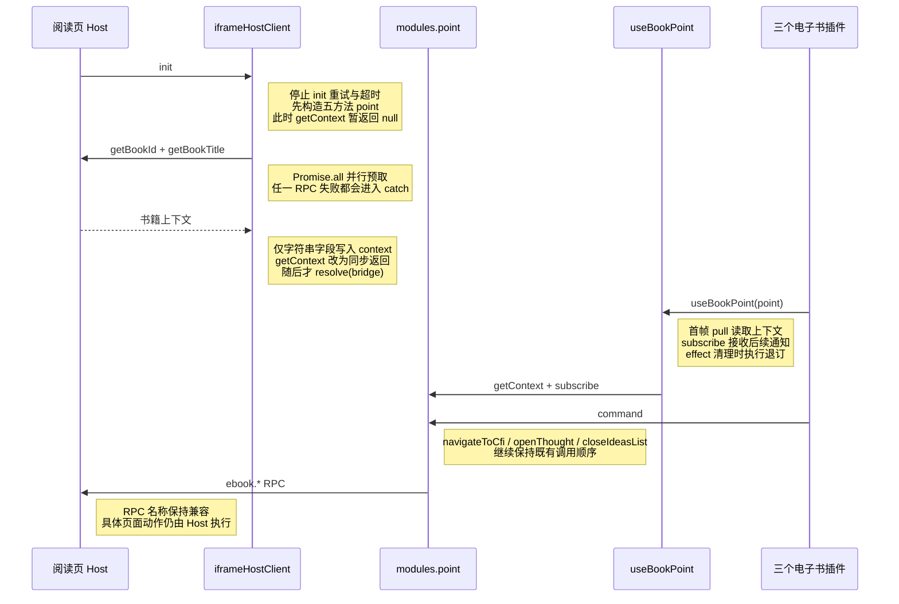

# Ebook 阅读页插件动态接入（Host Surface 发现机制）

> **延伸阅读（后续增量）**：入口勿再同文件导出空 `activate`/`deactivate`（已删），见 [远程插件HMR.md](../plugins/远程插件HMR.md)；桌面插件缓存见 [插件入口缓存失效.md](../plugins/插件入口缓存失效.md)。**`host.icon` 现为 SVG URL**，由统一 `PluginIcon` 内联渲染（不再用 Lucide 名白名单），见 [插件宿主图标.md](./插件宿主图标.md)。
>
> **当前迁移状态**：本篇 §1～§4 是 `PluginHostSurface` 时期的历史快照，不要再照着挂阅读页。现行挂载是 `HostPoint`：`toolbar`，以及 `drawer` 的 `part="trigger"` 和正文。见 [声明式扩展点.md](./声明式扩展点.md) 与 [阅读页扩展点.md](./阅读页扩展点.md)。`modules:ebook` 已删除，书籍上下文和命令走 `ebook.read` 的 `api.modules.point`。

## 1. 背景与目标

EPUB 阅读页（`apps/frontend/src/views/ebook/read.tsx`）此前通过硬编码插件 ID（`usePluginEnabled('ebookIdeas')`、`<PluginHostPage pluginId="ebookIdeas" />`）接入「全书想法」插件。每新增一个 ebook 槽位插件（全书划线、书信息测试等）都要回头改 `read.tsx` 的 import、顶栏按钮、Drawer 渲染与开关同步逻辑，扩展性差且易漏改。

本改动引入 **Host Surface 发现机制**：

- 插件在 registry 的 `PluginDescriptor` 上新增可选字段 `host: { surface: 'ebook.read'; slot: 'drawer' | 'toolbar'; icon?; order? }`，声明自己希望挂到哪个阅读页槽位。
- 阅读页不再硬编码插件 ID，改为通过 `useHostSurfacePlugins('ebook.read')` 同步枚举 registry 缓存中所有声明了该 surface 且已上架的插件，按 `slot` 与 `order` 自动渲染顶栏触发按钮 / 内联工具条 / Drawer 宿主。
- 配套新增后端 `GET /highlights/:bookId` 的分页参数与 remote 仓三个 ebook 视图（Ideas 迁移重组、Highlights 新增、TestBookInfo 新增），并扩展 `vite.config.ts` 的 MF `exposes`、独立预览路由与 i18n。

**目标**：阅读页新增 ebook 插件时**只需改 registry JSON**，`read.tsx` 零改动即可在顶栏/Drawer 自动出现入口。

## 2. 改动范围

### 后端

- `apps/backend/src/services/ebook/ebook.controller.ts`：`listHighlights` 端点新增 `QueryEbookListHighlightsDto` 查询参数，按需分页。
- `apps/backend/src/services/ebook/ebook.service.ts`：新增 `EbookHighlightPageDto` 类型；`listHighlights` 支持 `page` 参数，无参时返回数组（阅读器兼容），有参时返回分页对象。
- `apps/backend/src/services/ebook/dto/query-ebook-list-highlights.dto.ts`：纯新增，DTO 校验 `pageNo` / `pageSize`。

### 前端 - 插件核心

- `apps/frontend/src/plugins/core/types.ts`：`PluginDescriptor` 新增 `host` 字段类型。
- `apps/frontend/src/plugins/core/hostSurface.ts`：纯新增，`listHostSurfacePlugins` + `PluginHostSurface` 类型。
- `apps/frontend/src/plugins/hooks/useHostSurfacePlugins.ts`：纯新增，React Hook 包装。
- `apps/frontend/src/plugins/host/PluginHostPage.tsx`：接收 `className` 透传到插件根 `div`，支持 toolbar 槽内联尺寸控制。
- `apps/frontend/src/plugins/index.ts`：导出 `listHostSurfacePlugins` / `useHostSurfacePlugins` / `PluginHostSurface`。

### 前端 - Ebook 阅读页

- `apps/frontend/src/views/ebook/read.tsx`：移除 `usePluginEnabled('ebookIdeas')` / `ideasListOpen` / `Lightbulb` 按钮与硬编码 `Drawer`；改用 `hostDrawerPluginId` 状态 + `<EbookReadHostPlugins>` 三槽渲染。
- `apps/frontend/src/views/ebook/components/plugins/EbookReadHostPlugins.tsx`：纯新增，阅读页 Host 插件槽统一组件（drawer-triggers / toolbar / drawer 三 part）。

### Remote 插件仓

- `apps/remote-plugins/src/views/ebook/ideas/index.tsx`：纯新增（实为由 `views/ebook-ideas/` 整体迁移，内容未变）。
- `apps/remote-plugins/src/views/ebook-ideas/index.tsx`：纯删除（迁移到 `views/ebook/ideas/`）。
- `apps/remote-plugins/src/views/ebook/highlights/index.tsx`：纯新增，全书划线分页列表。
- `apps/remote-plugins/src/views/ebook/toolbar-test/book-info.tsx`：纯新增，toolbar 槽测试组件。
- `apps/remote-plugins/src/views/ebook/toolbar-test/bridge.ts`：纯新增，测试用 ebook modules 读取工具。
- `apps/remote-plugins/src/router/routes.tsx`：新增 highlights / toolbar-test 预览路由并迁移 import 路径；历史改动曾抽取 `mockEbookModules`，当前预览契约应使用 §4.11 的 `mockEbookPoint`。
- `apps/remote-plugins/src/views/embed/index.tsx`：import 路径迁移到 `@/views/ebook/ideas`。
- `apps/remote-plugins/src/views/home/index.tsx`：首页新增两个卡片入口。
- `apps/remote-plugins/src/layout/index.tsx`：顶栏导航新增两个链接。
- `apps/remote-plugins/vite.config.ts`：`exposes` 新增 `./EbookHighlights` / `./EbookTestBookInfo`，`./EbookIdeas` 路径迁移。
- `apps/remote-plugins/src/i18n/locales/en-US.ts` / `zh-CN.ts`：新增 highlights / ebookTest 文案。
- `apps/remote-plugins/plugin-info.md`：目录结构与 expose 表更新。

> 注：registry `apps/backend/uploads/remotes/plugins-registry.json` 中三个插件的 `host` 声明（见 §4.1 参考）为本机制的配置前提；该文件未在本次 git diff 中改动，作为运行时数据源使用。

## 3. 实现思路

1. **声明即挂载**：插件作者在 registry 给 `PluginDescriptor` 加 `host.surface = 'ebook.read'` + `slot`（`drawer` 抽屉式 / `toolbar` 顶栏内联）+ 可选 `icon`、`order`，阅读页即可发现，无需改业务代码。
2. **同步枚举 + 订阅刷新**：`listHostSurfacePlugins` 同步读 localStorage 中的 registry 缓存（`dnhyxc.plugin.registry.<env>.v1`），过滤 `enabled && host?.surface === surface`，按 `order` 升序排序（缺省 100）。`useHostSurfacePlugins` 在 mount 与 `subscribePluginEnabled` 触发时刷新，确保上架/下架即时反映。
3. **三 part 渲染**：`EbookReadHostPlugins` 用单一 `part` prop 区分三种渲染位 —— `drawer-triggers`（drawer 插件的顶栏图标按钮组）、`toolbar`（toolbar 插件的顶栏内联 `PluginHostPage`）、`drawer`（当前打开的 drawer 插件宿主 `Drawer` + `PluginHostPage`）。阅读页用单一状态 `hostDrawerPluginId` 管理当前打开的 drawer 插件，互斥单开。
4. **失效自愈**：当 registry 变更导致 `openPluginId` 不再属于 drawer 插件集合时，`useEffect` 自动回置为 `null`，避免渲染已下架插件的 Drawer。
5. **后端兼容分页**：`listHighlights` 保持旧调用方「无参返回数组」语义，新增 `page` 参数时返回 `{ list, total, pageNo, pageSize }`，让全书划线插件能滚动分页而不破坏阅读器内联划线的高频全量拉取。
6. **MF expose 扩展**：remote 仓把 `./EbookIdeas` 路径迁到 `views/ebook/ideas/`，并新增 `./EbookHighlights`、`./EbookTestBookInfo`；registry 通过 `remoteName: "remotePlugins"` + 同一 `entry` 复用同一 MF manifest。
7. **独立预览对齐**：remote 仓 `routes.tsx` 为每个新插件补独立预览路由（`/ebook/plugins/highlights`、`/ebook/plugins/toolbar-test`）。历史实现用 `mockEbookModules` 提供非空 bookId；当前则由 `mockEbookPoint.getContext()` 返回书籍上下文，并通过 `modules: { point: mockEbookPoint }` 注入预览组件。

## 4. 关键实现（改动前 / 改动后对比 + 注释）

### 4.1 `PluginDescriptor['host']` 类型扩展（`apps/frontend/src/plugins/core/types.ts`）

**对比范围**：`PluginDescriptor` 接口中 `injectRoute` 字段之后新增的 `host` 字段块。

**改动前** · `apps/frontend/src/plugins/core/types.ts`（基线，约 L36–L46）

```typescript
// 旧版 PluginDescriptor 只能用 injectRoute 控制是否自动注入路由
// 业务页若要内嵌插件，必须自己硬编码 pluginId 去 usePluginEnabled + PluginHostPage
	injectRoute?: boolean;
// 接口后续字段（remoteName 等）与本次改动无关，略
	// ...（未改动：remoteName / expose / entry 等字段）
```

**改动后** · `apps/frontend/src/plugins/core/types.ts`（当前，约 L36–L49）

```typescript
// 控制是否由 RouteInjector 自动注入业务路由树，与本改动无关
	injectRoute?: boolean;
// 新增：业务页自动挂载声明；有此字段后对应 Host 页按 surface/slot 渲染，无需硬编码 pluginId
	host?: {
// surface 固定为 ebook.read（阅读页），未来可扩展其它 Host 页
		surface: 'ebook.read';
// slot 决定渲染位：drawer 顶栏图标+抽屉；toolbar 顶栏内联小块
		slot: 'drawer' | 'toolbar';
// 可选 lucide 图标名，仅 drawer 用；缺省 Puzzle
		icon?: string;
// 可选排序权重，listHostSurfacePlugins 按 order 升序；缺省 100
		order?: number;
// 闭合 host 字段类型定义
	};
// 接口后续字段（remoteName 等）与本次改动无关，略
	// ...（未改动：remoteName / expose / entry 等字段）
```

**变更摘要**：`PluginDescriptor` 新增可选 `host` 字段，作为业务页「声明即挂载」的契约；不填则不影响原有路由/侧栏注入逻辑（向后兼容）。

> 参考：registry 中对应声明（`apps/backend/uploads/remotes/plugins-registry.json`，本文件未在本次 diff 中改动）形如：
>
> ```json
> // ebookIdeas：drawer 槽，Lightbulb 图标，order 10
> "host": { "surface": "ebook.read", "slot": "drawer", "icon": "Lightbulb", "order": 10 }
> // ebookTestBookInfo：toolbar 槽，order 20（无 icon）
> "host": { "surface": "ebook.read", "slot": "toolbar", "order": 20 }
> // ebookHighlights：drawer 槽，Highlighter 图标，order 30
> "host": { "surface": "ebook.read", "slot": "drawer", "icon": "Highlighter", "order": 30 }
> ```

### 4.2 `listHostSurfacePlugins` 与 `PluginHostSurface`（`apps/frontend/src/plugins/core/hostSurface.ts`）

**对比范围**：整文件（纯新增）。同步枚举指定 surface 上已上架的插件。

**改动后** · `apps/frontend/src/plugins/core/hostSurface.ts`（纯新增，约 L1–L24）

```typescript
// 引入 PluginDescriptor 类型，用于返回值与字段访问
import type { PluginDescriptor } from "./types";
// registry 本地缓存 key：按环境（生产/开发）区分，版本号 v1 便于日后换结构
const REGISTRY_CACHE_KEY = `dnhyxc.plugin.registry.${import.meta.env.PROD ? "prod" : "dev"}.v1`;
// 派生 surface 联合类型，目前仅 'ebook.read'；NonNullable 去掉 undefined
export type PluginHostSurface = NonNullable<
	PluginDescriptor["host"]
>["surface"];
// 同步读 registry 缓存中声明了指定 Host surface 且已上架的插件（按 order 升序）
export function listHostSurfacePlugins(
	// 入参：目标 Host surface，如 'ebook.read'
	surface: PluginHostSurface,
	// 返回类型：符合条件的 PluginDescriptor 数组
): PluginDescriptor[] {
	// try 包裹 JSON 解析，缓存损坏时回退空数组而非抛错
	try {
		// 同步取 registry 缓存字符串
		const cached = localStorage.getItem(REGISTRY_CACHE_KEY);
		// 无缓存直接返回空数组，调用方按 0 个插件渲染
		if (!cached) return [];
		// 解析缓存为 { plugins?: PluginDescriptor[] } 结构
		const data = JSON.parse(cached) as { plugins?: PluginDescriptor[] };
		// 过滤：已上架（enabled）且 host.surface 等于目标 surface
		const list = (data.plugins ?? []).filter(
			// 逐插件判定 enabled 与 surface 匹配
			(p) => p.enabled && p.host?.surface === surface,
		);
		// 按 host.order 升序排序，缺省 order 视为 100，保证按钮顺序稳定
		return list.sort(
			// 比较器：a 在前返回负数
			(a, b) => (a.host?.order ?? 100) - (b.host?.order ?? 100),
		);
		// catch 任意异常（JSON 解析失败 / localStorage 不可用等）
	} catch {
		// 异常时安全回退空数组，不阻塞阅读页渲染
		return [];
		// 闭合 try/catch
	}
	// 闭合 listHostSurfacePlugins 函数体
}
```

**变更摘要**：新增纯函数 `listHostSurfacePlugins`，从 registry 缓存同步枚举 surface 插件；导出 `PluginHostSurface` 类型供 Hook 与组件约束入参。

### 4.3 `useHostSurfacePlugins` Hook（`apps/frontend/src/plugins/hooks/useHostSurfacePlugins.ts`）

**对比范围**：整文件（纯新增）。订阅 surface 插件列表，registry / 上架状态变更时刷新。

**改动后** · `apps/frontend/src/plugins/hooks/useHostSurfacePlugins.ts`（纯新增，约 L1–L24）

```typescript
// 引入 useEffect（订阅/取消）与 useState（持有列表）
import { useEffect, useState } from "react";
// 引入上架状态变更订阅器，插件上架/下架时回调
import { subscribePluginEnabled } from "../core/enabledOverrides";
// 引入同步枚举函数与 surface 类型
import {
	listHostSurfacePlugins,
	type PluginHostSurface,
} from "../core/hostSurface";
// 引入 PluginDescriptor 类型作为 state 元素类型
import type { PluginDescriptor } from "../core/types";
// 订阅某 Host surface 上已声明且上架的插件列表（registry 缓存变更时刷新）
export function useHostSurfacePlugins(
	// 入参：目标 Host surface
	surface: PluginHostSurface,
	// 返回类型：当前 surface 上符合条件且排序后的插件数组
): PluginDescriptor[] {
	// 初始 state 用 listHostSurfacePlugins 同步初值，避免首帧空闪
	const [plugins, setPlugins] = useState(() =>
		// 惰性初始化：立即枚举当前 surface 插件
		listHostSurfacePlugins(surface),
	);
	// 订阅 surface 与上架变更：mount 时与每次回调重新枚举
	useEffect(() => {
		// sync：重新读缓存并 setState，保证最新
		const sync = () => setPlugins(listHostSurfacePlugins(surface));
		// 立即执行一次，覆盖 surface 变化后的列表
		sync();
		// 订阅上架/下架事件，返回取消订阅函数
		return subscribePluginEnabled(sync);
		// deps 仅 surface：surface 变化时重订阅与重枚举
	}, [surface]);
	// 返回当前插件列表供组件渲染
	return plugins;
	// 闭合 useHostSurfacePlugins 函数体
}
```

**变更摘要**：新增 React Hook `useHostSurfacePlugins`，惰性初值 + `subscribePluginEnabled` 订阅，确保上架/下架即时刷新。

### 4.4 `plugins/index.ts` 出口扩展

**对比范围**：`apps/frontend/src/plugins/index.ts` 中 `HOST_API_VERSION` 与 `usePluginEnabled` 附近的导出块。

**改动前** · `apps/frontend/src/plugins/index.ts`（基线，约 L34–L37）

```typescript
// 旧版只导出 HOST_API_VERSION 与 usePluginEnabled，未导出 Host Surface 能力
export { HOST_API_VERSION } from "./core/types";
export { usePluginEnabled } from "./hooks/usePluginEnabled";
// 后续为 PluginErrorBoundary 等导出，略
// ...（未改动：PluginErrorBoundary / PluginHostPage 等导出）
```

**改动后** · `apps/frontend/src/plugins/index.ts`（当前，约 L34–L40）

```typescript
// 导出 Host API 版本号（与本次改动无关，保留上下文）
export { HOST_API_VERSION } from "./core/types";
// 新增：导出 PluginHostSurface 类型，供业务页约束 surface 参数
export type { PluginHostSurface } from "./core/hostSurface";
// 新增：导出同步枚举函数，供非 React 场景或一次性读取使用
export { listHostSurfacePlugins } from "./core/hostSurface";
// 导出上架状态 Hook（与本次改动无关，保留上下文）
export { usePluginEnabled } from "./hooks/usePluginEnabled";
// 新增：导出 React Hook，供业务页订阅 surface 插件列表
export { useHostSurfacePlugins } from "./hooks/useHostSurfacePlugins";
// 后续为 PluginErrorBoundary 等导出，略
// ...（未改动：PluginErrorBoundary / PluginHostPage 等导出）
```

**变更摘要**：从插件运行时顶层 barrel 导出 `PluginHostSurface` / `listHostSurfacePlugins` / `useHostSurfacePlugins`，让阅读页可经 `@/plugins` 统一引入。

### 4.5 `PluginHostPage` 接受 `className`（`apps/frontend/src/plugins/host/PluginHostPage.tsx`）

**对比范围**：`PluginHostPage` 组件渲染插件根 `div` 的 `className` 表达式。

**改动前** · `apps/frontend/src/plugins/host/PluginHostPage.tsx`（基线，约 L160–L163）

```typescript
// 旧版根 div 的 className 固定，无法被外部覆盖尺寸
				<div
					className={`plugin-${pluginId} h-full w-full`}
					data-mf-plugin={pluginId}
```

**改动后** · `apps/frontend/src/plugins/host/PluginHostPage.tsx`（当前，约 L160–L163）

```typescript
// 新增 className 透传：toolbar 槽可注入 h-auto! 等尺寸覆盖，drawer 槽仍用默认 h-full
				<div
					className={cn(`plugin-${pluginId} h-full w-full`, className)}
					data-mf-plugin={pluginId}
```

**变更摘要**：`PluginHostPage` 的根 `div` 用 `cn(...)` 合并外部 `className`，使 toolbar 槽能覆盖 `h-full`（见 §4.6 `className="h-auto! min-h-0 w-full max-w-full"`）；`Props` 早已含 `className?: string`（顶部 `type Props = { pluginId: string; className?: string }`），本次仅接通使用。`cn` 来自 `@/lib/utils`，文件顶部已 import。

### 4.6 `EbookReadHostPlugins` 组件（`apps/frontend/src/views/ebook/components/plugins/EbookReadHostPlugins.tsx`）

**对比范围**：整文件（纯新增）。阅读页 Host 插件槽统一组件，按 `part` 渲染三种位。

**改动后** · `apps/frontend/src/views/ebook/components/plugins/EbookReadHostPlugins.tsx`（纯新增，约 L1–L152）

```typescript
// 引入 Drawer 组件，用于 drawer part 宿主
import { Drawer } from '@design/Drawer';
// 引入 Tooltip 组件，包裹 drawer-triggers 的图标按钮
import Tooltip from '@design/Tooltip';
// 引入 Button 组件，渲染触发按钮
import { Button } from '@ui/index';
// 引入用到的 lucide 图标与 LucideIcon 类型
import {
// 书签图标（备选）
	BookMarked,
// 划线笔图标（ebookHighlights 用）
	Highlighter,
// 灯泡图标（ebookIdeas 用）
	Lightbulb,
// 图标组件类型，用于 ICON_BY_NAME 字典
	type LucideIcon,
// 拼图图标（缺省/未知图标名回退）
	Puzzle,
// 闪光图标（备选）
	Sparkles,
// 闭合 lucide-react import
} from 'lucide-react';
// 引入 useEffect（失效自愈）与 CSSProperties 类型（chromeStyle）
import { useEffect, type CSSProperties } from 'react';
// 引入 i18n hook，取 locale 用于解析插件多语言标题
import { useI18n } from '@/hooks';
// 引入 cn 合并条件 className
import { cn } from '@/lib/utils';
// 从插件运行时 barrel 引入 pickPluginLocaleText / PluginHostPage / useHostSurfacePlugins
import {
// 按 locale 解析 PluginLocaleMap 文案
	pickPluginLocaleText,
// 挂载指定插件 ID 的 MF/iframe 宿主
	PluginHostPage,
// 订阅 ebook.read surface 插件列表
	useHostSurfacePlugins,
} from '@/plugins';
// 图标名 → 组件映射字典；新增 drawer 插件可在 registry 用这些名字
const ICON_BY_NAME: Record<string, LucideIcon> = {
// 灯泡
	Lightbulb,
// 拼图（缺省）
	Puzzle,
// 闪光
	Sparkles,
// 书签
	BookMarked,
// 划线笔
	Highlighter,
// 闭合字典
};
// 按名字取图标组件，未知或缺省回退 Puzzle
function pluginIcon(name?: string): LucideIcon {
// 无 name 直接回退 Puzzle
	if (!name) return Puzzle;
// 命中字典返回对应组件，否则回退 Puzzle
	return ICON_BY_NAME[name] ?? Puzzle;
// 闭合 pluginIcon
}
// 组件 Props 定义
type Props = {
// part 决定渲染位，详见下方注释
	/**
	 * - toolbar：slot=toolbar，顶栏内联 PluginHostPage
	 * - drawer-triggers：slot=drawer，顶栏图标按钮
	 * - drawer：slot=drawer，底部 Drawer 宿主
	 */
	part: 'toolbar' | 'drawer-triggers' | 'drawer';
// 当前打开的 drawer 插件 ID，null 表示未打开
	openPluginId?: string | null;
// drawer 插件 ID 变更回调（打开/关闭）
	onOpenPluginIdChange?: (id: string | null) => void;
// Drawer chrome 样式（透传阅读页主题等）
	chromeStyle?: CSSProperties;
// 闭合 Props
};
// 阅读页 Host 插件槽：按 registry host.surface === 'ebook.read' 自动渲染
// 新增插件只需改 registry，不必再改 read.tsx
export function EbookReadHostPlugins({
// part：渲染位
	part,
// openPluginId 缺省 null
	openPluginId = null,
// 打开/关闭回调
	onOpenPluginIdChange,
// Drawer 样式
	chromeStyle,
// 解构结束
}: Props) {
// 取 locale 用于解析插件标题
	const { locale } = useI18n();
// 订阅 ebook.read surface 全部已上架插件（按 order 排序）
	const all = useHostSurfacePlugins('ebook.read');
// 过滤出 drawer 槽插件（顶栏按钮 + Drawer 宿主共用）
	const drawerPlugins = all.filter((p) => p.host?.slot === 'drawer');
// 过滤出 toolbar 槽插件（顶栏内联）
	const toolbarPlugins = all.filter((p) => p.host?.slot === 'toolbar');
// 失效自愈：openPluginId 不在 drawerPlugins 中时回置 null
	useEffect(() => {
// 仅 drawer 相关 part 需要校验
		if (part !== 'drawer-triggers' && part !== 'drawer') {
// toolbar part 直接跳过
			return;
		}
// 当前打开的插件 ID 不再属于 drawer 插件集合时
		if (
			openPluginId &&
			!drawerPlugins.some((p) => p.id === openPluginId) &&
			onOpenPluginIdChange
		) {
// 回置为 null，避免渲染已下架/已迁移的 Drawer
			onOpenPluginIdChange(null);
		}
// deps：drawerPlugins 列表、openPluginId、回调、part 任一变化重校验
	}, [drawerPlugins, openPluginId, onOpenPluginIdChange, part]);
// toolbar part：内联渲染每个 toolbar 插件的 PluginHostPage
	if (part === 'toolbar') {
// 无 toolbar 插件则不渲染
		if (toolbarPlugins.length === 0) return null;
// 返回片段：每个 toolbar 插件一个外层 div
		return (
// Fragment 包裹多个内联槽
			<>
// 遍历 toolbar 插件
				{toolbarPlugins.map((p) => (
// 外层 div 限制宽度并标记插槽语义
					<div
// React key
						key={p.id}
// 限宽 280px 或 40vw 取小，保证顶栏不溢出
						className="flex max-w-[min(280px,40vw)] min-w-0 shrink items-center"
// 数据属性：标记 toolbar 槽，便于样式隔离 / 调试
						data-ebook-host-slot="toolbar"
// 数据属性：标记插件 ID
						data-plugin-id={p.id}
// 闭合外层 div 开标签
					>
// 挂载该 toolbar 插件，覆盖 h-full 为 h-auto! 以适配内联高度
						<PluginHostPage
// 插件 ID
							pluginId={p.id}
// 覆盖尺寸：自动高度、满宽
							className="h-auto! min-h-0 w-full max-w-full"
// 闭合 PluginHostPage
						/>
// 闭合外层 div
					</div>
// map 结束
				))}
// 闭合 Fragment
			</>
		);
// 结束 toolbar part 分支
	}
// drawer-triggers part：渲染 drawer 插件的顶栏图标按钮组
	if (part === 'drawer-triggers') {
// 无 drawer 插件则不渲染
		if (drawerPlugins.length === 0) return null;
// 返回片段：每个 drawer 插件一个 Tooltip+Button
		return (
// Fragment 包裹多个触发按钮
			<>
// 遍历 drawer 插件
				{drawerPlugins.map((p) => {
// 取该插件声明的图标组件
					const Icon = pluginIcon(p.host?.icon);
// 解析插件多语言标题，回退插件 ID
					const label = pickPluginLocaleText(p.title, locale) || p.id;
// 该按钮是否处于打开态
					const open = openPluginId === p.id;
// 返回单个 Tooltip + Button
					return (
// Tooltip 提供悬停说明
						<Tooltip
// React key
							key={p.id}
// 提示出现在按钮下方
							side="bottom"
// 与按钮间距 6px
							sideOffset={6}
// 悬停 200ms 后显示
							delayDuration={200}
// 启用阴影
							shadow
// 提示内容为插件标题
							content={label}
// 闭合 Tooltip 开标签
						>
// 触发按钮
							<Button
// 类型 button，避免表单提交
								type="button"
// ghost 变体
								variant="ghost"
// 小图标尺寸
								size="icon-sm"
// 打开态高亮，否则悬停变 teal
								className={cn(
// 打开态背景与文字色
									open
										? 'bg-theme/15 text-teal-500'
// 默认态文字色与悬停色
										: 'text-textcolor/80 hover:text-teal-500',
								)}
// aria-pressed 标记开关态
								aria-pressed={open}
// aria-label 为插件标题
								aria-label={label}
// 点击：已开则关，未开则打开该插件
								onClick={() => onOpenPluginIdChange?.(open ? null : p.id)}
// 闭合 Button 开标签
							>
// 渲染图标
								<Icon className="size-4" />
// 闭合 Button
							</Button>
// 闭合 Tooltip
						</Tooltip>
// map 回调返回结束
					);
// map 结束
				})}
// 闭合 Fragment
			</>
		);
// 结束 drawer-triggers part 分支
	}
// drawer part：查找当前打开的 drawer 插件元信息
	const openMeta = drawerPlugins.find((p) => p.id === openPluginId);
// 未找到则不渲染 Drawer
	if (!openMeta) return null;
// 渲染 Drawer 宿主 + PluginHostPage
	return (
// Drawer 提供滑出面板
		<Drawer
// 标题为插件多语言标题，回退插件 ID
			title={pickPluginLocaleText(openMeta.title, locale) || openMeta.id}
// open 跟随 openPluginId 是否存在
			open={!!openPluginId}
// 关闭回调：open=false 时回置 null
			onOpenChange={(open) => {
// 关闭时清空 openPluginId
				if (!open) onOpenPluginIdChange?.(null);
// 闭合 onOpenChange 回调
			}}
// Drawer body 内边距
			bodyClassName="pt-2 pb-2 pl-0"
// 透传阅读页 chrome 样式（主题色等）
			contentStyle={chromeStyle}
// 闭合 Drawer 开标签
		>
// 内容容器：撑满并允许内部滚动
			<div className="relative flex h-full min-h-0 flex-col">
// 仅在 openPluginId 存在时挂载插件，避免关闭瞬间仍加载
				{openPluginId ? <PluginHostPage pluginId={openPluginId} /> : null}
// 闭合内容容器
			</div>
// 闭合 Drawer
		</Drawer>
// 闭合组件返回
	);
// 闭合 EbookReadHostPlugins 函数体
}
```

**变更摘要**：新增 `EbookReadHostPlugins`，单一组件承载三 part 渲染，封装图标映射、多语言标题、失效自愈与 Drawer 宿主；阅读页只需放置三个 `<EbookReadHostPlugins part=... />`。

### 4.7 `EbookReadPage` 阅读页接入（`apps/frontend/src/views/ebook/read.tsx`）

#### 4.7.1 import 与状态声明调整

**对比范围**：`read.tsx` 顶部 import 区与组件内 `ebookIdeasEnabled` / `ideasListOpen` 相关声明。

**改动前** · `apps/frontend/src/views/ebook/read.tsx`（基线，约 L1–L50 与 L245–L370 摘录）

```typescript
// 旧版 import Drawer（用于硬编码想法抽屉），后文移除
import { Drawer } from '@design/Drawer';
// 旧版从 lucide 引入 Lightbulb（想法按钮图标），后文移除
	Lightbulb,
// 旧版从 @/plugins 引入 PluginHostPage / usePluginEnabled，后文改由 EbookReadHostPlugins 内部使用
import {
	type EbookHostThought,
	PluginHostPage,
	setEbookHostHandlers,
	usePluginEnabled,
} from '@/plugins';
// ...（未改动：其余 import 略）
// 旧版：想法列表插件是否启用的开关
	// 想法列表插件是否启用
	const ebookIdeasEnabled = usePluginEnabled('ebookIdeas');
// 旧版：单一想法抽屉开关，仅支持 ebookIdeas 一个插件
	const [ideasListOpen, setIdeasListOpen] = useState(false);
// 旧版：插件下架时强制关闭抽屉
	useEffect(() => {
		if (!ebookIdeasEnabled && ideasListOpen) setIdeasListOpen(false);
	}, [ebookIdeasEnabled, ideasListOpen]);
```

**当前实现（point 迁移后）** · `apps/frontend/src/views/ebook/read.tsx`

```typescript
// 通用 federation 门面同时提供 surface 挂载和 ebook.read 的上下文 / 命令绑定
import {
	bindPointCommand,
	PluginHostSurface,
	POINT,
	publishPointContext,
} from '@/federation';
// hostDrawerPluginId 仍表示当前打开的 drawer 插件，多个抽屉互斥单开
const [hostDrawerPluginId, setHostDrawerPluginId] = useState<string | null>(null);
```

**迁移摘要**：早期用于归档的 `EbookReadHostPlugins` 已收敛为通用 `PluginHostSurface`；`EbookHostThought` / `setEbookHostHandlers` 不再从阅读页导入。`host.surface` 的声明式发现机制仍然有效，变化的是页面宿主组件和 Host API 载体。

#### 4.7.2 当前书籍上下文与命令绑定

`setEbookHostHandlers` 已删除。EPUB 阅读页现在发布 `ebook.read` context，并把目录声明的三个命令绑定到页面实现：

```typescript
useEffect(() => {
	// 非 EPUB 不保留上一本书的上下文，也不给插件暴露阅读页命令
	if (book?.fmt !== 'epub') {
		publishPointContext(POINT.ebookRead, null);
		return;
	}
	const bookId = book.id;
	const bookTitle = book.title;
	// catalog 的 contextKeys 会裁剪为 bookId / bookTitle
	publishPointContext(POINT.ebookRead, { bookId, bookTitle });
	const unbind = [
		// 划线或想法条目通过统一 command 跳转到 CFI
		bindPointCommand(POINT.ebookRead, 'navigateToCfi', (cfi) =>
			ensureQuoteCfiInViewport(typeof cfi === 'string' ? cfi : ''),
		),
		// 只把合法对象转交页面已有的想法详情实现
		bindPointCommand(POINT.ebookRead, 'openThought', (thought) => {
			if (!thought || typeof thought !== 'object') return;
			openHostThought(thought as Parameters<typeof openHostThought>[0]);
		}),
		// closeIdeasList 是兼容命令名，实际关闭当前任意 drawer 插件
		bindPointCommand(POINT.ebookRead, 'closeIdeasList', () => {
			setHostDrawerPluginId(null);
		}),
	];
	return () => {
		// 页面切换或书籍变化时先解绑旧命令，避免落到旧书籍闭包
		for (const off of unbind) off();
		publishPointContext(POINT.ebookRead, null);
	};
}, [book?.fmt, book?.id, book?.title, ensureQuoteCfiInViewport, openHostThought]);
```

因此 Remote 不再调用 `ebook.getBookId()` 或 `ebook.navigateToCfi()`，而是读取 `point.getContext()` 并调用 `point.command(...)`。命令未登记与尚未绑定分别由 point API 抛出 `UNKNOWN_POINT_COMMAND` / `POINT_COMMAND_UNBOUND`。

#### 4.7.3 顶栏尾部按钮区（`epubHeaderTrailing`）

**对比范围**：`epubHeaderTrailing` 中原 `Lightbulb` Tooltip/Button 块。

**改动前** · `apps/frontend/src/views/ebook/read.tsx`（基线，约 L2521–L2549）

```typescript
// 旧版：仅当 ebookIdeasEnabled 时渲染硬编码的 Lightbulb 按钮
							{ebookIdeasEnabled ? (
// Tooltip 包裹按钮，悬停显示「打开想法列表」
								<Tooltip
									side="bottom"
									sideOffset={6}
									delayDuration={200}
									shadow
									content={t('ebook.read.ebookIdeas.open')}
								>
// ghost 图标按钮
									<Button
										type="button"
										variant="ghost"
										size="icon-sm"
// 打开态高亮 teal，否则默认
										className={cn(
											ideasListOpen
												? 'bg-theme/15 text-teal-500'
												: 'text-textcolor/80 hover:text-teal-500',
										)}
										aria-pressed={ideasListOpen}
										aria-label={t('ebook.read.ebookIdeas.open')}
// 点击打开想法抽屉
										onClick={() => setIdeasListOpen(true)}
									>
// 灯泡图标
										<Lightbulb className="size-4" />
// 闭合 Button
									</Button>
// 闭合 Tooltip
								</Tooltip>
// ebookIdeasEnabled 为 false 时不渲染
							) : null}
```

**当前实现** · `apps/frontend/src/views/ebook/read.tsx`

```tsx
// drawer-triggers 自动渲染所有 drawer 槽插件的顶栏图标按钮
<PluginHostSurface
	surface="ebook.read"
	part="drawer-triggers"
	openPluginId={hostDrawerPluginId}
	onOpenPluginIdChange={setHostDrawerPluginId}
/>
// toolbar 自动内联挂载所有 toolbar 槽插件
<PluginHostSurface surface="ebook.read" part="toolbar" />
```

**迁移摘要**：早期 `<EbookReadHostPlugins>` 的两个 part 原样迁移为通用 `<PluginHostSurface>`；这里仍负责“挂载”，并未改写成 `HostPoint`。`ebook.read` point 负责的是旁边的“上下文与命令”链路。

#### 4.7.4 底部 Drawer 宿主

**对比范围**：`EbookPageShell` 内尾部的 EPUB Drawer 块。

**改动前** · `apps/frontend/src/views/ebook/read.tsx`（基线，约 L3027–L3040）

```typescript
// 旧版：仅当 epub 且 ebookIdeasEnabled 时渲染硬编码想法 Drawer
					{book?.fmt === 'epub' && ebookIdeasEnabled ? (
// Drawer 标题固定为「想法列表」
						<Drawer
							title={t('ebook.read.ebookIdeas.title')}
							open={ideasListOpen}
							onOpenChange={setIdeasListOpen}
							bodyClassName="pt-2 pb-2 pl-0"
							contentStyle={epubSurfaceProps?.chromeStyle}
						>
							<div className="relative flex h-full min-h-0 flex-col">
// 仅挂载 ebookIdeas 一个插件
								{ideasListOpen ? <PluginHostPage pluginId="ebookIdeas" /> : null}
							</div>
						</Drawer>
					) : null}
```

**当前实现** · `apps/frontend/src/views/ebook/read.tsx`

```tsx
// EPUB 才渲染抽屉宿主，具体插件仍由 hostDrawerPluginId 决定
{book?.fmt === 'epub' ? (
	<PluginHostSurface
		surface="ebook.read"
		part="drawer"
		openPluginId={hostDrawerPluginId}
		onOpenPluginIdChange={setHostDrawerPluginId}
		chromeStyle={epubSurfaceProps?.chromeStyle}
	/>
) : null}
```

**迁移摘要**：硬编码 `Drawer` + `pluginId="ebookIdeas"` 的历史已被声明式 surface 取代；当前通用组件为 `PluginHostSurface`。上架状态与排序仍由 `useHostSurfacePlugins` 发现机制处理。

### 4.8 后端 highlights 分页端点

#### 4.8.1 `QueryEbookListHighlightsDto`（`apps/backend/src/services/ebook/dto/query-ebook-list-highlights.dto.ts`）

**对比范围**：整文件（纯新增）。

**改动后** · `apps/backend/src/services/ebook/dto/query-ebook-list-highlights.dto.ts`（纯新增，约 L1–L18）

```typescript
// 引入 Type 装饰器，把 query 字符串数值化
import { Type } from "class-transformer";
// 引入校验装饰器
import { IsNumber, IsOptional, Max, Min } from "class-validator";
// DTO：GET /highlights/:bookId 传 pageNo/pageSize 时返回分页，否则返回数组（阅读器兼容）
export class QueryEbookListHighlightsDto {
	// pageNo 可选
	@IsOptional()
	// 把字符串转 number
	@Type(() => Number)
	// 必须是数字
	@IsNumber()
	// 最小 1
	@Min(1)
	pageNo?: number;
	// pageSize 可选
	@IsOptional()
	// 把字符串转 number
	@Type(() => Number)
	// 必须是数字
	@IsNumber()
	// 最小 1
	@Min(1)
	// 最大 100，防止一次拉太多
	@Max(100)
	pageSize?: number;
	// 闭合 DTO class
}
```

**变更摘要**：新增分页查询 DTO，校验 `pageNo >= 1`、`1 <= pageSize <= 100`，且均为可选（不传即走旧的全量数组语义）。

#### 4.8.2 `listHighlights` 控制器方法（`apps/backend/src/services/ebook/ebook.controller.ts`）

**对比范围**：`EbookController.listHighlights` 方法。

**改动前** · `apps/backend/src/services/ebook/ebook.controller.ts`（基线，约 L445–L452）

```typescript
// 旧版 listHighlights 仅接收 bookId，无分页
	async listHighlights(
// 已登录请求，取 userId
		@Req() req: AuthedRequest,
// 路径参数 bookId，UUID 校验
		@Param('bookId', ParseUUIDPipe) bookId: string,
// 旧版无 query 参数
	) {
// 直接返回全部划线数组
		return this.ebookService.listHighlights(this.userId(req), bookId);
	}
```

**改动后** · `apps/backend/src/services/ebook/ebook.controller.ts`（当前，约 L446–L455）

```typescript
// 新增 @Query 注入分页参数
	async listHighlights(
// 已登录请求，取 userId
		@Req() req: AuthedRequest,
// 路径参数 bookId，UUID 校验
		@Param('bookId', ParseUUIDPipe) bookId: string,
// 新增：分页查询 DTO（pageNo/pageSize 可选）
		@Query() query: QueryEbookListHighlightsDto,
// 参数列表结束
	) {
// 是否走分页：pageNo 或 pageSize 任一存在即分页
		const paginate = query.pageNo != null || query.pageSize != null;
// 调用 service，按 paginate 决定是否传 page 对象
		return this.ebookService.listHighlights(
			this.userId(req),
			bookId,
// 分页时传 { pageNo, pageSize }，否则 undefined 走全量
			paginate ? { pageNo: query.pageNo, pageSize: query.pageSize } : undefined,
// 闭合 service 调用
		);
// 闭合 listHighlights 方法
	}
```

**变更摘要**：控制器新增 `@Query() query`，按 `pageNo`/`pageSize` 是否存在决定是否传 `page` 给 service；并在文件顶部新增 `import { QueryEbookListHighlightsDto } from './dto/query-ebook-list-highlights.dto'`。

#### 4.8.3 `listHighlights` 服务方法与 `EbookHighlightPageDto`（`apps/backend/src/services/ebook/ebook.service.ts`）

**对比范围**：`EbookHighlightDto` 之后新增的 `EbookHighlightPageDto` 类型，与 `EbookService.listHighlights` 方法。

**改动前** · `apps/backend/src/services/ebook/ebook.service.ts`（基线，约 L1695–L1707）

```typescript
// 旧版 listHighlights 仅返回全部划线数组
	async listHighlights(
		userId: number,
		bookId: string,
// 旧版无 page 参数
	): Promise<EbookHighlightDto[]> {
// 断言该书属于该用户
		await this.assertBookOwned(userId, bookId);
// 一次性查全部划线，按创建时间倒序
		const rows = await this.highlightRepo.find({
			where: { userId, bookId },
			order: { createdAt: 'DESC' },
		});
// 转换为 DTO 数组返回
		return rows.map((row) => this.toHighlightDto(row));
	}
```

**改动后** · `apps/backend/src/services/ebook/ebook.service.ts`（当前，类型约 L211–L217，方法约 L1702–L1730）

类型新增（紧随 `EbookHighlightDto`）：

```typescript
// 新增：分页响应类型，供全书划线插件滚动加载
export type EbookHighlightPageDto = {
	// 当前页划线列表
	list: EbookHighlightDto[];
	// 总条数
	total: number;
	// 当前页码
	pageNo: number;
	// 当前页大小
	pageSize: number;
	// 闭合分页类型
};
```

方法：

```typescript
// 新版 listHighlights：无 page 返回数组（阅读器兼容），有 page 返回分页对象
	async listHighlights(
		userId: number,
		bookId: string,
// 新增可选分页参数
		page?: { pageNo?: number; pageSize?: number },
// 返回类型联合：数组或分页对象
	): Promise<EbookHighlightDto[] | EbookHighlightPageDto> {
// 断言该书属于该用户
		await this.assertBookOwned(userId, bookId);
// 是否分页：pageNo 或 pageSize 任一存在
		const paginate = page?.pageNo != null || page?.pageSize != null;
// 不分页分支：保持旧语义，返回全部划线数组
		if (!paginate) {
// 一次性查全部
			const rows = await this.highlightRepo.find({
				where: { userId, bookId },
				order: { createdAt: 'DESC' },
			});
// 转换为 DTO 数组返回
			return rows.map((row) => this.toHighlightDto(row));
// 闭合不分页分支
		}
// 分页分支：pageNo 缺省 1
		const pageNo = page?.pageNo ?? 1;
// pageSize 缺省 50，并夹紧到 [1, 100]
		const pageSize = Math.min(Math.max(page?.pageSize ?? 50, 1), 100);
// findAndCount 同时取当前页数据与总数
		const [rows, total] = await this.highlightRepo.findAndCount({
			where: { userId, bookId },
			order: { createdAt: 'DESC' },
// 跳过前 (pageNo-1)*pageSize 条
			skip: (pageNo - 1) * pageSize,
// 取 pageSize 条
			take: pageSize,
		});
// 返回分页对象
		return {
// 当前页划线列表
			list: rows.map((row) => this.toHighlightDto(row)),
// 总条数
			total,
// 当前页码
			pageNo,
// 当前页大小
			pageSize,
// 闭合分页对象
		};
// 闭合 listHighlights 方法
	}
```

**变更摘要**：service `listHighlights` 新增可选 `page` 参数，无参保持数组语义（阅读器内联划线高频全量拉取不受影响），有参返回 `EbookHighlightPageDto` 分页对象；`pageSize` 夹紧 `[1,100]`，缺省 50。

### 4.9 Remote 仓 ebook 视图重组与新增

#### 4.9.1 `IdeasListApp` 迁移（`apps/remote-plugins/src/views/ebook/ideas/index.tsx`）

**对比范围**：整文件迁移。原 `apps/remote-plugins/src/views/ebook-ideas/index.tsx`（275 行）整体移动到 `apps/remote-plugins/src/views/ebook/ideas/index.tsx`，**内容未变**。

**改动前** · `apps/remote-plugins/src/views/ebook-ideas/index.tsx`（基线，约 L1–L30，已删除）

```typescript
// 旧位置：src/views/ebook-ideas/index.tsx，已删除
import Loading from '@design/Loading';
import { Button, ScrollArea } from '@ui/index';
import { useCallback, useEffect, useRef, useState } from 'react';
// ...（未改动：与新版完全一致，整文件迁移到 views/ebook/ideas/index.tsx）
// 旧版默认导出 IdeasListApp，逻辑同新版
export default function IdeasListApp({ api }: HostBridgeProps) {
	// ...（未改动：fetchPage / IntersectionObserver / 列表渲染等逻辑与新版一致）
```

**改动后** · `apps/remote-plugins/src/views/ebook/ideas/index.tsx`（当前，约 L1–L30 摘录；纯新增/迁移）

```typescript
// 新位置：src/views/ebook/ideas/index.tsx；与旧版内容一致，仅目录迁移
import Loading from "@design/Loading";
import { Button, ScrollArea } from "@ui/index";
import { useCallback, useEffect, useRef, useState } from "react";
import { useHostLocale, useI18n } from "@/hooks";
import type { Locale } from "@/i18n";
import { cn } from "@/lib/utils";
import "@/styles.css";
import { Quote } from "lucide-react";
// ...（未改动：Thought/EbookModules/HostBridgeProps/ThoughtPage 类型与 unwrapPage/formatTime/IdeasListApp 实现均与旧版一致）
// 默认导出 IdeasListApp：拉取 /ebook/thoughts/:bookId?publicOnly=true，滚动分页
export default function IdeasListApp({ api }: HostBridgeProps) {
	// ...（未改动：与旧版 ebook-ideas/index.tsx 完全一致）
	// 闭合 IdeasListApp
}
// 无 activate/deactivate：列表在 mount 时拉取；同文件混出非组件导出会破坏 Fast Refresh
```

**变更摘要**：`IdeasListApp` 由 `views/ebook-ideas/` 迁到 `views/ebook/ideas/`；生命周期空钩子已移除（见 [远程插件HMR.md](../plugins/远程插件HMR.md)）。

#### 4.9.2 `EbookHighlightsApp` 全书划线（`apps/remote-plugins/src/views/ebook/highlights/index.tsx`）

**对比范围**：整文件（纯新增）。结构与 `IdeasListApp` 同构：分页拉取 + IntersectionObserver 滚动加载。

**改动后** · `apps/remote-plugins/src/views/ebook/highlights/index.tsx`（纯新增，约 L89–L191 摘录：组件主体）

```typescript
// 全书划线：分页滚动加载当前用户在本书的全部划线
export default function EbookHighlightsApp({ api }: HostBridgeProps) {
// 取 t 翻译与 locale 格式化时间
	const { t, locale } = useI18n();
// 同步插件 locale 到 host
	useHostLocale(api);
// modules:point + host.surface=ebook.read 才会注入当前阅读点
	const point = api.modules?.point as EbookPointApi | undefined;
// context 需要订阅更新；subscribe 回调本身不带数据
	const [context, setContext] = useState<Record<string, unknown> | null>(() =>
		point?.getContext() ?? null,
	);
	useEffect(() => {
		const sync = () => setContext(point?.getContext() ?? null);
		sync();
		return point?.subscribe(sync);
	}, [point]);
// 当前书 ID 与标题都从 ebook.read context 读取
	const bookId = typeof context?.bookId === 'string' ? context.bookId : null;
	const bookTitle =
		typeof context?.bookTitle === 'string' ? context.bookTitle : null;
// 划线列表 state
	const [items, setItems] = useState<Highlight[]>([]);
// 当前页码 state
	const [pageNo, setPageNo] = useState(0);
// 总数 state
	const [total, setTotal] = useState(0);
// 首屏 loading
	const [loading, setLoading] = useState(false);
// 加载更多 loading
	const [loadingMore, setLoadingMore] = useState(false);
// 错误信息
	const [error, setError] = useState<string | null>(null);
// 滚动容器 ref
	const viewportRef = useRef<HTMLDivElement>(null);
// 哨兵 ref，触底时加载下一页
	const sentinelRef = useRef<HTMLDivElement>(null);
// 防重入标志
	const inflightRef = useRef(false);
// 是否还有更多
	const hasMore = items.length < total;
// 分页拉取：nextPage 页码，append=true 追加
	const fetchPage = useCallback(
		async (nextPage: number, append: boolean) => {
// 无 bookId / 无 http / 请求中则跳过
			if (!bookId || !api.http || inflightRef.current) return;
// 标记请求中
			inflightRef.current = true;
// 追加设 loadingMore，否则首屏 loading
			if (append) setLoadingMore(true);
			else {
				setLoading(true);
				setError(null);
			}
			try {
// 调用新增的分页端点 /ebook/highlights/:bookId?pageNo=&pageSize=
				const res = await api.http.get(
					`/ebook/highlights/${bookId}?pageNo=${nextPage}&pageSize=${PAGE_SIZE}`,
				);
// 解析分页响应
				const page = unwrapPage(res);
				setTotal(page.total);
				setPageNo(page.pageNo);
				setItems((prev) => {
// 首屏直接覆盖
					if (!append) return page.list;
// 追加时按 id 去重
					const seen = new Set(prev.map((h) => h.id));
					const extra = page.list.filter((h) => !seen.has(h.id));
					return [...prev, ...extra];
				});
			} catch (e) {
// 错误信息
				const message = e instanceof Error ? e.message : String(e);
				if (!append) {
// 首屏错误：清空并展示
					setError(message);
					setItems([]);
					setTotal(0);
					setPageNo(0);
				} else {
// 追加错误：toast 提示
					api.ui?.showToast({ message, type: 'error' });
				}
			} finally {
// 清重入标志
				inflightRef.current = false;
				setLoading(false);
				setLoadingMore(false);
			}
		},
// fetchPage 依赖
		[api.http, api.ui, bookId],
	);
// bookId 变化时拉首页
	useEffect(() => {
		if (!bookId || !api.http) {
			setItems([]);
			setTotal(0);
			setPageNo(0);
			setError(bookId ? null : t('highlightsList.unboundBook'));
			return;
		}
		void fetchPage(1, false);
	}, [api.http, bookId, fetchPage, t]);
// IntersectionObserver 触底加载下一页
	useEffect(() => {
		const root = viewportRef.current;
		const target = sentinelRef.current;
		if (!root || !target || !hasMore || loading || loadingMore) return;
		const io = new IntersectionObserver(
			(entries) => {
				if (!entries[0]?.isIntersecting) return;
				void fetchPage(pageNo + 1, true);
			},
			{ root, rootMargin: '120px 0px', threshold: 0 },
		);
		io.observe(target);
		return () => io.disconnect();
	}, [fetchPage, hasMore, loading, loadingMore, pageNo, items.length]);
// 点击划线条目：通过 ebook.read 命令跳转 CFI 并关闭当前抽屉
	const onOpen = (row: Highlight) => {
		const cfi = row.cfiRange?.trim();
		if (cfi) void point?.command('navigateToCfi', cfi);
		point?.command('closeIdeasList', undefined);
	};
// ...（未改动：JSX 渲染结构与 IdeasListApp 同构——书名/总数栏、ScrollArea 列表、Highlighter 图标、样式 label、加载更多/全部加载提示）
	return (
		// ...（未改动：见 IdeasListApp 同构的列表/分页/空态/错误态渲染）
	);
// 闭合 EbookHighlightsApp
}
```

**当前迁移摘要**：分页拉取与滚动加载逻辑不变；书籍信息改为 `point.getContext()`，点击条目改为 `point.command('navigateToCfi', cfi)` 和 `point.command('closeIdeasList', undefined)`。`subscribe` 只负责通知，插件必须在回调里重新读取 context。配套 `EbookPointApi` 类型见 §4.9.4。

#### 4.9.3 `EbookTestBookInfoApp` toolbar 槽测试（`apps/remote-plugins/src/views/ebook/toolbar-test/book-info.tsx`）

**对比范围**：整文件（纯新增）。验证 toolbar 槽内联渲染与当前 point API 桥接。

**改动后** · `apps/remote-plugins/src/views/ebook/toolbar-test/book-info.tsx`（纯新增，约 L1–L46）

```typescript
// context 通过 point.subscribe 驱动局部状态刷新
import { useEffect, useState } from 'react';
// 引入 Button 组件
import { Button } from '@ui/index';
// 引入 locale 同步与 i18n
import { useHostLocale, useI18n } from '@/hooks';
// 引入 cn 合并 className
import { cn } from '@/lib/utils';
// 引入子项目全局样式
import '@/styles.css';
// 引入测试用 bridge 类型与当前 point 读取函数
import { type EbookTestBridgeProps, readPointApi } from './bridge';
// 阅读页 Host 槽测试：toolbar 内联展示书名/Id + Toast
export default function EbookTestBookInfoApp({ api }: EbookTestBridgeProps) {
// 取 t 翻译
	const { t } = useI18n();
// 同步插件 locale 到 host
	useHostLocale(api);
// 从 api.modules.point 读取 ebook.read，而不是已删除的 modules.ebook
	const point = readPointApi(api);
	const [context, setContext] = useState<Record<string, unknown> | null>(() =>
		point?.getContext() ?? null,
	);
	useEffect(() => {
		const sync = () => setContext(point?.getContext() ?? null);
		sync();
		return point?.subscribe(sync);
	}, [point]);
// 当前书 ID 与标题做运行时类型收窄
	const bookId = typeof context?.bookId === 'string' ? context.bookId : null;
	const bookTitle =
		typeof context?.bookTitle === 'string' ? context.bookTitle : '';
// 展示 label：优先书名，回退书 ID，再回退「未绑定」
	const label = bookTitle || bookId || t('ebookTest.bookInfo.unbound');
	return (
		<div
			className={cn(
				'box-border flex h-8 max-w-full min-w-0 items-center gap-1.5 rounded-md',
				'border border-theme/10 bg-theme/5 px-2 text-xs',
			)}
			title={bookId ? `${bookTitle}\n${bookId}` : undefined}
		>
			<span className="text-textcolor/80 min-w-0 truncate font-mono">
				{label}
			</span>
			<Button
				type="button"
				size="sm"
				variant="ghost"
				className="h-6 shrink-0 px-1.5 text-xs"
				onClick={() =>
					api.ui?.showToast({
						type: 'info',
						message: bookId
							? t('ebookTest.bookInfo.toastOk', { id: bookId })
							: t('ebookTest.bookInfo.toastUnbound'),
					})
				}
			>
				{t('ebookTest.bookInfo.ping')}
			</Button>
		</div>
	);
}
```

**当前迁移摘要**：toolbar 槽仍内联展示 `bookId` / `bookTitle` 并通过 `ui.showToast` 验证 UI 能力，但数据入口已改为 `api.modules.point`。`bridge.ts` 中的 `EbookPointApi` / `EbookTestBridgeProps` 与 `readPointApi` 集中管理当前桥接契约。

#### 4.9.4 `EbookTestBridge` 工具（`apps/remote-plugins/src/views/ebook/toolbar-test/bridge.ts`）

**对比范围**：整文件（纯新增）。

**改动后** · `apps/remote-plugins/src/views/ebook/toolbar-test/bridge.ts`（纯新增，约 L1–L37）

```typescript
// 引入 Locale 类型
import type { Locale } from "@/i18n";
// 当前 ebook.read point API；其它页面扩展点也复用这五个方法
export type EbookPointApi = {
	// 阅读页只返回 catalog 登记的 bookId / bookTitle
	getContext: () => Record<string, unknown> | null;
	// 阅读页一般使用 context；保留统一 payload 读取面
	getPayload: (slot: string) => Record<string, unknown> | null;
	// 通知不带数据，回调里重新 getContext / getPayload
	subscribe: (listener: () => void) => () => void;
	// ebook.read 未声明 signals，调用也不会产生页面信号
	publishSignal: (name: string, value: unknown) => void;
	// 仅允许 navigateToCfi / openThought / closeIdeasList
	command: (name: string, arg: unknown) => unknown;
};
// 测试组件 Props（HostBridge 子集：仅 ui + modules，无 http）
export type EbookTestBridgeProps = {
	// api 桥接对象
	api: {
		// 主题
		theme: "light" | "dark";
		// 可选 locale
		locale?: Locale;
		// 事件总线
		event: {
			on: (event: string, handler: (data?: unknown) => void) => void;
			off: (event: string, handler: (data?: unknown) => void) => void;
			emit: (event: string, data?: unknown) => void;
		};
		// UI 能力（Toast）
		ui?: {
			showToast: (options: {
				message: string;
				type?: "success" | "error" | "info";
			}) => void;
		};
		// modules 命名空间
		modules?: Readonly<Record<string, unknown>>;
	};
	// 插件元信息
	plugin: { id: string; version: string; routePath: string };
	// 是否独立预览
	independent?: boolean;
	// 闭合 EbookTestBridgeProps
};
// 从 api.modules.point 读取由 host.surface=ebook.read 裁剪出的点 API
export function readPointApi(
	api: EbookTestBridgeProps["api"],
): EbookPointApi | undefined {
	// 权限或 surface 未配置时这里为 undefined，组件需按未绑定态处理
	return api.modules?.point as EbookPointApi | undefined;
}
```

**当前迁移摘要**：`api.modules.ebook` 的类型断言已替换为 `api.modules.point`。first-party MF 插件使用上述 point API；不可信 iframe 仍可调用兼容 RPC 名 `ebook.getBookId`、`ebook.getBookTitle`、`ebook.navigateToCfi`、`ebook.openThought`、`ebook.closeIdeasList`，Host 内部会转发到 `ebook.read` 的 context / command，不代表旧模块已经恢复。

### 4.10 `vite.config.ts` exposes 扩展（`apps/remote-plugins/vite.config.ts`）

**对比范围**：`federation` 配置中 `exposes` 块。

**改动前** · `apps/remote-plugins/vite.config.ts`（基线，约 L44–L48）

```typescript
// 旧版 exposes 仅 EbookIdeas 与 LearningNotes
							exposes: {
// EbookIdeas 指向旧路径 ebook-ideas/
								'./EbookIdeas': './src/views/ebook-ideas/index.tsx',
// LearningNotes 与本次改动无关，略
								'./LearningNotes': './src/views/learning-notes/index.tsx',
```

**改动后** · `apps/remote-plugins/vite.config.ts`（当前，约 L44–L50）

```typescript
// 新版 exposes：EbookIdeas 路径迁移 + 新增两个 ebook expose
							exposes: {
// EbookIdeas 迁移到 views/ebook/ideas/
								'./EbookIdeas': './src/views/ebook/ideas/index.tsx',
// 新增：全书划线
								'./EbookHighlights': './src/views/ebook/highlights/index.tsx',
// 新增：toolbar 槽测试组件
								'./EbookTestBookInfo': './src/views/ebook/toolbar-test/book-info.tsx',
// LearningNotes 与本次改动无关，略
								'./LearningNotes': './src/views/learning-notes/index.tsx',
```

**变更摘要**：`./EbookIdeas` 路径随文件迁移更新；新增 `./EbookHighlights`、`./EbookTestBookInfo` 两个 expose，registry 通过同名 expose 路径加载。

### 4.11 独立预览路由扩展（`apps/remote-plugins/src/router/routes.tsx`）

**对比范围**：`routes.tsx` 顶部 import、预览模块 mock 与 ebook 预览路由数组。“改动前”保留旧专属模块作历史对照，“改动后”展示当前 `api.modules.point` 契约。

**改动前** · `apps/remote-plugins/src/router/routes.tsx`（基线，约 L1–L45 摘录）

```typescript
// 旧版 import IdeasListApp 来自旧路径 ebook-ideas
import IdeasListApp from '@/views/ebook-ideas';
// ...（未改动：其余 import）
element: (
	<IdeasListApp
		independent
		api={mockApi({
			modules: {
				ebook: {
					getBookId: () => null,
					getBookTitle: () => '',
					navigateToCfi: () => undefined,
					openThought: () => undefined,
				},
			},
		})}
		plugin={mockPlugin('ebookIdeas', '/ebook/plugins/ebook-ideas')}
	/>
),
```

**改动后** · `apps/remote-plugins/src/router/routes.tsx`（当前预览契约摘录）

```typescript
// import 路径迁移到 views/ebook/ideas
import IdeasListApp from '@/views/ebook/ideas';
// 引入全书划线组件
import EbookHighlightsApp from '@/views/ebook/highlights';
// 引入 toolbar 测试组件
import EbookTestBookInfoApp from '@/views/ebook/toolbar-test/book-info';
// ...（未改动：其余 import）
// 五个方法与真 Host 的 api.modules.point 对齐
const mockEbookPoint = {
	// 预览统一从 context 读取非空书籍 ID 和书名
	getContext: () => ({
		bookId: 'preview-book',
		bookTitle: 'Standalone preview book',
	}),
	// ebook.read 的 toolbar / drawer 预览不依赖额外槽位载荷
	getPayload: (_slot: string) => null,
	// 静态预览没有外部变更，返回可安全调用的空退订函数
	subscribe: (_listener: () => void) => () => undefined,
	// ebook.read 目录没有 signals，保留方法以维持完整 point 形状
	publishSignal: (_name: string, _value: unknown) => undefined,
	// 三个已登记命令在预览中只提供空实现，未知命令仍明确报错
	command: (name: string, _arg: unknown) => {
		if (
			name === 'navigateToCfi' ||
			name === 'openThought' ||
			name === 'closeIdeasList'
		) {
			return undefined;
		}
		throw new Error('UNKNOWN_POINT_COMMAND');
	},
};
// ...（未改动：routes 数组外壳）
// IdeasList 通过 modules.point 取得与真 Host 一致的预览 API
element: (
	<IdeasListApp
		independent
		api={mockApi({ modules: { point: mockEbookPoint } })}
		plugin={mockPlugin('ebookIdeas', '/ebook/plugins/ebook-ideas')}
	/>
),
// highlights 预览路由复用同一个 point mock
{
	path: 'ebook/plugins/highlights',
	element: (
		<EbookHighlightsApp
			independent
			api={mockApi({ modules: { point: mockEbookPoint } })}
			plugin={mockPlugin('ebookHighlights', '/ebook/plugins/highlights')}
		/>
	),
},
// toolbar-test 预览路由也读取 point context，而非旧 ebook 模块
{
	path: 'ebook/plugins/toolbar-test',
	element: (
		<EbookTestBookInfoApp
			independent
			api={mockApi({ modules: { point: mockEbookPoint } })}
			plugin={mockPlugin('ebookTestBookInfo', '/ebook/plugins/toolbar-test')}
		/>
	),
},
```

**当前预览摘要**：三个 ebook 插件共享 `mockEbookPoint`，书籍 ID 与书名由 `getContext()` 返回，路由统一注入 `modules: { point: mockEbookPoint }`。旧 `mockEbookModules.ebook` 只保留在上面的“改动前”历史代码中；三个 expose 与 `highlights`、`toolbar-test` 预览入口仍然有效。

### 4.12 配套小改动（i18n / layout / home / embed / plugin-info.md）

下列文件均为**纯追加或路径迁移**，逻辑无破坏性，合并说明：

| 文件                                                         | 改动              | 说明                                                                                                                                                                                                                                                                                                                 |
| ------------------------------------------------------------ | ----------------- | -------------------------------------------------------------------------------------------------------------------------------------------------------------------------------------------------------------------------------------------------------------------------------------------------------------------- |
| `apps/remote-plugins/src/i18n/locales/zh-CN.ts` / `en-US.ts` | 新增 key          | `layout.ebookHighlights` / `layout.ebookTestBookInfo`、`home.ebookHighlights.{title,desc}` / `home.ebookTestBookInfo.{title,desc}`、`highlightsList.*`（unboundBook/empty/noQuote/style.highlight/underline/wavy）、`ebookTest.bookInfo.*`（blurb/bookId/bookTitle/unbound/ping/toastOk/toastUnbound）。中英文对齐。 |
| `apps/remote-plugins/src/layout/index.tsx`                   | 新增 2 条导航链接 | `{ to: '/ebook/plugins/highlights', label: t('layout.ebookHighlights') }` 与 `'/ebook/plugins/toolbar-test'`，加到顶栏导航数组。                                                                                                                                                                                     |
| `apps/remote-plugins/src/views/home/index.tsx`               | 新增 2 张卡片     | highlights 与 toolbar-test 的首页入口卡片，含 title/desc。                                                                                                                                                                                                                                                           |
| `apps/remote-plugins/src/views/embed/index.tsx`              | import 迁移       | `IdeasListApp` 由 `@/views/ebook-ideas` 改为 `@/views/ebook/ideas`，与文件迁移对齐。                                                                                                                                                                                                                                 |
| `apps/remote-plugins/plugin-info.md`                         | 文档更新          | 目录结构 `views/ebook-ideas/` 改为 `views/ebook/{ideas,highlights,toolbar-test}/`；Expose 表新增 `./EbookHighlights`、`./EbookTestBookInfo` 两行，`registry id` 列对齐。                                                                                                                                             |

> 这些文件均为单行/多行追加或字符串替换，无控制流变化；按 `code-before-after.md` §4「仅改 import / 重命名 / 文案」可合并说明，不展开成对代码块。

## 5. 2026-11-14：迁移到统一 `modules.point`

> **章节角色**：本节是 remote 插件仓当前实现，来源路径统一从 `dnhyxc-ai-plugins` 仓库根写为 `src/...`；改动前代码来自 `/tmp/point-doc-baseline` 的相同相对路径，改动后代码来自当前工作区。§1～§4 仍保留 Host Surface 首次落地时的历史快照，其中 `apps/remote-plugins/...` 不作为本轮路径依据。
>
> **主从分工**：统一五方法契约、主站按表面下发和预览注入见 [统一 point 模块桥](./统一point模块桥.md)；本节只展开电子书 iframe 客户端与三个电子书插件。想法列表首次插件化的旧 `api.modules.ebook` 快照见 [电子书插件想法列表](../ebook/电子书插件想法列表.md)。

### 5.1 改动范围与兼容边界

| 当前路径 | 实质改动 |
| --- | --- |
| `src/utils/iframeHostClient.ts` | `modules.ebook` 改为 `modules.point`；三个动作经 `command` 继续映射原 `ebook.*` RPC；init 后并行预取书籍上下文并改写同步 `getContext` |
| `src/views/ebook/point.ts` | 新增共享 `PointModule`、`bookFromContext` 与 `useBookPoint`；完整逐行代码见 [统一 point 模块桥 §4.2](./统一point模块桥.md#42-电子书-pointmodule-与-usebookpoint) |
| `src/views/ebook/ideas/index.tsx` | 删除 `EbookModules`，用 `useBookPoint` 订阅上下文，三个动作改走 `point.command` |
| `src/views/ebook/highlights/index.tsx` | 删除 `EbookModules`，用 `useBookPoint` 订阅上下文，CFI 导航与关闭 drawer 改走 `point.command` |
| `src/views/ebook/toolbar-test/book-info.tsx` | 删除 `readEbookModules`，改为 `point + useBookPoint`，标题回退与 Toast 不变 |
| `src/views/ebook/toolbar-test/bridge.ts` | 纯删除 `EbookTestModules` 与 `readEbookModules`，保留 `EbookTestBridgeProps` |
| `src/views/ebook/toolbar-test/lifecycle.ts` | 仅更新注释示例；运行时代码没有变化 |

这次切换**不保留 `api.modules.ebook` 兼容别名**，旧远程包必须与宿主一起升级；但 iframe 与主站之间仍使用 `ebook.getBookId`、`ebook.getBookTitle`、`ebook.navigateToCfi`、`ebook.openThought`、`ebook.closeIdeasList`，所以 Host 内部 RPC 协议无需同步改名。列表 HTTP API、分页数据结构、书籍展示和点击后的动作顺序均不变。

### 5.2 迁移后的调用链



**读图要点**：统一的是插件可见的模块面，不是 iframe 传输协议。`connectIframeHost` 只有在书籍上下文预取成功并改写 `getContext` 后才交付 bridge，因此组件首次同步读取不会再遇到「RPC 尚未返回」；失败路径仍先 `teardown()`，再在尚未 settled 时 `reject`。

### 5.3 共享 `point.ts` 的上下文语义

完整 `PointModule`、`bookFromContext`、`useBookPoint` 源码及逐行中文注释集中在 [统一 point 模块桥 §4.2](./统一point模块桥.md#42-电子书-pointmodule-与-usebookpoint)，本节不重复整份代码。三个组件共同依赖以下语义：

- **`bookFromContext` 收窄**：只接受 `ctx.bookId` 与 `ctx.bookTitle` 的字符串值，其它类型或缺失字段统一转为空串，避免 `unknown` 上下文直接进入请求或 UI。
- **首帧 `pull`**：`useBookPoint` 的 effect 建立后立即调用 `pull()`，同步执行 `point.getContext()` 并写入本地 `book` 状态，不必等待宿主第一次通知。
- **持续 `subscribe`**：首拉之后把同一个 `pull` 注册给 `point.subscribe`；宿主通知时重新读取并收窄最新上下文，而不是缓存事件里的未校验数据。
- **自动退订**：`point.subscribe(pull)` 返回的函数直接作为 effect cleanup；组件卸载或 `point` 实例变化时解除旧订阅，避免旧宿主继续触发 `setBook`。
- **无 `point` 的空上下文**：没有注入模块时不注册 effect，返回值始终是 `{ bookId: '', bookTitle: '' }`，不会把上一次订阅留下的书籍暴露给无桥环境；组件再把空 `bookId` 归为 `null`，沿用未绑定空态。

### 5.4 `iframeHostClient`：五方法 `point` 替代业务模块

**对比范围**：完整的 `bridge` 常量声明。`theme / locale / event / http / ui` 等未改字段在两侧相同位置对称省略，`modules` 与 `plugin` 完整保留。

**改动前** · `src/utils/iframeHostClient.ts`（基线，约 L126–L176，完整 `bridge` 声明，未改字段对称省略）

```typescript
// 构造旧版 HostBridgeProps，把电子书专用方法直接暴露在 modules.ebook 下
const bridge: HostBridgeProps = {
	// api 聚合宿主能力，业务模块与主题、HTTP 等能力并列注入
	api: {
		// 省略未改的主题、语言、事件、HTTP 与 UI 字段，聚焦模块面差异
		// ...（未改动）
		// modules 是宿主扩展能力集合，旧版按 ebook 业务名挂载
		modules: {
			// ebook 对象承载书籍读取和三个阅读动作，插件需要认识专用方法名
			ebook: {
				// 初始同步读取先返回 null，实际值要等 init 后的 RPC 预取再改写
				getBookId: () => null,
				// 初始书名同样返回 null，避免把异步 RPC 直接当成同步值使用
				getBookTitle: () => null,
				// CFI 导航沿用 ebook.navigateToCfi RPC，把 cfi 作为唯一参数发送
				navigateToCfi: (cfi: string) =>
					// 返回 RPC Promise，调用方可继续等待导航结果
					rpc('ebook.navigateToCfi', [cfi]),
				// 打开想法沿用 ebook.openThought RPC，保持原始想法对象不变
				openThought: (thought: unknown) =>
					// 返回 RPC Promise，让宿主处理想法详情
					rpc('ebook.openThought', [thought]),
				// 关闭想法列表继续调用原 RPC，无需传递参数
				closeIdeasList: () => rpc('ebook.closeIdeasList'),
			},
		},
	},
	// plugin 保留 init 中解析出的描述，确保远程组件仍能识别自身版本与路由
	plugin,
};
```

**改动后** · `src/utils/iframeHostClient.ts`（当前，约 L126–L185，完整 `bridge` 声明，未改字段对称省略）

```typescript
// 构造新版 HostBridgeProps，将电子书能力收敛到统一的 modules.point 五方法面
const bridge: HostBridgeProps = {
	// api 仍聚合宿主能力，变化只发生在 modules 的业务命名与调用形式
	api: {
		// 对称省略未改的主题、语言、事件、HTTP 与 UI 字段
		// ...（未改动）
		// modules 改为挂载唯一 point，插件不再寻找 ebook 专用对象
		modules: {
			// point 同时提供上下文、载荷、订阅、信号和命令五类通用能力
			point: {
				// 预取完成前先同步返回 null，并显式保留上下文的 Record 类型
				getContext: () => null as Record<string, unknown> | null,
				// 电子书 iframe 没有槽位载荷，统一返回 null 表达空数据
				getPayload: () => null,
				// 当前 iframe 桥没有上下文推送，返回空退订函数满足订阅契约
				subscribe: () => () => undefined,
				// 当前电子书插件不回写信号，空实现保持五方法面完整
				publishSignal: () => undefined,
				// command 按封闭命令名分发，避免为每个动作扩张 point 方法
				command: (name: string, arg?: unknown) => {
					// 仅 navigateToCfi 命中时发送导航 RPC，其它命令不会误入此分支
					if (name === 'navigateToCfi') {
						// 保留原 RPC 名并传递通用 arg，导航 Promise 语义不变
						return rpc('ebook.navigateToCfi', [arg]);
					}
					// openThought 单独匹配，确保想法对象只交给对应宿主动作
					if (name === 'openThought') {
						// 保留原 RPC 名和参数位置，兼容现有 Host 实现
						return rpc('ebook.openThought', [arg]);
					}
					// closeIdeasList 命中时关闭当前 drawer，维持点击后的收起行为
					if (name === 'closeIdeasList') {
						// 原 RPC 不需要参数，因此忽略通用 arg
						return rpc('ebook.closeIdeasList');
					}
					// 未登记命令安全返回 undefined，避免任意名称被转发到 Host
					return undefined;
				},
			},
		},
	},
	// plugin 描述保持原样，桥接迁移不改变远程插件身份信息
	plugin,
};
```

**变更摘要**：`point.command` 只承认三个白名单命令，且继续调用原 `ebook.*` RPC；`getPayload / subscribe / publishSignal` 是统一契约所需的安全空实现，本轮没有为 iframe 增加新的推送或信号通道。

### 5.5 `iframeHostClient`：init 后并行预取再交付 bridge

**对比范围**：init 分支内完整的异步 IIFE（立即调用函数表达式）。成功与失败路径全部保留，未省略 `teardown / settled / resolve / reject`。

**改动前** · `src/utils/iframeHostClient.ts`（基线，约 L178–L206，完整异步 IIFE）

```typescript
// 保留下行源码注释，说明旧 IdeasList 的同步读取依赖预取改写
// IdeasList 同步读 getBookId()；RPC 异步 → 预取后改写为同步返回
// 启动异步任务但不阻塞 onMessage，使 RPC 结果仍能由同一消息监听器接收
void (async () => {
	// try 覆盖两次预取和 bridge 交付，任何失败都进入统一清理路径
	try {
		// 并行请求 bookId 与 bookTitle，避免两次 RPC 串行增加首屏等待
		const [bookId, bookTitle] = await Promise.all([
			// 读取当前书籍 id，沿用 Host 已有 RPC
			rpc('ebook.getBookId'),
			// 同时读取书名，为想法与划线标题展示准备数据
			rpc('ebook.getBookTitle'),
		]);
		// 取得旧 ebook 模块引用，以便把异步预取结果改写为同步方法
		const ebook = bridge.api.modules!.ebook as {
			// getBookId 允许字符串或 null，匹配未绑定书籍的旧语义
			getBookId: () => string | null;
			// getBookTitle 同样允许空值，供组件决定是否显示标题
			getBookTitle: () => string | null;
		};
		// 仅在 RPC 返回字符串或 null 时采用，其它异常类型安全归为 null
		ebook.getBookId = () =>
			// 保持原值的可空形态，避免旧组件空值判断发生变化
			typeof bookId === 'string' || bookId === null ? bookId : null;
		// 书名也在预取后改为同步读取，避免每次渲染重新发 RPC
		ebook.getBookTitle = () =>
			// 非字符串且非 null 的异常返回统一降级为 null
		typeof bookTitle === 'string' || bookTitle === null
			// 条件成立时保留字符串或 null 书名，兼容旧组件的可空判断
			? bookTitle
			// 条件不成立说明类型异常，返回 null 避免脏数据进入标题 UI
			: null;
		// 只有尚未超时或失败交付时才 resolve，防止重复 settle
		if (!settled) {
			// 先标记已交付，确保后续失败或超时不再 reject
			settled = true;
			// 两个同步读取方法就绪后才把 bridge 交给远程入口
			resolve(bridge);
		}
		// 捕获预取或改写阶段的异常，避免 Promise 静默悬挂
	} catch (e) {
		// 清理 timeout、retry 与 message 监听，失败后不保留无效连接资源
		teardown();
		// 尚未交付时才进入 reject，避免覆盖已经成功返回的 bridge
		if (!settled) {
			// 标记失败已结算，阻止后续重复 resolve 或 reject
			settled = true;
			// 保留 Error 实例，其它异常值包装成 Error 便于调用方统一处理
			reject(e instanceof Error ? e : new Error(String(e)));
		}
	}
})();
```

**改动后** · `src/utils/iframeHostClient.ts`（当前，约 L187–L212，完整异步 IIFE）

```typescript
// 保留下行源码注释，说明新列表仍同步读取，只是同步入口改为 getContext
// 列表同步读 getContext()；RPC 异步，预取后改写成同步返回
// 启动异步预取任务并立即挂起等待，保证 init 消息处理本身不被 await 阻塞
void (async () => {
	// try 继续覆盖并行预取、上下文改写与最终交付，失败语义保持原样
	try {
		// 并行读取两个书籍字段，维持旧版首屏等待时间和 RPC 名称
		const [bookId, bookTitle] = await Promise.all([
			// bookId 仍由 ebook.getBookId 提供，统一 point 不改变传输协议
			rpc('ebook.getBookId'),
			// bookTitle 仍由 ebook.getBookTitle 提供，避免 Host 增加新接口
			rpc('ebook.getBookTitle'),
		]);
		// 取得新 point 引用，只需声明将被改写的同步 getContext 方法
		const point = bridge.api.modules!.point as {
			// 上下文以通用 Record 表达，允许只包含校验通过的部分字段
			getContext: () => Record<string, unknown> | null;
		};
		// 把 getContext 改为闭包读取预取结果，组件首拉即可同步拿到书籍信息
		point.getContext = () => ({
			// 只有字符串 bookId 才写入上下文，异常值直接省略而不是泄露给组件
			...(typeof bookId === 'string' ? { bookId } : {}),
			// 只有字符串书名才写入上下文，由 bookFromContext 再做统一收窄
			...(typeof bookTitle === 'string' ? { bookTitle } : {}),
		});
		// 尚未 settled 才允许成功交付，继续保持超时与失败互斥
		if (!settled) {
			// 标记 bridge 已成功交付，防止后续重复结算
			settled = true;
			// 同步 getContext 就绪后才 resolve，保证 useBookPoint 首帧 pull 有效
			resolve(bridge);
		}
		// 预取任一 RPC 失败或改写异常都进入同一 catch，不留下半初始化 bridge
	} catch (e) {
		// 失败时仍拆除计时器和消息监听，避免已失败连接继续响应 Host
		teardown();
		// settled 守卫继续阻止重复 reject，保持原有 Promise 结算约束
		if (!settled) {
			// 先锁定失败状态，再向远程入口报告初始化失败
			settled = true;
			// Error 原样抛出，其它值转为 Error，调用方无需区分异常类型
			reject(e instanceof Error ? e : new Error(String(e)));
		}
	}
})();
```

**变更摘要**：`Promise.all`、成功前的 `settled` 守卫和失败时的 `teardown + reject` 完全保留；差异仅是同步读取出口从两个 `ebook.getBook*` 方法变成一个 `point.getContext` 对象，并采用「非字符串字段省略 + `bookFromContext` 二次收窄」。

### 5.6 想法列表：`IdeasListApp`

#### 5.6.1 顶部依赖与删除 `EbookModules`

**对比范围**：相邻的 `cn`、共享 `point`、`styles.css` import 区；前后均从 `cn` 起到样式导入止。

**改动前** · `src/views/ebook/ideas/index.tsx`（基线，约 L6–L7，相关 import 区）

```typescript
// 引入类名合并工具，列表按钮样式逻辑不因桥接迁移而改变
import { cn } from '@/lib/utils';
// 引入全局样式，保持插件独立加载时的视觉基础
import '@/styles.css';
```

**改动后** · `src/views/ebook/ideas/index.tsx`（当前，约 L6–L8，相关 import 区）

```typescript
// 引入同一类名合并工具，未改的 JSX 继续复用
import { cn } from '@/lib/utils';
// 引入 PointModule 类型与 useBookPoint，统一完成上下文收窄、首拉和订阅
import { type PointModule, useBookPoint } from '@/views/ebook/point';
// 全局样式导入保持原位置，避免共享 point 模块改变样式加载顺序
import '@/styles.css';
```

`EbookModules` 是纯删除符号，当前文件没有对应声明；基线完整定义如下，删除原因是五方法 `PointModule` 已统一描述宿主能力。

**改动前** · `src/views/ebook/ideas/index.tsx`（基线，约 L25–L31，完整 `EbookModules`，当前已删除）

```typescript
// 旧类型把书籍读取与想法动作绑定在 ebook 专用模块上，本轮由 PointModule 取代
type EbookModules = {
	// 旧同步 id 读取迁入 point.getContext，再由 useBookPoint 归一为空串或字符串
	getBookId: () => string | null;
	// 旧同步书名读取同样迁入通用上下文，避免组件调用业务专用方法
	getBookTitle: () => string | null;
	// CFI 导航改为 command('navigateToCfi', cfi)，底层仍可返回 Promise
	navigateToCfi: (cfi: string) => void | Promise<void>;
	// 打开想法改为 command('openThought', thought)，Thought 参数结构不变
	openThought: (thought: Thought) => void;
	// 可选关闭方法改为统一的 closeIdeasList 命令，point 缺失时由可选链保护
	closeIdeasList?: () => void;
};
```

#### 5.6.2 组件上下文与 `onOpen` 顺序

**对比范围**：完整 `IdeasListApp` 组件声明。未改的列表状态、分页请求、IntersectionObserver effects 和列表 JSX 在两侧相同位置对称省略；组件签名、书籍上下文、`onOpen`、`return` 外壳和闭合完整保留。

**改动前** · `src/views/ebook/ideas/index.tsx`（基线，约 L96–L265，完整组件，未改逻辑对称省略）

```tsx
// 定义想法列表组件并从 HostBridgeProps 读取 api，旧实现直接使用 ebook 业务模块
function IdeasListApp({ api }: HostBridgeProps) {
	// 取得翻译函数与 locale，继续服务空态、计数和时间展示
	const { t, locale } = useI18n();
	// 同步 Host 语言到插件，保证抽屉与阅读页语言一致
	useHostLocale(api);

	// 从 modules.ebook 读取旧业务模块，类型断言描述五个专用方法
	const ebook = api.modules?.ebook as EbookModules | undefined;
	// 每次渲染同步读取 bookId，模块缺失或返回空值时归为 null
	const bookId = ebook?.getBookId() ?? null;
	// 每次渲染同步读取书名，未绑定时同样归为 null
	const bookTitle = ebook?.getBookTitle() ?? null;
	// 省略未改的列表状态、分页 fetchPage、首屏 effect 与滚动观察 effect
	// ...（未改动）

	// 点击想法时保持「CFI 导航 → 打开想法 → 关闭列表」的既定顺序
	const onOpen = (thought: Thought) => {
		// 去除 CFI 两端空白，避免空白字符串触发无意义导航
		const cfi = thought.cfiRange?.trim();
		// 仅有效 CFI 才调用旧导航方法，并用 void 明确不等待 Promise
		if (cfi) void ebook?.navigateToCfi(cfi);
		// 导航调用之后打开想法详情，保持详情与原文定位的交互顺序
		ebook?.openThought(thought);
		// 最后可选关闭列表，让阅读正文与想法详情成为当前焦点
		ebook?.closeIdeasList?.();
	};

	// 返回既有列表 UI；桥接变化不影响分页、空态和条目渲染
	return (
		// 对称省略未改的完整列表 JSX，保留组件 return 边界
		// ...（未改动）
	);
}
```

**改动后** · `src/views/ebook/ideas/index.tsx`（当前，约 L89–L259，完整组件，未改逻辑对称省略）

```tsx
// 定义同一想法列表组件，业务 props 不变，仅宿主模块读取方式迁移
function IdeasListApp({ api }: HostBridgeProps) {
	// 继续取得翻译与 locale，所有既有文案键保持不变
	const { t, locale } = useI18n();
	// 继续同步 Host 语言，桥接迁移不影响 locale 事件能力
	useHostLocale(api);

	// 从 modules.point 读取统一模块并收窄为 PointModule，缺失时保留 undefined
	const point = api.modules?.point as PointModule | undefined;
	// 通过共享 Hook 首拉并订阅书籍上下文，避免组件自行维护订阅生命周期
	const book = useBookPoint(point);
	// 空串 bookId 归为 null，沿用分页请求与未绑定空态的既有判断
	const bookId = book.bookId || null;
	// 空串书名归为 null，保持标题区域的原显示条件
	const bookTitle = book.bookTitle || null;
	// 对称省略未改的列表状态、分页 fetchPage、首屏 effect 与滚动观察 effect
	// ...（未改动）

	// 点击想法仍严格按「CFI 导航 → 打开想法 → 关闭列表」顺序调用统一命令
	const onOpen = (thought: Thought) => {
		// 继续 trim CFI，保证只有有效位置才触发导航
		const cfi = thought.cfiRange?.trim();
		// point 可选链替代 ebook 可选链，command 返回值仍由 void 显式忽略
		if (cfi) void point?.command('navigateToCfi', cfi);
		// 第二个命令打开同一 Thought 对象，详情数据结构和调用时机不变
		point?.command('openThought', thought);
		// 第三个命令显式传 undefined 作为无参占位，统一 command 签名下保持关闭行为
		point?.command('closeIdeasList', undefined);
	};

	// 返回同一列表 UI，书籍上下文和动作桥替换不要求修改 JSX
	return (
		// 对称省略未改的完整列表 JSX，组件闭合仍完整展示
		// ...（未改动）
	);
}
```

**变更摘要**：`useBookPoint` 让 `bookId / bookTitle` 成为可订阅状态，替代渲染期直接调用 `ebook.getBook*`；`onOpen` 三条语句顺序完全不变，只把专用方法改为白名单 `command`。

### 5.7 全书划线：`EbookHighlightsApp`

#### 5.7.1 顶部依赖与删除 `EbookModules`

**改动前** · `src/views/ebook/highlights/index.tsx`（基线，约 L6–L7，相关 import 区）

```typescript
// 引入类名合并工具，为划线按钮保留原条件样式
import { cn } from '@/lib/utils';
// 引入插件全局样式，保证列表独立预览与线上展示一致
import '@/styles.css';
```

**改动后** · `src/views/ebook/highlights/index.tsx`（当前，约 L6–L8，相关 import 区）

```typescript
// 类名工具保持原导入，划线列表 JSX 无需随桥接改动
import { cn } from '@/lib/utils';
// 引入统一 PointModule 与共享书籍 Hook，复用想法列表相同的上下文生命周期
import { type PointModule, useBookPoint } from '@/views/ebook/point';
// 样式导入顺序保持不变，避免迁移引入无关视觉差异
import '@/styles.css';
```

`EbookHighlightsApp` 的旧 `EbookModules` 同样纯删除；它不包含 `openThought`，说明划线插件只需上下文、导航与关闭 drawer 三项能力。

**改动前** · `src/views/ebook/highlights/index.tsx`（基线，约 L22–L27，完整 `EbookModules`，当前已删除）

```typescript
// 旧划线模块类型只声明实际使用的书籍读取和两个页面动作
type EbookModules = {
	// 旧 bookId 同步方法由 point.getContext 与 bookFromContext 取代
	getBookId: () => string | null;
	// 旧书名同步方法由共享 useBookPoint 的 bookTitle 取代
	getBookTitle: () => string | null;
	// 旧 CFI 导航方法由 command('navigateToCfi', cfi) 取代且保留 Promise 可能值
	navigateToCfi: (cfi: string) => void | Promise<void>;
	// 旧可选关闭方法由 command('closeIdeasList', undefined) 统一承接
	closeIdeasList?: () => void;
};
```

#### 5.7.2 组件上下文与 `onOpen`

**对比范围**：完整 `EbookHighlightsApp` 组件；未改的划线状态、分页、滚动加载和 JSX 对称省略，保留签名、上下文、`onOpen` 与 `return` 外壳。

**改动前** · `src/views/ebook/highlights/index.tsx`（基线，约 L94–L261，完整组件，未改逻辑对称省略）

```tsx
// 保留下行源码注释，标明组件负责当前书籍的全量划线分页浏览
/** 全书划线：分页滚动加载当前用户在本书的全部划线 */
// 定义划线列表组件，旧版通过 ebook 专用模块读取书籍与执行导航
function EbookHighlightsApp({ api }: HostBridgeProps) {
	// 获取翻译与 locale，用于样式标签、空态和时间格式化
	const { t, locale } = useI18n();
	// 跟随 Host 切换语言，保持划线面板与阅读页一致
	useHostLocale(api);

	// 读取旧 ebook 模块，并用本地 EbookModules 限定可用方法
	const ebook = api.modules?.ebook as EbookModules | undefined;
	// 同步读取当前 bookId，空值归为 null 以阻止无效列表请求
	const bookId = ebook?.getBookId() ?? null;
	// 同步读取当前书名，空值归为 null 以隐藏标题
	const bookTitle = ebook?.getBookTitle() ?? null;
	// 省略未改的划线状态、分页请求、首屏 effect 与 IntersectionObserver
	// ...（未改动）

	// 点击划线时先导航到 CFI，再关闭 drawer，不触发想法详情
	const onOpen = (row: Highlight) => {
		// 清理当前划线的 CFI，避免空白值被当作有效导航目标
		const cfi = row.cfiRange?.trim();
		// 有 CFI 才调用旧导航方法，void 保持不等待导航完成的交互
		if (cfi) void ebook?.navigateToCfi(cfi);
		// 导航之后可选关闭列表，保持用户回到正文的既有体验
		ebook?.closeIdeasList?.();
	};

	// 返回既有划线列表 UI，分页和条目内容不受桥接迁移影响
	return (
		// 对称省略未改的完整划线 JSX，保留组件返回边界
		// ...（未改动）
	);
}
```

**改动后** · `src/views/ebook/highlights/index.tsx`（当前，约 L88–L256，完整组件，未改逻辑对称省略）

```tsx
// 保留下行源码注释，组件职责仍是当前书籍的全书划线分页列表
/** 全书划线：分页滚动加载当前用户在本书的全部划线 */
// 定义同一划线组件，改从统一 point 获取书籍与命令能力
function EbookHighlightsApp({ api }: HostBridgeProps) {
	// 翻译与 locale 继续使用原 Hook，所有划线文案键保持不变
	const { t, locale } = useI18n();
	// Host 语言同步不变，point 只替代业务模块而非 event 能力
	useHostLocale(api);

	// 读取统一 point 并收窄类型，未注入时由共享 Hook 返回空上下文
	const point = api.modules?.point as PointModule | undefined;
	// 首拉并订阅书籍信息，使划线列表与想法列表共享同一更新机制
	const book = useBookPoint(point);
	// 空串 id 继续归为 null，保持 fetchPage 的守卫和未绑定提示
	const bookId = book.bookId || null;
	// 空串书名继续归为 null，保持原标题显隐逻辑
	const bookTitle = book.bookTitle || null;
	// 对称省略未改的划线状态、分页请求、首屏 effect 与滚动观察
	// ...（未改动）

	// 点击划线仍先导航再关闭 drawer，且不会调用 openThought
	const onOpen = (row: Highlight) => {
		// 继续 trim 当前行 CFI，保持空白值不导航的安全边界
		const cfi = row.cfiRange?.trim();
		// 有效 CFI 通过统一 command 导航，void 继续显式忽略异步返回值
		if (cfi) void point?.command('navigateToCfi', cfi);
		// 导航之后用统一命令关闭 drawer，undefined 对应原无参调用
		point?.command('closeIdeasList', undefined);
	};

	// 返回同一划线列表 UI，统一桥没有改变任何展示分支
	return (
		// 对称省略未改的完整划线 JSX，组件声明与闭合仍完整
		// ...（未改动）
	);
}
```

**变更摘要**：划线点击链路保持「导航 CFI → `closeIdeasList`」，没有额外调用 `openThought`；书籍上下文改为共享 Hook 后，分页依赖的 `bookId` 类型和空值语义不变。

### 5.8 工具栏书籍信息：`EbookTestBookInfoApp`

#### 5.8.1 import 替换

**改动前** · `src/views/ebook/toolbar-test/book-info.tsx`（基线，约 L1–L5，完整 import 区）

```tsx
// 引入按钮组件，继续提供 toolbar 中的 Toast 测试入口
import { Button } from '@ui/index';
// 引入 Host 语言同步与翻译 Hook，保持未绑定和 Toast 文案多语言
import { useHostLocale, useI18n } from '@/hooks';
// 引入类名合并工具，维持 toolbar 内联容器样式
import { cn } from '@/lib/utils';
// 引入全局样式，保证独立预览也有完整主题变量
import '@/styles.css';
// 同时引入 Props 类型和旧 readEbookModules 工具，运行时代码依赖 ebook 专用读取器
import { type EbookTestBridgeProps, readEbookModules } from './bridge';
```

**改动后** · `src/views/ebook/toolbar-test/book-info.tsx`（当前，约 L1–L6，完整 import 区）

```tsx
// 按钮组件保持不变，Toast 测试交互无需调整
import { Button } from '@ui/index';
// 语言相关 Hook 保持不变，统一 point 不影响 i18n 能力
import { useHostLocale, useI18n } from '@/hooks';
// 类名工具保持不变，容器视觉结构不受桥接迁移影响
import { cn } from '@/lib/utils';
// 全局样式保持原顺序，避免新增共享模块改变样式级联
import '@/styles.css';
// 新增 PointModule 与 useBookPoint，替代运行时 readEbookModules 调用
import { type PointModule, useBookPoint } from '@/views/ebook/point';
// bridge 现在只提供 Props 类型，type-only 导入不会保留运行时依赖
import type { EbookTestBridgeProps } from './bridge';
```

#### 5.8.2 组件订阅书籍上下文

**对比范围**：完整 `EbookTestBookInfoApp`；未改的 toolbar JSX 对称省略，组件签名、上下文派生和 `return` 外壳完整保留。

**改动前** · `src/views/ebook/toolbar-test/book-info.tsx`（基线，约 L7–L46，完整组件，未改 JSX 对称省略）

```tsx
// 保留下行源码注释，说明该组件用于验证 toolbar 槽的书籍信息和 Toast
/** 阅读页 Host 槽测试：toolbar 内联展示书名/Id + Toast */
// 定义 toolbar 测试组件，旧版通过 bridge 工具直接读取 ebook 模块
function EbookTestBookInfoApp({ api }: EbookTestBridgeProps) {
	// 获取翻译函数，为未绑定标签和 Toast 提供本地化文案
	const { t } = useI18n();
	// 同步 Host 语言，保证 toolbar 小块跟随阅读页切换
	useHostLocale(api);

	// 用 readEbookModules 读取旧业务模块，隐藏了 modules.ebook 的字段访问
	const ebook = readEbookModules(api);
	// 同步读取 id 并归为 null，供 title 属性和 Toast 成功分支判断
	const bookId = ebook?.getBookId() ?? null;
	// 同步读取书名并回退空串，供标签优先级和 title 文本使用
	const bookTitle = ebook?.getBookTitle() ?? '';
	// 按「书名 → id → 未绑定文案」选择标签，保持无书时仍可理解的状态
	const label = bookTitle || bookId || t('ebookTest.bookInfo.unbound');

	// 返回 toolbar 内联小块，标签与 Toast 分支沿用上述派生值
	return (
		// 对称省略未改的容器、标签和 Button JSX，保留组件返回边界
		// ...（未改动）
	);
}
```

**改动后** · `src/views/ebook/toolbar-test/book-info.tsx`（当前，约 L8–L48，完整组件，未改 JSX 对称省略）

```tsx
// 保留下行源码注释，组件仍用于 toolbar 槽书籍信息与 Toast 验证
/** 阅读页 Host 槽测试：toolbar 内联展示书名/Id + Toast */
// 定义同一 toolbar 测试组件，Props 不变而书籍来源改为共享 point Hook
function EbookTestBookInfoApp({ api }: EbookTestBridgeProps) {
	// 翻译函数保持原用途，未绑定和 Toast 文案键不变
	const { t } = useI18n();
	// Host 语言同步保持原用途，bridge 只替代书籍模块读取
	useHostLocale(api);

	// 直接读取统一 modules.point 并收窄类型，不再经过 readEbookModules
	const point = api.modules?.point as PointModule | undefined;
	// 首拉并订阅书籍上下文，让 toolbar 在宿主通知后刷新书名和 id
	const book = useBookPoint(point);
	// 空串 id 归为 null，保持 title 属性与 Toast 分支的旧判断
	const bookId = book.bookId || null;
	// 书名直接使用共享 Hook 的字符串，无书时自然回退为空串
	const bookTitle = book.bookTitle;
	// 标签优先级不变，迁移只改变数据来源而不改变展示规则
	const label = bookTitle || bookId || t('ebookTest.bookInfo.unbound');

	// 返回同一 toolbar 内联小块，书籍变化只通过上述 state 驱动重渲染
	return (
		// 对称省略未改的容器、标签和 Button JSX，组件闭合完整保留
		// ...（未改动）
	);
}
```

**变更摘要**：`readEbookModules` 的运行时依赖被完全移除；`bookTitle || bookId || unbound`、title 提示和 Toast 成功/未绑定分支均保持原样。

### 5.9 `bridge.ts`：删除旧模块类型与读取器

本文件只删除 `EbookTestModules` 和 `readEbookModules`，`Locale` import 与完整 `EbookTestBridgeProps` 保留。为让保留边界可直接核对，两侧均贴**完整文件**，而不是把保留的 Props 换成 prose。

**改动前** · `src/views/ebook/toolbar-test/bridge.ts`（基线，约 L1–L37，完整文件）

```typescript
// 引入 Locale 类型，约束 Props 中可选的宿主语言字段
import type { Locale } from '@/i18n';

// 保留下行源码注释，标明旧类型只覆盖 toolbar 测试所需 ebook 能力
/** 测试用 ebook Host API 子集 */
// 导出旧 ebook 模块类型，本轮因统一 PointModule 而删除
export type EbookTestModules = {
	// 旧 id 同步读取由 point.getContext 与 useBookPoint 接管
	getBookId: () => string | null;
	// 旧书名同步读取同样迁入通用书籍上下文
	getBookTitle: () => string | null;
	// 旧导航方法属于 bridge 测试类型面，但当前 book-info 组件并未使用
	navigateToCfi: (cfi: string) => void | Promise<void>;
	// 旧打开想法方法也未被当前 toolbar 组件使用，删除可收缩无效类型面
	openThought: (thought: unknown) => void;
	// 旧关闭列表可选方法由统一 command 语义取代
	closeIdeasList?: () => void;
};

// 导出 toolbar 测试组件的 Host props，桥接迁移后仍复用该完整结构
export type EbookTestBridgeProps = {
	// api 聚合主题、语言、事件、UI 与通用 modules 能力
	api: {
		// theme 保留 light/dark 联合类型，供远程根组件适配宿主主题
		theme: 'light' | 'dark';
		// locale 可选以兼容未传语言的 Host，并使用共享 Locale 类型
		locale?: Locale;
		// event 提供宿主事件订阅与发送能力，locale 同步仍依赖它
		event: {
			// on 注册事件处理器，data 使用 unknown 保持桥边界安全
			on: (event: string, handler: (data?: unknown) => void) => void;
			// off 使用相同事件名和处理器解除订阅，供 deactivate 清理
			off: (event: string, handler: (data?: unknown) => void) => void;
			// emit 允许插件发送事件，当前测试未调用但 Props 契约继续保留
			emit: (event: string, data?: unknown) => void;
		};
		// ui 可选承载宿主 UI 能力，未注入时组件使用可选链降级
		ui?: {
			// showToast 接收消息配置，toolbar 测试用它验证书籍绑定状态
			showToast: (options: {
				// message 是 Toast 正文，由本地化书籍 id 或未绑定文案组成
				message: string;
				// type 限定三种展示状态，当前测试使用 info
				type?: 'success' | 'error' | 'info';
				// 关闭 options 类型并声明 showToast 不返回值，保持旧回调签名完整
			}) => void;
		};
		// modules 保持通用只读 Record，使 point 与旧模块都能由同一 Props 承载
		modules?: Readonly<Record<string, unknown>>;
	};
	// plugin 描述保留 id、version 与 routePath，满足远程插件公共入口约定
	plugin: { id: string; version: string; routePath: string };
	// independent 可选标记独立预览，当前组件签名无需感知该差异
	independent?: boolean;
};

// 旧读取函数从 api.modules.ebook 取业务模块，本轮随 EbookTestModules 一并删除
export function readEbookModules(
	// 入参复用 Props 的 api 类型，避免读取器与组件桥结构漂移
	api: EbookTestBridgeProps['api'],
	// 返回旧模块或 undefined，让调用方以可选链处理未绑定场景
): EbookTestModules | undefined {
	// 类型断言把通用 Record 值收窄为旧模块，当前已由 PointModule 断言替代
	return api.modules?.ebook as EbookTestModules | undefined;
}
```

**改动后** · `src/views/ebook/toolbar-test/bridge.ts`（当前，约 L1–L22，完整文件）

```typescript
// Locale 类型导入保留，因为 Props 的 locale 字段未随模块读取器删除
import type { Locale } from '@/i18n';

// EbookTestModules 与 readEbookModules 已纯删除，当前文件直接从保留的 Props 开始
// 导出同一 toolbar Host props，保证 book-info 与 lifecycle 的公共桥契约不变
export type EbookTestBridgeProps = {
	// api 继续聚合宿主公共能力和通用 modules，point 由消费方自行收窄
	api: {
		// theme 字段原样保留，主题能力与业务模块迁移无关
		theme: 'light' | 'dark';
		// locale 字段原样保留，继续支持可选宿主语言
		locale?: Locale;
		// event 契约原样保留，lifecycle 的 locale 订阅与退订依赖它
		event: {
			// on 的函数签名不变，避免公共事件桥被误删
			on: (event: string, handler: (data?: unknown) => void) => void;
			// off 的函数签名不变，deactivate 仍用同一处理器解除订阅
			off: (event: string, handler: (data?: unknown) => void) => void;
			// emit 的函数签名不变，保留 Props 的完整公共能力面
			emit: (event: string, data?: unknown) => void;
		};
		// ui 仍为可选字段，book-info 的 Toast 调用继续可选降级
		ui?: {
			// showToast 配置结构未改，保证既有调用无需适配
			showToast: (options: {
				// message 仍接收本地化正文，书籍信息格式不变
				message: string;
				// type 仍限定 success/error/info，toolbar 测试继续传 info
				type?: 'success' | 'error' | 'info';
				// 关闭 options 类型并保留 void 返回，确保当前 Props 与基线签名一致
			}) => void;
		};
		// modules 仍使用通用只读 Record，当前键名 point 不需要专用 Props 字段
		modules?: Readonly<Record<string, unknown>>;
	};
	// plugin 身份描述完整保留，模块迁移不改变远程入口元信息
	plugin: { id: string; version: string; routePath: string };
	// independent 继续支持独立预览，路由与组件调用签名不变
	independent?: boolean;
};
```

**变更摘要**：改动后文件没有 `ebook` 字符串、专用模块类型或运行时读取函数；保留的 Props 与基线逐字段一致，因此 `book-info.tsx` 和 `lifecycle.ts` 不需要新 Props 类型。

### 5.10 `lifecycle.ts`：只更新注释示例

#### 5.10.1 文件顶部 import 注释

**改动前** · `src/views/ebook/toolbar-test/lifecycle.ts`（基线，约 L1–L2，完整 import 区）

```typescript
// 这行本身已是注释掉的旧读取器 import，本轮删除以避免示例继续引导使用 ebook 模块
// import { readEbookModules } from './bridge';
// 实际生效的 Props 类型导入保留，activate/deactivate 仍依赖同一桥结构
import type { EbookTestBridgeProps } from './bridge';
```

**改动后** · `src/views/ebook/toolbar-test/lifecycle.ts`（当前，约 L1，完整 import 区）

```typescript
// 旧 readEbookModules 注释 import 已删除，当前只保留实际生效的 Props 类型依赖
import type { EbookTestBridgeProps } from './bridge';
```

#### 5.10.2 完整 `activate` 对比

**对比范围**：完整 `activate` 函数；日志、locale 订阅与 `offLocale` 赋值逐行保留。大段 Toast 仍是源码注释，不会执行，因此本次没有运行时行为变化。

**改动前** · `src/views/ebook/toolbar-test/lifecycle.ts`（基线，约 L7–L25，完整 `activate`）

```typescript
// 导出激活生命周期并接收公共 api，保持远程入口原有签名
export async function activate(api: EbookTestBridgeProps['api']) {
	// 输出激活日志，便于在 Host 控制台确认 toolbar 插件已挂载
	console.log('activate ebookTestBookInfo');

	// 定义 locale 事件处理器，使用 unknown 接收任意事件载荷
	const onLocale = (data?: unknown) => {
		// 打印语言事件内容，帮助核对 Host eventBus 的推送数据
		console.info('[ebookTestBookInfo] locale', data);
	};

	// 注册 locale 监听，让激活后的插件可以观察宿主语言变化
	api.event.on('locale', onLocale);

	// 保存退订函数，deactivate 必须用同一 onLocale 引用才能正确解除监听
	offLocale = () => api.event.off('locale', onLocale);

	// 以下整块是旧 ebook 读取示例注释，不执行；本轮将其替换为 point.getContext 写法
	// const bookId = readEbookModules(api)?.getBookId() ?? null;
	// api.ui?.showToast({
	// 	type: 'info',
	// 	message: bookId
	// 		? `ebookTestBookInfo activated · ${bookId}`
	// 		: 'ebookTestBookInfo activated',
	// });
}
```

**改动后** · `src/views/ebook/toolbar-test/lifecycle.ts`（当前，约 L6–L24，完整 `activate`）

```typescript
// 激活函数签名与 async 修饰不变，本次只更新函数尾部注释示例
export async function activate(api: EbookTestBridgeProps['api']) {
	// 激活日志原样保留，确保现有调试与回归方式不受影响
	console.log('activate ebookTestBookInfo');

	// locale 处理器创建方式不变，仍接收 unknown 事件数据
	const onLocale = (data?: unknown) => {
		// 事件日志原样保留，便于核对宿主语言推送
		console.info('[ebookTestBookInfo] locale', data);
	};

	// locale 订阅调用不变，point 示例不会取代真实 eventBus 链路
	api.event.on('locale', onLocale);

	// offLocale 赋值不变，deactivate 的退订行为与基线一致
	offLocale = () => api.event.off('locale', onLocale);

	// 以下整块仍是注释示例，不执行；新示例从 point.getContext 安全读取 bookId
	// const bookId = (api.modules?.point as { getContext?: () => { bookId?: string } | null } | undefined)?.getContext?.()?.bookId;
	// api.ui?.showToast({
	// 	type: 'info',
	// 	message: bookId
	// 		? `ebookTestBookInfo activated · ${bookId}`
	// 		: 'ebookTestBookInfo activated',
	// });
}
```

**变更摘要**：唯一实质差异是注释示例改从 `api.modules?.point` 读取 `getContext()?.bookId`；`console`、事件订阅和 `offLocale` 完全相同，`deactivate` 也未改，故无需新增运行时迁移分支。

### 5.11 本轮回归要点

1. **iframe 初始化**：模拟两个预取 RPC 成功，确认 resolve 前 `point.getContext()` 已能同步返回字符串字段；任一 RPC reject 时确认 retry、timeout、message 监听被拆除且 connect Promise reject。
2. **上下文生命周期**：挂载三个组件时确认首帧 pull；手动触发宿主通知后确认 `bookId / bookTitle` 更新；卸载或替换 point 时确认旧订阅退订；无 point 时保持未绑定空态。
3. **想法顺序**：点击有效 CFI 的想法，命令调用必须依次是 `navigateToCfi`、`openThought`、`closeIdeasList`；CFI 空白时只执行后两个命令。
4. **划线顺序**：点击有效 CFI 的划线只执行 `navigateToCfi`、`closeIdeasList`，不得新增 `openThought`。
5. **toolbar 与生命周期**：书名 → id → 未绑定文案的回退和 Toast 不变；locale 激活订阅与退出退订不变。
6. **发布兼容**：旧远程包仍访问 `modules.ebook` 会得到 `undefined`，必须随宿主统一点模块一起重新构建、发布，不能混合上线。

## 6. 行为变化与兼容性（Host Surface 历史快照及当前备注）

| 维度                          | 变化                                                                                          | 兼容性                                                                                                          |
| ----------------------------- | --------------------------------------------------------------------------------------------- | --------------------------------------------------------------------------------------------------------------- |
| **registry `host` 字段**      | `PluginDescriptor` 新增可选 `host`                                                            | ✅ 向后兼容：不填 `host` 的旧插件行为不变，仍走路由/侧栏注入。                                                  |
| **阅读页顶栏按钮**            | 由「硬编码 Lightbulb」变为「按 `host.surface='ebook.read'` + `slot='drawer'` 自动渲染按钮组」 | ✅ 旧 `ebookIdeas` 在 registry 声明 `host` 后自动出现在按钮组；多个 drawer 插件按 `order` 排序、互斥单开。      |
| **阅读页抽屉**                | 由「单一 `ideasListOpen`」变为「`hostDrawerPluginId` 单选」                                   | ✅ 一次只开一个 drawer 插件；当前插件调用 `point.command('closeIdeasList', undefined)` 关闭当前 drawer。       |
| **电子书 Host API**           | `setEbookHostHandlers` / `api.modules.ebook` 已迁移为 `publishPointContext` / `bindPointCommand` / `api.modules.point` | ⚠️ first-party 插件需声明 `modules:point` 和 `host.surface='ebook.read'`；iframe 的 `ebook.*` RPC 名保留并在 Host 内部转发。 |
| **下架自愈**                  | 旧的「`useEffect` 监听 `ebookIdeasEnabled` 关抽屉」先下沉到历史 `EbookReadHostPlugins`，当前由通用 `PluginHostSurface` 承担 | ✅ 行为等价：drawer 插件下架后 `openPluginId` 不在列表则自动回置 `null`。                                       |
| **`GET /highlights/:bookId`** | 新增可选 `pageNo` / `pageSize` 查询参数                                                       | ✅ 不传参时返回数组（阅读器内联划线全量拉取语义不变）；传参时返回分页对象。调用方按返回结构区分。               |
| **MF exposes**                | 新增 `./EbookHighlights`、`./EbookTestBookInfo`；`./EbookIdeas` 路径迁移                      | ⚠️ 需重新构建 remote 仓并确认 registry `entry` 指向最新 manifest；旧 `entry` 缓存可能导致 expose 404。          |
| **remote 仓视图目录**         | `views/ebook-ideas/` → `views/ebook/ideas/`                                                   | ⚠️ 所有引用该路径的 import（`routes.tsx`、`embed/index.tsx`、`vite.config.ts`）已同步迁移；遗漏会导致构建失败。 |
| **PDF 阅读**                  | 不受影响                                                                                      | ✅ Drawer/toolbar 仅在 `book?.fmt === 'epub'` 时渲染。                                                          |

## 7. 测试与回归建议（Host Surface 历史快照及当前补充）

1. **阅读页 drawer 插件**：
   - registry 同时上架 `ebookIdeas`（order 10）与 `ebookHighlights`（order 30），确认顶栏出现两个按钮且顺序为 💡→🖍️。
   - 点 💡 打开「全书想法」→ 不关抽屉直接点 🖊️，确认互斥切换到「全书划线」。
   - 在抽屉中点击条目，确认 `point.command('navigateToCfi', cfi)` 跳转后抽屉关闭（`closeIdeasList` 命令生效）。
2. **toolbar 插件**：上架 `ebookTestBookInfo`（slot=toolbar），确认顶栏内联出现书信息小块且高度不撑破顶栏；点 Toast 按钮确认 `ui.showToast` 工作。
3. **下架自愈**：在 Plugin Center 下架当前已打开的 drawer 插件，确认抽屉自动关闭、按钮消失（`useHostSurfacePlugins` 订阅生效）。
4. **后端分页**：
   - `GET /ebook/highlights/:bookId`（无参）→ 返回数组，结构与旧版一致。
   - `GET /ebook/highlights/:bookId?pageNo=1&pageSize=20` → 返回 `{ list, total, pageNo, pageSize }`，`total` 与全量一致。
   - `pageSize=0` 或 `pageSize=999` → 被 `Min(1)` / `Max(100)` 夹紧。
5. **MF 构建**：重新构建 `apps/remote-plugins`，确认 `mf-manifest.json` 含三个 expose；在主项目清理 registry 缓存（localStorage `dnhyxc.plugin.registry.*.v1`）后重拉，确认 `loadRemote` 成功。
6. **独立预览**：访问 `:9008/ebook/plugins/highlights` 与 `/ebook/plugins/toolbar-test`，确认 mock `bookId='preview-book'` 下列表能拉取、toolbar 块显示书名。
7. **PDF 回归**：打开 PDF 书籍确认顶栏无 ebook 插件按钮、无 Drawer。
8. **i18n**：切换中英文，确认顶栏 Tooltip、Drawer 标题、空态文案、Toast 文案均随语言切换。

## 8. 相关文档与代码索引

### 8.1 当前统一 point 迁移

| 说明 | 路径 |
| --- | --- |
| 统一 point 主文档（含共享 `point.ts` 完整逐行代码） | [统一 point 模块桥](./统一point模块桥.md) |
| iframe 五方法桥与书籍预取 | `src/utils/iframeHostClient.ts` |
| 电子书共享上下文类型与订阅 Hook | `src/views/ebook/point.ts` |
| 想法列表 | `src/views/ebook/ideas/index.tsx` |
| 全书划线列表 | `src/views/ebook/highlights/index.tsx` |
| toolbar 书籍信息组件 | `src/views/ebook/toolbar-test/book-info.tsx` |
| toolbar 公共 Props | `src/views/ebook/toolbar-test/bridge.ts` |
| toolbar 生命周期与 point 注释示例 | `src/views/ebook/toolbar-test/lifecycle.ts` |

### 8.2 Host Surface 历史路径

下表保留首次 Host Surface 接入及主站后续扩展点的历史/主项目路径；本轮 remote 插件仓代码对照以 §8.1 的 `src/...` 为准。

| 说明                                            | 路径                                                                        |
| ----------------------------------------------- | --------------------------------------------------------------------------- |
| 插件运行时顶层 barrel（导出 Host Surface 能力） | `apps/frontend/src/plugins/index.ts`                                        |
| `PluginDescriptor` 类型（含 `host` 字段）       | `apps/frontend/src/plugins/core/types.ts`                                   |
| Host Surface 发现机制（同步枚举）               | `apps/frontend/src/plugins/core/hostSurface.ts`                             |
| Host Surface React Hook（订阅刷新）             | `apps/frontend/src/plugins/hooks/useHostSurfacePlugins.ts`                  |
| 上架状态订阅器                                  | `apps/frontend/src/plugins/core/enabledOverrides.ts`                        |
| 插件多语言文案解析                              | `apps/frontend/src/plugins/core/localeText.ts`                              |
| 插件宿主页（`className` 透传）                  | `apps/frontend/src/plugins/host/PluginHostPage.tsx`                         |
| 历史阅读页 Host 插件槽统一组件                  | `apps/frontend/src/views/ebook/components/plugins/EbookReadHostPlugins.tsx` |
| 当前通用 Host Surface 组件                      | `apps/frontend/src/federation/host/PluginHostSurface.tsx`                  |
| 阅读页接入点                                    | `apps/frontend/src/views/ebook/read.tsx`                                    |
| highlights 控制器端点                           | `apps/backend/src/services/ebook/ebook.controller.ts`                       |
| highlights service（分页）                      | `apps/backend/src/services/ebook/ebook.service.ts`                          |
| highlights 查询 DTO                             | `apps/backend/src/services/ebook/dto/query-ebook-list-highlights.dto.ts`    |
| registry（`host` 声明数据源）                   | `apps/backend/uploads/remotes/plugins-registry.json`                        |
| Remote 仓 Ideas 视图（迁移后）                  | `apps/remote-plugins/src/views/ebook/ideas/index.tsx`                       |
| Remote 仓 Highlights 视图                       | `apps/remote-plugins/src/views/ebook/highlights/index.tsx`                  |
| Remote 仓 TestBookInfo 视图                     | `apps/remote-plugins/src/views/ebook/toolbar-test/book-info.tsx`            |
| Remote 仓 TestBookInfo bridge                   | `apps/remote-plugins/src/views/ebook/toolbar-test/bridge.ts`                |
| Remote 仓 MF exposes 配置                       | `apps/remote-plugins/vite.config.ts`                                        |
| Remote 仓独立预览路由                           | `apps/remote-plugins/src/router/routes.tsx`                                 |
| Remote 仓 i18n（zh-CN / en-US）                 | `apps/remote-plugins/src/i18n/locales/{zh-CN,en-US}.ts`                     |
| Remote 仓插件开发手册                           | `apps/remote-plugins/plugin-info.md`                                        |
| 当前声明式扩展点主文档                         | `wiki/plugins/声明式扩展点.md`                                |
| 当前阅读页扩展点主文档                         | `wiki/plugins/阅读页扩展点.md`                                |
| 当前扩展点目录（槽位 / context / 命令）         | `apps/frontend/src/federation/points/catalog.ts`              |
| 当前 point API 装配                            | `apps/frontend/src/federation/points/api.ts`                  |
| 当前运行时权限裁剪与 iframe 兼容转发            | `apps/frontend/src/federation/runtime/index.ts`               |
| 延伸：ebook 插件动态接入实现思路（规划稿）      | `docs/ideas/电子书插件动态集成.md`                            |
| 延伸：主项目接入插件方式总览                    | `docs/app/宿主插件集成指南.md`                                 |
| 延伸：MF 实现过程总文档                         | `docs/app/模块联邦实现指南.md`                                       |

---

（若与仓库最新源码不一致，以源码为准）
