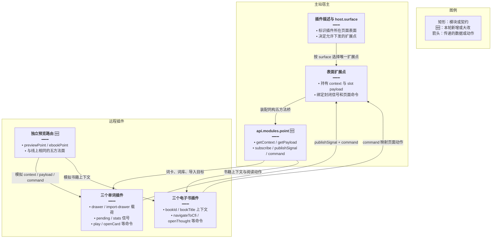

# 统一 point 模块桥：上下文、载荷、信号与命令

> **状态**：已落地 | **日期**：2026-11-14 | **功能域**：插件 / 模块联邦
> **需求摘要**：把按业务命名的 `modules.vocabDetail`、`modules.vocabDetailImport`、`modules.ebook` 统一为主站按插件 `host.surface` 下发的 `modules.point`。插件通过同一份五方法契约读取上下文与槽位载荷、订阅变化、回写信号并调用页面命令；独立预览路由也用同一契约提供模拟能力。

## 延伸阅读

- 单词详解预览接入与注册约定：[单词详解插件接入](./单词详解插件接入.md)
- 单词详解面板迁移：[单词详解插件面板](../english/单词详解插件面板.md)
- 单词详解列表迁移：[单词详解列表插件](../english/单词详解列表插件.md)
- 单词详解导入迁移：[单词详解导入插件](../english/单词详解导入插件.md)
- 电子书 iframe 与三个阅读插件迁移：[电子书宿主表面插件](./电子书宿主表面插件.md)

---

## 1. 背景与目标

旧桥把宿主内部业务对象直接暴露给插件：详解面板要认识 `getSnapshot / subscribeVocabDetail / setPending`，列表要认识 `getListLibrary / setListStats / open`，导入另有一套 `vocabDetailImport`，电子书则再扩一套 `ebook`。每增加一种插件，宿主与插件都要同步增加一组方法名，桥接层也逐渐混入业务语义。

本轮把插件可见面收敛为 `api.modules.point` 一份契约，达到四个目标：

1. **按表面下发**：主站只根据当前插件的 `host.surface` 决定挂哪一个扩展点，插件不再按业务名寻找宿主模块。
2. **读写分离**：`getContext` 读页面级上下文，`getPayload(slot)` 读槽位载荷，`publishSignal` 回写状态，`command` 执行动作，`subscribe` 统一接收变更。
3. **边界可收窄**：未登记的信号或命令由宿主拒绝，插件不能借桥任意调用宿主内部函数。
4. **预览同构**：独立预览也构造同样的 `point`，组件不需要为预览与线上各写一套分支。

## 2. 改动范围

| 路径 | 变更 | 本篇覆盖内容 |
| --- | --- | --- |
| `src/views/vocab-detail/point.ts` | 新增 | 单词插件的 `PointModule`、词卡载荷收窄、词库上下文与导入目标解析 |
| `src/views/ebook/point.ts` | 新增 | 电子书插件的 `PointModule`、书籍上下文收窄与 `useBookPoint` 订阅 Hook |
| `src/views/vocab-detail/types.ts` | 修改 | 删除旧 `VocabDetailModule`，保留纯数据结构类型 |
| `src/router/routes.tsx` | 修改 | 用 `ebookPoint` / `previewPoint` 替换三类业务 mock 模块，六个预览路由统一注入 `modules.point` |
| `src/utils/iframeHostClient.ts` | 修改 | iframe 的 `point.command` 到电子书 RPC 的映射与上下文预取；详见延伸阅读中的电子书专题 |
| 三个单词插件与三个电子书插件组件 | 修改 | 各组件改为消费 `point`；详见各自专题，不在本篇重复贴代码 |

## 3. 实现思路

### 3.1 统一后的模块关系



**读图要点**：`point` 不是把旧方法简单包一层改名，而是把「页面状态」「槽位数据」「状态回写」「页面动作」拆成四类语义。主站仍拥有具体实现，插件只看到当前表面允许的能力；预览路由则用同样五方法模拟宿主，因此组件迁移后无需保留旧桥分支。

### 3.2 五方法契约与本轮映射

| 方法 | 读取 / 写入语义 | 本轮使用位置 |
| --- | --- | --- |
| `getContext()` | 同步读页面级上下文；没有绑定时返回 `null` | 单词列表读 `libraryId`；电子书读 `bookId / bookTitle` |
| `getPayload(slot)` | 同步读指定槽位载荷；槽位无数据时返回 `null` | 详解面板读 `drawer`；导入面板读 `import-drawer` |
| `subscribe(listener)` | 监听上下文或载荷变化，返回退订函数 | 三个单词插件与 `useBookPoint` 共用 |
| `publishSignal(name, value)` | 把允许的状态信号回写宿主，不承诺返回值 | 详解回写 `pending`；列表回写 `stats` |
| `command(name, arg)` | 调用宿主已绑定命令，返回 `unknown`，必要时由调用方 `Promise.resolve` | 单词 `play / stop / openCard / pickJsonFile`；电子书 `navigateToCfi / openThought / closeIdeasList` |

**兼容性**：这是插件与宿主之间的破坏性契约切换，不保留 `modules.vocabDetail`、`modules.vocabDetailImport`、`modules.ebook` 的兼容别名。已发布旧远程包必须随宿主新版本一起升级；业务 HTTP 接口、词卡数据结构、列表游标协议和电子书 RPC 名称均未改变。

## 4. 关键代码（改动前 / 改动后对比 + 逐行注释）

### 4.1 单词插件 `PointModule` 与载荷解析

`src/views/vocab-detail/point.ts` 是本轮纯新增文件，基线中不存在，因此只展示改动后。`PointModule` 只描述宿主能力；三个解析函数把 `unknown` 载荷收窄成组件真正需要的结构，避免组件在各处重复做类型判断。

**来源**：`src/views/vocab-detail/point.ts`（**改动后** · 新增，约 L1–L46，完整文件）

```typescript
// 引入词卡快照类型，让通用 payload 经过解析后仍回到面板已有的数据结构
import type { VocabCardSnapshot } from './types';

/** 主站按插件的 host.surface 下发的唯一模块。 */
// 导出统一的 point 模块类型，使三个单词插件共享同一份宿主能力声明
export type PointModule = {
	// 同步读取页面上下文，供列表等插件获取 libraryId；未绑定时允许返回 null
	getContext: () => Record<string, unknown> | null;
	// 按槽位名读取载荷，把详解与导入等不同数据入口显式区分
	getPayload: (slot: string) => Record<string, unknown> | null;
	// 注册变更监听并返回退订函数，保证 effect 清理时能解除宿主订阅
	subscribe: (listener: () => void) => () => void;
	// 回写封闭信号名与值，避免插件直接修改宿主内部状态
	publishSignal: (name: string, value: unknown) => void;
	// 调用宿主已登记的页面命令，unknown 返回值兼容同步布尔值与异步 Promise
	command: (name: string, arg?: unknown) => unknown;
};

// 导出词卡载荷解析函数，把通用 Record 收窄为面板可渲染的 VocabCardSnapshot
export function cardFromPayload(
	// 接收 drawer 槽位的原始载荷；空值统一在这里处理，组件无需重复判空
	payload: Record<string, unknown> | null,
): VocabCardSnapshot | null {
	// 缺少载荷、word 非字符串或 word 全为空白时返回 null，避免触发无意义详解请求
	if (!payload || typeof payload.word !== 'string' || !payload.word.trim()) {
		// 用空快照表示当前不可展示，让面板走既有的空态而不是构造残缺词卡
		return null;
	}
	// 返回完整词头快照；只有经过逐字段收窄的数据才进入面板状态
	return {
		// 已通过字符串与空白校验的 word 作为加载详解和展示词头的稳定键
		word: payload.word,
		// 词性只接受字符串，其余类型归一为 null，防止异常宿主数据进入 UI
		pos: typeof payload.pos === 'string' ? payload.pos : null,
		// 音标同样做字符串收窄，保留面板对可选音标的既有处理
		ipa: typeof payload.ipa === 'string' ? payload.ipa : null,
		// 中文释义只接受字符串，缺失时保持 null 而不是写入 undefined
		translationZh:
			typeof payload.translationZh === 'string' ? payload.translationZh : null,
		// 示例句按可选字符串处理，使词头可以先展示宿主已有内容
		example: typeof payload.example === 'string' ? payload.example : null,
		// 仅白名单中的 list 保留为列表来源，其余值统一按 card，稳定控制加载骨架
		source: payload.source === 'list' ? 'list' : 'card',
	};
}

// 导出词库 id 解析函数，让列表组件不必了解通用上下文的字段类型细节
export function libraryIdFromContext(
	// 接收 point.getContext 的结果，并兼容调用方传入 undefined 的可选链场景
	context: Record<string, unknown> | null | undefined,
): string {
	// 用可选链读取 libraryId，未绑定上下文时不会抛错
	const libraryId = context?.libraryId;
	// 只有字符串 id 才用于请求，其余情况返回空串以触发列表的无库状态
	return typeof libraryId === 'string' ? libraryId : '';
}

// 导出导入目标解析函数，把 import-drawer 通用载荷收窄为当前词库与标题
export function importTargetFromPayload(
	// 接收导入槽位载荷；空值代表宿主尚未提供可导入目标
	payload: Record<string, unknown> | null,
): { libraryId: string; title: string } | null {
	// libraryId 缺失、非字符串或为空串时拒绝构造目标，防止请求落到错误词库
	if (!payload || typeof payload.libraryId !== 'string' || !payload.libraryId) {
		// 返回 null 让导入面板禁用依赖词库的操作并展示未绑定状态
		return null;
	}
	// 返回已验证的导入目标，标题与 id 分离以满足请求和展示两种用途
	return {
		// 复用通过校验的 libraryId，作为导入与已导入列表的共同请求参数
		libraryId: payload.libraryId,
		// 标题仅用于展示，缺失时安全降级为空串而不影响导入主流程
		title: typeof payload.title === 'string' ? payload.title : '',
	};
}
```

### 4.2 电子书 `PointModule` 与 `useBookPoint`

`src/views/ebook/point.ts` 也是纯新增文件。它没有复用单词目录的运行时代码，而是保留结构相同的领域类型和一个小 Hook：三个电子书组件只需订阅书籍上下文，不必各自实现 `useState + useEffect + subscribe`。

**来源**：`src/views/ebook/point.ts`（**改动后** · 新增，约 L1–L34，完整文件）

```typescript
// 引入 React 状态与副作用 Hook，用于把宿主同步上下文转换为可订阅的组件状态
import { useEffect, useState } from 'react';

/** 阅读页按 host.surface = ebook.read 下发的扩展点。 */
// 导出电子书侧 point 类型，与单词侧结构一致但保留领域独立的契约说明
export type PointModule = {
	// 同步读取书籍上下文，为列表请求和工具栏展示提供 bookId / bookTitle
	getContext: () => Record<string, unknown> | null;
	// 按槽位读取扩展载荷，保留统一契约以便同一表面扩展其它数据
	getPayload: (slot: string) => Record<string, unknown> | null;
	// 订阅宿主上下文变化并返回清理函数，避免插件卸载后继续接收通知
	subscribe: (listener: () => void) => () => void;
	// 回写表面允许的信号，使电子书插件与其它表面共用同一写入语义
	publishSignal: (name: string, value: unknown) => void;
	// 调用阅读页命令并保留 unknown 返回类型，以兼容导航等异步动作
	command: (name: string, arg?: unknown) => unknown;
};

// 定义书籍上下文收窄函数，把 unknown 记录转换成组件稳定使用的两个字符串字段
function bookFromContext(ctx: Record<string, unknown> | null): {
	// bookId 是列表请求的关键参数，统一为字符串可简化调用方判空
	bookId: string;
	// bookTitle 用于标题展示，缺失时同样以空串表示
	bookTitle: string;
} {
	// 返回规范化书籍对象，避免每个组件分别处理宿主脏数据
	return {
		// 仅接受字符串 bookId，其它类型归一为空串以阻止无效请求
		bookId: typeof ctx?.bookId === 'string' ? ctx.bookId : '',
		// 仅接受字符串书名，缺省时由组件决定回退到 id 或未绑定文案
		bookTitle: typeof ctx?.bookTitle === 'string' ? ctx.bookTitle : '',
	};
}

// 导出共享书籍订阅 Hook，集中实现首次拉取、宿主订阅与卸载清理
export function useBookPoint(point: PointModule | undefined): {
	// 向调用方返回规范化 bookId，供请求与空态判断复用
	bookId: string;
	// 向调用方返回规范化 bookTitle，供书籍标题展示复用
	bookTitle: string;
} {
	// 保存最近一次书籍上下文，初始空值确保宿主未注入时不会误发请求
	const [book, setBook] = useState({ bookId: '', bookTitle: '' });
	// 在 point 可用或实例变化时建立同步与订阅，依赖变化会自动退订旧实例
	useEffect(() => {
		// 未注入 point 时不注册副作用，独立缺失能力场景保持安全空态
		if (!point) return;
		// 定义同步函数，每次宿主通知都重新读取并收窄最新上下文
		const pull = () => setBook(bookFromContext(point.getContext()));
		// 挂载后立即拉取一次，避免等待第一次通知造成标题或列表延迟
		pull();
		// 直接把宿主退订函数作为 effect 清理函数，确保组件卸载后不再 setState
		return point.subscribe(pull);
		// point 是唯一外部依赖，实例替换时必须重建同步与订阅关系
	}, [point]);
	// 有 point 时返回已同步书籍；无 point 时返回新空对象，避免暴露陈旧状态
	return point ? book : { bookId: '', bookTitle: '' };
}
```

### 4.3 删除旧 `VocabDetailModule` 类型

旧类型把快照、订阅、pending、播放与停止绑定在一个业务模块上。新 `PointModule` 已接管这些能力，`VocabCardSnapshot` 与 `VocabDetail` 仍是纯数据类型并继续留在 `types.ts`，因此这里仅删除旧模块声明，没有改动后符号可展示。

**来源**：`src/views/vocab-detail/types.ts`（**改动前** · 基线约 L26–L32；该符号已删除）

```typescript
// 旧业务模块类型集中声明详解面板专用方法，本轮由通用 PointModule 完整取代
export type VocabDetailModule = {
	// 旧方法直接返回词卡快照，新契约改由 getPayload('drawer') 提供原始载荷
	getSnapshot: () => VocabCardSnapshot | null;
	// 旧订阅只服务详解快照，新契约由 subscribe 统一监听表面变化
	subscribeVocabDetail: (listener: () => void) => () => void;
	// 旧 pending 回写是可选业务方法，新契约由 publishSignal('pending', value) 替代
	setPending?: (word: string, pending: boolean) => void;
	// 旧播放命令直接挂在业务模块上，新契约由 command('play', text) 触发
	play?: (text: string) => Promise<void>;
	// 旧停止命令同样迁入 command('stop')，避免每种动作都扩张模块类型
	stop?: () => void;
};
```

**变更摘要**：`types.ts` 只保留 `VocabCardSnapshot`、`VocabDetail` 等数据结构；宿主能力类型统一移到新增的 `point.ts`，数据契约与桥接契约不再混放。

### 4.4 预览路由引入统一类型

**来源**：`src/router/routes.tsx`（**改动前** · 基线约 L11–L14；仅列相关 import，其他 import 对称省略）

```typescript
// 引入详解应用本体，预览路由继续复用同一面板而不维护第二套 UI
import VocabDetailApp from '@/views/vocab-detail';
// 省略未改动的预览数据与其它应用 import，聚焦本轮新增的桥类型
// ...（未改动）
// 引入预览快照与详解数据，旧 mock 模块和 HTTP mock 都复用这些固定样例
import { previewDetail, previewSnapshot } from '@/views/vocab-detail/preview';
```

**来源**：`src/router/routes.tsx`（**改动后** · 当前约 L11–L15；仅列相关 import，其他 import 对称省略）

```typescript
// 引入详解应用本体，业务 UI 不因桥接迁移而改变
import VocabDetailApp from '@/views/vocab-detail';
// 以 type-only 方式引入统一模块类型，编译后不会增加领域运行时代码依赖
import type { PointModule } from '@/views/vocab-detail/point';
// 引入预览快照与详解数据，供 previewPoint 的 drawer 载荷和 HTTP mock 使用
import { previewDetail, previewSnapshot } from '@/views/vocab-detail/preview';
// 省略未改动的导入，保持前后摘录范围都聚焦路由与桥接依赖
// ...（未改动）
```

**变更摘要**：新增的只是类型依赖；`previewDetail / previewSnapshot` 继续作为预览数据源，电子书预览复用这一结构类型而不引入运行时模块。

### 4.5 电子书预览模块：`mockEbookModules` → `ebookPoint`

**来源**：`src/router/routes.tsx`（**改动前** · 基线约 L16–L24，完整 `mockEbookModules`）

```typescript
// 旧预览常量按业务名构造 modules 对象，使三个电子书路由共享 ebook 模块
const mockEbookModules = {
	// ebook 属性直接对应插件读取的 api.modules.ebook
	ebook: {
		// 同步返回固定书籍 id，模拟宿主当前打开的书
		getBookId: () => 'preview-book',
		// 同步返回固定书名，供想法、划线和工具栏预览展示
		getBookTitle: () => 'Standalone preview book',
		// 导航命令在预览中执行空操作，避免没有真实阅读器时抛错
		navigateToCfi: () => undefined,
		// 打开想法在预览中不挂真实抽屉，因此保留空实现
		openThought: () => undefined,
		// 关闭想法列表同样为空操作，保持点击流程可完整执行
		closeIdeasList: () => undefined,
	},
};
```

**来源**：`src/router/routes.tsx`（**改动后** · 当前约 L17–L26，完整 `ebookPoint`）

```typescript
// 新预览常量直接实现 PointModule，使电子书预览与线上组件读取路径完全一致
const ebookPoint: PointModule = {
	// 通过统一上下文方法返回固定书籍信息，替代旧 getBookId / getBookTitle 两个方法
	getContext: () => ({
		// 固定 bookId 让列表预览能构造与线上相同的书籍参数
		bookId: 'preview-book',
		// 固定书名让三个电子书预览都展示一致的绑定状态
		bookTitle: 'Standalone preview book',
	}),
	// 电子书预览没有额外套件载荷，统一返回 null 以表达空槽位
	getPayload: () => null,
	// 返回空退订函数即可模拟无变化的静态书籍上下文
	subscribe: () => () => undefined,
	// 预览不接收状态信号，空实现保证组件调用时无需额外判空
	publishSignal: () => undefined,
	// 所有阅读命令在独立预览中安全空转，不依赖真实 EPUB rendition
	command: () => undefined,
};
```

**变更摘要**：电子书预览从「一个业务对象包五个方法」改为「一个 point 包五个通用方法」；书籍数据集中到 `getContext`，阅读动作由统一 `command` 承接。

### 4.6 单词预览模块：`mockVocabDetailModule` → `previewPoint`

**来源**：`src/router/routes.tsx`（**改动前** · 基线约 L26–L41，完整 `mockVocabDetailModule`）

```typescript
// 旧预览模块同时服务详解与列表，把不同业务方法塞在同一个 vocabDetail 对象中
const mockVocabDetailModule = {
	// 直接返回固定词卡快照，供详解面板首屏渲染
	getSnapshot: () => previewSnapshot,
	// 提供无变化订阅并返回空清理函数，满足面板 effect 的退订要求
	subscribeVocabDetail: () => () => undefined,
	// 用 Web Speech 模拟宿主播放，返回 Promise 以驱动面板播放态结算
	play: (text: string) =>
		// 创建可等待的语音任务，让结束与失败都能清除当前播放 key
		new Promise<void>((resolve) => {
			// 以传入文本构造语音 utterance，保持与真实宿主播放输入一致
			const utter = new SpeechSynthesisUtterance(text);
			// 固定英语音色语言，避免预览朗读按系统默认语言发音
			utter.lang = 'en-US';
			// 正常结束立即 resolve，通知面板清理播放状态
			utter.onend = () => resolve();
			// 语音失败也 resolve，防止预览按钮永久停留在播放中
			utter.onerror = () => resolve();
			// 播放前取消旧语音，避免连续点击时多段声音重叠
			speechSynthesis.cancel();
			// 把新 utterance 加入浏览器语音队列，开始本次预览朗读
			speechSynthesis.speak(utter);
		}),
	// 停止命令直接取消浏览器语音，供切词与卸载清理复用
	stop: () => speechSynthesis.cancel(),
	// 固定返回 true 表示打开详解成功，避免预览列表弹出未启用提示
	open: () => true,
	// 统计回写在预览中没有真实标题接收方，因此使用空实现
	setListStats: () => undefined,
};
```

**来源**：`src/router/routes.tsx`（**改动后** · 当前约 L28–L58，完整 `previewPoint`）

```typescript
// 新预览模块实现统一 PointModule，同时提供详解、列表与导入所需的最小能力
const previewPoint: PointModule = {
	// 页面上下文只包含当前预览词库 id，供列表首屏与切库逻辑读取
	getContext: () => ({ libraryId: 'preview-library' }),
	// 按槽位名分发不同载荷，使详解与导入可以共享同一个 point 实例
	getPayload: (slot) => {
		// drawer 槽位返回固定词卡，替代旧 getSnapshot 的业务方法
		if (slot === 'drawer') return previewSnapshot;
		// import-drawer 槽位进入导入目标分支，与详解载荷显式隔离
		if (slot === 'import-drawer') {
			// 返回词库 id 与标题，替代旧 vocabDetailImport.getTarget 的返回体
			return { libraryId: 'preview-library', title: 'Preview library' };
		}
		// 未识别槽位统一返回 null，防止误把其它业务数据交给调用方
		return null;
	},
	// 静态预览没有宿主变更通知，返回空退订函数满足统一订阅契约
	subscribe: () => () => undefined,
	// pending 与 stats 信号在预览中无需真实接收方，保留空调用以验证调用路径
	publishSignal: () => undefined,
	// 所有预览动作按命令名分发，替代旧 play / stop / open 等独立方法
	command: (name, arg) => {
		// stop 命令优先处理，确保切词和卸载都能取消当前浏览器语音
		if (name === 'stop') {
			// 取消语音队列中的旧任务，避免下一段播放被前一段干扰
			speechSynthesis.cancel();
			// 显式返回 undefined，与 PointModule 的同步命令返回约定一致
			return undefined;
		}
		// play 仅在参数确为字符串时执行，防止 unknown 参数误入语音 API
		if (name === 'play' && typeof arg === 'string') {
			// 返回 Promise 保留旧播放态结算语义，调用方可用 finally 清理播放 key
			return new Promise<void>((resolve) => {
				// 使用已校验的文本参数构造语音任务，与旧 mock 的播放内容一致
				const utter = new SpeechSynthesisUtterance(arg);
				// 固定为美式英语，保证预览发音不受系统默认语言影响
				utter.lang = 'en-US';
				// 正常结束时 resolve，使面板只清理本轮播放状态
				utter.onend = () => resolve();
				// 失败同样结算，避免无语音库环境下按钮卡死
				utter.onerror = () => resolve();
				// 新任务开始前取消旧任务，维持单段朗读行为
				speechSynthesis.cancel();
				// 把当前任务交给浏览器播放，保持预览可实际听到单词与例句
				speechSynthesis.speak(utter);
			});
		}
		// openCard 固定返回 true，让列表与导入预览可以走成功打开详解的分支
		if (name === 'openCard') return true;
		// pickJsonFile 返回已结算 null，模拟用户取消；chooseFile 不会再触发隐藏 input
		if (name === 'pickJsonFile') return Promise.resolve(null);
		// 未登记命令安全返回 undefined，防止拼写错误在预览中产生异常
		return undefined;
	},
};
```

**变更摘要**：`previewPoint` 同时取代详解、列表和导入三份 mock 能力；`drawer` 与 `import-drawer` 负责数据分流，`command` 负责动作分流，播放 Promise 与 `openCard === true` 等原有行为保持不变。

### 4.7 六个预览路由统一注入 `modules.point`

以下两侧都是完整 `routes` 数组符号；未改动的首页、HTTP mock、学习笔记、视频、404 与 embed 路由用对称省略表示。保留六个受影响路由的外层结构，便于直接对照注入字段。

**来源**：`src/router/routes.tsx`（**改动前** · 基线约 L43–L231，完整 `routes` 符号，未改路由与 HTTP mock 对称省略）

```tsx
// 源码注释保留：说明这些 path 必须与主站 registry 和业务树一致
/** 独立预览路由；path 与主站 registry / 业务树对齐 */
// 导出路由数组，六个插件预览在此装配各自的模拟模块桥
export const routes: RouteObject[] = [
	{
		// 根路径使用公共布局，保证独立预览与正常应用的导航壳一致
		path: '/',
		// 渲染公共布局组件，为子路由提供导航与主题容器
		element: <Layout />,
		// 子路由集中承载各插件独立预览入口
		children: [
			// 首页与其它未改子路由对称省略，聚焦六个模块注入点
			// ...（未改动）
			{
				// 详解预览路径与主站注册的远程路由保持一致
				path: 'english-learning/vocab-detail',
				// 返回详解预览的完整页面元素，继续复用真实 VocabDetailApp
				element: (
					// 固定预览最小高度，保证抽屉正文在独立页面中有足够布局空间
					<div className="h-full min-h-112">
						// 挂载真实详解插件，桥接差异只通过 api 注入
						<VocabDetailApp
							// 用 mockApi 构造宿主能力，HTTP 与模块桥都在此装配
							api={mockApi({
								// 详解 HTTP mock 与基线一致，省略以聚焦模块字段变化
								// ...（未改动）
								// 旧版按 vocabDetail 业务名注入详解与列表共用模块
								modules: { vocabDetail: mockVocabDetailModule },
							})}
						/>
					</div>
				),
			},
			{
				// 详解列表预览路径对应独立的列表 expose
				path: 'english-learning/vocab-detail-list',
				// 返回列表插件预览元素，复用真实分页与点词逻辑
				element: (
					// 使用与详解一致的预览高度，避免列表容器塌陷
					<div className="h-full min-h-112">
						// 挂载真实详解列表插件，保持滚动与统计逻辑可验证
						<VocabDetailListApp
							// 构造列表所需 mock HTTP 与模块能力
							api={mockApi({
								// 单页列表响应保持不变，省略未改 HTTP mock
								// ...（未改动）
								// 旧版列表同样读取 vocabDetail 业务模块
								modules: { vocabDetail: mockVocabDetailModule },
							})}
						/>
					</div>
				),
			},
			{
				// 导入预览路径与导入 expose 一一对应
				path: 'english-learning/vocab-detail-import',
				// 返回真实导入面板预览，覆盖选文件与导入列表交互
				element: (
					// 保留固定最小高度，让导入结果与已导入列表可滚动展示
					<div className="h-full min-h-112">
						// 挂载真实导入插件，避免预览另写简化表单
						<VocabDetailImportApp
							// 构造导入所需 HTTP 与目标词库桥
							api={mockApi({
								// 已导入列表 HTTP 响应保持原样，对称省略
								// ...（未改动）
								// 旧版导入使用独立的 vocabDetailImport 模块名
								modules: {
									// 导入桥只提供目标词库与订阅，不复用详解模块
									vocabDetailImport: {
										// 返回固定目标词库，供标题与导入请求使用
										getTarget: () => ({
											// 固定词库 id 与另外两个单词预览保持一致
											libraryId: 'preview-library',
											// 固定标题用于导入面板展示当前目标
											title: 'Preview library',
										}),
										// 静态目标没有变化通知，返回空退订函数满足 effect 清理
										subscribe: () => () => undefined,
									},
								},
							})}
						/>
					</div>
				),
			},
			// 学习笔记等未改路由在此对称省略，不参与模块桥迁移
			// ...（未改动）
			{
				// 想法列表独立预览路径与电子书远程入口一致
				path: 'ebook/plugins/ideas-list',
				// 返回想法列表真实组件的预览元素
				element: (
					// 挂载想法列表插件，验证书籍绑定、分页与打开想法动作
					<IdeasListApp
						// independent 标记独立运行，使组件使用预览壳所需行为
						independent
						// 旧版把 mockEbookModules 整体注入，其中实际键名为 ebook
						api={mockApi({ modules: mockEbookModules })}
						// 模拟插件描述，保持 id 与主站注册表中的想法插件一致
						plugin={mockPlugin('ebookIdeas', '/ebook/plugins/ebook-ideas')}
					/>
				),
			},
			{
				// 全书划线预览路径对应 highlights expose
				path: 'ebook/plugins/highlights',
				// 返回全书划线真实组件的预览元素
				element: (
					// 挂载划线插件，验证书籍上下文与 CFI 导航调用
					<EbookHighlightsApp
						// 独立预览模式复用相同页面壳行为
						independent
						// 旧版划线与想法共用业务命名的 mockEbookModules
						api={mockApi({ modules: mockEbookModules })}
						// 模拟划线插件描述，确保插件 id 与远程注册一致
						plugin={mockPlugin('ebookHighlights', '/ebook/plugins/highlights')}
					/>
				),
			},
			{
				// 工具栏测试预览路径对应书籍信息测试插件
				path: 'ebook/plugins/toolbar-test',
				// 返回书籍信息测试组件，验证 toolbar 槽位的宿主上下文
				element: (
					// 挂载书籍信息测试插件，复用真实标题与 id 回退逻辑
					<EbookTestBookInfoApp
						// 独立模式使测试组件不依赖真实阅读页
						independent
						// 旧版工具栏测试同样从 mockEbookModules 读取书籍方法
						api={mockApi({ modules: mockEbookModules })}
						// 模拟工具栏测试插件描述，参数换行保持源码布局
						plugin={mockPlugin(
							// 固定插件 id，与主站 toolbar 槽位注册保持一致
							'ebookTestBookInfo',
							// 固定远程路由路径，保证预览地址与注册地址一致
							'/ebook/plugins/toolbar-test',
						)}
					/>
				),
			},
			// 视频、404 等未改子路由对称省略，不影响本次桥接说明
			// ...（未改动）
		],
	},
	// embed 等顶层未改路由对称省略，保留 routes 数组完整闭合
	// ...（未改动）
];
```

**来源**：`src/router/routes.tsx`（**改动后** · 当前约 L60–L240，完整 `routes` 符号，未改路由与 HTTP mock 对称省略）

```tsx
// 源码注释保留：预览 path 仍需与主站注册表对齐
/** 独立预览路由；path 与主站 registry / 业务树对齐 */
// 导出路由数组，六个受影响插件现在统一接收 modules.point
export const routes: RouteObject[] = [
	{
		// 根路径继续使用公共布局，桥接迁移不改变预览导航结构
		path: '/',
		// 渲染同一 Layout，确保本轮差异只发生在宿主模块注入
		element: <Layout />,
		// 子路由继续按业务路径组织各远程插件预览
		children: [
			// 首页及其它未改子路由与改动前对称省略
			// ...（未改动）
			{
				// 详解预览 path 不变，已打开的书签与注册配置无需调整
				path: 'english-learning/vocab-detail',
				// 返回真实详解面板预览，验证新 point 读取与命令路径
				element: (
					// 保留原布局高度，避免桥接改造引入视觉差异
					<div className="h-full min-h-112">
						// 挂载同一 VocabDetailApp，组件内部改读 drawer 载荷
						<VocabDetailApp
							// mockApi 继续负责构造完整宿主 api
							api={mockApi({
								// 详解 HTTP mock 与改动前一致，对称省略
								// ...（未改动）
								// 统一通过 point 注入 previewPoint，不再暴露 vocabDetail 名称
								modules: { point: previewPoint },
							})}
						/>
					</div>
				),
			},
			{
				// 详解列表 path 不变，预览入口保持兼容
				path: 'english-learning/vocab-detail-list',
				// 返回真实列表面板，验证 context、stats 与 openCard 新链路
				element: (
					// 保留列表预览高度，确保 IntersectionObserver 有可滚动容器
					<div className="h-full min-h-112">
						// 挂载同一 VocabDetailListApp，业务渲染结构不变
						<VocabDetailListApp
							// mockApi 中同时保留 HTTP 列表数据与统一模块桥
							api={mockApi({
								// 单页列表数据与改动前一致，对称省略
								// ...（未改动）
								// 列表与详解共享 previewPoint，通过不同方法和槽位各取所需
								modules: { point: previewPoint },
							})}
						/>
					</div>
				),
			},
			{
				// 导入预览 path 不变，避免注册表和文档入口失效
				path: 'english-learning/vocab-detail-import',
				// 返回真实导入面板，验证 import-drawer 与两个命令
				element: (
					// 保留固定最小高度，导入结果区域布局不受影响
					<div className="h-full min-h-112">
						// 挂载同一 VocabDetailImportApp，复用全部导入与分页逻辑
						<VocabDetailImportApp
							// mockApi 继续提供导入 HTTP 和宿主模块
							api={mockApi({
								// 已导入列表响应与改动前一致，对称省略
								// ...（未改动）
								// 导入也统一接收 previewPoint，从 import-drawer 读取目标词库
								modules: { point: previewPoint },
							})}
						/>
					</div>
				),
			},
			// 学习笔记等未改路由与改动前对称省略
			// ...（未改动）
			{
				// 想法列表 path 不变，远程入口无需迁移
				path: 'ebook/plugins/ideas-list',
				// 返回真实想法列表，验证 getContext 与三个阅读命令
				element: (
					// 挂载同一 IdeasListApp，业务列表与操作条不变
					<IdeasListApp
						// 独立预览模式保持原语义
						independent
						// 改为显式注入 point: ebookPoint，与主站 surface 下发形态一致
						api={mockApi({ modules: { point: ebookPoint } })}
						// 插件描述保持原 id 与路由，桥接迁移不影响注册信息
						plugin={mockPlugin('ebookIdeas', '/ebook/plugins/ebook-ideas')}
					/>
				),
			},
			{
				// 全书划线 path 不变，继续复用既有预览入口
				path: 'ebook/plugins/highlights',
				// 返回真实划线列表，验证统一上下文与导航命令
				element: (
					// 挂载同一 EbookHighlightsApp，划线查询和 UI 不变
					<EbookHighlightsApp
						// 独立模式保持原预览行为
						independent
						// 与想法列表共享 ebookPoint，但各自通过同一契约独立调用
						api={mockApi({ modules: { point: ebookPoint } })}
						// 插件描述保持原样，避免远程注册信息漂移
						plugin={mockPlugin('ebookHighlights', '/ebook/plugins/highlights')}
					/>
				),
			},
			{
				// 工具栏测试 path 不变，便于持续回归 toolbar 槽位
				path: 'ebook/plugins/toolbar-test',
				// 返回真实书籍信息组件，验证 useBookPoint 的同步与订阅
				element: (
					// 挂载同一 EbookTestBookInfoApp，标题回退规则保持原样
					<EbookTestBookInfoApp
						// 独立模式继续脱离真实阅读器运行
						independent
						// 工具栏测试也改读 point，覆盖第三个电子书消费方
						api={mockApi({ modules: { point: ebookPoint } })}
						// 模拟插件描述仍分多行书写，保持源码结构一致
						plugin={mockPlugin(
							// 固定测试插件 id，确保与 toolbar 注册一致
							'ebookTestBookInfo',
							// 固定测试插件路由，保证预览与注册地址相同
							'/ebook/plugins/toolbar-test',
						)}
					/>
				),
			},
			// 视频、404 等未改子路由与改动前对称省略
			// ...（未改动）
		],
	},
	// embed 等顶层未改路由与改动前对称省略，保留 routes 完整闭合
	// ...（未改动）
];
```

**变更摘要**：六个预览路由只改模块注入，不改 path、组件、HTTP mock 或插件描述。三个单词路由共享 `previewPoint`，三个电子书路由共享 `ebookPoint`，与线上按 `host.surface` 下发唯一 `point` 的形态一致。

## 5. 风险与回归建议

| 场景 | 验证点 |
| --- | --- |
| 详解面板 | `drawer` 载荷有词与无词两种状态；`play / stop` Promise 能正确清理播放 key；`pending` 信号包含 `pluginId / key / on` |
| 详解列表 | `getContext().libraryId` 缺失时不请求；切库触发 `subscribe` 后旧响应被代际丢弃；`stats` 与 `openCard` 行为不变 |
| 导入面板 | `import-drawer` 缺 id 时禁用导入；`pickJsonFile` 同步值、Promise 与抛错都能被 `Promise.resolve + await` 处理；`openCard` 非 `true` 时 Toast |
| 电子书三个插件 | 上下文预取后 `getContext` 同步返回书籍；CFI 为空不导航；想法仍先导航再打开想法并关闭列表 |
| 独立预览 | 六个路由均可打开，语音、点词、取消选文件等降级行为与旧预览一致 |
| 旧远程包 | 仍调用旧模块名的包会拿不到桥，必须随本轮一起重新发布，不能混合上线 |

若与仓库最新源码不一致，以源码为准。
