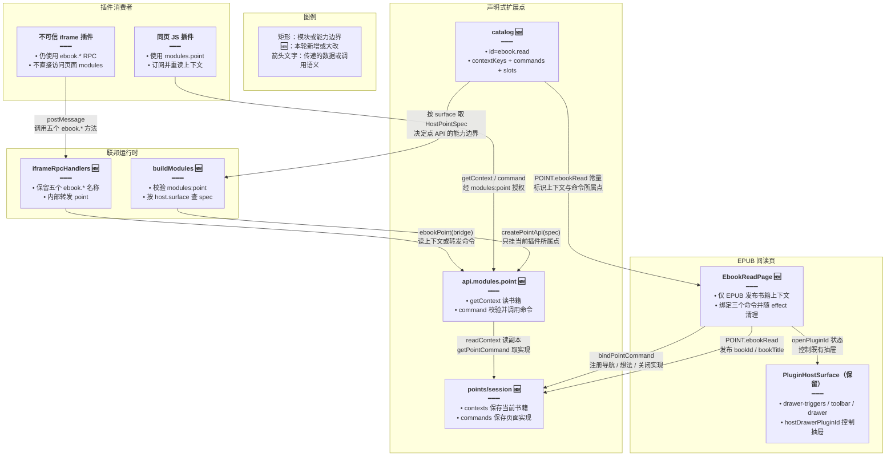
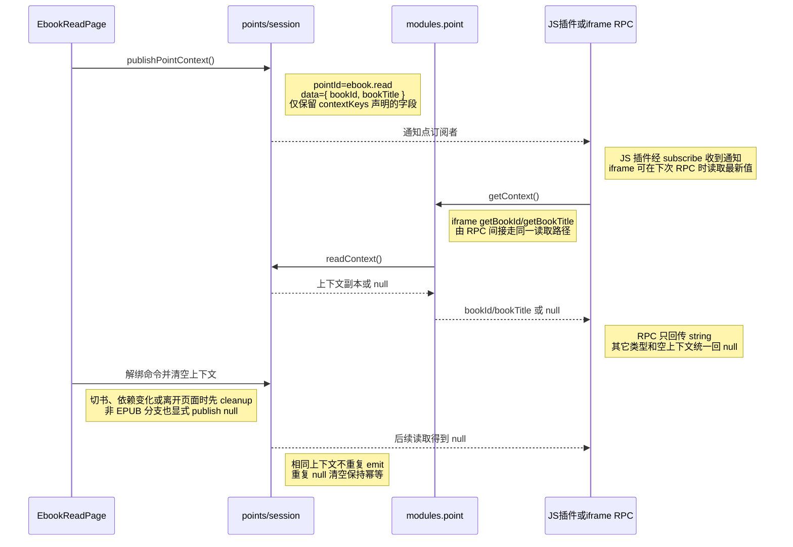
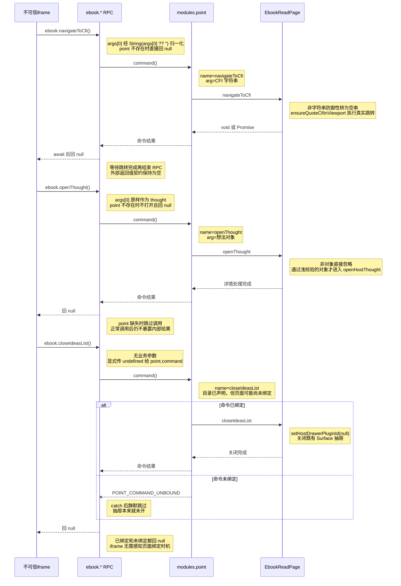

# 电子书阅读页迁移到 `ebook.read` 声明式扩展点

> 延伸阅读：[声明式扩展点](./声明式扩展点.md)。[电子书宿主表面插件](./电子书宿主表面插件.md) 是更早的发现机制快照。本篇记录电子书能力桥迁到 `ebook.read`。下文若仍写 `PluginHostSurface` 或页面里绑定 `closeIdeasList`，以本节现行实现为准。
>
> **现行实现**：阅读页用 `HostPoint` 画 `toolbar`，以及 `drawer` 的 `part="trigger"` 和正文。`navigateToCfi`、`openThought` 在阅读页绑定。`closeIdeasList` 在 `commandTable.ts` 启动时绑定，只 `closePoint`。离开阅读页或切到 PDF 时页面自己 `closePoint`。

## 1. 背景与目标

基线固定为 `58d0e2a1`。基线中，阅读页把当前书籍和导航函数写进 `modules/ebook/hostApi.ts` 的全局可变 `handlers`，运行时再把冻结的 `api.modules.ebook` 代理暴露给插件。代理虽然冻结，实际能力仍依赖一份电子书专属全局状态，权限、上下文、命令和清理也都需要单独维护。

本次改动把这份专属桥替换为统一的 `ebook.read` 声明式扩展点：

- 目录声明扩展点的 `toolbar` / `drawer` 槽位、`bookId` / `bookTitle` 上下文白名单和三个命令。
- EPUB 阅读页发布当前书籍上下文，并按扩展点命令名绑定 CFI 跳转、打开想法和关闭想法抽屉。
- 运行时按 `modules:point` 权限与插件自己的 `host.surface` 创建 `api.modules.point`，不再创建 `api.modules.ebook`。
- 不可信 iframe 仍调用原有 `ebook.getBookId`、`ebook.getBookTitle`、`ebook.navigateToCfi`、`ebook.openThought`、`ebook.closeIdeasList`，宿主内部改为转发到 `modules.point`。
- 顶栏、图标和抽屉后来已改成 `HostPoint`。`closeIdeasList` 不再写页面上的打开状态，只关闭阅读页抽屉槽。

### 改动范围

- `apps/frontend/src/views/ebook/read.tsx`
- `apps/frontend/src/federation/points/catalog.ts`
- `apps/frontend/src/federation/runtime/index.ts`
- `apps/frontend/src/federation/index.ts`
- `apps/frontend/src/federation/modules/ebook/hostApi.ts`（整文件删除）
- `apps/frontend/src/federation/modules/ebook/README.md`（整文件删除）

通用 `session.ts`、`api.ts`、HostPoint 和其它业务扩展点的完整实现见 [声明式扩展点](./声明式扩展点.md)；本篇只在解释电子书行为所必需时引用其契约。

## 2. 实现思路与迁移后架构

1. **声明先于调用**：`POINT.ebookRead` 固定为 `ebook.read`，`hostPoints` 同时约束可用槽位、上下文字段和命令名。插件不能借 `command` 自造主站能力。
2. **页面拥有生命周期**：书籍格式、id、标题或命令依赖变化时，React 先执行上一 effect 的清理，再发布新上下文并绑定新命令；离开页面时解绑命令且清空上下文。
3. **运行时按插件裁剪能力**：`buildModules` 新增 `plugin` 参数，以 `plugin.host?.surface` 查目录。只有声明 `modules:point` 且 surface 已登记的插件才拿到 `modules.point`。
4. **外部 RPC 名称保持稳定**：iframe 不直接感知目录和 Map，五个旧 RPC 名称由宿主适配层保留；适配层负责读上下文、转换参数、等待异步跳转和处理关闭命令的未绑定情况。
5. **挂载后来并进 `HostPoint`**：阅读页不再使用 `PluginHostSurface` 和 `hostDrawerPluginId`。图标是抽屉槽的 `part="trigger"`，正文是同一个槽。

**改动后** · 跨文件架构图，依据 `apps/frontend/src/views/ebook/read.tsx` 约 L1128–L1158、`apps/frontend/src/federation/points/catalog.ts` 约 L34–L134、`apps/frontend/src/federation/runtime/index.ts` 约 L83–L93 与 L213–L241、L336–L366 当前实现绘制。



**读图要点**：`catalog` 是静态能力边界，`session` 是运行时状态，`buildModules` 是权限入口，阅读页是上下文和命令的唯一业务实现方。iframe 适配层只是兼容层，不再持有或读取 `modules.ebook`；既有 Surface 渲染链独立保留。

## 3. 上下文与命令时序

### 3.1 书籍上下文发布、重读与清理

**改动后** · 上下文时序图，依据 `apps/frontend/src/views/ebook/read.tsx` 约 L1128–L1158 与 `apps/frontend/src/federation/runtime/index.ts` 约 L337–L345 绘制。



### 3.2 iframe 命令转发与关闭兜底

**改动后** · 命令时序图，依据 `apps/frontend/src/federation/runtime/index.ts` 约 L346–L365 与 `apps/frontend/src/views/ebook/read.tsx` 约 L1136–L1151 绘制。



## 4. 关键实现：改动前 / 改动后

### 4.1 阅读页联邦门面 import

**对比范围**：`apps/frontend/src/views/ebook/read.tsx` 中完整的 `@/federation` import 声明。旧版引入电子书专属类型和注册函数；新版引入通用点常量、上下文发布和命令绑定。

**改动前** · `apps/frontend/src/views/ebook/read.tsx`（基线 `58d0e2a1`，约 L24–L28）

```typescript
// 从联邦门面导入阅读页插件能力，旧版依赖电子书专属 Host API
import {
// 引入想法记录类型，供 openHostThought 约束插件传入的数据结构
	type EbookHostThought,
// 保留 Surface 组件，插件槽位发现与渲染方式不在本次迁移中改变
	PluginHostSurface,
// 引入专属 handlers 注册函数，旧版通过它写入全局可变电子书桥
	setEbookHostHandlers,
// 固定从联邦门面导入，保证阅读页与运行时共享同一套 Host API
} from '@/federation';
```

**改动后** · `apps/frontend/src/views/ebook/read.tsx`（当前，约 L24–L29）

```typescript
// 从联邦门面导入通用扩展点能力，替代电子书专属 handlers 桥
import {
// 引入命令绑定函数，让阅读页把三个业务实现注册到 ebook.read
	bindPointCommand,
// 保留 Surface 组件，继续负责既有顶栏入口与抽屉渲染
	PluginHostSurface,
// 引入点 id 常量，避免页面和目录分别硬编码 ebook.read 而拼写漂移
	POINT,
// 引入上下文发布函数，用于切书时更新书籍信息并在清空时通知订阅者
	publishPointContext,
// 仍从统一联邦门面导入，保持业务页面不直接依赖 session 内部文件
} from '@/federation';
```

**变更摘要**：`EbookHostThought` 和 `setEbookHostHandlers` 退出阅读页；页面改用 `POINT`、`publishPointContext`、`bindPointCommand`，Surface 渲染 import 保持不变。

### 4.2 `openHostThought`：想法类型内联与运行时边界

**对比范围**：完整 `openHostThought = useCallback(...)` 符号，包含参数、用户 id 归一化、想法字段映射和依赖数组。新版把已删除的 `EbookHostThought` 类型内联，业务转换逻辑保持不变。

**改动前** · `apps/frontend/src/views/ebook/read.tsx`（基线 `58d0e2a1`，约 L1091–L1115）

```typescript
// 打开主机想法
// 使用 useCallback 固定打开插件想法的回调，避免宿主 handlers 因函数身份变化而反复重绑
	const openHostThought = useCallback(
// 接收专属 Host 类型，旧版由 modules/ebook/hostApi.ts 统一导出该结构
		(raw: EbookHostThought) => {
// 归一化用户 id，兼容插件同时传数字和数字字符串的旧数据形态
			const userId =
// 数字 id 无需转换，保留原值可避免精度或格式再次变化
				typeof raw.userId === 'number'
// 已确认为 number 时直接采用该分支，满足阅读页想法模型的用户 id 类型
					? raw.userId
// 其它值先转字符串再按十进制解析，非法值用 0 兜底以维持旧展示行为
					: Number.parseInt(String(raw.userId), 10) || 0;
// 复用阅读页既有想法详情入口，确保插件想法和页内想法共用同一弹窗状态机
			openViewThought(
// 构造阅读页自己的 EbookThought 形状，隔离插件协议与内部模型
				{
// 保留想法 id，供详情查看、后续编辑和删除定位同一条记录
					id: raw.id,
// 写入归一化后的用户 id，避免字符串 id 影响阅读页后续判断
					userId,
// 保留 CFI 范围，详情关联原文时仍定位到同一段落
					cfiRange: raw.cfiRange,
// 引用文本缺失时回退空串，避免详情草稿出现 undefined
					quote: raw.quote ?? '',
// 想法正文缺失时回退空串，保持受控编辑状态稳定
					content: raw.content ?? '',
// 用户名缺失时回退空串，交由详情视图按无名称数据处理
					username: raw.username ?? '',
// 头像缺失时回退空串，避免把 undefined 传给头像组件
					avatar: raw.avatar ?? '',
// 创建时间缺失时回退空串，保持旧版详情字段完整
					createdAt: raw.createdAt ?? '',
// 更新时间缺失时回退空串，保持旧版详情字段完整
					updatedAt: raw.updatedAt ?? '',
// 公开标记原样透传，由 openViewThought 统一处理缺省公开语义
					isPublic: raw.isPublic,
				},
// fromList 固定为 false，因为插件直接打开详情，不要求返回某个页内列表快照
				false,
			);
		},
// 依赖 openViewThought，在其身份变化时重建回调，避免闭包调用过期详情入口
		[openViewThought],
	);
```

**改动后** · `apps/frontend/src/views/ebook/read.tsx`（当前，约 L1091–L1126）

```typescript
// 打开主机想法
// 使用 useCallback 固定命令实现，避免 effect 因回调身份无意义变化而反复解绑和重绑
	const openHostThought = useCallback(
// 在调用侧内联插件想法类型，解除对已删除 EbookHostThought 导出的依赖
		(raw: {
// id 仍为必填字符串，详情和后续操作需要稳定定位想法记录
			id: string;
// userId 同时允许数字和字符串，继续兼容既有插件数据
			userId: number | string;
// cfiRange 为必填字符串，用于把想法关联到 EPUB 原文位置
			cfiRange: string;
// quote 为必填字符串，保存想法引用的原文
			quote: string;
// content 为必填字符串，保存想法正文
			content: string;
// username 保持可选，未提供时由下方空串兜底
			username?: string;
// avatar 保持可选，未提供时由下方空串兜底
			avatar?: string;
// createdAt 保持可选，兼容缺少时间字段的旧记录
			createdAt?: string;
// updatedAt 保持可选，兼容缺少时间字段的旧记录
			updatedAt?: string;
// isPublic 保持可选，公开语义仍由阅读页既有逻辑统一补全
			isPublic?: boolean;
// 参数对象类型闭合后进入回调体，字段约束与旧专属类型逐项等价
		}) => {
// 归一化用户 id，沿用旧逻辑以免迁移能力桥时改变想法展示行为
			const userId =
// 数字 id 直接使用，避免不必要的字符串往返转换
				typeof raw.userId === 'number'
// number 分支保留原值，与阅读页内部模型一致
					? raw.userId
// 字符串等其它形态按十进制解析，非法输入继续以 0 兜底
					: Number.parseInt(String(raw.userId), 10) || 0;
// 继续调用既有 openViewThought，确保迁移只换输入通道、不换详情状态机
			openViewThought(
// 构造阅读页内部想法对象，保持插件协议和组件模型之间的适配层
				{
// 透传想法 id，保证详情操作仍指向同一记录
					id: raw.id,
// 使用归一化用户 id，避免数字字符串影响既有用户判断
					userId,
// 透传 CFI 范围，保持想法与原文位置的关联
					cfiRange: raw.cfiRange,
// 引用文本缺省时回退空串，保持草稿字段受控
					quote: raw.quote ?? '',
// 正文缺省时回退空串，保持详情编辑状态稳定
					content: raw.content ?? '',
// 用户名缺省时回退空串，沿用旧展示兜底
					username: raw.username ?? '',
// 头像缺省时回退空串，沿用旧展示兜底
					avatar: raw.avatar ?? '',
// 创建时间缺省时回退空串，避免引入新的 undefined 分支
					createdAt: raw.createdAt ?? '',
// 更新时间缺省时回退空串，避免引入新的 undefined 分支
					updatedAt: raw.updatedAt ?? '',
// 公开标记原样传入，继续由 openViewThought 解释缺省值
					isPublic: raw.isPublic,
				},
// fromList 仍为 false，因为扩展点命令不是从页内想法列表进入
				false,
			);
		},
// 依赖既有详情入口，保证回调重建时只捕获最新 openViewThought
		[openViewThought],
	);
```

**变更摘要**：类型字段和运行时转换没有变化，只把类型所有权从待删除的 Host API 文件收回阅读页。后续 effect 在调用前增加对象校验，避免不可信输入仅依赖 TypeScript 静态类型。

### 4.3 阅读页 `useEffect`：上下文、三个命令与清理

**对比范围**：完整的书籍桥接 `useEffect(() => { ... }, [deps])`。前后均包含非 EPUB 分支、书籍快照、命令或 handlers 注册、cleanup 和全部依赖项。

**改动前** · `apps/frontend/src/views/ebook/read.tsx`（基线 `58d0e2a1`，约 L1117–L1138）

```typescript
// 注册电子书专属 Host handlers，并把 React 生命周期同步到全局可变 handlers
	useEffect(() => {
// 非 EPUB 没有这套 CFI 与 Surface 能力，必须先清空旧书 handlers 再结束
		if (book?.fmt !== 'epub') {
// 把全局 handlers 置空，避免从 EPUB 切到其它格式后插件仍操作上一本书
			setEbookHostHandlers(null);
// 当前格式无需注册新实现，提前返回且不添加本 effect 的清理函数
			return;
		}
// 快照当前书 id，确保单次注册期间 getBookId 始终返回同一本书
		const bookId = book.id;
// 快照当前书名，确保标题读取与本次书籍上下文一致
		const bookTitle = book.title;
// 写入一份完整 handlers，向冻结代理背后的可变状态提供最新业务实现
		setEbookHostHandlers({
// 返回快照书 id，让插件读取当前 EPUB 而不是另查全局书籍状态
			getBookId: () => bookId,
// 返回快照书名，保持标题与本次注册的 id 同步切换
			getBookTitle: () => bookTitle,
// 把 CFI 转交既有视口跳转函数，复用阅读器导航与划线定位逻辑
			navigateToCfi: (cfi) => ensureQuoteCfiInViewport(cfi),
// 直接复用 openHostThought，让插件想法进入阅读页既有详情弹窗
			openThought: openHostThought,
// 清空当前 drawer 插件 id，以关闭想法列表对应的 Surface 抽屉
			closeIdeasList: () => setHostDrawerPluginId(null),
		});
// effect 清理时一次性置空 handlers，防止切书或离开后残留旧闭包
		return () => setEbookHostHandlers(null);
// 结束 effect 回调并展开依赖数组，保证书籍与函数身份变化会触发完整重绑
	}, [
// 依赖格式，格式变化时清理 EPUB 能力或重新注册
		book?.fmt,
// 依赖书 id，切书时作废旧 handlers 并绑定新书上下文
		book?.id,
// 依赖书名，标题变化时刷新插件读取结果
		book?.title,
// 依赖 CFI 跳转函数，避免 handlers 长期捕获过期导航实现
		ensureQuoteCfiInViewport,
// 依赖想法打开函数，确保详情入口与当前渲染一致
		openHostThought,
	]);
```

**改动后** · `apps/frontend/src/views/ebook/read.tsx`（当前，约 L1128–L1158）

```typescript
// 用同一 React 生命周期管理 ebook.read 上下文和命令，替代专属全局 handlers
	useEffect(() => {
// 非 EPUB 不发布书籍能力，避免 PDF 等格式暴露无意义的 CFI 导航
		if (book?.fmt !== 'epub') {
// 显式清空 ebook.read 上下文，使订阅者立即读到 null 而不是上一本 EPUB
			publishPointContext(POINT.ebookRead, null);
// 当前分支无需注册命令；上一 EPUB effect 的 cleanup 已先行解绑旧命令
			return;
		}
// 快照当前书 id，作为本次上下文发布和命令生命周期的稳定书籍标识
		const bookId = book.id;
// 快照当前书名，与同一书 id 一起发布以避免跨书拼合上下文
		const bookTitle = book.title;
// 发布白名单内两个字段，让 getContext 和 iframe getBook* 读取同一份书籍状态
		publishPointContext(POINT.ebookRead, { bookId, bookTitle });
// 收集三个解绑函数，cleanup 可逐条撤销本次 effect 注册的命令
		const unbind = [
// 绑定 navigateToCfi，命令名与 catalog 声明及 iframe 转发名保持一致
			bindPointCommand(POINT.ebookRead, 'navigateToCfi', (cfi) =>
// 仅把字符串 CFI 交给既有跳转函数，其它输入转为空串以防非法导航
				ensureQuoteCfiInViewport(typeof cfi === 'string' ? cfi : ''),
			),
// 绑定 openThought，把不可信 unknown 输入先在页面边界校验再进入详情逻辑
			bindPointCommand(POINT.ebookRead, 'openThought', (thought) => {
// null 与原始值在此直接忽略以避免属性读取抛错；这只是浅校验，数组等对象仍会继续进入适配器
				if (!thought || typeof thought !== 'object') return;
// 对象通过基础校验后复用既有适配器，Parameters 工具类型避免重复手写参数类型
				openHostThought(thought as Parameters<typeof openHostThought>[0]);
			}),
// 绑定 closeIdeasList，保留旧 RPC 的关闭语义但改走通用命令表
			bindPointCommand(POINT.ebookRead, 'closeIdeasList', () => {
// 清空 drawer 插件 id，继续驱动未改动的 PluginHostSurface 抽屉关闭
				setHostDrawerPluginId(null);
			}),
		];
// 返回完整清理函数，在切书、依赖变化或组件卸载时撤销本次注册
		return () => {
// 逐个执行解绑函数，bindPointCommand 的身份校验可避免误删后注册的新实现
			for (const off of unbind) off();
// 命令撤销后清空书籍上下文，防止插件在页面离开后读到陈旧书籍
			publishPointContext(POINT.ebookRead, null);
		};
// 结束新版 effect 回调并展开依赖数组，确保上下文与命令使用同一轮最新依赖
	}, [
// 依赖格式，进入或离开 EPUB 时切换发布与清空分支
		book?.fmt,
// 依赖书 id，切书时先清理旧点状态再发布新书
		book?.id,
// 依赖书名，标题变化时同步刷新扩展点上下文
		book?.title,
// 依赖导航实现，函数身份变化时重绑命令以避免过期闭包
		ensureQuoteCfiInViewport,
// 依赖想法适配器，函数身份变化时重绑 openThought 并维持最新详情入口
		openHostThought,
	]);
```

**变更摘要**：旧版一次写入整个 handlers，新版把“数据”与“行为”拆成上下文发布和三个独立命令。cleanup 不再只清一个全局引用，而是逐命令解绑并清空上下文；非 EPUB 分支仍提前返回，但清空目标改为 `POINT.ebookRead`。

### 4.4 `ebook.read` 的当前完整目录声明

**对比范围**：`catalog.ts` 为纯新增文件，基线中不存在，因此按规范只展示改动后。以下包含完整 `POINT` 常量，以及完整 `hostPoints` 外壳和其中未省略的 `[POINT.ebookRead]` 声明；其它业务点仅对称折叠，不在本篇展开。

**改动后（新增）** · `apps/frontend/src/federation/points/catalog.ts`（当前，约 L34–L44、L60–L134）

```typescript
// 集中登记稳定点 id，页面、目录和运行时都引用这些常量以避免字符串漂移
export const POINT = {
// 单词卡扩展点保留在同一目录，体现电子书已并入统一点体系而非另建注册表
	vocabCard: 'english.vocab.card',
// 单词库扩展点用于英语列表场景，与本文电子书声明共享目录结构
	vocabLibrary: 'english.vocab.library',
// 语句卡扩展点用于英语语句场景，本次仅列出常量而不展开其能力
	classicCard: 'english.classic.card',
// 语句库扩展点用于语句列表场景，本次仅列出常量而不展开其能力
	classicLibrary: 'english.classic.library',
// 错题集扩展点复用通用列表能力，与电子书无直接调用关系
	mistakes: 'english.mistakes',
// 复习扩展点复用通用列表能力，与电子书无直接调用关系
	review: 'english.review',
// 收藏扩展点复用通用列表能力，与电子书无直接调用关系
	favorites: 'english.favorites',
// 每日阅读扩展点复用通用列表能力，与电子书无直接调用关系
	dailyReading: 'english.dailyReading',
// 电子书阅读页固定使用 ebook.read，替代旧 modules:ebook 的业务标识
	ebookRead: 'ebook.read',
// as const 锁定点 id 字面量类型，使 HostPointSpec 和调用方获得稳定类型约束
} as const;

// 以点 id 索引全部 HostPointSpec，运行时只能为已登记 surface 创建 point API
export const hostPoints: Record<string, HostPointSpec> = {
// 其它业务点与电子书迁移无关，保留对象外壳但折叠其声明以便独立阅读电子书配置
	// ...（POINT.vocabCard 至 POINT.dailyReading 的其它点声明未展开）
// 以 ebook.read 为键登记阅读页，buildModules 通过插件 host.surface 精确找到此项
	[POINT.ebookRead]: {
// spec.id 与计算键使用同一常量，防止查到的目录项和实际点身份不一致
		id: POINT.ebookRead,
// 声明阅读页允许挂载的槽位，插件只能使用这里列出的 toolbar 或 drawer
		slots: [
// toolbar 提供顶栏内联槽，延续既有 Surface 的 toolbar 用法
			{ name: 'toolbar', kind: 'toolbar' },
// drawer 提供页面自管抽屉；layout.page=true 表示通用布局不代替阅读页渲染它
			{ name: 'drawer', kind: 'drawer', layout: { page: true } },
		],
// 上下文只开放书 id 和书名，publishPointContext 会丢弃其它未声明字段
		contextKeys: ['bookId', 'bookTitle'],
// 不声明 pending 或 stats 信号，电子书插件不能向通用信号通道写未授权状态
		signals: [],
// 仅开放三个命令，point.command 会拒绝其它名字并抛 UNKNOWN_POINT_COMMAND
		commands: ['navigateToCfi', 'openThought', 'closeIdeasList'],
	},
};
```

**变更摘要**：电子书现在与英语业务共用同一目录契约。`layout.page=true` 特别重要：它表达抽屉仍由阅读页自己渲染，与保留的 `PluginHostSurface` 和 `hostDrawerPluginId` 状态一致。

### 4.5 运行时电子书相关 import

**对比范围**：`runtime/index.ts` 中电子书能力装配所需的 import 替换。其它业务模块 import 的删除属于其它迁移，不在本篇重复。

**改动前** · `apps/frontend/src/federation/runtime/index.ts`（基线 `58d0e2a1`，约 L33）

```typescript
// 从电子书专属模块导入冻结代理工厂，旧 buildModules 凭 modules:ebook 权限调用它
import { createEbookModulesApi } from '../modules/ebook/hostApi';
```

**改动后** · `apps/frontend/src/federation/runtime/index.ts`（当前，约 L30–L32）

```typescript
// 导入通用点 API 工厂，用 HostPointSpec 统一生成 getContext 和 command 等能力
import { createPointApi } from '../points/api';
// 导入目录查询函数，把插件声明的 host.surface 解析为已登记扩展点
import { getHostPoint } from '../points/catalog';
// 以副作用导入通用内置命令；电子书三个命令仍在 read.tsx 绑定，不在这个文件重复注册
import '../points/commands';
```

**变更摘要**：运行时不再知道电子书 handlers 的存在，只依赖通用点 API 和目录。副作用 import 属于通用命令装配；阅读页命令仍严格跟随 EPUB 页面生命周期。

### 4.6 `ebookPoint(bridge)`：iframe 适配层的唯一取点入口

**对比范围**：`ebookPoint` 为纯新增函数，基线中不存在。完整展示参数形状、对 `modules.point` 的类型收窄和空值回退。

**改动后（新增）** · `apps/frontend/src/federation/runtime/index.ts`（当前，约 L83–L93）

```typescript
// 定义 iframe 桥到当前扩展点的适配函数，集中收窄未知 modules 以避免五个 RPC 各自重复断言
function ebookPoint(bridge: {
// bridge 只暴露 api.modules 这张只读未知表，适配层不依赖其它宿主内部字段
	api: { modules?: Readonly<Record<string, unknown>> };
// 关闭桥参数类型并进入适配函数体，后续只读取刚声明的最小 api 形状
}) {
// 读取当前插件桥上的 point 并收窄到本适配层需要的最小接口，缺失时保留 undefined
	const point = bridge.api.modules?.point as
// 联合类型的对象分支描述通用点 API，而不是恢复旧 ebook 专属方法表
		| {
// getContext 返回上下文字段表或 null，供 getBookId/getBookTitle 读取白名单数据
				getContext: () => Record<string, unknown> | null;
// command 接收目录中的命令名和可选参数，供导航、想法和关闭 RPC 转发
				command: (name: string, arg?: unknown) => unknown;
		  }
// 权限不足、surface 未登记或模块未挂载时允许为 undefined，后续统一回退空能力
		| undefined;
// 把 undefined 归一成 null，五个 RPC 可用可选链或显式分支处理同一空态
	return point ?? null;
}
```

**变更摘要**：适配层只认 `getContext` 和 `command` 两个通用方法。它不会按 `bridge.api.modules.ebook` 回退，因此旧权限和旧 JS API 不会因 RPC 名称保留而自动兼容。

### 4.7 `buildModules`：从 `modules:ebook` 到按 surface 装配 `modules:point`

**对比范围**：完整 `buildModules` 方法外壳、权限参数、电子书相关分支和返回值。学习笔记、聊天及单词业务分支与本文无关，在前后两侧同一位置用省略标记折叠；没有省略方法声明或闭合。

**改动前** · `apps/frontend/src/federation/runtime/index.ts`（基线 `58d0e2a1`，约 L227–L336；无关分支折叠）

```typescript
// buildModules 只接收权限集合，旧版无法根据插件 surface 选择通用扩展点
			buildModules: (allow) => {
// 创建待暴露模块表，只有权限命中的能力才写入并最终进入 bridge.api.modules
				const modules: Record<string, unknown> = {};
// 学习笔记与聊天分支和电子书迁移无关，保留方法边界但折叠其实现
				// ...（学习笔记与聊天分支未展开）
// 阅读页插件：书 id、跳转 CFI、开关想法列表
// 只有声明 modules:ebook 的插件才进入旧电子书能力装配分支
				if (allow.has('modules:ebook')) {
// 挂上阅读页模块，供同页插件和下面的 iframe 代调使用
// 创建冻结 ebook 代理并写入 modules.ebook，插件随后调用专属 getBookId 等方法
					modules.ebook = createEbookModulesApi();
// 结束阅读页权限分支
				}
// 其它业务模块分支与电子书迁移无关，在相同装配位置折叠而不混入本文主题
				// ...（单词相关业务模块分支未展开）
// 一个权限都没挂上就不要给 api.modules，避免空对象被插件当成模块已就绪
// 至少一个模块存在才返回模块表，否则返回 undefined 以表达没有能力可用
				return Object.keys(modules).length > 0 ? modules : undefined;
			},
```

**改动后** · `apps/frontend/src/federation/runtime/index.ts`（当前，约 L213–L241；无关分支折叠）

```typescript
// buildModules 新增 plugin 参数，使权限判断之外还能读取该插件声明的 host.surface
			buildModules: (allow, plugin) => {
// 创建待暴露模块表，继续保证未授权能力不会进入插件 bridge
				const modules: Record<string, unknown> = {};
// 学习笔记与聊天分支和电子书迁移无关，前后采用相同折叠范围
				// ...（学习笔记与聊天分支未展开）
// 只有声明 modules:point 才进入通用扩展点装配，旧 modules:ebook 不再命中任何分支
				if (allow.has('modules:point')) {
// 读取当前插件的 surface，确保一个插件只能拿到自己声明挂载的扩展点
					const pointId = plugin.host?.surface;
// 有 surface 才查询目录；缺失或不在目录时得到 null，不下发伪造的点 API
					const spec = pointId ? getHostPoint(pointId) : null;
// 目录项存在才创建并挂载 modules.point，从而把上下文和命令限制在该 spec 内
					if (spec) modules.point = createPointApi(spec);
				}
// 其它业务模块不在本篇展开，保留与基线一致的阅读位置以便对照电子书分支
				// ...（其它业务装配不在本文范围）
// 一个权限都没挂上就不要给 api.modules，避免空对象被插件当成模块已就绪
// 至少一个模块存在才返回模块表，权限或 surface 不满足时维持 undefined 空态
				return Object.keys(modules).length > 0 ? modules : undefined;
			},
```

**变更摘要**：权限从 `modules:ebook` 改为 `modules:point`，模块名从 `ebook` 改为 `point`。`plugin.host.surface=ebook.read` 时，目录查询命中上一节声明，生成的 API 才能访问电子书上下文和三个命令。

### 4.8 `iframeRpcHandlers`：五个旧名称的完整新转发实现

**对比范围**：完整 `iframeRpcHandlers` 配置对象，逐项覆盖 `getBookId`、`getBookTitle`、`navigateToCfi`、`openThought`、`closeIdeasList`，包括参数归一化、返回值和关闭命令的异常兜底。

**改动前** · `apps/frontend/src/federation/runtime/index.ts`（基线 `58d0e2a1`，约 L431–L498）

```typescript
// 不可信 iframe 拿不到页面内的 modules，改由主站按方法名代为调用阅读页 API
// 旧适配表把五个 ebook.* RPC 分别收窄并转发到 bridge.api.modules.ebook
		iframeRpcHandlers: {
// iframe 问当前书 id；阅读模块没挂上时回 null
// 保留 ebook.getBookId 方法名，iframe 无需关心主站内部模块实现
			'ebook.getBookId': (bridge) => {
// modules 是未知表，收窄到 getBookId 再调用
// 从旧 modules.ebook 读取能力并声明局部类型，避免把未知字段直接当函数调用
				const ebook = bridge.api.modules?.ebook as
// 只保留取书 id 这一个方法
// 对象分支只声明 getBookId，返回值允许 null 以表达阅读页未绑定
						| { getBookId: () => string | null }
// 阅读模块没挂上时是 undefined
// undefined 分支覆盖未授权或模块未装配的情况，供可选链安全跳过
						| undefined;
// 没有模块或没有书时回 null，iframe 据此显示空态
// 调用旧代理并用空值合并，确保模块缺失和 handlers 为空都返回统一 null
				return ebook?.getBookId() ?? null;
			},
// iframe 问当前书名；没有阅读模块时回 null
// 保留 ebook.getBookTitle 方法名，维持不可信插件的标题读取协议
			'ebook.getBookTitle': (bridge) => {
// 收窄到取书名
// 从旧 modules.ebook 读取标题能力，局部类型只暴露当前 RPC 所需方法
				const ebook = bridge.api.modules?.ebook as
// 只保留取书名
// 对象分支声明 getBookTitle，空标题场景仍以 null 表达
						| { getBookTitle: () => string | null }
// 阅读模块没挂上时是 undefined
// undefined 分支允许未授权插件安全返回空态
						| undefined;
// 没有模块或没有书名时回 null
// 可选调用并合并空值，保持 RPC 返回类型稳定为 string 或 null
				return ebook?.getBookTitle() ?? null;
			},
// iframe 要求跳到某个 CFI；参数缺失时传空串，由阅读页自己忽略
// 保留异步 ebook.navigateToCfi，等待阅读页跳转后再结束 iframe 请求
			'ebook.navigateToCfi': async (bridge, args) => {
// 收窄到按 CFI 跳转，跳转本身可能是异步的
// 从旧 modules.ebook 读取导航函数，并允许同步或 Promise 两种返回
				const ebook = bridge.api.modules?.ebook as
// 跳转可能返回 Promise，调用处会 await
// 对象分支声明 navigateToCfi 的 CFI 字符串参数和异步兼容返回值
						| { navigateToCfi: (cfi: string) => void | Promise<void> }
// 阅读模块没挂上时跳过跳转
// undefined 分支让无模块时无需额外条件即可跳过调用
						| undefined;
// 等跳转结束再回应 iframe，避免列表先关、阅读位置还没到
// 把首个参数归一成字符串并等待导航，缺参时沿用空串兜底行为
				await ebook?.navigateToCfi(String(args[0] ?? ''));
// 这个 RPC 没有返回值，固定回 null 让 iframe 侧的 Promise 结束
// 导航完成后固定返回 null，不向 iframe 暴露主站内部导航结果
				return null;
// 结束 navigateToCfi 代调
			},
// iframe 打开某条想法；整条记录原样交给阅读页
// 保留 ebook.openThought 同步入口，由阅读页自行解释想法对象
			'ebook.openThought': (bridge, args) => {
// 收窄到打开想法；记录结构由阅读页自己校验
// 从旧 modules.ebook 读取打开想法函数，输入保持 unknown 以隔离不可信数据
				const ebook = bridge.api.modules?.ebook as
// 想法记录保持 unknown，由阅读页自己认结构
// 对象分支只声明 openThought，避免适配层复制想法字段约束
						| { openThought: (t: unknown) => void }
// 阅读模块没挂上时不打开
// undefined 分支让模块缺失时可选链直接跳过
						| undefined;
// 第一个参数就是想法记录
// 原样转发首个参数，保留旧 RPC 的想法记录结构
				ebook?.openThought(args[0]);
// 无返回值
// 固定返回 null，保持该 RPC 无业务响应的约定
				return null;
// 结束 openThought 代调
			},
// iframe 关掉想法列表；方法可选，旧宿主没有也不报错
// 保留 ebook.closeIdeasList，继续允许无关闭能力的宿主静默处理
			'ebook.closeIdeasList': (bridge) => {
// closeIdeasList 是后加的，类型上可选
// 从旧 modules.ebook 读取可选关闭函数，以兼容未实现该能力的旧 handlers
				const ebook = bridge.api.modules?.ebook as
// 方法可选：旧的阅读模块没有这个函数
// 对象分支把 closeIdeasList 标成可选，从而未绑定时不会强制调用 undefined
						| { closeIdeasList?: () => void }
// 阅读模块没挂上时不调用
// undefined 分支同时覆盖模块未装配的空态
						| undefined;
// 模块或方法不存在就跳过
// 双重可选链同时跳过无模块和无方法两种情况，维持静默关闭语义
				ebook?.closeIdeasList?.();
// 无返回值
// 无论是否真正关闭都返回 null，避免 iframe 依赖主站内部抽屉状态
				return null;
// 结束 closeIdeasList 代调
			},
// 结束 iframe 代调表
		},
```

**改动后** · `apps/frontend/src/federation/runtime/index.ts`（当前，约 L336–L366）

```typescript
// 不可信 iframe 拿不到页面内的扩展点，仍用原来的方法名，由主站转到 ebook.read
// 新适配表保留五个外部名称，但统一通过 ebookPoint 获取 modules.point
		iframeRpcHandlers: {
// 保留 ebook.getBookId，现有 iframe 无需修改 postMessage 方法名
			'ebook.getBookId': (bridge) => {
// 从当前点上下文读取 bookId，替代旧 ebook 模块的独立 getBookId 方法
				const id = ebookPoint(bridge)?.getContext()?.bookId;
// 只把字符串 id 返回给 iframe，空上下文或异常字段类型统一回 null
				return typeof id === 'string' ? id : null;
			},
// 保留 ebook.getBookTitle，与书 id 共用同一份扩展点上下文
			'ebook.getBookTitle': (bridge) => {
// 从当前点上下文读取 bookTitle，避免标题和 id 来自不同 handlers 快照
				const title = ebookPoint(bridge)?.getContext()?.bookTitle;
// 只返回字符串标题，其它类型和无上下文状态统一回 null
				return typeof title === 'string' ? title : null;
			},
// 保留异步 ebook.navigateToCfi，外部参数位置和空响应约定不变
			'ebook.navigateToCfi': async (bridge, args) => {
// 先取当前插件的 point，区分未授权空能力和已授权但命令未绑定两种状态
				const point = ebookPoint(bridge);
// point 不存在时直接回 null，保持旧版无模块时跳过导航的行为
				if (!point) return null;
// 把首个参数归一成字符串后调用通用命令，并等待可能的异步视口跳转
				await point.command('navigateToCfi', String(args[0] ?? ''));
// 跳转完成后固定回 null，不向 iframe 泄漏内部命令返回值
				return null;
			},
// 保留 ebook.openThought，想法记录仍位于 args[0]
			'ebook.openThought': (bridge, args) => {
// 通过可选链把想法对象交给通用 openThought 命令，point 缺失时不执行
				ebookPoint(bridge)?.command('openThought', args[0]);
// 固定回 null，页面命令的新对象校验不会改变外部空响应契约
				return null;
			},
// 保留 ebook.closeIdeasList，并显式处理通用点命令的未绑定异常
			'ebook.closeIdeasList': (bridge) => {
// 读取当前 point，未授权或 surface 未登记时走与旧无模块一致的空态
				const point = ebookPoint(bridge);
// point 不存在时无需关闭，直接回 null 且不发命令
				if (!point) return null;
// 用 try 包住同步命令调用，因为通用 API 在未绑定时会抛 POINT_COMMAND_UNBOUND
				try {
// 以 undefined 作为无参数命令的显式实参，触发已绑定关闭实现
					point.command('closeIdeasList', undefined);
// 捕获未绑定等同步异常，替代旧可选方法调用的静默跳过语义
				} catch {
// 阅读页还没绑上命令时跳过，抽屉本来就没开
				}
// 无论命令未绑定还是关闭完成都固定回 null，保持 iframe 调用方无异常空响应
				return null;
			},
		},
```

**变更摘要**：五个 RPC 名称、参数位置和 `null` 响应保持不变，内部实现全部转向 `getContext` / `command`。`navigateToCfi` 继续 `await`；`openThought` 原样传第一个参数；`closeIdeasList` 用 `try/catch` 承接通用 API 的未绑定抛错并静默返回。

### 4.9 联邦门面删除电子书专属 Host API 导出

**对比范围**：以下 `export { ... } from './modules/ebook/hostApi'` 为纯删除导出块，当前文件中不存在对应“改动后”符号。通用 `POINT`、`bindPointCommand`、`publishPointContext` 等导出位于当前 `apps/frontend/src/federation/index.ts` 约 L92–L103，其完整体系见 [声明式扩展点](./声明式扩展点.md)，本篇不重复整份门面文件。

**改动前（已删除）** · `apps/frontend/src/federation/index.ts`（基线 `58d0e2a1`，约 L75–L81）

```typescript
// 从专属 hostApi 文件公开电子书 Host API，旧阅读页和运行时都经门面依赖这些符号
export {
// 导出冻结代理工厂，供 buildModules 创建 api.modules.ebook
	createEbookModulesApi,
// 导出 handlers 类型，供阅读页注册完整书籍与导航实现
	type EbookHostHandlers,
// 导出想法类型，供 openHostThought 约束插件输入
	type EbookHostThought,
// 导出 handlers 读取函数，便于旧宿主侧取得当前注册表
	getEbookHostHandlers,
// 导出 handlers 写入函数，供阅读页 effect 注册和清空全局实现
	setEbookHostHandlers,
// 指定旧模块文件来源；文件删除后此导出块必须同步删除以避免悬空引用
} from './modules/ebook/hostApi';
```

**删除原因**：这些符号全部服务于旧专属可变 handlers。继续导出会保留第二套写入口，也会引用已经删除的文件；删除后，页面和运行时只能经统一扩展点门面协作。

### 4.10 `modules/ebook/hostApi.ts` 完整旧实现（整文件删除）

**对比范围**：基线完整旧文件，包含 `EbookHostThought`、`EbookHostHandlers`、模块级 `handlers`、`setEbookHostHandlers`、`getEbookHostHandlers` 和 `createEbookModulesApi` 全部符号。该文件纯删除，无改动后代码块。

**改动前（整文件已删除）** · `apps/frontend/src/federation/modules/ebook/hostApi.ts`（基线 `58d0e2a1`，约 L1–L52）

```typescript
/** 阅读页注册的可变 ebook 能力；bridge 冻结后仍读到最新 book / 导航实现 */

// 定义插件想法的跨模块传输类型，统一旧 Host API 与阅读页回调的字段约定
export type EbookHostThought = {
// id 为必填字符串，用于唯一标识一条想法
	id: string;
// userId 允许数字或字符串，兼容不同数据源的作者 id 形态
	userId: number | string;
// cfiRange 为必填字符串，用于定位 EPUB 原文范围
	cfiRange: string;
// quote 为必填字符串，保存想法引用的原文
	quote: string;
// content 为必填字符串，保存想法正文
	content: string;
// username 可选，允许旧想法缺少作者显示名
	username?: string;
// avatar 可选，允许旧想法缺少头像地址
	avatar?: string;
// createdAt 可选，允许外部记录不提供创建时间
	createdAt?: string;
// updatedAt 可选，允许外部记录不提供更新时间
	updatedAt?: string;
// isPublic 可选，公开缺省语义交由阅读页处理
	isPublic?: boolean;
};

// 定义阅读页注册的完整能力表，把数据读取和三个行为集中在电子书专属对象中
export type EbookHostHandlers = {
// getBookId 返回当前书 id 或 null，供插件在无书时显示空态
	getBookId: () => string | null;
// getBookTitle 返回当前书名或 null，与书 id 共用同一注册快照
	getBookTitle: () => string | null;
// navigateToCfi 接收 CFI 并允许异步返回，供 RPC 等待真实导航完成
	navigateToCfi: (cfi: string) => void | Promise<void>;
// openThought 接收统一想法类型并同步打开详情，字段适配由阅读页负责
	openThought: (thought: EbookHostThought) => void;
// closeIdeasList 为可选方法，使旧 handlers 未实现关闭时仍可安全调用
	closeIdeasList?: () => void;
};

// 用模块级可变引用保存当前 handlers，让已冻结代理仍能读取页面后来注册的实现
let handlers: EbookHostHandlers | null = null;

// 导出 handlers 写入函数，供阅读页 effect 在 EPUB 进入时替换、离开时传 null
export function setEbookHostHandlers(next: EbookHostHandlers | null) {
// 整份替换模块级引用，以一次赋值切换当前书籍和全部命令闭包
	handlers = next;
}

// 导出 handlers 读取函数，供旧宿主代码直接取得当前实现或空态
export function getEbookHostHandlers(): EbookHostHandlers | null {
// 原样返回模块级引用，读取方据此判断阅读页是否已注册能力
	return handlers;
}

// 导出旧模块代理工厂，运行时凭 modules:ebook 权限把它挂到 api.modules.ebook
export function createEbookModulesApi() {
// 冻结方法表以防插件改写 API 形状，同时让方法内部继续读取可变 handlers
	return Object.freeze({
// 读取当前书 id；handlers 未注册时用可选链和空值合并回退 null
		getBookId: () => handlers?.getBookId() ?? null,
// 读取当前书名；与书 id 一样从最新 handlers 取值
		getBookTitle: () => handlers?.getBookTitle() ?? null,
// 定义 CFI 导航代理，保持字符串参数和可能的 Promise 返回值
		navigateToCfi: (cfi: string) => {
// 每次调用重新读取最新导航函数，避免冻结代理捕获旧书闭包
			const fn = handlers?.navigateToCfi;
// 导航未绑定时抛专属错误，让调用方明确区分空能力和其它导航失败
			if (!fn) throw new Error('EBOOK_API_UNBOUND');
// 已绑定时把 CFI 交给阅读页并原样返回结果，供 iframe 适配层 await
			return fn(cfi);
		},
// 定义打开想法代理，按旧统一类型接收完整记录
		openThought: (thought: EbookHostThought) => {
// 每次调用读取最新打开函数，确保切书后进入当前阅读页实现
			const fn = handlers?.openThought;
// 未绑定时同样抛 EBOOK_API_UNBOUND，旧导航和想法命令具有一致错误语义
			if (!fn) throw new Error('EBOOK_API_UNBOUND');
// 已绑定时原样转发想法，由阅读页适配字段并打开详情
			fn(thought);
		},
// 定义关闭想法列表代理，不在未绑定时抛错以保留可选能力语义
		closeIdeasList: () => {
// 双重可选链同时容忍 handlers 为空和 closeIdeasList 未实现，调用方无需捕获异常
			handlers?.closeIdeasList?.();
		},
	});
}
```

**删除原因**：通用目录已经承担类型和能力白名单，`session` 已承担上下文与命令存储，`bindPointCommand` 已承担按函数身份安全解绑。保留该文件会重复维护一套状态、错误码和导出，且允许绕过 `ebook.read` 目录直接写电子书能力，因此整文件删除，而不是再增加一层适配包装。

### 4.11 `modules/ebook/README.md` 完整旧文（整文件删除）

**对比范围**：基线完整旧 README。它记录旧模块职责、阅读页绑定和插件调用方式；这些示例会引导插件继续使用已删除 API，因此随实现一起删除。以下为旧文全文，新增注释仅用于解释旧文各行为何随迁移失效。

**改动前（整文件已删除）** · `apps/frontend/src/federation/modules/ebook/README.md`（基线 `58d0e2a1`，约 L1–L39）

````markdown
<!-- 旧文以模块目录为标题，代表电子书能力曾有独立维护边界 -->
# modules/ebook/

<!-- 旧文明确把 api.modules.ebook 当作 Host 表面，该表面现已被 modules.point 取代 -->
电子书阅读页的 `api.modules.ebook` Host 实现。

<!-- 旧文职责章节列出专属注册、冻结代理和权限门闩，均属于本次删除的重复机制 -->
## 职责

<!-- 旧阅读页使用 setEbookHostHandlers 绑定书籍与导航，新版改为发布上下文和绑定点命令 -->
- 阅读页通过 `setEbookHostHandlers` 绑定当前书籍与导航
<!-- 旧冻结代理依赖模块级 handlers，新版由通用点 API 和 session 分别承担这两个职责 -->
- `createEbookModulesApi()` 返回冻结代理，bridge 装配后插件可读最新 handlers
<!-- 旧权限为 modules:ebook，新版插件必须改声明 modules:point -->
- 权限门闩：`modules:ebook`

<!-- 旧文文件表只登记 hostApi.ts，体现所有电子书能力都集中在一个专属文件中 -->
## 文件

<!-- 表头用于说明旧目录内文件与用途 -->
| 文件 | 说明 |
<!-- 分隔行维持旧 Markdown 表格结构 -->
|------|------|
<!-- hostApi.ts 已整文件删除，旧方法现由 getContext 和三个点命令表达 -->
| `hostApi.ts` | `getBookId` / `navigateToCfi` / `openThought` 等 |

<!-- 旧 Host 绑定章节给出的注册方式已失效，保留全文用于辨认迁移前的调用形态 -->
## Host 绑定（阅读页）

<!-- 旧示例使用 ts 代码块演示阅读页如何写 handlers -->
```ts
// 旧示例从联邦门面导入专属写入函数，新版该导出已删除
import { setEbookHostHandlers } from '@/federation';

// 旧示例整份注册书籍读取、导航和想法回调，新版拆成上下文与命令注册
setEbookHostHandlers({
// 旧 getBookId 直接读页面 book.id，新版由发布的 bookId 上下文替代
  getBookId: () => book.id,
// 旧 navigateToCfi 以省略号代表页面跳转实现，新版使用同名点命令
  navigateToCfi: (cfi) => …,
// 旧 openThought 以省略号代表详情实现，新版仍由 openHostThought 承担
  openThought: (thought) => …,
// 旧示例结束 handlers 对象和注册调用，新版不再有这一写入入口
});
<!-- 结束旧 Host 绑定代码块 -->
```

<!-- 旧插件侧章节仍展示专属 JS API，因此不能直接作为新版接入指南 -->
## 插件侧

<!-- 旧示例用 ts 代码块演示 api.modules.ebook 的读取和命令调用 -->
```ts
// 旧插件读取 modules.ebook.getBookId，新版改读 modules.point.getContext()?.bookId
const bookId = api.modules?.ebook?.getBookId();
// 旧插件调用 modules.ebook.navigateToCfi，新版改用 modules.point.command 同名命令
await api.modules?.ebook?.navigateToCfi(cfi);
<!-- 结束旧插件调用代码块 -->
```

<!-- 旧关联章节指向运行时和 Surface 文档，迁移后 Surface 链仍有效但 runtime 实现已换 -->
## 关联

<!-- 旧运行时链接用于追踪 modules.ebook 装配，新版应在通用扩展点文档追踪 modules:point -->
- runtime 注册 → [`../../runtime/`](../../runtime/README.md)
<!-- Surface 挂载链接对应的能力未被本次删除，因此新文仍交叉引用既有电子书 Surface 专题 -->
- Surface 挂载 → [`../../host/PluginHostSurface.tsx`](../../host/PluginHostSurface.tsx)
````

**删除原因**：旧 README 的权限、Host 注册和插件调用示例全部指向已删除 API，保留会与新目录和权限模型冲突。Surface 发现机制并未删除，因此其有效内容继续由 [电子书宿主表面插件](./电子书宿主表面插件.md) 维护，而不是保留一份过时模块 README。

## 5. 行为变化与兼容性

### 5.1 保持不变的部分

| 边界 | 兼容结论 |
| --- | --- |
| 不可信 iframe RPC 方法名 | `ebook.getBookId`、`ebook.getBookTitle`、`ebook.navigateToCfi`、`ebook.openThought`、`ebook.closeIdeasList` 五个名称全部保留。 |
| iframe 参数位置 | CFI 和想法仍取 `args[0]`；CFI 仍经 `String(args[0] ?? '')` 归一化。 |
| iframe 空响应 | 五个处理器仍返回 `null`；导航仍在等待命令完成后返回。 |
| 无模块空态 | 没有 `modules.point` 时，读取类 RPC 回 `null`，导航和打开想法跳过，关闭想法跳过。 |
| 关闭未绑定 | `closeIdeasList` 未绑定时由 `catch` 静默跳过并回 `null`，延续旧可选方法的调用体验。 |
| 想法业务行为 | 用户 id 归一化、字段空值兜底和 `openViewThought(..., false)` 均未改变。 |
| 抽屉实现 | 仍由 `setHostDrawerPluginId(null)` 关闭既有 `PluginHostSurface` 抽屉。 |
| Surface 槽位 | `toolbar`、`drawer-triggers`、`drawer` 的既有使用没有随本次能力桥迁移改写。 |

### 5.2 明确不兼容的部分

| 契约 | 改动前 | 改动后 | 迁移要求 |
| --- | --- | --- | --- |
| 插件权限 | `modules:ebook` | `modules:point` | registry 中电子书插件必须改权限，并保留 `host.surface: "ebook.read"`。 |
| 同页 JS 模块名 | `api.modules.ebook` | `api.modules.point` | 不再读取旧 `ebook` 属性。 |
| 书 id / 书名 | `getBookId()` / `getBookTitle()` | `getContext()?.bookId` / `getContext()?.bookTitle` | 处理上下文为 `null` 的冷启动和非 EPUB 状态。 |
| CFI 跳转 | `navigateToCfi(cfi)` | `command('navigateToCfi', cfi)` | 按通用命令处理未绑定错误。 |
| 打开想法 | `openThought(thought)` | `command('openThought', thought)` | 传完整想法对象；非对象会被页面忽略。 |
| 关闭想法列表 | `closeIdeasList()` | `command('closeIdeasList', undefined)` | 直接 JS 调用未绑定时会抛 `POINT_COMMAND_UNBOUND`；iframe 适配层已捕获。 |
| 非法命令 | 专属对象上不存在方法 | `UNKNOWN_POINT_COMMAND` | 只能调用目录中三个命令。 |
| 命令未绑定 | 导航和打开想法抛 `EBOOK_API_UNBOUND` | 通用 API 抛 `POINT_COMMAND_UNBOUND` | 插件侧错误处理需更新；iframe 的关闭路径例外地静默。 |

**权限与 RPC 的关系**：保留 iframe 方法名并不等于保留旧权限。`ebookPoint(bridge)` 读取的是 `bridge.api.modules.point`，所以只声明 `modules:ebook` 的旧插件不会获得 point API；其 iframe 读取会回 `null`，命令也不会进入阅读页。必须同时更新权限声明。

**清理语义**：从 EPUB 切到另一本书时，React 先执行旧 effect cleanup（解绑三个命令、发布 `null`），再执行新 effect（发布新书、绑定新命令）。切到非 EPUB 或离开页面也会清理旧命令；非 EPUB 分支另外显式发布 `null`，重复清空由通用 session 幂等处理。

## 6. 回归覆盖清单

| 场景 | 操作 | 预期结果 |
| --- | --- | --- |
| 冷启动，EPUB 尚未就绪 | 直接打开 EPUB 阅读页，在书籍加载完成前让插件读取和调用 | `getContext` / 两个读取 RPC 为 `null`；未绑定的导航和打开想法按通用命令错误语义失败；关闭 iframe RPC 静默回 `null`，页面不残留旧书信息。 |
| 冷启动，插件尚未下载 | 先进入 EPUB，再启用或加载 `ebook.read` 插件 | 页面已发布的上下文可由后加载插件立即读取；命令在 effect 绑定后可用，无需重新进入书籍。 |
| 切书 | 从书 A 切到书 B，观察订阅通知、书名、CFI 和想法详情 | 旧命令先解绑，上下文短暂清空后发布 B；后续读取只得到 B 的 id/title，导航和想法不再调用 A 的闭包。 |
| 修改书名 | 保持同一 EPUB，只改变标题 | effect 重新发布相同 id 和新标题；插件不会继续读旧标题。 |
| 离开阅读页 | 从 EPUB 页面离开，再由已有插件引用读取或调用 | 三个命令均解绑，上下文为 `null`；不会打开已卸载页面的想法详情或关闭其它页面的抽屉。 |
| EPUB 切非 EPUB | 从 EPUB 切到 PDF 等格式 | 旧命令清理，`ebook.read` 上下文为 `null`；不会暴露 CFI 导航，非 EPUB 页面不注册新命令。 |
| 直接打开非 EPUB | 冷启动进入非 EPUB | 分支只清空上下文并返回，不创建本 effect 的命令清理数组，阅读页正常渲染。 |
| 插件未启用 | 禁用全部 `ebook.read` 插件后进入阅读页 | 页面上下文发布不妨碍阅读器本身；没有插件消费者时无额外 UI，既有 Surface 不出现已禁用插件入口。 |
| 权限缺失或 surface 未登记 | 插件只声明旧 `modules:ebook`，或不声明 / 错写 `host.surface` | `buildModules` 不挂 `modules.point`；同页旧 `api.modules.ebook` 不存在，iframe 适配层得到空 point 并回空态。 |
| 不可信 iframe 读取 | 通过 `ebook.getBookId` / `ebook.getBookTitle` 读取 | 方法名无需改变；EPUB 有上下文时返回字符串，非 EPUB、离开页面或无 point 时回 `null`。 |
| 不可信 iframe 导航 | 调用 `ebook.navigateToCfi`，分别传合法 CFI、缺参和非法类型 | 合法 CFI 等待真实跳转后回 `null`；缺参和非法类型归一成字符串或空串；point 缺失时直接回 `null`。 |
| 不可信 iframe 打开想法 | 调用 `ebook.openThought`，分别传合法对象和非对象 | 合法对象进入既有详情弹窗；非对象被阅读页命令忽略；RPC 正常路径回 `null`。 |
| 不可信 iframe 关闭想法 | 在抽屉已打开和阅读页尚未绑定两种情况下调用 `ebook.closeIdeasList` | 已绑定时 `hostDrawerPluginId` 变为 `null`；未绑定时异常被吞掉且回 `null`，不向 iframe 暴露未处理错误。 |
| 同页 JS 新 API | 使用 `modules:point` 和 `api.modules.point` 读取上下文并调用三个命令 | 只能使用目录声明的字段和命令；自造命令抛 `UNKNOWN_POINT_COMMAND`，未绑定命令抛 `POINT_COMMAND_UNBOUND`。 |
| 既有 Surface 回归 | 检查 drawer-triggers、toolbar、drawer 和抽屉开关 | 插件发现、排序、顶栏入口、页面自管抽屉与迁移前一致；关闭命令只改变原有 `hostDrawerPluginId`。 |

## 7. 源码索引与边界

| 内容 | 路径 |
| --- | --- |
| EPUB 上下文发布、命令绑定、想法适配和 effect 清理 | `apps/frontend/src/views/ebook/read.tsx` |
| `POINT.ebookRead` 与 `HostPointSpec` 声明 | `apps/frontend/src/federation/points/catalog.ts` |
| `modules:point` 装配、`ebookPoint` 和五个 iframe RPC 转发 | `apps/frontend/src/federation/runtime/index.ts` |
| 通用扩展点门面导出；旧电子书导出已删除 | `apps/frontend/src/federation/index.ts` |
| 旧可变 handlers、冻结代理和类型定义（已删除） | `apps/frontend/src/federation/modules/ebook/hostApi.ts` |
| 旧模块使用说明（已删除） | `apps/frontend/src/federation/modules/ebook/README.md` |
| 通用目录、上下文存储、点 API 和其它业务迁移 | [声明式扩展点](./声明式扩展点.md) |
| 既有阅读页 Surface 发现和槽位渲染 | [电子书宿主表面插件](./电子书宿主表面插件.md) |

本篇不覆盖英语单词、语句、错题等扩展点的迁移，也不要求修改既有 Surface JSX。文档中的行号对应 `58d0e2a1` 基线和本次编写时工作区，后续源码移动以符号名为准。

若与仓库最新源码不一致，以源码为准。
