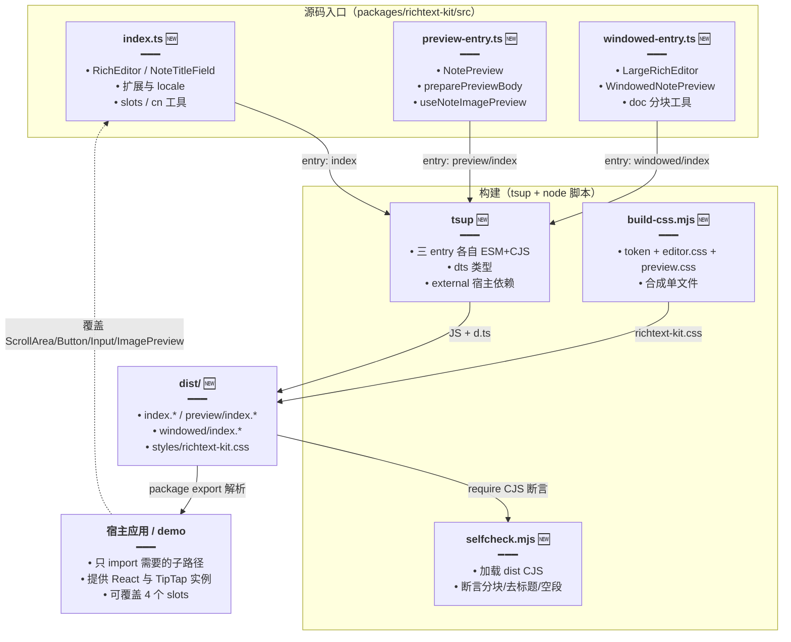
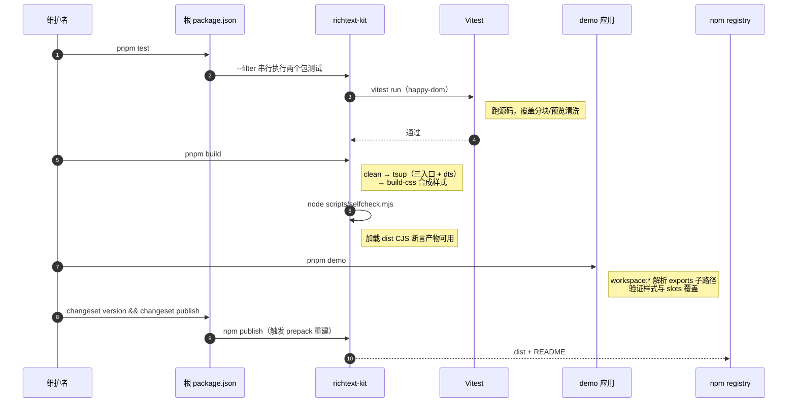

# 富文本套件包化（三入口 + slots 插槽 + 随包样式）

> 文档角色：本篇是 `@dnhyxc-ai/richtext-kit` 的**分发层主文档**——这个新包如何拆成「编辑器 / 只读预览 / 长文窗口化」三个入口、如何把宿主 UI（滚动区、按钮、输入框、图片预览）通过 slots 反转出去、样式如何随包产出，以及构建、自检、测试、demo、changeset 发布的完整链路。
>
> 延伸阅读：
> - 编辑器内核（TipTap 扩展装配、标题节点、工具栏、图片上传、链接气泡）：[富文本编辑器实现.md](./富文本编辑器实现.md)
> - 只读预览与图片灯箱（HTML 清洗、空段补 `<br>`、灯箱绑定）：[富文本预览与图片灯箱.md](./富文本预览与图片灯箱.md)
> - 长文分窗渲染（分块算法、窗口漂移、全文拼接）：[长文窗口化渲染.md](./长文窗口化渲染.md)
> - 同目录另一个可发布包的分发方式：[索引.md](./索引.md)

## 1. 背景与目标

改动前，仓库里的富文本能力与具体产品强绑定：编辑器、只读预览、长文分窗滚动散落在业务页面内，宿主组件（滚动容器、按钮、输入框、图片预览）直接写死，样式靠宿主项目的 Tailwind 全局配置。由此带来四个问题：

- **无法复用**：同一套编辑器在另一个项目要用，只能整段复制，后续修 bug 要同步多处。
- **依赖不可控**：`react`、`@tiptap/*` 等全部打进产物会产出多份 React 实例，宿主与库的 Context 直接失联。
- **样式不可分发**：组件类名依赖宿主的主题变量与 Tailwind 扫描范围，换个项目就掉样式。
- **无验收手段**：没有单元测试、没有构建后自检、没有可运行的 demo，改动只能靠人工点。

本轮目标：

1. **三入口按需加载**：`.`（编辑器）、`./preview`（只读预览）、`./windowed`（长文分窗）各自独立产物，只引预览的宿主不会被迫加载 TipTap 编辑器与工具栏。
2. **依赖外置**：`react` / `react-dom` / `@tiptap/*` / `radix-ui` / `lucide-react` 全部走 `external`，由宿主提供唯一实例。
3. **UI 可替换**：`ScrollArea` / `Button` / `Input` / `ImagePreview` 四个能力抽象成 slots，默认实现随包提供，宿主可整体替换。
4. **样式随包**：`scripts/build-css.mjs` 把主题 token + 编辑器样式 + 预览样式合成 `dist/styles/richtext-kit.css`，宿主一行 import 即可。
5. **可验证**：Vitest（happy-dom）+ 构建产物自检（`check:self`）+ Vite demo，三件套保证「测试通过 = 产物真的能用」。

## 2. 改动范围

| 文件 | 改动 | 角色 |
| --- | --- | --- |
| `packages/richtext-kit/package.json` | **新增** | 包元信息、`exports` 四个子路径、`prepack` 构建、`test` / `check:self` / `demo` 脚本、依赖与 peer 声明 |
| `packages/richtext-kit/tsup.config.ts` | **新增** | 三入口 ESM+CJS 双格式构建、`dts` 类型产物、依赖全量 external |
| `packages/richtext-kit/scripts/build-css.mjs` | **新增** | 主题 token + `editor.css` + `preview.css` 合成单文件样式 |
| `packages/richtext-kit/scripts/selfcheck.mjs` | **新增** | 构建后用 CJS 产物跑冒烟断言（分块/去标题/空段） |
| `packages/richtext-kit/vitest.config.ts` | **新增** | happy-dom 环境 + `test/**/*.test.ts(x)` 收集规则 |
| `packages/richtext-kit/tsconfig.json` | **新增** | 独立编译配置：`react-jsx`、`bundler` 解析、声明产物 |
| `packages/richtext-kit/src/slots/{types,context,index,defaults}.ts(x)` | **新增** | 四个宿主插槽的类型契约、Context 合并与默认实现 |
| `packages/richtext-kit/demo/**` | **新增** | Vite + Tailwind 的消费示例（`workspace:*` 引用本包） |
| `.changeset/config.json` | 修改 | 把 demo 加入 `ignore`，避免给私有示例包发版 |
| `package.json`（根） | 修改 | `test` 脚本串上 `@dnhyxc-ai/richtext-kit` |
| `packages/PUBLISH.md` | 修改 | 发布前需构建的包清单补 `richtext-kit` |

## 3. 实现思路

1. **三入口而非一个**：`src/index.ts`、`src/preview-entry.ts`、`src/windowed-entry.ts` 各自作为 tsup `entry`，产物落到 `dist/index.*`、`dist/preview/index.*`、`dist/windowed/index.*`。`exports` 用子路径暴露，Node 与打包器都能按需解析；`splitting: false` 保证每个入口自包含，避免宿主只装 preview 却因为共享 chunk 拉进编辑器。
2. **依赖全量 external**：`tsup` 的 `external` 罗列 20 个包名。容器类库最忌讳「打包进第二份 React」——会破 Hooks 与 Context；TipTap 各扩展同理必须与宿主版本一致，否则 Schema 冲突。代价是宿主必须自己装这些依赖，故 `package.json` 同时用 `peerDependencies` 声明 React 版本下限 `>=18`。
3. **slots 反转控制**：`RichTextKitSlots` 只包含四个真正与宿主视觉强相关的原语（滚动区、按钮、输入框、图片预览）。`RichTextKitProvider` 用 `useMemo` 把「默认实现 + 部分覆盖」合并成稳定引用，`useRichTextKitSlots` 在无 Provider 时回落默认值——组件既能被 Provider 包裹定制，也能裸用。
4. **样式产物单文件**：源码里 `editor.css` 与 `preview.css` 分离便于维护，但宿主不应关心文件结构，故构建末尾合成 `dist/styles/richtext-kit.css`，并把主题色收敛成 `--rtk-*` 变量、逐级回落到宿主常见变量（`--theme-*` → `--foreground`/`--border` 等）与硬编码兜底。
5. **类型与 JS 同源**：`tsup` 的 `dts: true` 为每个入口生成 `.d.ts`，`package.json` 的 `types` 指向对应入口声明，保证 `import type { RichEditorProps } from '@dnhyxc-ai/richtext-kit'` 在纯类型消费（`verbatimModuleSyntax`）下也可用。
6. **自检针对产物而非源码**：`check:self` 用 `createRequire` 加载 `dist/windowed/index.cjs` 与 `dist/preview/index.cjs` 跑断言——它验证的是「发布出去的 CJS 产物是否可加载、行为是否正确」，这是单元测试（跑源码）覆盖不到的一层。
7. **demo 是契约的活文档**：demo 通过 `"@dnhyxc-ai/richtext-kit": "workspace:*"` 消费本包，且只用 `exports` 暴露的子路径，任何「忘记导出 / 忘记 external / 忘记产样式」都会在 demo 里立刻暴露。
8. **发布链路沿用既有 Changesets**：根 `test` 串上本包，`.changeset/config.json` 只把 demo 加进 `ignore`（私有包不发版），`prepack` 钩子保证 `npm publish` 前一定重新构建。





## 4. 关键代码对比与注释

> 本包为**整包新增**，除 §4.8–§4.10 三处既有文件的小幅改动外，其余小节均为「纯新增」，按 Skill 例外条款只贴「改动后」一块。

### 4.1 `package.json`：exports 子路径与构建脚本

**改动后（纯新增）** · `packages/richtext-kit/package.json`（当前，约 L1–L88）

```jsonc
{
	// 包名走组织 scope，发布到 npm 的 @dnhyxc-ai 命名空间下
	"name": "@dnhyxc-ai/richtext-kit",
	// 初始版本：与仓库其它 kit 包同步演进，靠 changesets 递增
	"version": "0.0.3",
	// 强制 ESM 语义：package.json 层面声明模块类型，避免 Node 按 CJS 解析 .js
	"type": "module",
	// 一句话描述：编辑器 + 静态预览 + 长文窗口化，便于 npm 搜索与团队识别
	"description": "TipTap-based rich text editor and static note preview kit (edit + preview + windowed long docs)",
	// 作者信息，npm 页面展示
	"author": "dnhyxc <dnhyxc@163.com>",
	// MIT 协议：允许商业项目直接依赖
	"license": "MIT",
	// 旧解析器（不认 exports 的工具）回落的入口
	"main": "./dist/index.js",
	// 打包器优先读取的 ESM 入口，与 main 指向同一文件
	"module": "./dist/index.js",
	// 旧解析器回落的类型入口
	"types": "./dist/index.d.ts",
	// 声明样式文件有副作用：避免打包器 tree-shake 掉 dist 内的 css
	"sideEffects": [
		// 任意层级的 css 都视为副作用，保证 import 样式不被摇掉
		"**/*.css"
	],
	// 发布白名单：只发产物与说明，源码与测试不进包体
	"files": [
		// 构建产物目录
		"dist",
		// 使用说明：npm 页面正文来源
		"README.md"
	],
	// 关键词：提升 npm 检索命中率
	"keywords": [
		// 宿主框架
		"react",
		// 编辑器内核
		"tiptap",
		// 能力关键词
		"richtext",
		// 能力关键词
		"editor",
		// 能力关键词
		"preview",
		// 包标识
		"richtext-kit"
	],
	// 脚本区：构建、测试、自检、demo 都从这里进入
	"scripts": {
		// 清理旧产物：避免 tsup 增量残留过期文件被误发布
		"clean": "rm -rf dist",
		// 单独产出样式：便于只调样式时跳过 JS 构建
		"build:css": "node scripts/build-css.mjs",
		// 完整构建：先清空、再打包三入口、最后合成样式
		"build": "pnpm clean && tsup && pnpm build:css",
		// 发布钩子：npm publish / pnpm pack 前自动重建，杜绝发布过期 dist
		"prepack": "pnpm build",
		// 启动 demo：用 pnpm filter 精确启动示例应用
		"demo": "pnpm --filter @dnhyxc-ai/richtext-kit-demo dev",
		// 产物自检：在 dist 上跑冒烟断言
		"check:self": "node scripts/selfcheck.mjs",
		// 单次单元测试：CI 与根 test 脚本使用
		"test": "vitest run",
		// 监听测试：本地开发用
		"test:watch": "vitest"
	},
	// 条件导出：宿主按子路径拿到不同产物，实现按需加载
	"exports": {
		// 主入口：编辑器与全部公共类型
		".": {
			// 类型优先：TS 直接读声明，无需解析实现
			"types": "./dist/index.d.ts",
			// ESM 消费者
			"import": "./dist/index.js",
			// CJS 消费者（老工具链 / SSR require）
			"require": "./dist/index.cjs"
		},
		// 预览子路径：只读渲染，不拉工具栏与编辑器扩展
		"./preview": {
			// 预览入口类型
			"types": "./dist/preview/index.d.ts",
			// 预览 ESM 产物
			"import": "./dist/preview/index.js",
			// 预览 CJS 产物
			"require": "./dist/preview/index.cjs"
		},
		// 长文子路径：分窗编辑与分窗预览
		"./windowed": {
			// 长文入口类型
			"types": "./dist/windowed/index.d.ts",
			// 长文 ESM 产物
			"import": "./dist/windowed/index.js",
			// 长文 CJS 产物
			"require": "./dist/windowed/index.cjs"
		},
		// 样式子路径：宿主一行 import 即可获得全部样式
		"./styles.css": "./dist/styles/richtext-kit.css"
	},
	// peer 依赖：React 由宿主提供，避免双实例破坏 Hooks/Context
	"peerDependencies": {
		// 宿主 React 最低 18（并发渲染与 use 系列 API 基线）
		"react": ">=18.0.0",
		// ReactDOM 与 React 版本同步
		"react-dom": ">=18.0.0"
	},
	// 运行依赖：编辑器内核、扩展、图标、无样式 UI 原语与类名工具
	"dependencies": {
		// TipTap 核心：Editor 实例与命令类型
		"@tiptap/core": "^3.28.0",
		// 代码块 + lowlight 语法高亮扩展
		"@tiptap/extension-code-block-lowlight": "^3.28.0",
		// 自定义文档节点结构（标题节点替换默认 doc）
		"@tiptap/extension-document": "^3.28.0",
		// 高亮标记扩展
		"@tiptap/extension-highlight": "^3.28.0",
		// 图片节点扩展
		"@tiptap/extension-image": "^3.28.0",
		// 列表与任务列表扩展
		"@tiptap/extension-list": "^3.28.0",
		// 空文档占位文案扩展
		"@tiptap/extension-placeholder": "^3.28.0",
		// 表格扩展
		"@tiptap/extension-table": "^3.28.0",
		// 文本对齐扩展
		"@tiptap/extension-text-align": "^3.28.0",
		// TipTap 通用扩展集合（字符计数、空段等）
		"@tiptap/extensions": "^3.28.0",
		// ProseMirror 底层包：Schema/Transaction 类型与工具
		"@tiptap/pm": "^3.28.0",
		// React 绑定：useEditor / EditorContent
		"@tiptap/react": "^3.28.0",
		// 入门扩展包：段落、加粗、斜体、标题等基础节点
		"@tiptap/starter-kit": "^3.28.0",
		// 类名拼接工具：条件类名
		"clsx": "^2.1.1",
		// 语法高亮引擎：由代码块扩展消费
		"lowlight": "^3.3.0",
		// 图标库：工具栏与菜单按钮
		"lucide-react": "^0.563.0",
		// 无样式 UI 原语（气泡菜单、弹层定位）
		"radix-ui": "^1.4.3",
		// Tailwind 类名冲突合并：宿主覆盖类名时不被覆盖顺序坑到
		"tailwind-merge": "^3.4.0"
	},
	// 开发依赖：只在本包开发、构建、测试时使用
	"devDependencies": {
		// React 类型
		"@types/react": "^19.1.8",
		// ReactDOM 类型
		"@types/react-dom": "^19.1.6",
		// 轻量 DOM 环境：Vitest 里模拟浏览器
		"happy-dom": "^20.0.10",
		// 本地开发用的 React 实体（同时是 peer）
		"react": "^19.1.0",
		// 同上
		"react-dom": "^19.1.0",
		// 打包器：三入口 ESM+CJS + dts
		"tsup": "^8.5.1",
		// 类型编译
		"typescript": "^5.8.3",
		// 测试运行器
		"vitest": "^3.2.4"
	}
}
```

**变更摘要**：纯新增。关键在于 `exports` 的四个子路径与 `peerDependencies`：前者决定宿主能否按需加载，后者决定 React 是否单实例。

### 4.2 `tsup.config.ts`：三入口 + 依赖外置

**改动后（纯新增）** · `packages/richtext-kit/tsup.config.ts`（当前，约 L1–L43）

```typescript
// 引入 tsup 配置工厂：让配置获得类型提示
import { defineConfig } from 'tsup';

// 外置清单：这些包一律不打进产物，由宿主提供唯一实例
const external = [
	// React 本体：双实例会破坏 Hooks 与 Context
	'react',
	// ReactDOM 本体：同上
	'react-dom',
	// 新版 JSX 运行时：避免产物内联一份 jsx 实现
	'react/jsx-runtime',
	// TipTap 核心：必须与宿主同版本，否则 Schema 冲突
	'@tiptap/core',
	// React 绑定
	'@tiptap/react',
	// 气泡菜单子路径：实际 import 路径在此
	'@tiptap/react/menus',
	// 入门扩展集合
	'@tiptap/starter-kit',
	// 代码块高亮扩展
	'@tiptap/extension-code-block-lowlight',
	// 文档节点扩展
	'@tiptap/extension-document',
	// 高亮扩展
	'@tiptap/extension-highlight',
	// 图片扩展
	'@tiptap/extension-image',
	// 列表扩展
	'@tiptap/extension-list',
	// 占位扩展
	'@tiptap/extension-placeholder',
	// 表格扩展
	'@tiptap/extension-table',
	// 对齐扩展
	'@tiptap/extension-text-align',
	// 通用扩展集合
	'@tiptap/extensions',
	// ProseMirror 底层
	'@tiptap/pm',
	// 语法高亮引擎
	'lowlight',
	// 图标库：宿主可能已装，避免重复打包
	'lucide-react',
	// 无样式 UI 原语
	'radix-ui',
	// 类名工具
	'clsx',
	// 类名合并工具
	'tailwind-merge',
];

// 导出配置数组：结构预留多份构建，当前只有一份
export default defineConfig([
	{
		// 三入口映射：键即产物相对路径，值即源码入口
		entry: {
			// 主入口：编辑器与公共类型
			index: 'src/index.ts',
			// 预览入口：产物落到 dist/preview/index.*
			'preview/index': 'src/preview-entry.ts',
			// 长文入口：产物落到 dist/windowed/index.*
			'windowed/index': 'src/windowed-entry.ts',
		},
		// 双格式输出：ESM 给现代工具链，CJS 给 require 场景
		format: ['esm', 'cjs'],
		// 生成 .d.ts：宿主无需读源码即可获得类型
		dts: true,
		// 关闭代码分割：每个入口自包含，避免按需加载时被共享 chunk 拉进编辑器
		splitting: false,
		// 不产出 sourcemap：包体更小，排障靠宿主自己的构建
		sourcemap: false,
		// 构建前清空 dist：防止过期文件被一起发布
		clean: true,
		// 开启 tree-shaking：去掉未引用的内部符号
		treeshake: true,
		// 应用外置清单：与上方数组同源
		external,
	},
]);
```

**变更摘要**：纯新增。三入口 + `splitting: false` 是「按需加载」的前提，`external` 是「宿主单实例」的前提。

### 4.3 `scripts/build-css.mjs`：主题 token 与样式合成

**改动后（纯新增）** · `packages/richtext-kit/scripts/build-css.mjs`（当前，约 L1–L23）

```javascript
// 引入文件系统能力：读源码样式、写产物样式、建目录
import { mkdirSync, readFileSync, writeFileSync } from 'node:fs';
// 引入路径工具：解析包根与拼接产物路径
import { dirname, join } from 'node:path';
// 引入 ESM 下的文件 URL 转换：拿到当前脚本绝对路径
import { fileURLToPath } from 'node:url';

// 计算包根目录：脚本位于 scripts/ 下，向上一级即包根
const root = join(dirname(fileURLToPath(import.meta.url)), '..');
// 读取编辑器样式：工具栏、正文排版、代码块等
const editor = readFileSync(join(root, 'src/styles/editor.css'), 'utf8');
// 读取预览样式：只读态正文与图片排版
const preview = readFileSync(join(root, 'src/styles/preview.css'), 'utf8');
// 主题 token 模板：统一成 --rtk-* 变量，并逐级回落到宿主变量与硬编码兜底
const tokens = `/* @dnhyxc-ai/richtext-kit theme tokens — override in host */
:root {
	--rtk-text: var(--theme-textcolor, var(--foreground, #111));
	--rtk-border: var(--theme-border, var(--border, #e5e5e5));
	--rtk-bg: var(--theme-background, var(--background, #fff));
	--rtk-accent: var(--theme, #14b8a6);
}
`;

// 样式产物目录：dist/styles
const outDir = join(root, 'dist/styles');
// 递归建目录：首次构建时目录不存在
mkdirSync(outDir, { recursive: true });
// 写出合并后的单文件样式：宿主只需 import 一个路径
writeFileSync(
	// 产物文件名固定，与 package.json 的 ./styles.css 子路径对应
	join(outDir, 'richtext-kit.css'),
	// 拼接顺序：先变量、再编辑器、最后预览，保证预览覆盖编辑器基础排版
	`${tokens}\n${editor}\n${preview}\n`,
);
// 构建日志：CI 能确认样式阶段真的执行过
console.log('wrote dist/styles/richtext-kit.css');
```

**变更摘要**：纯新增。`--rtk-*` 变量的三级回落是「换项目不掉样式」的核心；拼接顺序保证预览态样式优先级。

### 4.4 `scripts/selfcheck.mjs`：针对构建产物的冒烟断言

**改动后（纯新增）** · `packages/richtext-kit/scripts/selfcheck.mjs`（当前，约 L1–L30）

```javascript
// 引入 CJS require 构造器：在 ESM 脚本里加载 dist 的 .cjs 产物
import { createRequire } from 'node:module';
// 引入路径工具
import { dirname, join } from 'node:path';
// 引入文件 URL 转换
import { fileURLToPath } from 'node:url';

// 包根目录：脚本位于 scripts/ 下
const root = join(dirname(fileURLToPath(import.meta.url)), '..');
// 基于当前模块创建 require：用于加载 CJS 产物
const require = createRequire(import.meta.url);

// 从窗口化入口产物解构：分块工具与窗口常量
const { isLargeNoteHtml, WINDOW_SIZE, createLargeNoteDoc } = require(
	// 直接指向 dist 的 CJS 文件，验证「发布后的产物」而非源码
	join(root, 'dist/windowed/index.cjs'),
);
// 从预览入口产物解构：正文清洗工具
const { preparePreviewBody, stripNoteTitleHtml } = require(
	// 同上，验证预览产物可加载
	join(root, 'dist/preview/index.cjs'),
);

// 构造标题节点 HTML：模拟编辑器保存后的真实格式
const title = '<div data-type="note-title" data-value="Hi">Hi</div>';
// 构造 90 个段落的正文：超过一窗，触发长文路径
const body = Array.from({ length: 90 }, (_, i) => `<p>b${i}</p>`).join('');
// 拼接成完整笔记 HTML
const html = `${title}${body}`;

// 断言长文识别生效：否则说明阈值常量或实现被改坏
if (!isLargeNoteHtml(html)) throw new Error('expected large note');
// 执行分块：这是长文窗口化的入口
const doc = createLargeNoteDoc(html);
// 断言分块数量：标题不算块，90 段应得 90 块
if (doc.doc.blocks.length !== 90) throw new Error('block split failed');
// 断言首窗条数：不能超过 WINDOW_SIZE
if (doc.doc.count !== Math.min(WINDOW_SIZE, 90))
	// 抛错让 CI 失败，而不是静默产出坏包
	throw new Error('window count');

// 去掉标题节点：预览态不应渲染可编辑标题
const stripped = stripNoteTitleHtml(html);
// 断言标题已剔除：残留说明正则或节点识别失效
if (stripped.includes('note-title')) throw new Error('title not stripped');
// 空段处理：预览态需补 <br> 才能保持行高
const prepared = preparePreviewBody(`${title}<p></p>`);
// 断言空段已被补 br：否则预览会出现「空段塌陷」
if (!prepared.includes('<br>')) throw new Error('empty p not preserved');

// 全部断言通过：输出可被 CI 捕获的成功标记
console.log('selfcheck ok');
```

**变更摘要**：纯新增。与 Vitest 的分工是：Vitest 验证源码逻辑，selfcheck 验证「dist 里的 CJS 产物能加载且行为正确」。

### 4.5 `vitest.config.ts`：测试环境与收集范围

**改动后（纯新增）** · `packages/richtext-kit/vitest.config.ts`（当前，约 L1–L9）

```typescript
// 引入 Vitest 配置工厂：获得类型提示
import { defineConfig } from 'vitest/config';

// 导出测试配置
export default defineConfig({
	// test 段：环境与文件收集规则
	test: {
		// 轻量 DOM 实现：分块与 HTML 清洗需要 DOM 解析能力
		environment: 'happy-dom',
		// 收集范围：test 目录下的 .test.ts 与 .test.tsx
		include: ['test/**/*.test.ts', 'test/**/*.test.tsx'],
		// 关闭全局注入：测试文件显式 import describe/it/expect，便于静态分析
		globals: false,
	},
});
```

**变更摘要**：纯新增。选 happy-dom 而非 jsdom 是为速度；`globals: false` 让测试文件自解释。

### 4.6 `tsconfig.json`：独立编译配置

**改动后（纯新增）** · `packages/richtext-kit/tsconfig.json`（当前，约 L1–L24）

```jsonc
{
	// 继承仓库根配置：复用路径别名与基础严格度
	"extends": "../../tsconfig.json",
	// 覆盖项：包作为独立库发布，编译目标与模块解析需自洽
	"compilerOptions": {
		// DOM 类型：编辑器与预览都直接操作 DOM
		"lib": ["ES2022", "DOM", "DOM.Iterable"],
		// 编译目标：现代语法直接保留，由宿主打包器再降级
		"target": "ES2022",
		// 源码根目录：声明文件路径基于它计算
		"rootDir": "./src",
		// 输出目录：与 tsup 产物同层
		"outDir": "./dist",
		// 产出 .d.ts：类型随包分发
		"declaration": true,
		// 声明文件输出目录
		"declarationDir": "./dist",
		// 不只看类型：允许实际 emit（demo 的 tsc -b 也会用到）
		"emitDeclarationOnly": false,
		// 保留 sourcemap：便于宿主调试到源码
		"sourceMap": true,
		// 允许产出文件：覆盖根配置可能的 noEmit
		"noEmit": false,
		// 禁止 import 带 .ts 后缀：保证产物导入路径可直接被 Node 解析
		"allowImportingTsExtensions": false,
		// 模块格式：ESM
		"module": "ESNext",
		// 解析策略：交给打包器（支持 exports / 条件导出）
		"moduleResolution": "bundler",
		// JSX 编译方式：新版自动运行时，无需每文件 import React
		"jsx": "react-jsx",
		// 关闭装饰器：本包不使用 Nest 风格装饰器
		"experimentalDecorators": false,
		// 关闭装饰器元数据：同上
		"emitDecoratorMetadata": false,
		// 允许未使用局部变量：库代码常有兼容性预留
		"noUnusedLocals": false,
		// 允许未使用参数：对外 API 签名需要保留占位
		"noUnusedParameters": false
	},
	// 编译范围：只含 src
	"include": ["./src/**/*"],
	// 排除：依赖与产物
	"exclude": ["node_modules", "dist"]
}
```

**变更摘要**：纯新增。`moduleResolution: bundler` + `jsx: react-jsx` 是库包能同时被 Vite/Webpack/Node 消费的关键。

### 4.7 slots 契约：类型、Context 与默认实现入口

#### 4.7.1 `RichTextKitSlots` 类型

**改动后（纯新增）** · `packages/richtext-kit/src/slots/types.ts`（当前，约 L1–L46）

```typescript
// 引入 React 类型：只用类型，不引入运行时
import type {
	// 组件类型：用于约束插槽必须是 React 组件
	ComponentType,
	// 内联样式类型：滚动区透传 style
	CSSProperties,
	// 子节点类型
	ReactNode,
	// 滚动事件处理器类型
	UIEventHandler,
} from 'react';

// 图片条目：灯箱与下载都围绕它
export type RichTextImageItem = {
	// 稳定 id：列表切换与 key 用，宿主可缺省
	id?: string;
	// 图片地址：必填
	url: string;
};

// 图片预览组件契约：宿主可换成自家灯箱
export type RichTextImagePreviewProps = {
	// 是否可见：受控显示
	visible: boolean;
	// 当前选中图：灯箱定位用
	selectedImage?: RichTextImageItem;
	// 可左右切换的图列表
	imageList?: RichTextImageItem[];
	// 是否展示下载按钮
	showDownload?: boolean;
	// 是否展示上一张/下一张
	showPrevAndNext?: boolean;
	// 灯箱标题
	title?: string;
	// 下载回调：由包内注入，宿主决定落盘方式
	download?: (image: RichTextImageItem) => void | Promise<void>;
	// 可见性变更回调：关闭灯箱时通知包内状态
	onVisibleChange?: (visible: boolean) => void;
	// 翻译函数：宿主接入自家 i18n，避免包内写死文案
	t?: (key: string, params?: Record<string, unknown>) => string;
};

// 滚动区契约：编辑与预览都把滚动容器交给宿主
export type RichTextScrollAreaProps = {
	// 追加类名
	className?: string;
	// 内联样式：长文窗口化要设置占位高度
	style?: CSSProperties;
	// 滚动回调：长文分窗计算窗口起点依赖它
	onScroll?: UIEventHandler<HTMLDivElement>;
	// 内容
	children?: ReactNode;
};

// 输入框契约：链接气泡里的 URL 输入
export type RichTextInputProps = React.InputHTMLAttributes<HTMLInputElement> & {
	// 是否展示字数：宿主输入框可能自带计数
	showCount?: boolean;
};

// 按钮契约：工具栏与气泡菜单都复用它
export type RichTextButtonProps =
	React.ButtonHTMLAttributes<HTMLButtonElement> & {
		// 视觉变体：默认 / 描边 / 幽灵 / 次要
		variant?: 'default' | 'outline' | 'ghost' | 'secondary';
	};

// 插槽总表：四个原语，覆盖本包所有需要宿主视觉介入的位置
export type RichTextKitSlots = {
	// 滚动容器：决定滚动条样式与视口实现
	ScrollArea: ComponentType<RichTextScrollAreaProps>;
	// 按钮：决定工具栏视觉
	Button: ComponentType<RichTextButtonProps>;
	// 输入框：决定链接输入视觉
	Input: ComponentType<RichTextInputProps>;
	// 图片预览：决定灯箱交互
	ImagePreview: ComponentType<RichTextImagePreviewProps>;
};
```

**变更摘要**：纯新增。四个插槽刻意只覆盖「视觉强相关」的位置，编辑器逻辑一律不外泄。

#### 4.7.2 `RichTextKitProvider` / `useRichTextKitSlots` / `mergeRichTextKitSlots`

**改动后（纯新增）** · `packages/richtext-kit/src/slots/context.tsx`（当前，约 L1–L33）

```tsx
// 引入 Context 与 hooks：实现插槽注入与读取
import { createContext, type ReactNode, useContext, useMemo } from 'react';
// 引入默认插槽实现：无 Provider 时的兜底
import { defaultRichTextKitSlots } from './defaults';
// 引入插槽类型
import type { RichTextKitSlots } from './types';

// 插槽 Context：null 表示未提供，读取时回落默认值
const RichTextKitSlotsContext = createContext<RichTextKitSlots | null>(null);

// Provider：宿主在任意层级包裹即可覆盖部分插槽
export function RichTextKitProvider({
	// 宿主提供的部分插槽：只写要覆盖的那几个
	slots,
	// 被包裹的组件树
	children,
}: {
	// 插槽参数：可选，不传即全默认
	slots?: Partial<RichTextKitSlots>;
	// 子节点必填
	children: ReactNode;
}) {
	// 合并结果并缓存：slots 引用不变时避免子树无谓重渲染
	const value = useMemo(
		// 展开默认实现后覆盖宿主值：后者优先级更高
		() => ({ ...defaultRichTextKitSlots, ...slots }),
		// 依赖宿主 slots：宿主换实现时才重算
		[slots],
	);
	// 通过 Context 下发合并结果
	return (
		// Provider 注入 value
		<RichTextKitSlotsContext.Provider value={value}>
			{/* 渲染子树，内部组件通过 hook 自行取用 */}
			{children}
		</RichTextKitSlotsContext.Provider>
	);
}

// 读取插槽：组件内部统一通过它拿 UI 原语
export function useRichTextKitSlots(): RichTextKitSlots {
	// 未包裹 Provider 时回落默认实现：保证裸用不炸
	return useContext(RichTextKitSlotsContext) ?? defaultRichTextKitSlots;
}

// 非组件环境（如工具函数）需要插槽时使用：手动合并
export function mergeRichTextKitSlots(
	// 部分覆盖项
	partial?: Partial<RichTextKitSlots>,
	// 返回完整插槽表
): RichTextKitSlots {
	// 与 Provider 同一合并语义，避免两处行为不一致
	return { ...defaultRichTextKitSlots, ...partial };
}
```

**变更摘要**：纯新增。`?? defaultRichTextKitSlots` 让组件「零配置可用」，`useMemo` 让「配置了也只重渲染一次」。

#### 4.7.3 插槽对外导出面

**改动后（纯新增）** · `packages/richtext-kit/src/slots/index.ts`（当前，约 L1–L19）

```typescript
// 导出 Provider 与两个工具：宿主定制入口
export {
	// 手动合并：非组件环境用
	mergeRichTextKitSlots,
	// Context Provider：组件树注入
	RichTextKitProvider,
	// 读取 hook：自定义组件里取插槽
	useRichTextKitSlots,
} from './context';
// 导出默认实现：宿主可只覆盖一两个，其余复用默认组件
export {
	// 默认按钮
	DefaultButton,
	// 默认图片预览灯箱
	DefaultImagePreview,
	// 默认输入框
	DefaultInput,
	// 默认滚动区
	DefaultScrollArea,
	// 默认插槽总表：也可整体透传给 merge
	defaultRichTextKitSlots,
} from './defaults';
// 导出类型：宿主写覆盖实现时需要这些契约
export type {
	// 按钮 props
	RichTextButtonProps,
	// 图片条目
	RichTextImageItem,
	// 图片预览 props
	RichTextImagePreviewProps,
	// 输入框 props
	RichTextInputProps,
	// 插槽总表
	RichTextKitSlots,
	// 滚动区 props
	RichTextScrollAreaProps,
} from './types';
```

**变更摘要**：纯新增。对外只暴露「合并函数 + Provider + hook + 默认实现 + 类型」，不暴露 Context 实例。

### 4.8 `.changeset/config.json`：demo 加入忽略清单

**改动前** · `.changeset/config.json`（HEAD，约 L10–L15）

```jsonc
	// 忽略清单：这些包不参与版本与发布
	"ignore": [
		// 后端应用：私有，随应用发布而非 npm
		"@dnhyxc-ai/backend",
		// 前端应用：同上
		"@dnhyxc-ai/frontend",
		// 发布脚本包：内部工具，不发 npm
		"@dnhyxc-ai/release-run"
	]
```

**改动后** · `.changeset/config.json`（当前，约 L10–L16）

```jsonc
	// 忽略清单：这些包不参与版本与发布
	"ignore": [
		// 后端应用：私有，随应用发布而非 npm
		"@dnhyxc-ai/backend",
		// 前端应用：同上
		"@dnhyxc-ai/frontend",
		// 发布脚本包：内部工具，不发 npm
		"@dnhyxc-ai/release-run",
		// 新增：富文本套件的 demo 应用是私有示例，不应被 changeset 发版
		"@dnhyxc-ai/richtext-kit-demo"
	]
```

**变更摘要**：只增加一行 ignore。若不忽略，`changeset version` 会尝试为私有 demo 包升版本并在 publish 阶段失败。

### 4.9 根 `package.json`：测试脚本串联

**改动前** · `package.json`（HEAD，约 L44）

```jsonc
	// 只跑 markdown-kit 的测试
	"test": "pnpm --filter @dnhyxc-ai/markdown-kit test"
```

**改动后** · `package.json`（当前，约 L44）

```jsonc
	// 串联两个 kit 的测试：&& 保证前一个失败即中断，CI 能快速定位
	"test": "pnpm --filter @dnhyxc-ai/markdown-kit test && pnpm --filter @dnhyxc-ai/richtext-kit test"
```

**变更摘要**：新增包接入根测试入口，避免「新包测试没进 CI」。

### 4.10 `packages/PUBLISH.md`：发布前置条件说明

**改动前** · `packages/PUBLISH.md`（HEAD，约 L9）

```markdown
- 发布前各包需已构建（例如 `@dnhyxc-ai/release-kit` 的 `dist`、`@dnhyxc-ai/markdown-kit` 的 `dist`）；对应包内通常已有 `prepublishOnly` / `prepack`。
```

**改动后** · `packages/PUBLISH.md`（当前，约 L9）

```markdown
- 发布前各包需已构建（例如 `@dnhyxc-ai/release-kit` 的 `dist`、`@dnhyxc-ai/markdown-kit` / `@dnhyxc-ai/richtext-kit` 的 `dist`）；对应包内通常已有 `prepublishOnly` / `prepack`。
```

**变更摘要**：文案补充新包，提示发布前 `dist` 必须存在（由 `prepack` 自动保证）。

### 4.11 `demo/package.json`：以 workspace 方式消费本包

**改动后（纯新增）** · `packages/richtext-kit/demo/package.json`（当前，约 L1–L27）

```jsonc
{
	// demo 独立包名：私有，仅本地演示
	"name": "@dnhyxc-ai/richtext-kit-demo",
	// 私有包：避免误发布到 npm
	"private": true,
	// 演示版本：与套件解耦，仅用于本地
	"version": "0.0.2",
	// ESM：与套件保持一致，便于直接消费 exports
	"type": "module",
	// 说明：指明演示内容对齐「学习笔记」形态
	"description": "React demo for @dnhyxc-ai/richtext-kit editor + preview (learning-notes aligned)",
	// 脚本：dev / build / preview 三件套
	"scripts": {
		// 启动 Vite 开发服务器：改源码即时热更
		"dev": "vite",
		// 先 tsc 再 vite build：同时验证类型与打包
		"build": "tsc -b && vite build",
		// 预览构建产物：验证生产模式行为
		"preview": "vite preview"
	},
	// 运行依赖
	"dependencies": {
		// 关键：workspace 协议指向本包，走 exports 子路径消费
		"@dnhyxc-ai/richtext-kit": "workspace:*",
		// 图标：demo 自己也要画图标
		"lucide-react": "^0.563.0",
		// React 实体：由 demo 提供唯一实例（与 peer 声明对应）
		"react": "^19.1.0",
		// ReactDOM 实体
		"react-dom": "^19.1.0"
	},
	// 开发依赖
	"devDependencies": {
		// Tailwind 的 Vite 插件：demo 用 Tailwind 写样式
		"@tailwindcss/vite": "^4.1.11",
		// React 类型
		"@types/react": "^19.1.8",
		// ReactDOM 类型
		"@types/react-dom": "^19.1.6",
		// React 插件：JSX 转换与 Fast Refresh
		"@vitejs/plugin-react": "^4.7.0",
		// Tailwind 本体
		"tailwindcss": "^4.1.11",
		// 类型编译
		"typescript": "^5.8.3",
		// 构建工具
		"vite": "^6.3.5"
	}
}
```

**变更摘要**：纯新增。`workspace:*` 让 demo 永远消费本地最新产物，是「exports 写错立刻暴露」的保障。

## 5. 行为变化与兼容性

| 场景 | 结果 |
| --- | --- |
| 宿主只引 `./preview` | 产物内不含编辑器、工具栏与 TipTap 编辑器扩展（`splitting: false` + 独立 entry） |
| 宿主已有 React / TipTap | 不产生第二份实例（全量 `external` + `peerDependencies`） |
| 宿主有自己的按钮/滚动条/灯箱 | 通过 `slots` 覆盖任意子集，其余回落默认实现 |
| 宿主未配置任何样式 | import `@dnhyxc-ai/richtext-kit/styles.css` 即完整可用；主题色可覆盖 `--rtk-*` |
| 宿主主题变量不同 | `--rtk-*` 会依次尝试 `--theme-*` → `--foreground` / `--border` / `--background` / `--theme` → 硬编码兜底 |
| CJS 环境（`require`） | 三个子路径均提供 `.cjs` 产物 |
| demo 包参与发版 | 已 `ignore`，不会触发 publish |
| 发布时忘记构建 | `prepack` 自动重建 |

**破坏性**：无。本包为新增，且当前 `apps/**` 尚未引用它（本轮未做业务侧接入），现有应用行为完全不变。

## 6. 回归清单

- `pnpm --filter @dnhyxc-ai/richtext-kit test` 通过（分块、预览清洗两组用例）。
- `pnpm --filter @dnhyxc-ai/richtext-kit build` 后检查 `dist/` 含 `index.*`、`preview/index.*`、`windowed/index.*`、`styles/richtext-kit.css`。
- `pnpm --filter @dnhyxc-ai/richtext-kit check:self` 输出 `selfcheck ok`。
- `pnpm demo` 后确认三个入口在浏览器中可用，且样式来自包内 CSS（不是宿主 Tailwind）。
- 用 `require('@dnhyxc-ai/richtext-kit/preview')` 与 `import ... from '@dnhyxc-ai/richtext-kit/windowed'` 各验证一次（CJS / ESM 双路径）。
- 覆盖 slots 单个字段（如只换 `Button`），确认其余三个仍为默认实现。
- 根 `pnpm test` 能同时跑 markdown-kit 与 richtext-kit。
- `changeset version` 不给 demo 包升版本。

## 7. 相关源码路径

| 关注点 | 路径 |
| --- | --- |
| 包元信息与导出契约 | `packages/richtext-kit/package.json` |
| 构建（三入口 / external） | `packages/richtext-kit/tsup.config.ts` |
| 样式合成 | `packages/richtext-kit/scripts/build-css.mjs` |
| 产物自检 | `packages/richtext-kit/scripts/selfcheck.mjs` |
| 测试配置 | `packages/richtext-kit/vitest.config.ts` |
| 插槽契约 | `packages/richtext-kit/src/slots/` |
| 消费示例 | `packages/richtext-kit/demo/` |
| 发版忽略清单 | `.changeset/config.json` |
| 根测试入口 | `package.json` |
| 发布说明 | `packages/PUBLISH.md` |

若与仓库最新源码不一致，以源码为准。
