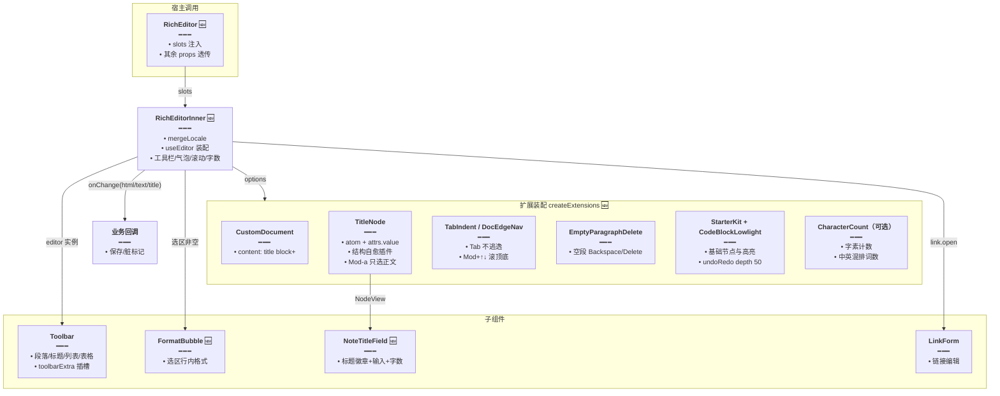
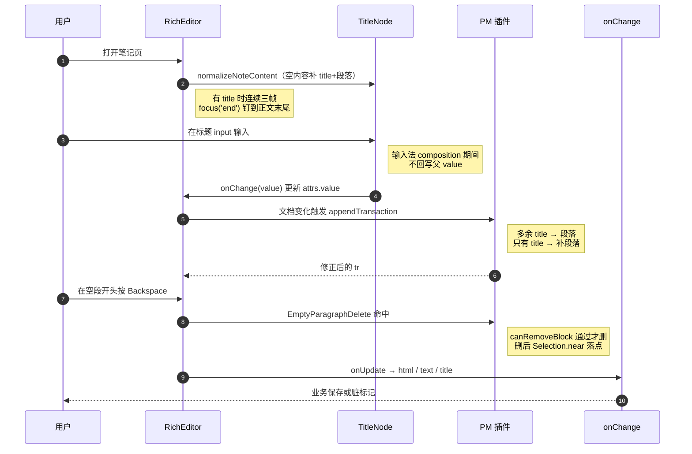

# 富文本编辑器实现（RichEditor + 扩展装配 + 笔记标题）

> 文档角色：本篇是 `@dnhyxc-ai/richtext-kit` **编辑器内核**的实现说明——`RichEditor` 组件如何把 TipTap 装配成「自带笔记标题、工具栏、气泡菜单、字数统计」的成品，扩展层如何用自定义 Document / 键盘快捷键解决标题 atom 与空段落删除的边界问题，以及文案如何与业务语言解耦。
>
> 延伸阅读：
> - 分发层（三入口、slots、构建、发布）：[富文本套件包化.md](./富文本套件包化.md)
> - 图片插入与链接编辑：[编辑器图片与链接.md](./编辑器图片与链接.md)
> - 只读预览与灯箱：[富文本预览与图片灯箱.md](./富文本预览与图片灯箱.md)
> - 长文分窗编辑：[长文窗口化渲染.md](./长文窗口化渲染.md)

## 1. 背景与目标

改动前，业务侧要用富文本就得自己拼 TipTap：手写扩展数组、自己处理「标题只能是文档首块」、自己补「空段落删不掉」的键盘行为、自己接字数与文案。同类页面各写一份，行为很快漂移。

本轮把编辑器收敛成一个成品组件，要解决的问题：

1. **一次装配**：`RichEditor` 一个组件同时提供工具栏、气泡菜单、正文滚动区、字数脚注、笔记标题字段，业务只需管 `content` / `onChange`。
2. **标题即文档首块**：用自定义 `title` atom 节点 + 自定义 `Document`（`content: 'title block+'`）保证结构，避免「标题」用普通段落被误删/误合并。
3. **键盘行为可控**：Tab 在列表里下沉、在正文插入缩进；Cmd/Ctrl+↑↓ 滚到顶/底且光标落点正确；空段落 Backspace/Delete 能真正删掉；Cmd/Ctrl+A 只选正文，避开标题 input。
4. **文案可替换**：所有 UI 文案集中在 `zhCN` / `enUS`，业务可传入 `Partial<RichEditorLocale>` 覆盖，不写死中文。
5. **热路径不浪费**：`onUpdate` 不序列化 JSON；无字数 UI 且无上限时不挂 `CharacterCount`（避免每次按键跑 `Intl.Segmenter`）。

## 2. 改动范围

| 文件 | 改动 | 角色 |
| --- | --- | --- |
| `packages/richtext-kit/src/editor/index.tsx` | **新增** | `RichEditor` / `RichEditorInner` / `CharCount` / `mergeLocale`，对外导出面 |
| `packages/richtext-kit/src/editor/extensions/index.ts` | **新增** | `createExtensions`、`TabIndent`、`DocEdgeNav`、`CustomDocument` |
| `packages/richtext-kit/src/editor/extensions/EmptyParagraphDelete.ts` | **新增** | 空段落 Backspace/Delete 直接删块 |
| `packages/richtext-kit/src/editor/title/TitleNode.ts` | **新增** | `title` atom 节点、结构自愈插件、`Mod-a`、`normalizeNoteContent`、`indentEditor`、`focusAfterTitle` |
| `packages/richtext-kit/src/editor/title/NoteTitleField.tsx` | **新增** | 标题输入外观（徽章 + 输入 + 字数），输入法安全 |
| `packages/richtext-kit/src/editor/title/Title.tsx` | **新增** | TipTap NodeView 包装 `NoteTitleField` |
| `packages/richtext-kit/src/editor/toolbar/Toolbar.tsx` | **新增** | 顶部工具栏（段落/标题/列表/表格/代码语言/对齐/图片/撤销等） |
| `packages/richtext-kit/src/editor/toolbar/FormatBubble.tsx` | **新增** | 选区气泡菜单（粗体/斜体/下划线/高亮/链接） |
| `packages/richtext-kit/src/editor/locale.ts` | **新增** | `zhCN` / `enUS` / `RichEditorLocale` / `richEditorLocaleOf` |
| `packages/richtext-kit/src/editor/types.ts` | **新增** | `RichEditorProps`、`CreateExtensionsOptions`、`RichEditorChangePayload` |
| `packages/richtext-kit/src/editor/code/{index,languages}.ts` | **新增** | 代码块语言清单与导出 |
| `packages/richtext-kit/src/editor/styles.css`、`src/styles/editor.css` | **新增** | 编辑器视觉样式（最终由 build-css 合成） |

## 3. 实现思路

1. **内外分层**：`RichEditor` 只负责包 `RichTextKitProvider`，真正的实现是 `RichEditorInner`。这样 hook 能无条件调用，不存在「Provider 在自身 return 里」的矛盾；同时 slots 对内部所有子组件可见。
2. **标题用 atom 而非文本块**：`title` 设 `atom: true`、`selectable: false`、`draggable: false`，节点内容由 NodeView 里的原生 `<input>` 维护（存在 `attrs.value`）。好处是标题永远不会被正文的合并/拆分逻辑破坏；代价是需要插件补「结构自愈」与「全选只选正文」。
3. **自定义 Document 限定结构**：`Document.extend({ content: 'title block+' })` 让 Schema 层面就禁止「无正文」——只有 atom 时 GapCursor 看起来有光标但打不了字，这是被反复踩过的坑，所以在结构中强制至少一个 block。
4. **结构自愈插件**：`appendTransaction` 在 doc 变化时把多余 title 替换成段落、在只有 title 时补一段；在选区变化时只做「非法选区纠正」。分开判断是为了避免每次移动光标都全量扫节点。
5. **焦点策略**：有 title 且自动聚焦时，创建后连续三帧把光标钉到正文末尾（NodeView 挂载会打乱首次落点）；`Mod-a` 只选正文区间，让浏览器绘制原生选区高亮；`Mod-ArrowUp` 特意从 `title.nodeSize + 1` 开始选，而不是 `focus('start')`，否则会被 atom 纠正逻辑拉到文末。
6. **Tab 不逃逸**：`TabIndent` 优先级设为 1000 覆盖默认行为——列表内 `sinkListItem`，否则插入 `\t`；代码块内返回 `false` 交还给 CodeBlockLowlight 自带的缩进。这样 Tab 永远不会跳到标题 input。
7. **空段落专项处理**：`EmptyParagraphDelete` 只处理「光标在空段开头按 Backspace」「光标在空段末尾按 Delete」两种情况，并先用 `canRemoveBlock` 保证删完仍满足最少块数（有标题时至少 2 块）。这是原子节点旁原生 Backspace 失效的标准补丁。
8. **字数与词数口径**：`CharacterCount` 的 `textCounter` 用 `Intl.Segmenter('zh', { granularity: 'grapheme' })` 按字素计数（emoji、组合字符不会被算成多个）；`wordCounter` 把中文按「字」计、其余按空白分词，两个口径相加——符合中英混排笔记的直觉。仅在 `showCharCount || maxLength != null` 时挂载。
9. **热路径克制**：`onUpdate` 只取 `getHTML()`、`getText({ blockSeparator: '\n\n' })` 与标题文本，不调 `getJSON()`；`json` 字段在类型里标为可选，需要时业务自己在 `extraExtensions` 里处理。
10. **输入法安全**：`NoteTitleField` 用 `composing` ref 在 `compositionstart/end` 之间暂停受控回写，避免中文输入法拼字过程中被父组件 value 覆盖。





## 4. 关键代码对比与注释

> 本包为整包新增，以下各节均为「纯新增」，按 Skill 例外条款只贴「改动后」一块。

### 4.1 `RichEditorProps` 与 `CreateExtensionsOptions`

**改动后（纯新增）** · `packages/richtext-kit/src/editor/types.ts`（当前，约 L1–L84）

```typescript
// 引入 TipTap 类型：编辑器实例、扩展数组、JSON 文档结构
import type { Editor, Extensions, JSONContent } from '@tiptap/react';
// 引入 React 类型：插槽节点与滚动处理器
import type { ReactNode, UIEventHandler } from 'react';
// 引入插槽类型：UI 原始组件可被宿主替换
import type { RichTextKitSlots } from '../slots';
// 引入图片解析函数类型：粘贴/拖放/选图统一入口
import type { ResolveImageSrc } from './image';
// 引入文案类型：保证 locale 键完整
import type { RichEditorLocale } from './locale';

// 文本方向：auto 交给浏览器按内容判断，便于 RTL 混排
export type TextDirection = 'ltr' | 'rtl' | 'auto';

// 编辑器内容：HTML 字符串或 TipTap JSON
export type RichEditorContent = string | JSONContent;

// onChange 负载：只带热路径真正需要的三种序列化结果
export type RichEditorChangePayload = {
	// 当前 HTML：保存与预览都用它
	html: string;
	// 源码注释：按需；热路径默认不序列化 JSON
	/** 按需；热路径默认不序列化 JSON */
	// JSON 文档：仅业务显式需要时使用
	json?: JSONContent;
	// 纯文本：搜索摘要、字数外的统计用
	text: string;
	// 源码注释：文档首位 title 节点纯文本
	/** 文档首位 title 节点纯文本 */
	// 标题：列表展示与脏标记比较用
	title: string;
};

// 扩展装配参数：让宿主在不重写扩展数组的前提下微调行为
export type CreateExtensionsOptions = {
	// 占位文案：不传用 locale.placeholder
	placeholder?: string;
	// 源码注释：CharacterCount 上限；不传则只统计不限制
	/** CharacterCount 上限；不传则只统计不限制 */
	// 字数上限：传给 CharacterCount.limit
	maxLength?: number;
	// 源码注释：为 false 时不挂 CharacterCount（无字数 UI 且无上限时关掉，避免每键 Segmenter）
	/** 为 false 时不挂 CharacterCount（无字数 UI 且无上限时关掉，避免每键 Segmenter） */
	// 是否启用字数统计：性能开关
	characterCount?: boolean;
	// 源码注释：粘贴/拖放图片解析（默认 FileReader → data URL）
	/** 粘贴/拖放图片解析（默认 FileReader → data URL） */
	// 图片地址解析器引用：用 ref 保证扩展内始终拿到最新实现
	resolveImageSrcRef?: { current: ResolveImageSrc };
	// 源码注释：追加扩展（在默认扩展之后）
	/** 追加扩展（在默认扩展之后） */
	// 额外扩展：业务自定义节点放在最后，优先级最低
	extraExtensions?: Extensions;
	// 源码注释：完全替换默认扩展列表
	/** 完全替换默认扩展列表 */
	// 完全接管：给了它就不再装配默认扩展
	extensions?: Extensions;
	// 源码注释：是否显示笔记标题节点（默认 true）
	/** 是否显示笔记标题节点（默认 true） */
	// 标题开关：关掉后文档结构退化为普通 block
	showTitle?: boolean;
	// 源码注释：图片拖拽缩放（默认 false：长文下 NodeView/监听开销大）
	/** 图片拖拽缩放（默认 false：长文下 NodeView/监听开销大） */
	// 图片缩放：长文场景建议保持关闭
	imageResize?: boolean;
	// 源码注释：表格列宽拖拽（默认 false：同上）
	/** 表格列宽拖拽（默认 false：同上） */
	// 表格列宽：同上，默认关闭
	tableResizable?: boolean;
};

// 组件 props：业务唯一需要理解的契约
export type RichEditorProps = {
	// 源码注释：受控内容（HTML 或 JSON）
	/** 受控内容（HTML 或 JSON） */
	// 受控值：与 defaultContent 二选一
	content?: RichEditorContent;
	// 源码注释：非受控初始内容
	/** 非受控初始内容 */
	// 初始值：只读一次
	defaultContent?: RichEditorContent;
	// 变更回调：html/text/title 三件套
	onChange?: (payload: RichEditorChangePayload) => void;
	// 是否可编辑：false 时只读浏览
	editable?: boolean;
	// 自动聚焦：true / 'end' / 数字位置
	autofocus?: boolean | 'start' | 'end' | 'all' | number;
	// 占位文案：覆盖 locale 默认值
	placeholder?: string;
	// 外层容器类名：控制高度与圆角
	className?: string;
	// 正文区类名：控制排版密度
	editorClassName?: string;
	// 源码注释：字数上限（长文 CharacterCount）
	/** 字数上限（长文 CharacterCount） */
	// 上限值：达到后显示「已达字数上限」
	maxLength?: number;
	// 源码注释：默认文本方向；默认 auto 以支持 RTL
	/** 默认文本方向；默认 auto 以支持 RTL */
	// 方向：ltr / rtl / auto
	textDirection?: TextDirection;
	// 是否显示顶部工具栏
	showToolbar?: boolean;
	// 是否显示选区气泡菜单
	showBubbleMenu?: boolean;
	// 是否显示底部字数统计
	showCharCount?: boolean;
	// 源码注释：是否显示笔记标题节点（默认 true）
	/** 是否显示笔记标题节点（默认 true） */
	// 标题开关：长文页关掉后用外面的大标题
	showTitle?: boolean;
	// 源码注释：图片拖拽缩放（默认 false）
	/** 图片拖拽缩放（默认 false） */
	// 图片缩放开关
	imageResize?: boolean;
	// 源码注释：表格列宽拖拽（默认 false）
	/** 表格列宽拖拽（默认 false） */
	// 表格列宽开关
	tableResizable?: boolean;
	// 源码注释：覆盖 / 合并文案（默认中文）
	/** 覆盖 / 合并文案（默认中文） */
	// 部分文案：只传要改的键
	locale?: Partial<RichEditorLocale>;
	// 源码注释：完全替换默认扩展
	/** 完全替换默认扩展 */
	// 接管扩展：高级用法，慎用
	extensions?: Extensions;
	// 源码注释：在默认扩展后追加
	/** 在默认扩展后追加 */
	// 追加扩展：自定义节点/插件放这里
	extraExtensions?: Extensions;
	// 源码注释：工具栏尾部插槽，便于业务扩展
	/** 工具栏尾部插槽，便于业务扩展 */
	// 尾部内容：节点或按 editor 渲染的函数
	toolbarExtra?: ReactNode | ((editor: Editor) => ReactNode);
	// 源码注释：
	// 自定义图片上传：工具栏选图 / 粘贴 / 拖放都会走这里。
	// 不传则本地读成 base64 data URL（Tauri 桌面端可用）。
	/**
	 * 自定义图片上传：工具栏选图 / 粘贴 / 拖放都会走这里。
	 * 不传则本地读成 base64 data URL（Tauri 桌面端可用）。
	 */
	// 上传函数：返回可直接放进 img src 的地址
	onUploadImage?: ResolveImageSrc;
	// 创建完成回调：业务拿 editor 做命令调用
	onCreate?: (editor: Editor) => void;
	// 源码注释：正文 ScrollArea 滚动
	/** 正文 ScrollArea 滚动 */
	// 滚动回调：长文窗口化据此计算窗口起点
	onBodyScroll?: UIEventHandler<HTMLDivElement>;
	// 源码注释：自定义包裹 EditorContent（长文外层虚拟滚动用）
	/** 自定义包裹 EditorContent（长文外层虚拟滚动用） */
	// 正文渲染钩子：长文用它插入标题与绝对定位偏移
	renderBody?: (editorContent: ReactNode) => ReactNode;
	// 源码注释：覆盖默认薄 UI（ScrollArea / Button / Input / ImagePreview）
	/** 覆盖默认薄 UI（ScrollArea / Button / Input / ImagePreview） */
	// 插槽覆盖：只传要替换的原语
	slots?: Partial<RichTextKitSlots>;
};
```

**变更摘要**：纯新增。props 刻意「少而全」——业务只需 `content` / `onChange`，其余都是可选微调；扩展装配参数与 props 分离，便于脱离组件单独建 editor。

### 4.2 `RichEditorInner`：装配主体

**改动后（纯新增）** · `packages/richtext-kit/src/editor/index.tsx`（当前，约 L22–L296）

```tsx
// 引入文本选区判定：气泡菜单只对「真实文本选区」出现
import { isTextSelection } from '@tiptap/core';
// 引入编辑器实例类型
import type { Editor } from '@tiptap/react';
// 引入 React 绑定：内容容器、上下文、创建与状态订阅
import {
	// 渲染编辑区
	EditorContent,
	// 向 NodeView 等深层组件提供 editor
	EditorContext,
	// 创建编辑器实例
	useEditor,
	// 订阅编辑器状态（字数）
	useEditorState,
} from '@tiptap/react';
// 引入气泡菜单：选区上方浮层
import { BubbleMenu } from '@tiptap/react/menus';
// 引入 React hooks
import { useCallback, useEffect, useMemo, useRef } from 'react';
// 引入类名合并
import { cn } from '../cn';
// 引入插槽 Provider：包住内部实现
import { RichTextKitProvider } from '../slots';
// 引入滚动区薄封装
import { ScrollArea } from '../ui/scroll-area';
// 引入扩展装配
import { createExtensions } from './extensions';
// 引入图片工具与解析类型
import { fileToDataUrl, type ResolveImageSrc } from './image';
// 引入链接表单与链接编辑器 hook
import { LinkForm, useLinkEditor } from './link';
// 引入文案与默认中文
import { type RichEditorLocale, zhCN } from './locale';
// 引入标题工具：取标题文本、空内容归一
import { getDocTitleText, normalizeNoteContent } from './title';
// 引入工具栏与气泡菜单
import { FormatBubble, Toolbar } from './toolbar';
// 引入 props 类型
import type { RichEditorProps } from './types';

// 合并文案：以 zhCN 为底，业务覆盖优先
function mergeLocale(
	// 业务传入的部分文案
	partial?: Partial<RichEditorLocale>,
	// 基底文案：默认中文
	base: RichEditorLocale = zhCN,
	// 返回完整文案表
): RichEditorLocale {
	// 展开基底后覆盖：缺键自动回落中文
	return { ...base, ...partial };
}

// 字数脚注：订阅 characterCount 存储，避免整树重渲染
function CharCount({
	// 编辑器实例
	editor,
	// 文案表
	locale,
	// 上限：用于「x / limit」与超限提示
	maxLength,
}: {
	// 实例类型
	editor: Editor;
	// 文案类型
	locale: RichEditorLocale;
	// 可选上限
	maxLength?: number;
}) {
	// 只订阅字数与词数：selector 返回新对象时 TipTap 会做浅比较
	const count = useEditorState({
		// 订阅目标
		editor,
		// 选择器：从扩展存储读计数
		selector: ({ editor: e }) => {
			// 取字符统计扩展存储；未挂载时为 undefined
			const storage = e.storage.characterCount as
				// 存储形状：两个取数函数
				| { characters: () => number; words: () => number }
				// 未启用时的类型
				| undefined;
			// 返回当前计数快照
			return {
				// 字素数：emoji 与组合字符按一个算
				chars: storage?.characters() ?? 0,
				// 词数：中文按字、其他按空白分词
				words: storage?.words() ?? 0,
			};
		},
	});

	// 是否已达上限：只在传入 maxLength 时判断
	const over = maxLength != null && count.chars >= maxLength;

	// 渲染脚注
	return (
		// 超限时追加 is-limit 类名，交给 CSS 变红
		<div className={cn('rich-editor-footer', over && 'is-limit')}>
			{/* 词数展示 */}
			<span>
				{/* 词数 + 文案 */}
				{count.words} {locale.words}
			</span>
			{/* 字符数展示 */}
			<span>
				{/* 当前字符数 */}
				{count.chars}
				{/* 有上限时追加「/ 上限」 */}
				{maxLength != null ? ` / ${maxLength}` : ''} {locale.chars}
				{/* 超限时追加提示文案 */}
				{over ? ` · ${locale.limitReached}` : ''}
			</span>
		</div>
	);
}

// 源码注释：
// TipTap 二次封装富文本编辑器。
// - 默认中文 UI
// - 内置 Formatting / 表格 / 本地图片(选图·粘贴·拖放) / 任务 / 字数 / RTL
// - 通过 extraExtensions / toolbarExtra / onUploadImage / slots 扩展
/**
 * TipTap 二次封装富文本编辑器。
 * - 默认中文 UI
 * - 内置 Formatting / 表格 / 本地图片(选图·粘贴·拖放) / 任务 / 字数 / RTL
 * - 通过 extraExtensions / toolbarExtra / onUploadImage / slots 扩展
 */
// 内部实现：不含 slots 形参，由外层 Provider 注入
function RichEditorInner({
	// 受控内容
	content,
	// 非受控初始内容：默认空串
	defaultContent = '',
	// 变更回调
	onChange,
	// 是否可编辑
	editable = true,
	// 默认自动聚焦
	autofocus = true,
	// 占位文案
	placeholder,
	// 外层类名
	className,
	// 正文类名
	editorClassName,
	// 字数上限
	maxLength,
	// 文本方向：默认自动
	textDirection = 'auto',
	// 默认显示工具栏
	showToolbar = true,
	// 默认显示气泡菜单
	showBubbleMenu = true,
	// 默认显示字数
	showCharCount = true,
	// 默认显示标题
	showTitle = true,
	// 图片缩放默认关
	imageResize = false,
	// 表格列宽默认关
	tableResizable = false,
	// 业务文案
	locale: localePartial,
	// 完全替换扩展
	extensions,
	// 追加扩展
	extraExtensions,
	// 工具栏尾部
	toolbarExtra,
	// 图片上传
	onUploadImage,
	// 创建回调
	onCreate,
	// 滚动回调
	onBodyScroll,
	// 正文渲染钩子
	renderBody,
// 去掉 slots：由外层 Provider 负责
}: Omit<RichEditorProps, 'slots'>) {
	// 合并文案：partial 变化才重算
	const locale = useMemo(() => mergeLocale(localePartial), [localePartial]);

	// 图片解析器引用：默认本地读 data URL
	const resolveImageSrcRef = useRef<ResolveImageSrc>(fileToDataUrl);
	// 每次渲染刷新实现：保证粘贴/拖放扩展拿到最新 onUploadImage
	resolveImageSrcRef.current = async (file) => {
		// 业务提供了上传函数则优先用
		if (onUploadImage) return onUploadImage(file);
		// 否则本地转 base64，桌面端无需后端即可插图
		return fileToDataUrl(file);
	};

	// 回调引用：避免 useEditor 因回调身份变化而重建编辑器
	const onChangeRef = useRef(onChange);
	// 同步最新回调
	onChangeRef.current = onChange;

	// 创建回调引用
	const onCreateRef = useRef(onCreate);
	// 同步最新创建回调
	onCreateRef.current = onCreate;

	// 源码注释：无字数 UI 且无上限时不挂 CharacterCount，避免每键 Segmenter
	// 只有需要展示字数或需要限制时才启用统计
	const enableCharacterCount = showCharCount || maxLength != null;

	// 创建编辑器：options 只在首帧生效
	const editor = useEditor({
		// SSR 场景不立即渲染：避免服务端无 DOM 报错
		immediatelyRender: false,
		// 扩展装配：把组件级开关翻译成扩展配置
		extensions: createExtensions({
			// 占位文案：props 优先于 locale
			placeholder: placeholder ?? locale.placeholder,
			// 字数上限
			maxLength,
			// 是否挂字数扩展
			characterCount: enableCharacterCount,
			// 完全替换扩展
			extensions,
			// 追加扩展
			extraExtensions,
			// 图片解析器
			resolveImageSrcRef,
			// 是否显示标题节点
			showTitle,
			// 图片缩放
			imageResize,
			// 表格列宽
			tableResizable,
		}),
		// 初始内容：有标题时补成合法笔记结构
		content: showTitle
			// 归一：空串或 <p></p> 变成 title + 段落
			? normalizeNoteContent(content ?? defaultContent)
			// 无标题模式直接用原始内容
			: (content ?? defaultContent ?? ''),
		// 可编辑态
		editable,
		// 自动聚焦
		autofocus,
		// 文本方向
		textDirection,
		// 编辑器 DOM 属性
		editorProps: {
			// 透传属性
			attributes: {
				// 基础类名 + 业务正文类名
				class: cn('tiptap focus:outline-none', editorClassName),
				// 语言标记：影响浏览器断行与拼写检查
				lang: 'zh-CN',
			},
		},
		// 创建完成：处理焦点落点
		onCreate: ({ editor: e }) => {
			// 把光标钉到正文末尾的幂等操作
			const focusBodyEnd = () => {
				// 已销毁直接返回：异步帧里实例可能已卸载
				if (e.isDestroyed) return;
				// 源码注释：有 title 节点，或显式 autofocus=end：都钉到正文末尾
				if (
					// 显式要求末尾
					autofocus === 'end' ||
					// 或文档首位是标题：避免光标停在标题 input
					e.state.doc.firstChild?.type.name === 'title'
				) {
					// 聚焦到文档末尾
					e.commands.focus('end');
				}
			};
			// 首帧先尝试一次
			focusBodyEnd();
			// 源码注释：Title NodeView 挂载可能打乱选区，下一帧再钉到末尾
			requestAnimationFrame(() => {
				// 第二帧纠正
				focusBodyEnd();
				// 第三帧兜底：等绝对定位与 NodeView 布局稳定
				requestAnimationFrame(focusBodyEnd);
			});
			// 通知业务：编辑器可用
			onCreateRef.current?.(e);
		},
		// 内容更新：热路径，只取必要序列化结果
		onUpdate: ({ editor: e }) => {
			// 取最新回调
			const cb = onChangeRef.current;
			// 没有回调就不做任何序列化，省开销
			if (!cb) return;
			// 源码注释：热路径不做 getJSON（学习笔记等只用 html/text/title）
			// 回调三件套
			cb({
				// HTML：保存与预览都直接用
				html: e.getHTML(),
				// 纯文本：块之间用空行分隔，便于摘要
				text: e.getText({ blockSeparator: '\n\n' }),
				// 标题：从 title atom 的 attrs 读
				title: getDocTitleText(e.state.doc),
			});
		},
	});

	// 链接编辑状态机：草稿、打开、应用、移除
	const link = useLinkEditor(editor);
	// 草稿引用：气泡菜单判断用，避免闭包拿到旧值
	const linkDraftRef = useRef(link.draft);
	// 同步最新草稿
	linkDraftRef.current = link.draft;

	// 源码注释：仅有真实文本选区时显示；补回 TipTap 默认的空块判断，避免空段落误显
	/** 气泡菜单显隐判定 */
	const shouldShowBubble = useCallback(
		// 参数由 BubbleMenu 注入
		({
			// 编辑器实例
			editor: e,
			// 视图：判断是否聚焦
			view,
			// 状态：取文档与选区
			state,
			// 选区起点
			from,
			// 选区终点
			to,
		}: {
			// 实例类型
			editor: Editor;
			// 视图最小契约：只用到 hasFocus
			view: { hasFocus: () => boolean };
			// 状态最小契约
			state: {
				// 取区间文本
				doc: { textBetween: (a: number, b: number) => string };
				// 选区是否折叠
				selection: { empty: boolean };
			};
			// 起点
			from: number;
			// 终点
			to: number;
		}) => {
			// 链接表单打开或只读时不显示气泡
			if (linkDraftRef.current || !e.isEditable) return false;
			// 未聚焦不显示：避免切窗后残留
			if (!view.hasFocus()) return false;
			// 取文档与选区
			const { doc, selection } = state;
			// 非文本选区、折叠、空区间、纯空白都不显示
			if (
				// 必须是文本选区
				!isTextSelection(selection) ||
				// 折叠选区没有可格式化内容
				selection.empty ||
				// 起终相同同样无内容
				from === to ||
				// 区间文本长度为 0（如仅空白）
				!doc.textBetween(from, to).length
			) {
				// 不显示
				return false;
			}
			// 图片与代码块上不弹行内格式菜单
			if (e.isActive('image') || e.isActive('codeBlock')) return false;
			// 其余情况显示
			return true;
		},
		// 无外部依赖：内部只读 ref
		[],
	);

	// 可编辑态同步：支持运行时切换只读
	useEffect(() => {
		// 编辑器尚未创建
		if (!editor) return;
		// 写入最新可编辑态
		editor.setEditable(editable);
		// editor 或 editable 变化时重跑
	}, [editor, editable]);

	// 源码注释：受控同步：仅在外部 content 与当前不一致时写入，避免打断输入
	useEffect(() => {
		// 未创建或非受控模式直接跳过
		if (!editor || content === undefined) return;
		// 外部值序列化：字符串直接用，对象转 JSON 比较
		const next =
			// 字符串保持原样
			typeof content === 'string' ? content : JSON.stringify(content);
		// 当前值序列化：与外部值同口径
		const current =
			// 字符串比 HTML
			typeof content === 'string'
				? editor.getHTML()
				// 对象比 JSON
				: JSON.stringify(editor.getJSON());
		// 完全一致则不同步：否则每次输入都会被 setContent 打断
		if (next === current) return;
		// 归一后写入：空内容自动补标题结构
		editor.commands.setContent(normalizeNoteContent(content), {
			// 不触发 onUpdate：这是外部同步而非用户编辑
			emitUpdate: false,
		});
		// 依赖 content 与实例
	}, [editor, content]);

	// 编辑器上下文：供 NodeView 深层组件取实例
	const ctx = useMemo(() => ({ editor }), [editor]);

	// 工具栏尾部内容：支持函数形式，把 editor 交给业务
	const extra = useMemo(() => {
		// 实例未就绪时不渲染扩展位
		if (!editor) return null;
		// 函数形式：调用后取节点
		return typeof toolbarExtra === 'function'
			? toolbarExtra(editor)
			: toolbarExtra;
		// 实例或插槽变化时重算
	}, [editor, toolbarExtra]);

	// 实例尚未创建：先渲染空，避免半初始化 UI
	if (!editor) return null;

	// 渲染完整编辑器
	return (
		// 提供 editor 上下文
		<EditorContext.Provider value={ctx}>
			{/* 外层容器：承载工具栏、表单、正文与脚注 */}
			<div className={cn('rich-editor rounded-r-md', className)} lang="zh-CN">
				{/* 工具栏：可按开关隐藏 */}
				{showToolbar && (
					// 传入实例、文案、上传、链接开关与扩展位
					<Toolbar
						// 编辑器实例
						editor={editor}
						// 文案
						locale={locale}
						// 图片上传：工具栏选图复用同一函数
						onUploadImage={onUploadImage}
						// 打开链接表单
						onOpenLink={link.open}
						// 链接表单是否已打开：按钮高亮
						linkOpen={!!link.draft}
						// 业务扩展位
						extra={extra}
					/>
				)}

				{/* 链接表单：有草稿才显示 */}
				{link.draft && (
					// 表单受控：href / 应用 / 移除 / 关闭
					<LinkForm
						// 文案
						locale={locale}
						// 当前地址
						href={link.draft.href}
						// 地址变更
						onHrefChange={link.setHref}
						// 确认应用
						onApply={link.apply}
						// 移除链接
						onRemove={link.remove}
						// 取消关闭
						onClose={link.close}
						// 无选区时提示先选文字
						hint={link.draft.range ? undefined : locale.linkEmptyHint}
					/>
				)}

				{/* 气泡菜单：选区上方浮层 */}
				{showBubbleMenu && (
					// 绑定实例与显隐判定
					<BubbleMenu
						// 编辑器实例
						editor={editor}
						// 显隐判定
						shouldShow={shouldShowBubble}
						// 定位：上方、偏移 8px、空间不足自动翻转
						options={{ placement: 'top', offset: 8, flip: true }}
					>
						{/* 行内格式按钮组 */}
						<FormatBubble
							// 实例
							editor={editor}
							// 文案
							locale={locale}
							// 打开链接表单
							onOpenLink={link.open}
						/>
					</BubbleMenu>
				)}

				{/* 正文滚动区：滚动回调交给长文窗口化 */}
				<ScrollArea className="rich-editor-body" onScroll={onBodyScroll}>
					{/* 有自定义渲染钩子则包裹 EditorContent */}
					{renderBody ? (
						// 长文用它插入文档流标题与偏移容器
						renderBody(<EditorContent editor={editor} spellCheck="false" />)
					) : (
						// 默认直接渲染编辑区，关闭拼写检查避免编辑态波浪线
						<EditorContent editor={editor} spellCheck="false" />
					)}
				</ScrollArea>

				{/* 字数脚注：可按开关隐藏 */}
				{showCharCount && (
					// 传入实例、文案与上限
					<CharCount editor={editor} locale={locale} maxLength={maxLength} />
				)}
			</div>
		</EditorContext.Provider>
	);
}
```

**变更摘要**：纯新增。三处关键取舍写在实现里：`useRef` 持有回调（避免重建编辑器）、三帧聚焦（对抗 NodeView 布局）、受控同步先比较再写入（不打断输入）。

### 4.3 `RichEditor` 外层与导出面

**改动后（纯新增）** · `packages/richtext-kit/src/editor/index.tsx`（当前，约 L298–L330）

```tsx
// 对外组件：只有它包 Provider
export function RichEditor(props: RichEditorProps) {
	// 拆出 slots，其余透传
	const { slots, ...rest } = props;
	// 用 Provider 包住内部实现：深层组件都能取到插槽
	return (
		// 注入部分覆盖的插槽
		<RichTextKitProvider slots={slots}>
			{/* 内部实现：不含 Provider，保证 hooks 无条件调用 */}
			<RichEditorInner {...rest} />
		</RichTextKitProvider>
	);
}

// 默认导出：便于 `import RichEditor from` 写法
export default RichEditor;
// 导出编辑器实例类型：业务拿 onCreate 参数时需要
export type { Editor } from '@tiptap/react';
// 导出代码语言类型
export type { CodeLanguage } from './code';
// 导出语言常量：代码块下拉用
export { CODE_LANGUAGES } from './code';
// 导出扩展装配：脱离组件自建 editor 时复用
export { createExtensions } from './extensions';
// 导出图片解析类型
export type { ResolveImageSrc } from './image';
// 导出本地图片工具：不传 onUploadImage 时自己也能转 base64
export { fileToDataUrl, pickImageFile } from './image';
// 导出文案类型
export type { RichEditorLocale } from './locale';
// 导出两套文案与语言选择器
export { enUS, richEditorLocaleOf, zhCN } from './locale';
// 导出标题相关能力：空文档常量、取标题、标题字段、归一化、节点
export {
	// 空笔记文档：title + 空段落
	EMPTY_NOTE_DOC,
	// 从文档取标题文本
	getDocTitleText,
	// 标题输入外观：长文窗外标题复用
	NoteTitleField,
	// 空内容归一化
	normalizeNoteContent,
	// title atom 节点
	TitleNode,
} from './title';
// 导出工具栏按钮原语：业务自定义工具时保持视觉一致
export { Btn } from './toolbar';
// 导出公共类型
export type {
	// 扩展装配参数
	CreateExtensionsOptions,
	// 变更负载
	RichEditorChangePayload,
	// 内容类型
	RichEditorContent,
	// 组件 props
	RichEditorProps,
	// 文本方向
	TextDirection,
} from './types';
```

**变更摘要**：纯新增。导出面「组件 + 扩展 + 节点 + 文案 + 类型」齐全，但工具函数只挑真正可复用的（图片、标题、归一化）。

### 4.4 `createExtensions`：扩展装配与两个键盘扩展

**改动后（纯新增）** · `packages/richtext-kit/src/editor/extensions/index.ts`（当前，约 L1–L200）

```typescript
// 引入 Extension 工厂：写无 Schema 的纯行为扩展
import { Extension } from '@tiptap/core';
// 引入代码块高亮扩展
import CodeBlockLowlight from '@tiptap/extension-code-block-lowlight';
// 引入 Document 扩展：用于自定义顶层结构
import Document from '@tiptap/extension-document';
// 引入高亮标记
import Highlight from '@tiptap/extension-highlight';
// 引入图片节点
import Image from '@tiptap/extension-image';
// 引入任务列表与任务项
import { TaskItem, TaskList } from '@tiptap/extension-list';
// 引入占位扩展
import { Placeholder } from '@tiptap/extension-placeholder';
// 引入表格套件：一次注册 table / row / cell / header
import { TableKit } from '@tiptap/extension-table';
// 引入文本对齐
import TextAlign from '@tiptap/extension-text-align';
// 引入字数统计扩展
import { CharacterCount } from '@tiptap/extensions';
// 引入扩展数组类型
import type { Extensions } from '@tiptap/react';
// 引入入门套件
import StarterKit from '@tiptap/starter-kit';
// 引入 lowlight：语法高亮引擎与常用语言集
import { common, createLowlight } from 'lowlight';
// 引入图片工具与上传扩展
import { fileToDataUrl, ImageUpload } from '../image';
// 引入默认文案：占位与标题提示
import { zhCN } from '../locale';
// 引入缩进工具与标题节点
import { indentEditor, TitleNode } from '../title';
// 引入装配参数类型
import type { CreateExtensionsOptions } from '../types';
// 引入空段落删除扩展
import { EmptyParagraphDelete } from './EmptyParagraphDelete';

// 创建高亮实例：common 覆盖主流语言，包体与能力平衡
const lowlight = createLowlight(common);

// 源码注释：Tab：列表下沉 / 正文插入缩进；并吞掉默认焦点切换（避免跳到标题 input）
/** Tab 缩进扩展 */
const TabIndent = Extension.create({
	// 扩展名：调试与冲突排查用
	name: 'tabIndent',
	// 优先级 1000：高于默认键盘映射，先拿到 Tab
	priority: 1000,
	// 注册快捷键
	addKeyboardShortcuts() {
		// 返回 键 → 处理器 映射
		return {
			// Tab：缩进
			Tab: ({ editor }) => {
				// 代码块内交给 CodeBlockLowlight 自己的 tabSize 逻辑
				if (editor.isActive('codeBlock')) return false;
				// 列表内下沉、否则插入 \t
				return indentEditor(editor);
			},
			// Shift+Tab：反向缩进
			'Shift-Tab': ({ editor }) => {
				// 代码块内同样不接管
				if (editor.isActive('codeBlock')) return false;
				// 有序/无序列表项上提
				if (editor.commands.liftListItem('listItem')) return true;
				// 任务列表项上提
				if (editor.commands.liftListItem('taskItem')) return true;
				// 其余情况吞掉按键：避免焦点跳到标题 input
				return true;
			},
		};
	},
});

// 滚动编辑器视口：跨框架拿不到 ScrollArea 实例，只能用 DOM 查找
function scrollEditorViewport(
	// 编辑器最小契约：只要能取 DOM
	editor: { view: { dom: Element } },
	// 滚动目标：顶部或底部
	to: 'top' | 'bottom',
) {
	// 向上找滚动视口：默认 ScrollArea 用这个 data-slot 标记
	const vp = editor.view.dom.closest(
		// 与 slots 默认实现的属性保持一致
		'[data-slot="scroll-area-viewport"]',
	// 收窄为可设 scrollTop 的元素
	) as HTMLElement | null;
	// 找不到视口（宿主自定义滚动容器）就不滚动，交回默认行为
	if (!vp) return;
	// 顶部即 0，底部即内容高度
	vp.scrollTop = to === 'top' ? 0 : vp.scrollHeight;
}

// 源码注释：Cmd/Ctrl+↑↓：滚到顶/底并落光标（避开 title atom 把 ↑ 纠到文末）
/** 文档首尾导航扩展 */
const DocEdgeNav = Extension.create({
	// 扩展名
	name: 'docEdgeNav',
	// 注册快捷键
	addKeyboardShortcuts() {
		// 返回映射
		return {
			// Cmd/Ctrl+↑：到文档开头
			'Mod-ArrowUp': ({ editor }) => {
				// 代码块内保留原生行为：跳到块首
				if (editor.isActive('codeBlock')) return false;
				// 取文档首块
				const title = editor.state.doc.firstChild;
				// 有标题则跳过 atom（nodeSize + 1 才是正文起点），否则从 1 开始
				const start = title?.type.name === 'title' ? title.nodeSize + 1 : 1;
				// 起点在合法范围内才设选区
				if (start <= editor.state.doc.content.size) {
					// 设光标到正文开头并聚焦
					editor.chain().setTextSelection(start).focus().run();
				} else {
					// 空文档：退回内置 focus('start')
					editor.commands.focus('start');
				}
				// 同步把视口滚到顶
				scrollEditorViewport(editor, 'top');
				// 已处理
				return true;
			},
			// Cmd/Ctrl+↓：到文档末尾
			'Mod-ArrowDown': ({ editor }) => {
				// 代码块内保留原生行为
				if (editor.isActive('codeBlock')) return false;
				// 光标到末尾
				editor.commands.focus('end');
				// 同步把视口滚到底
				scrollEditorViewport(editor, 'bottom');
				// 已处理
				return true;
			},
		};
	},
});

// 源码注释：首位固定 title，其后至少一段正文（避免仅有 atom 时 GapCursor 无法输入）
/** 自定义顶层结构：title + 至少一个 block */
const CustomDocument = Document.extend({
	// Schema 层面强制结构：不符合的内容会被规整
	content: 'title block+',
});

// 源码注释：组装默认扩展；业务可通过 extensions / extraExtensions 覆盖或追加
/**
 * 组装默认扩展；业务可通过 extensions / extraExtensions 覆盖或追加
 */
export function createExtensions(
	// 装配参数：全部可选
	options: CreateExtensionsOptions = {},
	// 返回扩展数组
): Extensions {
	// 完全接管模式：直接返回业务数组，不装配任何默认扩展
	if (options.extensions) return options.extensions;

	// 占位文案：参数优先，否则默认中文
	const placeholder = options.placeholder ?? zhCN.placeholder;
	// 图片解析器：无外部传入时默认本地读 base64
	const resolveImageSrcRef = options.resolveImageSrcRef ?? {
		// ref 的 current 即解析函数
		current: fileToDataUrl,
	};
	// 源码注释：默认开启；显式 false 时跳过（无字数 UI 且无上限）
	// 只有显式传 false 才关闭统计
	const withCharCount = options.characterCount !== false;
	// 源码注释：默认显示标题
	// 只有显式传 false 才关闭标题节点
	const withTitle = options.showTitle !== false;

	// 默认扩展列表：顺序即优先级参考
	const baseExtensions: Extensions = [
		// 有标题时先注册自定义 Document 与标题节点
		...(withTitle ? [CustomDocument, TitleNode] : []),
		// Tab 缩进
		TabIndent,
		// 首尾导航
		DocEdgeNav,
		// 空段落删除
		EmptyParagraphDelete,
		// 入门套件：段落、加粗、斜体、列表、引用等基础能力
		StarterKit.configure({
			// 有标题时禁用默认 document，避免与 CustomDocument 冲突
			document: withTitle ? false : undefined,
			// 末尾自动补段落：保证总有可输入位置
			trailingNode: {
				// 补的节点类型
				node: 'paragraph',
			},
			// 标题级别：1–5，不提供 h6（笔记场景用不到）
			heading: { levels: [1, 2, 3, 4, 5] },
			// 关闭内置代码块：改用 CodeBlockLowlight
			codeBlock: false,
			// 源码注释：TipTap 3：undoRedo（非 history）；长文降低深度，减轻内存与事务
			// 撤销栈深度：长文下 50 步足够，且显著省内存
			undoRedo: { depth: 50 },
			// 链接扩展配置
			link: {
				// 编辑态点击不跳转：避免误触离开
				openOnClick: false,
				// 自动识别裸链接
				autolink: true,
				// 无协议时补 https
				defaultProtocol: 'https',
				// 链接 DOM 属性
				HTMLAttributes: {
					// 防 window.opener 反向控制
					rel: 'noopener noreferrer',
					// 新标签打开
					target: '_blank',
				},
			},
		}),
		// 代码块 + 语法高亮
		CodeBlockLowlight.configure({
			// 高亮引擎实例
			lowlight,
			// 默认语言：未标注时按 JS 高亮
			defaultLanguage: 'javascript',
			// 允许 Tab 缩进
			enableTabIndentation: true,
			// 缩进宽度 2：与前端代码风格一致
			tabSize: 2,
			// 高亮 class：交给 hljs 主题
			HTMLAttributes: { class: 'hljs' },
		}),
		// 占位文案：按节点类型细化
		Placeholder.configure({
			// 占位函数：不同节点不同提示
			placeholder: ({ editor, node }) => {
				// 标题节点不显示占位：标题有自己的输入框提示
				if (withTitle && node.type.name === 'title') return '';
				// 标题区块显示「标题 N」
				if (node.type.name === 'heading') {
					// 拼接级别数字
					return `${zhCN.placeholderHeading} ${node.attrs.level}`;
				}
				// 显式忽略 editor：签名需要但本分支不用
				void editor;
				// 其余节点用通用占位
				return placeholder;
			},
			// 空编辑器时的 class：控制整体占位位置
			emptyEditorClass: 'is-editor-empty',
			// 空节点 class：控制单节点占位
			emptyNodeClass: 'is-empty',
			// 只在当前节点以空节点显示：避免整篇都是占位
			showOnlyCurrent: true,
			// 只读态不显示占位
			showOnlyWhenEditable: true,
		}),
		// 高亮：支持多色
		Highlight.configure({ multicolor: true }),
		// 文本对齐：只对标题与段落生效
		TextAlign.configure({
			// 生效节点
			types: ['heading', 'paragraph'],
			// 支持的四种对齐
			alignments: ['left', 'center', 'right', 'justify'],
		}),
		// 图片节点
		Image.configure({
			// 块级图片：独占一行，便于居中与缩放
			inline: false,
			// 允许 base64：桌面端本地插图无需上传
			allowBase64: true,
			// 图片 DOM 属性
			HTMLAttributes: {
				// 统一类名：样式与预览共用
				class: 'rich-editor-image',
				// 源码注释：内联间距/圆角：刷新后 MF @scope 样式常失效，不依赖 stylesheet
				// 内联兜底间距：避免样式表失效时图片贴字
				style: 'margin: 0.75em 0; border-radius: 0.5rem',
			},
			// 开启缩放时追加配置
			...(options.imageResize
				? {
						// 缩放能力
						resize: {
							// 启用拖拽缩放
							enabled: true,
							// 拖角保持比例：避免图片被压扁
							alwaysPreserveAspectRatio: true,
						},
					}
				// 关闭时不加任何字段
				: {}),
		}),
		// 图片上传：接管选图/粘贴/拖放
		ImageUpload.configure({ resolveSrcRef: resolveImageSrcRef }),
		// 表格套件：统一注册行列单元格
		TableKit.configure({
			// 表格配置
			table: { resizable: options.tableResizable === true },
		}),
		// 任务列表
		TaskList,
		// 任务项：允许嵌套子任务
		TaskItem.configure({ nested: true }),
		// 需要统计时才挂 CharacterCount
		...(withCharCount
			? [
					// 字数统计配置
					CharacterCount.configure({
						// 上限：无上限传 null
						limit: options.maxLength ?? null,
						// 字符计数：按字素切分，emoji 不会被算成多个
						textCounter: (text) =>
							// Segmenter 结果转数组取长度
							[
								// 按字形簇切分：最贴近「用户看到几个字」
								...new Intl.Segmenter('zh', {
									// 粒度：字素
									granularity: 'grapheme',
								}).segment(text),
							].length,
						// 词数：中文按字、其他按空白分词
						wordCounter: (text) => {
							// 匹配 CJK 统一表意文字（含扩展 A 与兼容区）
							const cjk =
								text.match(/[\u4e00-\u9fff\u3400-\u4dbf\uf900-\ufaff]/g)
									// 命中数量
									?.length ?? 0;
							// 去掉中文后用空白分词
							const latin = text
								// 把中文字符替换成空格，避免中英粘连
								.replace(/[\u4e00-\u9fff\u3400-\u4dbf\uf900-\ufaff]/g, ' ')
								// 按空白切分
								.split(/\s+/)
								// 过滤空串
								.filter(Boolean).length;
							// 两个口径相加：中英混排的直观词数
							return cjk + latin;
						},
					}),
				]
			// 不需要统计时为空数组
			: []),
		// 业务追加扩展：放在最后，权限最低
		...(options.extraExtensions ?? []),
	];

	// 返回组装结果
	return baseExtensions;
}
```

**变更摘要**：纯新增。`CustomDocument` + `StarterKit.document: false` 是标题结构的根；`TabIndent` 的 `priority: 1000` 与「代码块返回 false」是 Tab 行为正确的两个关键点。

### 4.5 `EmptyParagraphDelete`：空段落删除

**改动后（纯新增）** · `packages/richtext-kit/src/editor/extensions/EmptyParagraphDelete.ts`（当前，约 L1–L86）

```typescript
// 引入扩展工厂
import { Extension } from '@tiptap/core';
// 引入 ProseMirror 节点类型
import type { Node as PmNode } from '@tiptap/pm/model';
// 引入选区类型与文本选区
import { Selection, TextSelection } from '@tiptap/pm/state';

// 判断节点是否为「空段落」
function isEmptyParagraphNode(node: PmNode): boolean {
	// 只看段落：其他节点一律不算
	if (node.type.name !== 'paragraph') return false;
	// 完全无内容：标准空段
	if (node.content.size === 0) return true;
	// 源码注释：<p><br></p> 也算空行
	// 默认只含换行才算空
	let onlyBreaks = true;
	// 遍历子节点
	node.forEach((child) => {
		// 出现非 hardBreak 子节点即非空
		if (child.type.name !== 'hardBreak') onlyBreaks = false;
	});
	// 全是换行或本身为空
	return onlyBreaks;
}

// 源码注释：当前是否在空段落内
/** 命中空段落时返回删除区间 */
function emptyParagraphAt(selection: Selection) {
	// 必须是非折叠文本选区：Range 选区不能代表光标
	if (!(selection instanceof TextSelection) || !selection.empty) return null;
	// 取光标所在位置
	const { $from } = selection;
	// 取父节点
	const parent = $from.parent;
	// 父节点不是空段落直接不命中
	if (!isEmptyParagraphNode(parent)) return null;
	// 返回删除所需信息
	return {
		// 光标解析位置：用于取 parentOffset
		$from,
		// 父节点：用于取内容长度
		parent,
		// 段落起始位置：删除区间左端
		from: $from.before(),
		// 段落结束位置：起点 + 节点尺寸
		to: $from.before() + parent.nodeSize,
	};
}

// 源码注释：删掉后文档是否仍满足最少块数（有 title 时至少 title+1 块，否则至少 1 块）
/** 删除后结构是否仍合法 */
function canRemoveBlock(doc: {
	// 顶层子节点数量
	childCount: number;
	// 首块类型：判断是否有 title
	firstChild?: { type: { name: string } } | null;
	// 余量判断结果
}): boolean {
	// 有标题时最少 2 块（title + 正文），否则 1 块
	const min = doc.firstChild?.type.name === 'title' ? 2 : 1;
	// 严格大于最少块数才允许删
	return doc.childCount > min;
}

// 源码注释：
// 空段落卡在 title/文档开头与图片之间时，原生 Backspace 无法「并进」atom，表现为删不掉。
// 在空段开头 Backspace / 空段末尾 Delete 时直接删掉该段。
/**
 * 空段落删除扩展：补上 atom 旁原生 Backspace/Delete 失效的行为
 */
export const EmptyParagraphDelete = Extension.create({
	// 扩展名
	name: 'emptyParagraphDelete',

	// 注册按键
	addKeyboardShortcuts() {
		// 返回映射
		return {
			// Backspace：光标在空段开头时删段
			Backspace: ({ editor }) => {
				// 找当前空段
				const hit = emptyParagraphAt(editor.state.selection);
				// 光标不在段首则交回默认：段中退格应正常删字
				if (hit?.$from?.parentOffset !== 0) return false;
				// 删了会破坏最少块数则交回默认
				if (!canRemoveBlock(editor.state.doc)) return false;

				// 取删除区间
				const { from, to } = hit;
				// 链式执行
				return editor
					// 进入命令链
					.chain()
					// 自定义事务：删段并重设选区
					.command(({ tr, dispatch }) => {
						// 删除整个空段
						tr.delete(from, to);
						// 删除后位置可能越界，取最小值兜底
						const pos = Math.min(from, tr.doc.content.size);
						// 就近落点：优先向后找可放光标的位置
						tr.setSelection(Selection.near(tr.doc.resolve(pos), 1));
						// 派发事务：dispatch 为空表示只试算不执行
						dispatch?.(tr);
						// 命令已处理
						return true;
					})
					// 执行
					.run();
			},
			// Delete：光标在空段末尾时删段
			Delete: ({ editor }) => {
				// 找当前空段
				const hit = emptyParagraphAt(editor.state.selection);
				// 不在空段内交回默认
				if (!hit) return false;
				// 光标不在段末则交回默认：段中 Delete 应正常删后面的字
				if (hit.$from.parentOffset !== hit.parent.content.size) return false;
				// 保持最少块数
				if (!canRemoveBlock(editor.state.doc)) return false;
				// 已是文档最后一块时交给默认：避免删到文档末尾无落点
				if (hit.to >= editor.state.doc.content.size) return false;

				// 取删除区间
				const { from, to } = hit;
				// 链式执行
				return editor
					// 进入命令链
					.chain()
					// 自定义事务
					.command(({ tr, dispatch }) => {
						// 删除空段
						tr.delete(from, to);
						// 落点兜底
						const pos = Math.min(from, tr.doc.content.size);
						// 就近设置选区
						tr.setSelection(Selection.near(tr.doc.resolve(pos), 1));
						// 派发
						dispatch?.(tr);
						// 已处理
						return true;
					})
					// 执行
					.run();
			},
		};
	},
});
```

**变更摘要**：纯新增。两处「提前返回 `false`」是安全边界：段中按键必须交回默认，否则删字会变成删段；`canRemoveBlock` 防止文档被删空。

### 4.6 `TitleNode`：标题 atom 与结构自愈

**改动后（纯新增）** · `packages/richtext-kit/src/editor/title/TitleNode.ts`（当前，约 L1–L231）

```typescript
// 引入 TipTap 核心类型与工具
import type { Editor, JSONContent } from '@tiptap/core';
// 引入属性合并与节点工厂
import { mergeAttributes, Node } from '@tiptap/core';
// 引入 GapCursor：图片等 atom 旁的光标类型
import { GapCursor } from '@tiptap/pm/gapcursor';
// 引入状态层：插件、key、选区与文本选区
import { Plugin, PluginKey, Selection, TextSelection } from '@tiptap/pm/state';
// 引入 React NodeView 渲染器
import { ReactNodeViewRenderer } from '@tiptap/react';
// 引入标题视图组件
import TitleView from './Title';

// 源码注释：空笔记：必有 title + 一段正文，避免只有 atom 时光标落在 GapCursor 上无法输入
/** 空笔记文档：title + 空段落 */
export const EMPTY_NOTE_DOC: JSONContent = {
	// 根节点类型
	type: 'doc',
	// 固定两块结构
	content: [{ type: 'title', attrs: { value: '' } }, { type: 'paragraph' }],
};

// 源码注释：空 HTML / 空串 → 合法笔记文档
/**
 * 空 HTML / 空串 → 合法笔记文档
 */
export function normalizeNoteContent(
	// 任意输入：字符串、JSON、空值
	content: string | JSONContent | undefined | null,
	// 返回可直接喂给 TipTap 的内容
): string | JSONContent {
	// 三种「空」形态统一替换：null / 空串 / 单个空段落
	if (content == null || content === '' || content === '<p></p>') {
		// 返回带标题的空文档
		return EMPTY_NOTE_DOC;
	}
	// 其余内容原样返回
	return content;
}

// 源码注释：
// 笔记常驻标题：atom + 原生 input（attrs.value）。
// group 不用 block，保证文档仅首位一个 title。
/**
 * 笔记标题节点：atom + 原生 input
 */
export const TitleNode = Node.create({
	// 节点名：Document 的 content 表达式引用它
	name: 'title',

	// 独立 group：不进入 block 组，避免被当作普通段落插入
	group: 'title',

	// atom：内容不可编辑，由 NodeView 的 input 维护
	atom: true,

	// 禁止拖拽：标题位置固定
	draggable: false,

	// 禁止选中：避免选区跨进 input
	selectable: false,

	// 属性定义
	addAttributes() {
		// 只有一个 value 属性
		return {
			// 标题文本
			value: {
				// 默认空串
				default: '',
				// 从 DOM 解析：优先 data-value，退化到 textContent
				parseHTML: (el) =>
					// 取属性
					(el as HTMLElement).getAttribute('data-value') ??
					// 退化到文本
					(el as HTMLElement).textContent ??
					// 最后空串
					'',
				// 渲染到 DOM：非空才写属性，保持 HTML 干净
				renderHTML: (attrs) =>
					// 有条件写 data-value
					attrs.value ? { 'data-value': attrs.value as string } : {},
			},
		};
	},

	// 解析规则：只认带 data-type 的 div
	parseHTML() {
		// 与 renderHTML 输出保持对称
		return [{ tag: 'div[data-type="note-title"]' }];
	},

	// 序列化规则：历史保存的 HTML 也带 data-type
	renderHTML({ HTMLAttributes, node }) {
		// 返回 div 节点
		return [
			// 标签名
			'div',
			// 合并属性并强制标记类型
			mergeAttributes(HTMLAttributes, {
				// 类型标记：parseHTML 依赖它
				'data-type': 'note-title',
				// 标题值：预览与再解析都靠它
				'data-value': node.attrs.value ?? '',
			}),
			// 文本内容：保证无 JS 环境也能看到标题
			node.attrs.value ?? '',
		];
	},

	// NodeView：用 React 渲染可输入的标题
	addNodeView() {
		// 源码注释：stopEvent：标题内交互不交给 PM，避免和正文抢输入
		// 返回 React NodeView
		return ReactNodeViewRenderer(TitleView, {
			// 所有事件都拦截：input 需要原生行为
			stopEvent: () => true,
		});
	},

	// 插件：结构自愈与选区纠正
	addProseMirrorPlugins() {
		// 返回插件数组
		return [
			// 单个自愈插件
			new Plugin({
				// 插件 key：便于调试与去重
				key: new PluginKey('singleNoteTitle'),
				// 在事务提交后追加修正事务
				appendTransaction(transactions, _old, state) {
					// 是否有文档变更
					const docChanged = transactions.some((tr) => tr.docChanged);
					// 是否有选区变更
					const selectionSet = transactions.some((tr) => tr.selectionSet);
					// 两者都没有则无需处理
					if (!docChanged && !selectionSet) return null;

					// 在现有状态上构造修正事务
					let tr = state.tr;
					// 是否有改动
					let changed = false;

					// 源码注释：结构修复只在 doc 变化时做（选区变化不必扫多余 title）
					if (docChanged) {
						// 收集多余 title 的位置与尺寸
						const extras: { pos: number; nodeSize: number }[] = [];
						// 已出现的 title 计数
						let seen = 0;
						// 遍历顶层节点
						state.doc.forEach((node, offset) => {
							// 跳过非 title
							if (node.type.name !== 'title') return;
							// 计数加一
							seen += 1;
							// 第二块起即多余
							if (seen > 1)
								// 记录位置与尺寸
								extras.push({ pos: offset, nodeSize: node.nodeSize });
						});
						// 从后往前替换：避免前面替换导致后面位置失效
						for (let i = extras.length - 1; i >= 0; i--) {
							// 取当前项
							const { pos, nodeSize } = extras[i];
							// 多余的 title 换成空段落
							tr.replaceWith(
								// 起点
								pos,
								// 终点
								pos + nodeSize,
								// 替换为空段落
								state.schema.nodes.paragraph.create(),
							);
							// 标记已改动
							changed = true;
						}

						// 用修正后的文档继续判断
						const doc = changed ? tr.doc : state.doc;
						// 取首块
						const title = doc.firstChild;
						// 源码注释：没有正文块时补一段（atom 旁 GapCursor 看起来像有光标但输不进字）
						if (title?.type.name === 'title' && doc.childCount < 2) {
							// 在标题后插入空段落
							tr = tr.insert(
								// 插入位置：标题之后
								title.nodeSize,
								// 空段落节点
								state.schema.nodes.paragraph.create(),
							);
							// 标记已改动
							changed = true;
						}
					}

					// 取最终文档：已改动用事务文档，否则原文档
					const nextDoc = changed ? tr.doc : state.doc;
					// 取首块
					const titleNode = nextDoc.firstChild;
					// 首块是标题时才需要处理选区
					if (titleNode?.type.name === 'title') {
						// 标题节点尺寸：正文起点为 titleSize + 1
						const titleSize = titleNode.nodeSize;
						// 取当前选区：已改动用事务选区
						const sel = changed ? tr.selection : state.selection;
						// 解析起点
						const $from = sel.$from;
						// 光标是否合法地落在正文里
						const caretInBody =
							// 必须是折叠文本选区
							sel instanceof TextSelection &&
							// 折叠
							sel.empty &&
							// 父节点是文本块
							$from.parent.isTextblock &&
							// 位置在标题之后
							$from.pos > titleSize;

						// 源码注释：
						// 仅「空正文」或非法非文本选区才纠正。
						// 正文 GapCursor（如图片前）合法；非法选区钉回正文开头（勿 atEnd，否则 Cmd+↑ 会被纠到文末）。
						// 正文是否为空：无第二块，或第二块是空文本块
						const bodyEmpty =
							// 只有标题
							nextDoc.childCount < 2 ||
							// 或恰好两块且第二块为空文本块
							(nextDoc.childCount === 2 &&
								nextDoc.child(1).isTextblock &&
								nextDoc.child(1).content.size === 0);

						// 是否需要纠正
						let needsFix = false;
						// 空正文且光标不在正文里：需要纠正
						if (bodyEmpty && sel.empty && !caretInBody) {
							// 标记纠正
							needsFix = true;
						} else if (
							// 折叠选区
							sel.empty &&
							// 但不是 GapCursor（图片旁合法）
							!(sel instanceof GapCursor) &&
							// 父节点不是文本块：非法落点
							!$from.parent.isTextblock
						) {
							// 标记纠正
							needsFix = true;
						}

						// 位置合法才纠正，避免越界
						if (needsFix && titleSize + 1 <= nextDoc.content.size) {
							// 把光标钉到正文开头
							tr = tr.setSelection(
								// 就近取正文起点
								TextSelection.near(nextDoc.resolve(titleSize + 1), 1),
							);
							// 标记已改动
							changed = true;
						}
					}

					// 有改动才返回事务：null 表示不追加
					return changed ? tr : null;
				},
			}),
		];
	},

	// 快捷键：全选只覆盖正文
	addKeyboardShortcuts() {
		// 返回映射
		return {
			// 源码注释：全选只覆盖正文，避开 title NodeView，让浏览器能画出原生选区高亮
			'Mod-a': ({ editor }) => {
				// 取文档
				const { doc } = editor.state;
				// 取首块
				const title = doc.firstChild;
				// 无标题则交回默认全选
				if (title?.type.name !== 'title') return false;

				// 正文起点
				const start = title.nodeSize + 1;
				// 文档只有标题：已无可选内容，直接吞掉按键
				if (start >= doc.content.size) return true;

				// 起点就近取整：避免落在节点边界非法位置
				const from = TextSelection.near(doc.resolve(start), 1).from;
				// 终点取文档末尾
				const to = Selection.atEnd(doc).to;
				// 起终有效则设区间选区
				if (from < to) {
					// 选中正文全部
					editor.commands.setTextSelection({ from, to });
				} else {
					// 退化情况只设光标
					editor.commands.setTextSelection(from);
				}
				// 已处理
				return true;
			},
		};
	},
});

// 默认导出：与命名导出一致，便于两种 import 写法
export default TitleNode;

// 源码注释：取文档首位 title 文本，供笔记列表展示
/** 取文档首位 title 文本 */
export function getDocTitleText(doc: {
	// 首块最小契约
	firstChild?: {
		// 类型信息
		type: { name: string };
		// 属性表
		attrs: Record<string, unknown>;
		// 文本内容
		textContent: string;
	} | null;
	// 返回标题字符串
}): string {
	// 取首块
	const first = doc.firstChild;
	// 首块不是标题则无标题
	if (first?.type.name !== 'title') return '';
	// 取属性里的 value
	const fromAttr = first.attrs.value;
	// 是字符串就 trim 后返回：这是权威来源
	if (typeof fromAttr === 'string') return fromAttr.trim();
	// 退化到节点文本
	return first.textContent.trim();
}

// 源码注释：正文 Tab 缩进：列表下沉，否则插入 \t
/** 正文缩进 */
export function indentEditor(editor: Editor): boolean {
	// 代码块内不处理：交给代码块自己的缩进
	if (editor.isActive('codeBlock')) return false;
	// 列表项下沉
	if (editor.commands.sinkListItem('listItem')) return true;
	// 任务项下沉
	if (editor.commands.sinkListItem('taskItem')) return true;
	// 其余情况插入制表符
	return editor.commands.insertContent('\t');
}

// 源码注释：标题 input 按 Enter / Tab：跳到正文末尾
/** 标题回车/Tab 后聚焦正文 */
export function focusAfterTitle(editor: Editor) {
	// 取首块
	const title = editor.state.doc.firstChild;
	// 无标题则直接聚焦文档末尾
	if (title?.type?.name !== 'title') {
		// 末尾聚焦
		editor.commands.focus('end');
		// 结束
		return;
	}
	// 标题之后的位置
	const after = title.nodeSize;
	// 取下一块
	const next = editor.state.doc.nodeAt(after);
	// 没有正文块则补一段再聚焦
	if (!next) {
		// 链式：插入段落 → 聚焦末尾
		editor
			// 进入链
			.chain()
			// 在标题后插入段落
			.insertContentAt(after, { type: 'paragraph' })
			// 聚焦末尾
			.focus('end')
			// 执行
			.run();
		// 结束
		return;
	}
	// 已有正文：直接聚焦末尾
	editor.commands.focus('end');
}
```

**变更摘要**：纯新增。`appendTransaction` 把「结构自愈」与「选区纠正」放在同一个插件内但用 `docChanged` 分流，避免光标移动触发全量节点扫描。

### 4.7 `NoteTitleField`：输入法安全的标题输入

**改动后（纯新增）** · `packages/richtext-kit/src/editor/title/NoteTitleField.tsx`（当前，约 L1–L76）

```tsx
// 引入标题图标
import { NotebookPen } from 'lucide-react';
// 引入 hooks：副作用与本地态
import { useEffect, useRef, useState } from 'react';
// 引入类名合并
import { cn } from '../../cn';
// 引入输入框薄封装：走 slots.Input
import { Input } from '../../ui';
// 引入文案类型与默认中文
import { type RichEditorLocale, zhCN } from '../locale';

// 组件 props
type Props = {
	// 当前标题
	value: string;
	// 变更回调
	onChange: (value: string) => void;
	// 源码注释：Enter / Tab：交给正文
	/** Enter / Tab：交给正文 */
	// 继续回调：跳到正文
	onContinue?: () => void;
	// 追加类名
	className?: string;
	// 源码注释：覆盖默认中文文案（含 titleBadge）
	/** 覆盖默认中文文案（含 titleBadge） */
	// 部分文案：只传要改的键
	locale?: Partial<RichEditorLocale>;
};

// 源码注释：
// 笔记标题外观（徽章 + 输入 + 字数）。
// TipTap Title NodeView 与长文窗外标题共用；视觉以 editor.css 为准。
/**
 * 笔记标题外观组件
 */
export function NoteTitleField({
	// 当前值
	value,
	// 变更回调
	onChange,
	// 继续回调
	onContinue,
	// 类名
	className,
	// 文案
	locale: localePartial,
}: Props) {
	// 合并文案：默认中文打底
	const editorLocale = { ...zhCN, ...localePartial };
	// 输入法组合态标记：组合期间不回写父值
	const composing = useRef(false);
	// 本地输入值：保证输入流畅
	const [local, setLocal] = useState(value);

	// 外部值变化时同步本地：组合期间跳过，避免打断拼字
	useEffect(() => {
		// 正在组合输入则不覆盖
		if (composing.current) return;
		// 写入外部最新值
		setLocal(value);
		// 只在 value 变化时同步
	}, [value]);

	// 提交：先更新本地再决定是否通知父级
	const commit = (next: string) => {
		// 本地立即生效：输入框不卡顿
		setLocal(next);
		// 非组合态才回写父级
		if (!composing.current) onChange(next);
	};

	// 渲染标题区
	return (
		// 外层：与正文同宽，间距交给 CSS
		<div className={cn('rich-editor-note-title', className)}>
			{/* 徽章 + 输入的结构容器 */}
			<div className="rich-editor-note-title-shell">
				{/* 左侧徽章：提示这是笔记标题 */}
				<div className="rich-editor-note-title-badge">
					{/* 装饰图标：对读屏隐藏 */}
					<NotebookPen aria-hidden />
					{/* 徽章文案 */}
					<span>{editorLocale.titleBadge}</span>
				</div>
				{/* 标题输入框：走 slots，可被宿主替换 */}
				<Input
					// 样式类名
					className="rich-editor-note-title-input"
					// 受控值：用本地值保证输入流畅
					value={local}
					// 占位提示
					placeholder={editorLocale.placeholderHeadingHint}
					// 最大长度：标题不需要更长
					maxLength={50}
					// 展示字数：与正文脚注风格一致
					showCount
					// 从 Tab 序列中移除：Tab 应作用于正文缩进
					tabIndex={-1}
					// 阻止冒泡：避免点击标题被外层当作编辑器点击
					onMouseDown={(e) => e.stopPropagation()}
					// 组合开始：进入拼字态
					onCompositionStart={() => {
						// 标记组合中
						composing.current = true;
					}}
					// 组合结束：提交最终值
					onCompositionEnd={(e) => {
						// 退出组合态
						composing.current = false;
						// 提交输入法最终结果
						commit(e.currentTarget.value);
					}}
					// 普通输入：直接提交
					onChange={(e) => commit(e.target.value)}
					// 按键处理：Enter / Tab 跳到正文
					onKeyDown={(e) => {
						// 原生组合态中不处理：Enter 用于上屏
						if (e.nativeEvent.isComposing) return;
						// 回车或 Tab
						if (e.key === 'Enter' || e.key === 'Tab') {
							// 阻止默认：Tab 不跳焦点、Enter 不换行
							e.preventDefault();
							// 通知父级聚焦正文
							onContinue?.();
						}
					}}
				/>
			</div>
		</div>
	);
}
```

**变更摘要**：纯新增。三处防坑：`composing` ref 保护中文输入、`tabIndex={-1}` 让 Tab 始终归正文、`onKeyDown` 先判 `isComposing` 再拦 Enter。

### 4.8 `FormatBubble`：选区行内格式

**改动后（纯新增）** · `packages/richtext-kit/src/editor/toolbar/FormatBubble.tsx`（当前，约 L1–L68）

```tsx
// 引入编辑器类型
import type { Editor } from '@tiptap/react';
// 引入图标：粗体/高亮/斜体/链接/下划线
import { Bold, Highlighter, Italic, Link2, Underline } from 'lucide-react';
// 引入节点类型
import type { ReactNode } from 'react';
// 引入文案类型
import type { RichEditorLocale } from '../locale';

// 组件 props
type Props = {
	// 编辑器实例
	editor: Editor;
	// 完整文案
	locale: RichEditorLocale;
	// 打开链接表单
	onOpenLink: () => void;
};

// 气泡内按钮：保持与工具栏一致的手感
function Btn({
	// 标题：同时作 tooltip 与 aria-label
	title,
	// 点击
	onClick,
	// 图标
	children,
}: {
	// 标题
	title: string;
	// 点击回调
	onClick: () => void;
	// 子节点
	children: ReactNode;
}) {
	// 渲染按钮
	return (
		// 用 div 语义的 button，避免表单内误提交
		<button
			// 明确类型
			type="button"
			// 视觉类名 + 图标描边动画
			className="rich-editor-btn lucide-stroke-draw-hover [&_svg]:overflow-visible"
			// 悬停提示
			title={title}
			// 读屏标签
			aria-label={title}
			// 阻止默认：避免点击时编辑器失焦导致选区丢失
			onMouseDown={(e) => e.preventDefault()}
			// 点击执行格式命令
			onClick={onClick}
		>
			{/* 图标 */}
			{children}
		</button>
	);
}

// 源码注释：选区气泡菜单：常用行内格式
/** 选区气泡菜单 */
export function FormatBubble({ editor, locale: t, onOpenLink }: Props) {
	// 渲染工具栏容器
	return (
		// role=toolbar：读屏可识别为一组操作
		<div className="rich-editor-bubble" role="toolbar" aria-label="快捷格式">
			{/* 粗体 */}
			<Btn
				// 文案
				title={t.bold}
				// 切换粗体并保持焦点
				onClick={() => editor.chain().focus().toggleBold().run()}
			>
				{/* 图标 */}
				<Bold size={14} />
			</Btn>
			{/* 斜体 */}
			<Btn
				// 文案
				title={t.italic}
				// 切换斜体
				onClick={() => editor.chain().focus().toggleItalic().run()}
			>
				{/* 图标 */}
				<Italic size={14} />
			</Btn>
			{/* 下划线 */}
			<Btn
				// 文案
				title={t.underline}
				// 切换下划线
				onClick={() => editor.chain().focus().toggleUnderline().run()}
			>
				{/* 图标 */}
				<Underline size={14} />
			</Btn>
			{/* 高亮 */}
			<Btn
				// 文案
				title={t.highlight}
				// 切换高亮
				onClick={() => editor.chain().focus().toggleHighlight().run()}
			>
				{/* 图标 */}
				<Highlighter size={14} />
			</Btn>
			{/* 链接：交给外部表单，不直接改文档 */}
			<Btn title={t.link} onClick={onOpenLink}>
				{/* 图标 */}
				<Link2 size={14} />
			</Btn>
		</div>
	);
}
```

**变更摘要**：纯新增。所有按钮 `onMouseDown` 都 `preventDefault`——否则点击瞬间编辑器失焦、选区塌陷，格式命令会作用到空光标上。

### 4.9 工具栏结构（`Toolbar.tsx` 摘录说明）

`Toolbar.tsx` 共约 1020 行，主体是一组「下拉 + 按钮」组合。为控制篇幅，此处只列结构，不整段粘贴；完整代码见源码。

| 区块 | 能力 | 关键实现点 |
| --- | --- | --- |
| 段落/标题下拉 | 正文、H1–H5 | 用 `editor.isActive('heading', { level })` 回显当前级别 |
| 行内格式 | 粗体、斜体、下划线、删除线、行内代码、高亮 | 统一 `chain().focus().toggleXxx().run()` |
| 列表 | 无序、有序、任务 | `toggleBulletList` / `toggleOrderedList` / `toggleTaskList` |
| 块级 | 引用、代码块、分隔线 | 代码块附带语言下拉（`CODE_LANGUAGES`） |
| 表格 | 插入/增删行列、合并/拆分、删除表 | 用 `DropdownMenu` 承载全部表格命令 |
| 对齐与方向 | 左/中/右/两端、LTR/RTL/auto | `setTextAlign` + `textDirection` |
| 图片 | 选择本地图片 | 调 `pickImageFile` + `onUploadImage`，再 `setImage` |
| 历史与清理 | 撤销、重做、清除格式 | `undo` / `redo` / `unsetAllMarks().clearNodes()` |
| 扩展位 | `toolbarExtra` | 渲染在工具栏最右侧 |

## 5. 行为变化与兼容性

| 场景 | 结果 |
| --- | --- |
| 传入空内容 | 自动补成「标题 + 空段落」，不会出现打不了字的空文档 |
| 业务传入多余 title | 插件自动替换为段落，不报错 |
| 中文输入法输入标题 | 组合期间不回写父级，上屏后一次性提交 |
| 按 Tab | 列表下沉 / 正文插入 `\t`；标题输入框不参与 Tab |
| 按 Cmd/Ctrl+A | 只选正文，标题 input 保持可单独编辑 |
| 按 Cmd/Ctrl+↑ | 光标落到正文首块（跳过标题 atom），视口滚到顶部 |
| 空段落夹在标题与图片之间 | Backspace/Delete 可直接删除该段 |
| 业务只要 HTML | `onChange` 不强制 `getJSON()`，热路径无额外开销 |
| 业务不显示字数且无上限 | 不挂 `CharacterCount`，避免每键 `Intl.Segmenter` |
| 只读模式 | `editable=false` 时气泡菜单不出现，工具栏仍可见（业务可自行 `showToolbar={false}`） |

**破坏性**：无。本包为新增，`apps/**` 尚未接入。

## 6. 回归清单

- 空内容打开 → 标题为空、光标在正文，可立即输入。
- 标题输入中文（拼音候选）→ 不丢字、不跳焦；Enter / Tab 后光标进正文。
- 连续两次粘贴含 `<div data-type="note-title">` 的 HTML → 仍只有首块标题。
- 空段落夹在标题与图片之间 → Backspace 能删掉，且删后仍有正文块。
- 列表内 Tab / Shift+Tab → 下沉/上提；正文 Tab → 插入制表符；代码块 Tab → 缩进。
- Cmd/Ctrl+A 后输入 → 只替换正文，标题不受影响。
- 字数：emoji 计 1、中英混排词数符合直觉；达到 `maxLength` 显示「已达字数上限」。
- 受控模式：外部更新 `content` 会同步，但打字过程中不会被覆盖。
- `showTitle={false}` → 无标题节点，`onChange.title` 为空串。
- `extensions` 传入自定义数组 → 默认扩展完全不生效（预期行为）。

## 7. 相关源码路径

| 关注点 | 路径 |
| --- | --- |
| 组件与装配 | `packages/richtext-kit/src/editor/index.tsx` |
| 扩展组装 / 快捷键 | `packages/richtext-kit/src/editor/extensions/index.ts` |
| 空段落删除 | `packages/richtext-kit/src/editor/extensions/EmptyParagraphDelete.ts` |
| 标题节点与插件 | `packages/richtext-kit/src/editor/title/TitleNode.ts` |
| 标题输入外观 | `packages/richtext-kit/src/editor/title/NoteTitleField.tsx` |
| 工具栏 | `packages/richtext-kit/src/editor/toolbar/Toolbar.tsx` |
| 气泡菜单 | `packages/richtext-kit/src/editor/toolbar/FormatBubble.tsx` |
| 文案 | `packages/richtext-kit/src/editor/locale.ts` |
| props 契约 | `packages/richtext-kit/src/editor/types.ts` |

若与仓库最新源码不一致，以源码为准。
