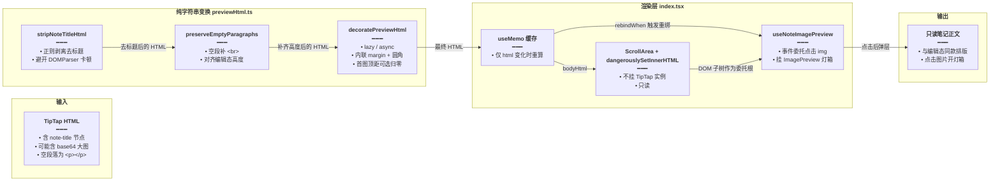
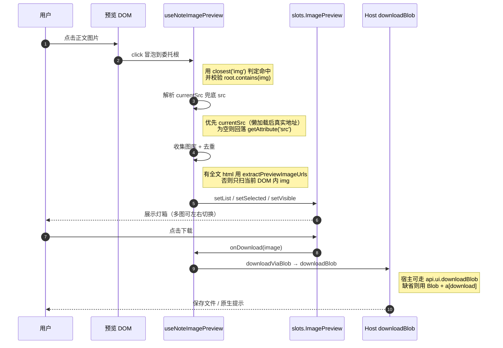

# 富文本预览与图片灯箱

本文归档笔记「只读预览」这一层：Markdown/JSON 之外的笔记内容如何在不挂载 TipTap 的前提下渲染成与编辑态一致的排版、大文档为什么放弃 DOMParser 走正则、空段落为什么会「塌高」，以及点击正文图片后如何打开灯箱并能下载原图。

> **文档角色**：本模块是富文本套件里的**展示端**专题，与编辑端（[富文本编辑器实现.md](./富文本编辑器实现.md)）、长文分块（[长文窗口化渲染.md](./长文窗口化渲染.md)）互为上下游。
> **延伸阅读**：
> - [富文本套件包化.md](./富文本套件包化.md) —— 包结构、`./preview` 子路径与样式分发
> - [编辑器图片与链接.md](./编辑器图片与链接.md) —— 图片如何进入文档（决定预览里 `img` 的形态）
> - [长文窗口化渲染.md](./长文窗口化渲染.md) —— 大文档拆块后如何复用本篇的渲染函数

---

## 1. 背景与目标

编辑器用 TipTap 渲染是可以的，但**只读预览**如果也挂一个 TipTap 实例，代价很直接：

- 每打开一篇笔记就要构建一套 ProseMirror schema 与插件（含 lowlight 语法高亮、表格、图片插件），大文档首屏明显卡顿；
- 预览是只读的，用户不该能编辑，挂编辑器后必须额外禁掉所有输入，反而增加状态复杂度；
- 列表页可能同时预览多篇，多个编辑器实例的内存占用不可接受。

所以预览层的核心决策是：**把 TipTap 导出的 HTML 当字符串处理，最后用 `dangerouslySetInnerHTML` 一次性挂载**。这带来三个必须自己解决的问题：

| 编号 | 问题 | 解法 |
| --- | --- | --- |
| P1 | 导出 HTML 里带着编辑器内嵌的 title 节点，预览不该重复显示标题 | `stripNoteTitleHtml` 正则剥离 |
| P2 | 空段落 `<p></p>` 在静态 HTML 里高度为 0，和编辑态高度不一致 | `preserveEmptyParagraphs` 补 `<br>` |
| P3 | 图片没有统一间距与圆角，且大图会拖慢首屏 | `decoratePreviewHtml` 内联样式 + 懒加载 |

还有两个延伸目标：

| 编号 | 目标 | 验收 |
| --- | --- | --- |
| P4 | 点击正文任意图片能打开灯箱，且能用左右键在全文图片间切换 | 灯箱打开、`showPrevAndNext` 在多图时为真 |
| P5 | 灯箱内可下载原图，下载走宿主提供的通道 | 调用 `downloadBlob` 而非浏览器默认行为 |

---

## 2. 改动范围

本模块随 `packages/richtext-kit` 新增，按 Skill「纯新增例外」只提供**改动后**代码。

| 文件 | 行数 | 职责 |
| --- | --- | --- |
| `packages/richtext-kit/src/preview/previewHtml.ts` | 120 | 纯字符串变换：去标题、补空段、装饰图片、切块 |
| `packages/richtext-kit/src/preview/index.tsx` | 158 | `NotePreview` 组件：顶栏 + 正文 + 底部 + 灯箱挂载点 |
| `packages/richtext-kit/src/preview/useNoteImagePreview.tsx` | 199 | 图片点击委托、图库收集、直接下载 |
| `packages/richtext-kit/src/preview-entry.ts` | 23 | `./preview` 子路径的导出面 |
| `packages/richtext-kit/test/preview/previewHtml.test.ts` | 23 | 去标题与补空段的最小回归用例 |

---

## 3. 实现思路

### 3.1 为什么用正则而不是 DOMParser

`stripNoteTitleHtml` 的注释写得很直白：大文档里常常嵌着 base64 图片，一个 `` 就可能有几百 KB 甚至几 MB。用 `DOMParser.parseFromString` 会把整棵树解析成 DOM 节点，主线程直接卡住；而正则只需要扫一遍字符串，代价与文档体积线性相关且常数极小。

该做法成立的前提是 **title 节点的 `renderHTML` 是单层 `div`、内部不会出现同名嵌套**（见 [富文本编辑器实现.md](./富文本编辑器实现.md) 里的 `TitleNode`），因此 `[\s\S]*?</div>` 这种非贪婪匹配不会“多吃”或“少吃”。

### 3.2 空段落为什么会塌

TipTap 编辑态里，空段落是靠 ProseMirror 的 CSS（`.ProseMirror p:empty::after`）撑出高度的。一旦把 HTML 当作静态字符串渲染，这些编辑器专用样式不再生效，`<p></p>` 的高度变成 0，视觉上就表现为「用户敲的空行在预览里消失了」。

`preserveEmptyParagraphs` 的解法是把「纯空白」的 `<p>` 改写成 `<p><br></p>`，`<br>` 在静态 HTML 里天然占一行高度，从而与编辑态对齐。正则里同时匹配了 `\s`、`&nbsp;` 和 `\u00a0` 三种“看起来是空”的写法。

### 3.3 图片装饰为什么要内联样式

`decoratePreviewHtml` 做三件事：

1. 缺 `loading="lazy"` 就补上——长文里有几十张图时，懒加载是最省事的首屏优化；
2. 缺 `decoding="async"` 就补上——避免大图解码阻塞主线程；
3. 用 `withImgInlineStyle` 写入 `margin` 与 `border-radius`。

第 3 点选择**内联 style** 而不是加 class，原因写在函数注释里：预览可能运行在微前端（MF）`@scope` 环境下，外部样式表能否命中子树并不可靠，而内联样式永远生效。`withImgInlineStyle` 还处理了一个细节：如果 `img` 已有 `style`，先**移除**其中的 `margin` 与 `border-radius` 声明再拼接，避免出现同名属性后者被前者覆盖的不可控结果；并且同时兼容双引号、单引号与无 `style` 三种写法。

### 3.4 首图顶距的处理

`flushLeadingImg` 这个开关的存在，是因为「正文首图」与「窗口首图」在语义上完全不同：

- 整篇预览时，如果正文第一块就是图片，图片上方的 `0.75em` 留白会和顶栏贴得太松，视觉上像“多了一块空白”，所以 `margin-top: 0`；
- 长文窗口化（`origin > 0`）时，窗口的第一块只是全文的中间片段，它的首图**不是**文档首图，必须保持正常上边距，否则每一屏顶部都会缺一截间距。

因此调用方在窗口场景必须显式传 `flushLeadingImg: false`。

### 3.5 切块函数是“尽力而为”

`splitPreviewBlocks` 用一条正则按**顶层开闭标签**切分，服务于长文窗口化。注释里承认了局限：嵌套同名标签（如 `div` 套 `div`）可能切不准。所以它的契约是「尽力切，切不准由调用方回退整段挂载」，而不是保证绝对正确。这条契约很重要——它让分块逻辑可以保持极简，不需要引入真正的 HTML 解析器。

### 3.6 预览主链路



### 3.7 灯箱点击链路



---

## 4. 关键代码

> 本章代码块均为**纯新增文件**，按 `code-before-after.md` §4 纯新增例外，仅提供「改动后」一侧。
> 若与仓库最新源码不一致，以源码为准。

### 4.1 字符串变换 `previewHtml.ts`

来源：`packages/richtext-kit/src/preview/previewHtml.ts`（**改动后**，纯新增，约 L1–L120）

```typescript
// 去掉文档内嵌的 title 节点
export function stripNoteTitleHtml(html: string): string {
	// 空输入直接返回空串，避免正则白跑一遍
	if (!html) return '';
	// 用正则匹配单层 note-title div 并整段删除
	return html.replace(
		// data-type 为 note-title 的 div；非贪婪匹配内容，避免吞掉后面的正文
		/<div\b[^>]*\bdata-type=["']note-title["'][^>]*>[\s\S]*?<\/div>/i,
		// 替换成空串即完成剥离
		'',
	);
}

// 空段落补 <br>，与 TipTap 编辑态占位一致（纯 <p></p> 在静态 HTML 里高度会塌掉）
export function preserveEmptyParagraphs(html: string): string {
	// 空输入直接返回，保持函数幂等
	if (!html) return '';
	// 匹配「开标签 + 纯空白内容 + 闭标签」的段落并补一个换行占位
	return html.replace(
		// 兼容普通空格、&nbsp; 实体与 \u00a0 三种空白写法
		/<p(\b[^>]*)>(?:\s|&nbsp;|\u00a0)*<\/p>/gi,
		// 保留原属性（$1）并塞入 <br>，让静态渲染也有一行高度
		'<p$1><br></p>',
	);
}

// 统一圆角，与编辑态图片样式保持一致
const IMG_RADIUS = 'border-radius: 0.5rem';
// 常规图片的上下外边距，控制图文节奏
const IMG_MARGIN = 'margin: 0.75em 0';
// 首图专用：去掉上边距，避免与顶栏之间出现多余空白
const IMG_MARGIN_FLUSH_TOP = 'margin: 0 0 0.75em';

// 判断正文是否以  {
			// 先移除已有的 margin 声明，避免与本次写入的冲突
			const rest = raw
				// 去掉所有 margin:* 片段（含结尾分号）
				.replace(/\bmargin\s*:[^;]*;?/gi, '')
				// 去掉所有 border-radius:* 片段
				.replace(/\bborder-radius\s*:[^;]*;?/gi, '')
				// 去掉首尾空白，便于判断是否还有其它声明
				.trim()
				// 去掉清洗后残留的首尾分号
				.replace(/^;+|;+$/g, '')
				// 再 trim 一次，防止分号周边留空格
				.trim();
			// 有残余声明时拼在强制样式之后，没有则只保留强制样式
			return `style="${rest ? `${styleValue}; ${rest}` : styleValue}"`;
		});
	}
	// 情况二：style 用单引号包裹，逻辑与上面一致但引号不同
	if (/\bstyle\s*=\s*'/i.test(attrs)) {
		// 同样用回调替换以清洗旧声明
		return attrs.replace(/\bstyle\s*=\s*'([^']*)'/i, (_m, raw: string) => {
			// 移除已有的 margin
			const rest = raw
				// 只删 margin 相关片段
				.replace(/\bmargin\s*:[^;]*;?/gi, '')
				// 只删圆角相关片段
				.replace(/\bborder-radius\s*:[^;]*;?/gi, '')
				// 去首尾空白
				.trim()
				// 去首尾多余分号
				.replace(/^;+|;+$/g, '')
				// 最终再 trim
				.trim();
			// 按单引号形式重新拼装 style
			return `style='${rest ? `${styleValue}; ${rest}` : styleValue}'`;
		});
	}
	// 情况三：完全没有 style，直接追加一条内联样式
	return `${attrs} style="${styleValue}"`;
}

// 图片装饰的可选项
export type DecoratePreviewHtmlOptions = {
	// 为 true 且正文以图开头时，首张图 margin-top: 0；长文窗口 origin>0 时必须传 false
	flushLeadingImg?: boolean;
};

// 预览图：懒加载 + 内联 margin / 圆角（不依赖 MF @scope 下的 stylesheet）
export function decoratePreviewHtml(
	// 待装饰的 HTML
	html: string,
	// 可选项，缺省时按「整篇预览」处理
	opts?: DecoratePreviewHtmlOptions,
): string {
	// 空输入直接返回，避免无意义遍历
	if (!html) return '';
	// 只有显式没关掉 flushLeadingImg 且正文确实以图开头，才启用首图顶距归零
	const flushLeading = opts?.flushLeadingImg !== false && startsWithImg(html);
	// 用标记位记录是否已处理过第一张图
	let isFirst = true;
	// 逐个匹配 img 标签，只改属性不碰其它结构
	return html.replace(/]*)>/gi, (_full, attrs: string) => {
		// 以原始属性串为基底逐步追加
		let next = attrs;
		// 缺 loading 属性时补懒加载，长文多图场景可显著减少首屏请求
		if (!/\bloading\s*=/i.test(next)) next += ' loading="lazy"';
		// 缺 decoding 属性时补异步解码，避免大图解码阻塞主线程
		if (!/\bdecoding\s*=/i.test(next)) next += ' decoding="async"';
		// 仅当允许首图归零且当前确实是第一张图时才使用特殊边距
		const flushTop = flushLeading && isFirst;
		// 处理完第一张后立刻取消标记
		isFirst = false;
		// 把 margin 与圆角合并进现有 style
		next = withImgInlineStyle(
			// 已追加过 loading / decoding 的属性串
			next,
			// 首图用去顶距版本，其余用常规上下边距
			flushTop ? IMG_MARGIN_FLUSH_TOP : IMG_MARGIN,
		);
		// 还原成完整 img 标签
		return ``;
	});
}

// 按顶层开闭标签切开（笔记多为扁平 p / h / ul / table），供长文分块复用
export function splitPreviewBlocks(html: string): string[] {
	// 空输入没有任何块
	if (!html) return [];
	// 收集结果的数组
	const blocks: string[] = [];
	// 匹配「自闭合标签」或「同名的开闭标签对」，_1 反向引用保证标签同名
	const re = /<([a-z][a-z0-9]*)\b[^>]*(?:\/>|>[\s\S]*?<\/\1>)/gi;
	// 记录上一次扫描结束的位置
	let last = 0;
	// exec 的返回值容器
	let m: RegExpExecArray | null;
	// 循环取出每一个顶层块
	while ((m = re.exec(html))) {
		// 两块之间若夹着裸文本（如直接写在根上的文字），也要保留
		if (m.index > last) {
			// 取出夹缝内容并去掉首尾空白
			const gap = html.slice(last, m.index).trim();
			// 非空才单独成块，避免产生空块
			if (gap) blocks.push(gap);
		}
		// 把匹配到的完整标签块收集起来
		blocks.push(m[0]);
		// 更新扫描游标到本次匹配末尾
		last = m.index + m[0].length;
	}
	// 处理最后一段没有被正则覆盖的尾巴
	if (last < html.length) {
		// 取尾部内容并 trim
		const tail = html.slice(last).trim();
		// 非空则作为最后一个块
		if (tail) blocks.push(tail);
	}
	// 完全没切出块时回退成「整段一块」，保证调用方永远拿到可用结果
	return blocks.length ? blocks : [html];
}

// 预览正文：去 title、保留空行（与编辑态一致），图懒加载 + 首图顶距
export function preparePreviewBody(html: string): string {
	// 三步串联：先去标题，再补空段高度，最后装饰图片
	return decoratePreviewHtml(preserveEmptyParagraphs(stripNoteTitleHtml(html)));
}
```

### 4.2 预览组件 `index.tsx`

来源：`packages/richtext-kit/src/preview/index.tsx`（**改动后**，纯新增，约 L1–L158）

```tsx
// 引入一个占位图标，用于空状态下的视觉提示
import { Component } from 'lucide-react';
// 引入 React 基础能力：节点类型、缓存、DOM 引用
import { type ReactNode, useMemo, useRef } from 'react';
// 引入类名合并工具，便于外部覆盖样式
import { cn } from '../cn';
// 引入插槽 Provider 与插槽类型，保证预览也能被宿主替换 UI 组件
import { RichTextKitProvider, type RichTextKitSlots } from '../slots';
// 引入套件统一的滚动容器，和编辑态保持一致的滚动条样式
import { ScrollArea } from '../ui/scroll-area';
// 引入正文预处理函数
import { preparePreviewBody } from './previewHtml';
// 引入灯箱 hook 与宿主下载类型
import {
	// 宿主下载实现类型
	type HostDownloadBlob,
	// 图片点击灯箱 hook
	useNoteImagePreview,
} from './useNoteImagePreview';

// 预览层可国际化的文案
export type NotePreviewLocale = {
	// 空内容提示
	emptyContent: string;
	// 无标题时的兜底标题
	untitledNote: string;
};

// 默认中文文案，宿主未注入时直接可用
const defaultPreviewLocale: NotePreviewLocale = {
	// 暂无内容
	emptyContent: '暂无内容',
	// 无标题笔记
	untitledNote: '无标题笔记',
};

// 预览组件 props
export type NotePreviewProps = {
	// 顶栏标题（替代编辑器的工具栏）
	title: string;
	// TipTap 导出的 HTML 内容
	html?: string;
	// 顶栏标题旁 / 下方的次要信息（时间、标签等）
	meta?: ReactNode;
	// 顶栏右侧操作（返回编辑、列表开关等）
	headerExtra?: ReactNode;
	// 自定义正文；传入时忽略 html
	children?: ReactNode;
	// 底部插槽
	footer?: ReactNode;
	// 根容器类名
	className?: string;
	// 正文容器类名
	bodyClassName?: string;
	// 覆盖空状态文案
	emptyText?: string;
	// 加载中：为真时不展示空状态
	loading?: boolean;
	// 文案覆盖，按字段合并
	locale?: Partial<NotePreviewLocale>;
	// 点击图片预览时的下载实现（嵌入 Host 用宿主通道，独立预览用同源实现）
	downloadBlob?: HostDownloadBlob;
	// 插槽覆盖
	slots?: Partial<RichTextKitSlots>;
};

// 透传导出预处理函数，方便宿主在自定义渲染里复用
export {
	// 图片装饰
	decoratePreviewHtml,
	// 完整正文预处理
	preparePreviewBody,
	// 空段补 br
	preserveEmptyParagraphs,
	// 顶层切块
	splitPreviewBlocks,
	// 去 title 节点
	stripNoteTitleHtml,
} from './previewHtml';

// 透传导出灯箱相关类型与工具
export type { HostDownloadBlob, SelectedImage } from './useNoteImagePreview';
export {
	// 从 HTML 抽全部图片地址
	extractPreviewImageUrls,
	// 灯箱 hook
	useNoteImagePreview,
} from './useNoteImagePreview';

// 内层组件：不包 Provider，避免宿主无法在外层再套一层配置
function NotePreviewInner({
	// 顶栏标题
	title,
	// 正文 HTML
	html,
	// 次要信息
	meta,
	// 顶栏右侧操作
	headerExtra,
	// 自定义正文
	children,
	// 底部插槽
	footer,
	// 根类名
	className,
	// 正文类名
	bodyClassName,
	// 空状态文案覆盖
	emptyText,
	// 加载态
	loading,
	// 文案覆盖
	locale: localePartial,
	// 下载实现
	downloadBlob,
}: Omit<NotePreviewProps, 'slots'>) {
	// 合并默认文案与调用方覆盖项
	const locale = { ...defaultPreviewLocale, ...localePartial };
	// 空状态文案优先取显式传入的 emptyText
	const empty = emptyText ?? locale.emptyContent;
	// 正文只在 html 变化时重新处理，避免滚动等无关渲染重复跑正则
	const bodyHtml = useMemo(
		// 有 html 才预处理，否则给空串走空状态分支
		() => (html ? preparePreviewBody(html) : ''),
		// 依赖只有 html
		[html],
	);
	// 正文 DOM 引用，既用于挂载点也作为灯箱事件委托根
	const bodyRef = useRef<HTMLDivElement>(null);
	// 注册图片点击灯箱，返回可直接渲染的弹层节点
	const { noteImagePreviewModal } = useNoteImagePreview({
		// 委托根：正文容器
		rootRef: bodyRef,
		// 只有走默认正文时才需要传全文 html 用于图库
		html: children == null ? html : undefined,
		// 下载实现透传给灯箱
		downloadBlob,
		// 自定义正文时不接管点击，避免干扰宿主自己的交互
		enabled: children == null,
		// html 重新计算后触发重绑，保证 innerHTML 替换后监听仍有效
		rebindWhen: bodyHtml,
	});

	// 渲染整体结构
	return (
		<div
			// contain layout/paint 隔离大预览 DOM 的重排重绘，避免拖累左侧列表
			// 注意：不要加 contain:style，WebKit/Tauri 下会导致子树样式延后生效
			className={cn(
				// 纵向布局、圆角右侧、隐藏溢出
				'note-preview flex h-full min-h-0 min-w-0 flex-col overflow-hidden rounded-r-md contain-[layout_paint]',
				// 允许调用方覆盖
				className,
			)}
		>
			{/* 顶栏：固定高度、底部细分隔线 */}
			<header className="note-preview-header h-10 border-theme/10 flex shrink-0 items-center gap-3 border-b px-3 pr-1.5 py-2.5">
				{/* 标题区占满剩余宽度，并允许收缩以便省略号截断 */}
				<div className="min-w-0 flex-1">
					{/* 标题为空时回落「无标题笔记」，避免顶栏空荡 */}
					<h1 className="text-textcolor truncate text-base font-semibold leading-snug">
						{title.trim() || locale.untitledNote}
					</h1>
					{/* 有次要信息时才渲染第二行 */}
					{meta ? (
						<div className="text-textcolor/45 mt-0.5 truncate text-xs">
							{/* 次要信息内容 */}
							{meta}
						</div>
					) : null}
				</div>
				{/* 右侧操作区不参与收缩，保证按钮完整可见 */}
				{headerExtra ? (
					<div className="flex shrink-0 items-center gap-0.5">
						{/* 宿主注入的操作按钮 */}
						{headerExtra}
					</div>
				) : null}
			</header>

			{/* 正文区三态：自定义正文 / 默认 HTML / 空状态 */}
			{children != null ? (
				// 自定义正文优先级最高，直接渲染
				children
			) : bodyHtml ? (
				// 默认正文：滚动容器 + 静态 HTML
				<ScrollArea
					// 复用编辑态正文类名，保证排版一致
					className={cn(
						// rich-editor-body 提供字号行高，note-preview-static 标记只读
						'rich-editor-body note-preview-static text-textcolor min-h-0 flex-1',
						// 允许调用方追加
						bodyClassName,
					)}
				>
					<div
						// 挂到 bodyRef，既是渲染容器也是灯箱事件委托根
						ref={bodyRef}
						// 复用 TipTap 的类名，直接继承编辑器样式
						className="tiptap note-preview-tiptap ProseMirror"
						// 直接写入预处理后的 HTML；内容来自本仓编辑器导出，非用户直填
						dangerouslySetInnerHTML={{ __html: bodyHtml }}
					/>
				</ScrollArea>
			) : loading ? null : (
				// 加载中不展示空状态，避免「先空后有」的闪烁
				<div className="flex items-center justify-center flex-col gap-5 h-full box-border min-w-0 max-w-full w-full p-3 rounded-md">
					{/* 空状态图标，轻微上下浮动提示可交互 */}
					<Component className="w-16 h-16 text-textcolor/70 animate-bounce" />
					{/* 空状态文案 */}
					<div className="text-sm text-textcolor/80">{empty}</div>
				</div>
			)}

			{/* 底部插槽，有则渲染 */}
			{footer ? <div className="shrink-0">{footer}</div> : null}
			{/* 灯箱弹层固定挂在组件末尾，避免被滚动容器裁剪 */}
			{noteImagePreviewModal}
		</div>
	);
}

// 笔记只读预览：与编辑态同一套 ScrollArea + 正文样式（静态 HTML，不挂 TipTap）
export function NotePreview(props: NotePreviewProps) {
	// 把插槽配置拆出来，其余参数原样透传
	const { slots, ...rest } = props;
	// 用 Provider 包裹，使内部 hook 能读到宿主替换的 UI 组件
	return (
		<RichTextKitProvider slots={slots}>
			{/* 内层组件负责实际渲染 */}
			<NotePreviewInner {...rest} />
		</RichTextKitProvider>
	);
}

// 默认导出，便于宿主按需懒加载
export default NotePreview;
```

### 4.3 图片点击与灯箱 `useNoteImagePreview.tsx`

来源：`packages/richtext-kit/src/preview/useNoteImagePreview.tsx`（**改动后**，纯新增，约 L1–L199）

```tsx
// 引入 React 基础能力：节点类型、引用类型、回调缓存、副作用、缓存值、DOM 引用、状态
import {
	// 可渲染节点
	type ReactNode,
	// ref 对象类型
	type RefObject,
	// 稳定回调
	useCallback,
	// 副作用（绑定 / 解绑事件）
	useEffect,
	// 记忆化计算
	useMemo,
	// 可变引用
	useRef,
	// 组件状态
	useState,
} from 'react';
// 引入插槽体系：图片项类型与读取插槽的 hook
import { type RichTextImageItem, useRichTextKitSlots } from '../slots';

// 宿主提供的下载实现签名：接收文件名、二进制与 MIME，返回是否成功
export type HostDownloadBlob = (options: {
	// 建议的文件名
	fileName: string;
	// 二进制内容
	data: ArrayBuffer | Uint8Array;
	// 可选 MIME 类型
	mimeType?: string;
// 返回结果的 Promise，hostToasted 表示宿主是否已自行提示
}) => Promise<{ ok: boolean; hostToasted: boolean; message?: string }>;

// 当前选中图片的类型别名，便于宿主侧复用
export type SelectedImage = RichTextImageItem;

// 国际化函数签名
type TFn = (key: string, params?: Record<string, unknown>) => string;

// 从 URL 推断落盘文件名
function fileNameFromUrl(url: string): string {
	// try 包裹 URL 解析，data URL 等特殊值可能抛错
	try {
		// 以当前页面为基准解析，兼容相对路径
		const path = new URL(url, window.location.href).pathname;
		// 取最后一段并解码，中文文件名也能还原
		const base = decodeURIComponent(path.split('/').pop() || '');
		// 只有带扩展名才认为推断成功
		if (base && /\.[a-z0-9]+$/i.test(base)) return base;
	// 解析失败时静默走兜底文件名
	} catch {
		/* ignore */
	}
	// 兜底文件名，保证下载永远有名字
	return 'image.png';
}

// 从笔记 HTML 抽出全部图片地址（窗口化预览也能翻页）
export function extractPreviewImageUrls(html: string): string[] {
	// 空内容没有图片
	if (!html.trim()) return [];
	// 解析失败时也要返回可用结果，因此整体兜底
	try {
		// 这里可以用 DOMParser：只处理纯文本笔记，大图场景由调用方决定是否调用
		const doc = new DOMParser().parseFromString(html, 'text/html');
		// 去重集合
		const seen = new Set<string>();
		// 有序结果数组
		const out: string[] = [];
		// 遍历所有 img
		for (const img of doc.querySelectorAll('img')) {
			// 取 src 并去空白
			const src = img.getAttribute('src')?.trim();
			// 空地址或重复地址直接跳过
			if (!src || seen.has(src)) continue;
			// 记录已出现
			seen.add(src);
			// 保持文档顺序
			out.push(src);
		}
		// 返回去重后的图片地址
		return out;
	// 解析异常时返回空数组，让灯箱退化成单图模式
	} catch {
		// 兜底空数组
		return [];
	}
}

// 取图并落盘：优先走宿主通道，缺省用浏览器下载
async function downloadViaBlob(
	// 图片地址
	url: string,
	// 可选宿主下载实现
	downloadBlob?: HostDownloadBlob,
): Promise<void> {
	// 先抓取二进制，data URL 与 http 地址都能被 fetch 处理
	const res = await fetch(url);
	// 非 2xx 直接抛错，交由调用方提示
	if (!res.ok) throw new Error(`HTTP ${res.status}`);
	// 读出 ArrayBuffer
	const data = await res.arrayBuffer();
	// 取响应 MIME，去掉 ;charset=... 之类的参数，缺省按 png 处理
	const mime =
		res.headers.get('content-type')?.split(';')[0]?.trim() || 'image/png';
	// 推断文件名
	const fileName = fileNameFromUrl(url);

	// 有宿主通道时优先交给宿主，便于统一提示与权限控制
	if (downloadBlob) {
		// 调用宿主实现
		const result = await downloadBlob({ fileName, data, mimeType: mime });
		// 宿主报告失败时抛出带信息的错误
		if (!result.ok) throw new Error(result.message || 'download failed');
		// 成功即结束
		return;
	}

	// 无宿主通道：用 Blob + 临时 a 标签走浏览器原生下载
	const blob = new Blob([data], { type: mime });
	// 生成临时对象 URL
	const obj = URL.createObjectURL(blob);
	// 创建临时下载锚点
	const a = document.createElement('a');
	// 指向对象 URL
	a.href = obj;
	// 指定落盘文件名
	a.download = fileName;
	// 必须挂到文档上，部分浏览器才会响应 click
	document.body.appendChild(a);
	// 触发下载
	a.click();
	// 立即移除，避免污染 DOM
	a.remove();
	// 回收对象 URL，释放内存
	URL.revokeObjectURL(obj);
}

// hook 返回值
export type UseNoteImagePreviewResult = {
	// 可直接渲染的灯箱弹层
	noteImagePreviewModal: ReactNode;
};

// 在 rootRef 子树内委托点击 img，打开 ImagePreview；rebindWhen 变化时重绑，避免 innerHTML 替换后监听失效
export function useNoteImagePreview(options: {
	// 事件委托根
	rootRef: RefObject<HTMLElement | null>;
	// 全文 HTML，用于图库列表；缺省则只收集当前 DOM 内图片
	html?: string;
	// 宿主下载实现
	downloadBlob?: HostDownloadBlob;
	// 国际化函数
	t?: TFn;
	// 是否启用（自定义正文时通常关闭）
	enabled?: boolean;
	// 重绑触发值
	rebindWhen?: unknown;
}): UseNoteImagePreviewResult {
	// 解构参数并给 enabled 默认值
	const {
		// 委托根
		rootRef,
		// 全文 HTML
		html,
		// 下载实现
		downloadBlob,
		// 国际化
		t,
		// 默认启用
		enabled = true,
		// 重绑触发值
		rebindWhen,
	} = options;

	// 从插槽取图片预览组件，宿主可整体替换灯箱实现
	const { ImagePreview } = useRichTextKitSlots();
	// 灯箱是否可见
	const [visible, setVisible] = useState(false);
	// 当前选中的图片
	const [selected, setSelected] = useState<SelectedImage>({ url: '' });
	// 图库列表
	const [list, setList] = useState<SelectedImage[]>([]);
	// 用 ref 持有最新下载实现，避免它变化时重建事件监听
	const downloadBlobRef = useRef(downloadBlob);
	// 每次渲染同步最新值，保证点击时用的是当前 props
	downloadBlobRef.current = downloadBlob;

	// 全文图库：只有传了 html 才解析，避免无谓开销
	const galleryFromHtml = useMemo(
		// 有 html 就抽地址，否则给 null 表示「没有全文信息」
		() => (html ? extractPreviewImageUrls(html) : null),
		// html 变化时重算
		[html],
	);

	// 绑定点击委托
	useEffect(() => {
		// 取当前委托根
		const root = rootRef.current;
		// 根不存在或未启用时不绑定
		if (!root || !enabled) return;

		// 点击处理函数
		const onClick = (e: MouseEvent) => {
			// 取事件目标
			const el = e.target;
			// 非元素节点（如文本节点）直接忽略
			if (!(el instanceof Element)) return;
			// 向上找最近的 img，兼容点在图片内层元素上的情况
			const img = el.closest('img');
			// 不是图片或不在委托根内则放行
			if (!img || !root.contains(img)) return;
			// 优先 currentSrc（懒加载 / srcset 解析后的真实地址），再回落 src
			const url =
				(img as HTMLImageElement).currentSrc || img.getAttribute('src');
			// 没有有效地址则不处理
			if (!url?.trim()) return;
			// 阻止图片被拖拽 / 选中文本等默认行为
			e.preventDefault();
			// 阻止冒泡到宿主的点击处理
			e.stopPropagation();

			// 图库来源：优先全文 HTML，保证窗口化时也能翻完整篇
			const urls =
				galleryFromHtml && galleryFromHtml.length > 0
					? galleryFromHtml
					: Array.from(root.querySelectorAll('img'))
							// 逐个取真实地址
							.map((node) => {
								// 断言成图片元素以便读 currentSrc
								const n = node as HTMLImageElement;
								// currentSrc 优先，其次 src，最后给空串
								return (n.currentSrc || n.getAttribute('src') || '').trim();
							})
							// 过滤空地址
							.filter(Boolean);

			// 去重后的地址数组
			const uniq: string[] = [];
			// 去重集合
			const seen = new Set<string>();
			// 保持文档顺序去重
			for (const u of urls) {
				// 已出现过则跳过
				if (seen.has(u)) continue;
				// 记录
				seen.add(u);
				// 收集
				uniq.push(u);
			}
			// 转成灯箱需要的图片项结构
			const images = uniq.map((u, i) => ({ id: String(i), url: u }));
			// 定位当前点击的图片在列表中的项
			const hit =
				images.find((i) => i.url === url) ??
				// 找不到时兜底成单图，保证灯箱仍能打开
				({ id: '0', url } as SelectedImage);
			// 写入图库
			setList(images);
			// 写入选中项
			setSelected(hit);
			// 打开灯箱
			setVisible(true);
		};

		// 绑定到委托根
		root.addEventListener('click', onClick);
		// 清理时解绑，防止重绑或卸载后残留
		return () => root.removeEventListener('click', onClick);
	}, [rootRef, enabled, rebindWhen, galleryFromHtml]);

	// 灯箱显隐回调：关闭时清空状态
	const onVisibleChange = useCallback((next: boolean) => {
		// 同步可见性
		setVisible(next);
		// 关闭时重置选中与列表，避免下次打开闪现旧图
		if (!next) {
			// 清空选中
			setSelected({ url: '' });
			// 清空列表
			setList([]);
		}
	}, []);

	// 下载回调：取最新下载实现，失败只告警不打断
	const onDownload = useCallback(async (image: SelectedImage) => {
		// 没有地址则无事可做
		if (!image.url) return;
		// 捕获异常，避免未处理的 rejection
		try {
			// 走统一的取图 + 落盘逻辑
			await downloadViaBlob(image.url, downloadBlobRef.current);
		} catch (err) {
			// 失败仅打印警告，交互层不弹错误
			console.warn('[note-preview] image download failed', err);
		}
	}, []);

	// 直接构造灯箱节点，父组件按普通元素渲染即可
	const noteImagePreviewModal = (
		<ImagePreview
			// 受控可见性
			visible={visible}
			// 当前图
			selectedImage={selected}
			// 图库
			imageList={list}
			// 展示下载按钮
			showDownload
			// 多图才展示左右切换
			showPrevAndNext={list.length > 1}
			// 下载回调
			download={onDownload}
			// 显隐回调
			onVisibleChange={onVisibleChange}
			// 标题走国际化，未注入时为空
			title={t?.('imagePreview.title')}
			// 透传国际化函数给灯箱内部
			t={t}
		/>
	);

	// 返回可供渲染的弹层
	return { noteImagePreviewModal };
}
```

### 4.4 预览子路径导出 `preview-entry.ts`

来源：`packages/richtext-kit/src/preview-entry.ts`（**改动后**，纯新增，约 L1–L23）

```typescript
// 导出预览层对外类型
export type {
	// 宿主下载实现签名
	HostDownloadBlob,
	// 预览文案类型
	NotePreviewLocale,
	// 预览组件 props
	NotePreviewProps,
	// 选中图片类型
	SelectedImage,
} from './preview';
// 导出预览层可用的函数与组件
export {
	// 图片装饰
	decoratePreviewHtml,
	// 从 HTML 抽全部图片地址
	extractPreviewImageUrls,
	// 预览组件
	NotePreview,
	// 完整正文预处理
	preparePreviewBody,
	// 空段补 br
	preserveEmptyParagraphs,
	// 顶层切块
	splitPreviewBlocks,
	// 去 title 节点
	stripNoteTitleHtml,
	// 图片灯箱 hook
	useNoteImagePreview,
} from './preview';
// 导出插槽类型与默认实现，使预览入口可以独立替换 UI
export type { RichTextKitSlots } from './slots';
export {
	// 默认插槽实现
	defaultRichTextKitSlots,
	// 插槽 Provider
	RichTextKitProvider,
	// 读取插槽的 hook
	useRichTextKitSlots,
} from './slots';
```

**变更摘要**：`./preview` 子路径刻意把插槽体系一并导出，原因是独立预览场景（比如只引入预览、不引入编辑器）也必须能替换 `ImagePreview` 与 `ScrollArea`，否则宿主会被默认实现绑死。

### 4.5 回归用例 `previewHtml.test.ts`

来源：`packages/richtext-kit/test/preview/previewHtml.test.ts`（**改动后**，纯新增，约 L1–L23）

```typescript
// 引入 Vitest 的用例组织与断言
import { describe, expect, it } from 'vitest';
// 引入被测函数
import {
	// 完整正文预处理
	preparePreviewBody,
	// 去 title 节点
	stripNoteTitleHtml,
} from '../../src/preview/previewHtml';
// 引入标题转 HTML 工具，用于构造「带 title 的导出内容」
import { titleToHtml } from '../../src/windowed/doc';

// 用例组：去标题
describe('stripNoteTitleHtml', () => {
	// 构造带标题的 HTML 后断言标题被剥离、正文保留
	it('去掉 note-title 节点', () => {
		// 用真实 titleToHtml 产出，避免手写 HTML 与实现脱节
		const html = `${titleToHtml('Hi')}<p>body</p>`;
		// 执行剥离
		const stripped = stripNoteTitleHtml(html);
		// 结果中不应再出现 note-title 标记
		expect(stripped).not.toContain('note-title');
		// 正文必须原样保留
		expect(stripped).toContain('<p>body</p>');
	});
});

// 用例组：完整正文预处理
describe('preparePreviewBody', () => {
	// 断言空段落被补上 br，同时标题仍被去掉
	it('空段补 br，避免预览塌高', () => {
		// 拼一个「标题 + 空段落」的最小样本
		const prepared = preparePreviewBody(`${titleToHtml('Hi')}<p></p>`);
		// 空段必须变成含 br 的段落
		expect(prepared).toContain('<br>');
		// 标题节点必须已被剥离
		expect(prepared).not.toContain('note-title');
	});
});
```

---

## 5. 行为变化

`packages/richtext-kit` 尚未被 `apps/**` 接入，因此对现有应用**零行为变化**。接入后的行为契约如下：

| 场景 | 行为 |
| --- | --- |
| 预览含 title 的笔记 | 标题只在顶栏出现一次，正文里不重复 |
| 正文含空段落 | 预览保留空行高度，与编辑态一致 |
| 正文图片 | 自动带 `loading="lazy"`、`decoding="async"`、圆角与上下边距 |
| 正文第一块就是图片（整篇预览） | 首图 `margin-top: 0` |
| 长文窗口化（`origin > 0`） | 传 `flushLeadingImg: false`，首图保持正常顶距 |
| 点击正文图片 | 打开灯箱，按全文图片顺序可左右切换 |
| 灯箱点下载 | 有 `downloadBlob` 走宿主，否则浏览器原生下载 |
| 传了 `children` 自定义正文 | 不接管图片点击，避免干扰宿主交互 |
| 无内容且非加载中 | 展示图标 + 「暂无内容」 |
| 无内容但 `loading` | 什么都不展示，避免空状态闪烁 |

---

## 6. 回归清单

1. 带图长文预览：滚动流畅，图片逐张懒加载，首屏不一次性拉全部图。
2. 正文含 3 个连续空段落：预览高度与编辑态一致。
3. 正文以图片开头：整篇预览时该图上方无多余空白。
4. 窗口化预览（`origin > 0`）：每屏首图都保留上方间距。
5. 点击第 2 张图：灯箱直接定位到第 2 张，左右键可切到第 1、3 张。
6. 灯箱内下载：文件名与原图一致；中文文件名不乱码。
7. 宿主传入 `downloadBlob` 且返回 `ok: false`：不产生浏览器下载，控制台有告警。
8. 传入 `children`：正文按自定义节点渲染，点击图片不弹灯箱。
9. `title` 为空串：顶栏显示「无标题笔记」。
10. `html` 为空且 `loading` 为真：不出现空状态图标。

---

## 7. 路径速查

| 目的 | 位置 |
| --- | --- |
| 调正文预处理顺序 | `packages/richtext-kit/src/preview/previewHtml.ts` 的 `preparePreviewBody` |
| 调图片间距 / 圆角 | 同文件的 `IMG_MARGIN`、`IMG_RADIUS` |
| 调首图顶距策略 | 同文件的 `flushLeadingImg` 选项 |
| 改预览布局与三态 | `packages/richtext-kit/src/preview/index.tsx` 的 `NotePreviewInner` |
| 改灯箱图库来源 | `packages/richtext-kit/src/preview/useNoteImagePreview.tsx` 的 `galleryFromHtml` |
| 改下载策略 | 同文件的 `downloadViaBlob` |
| 替换灯箱 UI | 宿主传 `slots.ImagePreview`（见 [富文本套件包化.md](./富文本套件包化.md)） |
