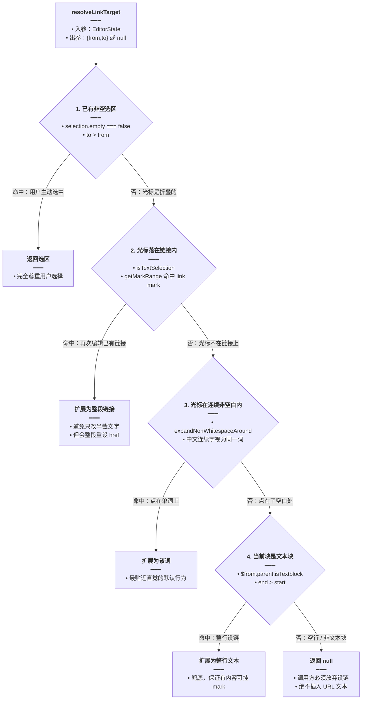

# 编辑器图片与链接

本文归档富文本编辑器里「本地图片插入」与「超链接设置」两条交互链路：图片如何从三种入口（粘贴、拖放、系统文件选择器）统一汇入同一条上传管线，又如何在插入前把 webp/avif 等格式转成 JPEG 以免后续 DOCX 导出失败；链接如何在「没选中任何文字」的情况下智能判定设链目标，并且始终不把 URL 文本写进正文。

> **文档角色**：本模块是编辑器内核（`富文本编辑器实现.md`）的**能力扩展层**专题，只讲图片与链接两件事。
> **延伸阅读**：
> - [富文本编辑器实现.md](./富文本编辑器实现.md) —— RichEditor 组件外壳、扩展装配、标题节点与文档结构自愈
> - [富文本套件包化.md](./富文本套件包化.md) —— 三入口产物、样式分发与对外契约
> - [富文本预览与图片灯箱.md](./富文本预览与图片灯箱.md) —— 只读预览里的图片点击放大

---

## 1. 背景与目标

富文本编辑器要真正可用，绕不开两件「小事」：

1. **图片要能进来，且进来之后不能坏。** 用户最常见的动作是截图后 `Cmd+V`，其次是拖拽文件，最后才是点工具栏选文件。这三条路径如果各写一套，行为必然不一致（有的走 data URL、有的走 base64、有的直接塞 blob URL），后续导出 DOCX 时就会出现「线上预览正常、导出后图片裂开」的经典问题。
2. **链接不能靠 `window.prompt`。** 桌面端（Tauri）WebView 对 `window.prompt` 支持不稳定，而且原生弹窗无法复用应用的主题样式；更关键的是，用户往往**不选中文字**就点「插入链接」，此时必须有一套可解释的「目标推断」规则，否则最常见的错误实现是把 URL 直接当文本插进正文。

目标拆解：

| 编号 | 目标 | 验收方式 |
| --- | --- | --- |
| G1 | 粘贴、拖放、选文件三个入口复用同一套上传实现 | 只改 `resolveSrcRef.current` 即可整体替换上传逻辑 |
| G2 | 非 DOCX 友好格式（webp / avif / heic 等）插入前转 JPEG | 插入后 `img src` 以 `data:image/jpeg` 开头 |
| G3 | 图片与文本混合粘贴时两者都不丢 | 既出现图片节点，也出现原文文本 |
| G4 | 桌面端宿主拦截粘贴后仍能交回编辑器处理 | 派发自定义事件后图片被插入 |
| G5 | 无选区时链接目标可预测、可解释 | 选区 → 链接 → 单词 → 整行 → 空行不设链 |
| G6 | 空行点「确定」绝不把 URL 插入正文 | 文档内容完全不变 |

---

## 2. 改动范围

本模块全部为新增文件（`packages/richtext-kit` 为新包，见 [富文本套件包化.md](./富文本套件包化.md)），因此下文代码块按 Skill 的「纯新增例外」只给**改动后**一侧，不再补「改动前」。

| 文件 | 行数 | 职责 |
| --- | --- | --- |
| `packages/richtext-kit/src/editor/image/image.ts` | 137 | 文件解码、格式转码、剪贴板/拖放数据提取、统一插图 |
| `packages/richtext-kit/src/editor/image/ImageUpload.ts` | 91 | TipTap 扩展：粘贴 / 拖放 / 桌面端自定义事件三个入口 |
| `packages/richtext-kit/src/editor/image/index.ts` | 15 | 模块导出面 |
| `packages/richtext-kit/src/editor/link/linkRange.ts` | 87 | 设链目标五级解析、加链接 / 去链接 |
| `packages/richtext-kit/src/editor/link/LinkForm.tsx` | 155 | 链接输入面板组件 + `useLinkEditor` 状态机 |
| `packages/richtext-kit/src/editor/link/index.ts` | 3 | 模块导出面 |

---

## 3. 实现思路

### 3.1 图片：三个入口，一条管线

关键决策是**把「取得 File」与「File 变成 src」彻底分开**：

- 「取得 File」由入口负责：`handlePaste` 从 `clipboardData.items` 取、`handleDrop` 从 `dataTransfer.files` 取、工具栏按钮走 `pickImageFile` 造一个临时 `<input type="file">`。
- 「File 变成 src」由 `resolveSrcRef.current` 负责，默认实现是 `fileToDataUrl`。

这样做的收益是：宿主应用接了自己的 OSS 上传时，只需要把 `resolveSrcRef` 换成「上传后返回 URL」的函数，三个入口同时生效，不需要改扩展代码。**用可变引用 `{ current }` 而不是普通 prop**，是因为 TipTap 的扩展在 `useEditor` 创建时就被固化进 schema 与插件列表，props 变化不会重建扩展；只有 ref 才能读到「最新的」上传函数。

### 3.2 为什么必须转 JPEG

`fileToDataUrl` 里维护了一个 `DOCX_SAFE` 白名单（jpeg/jpg/png/gif）。命中白名单就直接 `FileReader.readAsDataURL`，零成本；未命中则走 `fileToJpegDataUrl`，用 `canvas.toDataURL('image/jpeg', 0.9)` 重新编码。

原因在于下游导出链路：DOCX 的图片部件对 webp/avif 支持参差，一旦原样嵌进去，导出环节要么失败、要么被静默丢弃。提前在**插入时**统一格式，比在导出时补救代价低得多。同时保留了一条兜底：如果浏览器连解码都做不到（典型是部分 HEIC），`catch` 会退回原始 data URL，把转码压力交给服务端 sharp——**宁可让服务端处理，也不要让用户看到「插入失败」**。

### 3.3 混合粘贴为什么要「先让 ProseMirror 粘贴文本」

`handlePaste` 里有个反直觉的分支：

- 剪贴板**同时**有图片和文本/HTML（比如从 Word 复制一段带图的段落）→ 先**异步**触发 `insertImages`，然后 `return false`，让 ProseMirror 继续执行默认粘贴。
- 剪贴板**只有**图片（比如截图）→ `preventDefault()` 后插图，`return true`。

`return false` 之所以可行，是因为「读 File → 解码 → 转码」整条链路都是异步的；等 `setImage` 真正执行时，ProseMirror 的默认文本粘贴早已落盘，两者的插入位置不会打架。如果反过来先 `preventDefault` 再插图，文本就丢了。

### 3.4 桌面端的自定义事件回传

Tauri 宿主在某些场景会自己拦截 `Cmd+V`（为了拿到系统级剪贴板权限），此时浏览器侧的 `handlePaste` 根本不会被触发。约定的补救通道是 `rich-editor:desktop-paste-images` 事件，`detail.files` 携带 `File[]`。扩展在 `view` 生命周期里挂监听、在 `destroy` 里摘掉，避免编辑器重建后监听器泄漏。

### 3.5 链接：打开时就锁定目标

`useLinkEditor.open()` 会**立刻**调用 `resolveLinkTarget` 把目标区间算出来并 `setTextSelection`，把区间存进 `draft.range`。这带来两个好处：

1. 用户能当场看见「哪段文字将要被加链接」，所见即所得。
2. 输入框获得焦点、选区消失之后，目标依然保存在 `draft` 里，不会因为失焦而丢失。

`apply()` 时只对 `draft.range` 调用 `applyLinkToRange`，**绝不**把 URL 文本插入正文——`range` 为 `null`（空行）时直接关面板，什么都不做。

### 3.6 目标推断的五级优先级



第 3 级里有个容易忽略的细节：**光标停在字符右侧时优先贴左**。用户在「链接」两个字的右边点击，`offset` 指向的是「接」的位置，若直接取右侧字符就会选到下一个词。实现里先判断「右侧是空白或已到行尾，且左侧不是空白」，成立就把 `offset` 减一。

### 3.7 加链接不能串 `extendMarkRange`

`applyLinkToRange` 刻意只做 `setTextSelection(range)` + `setLink({ href })`，注释里写明了原因：`extendMarkRange('link')` 在目标位置**没有** link mark 时会中断整个 chain，导致 `setLink` 不执行。这是 TipTap 命令链的常见坑，必须用最朴素的组合。

### 3.8 面板不能依赖 `window.prompt`

`LinkForm` 是一个普通 React 组件，通过 `role="dialog"` + `aria-label` 提供可访问性语义，挂载后自动 `focus()` + `select()` 让用户直接覆盖输入。`onMouseDown` 里对非 `input/button` 目标 `preventDefault()`，防止点击面板空白处导致编辑器失焦、选区被浏览器清除。

---

## 4. 关键代码

> 本章所有代码块均为**纯新增文件**（`packages/richtext-kit` 新包），按 Skill `code-before-after.md` §4 的纯新增例外，仅提供**改动后**一侧，不构造「改动前」。
> 若与仓库最新源码不一致，以源码为准。

### 4.1 图片转码与数据提取 `image.ts`

来源：`packages/richtext-kit/src/editor/image/image.ts`（**改动后**，纯新增，约 L1–L137）

```typescript
// 引入 TipTap 编辑器的类型（仅类型导入，编译期擦除，不会把 React 运行时带进纯逻辑模块）
import type { Editor } from '@tiptap/react';

// 白名单：能直接进入 DOCX 导出链路、无需二次转码的图片格式
const DOCX_SAFE = new Set([
	// JPEG：兼容性最好、体积可控，也是服务端 sharp 的默认输出
	'image/jpeg',
	// 非标准但真实存在的写法：部分系统/浏览器会把 .jpg 报成 image/jpg
	'image/jpg',
	// PNG：支持透明通道，Word 可直接嵌入
	'image/png',
	// GIF：动图在 Word 里至少能渲染首帧，无需转换
	'image/gif',
]);

// 把已解码的位图统一画到离屏 canvas 再导出 JPEG，绕开 webp/avif 在 DOCX 导出链上的兼容问题
function bitmapToJpegDataUrl(
	// 输入源：优先用 createImageBitmap 得到的位图，降级时是  元素
	source: ImageBitmap | HTMLImageElement,
	// 压缩质量：0.9 在肉眼几乎无损与文件体积之间取得平衡
	quality = 0.9,
// 返回值是 data:image/jpeg;base64,... 形式的字符串
): string {
	// 创建离屏画布作为转码中转站，不挂载到 DOM，避免页面闪烁
	const canvas = document.createElement('canvas');
	// 宽度取原图尺寸并兜底 1px，防止 0 尺寸文件导致 toDataURL 抛异常
	canvas.width = Math.max(1, source.width);
	// 高度同样取原图尺寸并兜底 1px
	canvas.height = Math.max(1, source.height);
	// 取 2D 上下文用于绘制原图
	const ctx = canvas.getContext('2d');
	// 极少数环境会禁用 canvas（例如严格 CSP），此时直接抛错交由上层走兜底
	if (!ctx) throw new Error('canvas unsupported');
	// 按原始尺寸把位图绘制到 (0,0)，不做缩放以保证清晰度
	ctx.drawImage(source, 0, 0);
	// 以 JPEG 格式导出 data URL，格式固定因此下游无需再判断
	return canvas.toDataURL('image/jpeg', quality);
}

// 异步把 File 解码成位图后再转 JPEG：优先 createImageBitmap，失败链后降级 
async function fileToJpegDataUrl(file: File): Promise<string> {
	// 现代浏览器与 Tauri WebView 通常都提供 createImageBitmap，可跳过 DOM 解码
	if (typeof createImageBitmap === 'function') {
		// 直接把文件解码为位图，不产生 objectURL，省一次 blob 句柄
		const bmp = await createImageBitmap(file);
		// try/finally 保证位图无论转码成功与否都被释放
		try {
			// 交给 canvas 统一转码为 JPEG data URL
			return bitmapToJpegDataUrl(bmp);
		// finally 在 return 求值之后、函数真正返回之前执行
		} finally {
			// 显式关闭位图，避免连续插入大图造成显存/内存持续增长
			bmp.close();
		}
	}
	// 降级路径：先造 object URL，再借  完成解码
	const objectUrl = URL.createObjectURL(file);
	// try/finally 保证 object URL 一定被回收，避免 blob 常驻内存
	try {
		// 把回调式 onload/onerror 包成 Promise，便于用 await 串行书写
		const img = await new Promise<HTMLImageElement>((resolve, reject) => {
			// 创建游离的图片元素，仅用于解码，不插入文档
			const el = new Image();
			// 解码成功时把  交给后续 canvas 绘制
			el.onload = () => resolve(el);
			// 解码失败（文件损坏 / 格式不支持）时抛出统一错误，交由外层 catch 兜底
			el.onerror = () => reject(new Error('image decode failed'));
			// 赋值 src 后浏览器才开始真正加载与解码
			el.src = objectUrl;
		});
		// 解码完成后复用与 createImageBitmap 分支相同的转码逻辑
		return bitmapToJpegDataUrl(img);
	// 无论成功还是抛错，都必须回收 object URL
	} finally {
		// 释放 URL 句柄，防止 blob 数据长期占用内存
		URL.revokeObjectURL(objectUrl);
	}
}

// 对外主入口：本地文件 → data URL；非 jpeg/png/gif 先转 JPEG，以兼容 DOCX 导出
export function fileToDataUrl(file: File): Promise<string> {
	// 取小写 MIME 类型并兜底空串，避免某些系统给出 undefined 直接崩溃
	const type = (file.type || '').toLowerCase();
	// 命中白名单时无需转码，走最省事的 FileReader 直读
	if (DOCX_SAFE.has(type)) {
		// 包成 Promise 以统一异步接口
		return new Promise((resolve, reject) => {
			// FileReader 是读取本地文件最通用、兼容性最好的方式
			const reader = new FileReader();
			// 读取完成后把 base64 结果转成字符串返回
			reader.onload = () => resolve(String(reader.result));
			// 读取失败（权限 / 文件被删）时把原生错误向上抛
			reader.onerror = () => reject(reader.error ?? new Error('read failed'));
			// 以 data URL 形式读取，天然带 MIME 头
			reader.readAsDataURL(file);
		});
	}
	// 非白名单格式先尝试转 JPEG；catch 兜住浏览器也解不了的情况
	return fileToJpegDataUrl(file).catch(() => {
		// 浏览器解不了（典型是部分 HEIC）时退回原始 data URL，把转码压力交给服务端 sharp
		return new Promise((resolve, reject) => {
			// 复用同款 FileReader 读取流程，保证返回结构一致
			const reader = new FileReader();
			// 读完即返回原始 base64，不做任何格式假设
			reader.onload = () => resolve(String(reader.result));
			// 仍然失败则如实报错，避免静默吞掉用户操作
			reader.onerror = () => reject(reader.error ?? new Error('read failed'));
			// 以 data URL 读取，保留原始 MIME，便于服务端判断真实格式
			reader.readAsDataURL(file);
		});
	});
}

// 打开系统文件选择器选一张本地图片，替代不可控的 window.prompt
export function pickImageFile(accept = 'image/*'): Promise<File | null> {
	// 用 Promise 把「选择」这一异步用户行为转成可 await 的结果
	return new Promise((resolve) => {
		// 动态创建 input，避免在每个编辑器实例里常驻隐藏节点
		const input = document.createElement('input');
		// 指定为文件选择类型
		input.type = 'file';
		// 限制可选文件类型，默认只允许图片，减少误选
		input.accept = accept;
		// 单次只允许选一张，与「一次插图一张」的交互预期一致
		input.multiple = false;
		// 用标记位保证 change 与 cancel 两个回调只生效一次（用户取消后可能仍触发 change）
		let settled = false;
		// 统一的收敛函数：无论来自 change 还是 cancel 都走这里
		const done = (file: File | null) => {
			// 已经收敛过就直接返回，防止重复 resolve
			if (settled) return;
			// 标记为已收敛
			settled = true;
			// 把结果（可能是 null）交回调用方
			resolve(file);
		};
		// 用户选中文件时取第一个；未选则给 null
		input.onchange = () => done(input.files?.[0] ?? null);
		// Chromium / Tauri WebView 支持 cancel 事件，用户点「取消」时也能及时收敛
		input.addEventListener('cancel', () => done(null));
		// 触发系统文件选择器
		input.click();
	});
}

// 判断是否为图片文件，供粘贴与拖放两条链路复用
export function isImageFile(file: File): boolean {
	// 以 MIME 前缀判断，覆盖所有 image/* 子类型
	return file.type.startsWith('image/');
}

// 从剪贴板事件中提取所有图片文件
export function clipboardImageFiles(event: ClipboardEvent): File[] {
	// 剪贴板数据可能为空（如某些安全策略下），先取 items
	const items = event.clipboardData?.items;
	// 没有 items 说明剪贴板不含任何可读数据
	if (!items) return [];
	// 收集结果的数组
	const out: File[] = [];
	// 逐个遍历剪贴板条目
	for (let i = 0; i < items.length; i++) {
		// 取当前条目
		const item = items[i];
		// 非图片类型（text/html、text/plain 等）直接跳过
		if (!item?.type.startsWith('image/')) continue;
		// 把条目转成 File 对象
		const file = item.getAsFile();
		// 只有成功拿到 File 才收集，避免 push undefined
		if (file) out.push(file);
	}
	// 返回全部图片文件
	return out;
}

// 判断剪贴板是否同时携带文本或 HTML 内容，用于识别「图文混排」粘贴
export function clipboardHasTextContent(event: ClipboardEvent): boolean {
	// 取剪贴板数据对象
	const data = event.clipboardData;
	// 拿不到数据时按「无文本」处理
	if (!data) return false;
	// 优先看富文本内容，从 Word/网页复制时一定有 text/html
	const html = data.getData('text/html');
	// 富文本非空即视为有文本内容
	if (html?.trim()) return true;
	// 再看纯文本，覆盖从终端、输入框复制的场景
	const text = data.getData('text/plain');
	// 纯文本非空同样视为有文本内容
	if (text?.trim()) return true;
	// 两者都为空，说明这是纯图片粘贴
	return false;
}

// 从拖放的 DataTransfer 中筛出图片文件
export function dataTransferImageFiles(dt: DataTransfer | null): File[] {
	// 没有拖放数据或没有文件时直接返回空数组
	if (!dt?.files?.length) return [];
	// 展开 FileList 后按图片类型过滤
	return [...dt.files].filter(isImageFile);
}

// 上传函数契约：把 File 变成最终要写进 src 的字符串，允许异步、允许返回空表示放弃
export type ResolveImageSrc = (
	// 待处理的本地文件
	file: File,
// 返回 data URL / 远端 URL；null 或 undefined 表示这次上传失败应跳过
) => string | Promise<string | null | undefined>;

// 统一插图：逐个解析 src 并落到文档里，保证顺序与用户选择顺序一致
export async function insertImages(
	// 目标编辑器实例
	editor: Editor,
	// 待插入的图片文件列表
	files: File[],
	// 由宿主注入的上传实现
	resolveSrc: ResolveImageSrc,
// 无返回值，副作用是往文档里插入图片节点
): Promise<void> {
	// 串行遍历，避免并发插图导致位置错乱
	for (const file of files) {
		// 二次校验类型，防止调用方传入混有非图片的数组
		if (!isImageFile(file)) continue;
		// 等待上传/转码完成，拿到最终 src
		const src = await resolveSrc(file);
		// 上传失败或返回空串时跳过这一张，不影响其余图片
		if (!src?.trim()) continue;
		// 聚焦编辑器并在当前光标处插入图片节点，alt 用文件名以便无图时也能识别
		editor.chain().focus().setImage({ src: src.trim(), alt: file.name }).run();
	}
}
```

### 4.2 三入口扩展 `ImageUpload.ts`

来源：`packages/richtext-kit/src/editor/image/ImageUpload.ts`（**改动后**，纯新增，约 L1–L91）

```typescript
// 引入 TipTap 扩基类，用来声明可配置的 ProseMirror 插件
import { Extension } from '@tiptap/core';
// 引入 ProseMirror 的 Plugin 与 PluginKey，用于给插件一个稳定标识
import { Plugin, PluginKey } from '@tiptap/pm/state';
// 从同级 image 模块引入数据提取与插图工具
import {
	// 判断剪贴板是否同时含有文本/HTML，决定粘贴分流策略
	clipboardHasTextContent,
	// 从剪贴板事件里取出图片文件
	clipboardImageFiles,
	// 从拖放事件里取出图片文件
	dataTransferImageFiles,
	// 默认上传实现：File → data URL（必要时转 JPEG）
	fileToDataUrl,
	// 统一的插图函数
	insertImages,
	// 类型守卫：过滤非图片文件
	isImageFile,
	// 上传函数契约类型
	type ResolveImageSrc,
} from './image';

// 扩展的可配置项
export type ImageUploadOptions = {
	// 可变引用：始终读最新上传实现（默认 FileReader → data URL），解决扩展不随 props 重建的问题
	resolveSrcRef: { current: ResolveImageSrc };
};

// 桌面端宿主（Tauri）拦截 Cmd+V 后派发该事件，detail.files 为 File[]
export const DESKTOP_PASTE_IMAGES_EVENT = 'rich-editor:desktop-paste-images';

// 粘贴 / 拖放本地图片到编辑器：三入口共用一套上传与插入逻辑
export const ImageUpload = Extension.create<ImageUploadOptions>({
	// 扩展唯一名，参与扩展冲突检测
	name: 'imageUpload',

	// 提供默认配置，让不传参时也能开箱即用
	addOptions() {
		// 返回默认选项对象
		return {
			// 默认上传实现就是本地转 data URL，宿主可随时替换为远端上传
			resolveSrcRef: { current: fileToDataUrl },
		};
	},

	// 注册 ProseMirror 插件，接管粘贴与拖放事件
	addProseMirrorPlugins() {
		// 拿到当前编辑器实例，插图时需要在它上面跑命令链
		const editor = this.editor;
		// 解构出可变引用，事件回调里永远读最新的上传实现
		const { resolveSrcRef } = this.options;

		// 返回插件数组，本扩展只需要一个插件
		return [
			// 创建插件实例
			new Plugin({
				// 绑定稳定 key，方便调试与后续按 key 查找
				key: new PluginKey('imageUpload'),
				// view 生命周期：用来挂载 / 卸载原生 DOM 事件监听
				view(editorView) {
					// 桌面端自定义事件的处理函数
					const onDesktopPaste = (e: Event) => {
						// 把原生 Event 断言成携带 files 的 CustomEvent
						const ce = e as CustomEvent<{ files?: File[] }>;
						// 取出文件并过滤非图片，宿主可能把整批剪贴板内容都塞进来
						const files = (ce.detail?.files ?? []).filter(isImageFile);
						// 没有图片就静默返回，不干扰宿主其它逻辑
						if (!files.length) return;
						// 阻止事件继续冒泡，避免宿主侧重复处理
						ce.preventDefault();
						// 阻止上层再次响应同一事件
						ce.stopPropagation();
						// 异步插图，用 void 明确这是「即发即忘」的副作用
						void insertImages(editor, files, (f) => resolveSrcRef.current(f));
					};
					// 把监听挂在编辑器根 DOM 上，事件由宿主向该节点派发
					editorView.dom.addEventListener(
						// 约定的事件名
						DESKTOP_PASTE_IMAGES_EVENT,
						// 处理函数
						onDesktopPaste,
					);
					// 返回销毁钩子
					return {
						// 编辑器销毁时摘除监听，防止重建后监听器泄漏
						destroy() {
							// 与添加时传入同一个函数引用，才能正确解绑
							editorView.dom.removeEventListener(
								// 同一个事件名
								DESKTOP_PASTE_IMAGES_EVENT,
								// 同一个处理函数
								onDesktopPaste,
							);
						},
					};
				},
				// props：接管 ProseMirror 的粘贴与拖放默认行为
				props: {
					// 粘贴：区分纯图片与图文混排两种情况
					handlePaste(_view, event) {
						// 先从剪贴板里捞出所有图片
						const files = clipboardImageFiles(event);
						// 没有图片就走默认粘贴，完全不干预
						if (!files.length) return false;
						// 剪贴板同时含图片与文本/HTML：让 ProseMirror 先完成默认文本粘贴，
						// 再异步插入图片（insertImages 读图是异步的，会在默认粘贴落盘后执行）
						if (clipboardHasTextContent(event)) {
							// 先异步启动插图，不阻塞默认粘贴
							void insertImages(editor, files, (f) => resolveSrcRef.current(f));
							// 返回 false 表示「不接管」，让默认文本粘贴继续执行
							return false;
						}
						// 仅有图片（如截图）：阻止默认行为，避免浏览器插入 image/* 的原始路径
						event.preventDefault();
						// 异步插图
						void insertImages(editor, files, (f) => resolveSrcRef.current(f));
						// 返回 true 表示已完全接管本次粘贴
						return true;
					},
					// 拖放：只处理「从外部拖入文件」，编辑器内部移动节点交给默认逻辑
					handleDrop(_view, event, _slice, moved) {
						// moved 为 true 表示是文档内部拖动，必须放行否则无法移动节点
						if (moved) return false;
						// 从拖放数据里筛出图片文件
						const files = dataTransferImageFiles(event.dataTransfer);
						// 没有图片文件则走默认行为
						if (!files.length) return false;
						// 阻止浏览器用默认方式打开被拖入的文件
						event.preventDefault();
						// 异步插图
						void insertImages(editor, files, (f) => resolveSrcRef.current(f));
						// 表示已接管本次拖放
						return true;
					},
				},
			}),
		];
	},
});
```

**变更摘要**：`handlePaste` 是本模块最关键的分支——`clipboardHasTextContent` 为真时「先异步插图 + 返回 false」，让文本与图片同时保留；拖放则用 `moved` 参数把内部拖动排除在外。

### 4.3 图片模块导出面 `image/index.ts`

来源：`packages/richtext-kit/src/editor/image/index.ts`（**改动后**，纯新增，约 L1–L15）

```typescript
// 导出扩展相关能力：宿主替换上传实现时只依赖这三个符号
export {
	// 桌面端粘贴图片的自定义事件名，宿主派发时使用
	DESKTOP_PASTE_IMAGES_EVENT,
	// TipTap 扩展本体，由 createExtensions 装配
	ImageUpload,
	// 扩展选项类型，宿主配置 resolveSrcRef 时需要
	type ImageUploadOptions,
} from './ImageUpload';
// 导出纯函数工具，便于宿主在工具栏按钮里直接复用
export {
	// 判断剪贴板是否含文本，宿主自定义粘贴逻辑时会用到
	clipboardHasTextContent,
	// 从剪贴板提取图片文件
	clipboardImageFiles,
	// 从拖放数据提取图片文件
	dataTransferImageFiles,
	// 默认上传实现：File → data URL
	fileToDataUrl,
	// 统一插图函数
	insertImages,
	// 图片类型守卫
	isImageFile,
	// 系统文件选择器
	pickImageFile,
	// 上传函数契约类型
	type ResolveImageSrc,
} from './image';
```

### 4.4 设链目标解析 `linkRange.ts`

来源：`packages/richtext-kit/src/editor/link/linkRange.ts`（**改动后**，纯新增，约 L1–L87）

```typescript
// 引入编辑器与命令类型，applyLinkToRange / removeLinkInRange 需要在其上跑 chain
import type { Editor } from '@tiptap/core';
// 引入 getMarkRange（扩展 mark 到完整区间）与 isTextSelection（判断是否文本选区）
import { getMarkRange, isTextSelection } from '@tiptap/core';
// 引入 ProseMirror 节点类型，用于在文档上做位置解析
import type { Node as PmNode } from '@tiptap/pm/model';
// 引入编辑器状态类型，解析时只读不改
import type { EditorState } from '@tiptap/pm/state';

// 设链目标区间，from/to 均为文档绝对位置
export type LinkRange = { from: number; to: number };

// 解析「设链目标」选区（对齐常见富文本行为），五级优先级从精确到宽松
export function resolveLinkTarget(state: EditorState): LinkRange | null {
	// 解构出当前选区、文档与 schema，schema 用来判断是否注册了 link mark
	const { selection, doc, schema } = state;
	// 解构选区边界与折叠标记，empty 为 true 表示只有光标没有选区
	const { from, to, empty, $from } = selection;

	// 第一级：已有非空选区时完全尊重用户选择，不再做任何扩展
	if (!empty && to > from) return { from, to };

	// 第二级：光标落在已有链接内时，扩展成整段链接，避免只改半截文字
	if (isTextSelection(selection) && schema.marks.link) {
		// 用 getMarkRange 求当前位置所属 link mark 的完整区间
		const markRange = getMarkRange($from, schema.marks.link);
		// 区间有效（有长度）才采用，防止零长度区间把链接改坏
		if (markRange && markRange.to > markRange.from) return markRange;
	}

	// 第三级：把光标扩展到所在单词（中文连续字视为同一词）
	const word = expandNonWhitespaceAround(doc, from);
	// 命中单词就直接作为目标
	if (word) return word;

	// 第四级：兜底扩展到当前文本块的全部文本
	if ($from.parent.isTextblock) {
		// 取当前块的起始位置（位于块内部第一个字符之前）
		const start = $from.start();
		// 取当前块的结束位置
		const end = $from.end();
		// 只有非空块才设链，空块设链没有意义
		if (end > start) return { from: start, to: end };
	}

	// 第五级：空行或非文本块，返回 null，由调用方放弃设链
	return null;
}

// 从 pos 向两侧扩到连续非空白字符，得到「单词」级别区间
function expandNonWhitespaceAround(doc: PmNode, pos: number): LinkRange | null {
	// 文档内容总长度，用于后续夹取位置，防止越界 resolve
	const size = doc.content.size;
	// 空文档没有任何可设链内容
	if (size < 1) return null;

	// 把位置夹在 [0, size] 内，避免调用方传入越界位置导致 resolve 抛错
	const clamped = Math.max(0, Math.min(pos, size));
	// 把绝对位置解析成带父节点的 ResolvedPos
	const $pos = doc.resolve(clamped);
	// 只在文本块内做扩展，图片、分割线等非文本节点直接放弃
	if (!$pos.parent.isTextblock) return null;

	// 当前文本块的起点
	const blockStart = $pos.start();
	// 当前文本块的终点
	const blockEnd = $pos.end();
	// 空块没有文本可扩展
	if (blockEnd <= blockStart) return null;

	// 取出块内纯文本；叶子节点替成 \0，避免把图片当字符参与判断
	const text = doc.textBetween(blockStart, blockEnd, '\n', '\0');
	// 全空白块同样放弃，避免把整片空格设成链接
	if (!text.trim()) return null;

	// 把绝对位置换算成块内字符偏移，并夹在合法范围内
	let offset = Math.max(0, Math.min(clamped - blockStart, text.length));

	// 光标在字符右侧时，优先贴到左侧字符
	if (
		// 偏移大于 0 才有左侧字符可贴
		offset > 0 &&
		// 右侧已到行尾或为空白，说明光标停在词与词之间
		(offset >= text.length || /\s/.test(text[offset]!)) &&
		// 左侧不是空白，确认左侧确实是一个词
		!/\s/.test(text[offset - 1]!)
	) {
		// 把偏移左移一位，让目标落在刚输入完的那个词上
		offset -= 1;
	}

	// 若定位点本身仍是空白或越界，说明光标在空白处，不扩展
	if (offset >= text.length || /\s/.test(text[offset]!)) return null;

	// 左边界从定位点开始向左探查
	let left = offset;
	// 右边界从定位点右侧一格开始（当前字符已被包含）
	let right = offset + 1;
	// 向左扩到空白为止
	while (left > 0 && !/\s/.test(text[left - 1]!)) left -= 1;
	// 向右扩到空白为止
	while (right < text.length && !/\s/.test(text[right]!)) right += 1;

	// 把块内偏移换算回文档绝对位置返回
	return { from: blockStart + left, to: blockStart + right };
}

// 给指定区间加链接
export function applyLinkToRange(
	// 编辑器实例
	editor: Editor,
	// 目标区间
	range: LinkRange,
	// 规范化后的链接地址
	href: string,
) {
	// 只 setTextSelection + setLink，勿串联 extendMarkRange（无 mark 时会中断 chain）
	editor.chain().focus().setTextSelection(range).setLink({ href }).run();
}

// 去掉指定区间上的链接 mark
export function removeLinkInRange(editor: Editor, range: LinkRange) {
	// 先选中目标区间再取消链接，保证只影响这一段
	editor.chain().focus().setTextSelection(range).unsetLink().run();
}
```

### 4.5 链接面板与状态机 `LinkForm.tsx`

来源：`packages/richtext-kit/src/editor/link/LinkForm.tsx`（**改动后**，纯新增，约 L1–L155）

```tsx
// 引入编辑器类型，useLinkEditor 需要在其上读取属性与执行命令
import type { Editor } from '@tiptap/react';
// 引入 React 基础 hooks：回调缓存、副作用、DOM 引用、状态
import { useCallback, useEffect, useRef, useState } from 'react';
// 复用套件内部的 Button / Input，保持与工具栏一致的视觉与主题变量
import { Button, Input } from '../../ui';
// 引入编辑器文案类型，链接面板的所有标签都走国际化
import type { RichEditorLocale } from '../locale';
// 引入区间计算与设链 / 去链工具
import {
	// 给区间加链接
	applyLinkToRange,
	// 区间类型
	type LinkRange,
	// 去掉区间链接
	removeLinkInRange,
	// 解析设链目标
	resolveLinkTarget,
} from './linkRange';

// 链接草稿：面板打开期间的目标与输入值
export type LinkDraft = {
	// 当前输入框里的地址
	href: string;
	// 设链目标；null 表示空行，无法设链
	range: LinkRange | null;
};

// 面板组件的 props
type LinkFormProps = {
	// 国际化文案对象，组件内简写为 t
	locale: RichEditorLocale;
	// 受控的地址值
	href: string;
	// 地址变更回调
	onHrefChange: (href: string) => void;
	// 点击「确定」的回调
	onApply: () => void;
	// 点击「移除」的回调
	onRemove: () => void;
	// 点击「取消」或按 Esc 的回调
	onClose: () => void;
	// 空行无法设链时的提示文案
	hint?: string;
};

// 自定义链接输入面板（替代 window.prompt，适配 Tauri）
export function LinkForm({
	// 国际化文案，重命名为 t 便于模板内短写
	locale: t,
	// 受控地址值
	href,
	// 地址变更回调
	onHrefChange,
	// 确定回调
	onApply,
	// 移除回调
	onRemove,
	// 关闭回调
	onClose,
	// 无法设链的提示
	hint,
}: LinkFormProps) {
	// 持有输入框 DOM 引用，用于挂载后自动聚焦与全选
	const inputRef = useRef<HTMLInputElement>(null);

	// 挂载后自动聚焦并全选，让用户可以直接覆盖旧链接
	useEffect(() => {
		// 聚焦输入框，接管键盘输入
		inputRef.current?.focus();
		// 全选已有内容，键入即替换，减少一次删除操作
		inputRef.current?.select();
	}, []);

	// 渲染面板容器
	return (
		<div
			// 横向排列、间距紧凑，底部留白略小以贴近气泡菜单
			className="flex items-center gap-2 p-3 pb-2"
			// 声明为对话框，供读屏软件识别
			role="dialog"
			// 用「链接」作为无障碍名称
			aria-label={t.link}
			// 阻止点击面板空白处导致编辑器失焦、选区被清除
			onMouseDown={(e) => {
				// 点在输入框或按钮上时保持默认行为，否则按钮会点不动
				if ((e.target as HTMLElement).closest('input,button')) return;
				// 其余区域一律阻止默认聚焦转移
				e.preventDefault();
			}}
		>
			{/* <span className="text-sm text-textcolor/60">{t.linkPrompt}</span> */}
			<Input
				// 绑定 DOM 引用，供上面的聚焦逻辑使用
				ref={inputRef}
				// 普通文本输入，兼容中文与特殊字符
				type="text"
				// 声明输入法为 URL，移动端键盘会给出 «.com» / «/» 快捷键
				inputMode="url"
				// 开启浏览器 URL 自动补全
				autoComplete="url"
				// 去掉默认阴影与描边，只保留主题色的细边框，融入气泡菜单
				className="text-textcolor/80 flex-1 shadow-none border-theme/15 focus-visible:border-theme/30 focus-visible:ring-0"
				// 占位提示引导用户输入地址
				placeholder={t.linkPlaceholder}
				// 受控值来自 draft.href
				value={href}
				// 每次输入都上抛给状态机
				onChange={(e) => onHrefChange(e.target.value)}
				// 键盘快捷键：回车确定、Esc 取消
				onKeyDown={(e) => {
					// 回车等价于点「确定」，符合表单直觉
					if (e.key === 'Enter') {
						// 阻止默认换行/提交，避免页面刷新
						e.preventDefault();
						// 执行应用
						onApply();
					}
					// Esc 关闭面板，不修改文档
					if (e.key === 'Escape') {
						// 阻止 Esc 冒泡触发上层其它快捷键
						e.preventDefault();
						// 关闭面板
						onClose();
					}
				}}
			/>
			{/* 空行等无法设链时展示提示，帮助用户理解为何确定按钮不可用 */}
			{hint ? <span className="rich-editor-link-hint">{hint}</span> : null}
			{/* 确定按钮：存在提示（无目标）时禁用，从交互上阻断非法操作 */}
			<Button type="button" disabled={!!hint} onClick={onApply}>
				{/* 按钮文案走国际化 */}
				{t.linkApply}
			</Button>
			{/* 移除按钮：去掉目标区间上已有的链接 */}
			<Button type="button" onClick={onRemove}>
				{/* 移除文案走国际化 */}
				{t.unlink}
			</Button>
			{/* 取消按钮：仅关闭面板，不改文档 */}
			<Button type="button" onClick={onClose}>
				{/* 取消文案走国际化 */}
				{t.linkCancel}
			</Button>
		</div>
	);
}

// 规范化用户输入的地址：补协议、过滤空值、识别「只输了 https://」的半成品
function normalizeHref(raw: string): string {
	// 去掉首尾空白，避免空格被当成地址一部分
	const url = raw.trim();
	// 空串或只有协议前缀（用户点了输入框但没输入）都视为「未填写」
	if (!url || url === 'https://' || url === 'http://') return '';
	// 已有协议（mailto:、tel:、http: 等）时原样返回，不做二次改写
	if (!/^[a-z][a-z0-9+.-]*:/i.test(url)) return `https://${url}`;
	// 已是完整地址，直接使用
	return url;
}

// 链接面板状态机：把「打开 → 编辑 → 应用/移除/关闭」收敛成一组稳定回调
export function useLinkEditor(editor: Editor | null) {
	// 当前草稿，null 表示面板未打开
	const [draft, setDraft] = useState<LinkDraft | null>(null);

	// 打开面板：先锁定目标区间，再初始化输入值
	const open = useCallback(() => {
		// 编辑器尚未就绪时直接忽略
		if (!editor) return;
		// 解析当前光标/选区对应的设链目标
		const range = resolveLinkTarget(editor.state);
		// 读取光标处已有的链接地址，便于「编辑已有链接」时回填
		const prev =
			(editor.getAttributes('link').href as string | undefined) ?? '';

		// 有目标时先选中，方便用户看见将要加链接的范围
		if (range) {
			// 只设置选区，不修改文档内容
			editor.chain().setTextSelection(range).run();
		}

		// 初始化草稿：回填旧地址，没有则给个协议前缀减少输入
		setDraft({
			// 旧地址优先，否则预填 https://
			href: prev || 'https://',
			// 保存目标区间，后续应用时不再重新解析
			range,
		});
	}, [editor]);

	// 关闭面板：直接清空草稿
	const close = useCallback(() => setDraft(null), []);

	// 应用：把草稿里的地址写到草稿区间上
	const apply = useCallback(() => {
		// 编辑器或草稿缺失时不做任何事
		if (!editor || !draft) return;
		// 规范化输入，空值意味着「用户想清除链接」
		const href = normalizeHref(draft.href);

		// 无目标区间（空行）时只关面板，绝不把 URL 插入正文
		if (!draft.range) {
			// 清空草稿即关闭面板
			setDraft(null);
			// 提前返回，避免继续走到设链逻辑
			return;
		}

		// 地址为空说明用户清空了输入，等价于移除链接
		if (!href) {
			// 去掉目标区间上的链接 mark
			removeLinkInRange(editor, draft.range);
			// 关闭面板
			setDraft(null);
			// 结束本次应用
			return;
		}

		// 正常设链：只给目标区间加 mark
		applyLinkToRange(editor, draft.range, href);
		// 应用完成后关闭面板
		setDraft(null);
	}, [draft, editor]);

	// 移除：不管输入框内容，直接去掉目标区间的链接
	const remove = useCallback(() => {
		// 缺少前置条件时直接返回
		if (!editor || !draft) return;
		// 有目标区间才去掉 mark
		if (draft.range) removeLinkInRange(editor, draft.range);
		// 关闭面板
		setDraft(null);
	}, [draft, editor]);

	// 输入框变更：只更新草稿里的 href，不触碰文档
	const setHref = useCallback((href: string) => {
		// 草稿存在时合并新地址，不存在时保持 null
		setDraft((d) => (d ? { ...d, href } : d));
	}, []);

	// 对外的稳定接口，供气泡菜单直接解构使用
	return { draft, open, close, apply, remove, setHref };
}
```

### 4.6 链接模块导出面 `link/index.ts`

来源：`packages/richtext-kit/src/editor/link/index.ts`（**改动后**，纯新增，约 L1–L3）

```typescript
// 导出面板组件、草稿类型与状态机 hook，供气泡菜单使用
export { type LinkDraft, LinkForm, useLinkEditor } from './LinkForm';
// 导出区间计算与设链 / 去链工具，供宿主自定义链接入口时复用
export { applyLinkToRange, type LinkRange, removeLinkInRange, resolveLinkTarget } from './linkRange';
```

---

## 5. 行为变化

`packages/richtext-kit` 是新包，`apps/**` 尚未接入，因此**对现有应用零行为变化**。下表描述的是「接入后」编辑器自身的行为契约：

| 场景 | 行为 |
| --- | --- |
| 截图后 `Cmd+V` | 只插入图片，浏览器不再插入原始文件路径 |
| 从 Word 复制「文字 + 图片」 | 文字按默认粘贴落盘，图片异步补充插入，两者都不丢 |
| 拖入 `webp` 文件 | 先转 JPEG 再插入，`src` 为 `data:image/jpeg` |
| 拖入 `heic`（浏览器无法解码） | 退回原始 data URL，交服务端 sharp 处理，不报错 |
| 编辑器内部拖动已有图片 | 由 `moved` 判断放行，正常移动节点 |
| 选中文字后点链接 | 只给选中文字加 mark |
| 光标在已有链接内点链接 | 扩展为整段链接并覆盖 href |
| 光标在单词上点链接 | 给该词加链接（中文连续字整体识别） |
| 光标在空白行点链接 | 面板可打开但「确定」禁用，点确定不产生任何文档改动 |
| 输入框只填 `example.com` | 自动补成 `https://example.com` |
| 清空输入框后点确定 | 等价于「移除链接」 |

---

## 6. 回归清单

1. 纯图片粘贴：插入后 `img` 的 `src` 以 `data:image/` 开头，文档中无裸文件名文本。
2. 图文混排粘贴：文本与图片同时存在，且文本内容与源一致（未被吞、未重复）。
3. 多图一次性粘贴：图片按剪贴板顺序依次插入，无位置错乱。
4. `webp` / `avif` 拖放：`src` 为 `data:image/jpeg`。
5. `heic` 拖放：不抛错、文档出现图片节点（可能为原始格式）。
6. 宿主派发 `rich-editor:desktop-paste-images`：图片被插入；编辑器重建后不重复插入（验证监听已解绑）。
7. 编辑器内部拖动图片：位置正常变化，不产生额外副本。
8. 空行打开链接面板：确定按钮禁用；强行回车不修改文档。
9. 光标停在「链接」二字右侧点链接：目标为「链接」而非后面的词。
10. 对已有链接再次设链：整段链接被覆盖为新 href，而非只改半截。

---

## 7. 路径速查

| 目的 | 位置 |
| --- | --- |
| 改上传实现（接 OSS） | `packages/richtext-kit/src/editor/image/ImageUpload.ts` 的 `resolveSrcRef` |
| 调整白名单格式 | `packages/richtext-kit/src/editor/image/image.ts` 的 `DOCX_SAFE` |
| 调整单词识别规则 | `packages/richtext-kit/src/editor/link/linkRange.ts` 的 `expandNonWhitespaceAround` |
| 调整目标优先级 | `packages/richtext-kit/src/editor/link/linkRange.ts` 的 `resolveLinkTarget` |
| 改链接面板 UI | `packages/richtext-kit/src/editor/link/LinkForm.tsx` |
| 气泡菜单如何调用 | `packages/richtext-kit/src/editor/FormatBubble.tsx`（见 [富文本编辑器实现.md](./富文本编辑器实现.md)） |
