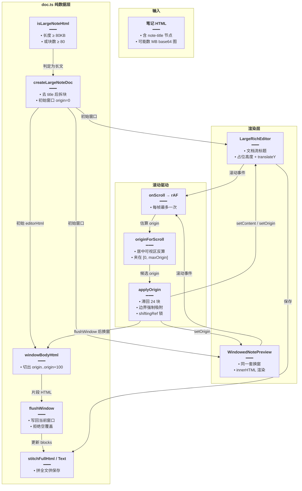
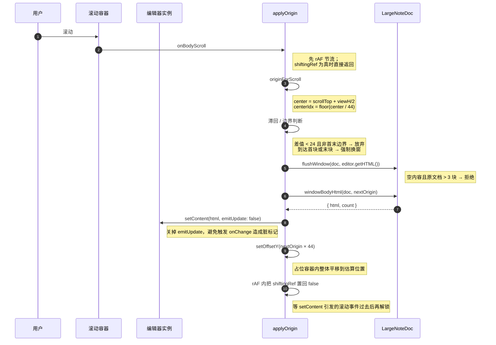

# 长文窗口化渲染

本文归档「大笔记」在编辑器与预览两端的窗口化方案：当一篇笔记的块数或体积超过阈值时，不再把整篇内容挂进 DOM，而是只在视口附近保留约 100 个块，靠一个撑满全高的占位容器 + `translateY` 制造「整篇都在」的错觉，滚动时换窗、保存时拼接。

> **文档角色**：本模块是富文本套件的**性能层**专题，建立在 [富文本预览与图片灯箱.md](./富文本预览与图片灯箱.md) 的字符串变换能力之上。
> **延伸阅读**：
> - [富文本编辑器实现.md](./富文本编辑器实现.md) —— `RichEditor` 的 `renderBody` / `onBodyScroll` 插槽如何被本模块接管
> - [富文本预览与图片灯箱.md](./富文本预览与图片灯箱.md) —— `splitPreviewBlocks`、`decoratePreviewHtml` 的来源
> - [富文本套件包化.md](./富文本套件包化.md) —— `./windowed` 子路径与产物自检

---

## 1. 背景与目标

一篇「长笔记」的典型形态是：几百个段落 + 若干 base64 内嵌图片，HTML 体积可以达到几 MB。这种内容直接渲染会踩两个坑：

1. **编辑器卡死。** TipTap 需要把整篇 HTML 解析成 ProseMirror 文档树，每个块都要建节点、算装饰、跑插件；几千个块时首屏能黑屏数秒。
2. **预览拖垮列表。** 笔记列表通常左边是列表、右边是预览，预览侧一旦挂上几万个 DOM 节点，左侧滚动会被同一个主线程拖到掉帧。

窗口化的思路很直接：**只渲染视口附近的一小段，其余部分用一个等高的空容器占位**。滚动时把占位容器内的内容整体平移到新的位置，并换入新的片段。

目标与验收：

| 编号 | 目标 | 验收 |
| --- | --- | --- |
| W1 | 大笔记首屏不为整篇建 DOM | 首屏只挂 ≤ `WINDOW_SIZE` 块 |
| W2 | 滚动条长度、位置与「整篇都在」一致 | 占位容器高度 = 总块数 × 估算块高 |
| W3 | 换窗不抖动、不无限触发 | 位移小于 `ORIGIN_HYSTERESIS` 时不换窗 |
| W4 | 保存时拿到完整内容 | `getHTML` / `getText` 返回全文而非当前窗口 |
| W5 | 空窗口不得覆盖已有内容 | 用空内容调用 `flushWindow` 返回 `false` 且不改数据 |
| W6 | 打开长文直接定位到文末 | 初始窗口 = 最后一窗，焦点在文末 |

---

## 2. 改动范围

随 `packages/richtext-kit` 新增，按 Skill「纯新增例外」只提供**改动后**代码。

| 文件 | 行数 | 职责 |
| --- | --- | --- |
| `packages/richtext-kit/src/windowed/doc.ts` | 156 | 纯数据层：判大、拆块、换窗、写回、拼接 |
| `packages/richtext-kit/src/windowed/LargeRichEditor.tsx` | 270 | 长文编辑器：文档流标题 + 绝对定位窗口 |
| `packages/richtext-kit/src/windowed/WindowedNotePreview.tsx` | 180 | 长文只读预览：同套换窗逻辑 |
| `packages/richtext-kit/src/windowed-entry.ts` | 27 | `./windowed` 子路径导出面 |
| `packages/richtext-kit/test/windowed/doc.test.ts` | 49 | 判大、拆窗、拒绝空覆盖的用例 |

---

## 3. 实现思路

### 3.1 四个常量定住整套策略

| 常量 | 值 | 作用 |
| --- | --- | --- |
| `LARGE_MIN_BLOCKS` | 80 | 块数达到该值即视为长文 |
| `WINDOW_SIZE` | 100 | 一次挂进 DOM 的最大块数 |
| `ORIGIN_HYSTERESIS` | 24 | 窗口起点变化小于该值时不换窗，抑制抖动 |
| `EST_BLOCK_H` | 44 | 单块估算高度，用于撑占位容器与反算滚动位置 |

「估算块高」是有意为之的妥协：真实块高需要布局后才能知道，而窗口化本身就是为了避免一次性布局全文。用固定估值撑出滚动条，换来的是**滚动条长度不精确但可用**；换窗时用 `translateY(nextOrigin × EST_BLOCK_H)` 把内容钉到估算位置，用户视觉上不会察觉到跳变。

### 3.2 判定长文：体积或块数任一超标

`isLargeNoteHtml` 有两条判定线：字符串长度 ≥ 80,000 字符，或拆块数 ≥ 80。前者覆盖「块很少但每块都是巨大 base64 图片」的情况，后者覆盖「块很多但每块很短」的情况——只判其中一条都会漏。

### 3.3 换窗的三重防抖

换窗是一件很危险的事：它要 `setContent` 替换编辑器内容，而 `setContent` 又会触发滚动与选中变化，极易形成「换窗 → 滚动 → 再换窗」的死循环。代码里叠了三层保护：

1. **滞回阈值**：`|nextOrigin - originRef.current| < ORIGIN_HYSTERESIS` 时直接返回；
2. **边界吸附**：即将到达首块或末块（`snapEdge`）时**无视**滞回阈值强制换窗，否则用户滚到最底部却永远差最后 24 块；
3. **`shiftingRef` 锁 + rAF 解锁**：换窗期间置真，所有滚动回调直接返回；换窗结束后在下一帧才解锁，确保 `setContent` 引发的滚动事件已经过去。

另外滚动回调本身还套了一层 `requestAnimationFrame`（`scrollRafRef`），把高频 `scroll` 事件压成每帧最多一次。

### 3.4 写回与「拒绝空覆盖」

换窗前必须把当前窗口的编辑结果写回 `doc.blocks`：

```
doc.blocks.splice(doc.origin, doc.count, ...新的块)
```

这里有个真实的坑：`setContent` 或未初始化完成时，编辑器可能只回传 `<p></p>`。如果直接写回，就会把原本 90 个块覆盖成 1 个空段落——**用户什么都没删，内容却没了**。`flushWindow` 因此加了 `isEffectivelyEmptyBody` 判定：新内容不超过 3 块且全是空段落，而原文档本身超过 3 块时，直接返回 `false` 并放弃本次写回。

### 3.5 保存要的是全文

`getHTML` 与 `getText` 都先 `flushWindow` 把当前窗口写回，再把 `doc.blocks.join('')` 拼成全篇，前面补上 `titleToHtml(title)`。文本版还会做标签到纯文本的降级：

- `<br>` → `\n`
- `</p>` → `\n\n`
- 其余标签直接剥掉
- 连续 3 个以上换行压成 2 个

### 3.6 打开长文默认落在文末

`bootLargeNote` 在初始化时把窗口直接设成**最后一窗**（`maxOrigin = blocks.length - WINDOW_SIZE`）。原因写在注释里：短文编辑器的习惯是「进入即光标在文末继续写」，长文如果从第 0 块开始，`focus('end')` 会把光标放到第 100 块末尾——那是全文的中段，用户会以为内容被截断了。

### 3.7 编辑器里的标题为什么走文档流

`LargeRichEditor` 没有用固定高度的标题槽，而是把 `NoteTitleField` 放在文档流里，与正文共用一个滚动容器。原因是固定槽位会让标题与正文之间出现一条无法消除的大缝——短文的标题是 TipTap 文档里的 `title` 节点（自然贴合正文），长文若用槽位就与短文视觉不一致。标题高度通过 `ResizeObserver` 实时记录到 `titleHRef`，滚动换算时减掉它，保证「正文顶部」对齐。

### 3.8 块数不足一窗时不垫高

`windowed = blockCount > WINDOW_SIZE` 这个判断很关键。大图笔记因为 base64 体积超标进入了长文路径，但块数可能只有 5 块；此时若仍按 `WINDOW_SIZE × EST_BLOCK_H` 撑高度，文末会出现几屏高的空白。所以只有块数真的超过一窗时才启用占位容器与绝对定位。

### 3.9 整体链路



### 3.10 一次换窗的时序



---

## 4. 关键代码

> 本章代码块均为**纯新增文件**，按 `code-before-after.md` §4 纯新增例外，仅提供「改动后」一侧。
> 若与仓库最新源码不一致，以源码为准。

### 4.1 数据层 `doc.ts`

来源：`packages/richtext-kit/src/windowed/doc.ts`（**改动后**，纯新增，约 L1–L156）

```typescript
// 复用预览层的拆块与去标题能力，保证编辑态与预览态的块边界完全一致
import { splitPreviewBlocks, stripNoteTitleHtml } from '../preview/previewHtml';

// 块数阈值：达到该值即走长文窗口化路径
export const LARGE_MIN_BLOCKS = 80;
// 一次挂进 DOM 的最大块数，同时也是估算高度的单位基数
export const WINDOW_SIZE = 100;
// 换窗滞回：起点变化小于该块数时不触发换窗，抑制滚动抖动
export const ORIGIN_HYSTERESIS = 24;
// 单块估算高度（px），用于撑占位容器与反算滚动位置
export const EST_BLOCK_H = 44;

// 与 previewHtml 中同一条正则，用于在不拆块的前提下抠出标题节点
const TITLE_RE =
	/<div\b[^>]*\bdata-type=["']note-title["'][^>]*>[\s\S]*?<\/div>/i;

// 长文的内存模型：块数组 + 当前窗口起点与长度
export type LargeNoteDoc = {
	// 全部块，换窗时只替换其中一段
	blocks: string[];
	// 当前窗口起点（块索引）
	origin: number;
	// 当前窗口块数
	count: number;
};

// 取出标题节点的 HTML 原文，找不到时返回空串
export function extractTitleHtml(html: string): string {
	// match 返回数组，取第 0 项即完整标签
	return html.match(TITLE_RE)?.[0] ?? '';
}

// 从标题节点中取纯文本标题
export function extractTitleText(html: string): string {
	// 先拿到标题节点 HTML
	const node = extractTitleHtml(html);
	// 没有标题节点时返回空串
	if (!node) return '';
	// 优先读 data-value 属性，它保存的是转义前的原始标题
	const fromAttr = node.match(/data-value=["']([^"']*)["']/i)?.[1];
	// 属性存在（包括空串）就以它为准，避免被 HTML 实体干扰
	if (fromAttr != null) return fromAttr.trim();
	// 属性缺失时退化为「剥掉所有标签取文本」
	return node.replace(/<[^>]+>/g, '').trim();
}

// 判断是否有可保存的正文：纯文字，或仅图片等媒体（getText 不包含 img）
export function hasNoteBodyContent(html: string, text = ''): boolean {
	// 有纯文本说明一定有内容，最快路径
	if (text.trim()) return true;
	// 去掉标题节点，避免「只有标题」被判成有正文
	const body = stripNoteTitleHtml(html);
	// 媒体标签不产生纯文本，但仍是有效内容，必须单独判定
	if (/<(img|video|audio|iframe|embed)\b/i.test(body)) return true;
	// 兜底：剥掉标签并还原空格实体后是否还有可见字符
	return (
		body
			// 去掉全部标签
			.replace(/<[^>]+>/g, '')
			// 把 &nbsp; 还原成空格，否则会被当成有内容
			.replace(/&nbsp;/gi, ' ')
			// 去掉首尾空白
			.trim().length > 0
	);
}

// 把标题文本重新包装成编辑器可识别的 title 节点
export function titleToHtml(title: string): string {
	// 逐项转义，防止标题里的特殊字符破坏 HTML 结构
	const safe = title
		// & 必须最先转义，否则会把后面转义出的实体再次转义
		.replace(/&/g, '&amp;')
		// 双引号转义，因为它会出现在属性值里
		.replace(/"/g, '&quot;')
		// 小于号转义，防止被解析成标签开头
		.replace(/</g, '&lt;')
		// 大于号转义，保持成对以便阅读
		.replace(/>/g, '&gt;');
	// data-value 保存原始标题（已转义），内部文本用于渲染
	return `<div data-type="note-title" data-value="${safe}">${safe}</div>`;
}

// 判定是否为长文：非空字符串且体积或块数任一超标
export function isLargeNoteHtml(content: unknown): content is string {
	// 类型守卫：非字符串或空串一律不算长文
	if (typeof content !== 'string' || !content) return false;
	// 去掉标题后再拆块，避免标题占用一个块位影响阈值判断
	const body = stripNoteTitleHtml(content);
	// 体积线：80,000 字符（典型为大量 base64 图片）
	if (content.length >= 80_000) return true;
	// 块数线：拆块后达到阈值
	return splitPreviewBlocks(body).length >= LARGE_MIN_BLOCKS;
}

// 把整篇 HTML 转成长文文档模型 + 初始窗口
export function createLargeNoteDoc(html: string): {
	// 交给编辑 / 预览使用的文档模型
	doc: LargeNoteDoc;
	// 提取出的标题纯文本
	title: string;
	// 初始窗口对应的 HTML 片段
	editorHtml: string;
} {
	// 不折叠空段：预览 / 长文编辑窗口与短文编辑态空行保持一致
	const title = extractTitleText(html);
	// 去掉标题节点，剩下的才是正文块
	const body = stripNoteTitleHtml(html);
	// 按顶层标签拆块
	const parts = splitPreviewBlocks(body);
	// 拆不出块时兜底一个空段落，保证后续逻辑永远有块可用
	const blocks = parts.length ? parts : ['<p></p>'];
	// 初始窗口最多一窗，文档不足一窗时取全部
	const count = Math.min(WINDOW_SIZE, blocks.length);
	// 组装文档模型，初始从第 0 块开始
	const doc: LargeNoteDoc = { blocks, origin: 0, count };
	// 返回模型、标题与首窗 HTML（空则兜底空段落）
	return {
		// 文档模型
		doc,
		// 标题文本
		title,
		// 首窗内容
		editorHtml: blocks.slice(0, count).join('') || '<p></p>',
	};
}

// 判断一段块集合是否「实质为空」，用于阻止空覆盖
function isEffectivelyEmptyBody(blocks: string[]): boolean {
	// 完全没有块当然算空
	if (blocks.length === 0) return true;
	// 超过 3 块直接认为有内容，避免逐块正则的开销
	if (blocks.length > 3) return false;
	// 3 块以内必须全部是空段落才算空
	return blocks.every((b) => /^<p\b[^>]*>\s*<\/p>$/i.test(b));
}

// 把编辑器当前内容写回文档模型的当前窗口
export function flushWindow(doc: LargeNoteDoc, editorHtml: string): boolean {
	// 拆出编辑器里的正文块（顺带去标题）
	const bodyBlocks = splitPreviewBlocks(stripNoteTitleHtml(editorHtml));
	// 新内容是空的、而原文档明显有内容时，判定为异常回传并拒绝覆盖
	if (isEffectivelyEmptyBody(bodyBlocks) && doc.count > 3) return false;
	// 正常情况：空则兜底一个空段落，保证 splice 参数合法
	const next = bodyBlocks.length ? bodyBlocks : ['<p></p>'];
	// 用新块替换当前窗口对应的区间
	doc.blocks.splice(doc.origin, doc.count, ...next);
	// 窗口长度跟随新内容变化，否则后续切片会错位
	doc.count = next.length;
	// 返回成功，调用方可据此决定是否继续换窗
	return true;
}

// 按 origin 切出一窗内容
export function windowBodyHtml(
	// 文档模型
	doc: LargeNoteDoc,
	// 目标窗口起点
	origin: number,
): {
	// 切出的 HTML（多块直接拼接）
	html: string;
	// 实际块数（至少 1）
	count: number;
} {
	// 块数不超过一窗，且不越过文档末尾
	const count = Math.min(WINDOW_SIZE, Math.max(0, doc.blocks.length - origin));
	// 有块则切片拼接，没有则兜底一个空段落避免编辑器内容为空
	const html =
		count > 0 ? doc.blocks.slice(origin, origin + count).join('') : '<p></p>';
	// count 为 0 时返回 1，与兜底空段落保持一致
	return { html, count: count > 0 ? count : 1 };
}

// 由滚动位置反算「让可视区居中」的窗口起点
export function originForScroll(
	// 滚动容器当前的 scrollTop
	scrollTop: number,
	// 可视区高度
	viewH: number,
	// 文档总块数
	blockCount: number,
	// 单块估算高度
	estH: number,
): number {
	// 取可视区中心在内容坐标系中的位置
	const center = scrollTop + viewH / 2;
	// 换算成块索引并夹在 [0, blockCount-1]，防止越界
	const centerIdx = Math.max(
		// 下界 0
		0,
		// 上界为最后一块
		Math.min(blockCount - 1, Math.floor(center / estH)),
	);
	// 窗口起点最大只能是「总块数 - 一窗」，否则切片会不足一窗
	const maxOrigin = Math.max(0, blockCount - WINDOW_SIZE);
	// 让窗口中心对准可视区中心，并夹在合法范围内
	return Math.max(
		// 下界 0
		0,
		// 上界 maxOrigin
		Math.min(maxOrigin, centerIdx - Math.floor(WINDOW_SIZE / 2)),
	);
}

// 拼接完整 HTML 用于保存
export function stitchFullHtml(
	// 文档模型
	doc: LargeNoteDoc,
	// 标题文本
	title: string,
	// 编辑器当前窗口内容
	editorHtml: string,
): string {
	// 先把当前窗口写回，否则会丢掉用户最后编辑的一段
	flushWindow(doc, editorHtml);
	// 标题节点 + 全部块拼接即完整文档
	return `${titleToHtml(title)}${doc.blocks.join('')}`;
}

// 拼接完整纯文本用于保存 / 分词 / 字数统计
export function stitchFullText(
	// 文档模型
	doc: LargeNoteDoc,
	// 标题文本
	title: string,
	// 编辑器当前窗口内容
	editorHtml: string,
): string {
	// 同样先写回当前窗口
	flushWindow(doc, editorHtml);
	// 先拼出与 HTML 版一致的完整文档
	const full = `${titleToHtml(title)}${doc.blocks.join('')}`;
	// 再做标签到文本的降级
	return full
		// 换行标签转成单个换行
		.replace(/<br\s*\/?>/gi, '\n')
		// 段落结束转成两个换行，形成段间距
		.replace(/<\/p>/gi, '\n\n')
		// 其余标签全部剥掉
		.replace(/<[^>]+>/g, '')
		// 三个及以上连续换行压成两个，避免出现大段空白
		.replace(/\n{3,}/g, '\n\n')
		// 去掉首尾空白
		.trim();
}
```

### 4.2 长文编辑器 `LargeRichEditor.tsx`

来源：`packages/richtext-kit/src/windowed/LargeRichEditor.tsx`（**改动后**，纯新增，约 L1–L270）

```tsx
// 引入 React 能力：节点类型、滚动事件类型、回调缓存、布局副作用、引用、状态
import {
	// 可渲染节点
	type ReactNode,
	// 滚动事件类型
	type UIEvent,
	// 稳定回调
	useCallback,
	// 布局副作用（在绘制前同步测量标题高度）
	useLayoutEffect,
	// 可变引用
	useRef,
	// 组件状态
	useState,
} from 'react';
// 引入类名合并工具
import { cn } from '../cn';
// 引入编辑器外壳、标题输入组件与相关类型
import {
	// 编辑器实例类型
	type Editor,
	// 文档流标题输入框
	NoteTitleField,
	// 基础编辑器组件
	RichEditor,
	// 文案类型
	type RichEditorLocale,
	// 编辑器 props 类型
	type RichEditorProps,
} from '../editor';
// 引入插槽类型，允许宿主替换内部 UI
import type { RichTextKitSlots } from '../slots';
// 引入数据层全部能力
import {
	// 构建文档模型
	createLargeNoteDoc,
	// 单块估算高度
	EST_BLOCK_H,
	// 写回当前窗口
	flushWindow,
	// 文档模型类型
	type LargeNoteDoc,
	// 滞回阈值
	ORIGIN_HYSTERESIS,
	// 滚动位置反算窗口起点
	originForScroll,
	// 拼接完整 HTML
	stitchFullHtml,
	// 拼接完整文本
	stitchFullText,
	// 一窗块数
	WINDOW_SIZE,
	// 切出指定窗口
	windowBodyHtml,
} from './doc';

// 暴露给宿主的保存接口
export type LargeNoteSaveApi = {
	// 取完整 HTML
	getHTML: () => string;
	// 取完整纯文本
	getText: () => string;
	// 取标题
	getTitle: () => string;
};

// 组件 props
type Props = {
	// 初始内容（完整 HTML）
	defaultContent: string;
	// 文案覆盖
	locale: Partial<RichEditorLocale>;
	// 正文占位提示
	placeholder?: string;
	// 工具栏额外节点
	toolbarExtra?: RichEditorProps['toolbarExtra'];
	// 图片上传实现，返回最终 URL
	onUploadImage?: RichEditorProps['onUploadImage'];
	// 根容器类名
	className?: string;
	// 正文编辑器类名
	editorClassName?: string;
	// 编辑器就绪回调，同时交出保存接口
	onReady: (editor: Editor, save: LargeNoteSaveApi) => void;
	// 标题或正文变更时回调（用于未保存标记）
	onChange?: () => void;
	// 插槽覆盖
	slots?: Partial<RichTextKitSlots>;
};

// 初始化长文：构建模型并把初始窗口挪到最后一窗
function bootLargeNote(defaultContent: string) {
	// 先按常规方式构建模型（origin 从 0 开始）
	const created = createLargeNoteDoc(defaultContent);
	// 进编辑要对齐短文「光标在文末」：初始就挂最后一窗，避免 focus(end) 停在全文中段
	const maxOrigin = Math.max(0, created.doc.blocks.length - WINDOW_SIZE);
	// 只有确实存在后续窗口时才需要挪动
	if (maxOrigin > 0) {
		// 切出最后一窗
		const { html, count } = windowBodyHtml(created.doc, maxOrigin);
		// 更新模型起点
		created.doc.origin = maxOrigin;
		// 更新模型窗口长度
		created.doc.count = count;
		// 用最后一窗替换初始内容
		created.editorHtml = html;
	}
	// 返回可直接用于渲染的模型
	return created;
}

// 把滚动容器滚到底并聚焦文末
function scrollViewportToEnd(editor: Editor) {
	// 通过 data-slot 找到套件封装的滚动视口，避免依赖具体 DOM 层级
	const vp = editor.view.dom.closest(
		'[data-slot="scroll-area-viewport"]',
	) as HTMLElement | null;
	// 找到就滚到底部
	if (vp) vp.scrollTop = vp.scrollHeight;
	// 编辑器未被销毁时把光标放到文末，让用户直接继续写
	if (!editor.isDestroyed) editor.commands.focus('end');
}

// 长笔记连续滚动编辑：标题与短文共用 NoteTitleField，自然文档流紧贴正文
export function LargeRichEditor({
	// 初始内容
	defaultContent,
	// 文案覆盖
	locale,
	// 占位提示
	placeholder,
	// 工具栏额外节点
	toolbarExtra,
	// 图片上传实现
	onUploadImage,
	// 根类名
	className,
	// 正文类名
	editorClassName,
	// 就绪回调
	onReady,
	// 变更回调
	onChange,
	// 插槽覆盖
	slots,
}: Props) {
	// 只在首次渲染时构建模型，后续重渲染复用同一份数据
	const boot = useRef(bootLargeNote(defaultContent));
	// 文档模型的稳定引用，换窗时直接改这里的数据
	const docRef = useRef<LargeNoteDoc>(boot.current.doc);
	// 编辑器实例引用
	const editorRef = useRef<Editor | null>(null);
	// 标题容器引用，用于测量高度
	const titleWrapRef = useRef<HTMLDivElement | null>(null);
	// 标题容器高度缓存，滚动换算时要减掉它
	const titleHRef = useRef(0);
	// 标题状态，驱动标题输入框渲染
	const [title, setTitle] = useState(boot.current.title);
	// 标题的引用副本，供保存接口读取最新值
	const titleRef = useRef(title);
	// 每次渲染同步最新标题，避免闭包拿到旧值
	titleRef.current = title;
	// 当前窗口起点引用，用于滞回比较
	const originRef = useRef(boot.current.doc.origin);
	// 换窗锁：为真时所有滚动逻辑直接返回
	const shiftingRef = useRef(false);
	// 滚动节流用的 rAF 句柄
	const scrollRafRef = useRef(0);
	// onReady 的引用副本，避免它变化导致 onCreate 重建
	const onReadyRef = useRef(onReady);
	// 同步最新回调
	onReadyRef.current = onReady;
	// onChange 的引用副本
	const onChangeRef = useRef(onChange);
	// 同步最新回调
	onChangeRef.current = onChange;

	// 总块数状态，块数变化时更新占位高度
	const [blockCount, setBlockCount] = useState(boot.current.doc.blocks.length);
	// 窗口内容的垂直偏移，驱动 translateY
	const [offsetY, setOffsetY] = useState(boot.current.doc.origin * EST_BLOCK_H);
	// 块数不足一窗时勿按 WINDOW_SIZE 垫高（大图笔记常因 base64 进长文路径，否则文末巨空白）
	const windowed = blockCount > WINDOW_SIZE;
	// 占位容器高度：块数 × 估算块高，至少一屏
	const bodyH = Math.max(blockCount, 1) * EST_BLOCK_H;

	// 布局副作用：测量标题高度并持续跟踪变化
	useLayoutEffect(() => {
		// 取标题容器
		const el = titleWrapRef.current;
		// 容器不存在则跳过
		if (!el) return;
		// 同步函数：把当前高度写入缓存
		const sync = () => {
			// offsetHeight 含边框，足够用于滚动换算
			titleHRef.current = el.offsetHeight;
		};
		// 首次立即测量，避免第一帧用 0 值换算
		sync();
		// 监听尺寸变化，标题换行或字号变化时也能跟上
		const ro = new ResizeObserver(sync);
		// 开始观察
		ro.observe(el);
		// 卸载时断开观察，防止泄漏
		return () => ro.disconnect();
	}, []);

	// 构造保存接口，内部始终读最新引用
	const saveApi = useCallback((): LargeNoteSaveApi => {
		// 返回三个取值函数
		return {
			// 完整 HTML
			getHTML: () => {
				// 取编辑器实例
				const e = editorRef.current;
				// 实例可用时取当前窗口 HTML，否则给空串
				const html = e && !e.isDestroyed ? e.getHTML() : '';
				// 写回并拼接全文
				return stitchFullHtml(docRef.current, titleRef.current, html);
			},
			// 完整纯文本
			getText: () => {
				// 取编辑器实例
				const e = editorRef.current;
				// 同样只在实例可用时取内容
				const html = e && !e.isDestroyed ? e.getHTML() : '';
				// 写回并拼接纯文本
				return stitchFullText(docRef.current, titleRef.current, html);
			},
			// 标题去空白后返回
			getTitle: () => titleRef.current.trim(),
		};
	}, []);

	// 把焦点移到正文开头，用于标题按回车后继续写
	const focusBody = useCallback(() => {
		// focus('start') 把光标放到正文第一块开头
		editorRef.current?.commands.focus('start');
	}, []);

	// 标题变更处理
	const onTitleChange = useCallback((next: string) => {
		// 先更新引用，保证保存接口立即拿到新值
		titleRef.current = next;
		// 再更新状态驱动渲染
		setTitle(next);
		// 通知宿主产生变更（用于未保存标记）
		onChangeRef.current?.();
	}, []);

	// 应用新窗口：换窗的唯一入口
	const applyOrigin = useCallback((editor: Editor, nextOrigin: number) => {
		// 取文档模型
		const doc = docRef.current;
		// 正在换窗时直接放弃，避免递归
		if (shiftingRef.current) return;
		// 起点没变则无需任何操作
		if (nextOrigin === originRef.current) return;

		// 允许的最大起点
		const maxOrigin = Math.max(0, doc.blocks.length - WINDOW_SIZE);
		// 是否正在进入首块或末块边界
		const snapEdge =
			// 即将到达第 0 块
			(nextOrigin === 0 && originRef.current !== 0) ||
			// 即将到达最后一窗
			(nextOrigin === maxOrigin && originRef.current !== maxOrigin);
		// 未到边界且位移不足滞回阈值时放弃换窗
		if (
			// 非边界场景
			!snapEdge &&
			// 位移过小
			Math.abs(nextOrigin - originRef.current) < ORIGIN_HYSTERESIS
		) {
			// 直接返回，保持当前窗口
			return;
		}

		// 上锁，阻止期间的滚动回调重入
		shiftingRef.current = true;
		// try/finally 保证锁一定会被安排释放
		try {
			// 先把当前窗口的编辑结果写回模型
			flushWindow(doc, editor.getHTML());
			// 切出新窗口内容
			const { html, count } = windowBodyHtml(doc, nextOrigin);
			// 替换编辑器内容；关掉 emitUpdate 以免触发 onChange 造成假脏标记
			const ok = editor.commands.setContent(html, { emitUpdate: false });
			// setContent 被拒绝（如内容非法）时放弃本次换窗，保持模型一致
			if (ok === false) return;
			// 更新模型起点
			doc.origin = nextOrigin;
			// 更新模型窗口长度
			doc.count = count;
			// 同步起点引用，供下次滞回比较
			originRef.current = nextOrigin;
			// 把窗口平移到估算位置
			setOffsetY(nextOrigin * EST_BLOCK_H);
			// 同步总块数，触发布局高度重算
			setBlockCount(doc.blocks.length);
		// finally 在正常返回与提前 return 时都会执行
		} finally {
			// 下一帧再解锁，确保 setContent 引发的滚动事件已经过去
			requestAnimationFrame(() => {
				// 释放换窗锁
				shiftingRef.current = false;
			});
		}
	}, []);

	// 正文滚动处理：rAF 节流后反算窗口
	const onBodyScroll = useCallback(
		// 滚动事件来自正文滚动容器
		(e: UIEvent<HTMLDivElement>) => {
			// 取编辑器实例
			const editor = editorRef.current;
			// 实例不存在、已销毁或正在换窗时都不处理
			if (!editor || editor.isDestroyed || shiftingRef.current) return;
			// 取滚动容器
			const vp = e.currentTarget;
			// 标题高度优先用缓存，其次现场测量
			const titleH =
				titleHRef.current || titleWrapRef.current?.offsetHeight || 0;
			// 减掉标题高度并夹到非负，得到正文坐标系下的滚动位置
			const top = Math.max(0, vp.scrollTop - titleH);
			// 可视区高度，取不到时给一个合理默认值
			const viewH = vp.clientHeight || 600;
			// 已有一帧待执行时直接返回，实现每帧最多一次
			if (scrollRafRef.current) return;
			// 安排到下一帧执行
			scrollRafRef.current = requestAnimationFrame(() => {
				// 清空句柄，允许下次调度
				scrollRafRef.current = 0;
				// 帧内再次检查换窗锁，防止这一帧被换窗占用
				if (shiftingRef.current) return;
				// 反算候选窗口起点
				const next = originForScroll(
					// 正文滚动位置
					top,
					// 可视区高度
					viewH,
					// 总块数
					docRef.current.blocks.length,
					// 估算块高
					EST_BLOCK_H,
				);
				// 真正应用换窗
				applyOrigin(editor, next);
			});
		},
		// 依赖换窗函数
		[applyOrigin],
	);

	// 自定义正文渲染：标题 + 占位容器 + 绝对定位的编辑器内容
	const renderBody = useCallback(
		// editorContent 由 RichEditor 注入，即 TipTap 的正文节点
		(editorContent: ReactNode) => (
			// 外层相对定位，作为绝对定位的参照
			<div className="relative w-full">
				{/* 文档流标题：与短文 TipTap node-title 同距，mb-2 即空隙 */}
				<div ref={titleWrapRef} className="relative z-1">
					<NoteTitleField
						// 受控标题值
						value={title}
						// 标题变更回调
						onChange={onTitleChange}
						// 标题内回车聚焦正文
						onContinue={focusBody}
					/>
				</div>
				{/* 块数超过一窗才启用窗口化容器 */}
				{windowed ? (
					// 占位容器撑出全篇高度，滚动条长度由此决定
					<div className="relative w-full" style={{ height: bodyH }}>
						<div
							// 绝对定位到容器顶部，宽度拉满
							className="absolute top-0 right-0 left-0"
							// 按窗口起点平移，视觉上落在正确位置
							style={{ transform: `translateY(${offsetY}px)` }}
						>
							{/* 真正的编辑器内容 */}
							{editorContent}
						</div>
					</div>
				) : (
					// 不足一窗时按普通文档流渲染，避免文末空出几屏
					<div className="relative w-full">{editorContent}</div>
				)}
			</div>
		),
		// 依赖渲染所需的全部响应式值
		[bodyH, focusBody, offsetY, onTitleChange, title, windowed],
	);

	// 渲染整体结构
	return (
		<div className={cn('flex h-full min-h-0 min-w-0 flex-col', className)}>
			<RichEditor
				// 初始内容取当前窗口片段
				defaultContent={boot.current.editorHtml}
				// 标题由 renderBody 自定义渲染，关掉内置标题
				showTitle={false}
				// 自动聚焦交给 onCreate 里的滚动逻辑处理
				autofocus={false}
				// 正文占位提示
				placeholder={placeholder}
				// 文案覆盖
				locale={locale}
				// 字数统计在长文场景成本高且意义有限，关闭
				showCharCount={false}
				// 长文不需要气泡菜单，避免与窗口滚动冲突
				showBubbleMenu={false}
				// 图片上传实现
				onUploadImage={onUploadImage}
				// 接管滚动事件
				onBodyScroll={onBodyScroll}
				// 接管正文渲染结构
				renderBody={renderBody}
				// 插槽覆盖
				slots={slots}
				// 内容变更只上报，不在回调里做重活
				onChange={() => onChangeRef.current?.()}
				// 编辑器创建完成：交出实例与保存接口，并滚到底
				onCreate={(e) => {
					// 保存实例引用
					editorRef.current = e;
					// 把模型起点与引用对齐，防止首次换窗判断出错
					docRef.current.origin = originRef.current;
					// 通知宿主并交出保存接口
					onReadyRef.current(e, saveApi());
					// 布局完成后再滚到底 + 焦点文末（双 rAF 等绝对定位 offset 生效）
					requestAnimationFrame(() => {
						// 第一次尝试
						scrollViewportToEnd(e);
						// 再等一帧，确保占位容器与 translateY 已生效
						requestAnimationFrame(() => scrollViewportToEnd(e));
					});
				}}
				// 外壳撑满剩余高度并裁剪溢出
				className="flex min-h-0 flex-1 flex-col overflow-hidden"
				// 正文类名透传
				editorClassName={editorClassName}
				// 工具栏额外节点
				toolbarExtra={toolbarExtra}
			/>
		</div>
	);
}

/** @deprecated 兼容插件旧名 */
export const LargeNoteEditor = LargeRichEditor;
```

### 4.3 长文预览 `WindowedNotePreview.tsx`

来源：`packages/richtext-kit/src/windowed/WindowedNotePreview.tsx`（**改动后**，纯新增，约 L1–L180）

```tsx
// 引入 React 能力：滚动事件类型、回调缓存、副作用、缓存值、引用、状态
import {
	// 滚动事件类型
	type UIEvent,
	// 稳定回调
	useCallback,
	// 副作用（卸载清理）
	useEffect,
	// 记忆化计算
	useMemo,
	// 可变引用
	useRef,
	// 组件状态
	useState,
} from 'react';
// 引入类名合并工具
import { cn } from '../cn';
// 引入预览层的图片装饰与空段补全
import {
	// 图片懒加载 + 内联样式
	decoratePreviewHtml,
	// 空段补 br
	preserveEmptyParagraphs,
} from '../preview/previewHtml';
// 引入灯箱 hook 与下载类型
import {
	// 宿主下载类型
	type HostDownloadBlob,
	// 图片点击灯箱
	useNoteImagePreview,
} from '../preview/useNoteImagePreview';
// 引入插槽 Provider 与类型
import { RichTextKitProvider, type RichTextKitSlots } from '../slots';
// 引入统一滚动容器
import { ScrollArea } from '../ui/scroll-area';
// 引入数据层能力
import {
	// 构建文档模型
	createLargeNoteDoc,
	// 单块估算高度
	EST_BLOCK_H,
	// 文档模型类型
	type LargeNoteDoc,
	// 滞回阈值
	ORIGIN_HYSTERESIS,
	// 滚动反算窗口起点
	originForScroll,
	// 一窗块数
	WINDOW_SIZE,
	// 切出指定窗口
	windowBodyHtml,
} from './doc';

// 组件 props
type Props = {
	// 完整 HTML
	html: string;
	// 容器类名
	className?: string;
	// 宿主下载实现
	downloadBlob?: HostDownloadBlob;
	// 插槽覆盖
	slots?: Partial<RichTextKitSlots>;
};

// 长文只读预览：与 LargeRichEditor 同一套滚动窗口，避免全文 DOM 拖垮左侧列表滚动
function WindowedNotePreviewInner({
	// 完整 HTML
	html,
	// 容器类名
	className,
	// 下载实现
	downloadBlob,
}: Omit<Props, 'slots'>) {
	// html 变化时重建模型，避免残留旧窗口
	const boot = useMemo(() => createLargeNoteDoc(html), [html]);
	// 模型引用，换窗时更新 origin / count
	const docRef = useRef<LargeNoteDoc>(boot.doc);
	// 当前起点引用，用于滞回比较
	const originRef = useRef(0);
	// 换窗锁
	const shiftingRef = useRef(false);
	// 滚动节流 rAF 句柄
	const scrollRafRef = useRef(0);
	// 正文容器引用，兼作灯箱事件委托根
	const bodyRef = useRef<HTMLDivElement>(null);

	// 当前窗口起点状态
	const [origin, setOrigin] = useState(0);
	// 窗口内容的垂直偏移
	const [offsetY, setOffsetY] = useState(0);
	// 总块数直接取模型，纯展示无需状态
	const blockCount = boot.doc.blocks.length;
	// 占位容器高度，至少一屏
	const bodyH = Math.max(blockCount, 1) * EST_BLOCK_H;
	// 块数超过一窗才启用窗口化
	const windowed = blockCount > WINDOW_SIZE;

	// 用最新的模型覆盖引用，保证回调里读到当前文档
	docRef.current = boot.doc;

	// 计算当前窗口要渲染的 HTML
	const windowHtml = useMemo(() => {
		// 切出窗口片段
		const { html: slice } = windowBodyHtml(boot.doc, origin);
		// 仅文档窗口起点才允许「以图开头 → 首图去顶距」
		return decoratePreviewHtml(preserveEmptyParagraphs(slice), {
			// origin 为 0 说明这是真正的文档开头
			flushLeadingImg: origin === 0,
		});
	}, [boot.doc, origin]);

	// 注册图片点击灯箱；html 传全文，保证窗口化时也能翻完整篇
	const { noteImagePreviewModal } = useNoteImagePreview({
		// 委托根
		rootRef: bodyRef,
		// 全文 HTML 用于图库
		html,
		// 下载实现
		downloadBlob,
		// 窗口或内容长度变化时重绑，防止 innerHTML 替换后监听失效
		rebindWhen: `${origin}:${windowHtml.length}`,
	});

	// 应用新窗口
	const applyOrigin = useCallback((nextOrigin: number) => {
		// 取模型
		const doc = docRef.current;
		// 正在换窗时放弃
		if (shiftingRef.current) return;
		// 起点未变则无事可做
		if (nextOrigin === originRef.current) return;

		// 最大起点
		const maxOrigin = Math.max(0, doc.blocks.length - WINDOW_SIZE);
		// 是否进入首块或末块边界
		const snapEdge =
			// 即将到达第 0 块
			(nextOrigin === 0 && originRef.current !== 0) ||
			// 即将到达最后一窗
			(nextOrigin === maxOrigin && originRef.current !== maxOrigin);
		// 非边界且位移不足阈值时放弃
		if (
			// 非边界场景
			!snapEdge &&
			// 位移过小
			Math.abs(nextOrigin - originRef.current) < ORIGIN_HYSTERESIS
		) {
			// 保持当前窗口
			return;
		}

		// 上锁，阻止换窗期间重复触发
		shiftingRef.current = true;
		// 同步起点引用
		originRef.current = nextOrigin;
		// 更新模型起点
		doc.origin = nextOrigin;
		// 更新模型窗口长度，防止后续切片错位
		doc.count = Math.min(
			// 不超过一窗
			WINDOW_SIZE,
			// 且不越过文档末尾
			Math.max(0, doc.blocks.length - nextOrigin),
		);
		// 触发重新渲染
		setOrigin(nextOrigin);
		// 把窗口平移到估算位置
		setOffsetY(nextOrigin * EST_BLOCK_H);
		// 下一帧解锁，让渲染先完成
		requestAnimationFrame(() => {
			// 释放锁
			shiftingRef.current = false;
		});
	}, []);

	// 滚动处理：rAF 节流后反算窗口
	const onScroll = useCallback(
		// 滚动事件
		(e: UIEvent<HTMLDivElement>) => {
			// 换窗期间不响应
			if (shiftingRef.current) return;
			// 取滚动容器
			const vp = e.currentTarget;
			// 预览没有文档流标题，直接取 scrollTop 并夹到非负
			const top = Math.max(0, vp.scrollTop);
			// 可视区高度，缺省 600
			const viewH = vp.clientHeight || 600;
			// 已有一帧待执行时返回
			if (scrollRafRef.current) return;
			// 安排到下一帧
			scrollRafRef.current = requestAnimationFrame(() => {
				// 清空句柄
				scrollRafRef.current = 0;
				// 帧内再次检查换窗锁
				if (shiftingRef.current) return;
				// 反算并应用新窗口
				applyOrigin(
					originForScroll(
						// 滚动位置
						top,
						// 可视区高度
						viewH,
						// 总块数
						docRef.current.blocks.length,
						// 估算块高
						EST_BLOCK_H,
					),
				);
			});
		},
		// 依赖换窗函数
		[applyOrigin],
	);

	// 卸载时取消未执行的 rAF，避免对已卸载组件 setState
	useEffect(
		// 返回清理函数
		() => () => {
			// 存在待执行帧时取消
			if (scrollRafRef.current) cancelAnimationFrame(scrollRafRef.current);
		},
		// 只在卸载时执行
		[],
	);

	// 渲染
	return (
		<>
			<ScrollArea
				// 复用编辑态正文样式，保证视觉一致
				className={cn(
					// rich-editor-body 提供字号行高，note-preview-static 标记只读
					'rich-editor-body note-preview-static text-theme min-h-0 flex-1',
					// 允许调用方覆盖
					className,
				)}
				// 只有窗口化时才接管滚动，短文交给原生滚动
				onScroll={windowed ? onScroll : undefined}
			>
				{/* 窗口化分支：占位容器 + 绝对定位内容 */}
				{windowed ? (
					<div
						// 挂到 bodyRef，作为灯箱事件委托根
						ref={bodyRef}
						// 相对定位，作为绝对定位参照
						className="relative w-full"
						// 撑出全篇高度
						style={{ height: bodyH }}
					>
						<div
							// 复用 TipTap 类名继承编辑器排版
							className="tiptap note-preview-tiptap ProseMirror absolute top-0 right-0 left-0"
							// 按窗口起点平移
							style={{ transform: `translateY(${offsetY}px)` }}
							// 写入当前窗口 HTML
							dangerouslySetInnerHTML={{ __html: windowHtml }}
						/>
					</div>
				) : (
					// 短文分支：普通文档流，无需平移
					<div
						// 同样挂到 bodyRef
						ref={bodyRef}
						// 静态渲染类名
						className="tiptap note-preview-tiptap ProseMirror relative w-full"
						// 写入全部内容
						dangerouslySetInnerHTML={{ __html: windowHtml }}
					/>
				)}
			</ScrollArea>
			{/* 灯箱弹层 */}
			{noteImagePreviewModal}
		</>
	);
}

// 导出组件：外层包 Provider，使插槽可被宿主覆盖
export function WindowedNotePreview(props: Props) {
	// 拆出插槽配置
	const { slots, ...rest } = props;
	// 用 Provider 包裹内层实现
	return (
		<RichTextKitProvider slots={slots}>
			{/* 内层负责实际渲染与换窗 */}
			<WindowedNotePreviewInner {...rest} />
		</RichTextKitProvider>
	);
}

/** @deprecated 兼容插件旧名 */
export const WindowedPreviewBody = WindowedNotePreview;
```

**变更摘要**：预览版与编辑器版共用 `doc.ts` 的全部算法，差异只有两处——预览没有文档流标题（不需要减 `titleH`），且换窗靠 `setOrigin` 触发重渲染而不是 `setContent`。

### 4.4 子路径导出 `windowed-entry.ts`

来源：`packages/richtext-kit/src/windowed-entry.ts`（**改动后**，纯新增，约 L1–L27）

```typescript
// 导出文档模型类型
export type { LargeNoteDoc } from './windowed/doc';
// 导出数据层全部常量与函数
export {
	// 构建初始文档模型
	createLargeNoteDoc,
	// 单块估算高度
	EST_BLOCK_H,
	// 取标题节点 HTML
	extractTitleHtml,
	// 取标题纯文本
	extractTitleText,
	// 写回当前窗口
	flushWindow,
	// 判断是否有可保存正文
	hasNoteBodyContent,
	// 判断是否为长文
	isLargeNoteHtml,
	// 长文块数阈值
	LARGE_MIN_BLOCKS,
	// 换窗滞回阈值
	ORIGIN_HYSTERESIS,
	// 滚动反算窗口起点
	originForScroll,
	// 拼接完整 HTML
	stitchFullHtml,
	// 拼接完整纯文本
	stitchFullText,
	// 标题包装成节点
	titleToHtml,
	// 一窗块数
	WINDOW_SIZE,
	// 切出指定窗口
	windowBodyHtml,
} from './windowed/doc';
// 导出编辑器组件与保存接口类型
export {
	// 长文编辑器
	LargeNoteEditor,
	// 保存接口类型
	type LargeNoteSaveApi,
	// 长文编辑器（新名）
	LargeRichEditor,
} from './windowed/LargeRichEditor';
// 导出预览组件
export {
	// 长文只读预览
	WindowedNotePreview,
	// 旧名别名，保持兼容
	WindowedPreviewBody,
} from './windowed/WindowedNotePreview';
```

### 4.5 回归用例 `doc.test.ts`

来源：`packages/richtext-kit/test/windowed/doc.test.ts`（**改动后**，纯新增，约 L1–L49）

```typescript
// 引入 Vitest 的用例组织与断言
import { describe, expect, it } from 'vitest';
// 引入被测函数与常量
import {
	// 构建文档模型
	createLargeNoteDoc,
	// 写回窗口
	flushWindow,
	// 长文判定
	isLargeNoteHtml,
	// 块数阈值
	LARGE_MIN_BLOCKS,
	// 标题包装
	titleToHtml,
	// 一窗块数
	WINDOW_SIZE,
} from '../../src/windowed/doc';

// 构造「一个标题 + n 个段落」的测试样本
function titledBody(n: number): string {
	// 标题节点
	const title = titleToHtml('Hi');
	// 生成 n 个段落并拼接
	const body = Array.from({ length: n }, (_, i) => `<p>b${i}</p>`).join('');
	// 标题在前、正文在后
	return `${title}${body}`;
}

// 用例组：长文判定
describe('isLargeNoteHtml', () => {
	// 3 块的小文档不应被判为长文
	it('短文为 false', () => {
		// 断言返回 false
		expect(isLargeNoteHtml(titledBody(3))).toBe(false);
	});

	// 恰好达到阈值时应判为长文，验证边界取等
	it('块数达到 LARGE_MIN_BLOCKS 为 true', () => {
		// 断言返回 true
		expect(isLargeNoteHtml(titledBody(LARGE_MIN_BLOCKS))).toBe(true);
	});

	// 非字符串与空串都应安全返回 false
	it('非字符串为 false', () => {
		// null 不是长文
		expect(isLargeNoteHtml(null)).toBe(false);
		// 空串不是长文
		expect(isLargeNoteHtml('')).toBe(false);
	});
});

// 用例组：构建文档模型
describe('createLargeNoteDoc', () => {
	// 验证拆块数量与初始窗口截断
	it('拆块并截一窗', () => {
		// 90 个段落，超过一窗但未到 100
		const html = titledBody(90);
		// 构建模型
		const created = createLargeNoteDoc(html);
		// 标题应被正确解析
		expect(created.title).toBe('Hi');
		// 块数应等于段落数
		expect(created.doc.blocks.length).toBe(90);
		// 初始窗口取「一窗」与「总块数」的较小值
		expect(created.doc.count).toBe(Math.min(WINDOW_SIZE, 90));
	});
});

// 用例组：写回窗口
describe('flushWindow', () => {
	// 空内容不得覆盖已有内容，这是防丢数据的关键保护
	it('拒绝用空窗覆盖已有多块', () => {
		// 先构建 90 块的模型
		const created = createLargeNoteDoc(titledBody(90));
		// 用单个空段落尝试写回
		const ok = flushWindow(created.doc, '<p></p>');
		// 应被拒绝
		expect(ok).toBe(false);
		// 原块数保持不变
		expect(created.doc.blocks.length).toBe(90);
	});
});
```

---

## 5. 行为变化

`packages/richtext-kit` 尚未接入 `apps/**`，对现有应用**零行为变化**。接入后的契约如下：

| 场景 | 行为 |
| --- | --- |
| 短文（< 80 块且 < 80KB） | 完全走普通 `RichEditor` / `NotePreview`，不启用窗口化 |
| 长文（≥ 80 块或 ≥ 80KB） | 只挂 100 块，占位容器撑出全篇高度 |
| 打开长文编辑 | 初始落在最后一窗，滚动条在底部，光标在文末 |
| 缓慢小幅滚动 | 位移不足 24 块时窗口不变，避免抖动 |
| 滚到文档最底部 | 强制吸附最后一窗，不会差最后几块 |
| 换窗过程中滚动 | 被 `shiftingRef` 挡住，不产生递归 |
| 保存 HTML | 返回标题 + 全篇正文，不是当前窗口 |
| 保存纯文本 | `<br>` → 换行、`</p>` → 空行，连续空行压缩 |
| 编辑器异常回传空内容 | `flushWindow` 拒绝写回，原内容不丢 |
| 块数不足一窗但体积超标 | 不撑占位高度，避免文末大片空白 |
| 长文预览 | 与编辑同一套换窗；首图仅 `origin === 0` 时去顶距 |

---

## 6. 回归清单

1. 90 块笔记进入编辑：`blocks.length` 为 90，初始窗口为最后一窗。
2. 500 块笔记滚动到底再滚回顶部：内容连续、无丢失、无重复块。
3. 在长文中间插入图片后立刻保存：`getHTML` 包含新图。
4. 在长文中间删除大段后保存：`getHTML` 内容与界面一致。
5. 快速上下拖动滚动条：不出现白屏闪烁或内容跳动超过一屏。
6. 滚到最底部：最后一窗完整可见，最后一块不被截断。
7. 空内容（异常回传）触发换窗：内容不被清空（验证 `flushWindow` 返回 `false`）。
8. 大图笔记（体积 > 80KB 但块数 < 100）：文末无大片空白（`windowed` 为 false）。
9. 长文预览点击图片：灯箱能翻到全文任意图片（`html` 传的是全文）。
10. 长文预览滚到第 2 窗后点首图：首图保留正常顶距（`flushLeadingImg` 为 false）。

---

## 7. 路径速查

| 目的 | 位置 |
| --- | --- |
| 调长文判定阈值 | `packages/richtext-kit/src/windowed/doc.ts` 的 `LARGE_MIN_BLOCKS` 与 80_000 |
| 调窗口大小 | 同文件的 `WINDOW_SIZE` |
| 调滚动灵敏度 | 同文件的 `ORIGIN_HYSTERESIS` |
| 调行高估算 | 同文件的 `EST_BLOCK_H` |
| 改换窗策略 | `LargeRichEditor.tsx` / `WindowedNotePreview.tsx` 的 `applyOrigin` |
| 改保存逻辑 | `doc.ts` 的 `stitchFullHtml` / `stitchFullText` |
| 改初始定位 | `LargeRichEditor.tsx` 的 `bootLargeNote` |
