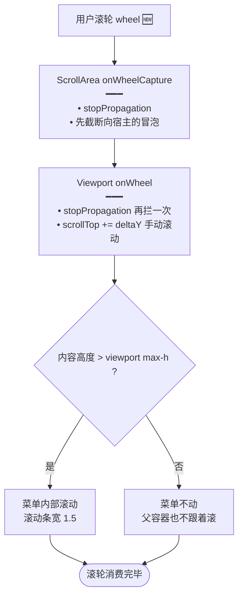

# 下拉菜单滚动区（DropdownMenuContent）

> 文档角色：`dnhyxc-ai-plugins` 中 shadcn 版下拉菜单容器的滚动方案改造归档，同时记录 `DropdownMenuItem` 高亮态与 destructive 配色的统一。

## 1. 为何改

改造前的 `DropdownMenuContent` 把滚动交给浏览器：内容根直接挂 `max-h-(--radix-dropdown-menu-content-available-height) overflow-y-auto`。带来三个问题：

1. **滚动条与站点视觉不一致**：原生滚动条宽度、圆角、颜色不受主题控制，与站内 `ScrollArea` 的细滚动条割裂。
2. **滚动穿透**：菜单贴在可滚动父容器（页面、抽屉、编辑器浮层）上时，菜单滚到底后继续滚轮会把滚动传给父级，导致背景页面跟着动。
3. **内边距写死**：`p-1` 由容器统一给，菜单项想自带分组间距或自定义 `max-h` 时无处可插，只能靠 `className` 覆盖，容易与默认值打架。

改造后统一为「**内容根不滚，内部套 `ScrollArea` 滚**」，并开放 `scrollable` / `viewportClassName` / `scrollClassName` 三个参数，让调用方按需开关或调高度。

| 关注点 | 改动前 | 改动后 |
| ------ | ------ | ------ |
| 滚动容器 | 浏览器原生 `overflow-y-auto` | 内部 `ScrollArea`（Radix ScrollArea） |
| 高度上限 | 内容根 `max-h-(...)` | 传给 `ScrollArea` 的 `max-h-(...)` |
| 滚动条 | 原生样式 | 主题化细滚动条（`w-1.5`） |
| 滚动穿透 | 无处理 | `onWheelCapture` + `onWheel` 双重 `stopPropagation` |
| 内边距 | 容器 `p-1` | 视口 `p-2 px-2.5`，容器 `p-0` |
| 自定义 | 仅 `className` | `scrollable` / `viewportClassName` / `scrollClassName` |

## 2. 改动范围

| 文件 | 符号 | 改动 |
| ---- | ---- | ---- |
| `src/components/ui/dropdown-menu.tsx` | `DropdownMenuContent` | 新增三个参数；内容根改 `overflow-hidden`；内部包 `ScrollArea`；接管滚轮事件 |
| `src/components/ui/dropdown-menu.tsx` | `DropdownMenuItem` | hover / focus / highlighted 三态统一为 `bg-theme/10`；destructive 文案色改 `teal-500` |

## 3. 实现思路

### 3.1 默认包 ScrollArea

- 参数 `scrollable` 默认 `true`：绝大多数菜单直接获得主题化滚动条与防穿透能力，调用方零改动。
- 内容根此时加 `p-0 overflow-hidden`，把内边距与滚动全部下放给 `ScrollArea`，避免「容器滚 + 视口再滚」的双层滚动。
- `scrollable={false}` 时保持旧行为（`max-h` + `p-1` + 原生滚动），给已经自管滚动或内容极短的菜单留退路。

### 3.2 三个参数的分工

| 参数 | 传给谁 | 用途 |
| ---- | ------ | ---- |
| `scrollable` | 分支开关 | `false` 时完全不挂 `ScrollArea`，直接渲染 children |
| `viewportClassName` | `ScrollArea.viewportClassName` | 高度上限；默认 `max-h-(--radix-dropdown-menu-content-available-height)`，显式给 `max-h-*` 才能滚 |
| `scrollClassName` | `ScrollArea.className` + 内容根 `p-0` 分支 | 调整滚动区外框（如固定宽度、圆角、额外内边距） |

`ScrollArea` 的 `ScrollAreaPrimitive.Root` 自带 `overflow-hidden`，`Viewport` 才是实际滚动层，因此高度上限必须落在 viewport 上——这正是 `viewportClassName` 的默认值来源。

### 3.3 阻止滚动穿透

- `onWheelCapture`：捕获阶段先 `stopPropagation()`，阻止滚轮事件继续向宿主（页面/抽屉）冒泡。
- `onWheel`：冒泡阶段再 `stopPropagation()`，并手动 `event.currentTarget.scrollTop += event.deltaY`。
- 之所以要手动加 `scrollTop`：捕获阶段已被 `stopPropagation`，若不在视口上补一次滚动，Radix 内部的默认处理可能收不到事件，出现「拦截了穿透但菜单自己不滚」。
- 副作用：菜单内若嵌套了横向滚动区或自定义滚轮交互，需要改用 `scrollable={false}` 自行处理，否则事件会被本层吞掉。

### 3.4 `overflow-hidden` 替代 `overflow-y-auto`

内容根只负责裁剪圆角与阴影边界（`rounded-md` + `overflow-hidden`），不再承担滚动；滚动职责单一化后，圆角不会被滚动条切出直角，菜单内容也不会「越出容器再被父级裁掉」。

### 3.5 DropdownMenuItem 高亮与配色

- 改动前只有 `focus:bg-theme/5`：鼠标 hover 与 Radix 键盘 `data-[highlighted]` 状态不一致，浅色背景下 5% 的底色几乎看不出。
- 改动后三种状态统一为 `bg-theme/10` 与 `text-textcolor`，鼠标移动、键盘上下、`focus` 视觉一致。
- destructive 项的文字色从 `text-destructive` 改为 `teal-500`，与站点强调色统一；图标仍保留 `text-destructive`（去掉原来的 `!` 强制），用于保留「危险操作」的语义色。

### 3.6 滚轮事件链路



**读图要点**：捕获与冒泡两处都 `stopPropagation`，保证滚轮不会漏到宿主；真正的位移由 `onWheel` 手动写入 `scrollTop`，所以即使事件被拦，也能滚到底。

## 4. 关键代码对比与注释

### 4.1 `DropdownMenuContent`

**对比范围**：`src/components/ui/dropdown-menu.tsx` 中 `function DropdownMenuContent(...)` 全函数。

**改动前** · `src/components/ui/dropdown-menu.tsx`（基线 HEAD，约 L32–L50）

```tsx
// 内容容器：直接透传 Radix Content 的 props
function DropdownMenuContent({
	// 调用方追加类名，用于覆盖默认宽度等
	className,
	// 与触发器的垂直偏移，默认 4px
	sideOffset = 4,
	// 其余 Radix Content 属性
	...props
	// 结束参数类型注解：直接复用 Radix Content 的 props 类型
}: React.ComponentProps<typeof DropdownMenuPrimitive.Content>) {
	// 经 Portal 渲染到 body，避免被父级 overflow 裁剪
	return (
		// Radix Portal 容器
		<DropdownMenuPrimitive.Portal>
			// Radix 内容根：负责定位、动画与键盘交互
			<DropdownMenuPrimitive.Content
				// shadcn 约定的定位标识
				data-slot="dropdown-menu-content"
				// 透传偏移量给 Radix 计算坐标
				sideOffset={sideOffset}
				// 合并默认样式与调用方类名
				className={cn(
					// 改动前默认类：max-h 限制高度，overflow-y-auto 由浏览器负责滚动
					'bg-theme-background text-textcolor data-[state=open]:animate-in data-[state=closed]:animate-out data-[state=closed]:fade-out-0 data-[state=open]:fade-in-0 data-[state=closed]:zoom-out-95 data-[state=open]:zoom-in-95 data-[side=bottom]:slide-in-from-top-2 data-[side=left]:slide-in-from-right-2 data-[side=right]:slide-in-from-left-2 data-[side=top]:slide-in-from-bottom-2 z-50 max-h-(--radix-dropdown-menu-content-available-height) min-w-32 origin-(--radix-dropdown-menu-content-transform-origin) overflow-x-hidden overflow-y-auto rounded-md border border-theme/5 p-1 shadow-md',
					// 调用方类名最后合并，可覆盖默认值
					className,
				)}
				// 透传剩余属性（事件、aria 等）
				{...props}
			/>
		</DropdownMenuPrimitive.Portal>
	);
}
```

**改动后** · `src/components/ui/dropdown-menu.tsx`（当前源码，约 L33–L86）

```tsx
// 内容容器：新增滚动开关与 ScrollArea 相关类名参数
function DropdownMenuContent({
	// 调用方追加类名
	className,
	// 与触发器的垂直偏移，默认 4px
	sideOffset = 4,
	// 显式接收 children，滚动分支需要把它塞进 ScrollArea
	children,
	// 是否启用内置滚动区；默认 true，已自管滚动的菜单传 false
	scrollable = true,
	// 视口高度上限：默认沿用 Radix 提供的可用高度变量，显式 max-h 才能滚
	viewportClassName = 'max-h-(--radix-dropdown-menu-content-available-height)',
	// 滚动区外框类名，同时作用于 ScrollArea root 与内容根的 p-0 分支
	scrollClassName,
	// 其余 Radix Content 属性
	...props
	// 结束参数类型：Radix Content props 与新增三个滚动参数取交叉类型
}: React.ComponentProps<typeof DropdownMenuPrimitive.Content> & {
	// 类型声明：滚动开关
	scrollable?: boolean;
	// 类型声明：滚动区外框类名
	scrollClassName?: string;
	// 类型声明：视口高度/内边距类名
	viewportClassName?: string;
}) {
	// 经 Portal 渲染到 body
	return (
		// Radix Portal 容器
		<DropdownMenuPrimitive.Portal>
			// Radix 内容根：改为只裁剪不滚动
			<DropdownMenuPrimitive.Content
				// shadcn 约定的定位标识
				data-slot="dropdown-menu-content"
				// 透传偏移量
				sideOffset={sideOffset}
				// 合并默认样式、滚动分支样式与调用方类名
				className={cn(
					// 默认类：去掉 max-h 与 overflow-y-auto，改用 overflow-hidden 裁圆角与阴影
					'bg-theme-background text-textcolor data-[state=open]:animate-in data-[state=closed]:animate-out data-[state=closed]:fade-out-0 data-[state=open]:fade-in-0 data-[state=closed]:zoom-out-95 data-[state=open]:zoom-in-95 data-[side=bottom]:slide-in-from-top-2 data-[side=left]:slide-in-from-right-2 data-[side=right]:slide-in-from-left-2 data-[side=top]:slide-in-from-bottom-2 z-50 min-w-32 origin-(--radix-dropdown-menu-content-transform-origin) overflow-hidden rounded-md border border-theme/5 shadow-md',
					// 启用滚动时容器去掉内边距，由 ScrollArea 视口接管
					scrollable
						// 只保留外框类名，p-0 避免与视口内边距叠加
						? cn('p-0', scrollClassName)
						// 关闭滚动时回退旧行为：max-h + p-1 + 原生滚动
						: cn('max-h-(--radix-dropdown-menu-content-available-height) p-1'),
					// 调用方类名最后合并
					className,
				)}
				// 透传剩余属性
				{...props}
			>
				// 滚动模式：内容统一包进 ScrollArea
				{scrollable ? (
					// ScrollArea 承担滚动与滚动条
					<ScrollArea
						// root 占满宽度并允许收缩，去掉默认边框避免与菜单边框叠加
						className={cn('w-full min-h-0 border-0', scrollClassName)}
						// 视口类名：内边距 + 高度上限，并用 ! 压过 Radix 内联的 display:table
						viewportClassName={cn(
							// 基础内边距与最小高度，保持与旧 p-1 视觉接近但不紧贴边缘
							'box-border p-2 px-2.5 [&>div]:min-h-0!',
							// 调用方传入的高度上限覆盖默认值，必须含 max-h-* 才能滚动
							viewportClassName,
						)}
						// 滚动条收窄并去掉左边框，贴合菜单细边风格
						scrollbarClassName="w-1.5 border-l-0 p-0"
						// 冒泡阶段拦滚轮并手动位移，保证菜单自身可滚
						onWheel={(event) => {
							// 阻止事件继续向宿主冒泡，避免背景页面跟着滚
							event.stopPropagation();
							// 手动把滚轮增量写进视口滚动位置
							event.currentTarget.scrollTop += event.deltaY;
						}}
						// 捕获阶段先拦一次，覆盖内层不可滚时的穿透场景
						onWheelCapture={(event) => {
							// 阻止滚轮事件向外层传播
							event.stopPropagation();
						}}
					>
						// 菜单项由调用方传入，原样落在视口内
						{children}
					</ScrollArea>
				) : (
					// 关闭滚动时直接渲染 children，保持旧结构与旧样式
					children
				)}
			</DropdownMenuPrimitive.Content>
		</DropdownMenuPrimitive.Portal>
	);
}
```

**变更摘要**：新增 `children` / `scrollable` / `viewportClassName` / `scrollClassName`；内容根由 `max-h + overflow-y-auto + p-1` 改为 `overflow-hidden + p-0`（或 `scrollable=false` 时回退旧类）；children 默认包进带滚轮拦截的 `ScrollArea`。

### 4.2 `DropdownMenuItem`

**对比范围**：`src/components/ui/dropdown-menu.tsx` 中 `function DropdownMenuItem(...)` 全函数。

**改动前** · `src/components/ui/dropdown-menu.tsx`（基线 HEAD，约 L60–L81）

```tsx
// 菜单项：支持 inset 缩进与 destructive 变体
function DropdownMenuItem({
	// 调用方追加类名
	className,
	// 是否左侧缩进，用于带图标的对齐
	inset,
	// 变体：默认 / 危险操作
	variant = 'default',
	// 其余 Radix Item 属性
	...props
	// 结束参数类型注解：复用 Radix Item 的 props 并扩展两个自有字段
}: React.ComponentProps<typeof DropdownMenuPrimitive.Item> & {
	// 类型声明：缩进
	inset?: boolean;
	// 类型声明：变体枚举
	variant?: 'default' | 'destructive';
}) {
	// 渲染 Radix Item
	return (
		// Radix 菜单项：负责焦点与选中事件
		<DropdownMenuPrimitive.Item
			// shadcn 约定的定位标识
			data-slot="dropdown-menu-item"
			// 把缩进透传给样式
			data-inset={inset}
			// 把变体透传给样式
			data-variant={variant}
			// 合并默认样式与调用方类名
			className={cn(
				// 改动前默认类：仅 focus 态 5% 底色，destructive 用 text-destructive 与 svg 强制色
				"cursor-pointer focus:bg-theme/5 focus:text-textcolor data-[variant=destructive]:text-destructive data-[variant=destructive]:focus:bg-destructive/10 dark:data-[variant=destructive]:focus:bg-destructive/20 data-[variant=destructive]:focus:text-destructive data-[variant=destructive]:*:[svg]:text-destructive! [&_svg:not([class*='text-'])]:text-muted-foreground relative flex items-center gap-2 rounded-sm px-2 py-1.5 text-sm outline-hidden select-none data-disabled:pointer-events-none data-disabled:opacity-50 data-inset:pl-8 [&_svg]:pointer-events-none [&_svg]:shrink-0 [&_svg:not([class*='size-'])]:size-4",
				// 调用方类名最后合并，可覆盖高亮底色
				className,
			)}
			// 透传剩余属性（onSelect 等）
			{...props}
		/>
	);
}
```

**改动后** · `src/components/ui/dropdown-menu.tsx`（当前源码，约 L96–L117）

```tsx
// 菜单项：高亮三态统一，destructive 改为站点强调色
function DropdownMenuItem({
	// 调用方追加类名
	className,
	// 是否左侧缩进
	inset,
	// 变体：默认 / 危险操作
	variant = 'default',
	// 其余 Radix Item 属性
	...props
	// 结束参数类型注解：复用 Radix Item 的 props 并扩展两个自有字段
}: React.ComponentProps<typeof DropdownMenuPrimitive.Item> & {
	// 类型声明：缩进
	inset?: boolean;
	// 类型声明：变体枚举
	variant?: 'default' | 'destructive';
}) {
	// 渲染 Radix Item
	return (
		// Radix 菜单项：负责焦点与选中事件
		<DropdownMenuPrimitive.Item
			// shadcn 约定的定位标识
			data-slot="dropdown-menu-item"
			// 把缩进透传给样式
			data-inset={inset}
			// 把变体透传给样式
			data-variant={variant}
			// 合并默认样式与调用方类名
			className={cn(
				// 改动后默认类：hover / focus / highlighted 统一 10% 底色，destructive 文案改 teal-500
				"cursor-pointer hover:bg-theme/10 focus:bg-theme/10 data-[highlighted]:bg-theme/10 hover:text-textcolor focus:text-textcolor data-[highlighted]:text-textcolor data-[variant=destructive]:text-teal-500 data-[variant=destructive]:focus:bg-destructive/10 dark:data-[variant=destructive]:focus:bg-destructive/20 data-[variant=destructive]:focus:text-teal-500 data-[variant=destructive]:*:[svg]:text-destructive [&_svg:not([class*='text-'])]:text-muted-foreground relative flex items-center gap-2 rounded-sm px-2 py-1.5 text-sm outline-hidden select-none data-disabled:pointer-events-none data-disabled:opacity-50 data-inset:pl-8 [&_svg]:pointer-events-none [&_svg]:shrink-0 [&_svg:not([class*='size-'])]:size-4",
				// 调用方类名最后合并，仍可覆盖底色
				className,
			)}
			// 透传剩余属性（onSelect 等）
			{...props}
		/>
	);
}
```

**变更摘要**：`hover` / `focus` / `data-[highlighted]` 三态统一为 `bg-theme/10` 与 `text-textcolor`；destructive 的文字色 `text-destructive → text-teal-500`，图标色去掉 `!` 强制；其余布局、尺寸、禁用态不变。

## 5. 兼容性与回归建议

- **默认行为变化**：所有使用 `DropdownMenuContent` 的菜单会自动变成「内部 ScrollArea + 细滚动条」。视觉上内边距由 `p-1` 变为视口 `p-2 px-2.5`，若某处依赖紧贴边缘的绝对定位装饰，需要复查。
- **事件副作用**：`onWheelCapture` 会吞掉滚轮事件，菜单内嵌的横向滚动/自定义滚轮组件需传 `scrollable={false}`。
- **高度依赖显式 `max-h`**：`viewportClassName` 默认值必须保留或替换成同类 `max-h-*`，否则内容不滚、直接溢出（内容根已是 `overflow-hidden`）。
- **destructive 配色**：由红改 teal 属于视觉语义调整，若某处希望保持红色危险提示，可在该菜单项用 `className` 覆盖文字色。

回归清单：

1. 顶部导航「更多」下拉（`src/layout/index.tsx`，`w-44`）——窄屏滚轮、滚到底不带动页面；
2. 单词详解面板的版本切换菜单（`src/views/vocab-detail/panel.tsx`，`side="top"`）——版本项 hover / 键盘高亮一致，长列表可滚；
3. 富文本工具栏的标题级别菜单（`src/components/design/RichEditor/toolbar/Toolbar.tsx`）——`onCloseAutoFocus` 与分组标签不受影响；
4. 任意嵌套在可滚动抽屉/页面中的菜单——滚轮不穿透；
5. `scrollable={false}` 的调用方（如后续新增）——仍是旧的原生滚动表现。

## 6. 相关源码路径

| 说明 | 路径 |
| ---- | ---- |
| 下拉菜单容器与菜单项 | `src/components/ui/dropdown-menu.tsx` |
| 滚动区组件（props 语义） | `src/components/ui/scroll-area.tsx` |
| 顶部导航「更多」菜单 | `src/layout/index.tsx` |
| 单词详解版本切换菜单 | `src/views/vocab-detail/panel.tsx` |
| 富文本标题级别菜单 | `src/components/design/RichEditor/toolbar/Toolbar.tsx` |

---

（若与仓库最新源码不一致，以源码为准）
