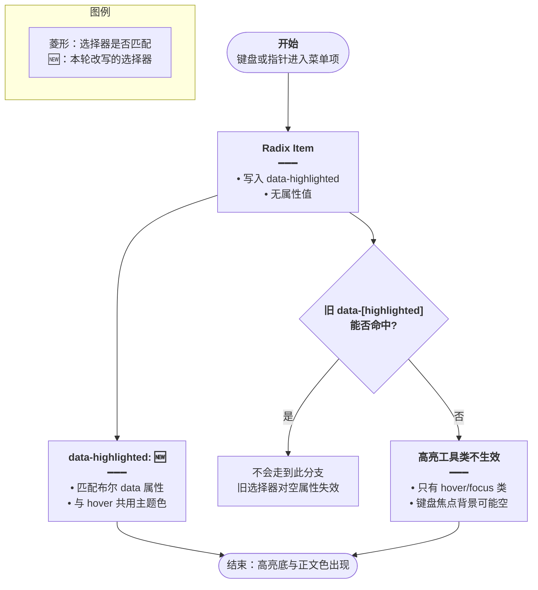

# 下拉菜单键盘高亮选择器

> **状态**：已落地 | **日期**：2026-11-14 | **功能域**：通用 UI
> **需求摘要**：插件仓 `DropdownMenuItem` 把 Radix 高亮态的 Tailwind 选择器从任意属性写法改成布尔 data 属性写法，键盘/指针高亮背景与正文色才能真正套上主题色。
> **文档角色**：本轮 Remote 仓未提交 diff 中唯一独立于 `modules.point` 的样式修复；统一桥接见 [统一 point 模块桥](../plugins/统一point模块桥.md)。

## 延伸阅读

- 插件独立预览顶栏「更多」也用这份下拉：[独立预览打磨](./独立预览打磨.md)
- 主站下拉滚动区内边距：[UI色调打磨](./UI色调打磨.md)

---

## 1. 背景与目标

独立预览顶栏溢出导航用 Radix Dropdown Menu。条目键盘或指针滑过时，Radix 会在根节点写 **`data-highlighted`**（无值布尔属性）。旧 class 写成 `data-[highlighted]:bg-theme/10`，这是 Tailwind 的「任意 data 属性名」语法，对应的是 `data-highlighted="highlighted"` 这类带值匹配，和 Radix 实际写出的空属性对不上。结果是 hover 手写类生效、键盘高亮态背景和文字色经常不出现。

目标：只改这一条选择器，让高亮态与 `hover:` / `focus:` 使用同一套 `bg-theme/10` 与 `text-textcolor`。

无跨模块数据流，略架构图；下面用一张小流程图标出选择器分叉。



**读图要点**：本轮不改 Radix 行为，只改 Tailwind 如何认 `data-highlighted`。`data-[variant=destructive]` 仍用带值任意属性语法，因为 variant 真的有属性值。

---

## 2. 改动范围

- `src/components/ui/dropdown-menu.tsx`（插件仓 `dnhyxc-ai-plugins`）：`DropdownMenuItem` 的 `className` 两处 `data-[highlighted]` → `data-highlighted`

其它菜单项（Checkbox / Radio）本轮未改。

---

## 3. 实现思路

- Tailwind v4 里，`data-highlighted:` 对应存在该布尔属性；`data-[highlighted]:` 更接近「属性值等于 highlighted」。Radix 用前者。
- 保留 `hover:` 与 `focus:` 兜底，触控和鼠标仍可用。
- 破坏性 variant 仍走 `data-[variant=destructive]`，因为 `data-variant="destructive"` 有值。

---

## 4. 关键代码对比

### 4.1 `DropdownMenuItem`

**对比范围**：完整 `function DropdownMenuItem`（声明到闭合）。唯一语义 diff 是 class 字符串里两处高亮选择器。

**改动前** · `src/components/ui/dropdown-menu.tsx`（基线，约 L96–L117）

```tsx
// 菜单项函数：承接 Radix Item 的原生 props，并叠加 inset / variant
function DropdownMenuItem({
	// 调用方可再拼一层 class，必须放进 cn 末参以免盖不住主题高亮
	className,
	// 子级缩进标记，转成 data-inset 给后面的 pl-8 用
	inset,
	// 默认普通项；destructive 走另一套强调色，不能和高亮态抢选择器
	variant = 'default',
	// 其余 Radix 事件与无障碍属性原样下传，避免包一层丢掉键盘行为
	...props
}: React.ComponentProps<typeof DropdownMenuPrimitive.Item> & {
	// 可选缩进，给分组里的二级项用
	inset?: boolean;
	// 只开放两种外观，禁止调用方再发明第三种 data-variant
	variant?: 'default' | 'destructive';
}) {
	return (
		<DropdownMenuPrimitive.Item
			data-slot="dropdown-menu-item"
			data-inset={inset}
			data-variant={variant}
			className={cn(
				// 旧选择器 data-[highlighted] 对 Radix 空属性匹配不上，键盘高亮常无背景
				"cursor-pointer hover:bg-theme/10 focus:bg-theme/10 data-[highlighted]:bg-theme/10 hover:text-textcolor focus:text-textcolor data-[highlighted]:text-textcolor data-[variant=destructive]:text-teal-500 data-[variant=destructive]:focus:bg-destructive/10 dark:data-[variant=destructive]:focus:bg-destructive/20 data-[variant=destructive]:focus:text-teal-500 data-[variant=destructive]:*:[svg]:text-destructive [&_svg:not([class*='text-'])]:text-muted-foreground relative flex items-center gap-2 rounded-sm px-2 py-1.5 text-sm outline-hidden select-none data-disabled:pointer-events-none data-disabled:opacity-50 data-inset:pl-8 [&_svg]:pointer-events-none [&_svg]:shrink-0 [&_svg:not([class*='size-'])]:size-4",
				className,
			)}
			{...props}
		/>
	);
}
```

**改动后** · `src/components/ui/dropdown-menu.tsx`（当前，约 L96–L117）

```tsx
// 菜单项函数：承接 Radix Item 的原生 props，并叠加 inset / variant
function DropdownMenuItem({
	// 调用方可再拼一层 class，必须放进 cn 末参以免盖不住主题高亮
	className,
	// 子级缩进标记，转成 data-inset 给后面的 pl-8 用
	inset,
	// 默认普通项；destructive 走另一套强调色，不能和高亮态抢选择器
	variant = 'default',
	// 其余 Radix 事件与无障碍属性原样下传，避免包一层丢掉键盘行为
	...props
}: React.ComponentProps<typeof DropdownMenuPrimitive.Item> & {
	// 可选缩进，给分组里的二级项用
	inset?: boolean;
	// 只开放两种外观，禁止调用方再发明第三种 data-variant
	variant?: 'default' | 'destructive';
}) {
	return (
		<DropdownMenuPrimitive.Item
			data-slot="dropdown-menu-item"
			data-inset={inset}
			data-variant={variant}
			className={cn(
				// 改用 data-highlighted: 匹配布尔属性，使键盘高亮与 hover 共用主题底与正文色
				"cursor-pointer hover:bg-theme/10 focus:bg-theme/10 data-highlighted:bg-theme/10 hover:text-textcolor focus:text-textcolor data-highlighted:text-textcolor data-[variant=destructive]:text-teal-500 data-[variant=destructive]:focus:bg-destructive/10 dark:data-[variant=destructive]:focus:bg-destructive/20 data-[variant=destructive]:focus:text-teal-500 data-[variant=destructive]:*:[svg]:text-destructive [&_svg:not([class*='text-'])]:text-muted-foreground relative flex items-center gap-2 rounded-sm px-2 py-1.5 text-sm outline-hidden select-none data-disabled:pointer-events-none data-disabled:opacity-50 data-inset:pl-8 [&_svg]:pointer-events-none [&_svg]:shrink-0 [&_svg:not([class*='size-'])]:size-4",
				className,
			)}
			{...props}
		/>
	);
}
```

**变更摘要**：背景与文字色两处高亮选择器改为 `data-highlighted:`，对齐 Radix 空属性；`data-[variant=destructive]` 未动。

---

## 5. 行为变化与兼容性

- 键盘上下移动菜单项时，当前项应出现与 hover 相同的浅主题底和正文色。
- 鼠标 hover / focus 行为不变。
- 破坏性项的红色强调不变。
- 主站若仍使用 `data-[highlighted]`，不受本插件仓文件影响。

---

## 6. 测试与回归建议

1. 打开插件独立预览，点顶栏「更多」，用键盘上下移动：当前项背景为 `theme/10`。
2. 鼠标划过同一项，视觉应与键盘高亮一致。
3. 若有 destructive 项，其文字色仍为 teal 强调，不要被高亮选择器盖成普通正文色。

---

## 7. 相关文档与代码索引

| 说明 | 路径 |
| ---- | ---- |
| 本轮改动文件 | `dnhyxc-ai-plugins/src/components/ui/dropdown-menu.tsx` |
| 统一 point 桥（同轮另一功能） | [统一 point 模块桥](../plugins/统一point模块桥.md) |

---

（若与仓库最新源码不一致，以源码为准）
